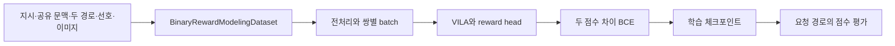

# 01. 쌍별 보상 학습에서 점수 응답까지

분석일 **2026-11-15**, 커밋 `411ad9dd7baaa6f66d31e416cd100214447bd5f3`. [용어집](chapter-00-glossary.md). 보상 모델은 경로의 목표 일치도를 숫자로 평가하며 실제 환경의 보상과 같지 않다. VILA는 시각·언어 모델, LoRA는 작은 추가 가중치를 학습하는 방식이다.

## 학습 입력과 호출 흐름

[finetune_lora_rm.train](../../../code/reference-implementations/armap/RM/finetune_lora_rm.py:256)은 모델 구성·데이터 모듈→RewardModelTrainer 학습으로 이어진다. [ScienceWorld 설정](../../../code/reference-implementations/armap/RM/scripts/train_reward_sciworld.sh:19)은 preference/factual/image 자료, 동일 train/eval 파일, eval_size=500, seed42, LoRA·길이 설정을 전달한다. 이 파일들을 다운로드하거나 학습한 것은 아니다.

| 경계 | 실제 코드·입출력 |
|---|---|
| 선호 라벨 | [preprocess_for_reward_modeling](../../../code/reference-implementations/armap/RM/data_utils/data_utils_rm.py:41)는 conversations, output_1/2, preference, id를 읽는다. preference 1/2는 choice 0/1로 매핑 |
| 분할 | [make_binary_reward_modeling_data_module](../../../code/reference-implementations/armap/RM/data_utils/data_utils_rm.py:447)는 같은 데이터 경로/이름이면 seed를 고정한 행 단위 random_split. 별도 train/eval 파일 조합은 해당 분기에서 미구현 |
| 표현·점수 | [RewardModel.forward](../../../code/reference-implementations/armap/RM/models/reward_model.py:184)는 언어 모델 출력 끝 위치의 은닉 상태를 선형 head에 통과시켜 scalar 반환 |
| 목적 함수 | [compute_loss](../../../code/reference-implementations/armap/RM/models/reward_model.py:281)는 경로 두 개 점수 차이의 BCE와 작은 점수 중심화 항을 학습 |

쌍별 선호 라벨이 있다는 것과 점수가 목표 성공 확률로 보정됐다는 것은 다르다. 행 단위 분할만으로 동일 원과업·변형 경로가 train/eval에 섞이지 않는다고 보장할 수 없다. 반대로 외부 benchmark 누출이 있다고 단정하지도 않는다. 원자료 계보·그룹별 중복 검사가 미확인이다.

## 점수 요청의 자료·저장·반환

[server_lora_rm.get_prediction](../../../code/reference-implementations/armap/RM/server_lora_rm.py:482)은 multipart의 preference_data·factual_data·prompt·이미지를 읽고 요청 순서로 ID를 다시 부여한다. 추론 때 두 출력 입력을 동일한 경로로 만들어 기존 쌍별 데이터 전처리/평가 경로를 사용한다. “두 후보 중 더 좋은 경로를 즉시 반환하는 서비스”가 아니라 경로별 점수 목록을 반환한다.

[get_rewards](../../../code/reference-implementations/armap/RM/server_lora_rm.py:426)는 임시 디렉터리에 자료·지시·이미지를 저장하고 전역 data_args를 갱신한다. 데이터 모듈을 갈아 끼운 trainer.evaluate가 [callback](../../../code/reference-implementations/armap/RM/server_lora_rm.py:374)으로 전역 result_dict를 채운 뒤 점수를 모아 반환한다. 정상 경로 끝에서 임시 자료를 지운다. 예외 시 정리·요청 간 격리의 보장은 이 코드만으로 확인되지 않는다.

응답은 새 ID 순서의 JSON 숫자 배열이다. 요청은 원본 candidate_id를 따로 보존해야 하며 ID 재매핑으로 순서가 바뀌지 않았는지 확인해야 한다. 서버는 전역 데이터/트레이너를 공유하므로 동시 처리의 정확성은 실제 동작 확인이 필요하다. 이 분석에서는 서비스를 실행하지 않았다.

## 실패와 후속 검증 경계

필수 필드·이미지·JSON·점수 개수·유한값을 포함한 명시적 응답 스키마 검사가 완결돼 있지 않다. 클라이언트의 HTTP 실패 처리와 예측 점수 누락을 별도 기록해야 한다. 전처리의 이미지/텍스트와 프롬프트 템플릿도 학습·추론에서 일치시켜야 한다.

검증 예정 항목은 양성/음성 방향, 원과업별 분할, 길이 잘림·이미지 누락, 체크포인트/head 로드, 요청 ID/점수 일치, 평가 예외 후 상태·임시 자료 정리다. 현재는 정적 분석이며 테스트 통과·모델 성능을 주장하지 않는다. 학습용 원문 지시는 [multi_frame_prompt.txt](../../../code/reference-implementations/armap/RM/prompts/multi_frame_prompt.txt) 그대로 보존하고 논문 부록과 구분한다.
