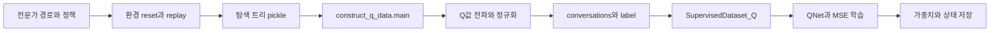

# 01. 탐색 기록에서 QNet 학습까지

분석일 **2026-11-15**, 커밋 `6f2cdf49f7f030c6604e9678d9db8ac4abe00fee`. [용어집](chapter-00-glossary.md). QNet은 행동의 장기 보상을 예측하는 모델, SFT는 예시를 따라 가중치를 학습하는 방식이다. 이 장은 데이터·목적 함수·저장 경계를 설명하며 학습 성공을 보고하지 않는다.

## 역할과 호출 흐름

탐색은 [explore_sft_agent.py](../../../code/reference-implementations/qlass/qlass/explore_sft_agent.py:145)의 `main`에서 전문가 경로를 찾아 실행하고 트리를 확장한다. 과업별 환경을 초기화하고 이전 행동을 replay하여 노드 상태를 만든다. 전문가 자료는 단순 평가 정답과 구분해야 한다. [관련 경로](../../../code/reference-implementations/qlass/qlass/explore_sft_agent.py:212).

## 데이터 입력·변환·출력

| 단계 | 코드 | 입력→출력·상태 변화 |
|---|---|---|
| 수집 결합 | [combine_jsonl / combine_pkl](../../../code/reference-implementations/qlass/qlass/construct_q_data.py:13) | 여러 slice의 JSON 배열·pickle 트리→결합 배열/트리. 확장자가 jsonl이어도 실제 json.load/dump 배열 |
| vanilla 라벨 | [collect_vanilla_q_data_from_trees_unpruned](../../../code/reference-implementations/qlass/qlass/construct_q_data.py:181) | 내부 노드 보상을 0으로 만들고 말단 보상을 남김→Q값 전파 |
| Q값 재귀 | [TreeNode.update_q_values](../../../code/reference-implementations/qlass/qlass/explore_sft_agent.py:44) | 말단은 실제 보상, 부모는 현재 보상+0.9×자식 최대 Q값 |
| 표본 구성 | [collect_q_data_from_a_tree](../../../code/reference-implementations/qlass/qlass/construct_q_data.py:92) | root를 제외한 상태 대화+행동→conversations, label |
| 크기·척도 | [수집 후처리](../../../code/reference-implementations/qlass/qlass/construct_q_data.py:204) | 트리당 최대 300개를 표본화하고 해당 트리 라벨을 min-max 정규화. 상수 범위는 0 |
| 학습 데이터 | [make_supervised_data_module](../../../code/reference-implementations/qlass/qlass/train_q.py:120) | data_path JSON→GPU 입력/attention_mask/label. eval_data_path는 선택사항 |
| 목적 함수 | [Q_Trainer.compute_loss](../../../code/reference-implementations/qlass/qlass/q_trainer.py:3435) | QNet 출력과 label의 MSE. 텍스트 다음 토큰 CE와 다름 |

vanilla, pseudo_depth, reward는 [main의 분기](../../../code/reference-implementations/qlass/qlass/construct_q_data.py:234)로 선택한다. pseudo_depth는 인위적인 잔여 깊이 보상 누적이 있으며 vanilla와 동일 라벨로 부르지 않는다. 학습 경로가 같은 과업에서 나왔는지와 별도 시험 분할은 파일 이름만으로 확인되지 않는다.

[QNet.forward](../../../code/reference-implementations/qlass/qlass/q_network.py:56)는 언어 모델 마지막 은닉 상태를 MLP에 통과시키고 padding 위치를 고려해 값을 고른다. MLP는 숫자를 예측하는 작은 다층 신경망이다. 선택적으로 sigmoid를 적용한다. 기본 모델을 동결하는 코드는 주석이므로 주석만 보고 “평가 head만 학습”으로 설명하면 안 된다.

## 저장과 재현 경계

[train_q.py](../../../code/reference-implementations/qlass/qlass/train_q.py:174)는 QNet→데이터 모듈→Q_Trainer→기존 checkpoint 유무에 따라 resume/new train→저장 흐름이다. [QNet.save_pretrained](../../../code/reference-implementations/qlass/qlass/q_network.py:88)는 전달된 상태를 pytorch_model.bin에 저장한다. tokenizer·config와 평가 시 로더의 입력이 일치하는지는 별도 확인이 필요하다.

현재 공개 스크립트의 연결에는 다음 미해결 사항이 있다. 이를 수정하거나 실행하지 않았고 논문의 성능을 반증하는 결과로 취급하지 않는다.

- [collect_q.sh](../../../code/reference-implementations/qlass/qlass/scripts/collect_q.sh)는 기본 vanilla를 쓰지만 [construct_q_data.py](../../../code/reference-implementations/qlass/qlass/construct_q_data.py:245)는 vanilla.jsonl로 출력한다. [train_qnet_7b.sh](../../../code/reference-implementations/qlass/qlass/scripts/train_qnet_7b.sh:15)는 다른 q_data.jsonl 경로를 입력으로 사용한다.
- [vanilla 수집](../../../code/reference-implementations/qlass/qlass/construct_q_data.py:193)은 결합된 트리 묶음 중 마지막 묶음을 건너뛴다. 그 묶음이 어떤 slice인지와 데이터 누락 영향은 미확인이다. 입력 디렉터리를 재사용하면 기존 combined 파일이 재결합될 가능성도 있다.
- train_qnet 스크립트는 sft_model_name을 내부에서 정의하지 않은 채 사용한다. 외부 환경에서 주입됐는지 확인하지 않았다.
- 위 문제와 학습/평가 분할·정규화는 체크포인트 재현에 영향을 주므로 자료 해시·slice 순서·변형·라벨 통계를 별도 명세해야 한다.

관련 동작 검증은 미실시다. 후속 검증 항목은 slice별 입력/출력 ID와 행 수, 동일 과업의 split 중복, vanilla/pseudo_depth/reward 라벨 차이, 저장·로드 일치다. 논문 재현을 현재 소형 모델에 점수만 요청하는 자체 변형으로 대체하지 않는다.
