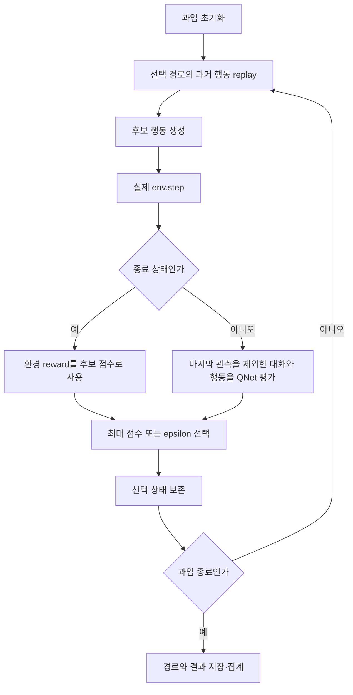

# 02. 후보 실행·선택·집계와 재현 경계

분석일 **2026-11-15**, 고정 커밋 `6f2cdf49f7f030c6604e9678d9db8ac4abe00fee`. [용어집](../01-core/chapter-00-glossary.md), [학습 단계](../01-core/chapter-01-learning.md). best_of_N은 한 단계의 후보 수, n_trajs는 과업당 경로 수다. 둘을 한 번의 생성이나 같은 예산으로 해석하지 않는다.

## 진입 설정과 논문 조건

[안내된 ALFWorld 스크립트](../../../code/reference-implementations/qlass/qlass/scripts/eval_q_wo_perturb_7b_alfworld.sh:29)는 BON=2, n_trajs=3, dev, ICL=1, perturb 비활성이다. CLI 기본 best_of_N은 [3](../../../code/reference-implementations/qlass/qlass/q_guided_inference.py:568)이며 원문 주요 표의 N=6과 모두 다르다. [모델 설정](../../../code/reference-implementations/qlass/qlass/configs/model/sglang.json:1)의 온도는 0.7이다. README의 실행 예시를 논문 표 재현 명령으로 단정하지 않는다.

[AlfWorldTask.load_tasks](../../../code/reference-implementations/qlass/qlass/tasks/alfworld.py:43)는 train/dev/test를 각각 train/eval_in_distribution/eval_out_of_distribution으로 매핑한다. dev 140·test 134개이며 slice별 task_id가 로컬 인덱스이므로 실행 전체 식별자에는 split·slice·game_file도 필요하다.

## 실제 관측을 포함하는 후보 비교

[main 후보 루프](../../../code/reference-implementations/qlass/qlass/q_guided_inference.py:320)는 매 후보마다 env.reset 후 기존 선택 행동을 replay하고 history 일치를 assert한다. 그 뒤 새 행동을 실제 실행한다. 따라서 논리적으로 학습된 Q값을 쓰더라도 후보 분기 생성은 환경 복제/재실행을 전제로 한다. 단순 정적 답안 목록의 점수 비교와 다르다.

[evaluate_trajs_qnet_v2](../../../code/reference-implementations/qlass/qlass/q_guided_inference.py:89)는 새 상태 대화에서 마지막 관측을 제외해 전처리한 뒤 QNet을 호출한다. 반면 [종료 후보](../../../code/reference-implementations/qlass/qlass/q_guided_inference.py:361)는 실제 new_state.reward를 바로 점수로 쓴다. **예측 Q값과 종료 피드백을 함께 사용하는 경로**다. 우리 비교에서는 점수 출처·피드백 접근을 명시하고, 미래 성과에 접근하지 않는 순수 선택과 분리해야 한다. 모든 원문 결과가 누출됐다고 결론내리는 근거는 아니다.

bon 모드는 Python max, epsilon_greedy는 확률적으로 무작위 선택이다. 동률은 후보 순서에 따라 첫 최대가 선택된다. 선택 뒤 다음 턴에서 reset/replay로 분기를 재구성한다. ALFWorld [환경 step](../../../code/reference-implementations/qlass/qlass/envs/alfworld_env.py:82)은 파싱/실행 예외를 관측 오류로 바꾸고 steps를 늘리며 최대 횟수에 종료한다. success·finished·실제 reward가 모두 같은 의미인지는 평가에서 분리해야 한다.

## 호출 실패·사용량·저장

[SGLangAgent.__call__](../../../code/reference-implementations/qlass/qlass/agents/sglang_agent.py:29)은 스트리밍 응답을 파싱하고 예외 시 최대 3회·5초 간격으로 재시도한 후 빈 문자열을 반환한다. 이 경로에는 명시적 timeout·raise_for_status·완전한 사용량 기록이 없다. HTTP 실패와 빈 모델 답을 별도 저장하는 우리의 계약과 차이가 있다.

[main 저장](../../../code/reference-implementations/qlass/qlass/q_guided_inference.py:391)은 최종 경로·실제 보상·success와 중간 비종료 후보의 action/value 목록을 남긴다. 종료 후보의 점수·실패 후보·각 QNet 호출의 사용량이 모두 같은 구조로 저장되지는 않는다. 주기적으로 전체 JSON 배열과 pickle을 다시 쓰며, jsonl 확장자라고 한 행씩 append한다고 생각하면 안 된다.

[calc_results.py](../../../code/reference-implementations/qlass/qlass/calc_results.py:21)는 연속 3개를 같은 과업으로 간주한다. 첫 경로 성공, 세 경로 중 2개 이상 성공, 하나 이상 성공을 구분한다. `avg max` 이름의 값은 2개 이상 성공 지표이고 `bon` 집계는 실제 보상이 하나 이상 1인지 보는 진단값이다. 이것을 학습된 평가기가 고른 경로의 성공률로 혼합하지 않는다. ID별 그룹 검사·행 수 검증도 보완 대상이다.

## 게시 소스의 실행 동일성은 미확인

공개 [진입 import](../../../code/reference-implementations/qlass/qlass/q_guided_inference.py:21)는 model.q_network지만 고정 Git 트리에는 qlass/q_network.py만 있다. 별도 모듈/PYTHONPATH 전제는 미확인이다. 게시 [QNet.from_pretrained](../../../code/reference-implementations/qlass/qlass/q_network.py:129)는 model_args를 전달하지 않고 생성자를 호출하지만 생성자는 [model_args.apply_sigmoid](../../../code/reference-implementations/qlass/qlass/q_network.py:52)에 접근한다. 이 소스 조합에는 정적으로 확인되는 연결 결손이 있다. 실제 환경을 실행하거나 임의 수정하지 않았다.

따라서 현재 커밋을 그대로 실행해 논문 성능을 확인했다고 말할 수 없다. 방법은 성능 후보로 유지하고, 재현/자체 구현에서는 모듈·체크포인트·Q 라벨·피드백·예산 계약을 명시해야 한다. 후속 검증 항목은 replay 상태 일치, 종료/비종료 점수 출처, 후보·시도별 비용, 과업 ID별 집계, 저장·복원·모델 구성 일치다.
