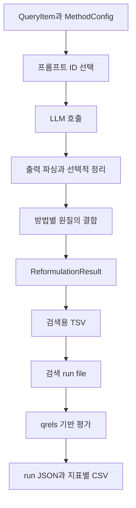

# 방법 변형과 평가 자료의 경계

조사일 **2026-11-15**. [커밋·범위](../README.md), [용어집](chapter-00-glossary.md). E01은 여러 재작성 방법을 같은 검색 조건에서 비교하는 연구다. 공개 도구는 그 비교를 위한 구현과 결과 자료를 제공하지만, 현재 기본값으로 실행하면 과거 표를 자동 재현한다는 뜻은 아니다.

## 입력에서 검색 질의까지

근거: [core/base.py](../../../code/reference-implementations/querygym/querygym/core/base.py), [core/runner.py](../../../code/reference-implementations/querygym/querygym/core/runner.py), [core/llm.py](../../../code/reference-implementations/querygym/querygym/core/llm.py), [core/prompts.py](../../../code/reference-implementations/querygym/querygym/core/prompts.py), [프롬프트 원문](../../../code/reference-implementations/querygym/querygym/prompt_bank.yaml).

`run_method`는 registry에서 방법 클래스를 고르고 `MethodConfig`·LLM client·PromptBank를 주입한다. `reformulate_batch`는 `QueryItem(qid,text)`마다 `reformulate`를 호출해 `ReformulationResult(qid,original,reformulated,metadata)`를 모은다. `PromptBank.render`는 ID와 변수를 사용해 system/user/assistant 메시지를 만든다. `OpenAICompatibleClient.chat`은 첫 응답 `content` 또는 빈 문자열을 반환한다. 이 wrapper에 자체 retry loop·usage 저장은 없다. `MethodConfig.retries` 필드 존재만으로 재시도 구현을 주장하지 않는다. SDK 내부 동작은 미분석이다.

| 구현 | 생성·기본값 | 최종 검색 문자열·주의점 |
|---|---|---|
| `GENQR.reformulate` | 같은 `genqr.keywords.v1`로 기본 5회·temperature .8·출력 최대 256 | `q + out1 + … + out5`. 이 함수는 공통 `concatenate_result`를 호출하지 않아 원질의 5회 기본 규칙이 적용되지 않음 |
| `GenQREnsemble.reformulate` | 기본 10개 지시 ID·temperature .92·각 256토큰 | 기본 `q` 5회 + 모든 키워드. 키워드 중복 제거 없음. `variant_ids`·반복 수는 설정 변경 가능 |
| `Query2E.reformulate` | 기본 zero-shot, 1회·temperature .3·256토큰·최대 20개 키워드 | 기본 `q` 5회 + 파싱한 키워드. few-shot은 예시를 별도 제공/선택 |

위 값은 **클래스 내부 기본값**이다. 라이브러리 `defaults.yaml`과 예제 `reformulation_config.yaml`이 다른 값을 제공할 수 있다. 예제 Query2E는 temperature 1·128토큰이다. 따라서 실행에 실제 적용된 설정을 기록한다.

예를 들어 q가 `solar storm`이면 GenQR은 원문 한 번 뒤에 생성문 5개를 붙이고, 앙상블은 원문 5번 뒤에 지시별 결과를 붙인다. **형식 설명용 예시**이며 검색 결과나 성능을 측정한 것은 아니다. 원질의 반복과 생성 횟수는 서로 다른 성능 조건이다.

GenQR·앙상블은 context를 소비하지 않는 선택 경로다. 따라서 원논문의 T5 학습형·GenPRF 전체와 같은 구현으로 취급하지 않는다. 앙상블 `parallel=True`에서는 완료 순서대로 키워드를 추가하므로 연결 순서가 실행마다 달라질 수 있다. BM25와 순서/길이에 민감한 신경 검색기의 영향을 같다고 가정하지 않는다. 모델 호출 예외는 이 두 방법에서 외부로 전파된다.

## Q2K 대응과 버전 변경

E01 §2.2.1은 Q2K를 단일 호출 keyword 확장이라고 설명한다. 공개 코드에는 `Query2E`가 같은 유형을 구현하며 [prompt bank](../../../code/reference-implementations/querygym/querygym/prompt_bank.yaml)의 `q2e.zs.v1`과 `q2e.fs.v1`을 사용한다. **해석:** 방법 유형상 대응 후보지만 E01의 각 Q2K 표 행이 특정 `query2e` run hash와 동일하다는 직접 연결은 이번 선택 범위에서 확정하지 못했다. 원논문 N29의 여덟 프롬프트 전체를 이 클래스 하나로 대체하지 않는다.

현재 `Query2E.VERSION=2.0`, `clean_output=True`가 기본이다. `_strip_framing`·`_extract_keywords`는 대화 문구·서식·think trace 등을 정리한다. `effective_params`는 정리 적용을 설정 hash에 기록한다. 오류와 빈 출력은 구분된다.

| 사건 | 상태와 반환 |
|---|---|
| 정상 출력 | 키워드 최대 개수 제한 후 원질의 반복과 결합 |
| 빈 출력·정리 후 빈 키워드 | 빈 키워드로 원질의만 반복해 결합 가능. 예외 fallback과 다름 |
| 잘못된 mode·LLM/파싱 예외 | 예외를 잡아 원질의 한 번 반환, metadata에 error·fallback=True |
| GenQR/앙상블 호출 오류 | 클래스에서 fallback하지 않아 batch가 중단될 수 있음 |

중요 근거는 [test_query2e_clean_output_params_hash](../../../code/reference-implementations/querygym/reproducibility/tests/test_repro_schema.py)의 assertion이다. 두 저장 run을 읽고 `clean_output=False`일 때 과거 hash와 같고 현재 기본값일 때 다르다고 검증하도록 작성되어 있다. [대표 저장 JSON](../../../code/reference-implementations/querygym/reproducibility/data/runs/bright-biology/query2e/openai/gpt-4.1/bm25/edce8c2a.json)은 `git_commit:null`이다. 따라서 현재 소스만으로 당시 구현·논문 표 일치를 보장할 수 없다. 이 BRIGHT 자료를 E01의 원래 9개 데이터셋 표라고 간주하지 않는다.

## 저장·평가·집계 경계

[reformulate_queries](../../../code/reference-implementations/querygym/examples/querygym_pyserini/reformulate_queries.py)는 재작성 batch를 마친 뒤 최종 검색용 TSV·원질의 TSV·설정/시간 metadata를 저장한다. 선택 경로에서는 질의별 중간 저장·재개가 없다. 검색기 초기화 실패는 경고 후 계속할 수 있어 context 필요 방법과 무문맥 방법의 실험 조건을 별도로 확인해야 한다. 이번에는 재작성 세 클래스와 평가 입출력만 읽었으며 전체 retrieve backend는 미분석이다.

[run_pyserini_eval](../../../code/reference-implementations/querygym/examples/querygym_pyserini/evaluate.py)은 qrels와 run file을 `pyserini.eval.trec_eval` subprocess에 전달한다. MAP/Recall 문자열이 있는 지표에는 relevance level 2를 지정한다. subprocess 실패는 전파한다. 주석에 `-c`를 per-query output으로 설명하지만 **확인된 사실은 인자 전달뿐**이다. 정확한 옵션 의미·질의 coverage·데이터셋별 판정 기준은 해당 evaluator 버전과 추가 대조해야 한다.

[aggregate_runs](../../../code/reference-implementations/querygym/reproducibility/scripts/aggregate_runs.py)는 run JSON을 schema/registry로 검증한 뒤 **지표 하나당 CSV 한 행**을 만든다. 이는 문서 순위 재평가나 논문 표 재계산이 아니다. `compute_params_hash`는 method/model/params/llm 설정만 포함하고 코드·prompt bank·코퍼스 해시는 포함하지 않는다. `compute_run_id`는 environment를 제외한다. 자체 명세에는 코드·프롬프트·입력·검색기 revision을 별도로 저장해야 한다.

## 테스트·미확인

[test_methods_genqr.py](../../../code/reference-implementations/querygym/tests/test_methods_genqr.py)는 가짜 응답으로 앙상블 결과에 원질의 반복 문자열이 포함되는지만 확인한다. [test_methods_query2e.py](../../../code/reference-implementations/querygym/tests/test_methods_query2e.py)는 정리 기본값/비활성화·미완성 think·빈 출력·effective_params를 다룬다. 실제 모델 성능 테스트가 아니며 이번에 실행하지 않았다. 관련 schema 테스트도 assertion을 읽은 상태다.

남은 작업은 E01 Q2K 표 행↔run ID 매핑, 실제 검색기·인덱스 버전·각 지표의 질의 분모, PRF/학습형 원논문 변형, 모든 run file의 형식/순위 대조다. 프롬프트 원문은 고정 소스에 보존하지만 논문 부록 전체 전사·시각 대조는 [기존 색인](../../../.codex/research/planning-decomposition-rewriting/papers/appendix_prompt_sources.md)의 미완료 상태를 유지한다.
