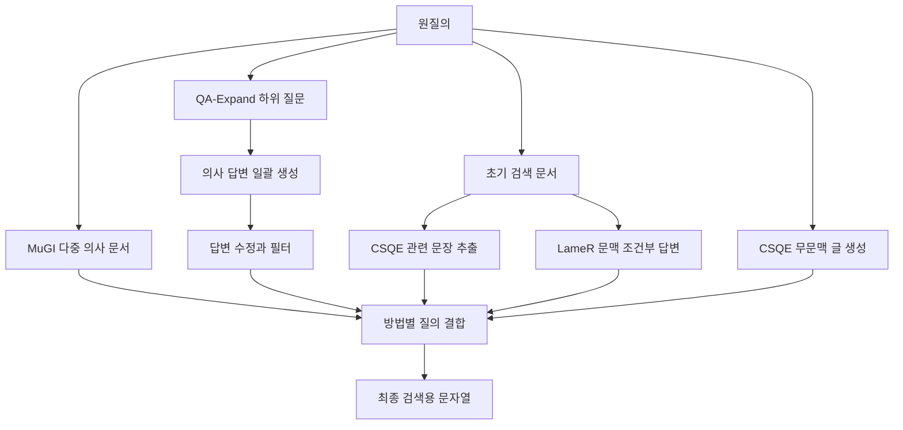

# 다중 생성·질문 분해·검색 문서 피드백

조사일 **2026-11-15**. [커밋·범위](../README.md), [용어집](chapter-00-glossary.md), [이전 장](chapter-01-variants-and-evaluation.md). 이번에는 MuGI·QA-Expand·CSQE·LameR의 선택 경로를 분석한다. **문자열을 만들어 반환하는 QueryGym 구현과 원논문의 벡터 결합·재순위화 전체를 구분한다.** 모델·검색·테스트 실행 없이 소스를 읽었다.

## 네 가지 생성 구조

의사 문서(pseudo-document)는 검색 표현을 풍부하게 하기 위해 모델이 만든 글이다. 실제 근거 문서가 아니다. 피드백에는 생성 답변을 자체 검토하는 방식과 검색된 문서를 사용하는 방식이 있으며, 이 코드의 QA-Expand는 전자, CSQE/LameR는 후자다. [공통 데이터 계약](chapter-01-variants-and-evaluation.md)의 `QueryItem → ReformulationResult`를 그대로 사용한다.

| 경로 | 호출·중간 결과 | 기본 검색 문자열 |
|---|---|---|
| [MuGI.reformulate](../../../code/reference-implementations/querygym/querygym/methods/mugi.py) | 질문 → 동일 지시로 의사 문서 5개. 선택적 병렬 생성 | 원질의 적응 반복 + 모든 의사 문서 |
| [QAExpand.reformulate](../../../code/reference-implementations/querygym/querygym/methods/qa_expand.py) | 하위 질문 생성 → 질문 JSON으로 답변 일괄 생성 → 원질의와 답변의 검토/수정. LLM 3호출 | 원질의 3회 + 정리한 답변 |
| [CSQE.reformulate](../../../code/reference-implementations/querygym/querygym/methods/csqe.py) | 검색 문맥 준비 → 무문맥 KEQE 2출력 → 문맥 기반 CSQE 2출력 → 인용문 추출 | 원질의 2회 + KEQE + 추출문, 전체 소문자화 |
| [LameR.reformulate](../../../code/reference-implementations/querygym/querygym/methods/lamer.py) | 상위 검색 문서 최대 10개를 같은 지시에 넣고 답변 글 5개 생성 | `q + a1 + q + a2 + … + q + a5` |

CSQE의 기본 요청은 두 번이지만 각 요청에 `n=2`를 전달하므로 생성 출력은 네 개다. QA-Expand는 질문이 세 개라고 답변 API를 세 번 호출하지 않고 일괄 생성한다. **HTTP 요청 수·출력 후보 수·생성 토큰을 따로 세어야 한다.**

## MuGI: 실제 결합과 metadata가 같은 기본값을 쓰는지 확인한다

`num_docs=5`, 출력 최대 1,024토큰·temperature 1이 내부 기본값이다. params 값이 llm 값보다 우선한다. 모드는 zero-shot/few-shot, 또는 직접 prompt ID로 고른다. 병렬이면 `as_completed` 순서대로 문서를 모으며 원래 생성 인덱스를 복원하지 않는다. 중복 문서 제거는 없다.

`reformulate`는 지역 변수 `adaptive_times`를 기본 **6**으로 계산하지만 최종 문자열은 [BaseReformulator.concatenate_result](../../../code/reference-implementations/querygym/querygym/core/base.py)에 맡긴다. base는 같은 설정이 없으면 **5**를 쓴다. 기본 params가 빈 dict라면 metadata의 반복 횟수와 실제 문자열 반복 횟수가 달라질 수 있다. `defaults.yaml`이 6을 명시해 전달하는 경로에서는 이 차이가 사라진다. **코드에서 도출한 조건이며 실행 재현한 결함 보고가 아니다.**

base 식은 `max(1, (len(generated_text)//len(q))//adaptive_times)`이며 Python 문자열의 문자 수를 사용한다. 원논문의 길이/β 규칙과 실제 토큰화·절단을 별도로 기록한다. 빈 질의는 metadata 계산 전 결합 함수에서 0 나눗셈에 도달할 수 있다. `adaptive_times=0`, 빈/음수 생성 수의 입력 검증과 독립 retry는 해당 클래스에 없다. 원논문 MuGI의 contextualized pooling(질의와 각 생성문의 벡터를 만든 뒤 결합)·보정/재순위화는 이 문자열 반환 클래스가 수행하지 않는다.

## QA-Expand: 분해가 곧 외부 근거 수집은 아니다

`k=3` 고정이다. 질문 생성 결과를 `parse_llm_json`으로 읽고 `question`으로 시작하는 key가 있으면 dict 전체를 다음 단계에 넘긴다. 이 분기는 key 세 개만 남기거나 값의 질문 적합성을 검증하지 않는다. 텍스트 fallback은 번호를 지우고 앞 세 줄을 택하며 모자란 칸은 빈 문자열로 채운다.

두 번째 호출은 질문 JSON만 받고 내부 지식으로 답변한다. 세 번째 호출은 원질의·답변을 받아 필터/수정한다. 정답이나 실제 검색 결과로 검증하지 않는다. 최종 dict는 key를 정렬해 비어 있지 않은 모든 값을 문자열로 합치므로 `answer1..3` 외 key를 제외하는 검사는 없다. JSON 파싱 실패면 **모델의 원응답 문자열**을 그대로 결합한다. 원질의 fallback·재생성·실패 상태 반환과 다르다.

`parse_llm_json`은 fence 제거·escape 치환·쉼표/따옴표/미완성 JSON 보정·정규식 추출을 시도한다. 반환 주석은 dict지만 일반 `json.loads` 결과의 타입을 검증하지 않는다. JSON list 같은 결과는 후속 `.keys()`/`.items()`에서 실패할 수 있다. 코드의 복구 파싱을 논문 프롬프트 원문에 역으로 덧붙이지 않는다.

## CSQE/LameR: 검색 문맥이 누락되어도 생성이 시작될 수 있다

두 클래스는 `REQUIRES_CONTEXT=True`다. `reformulate_batch`는 ctx_map이 없으면 `_get_retrieval_params`로 searcher를 준비한다. searcher 생성 예외는 base에서 빈 dict로 바뀔 수 있고, index/사전 문맥이 없으면 클래스는 `contexts or []`로 빈 문맥을 받아 계속 생성한다. 상위 예제의 searcher 초기화 실패도 경고 후 계속할 수 있다. 따라서 성공 응답만으로 “실제 코퍼스 피드백을 사용했다”고 보장할 수 없다.

| 처리 | 조건·보장 범위 |
|---|---|
| 문맥 입력 | 상위 `retrieval_k=10`개에 번호를 붙임. 두 클래스 안에는 문서별 토큰 절단이 없음 |
| CSQE 생성 | 공통 `chat()` wrapper 대신 `self.llm.client.chat.completions.create`를 직접 호출. 이 SDK 객체를 제공하지 않는 임의 client와의 호환은 보장되지 않음 |
| CSQE 문장 추출 | 응답의 모든 큰따옴표 구간을 합침. 없으면 번호 표식 뒤 텍스트를 사용. **입력 문서의 실제 substring인지 검사하지 않음** |
| CSQE 빈/오류 | 추출 실패면 빈 문자열. KEQE 응답 `content=None`에는 `.strip()`이 먼저 적용되어 오류 가능. 예외는 클래스 밖으로 전파 |
| LameR 지시 선택 | `lamer.msmarco.v1`을 고정 사용. prompt bank의 SciFact·FiQA 등 별도 지시가 존재해도 이 함수가 자동 선택하지 않음 |
| LameR 예산 | `gen_passages=5`, 최대 128토큰·temperature 1. 요청 실패 시 해당 함수의 독립 재시도/부분 결과 저장 없음 |

원논문 CSQE의 정확한 문장 복사 비율과 공개 클래스의 인용문 추출은 다른 보장이다. LameR 원논문의 데이터별 지시와 128토큰 절단을 현재 클래스의 기본 동작이라고 가정하지 않는다.

## 저장 결과의 대응: 수치는 연결되지만 당시 실행은 확정되지 않는다

[E01 Table 4](../../../.codex/research/planning-decomposition-rewriting/papers/pdf/E01_2604.27421v1.pdf#page=7)의 GPT-4.1·다섯 방법(Q2K 포함)·세 TREC 자료·세 검색기를 저장 JSON과 대조했다. [대응표 JSON](../../../.codex/research/planning-decomposition-rewriting/e01_selected_run_mapping.json)에 45조건·90지표 셀의 경로/설정을 보존했다. 출판 표는 소수 셋째 자리이므로 허용 차이는 .0005001로 명시했다. 이는 해당 표의 수치/설정 대응을 지지하며 **동일 코드 실행의 독립 재현이 아니다**.

- 45개 모두 환경이 `backfill`, git commit은 null이며 순위 run 파일은 없다. 과거 수치를 이전한 기록이라는 [submit_run 주석](../../../code/reference-implementations/querygym/reproducibility/scripts/submit_run.py)과도 구분해 읽는다.
- 질의 TSV는 있으며, 메타데이터와 같은 43/54/50개 질의 ID를 가진다. 같은 방법/데이터의 TSV 해시는 세 검색기에서 같아 **최종 검색 단계의 입력 문자열 동일성**은 확인된다. 초기 피드백 검색기까지 같다는 증명은 아니다.
- CSQE TSV에는 따옴표로 감싼 다중 행 필드가 있다. [DataLoader.save_queries](../../../code/reference-implementations/querygym/querygym/data/dataloader.py)는 `csv.writer(delimiter='\t')`를 사용한다. 물리적 줄 수로 질의 수를 세지 않고 `csv.reader`로 읽어야 한다.
- 선택 기록은 temperature 1·출력 상한 128을 갖는다. `num_examples=4,train_split=train`이라는 params만으로 실제 네 예시 사용을 주장하지 않는다. 위 클래스들이 읽는 key·프롬프트와 구별해야 한다.

Q2K↔Query2E의 **표/기록 수치 대응**은 이번에 보완했다. 현재 Query2E의 출력 정리 기본값과 과거 실행의 차이, 정확한 당시 소스·SDK·인덱스·관련성 정답은 여전히 미확인이다.

## 테스트·판정 인계

`code/reference-implementations/querygym/tests/`에서 네 클래스명을 검색했으나 직접 다루는 테스트는 찾지 못했다. 파서·결합·문맥 누락 경계를 실행 검증한 것은 아니다. 모델/도구 테스트·원본 수정 없이 관련 Python AST와 자료 해시만 확인한다. 테스트 미발견은 동작 실패 증명이 아니다.

원논문 성능·반례·QA-Expand v3의 AMD 개정·잠정 후보 처분은 [경쟁군 종합](../../../.codex/research/planning-decomposition-rewriting/26_expansion_competitor_comparison.md)에 있다. 다음 구현 명세는 **생성문별 벡터 결합, 검색 문장 근거성, 실제 적용한 원질의 반복/절단, 문맥 누락 상태**를 분리해야 한다. 단순히 같은 문자열 API로 네 원논문을 재현했다고 표시하지 않는다.
