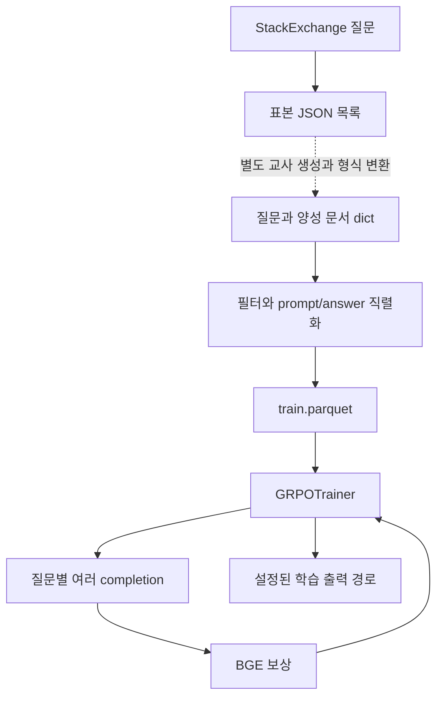

# 데이터 구축과 보상 학습

조사일 **2026-11-15**. [범위·커밋](../README.md), [용어집](chapter-00-glossary.md).

## 책임과 핵심 동작

RQR(Reinforced Query Reasoner)은 관련 문서와 더 잘 맞는 검색용 추론 내용을 생성하도록 학습한다. GRPO(Group Relative Policy Optimization)는 한 질문의 여러 생성 후보 사이 보상 차이를 학습에 쓰는 방법이다. **공개 보상 함수는 전체 문서 검색 순위를 계산하지 않고, BGE 문장 벡터의 관련성 증가량을 계산한다.** 논문 §3–4의 학습 목적을 실제 함수 경계로 나눈다.

근거: [build_dataset.py](../../../code/reference-implementations/tongsearch-qr/scripts/data_process/build_dataset.py), [reward.py](../../../code/reference-implementations/tongsearch-qr/scripts/train/reward.py), [train_grpo.py](../../../code/reference-implementations/tongsearch-qr/scripts/train/train_grpo.py), [run_train.sh](../../../code/reference-implementations/tongsearch-qr/scripts/train/run_train.sh), [run_server.sh](../../../code/reference-implementations/tongsearch-qr/scripts/train/run_server.sh).

## 데이터와 호출 경계

| 단계 | 입력 → 출력 | 확인한 조건 |
|---|---|---|
| `collect_questions`·`build_samples` | StackExchange 행 → `{instruction,input}` 목록 | 도메인별 최대 1,200개. seed 기본 2025. 추론 지시를 붙여 JSON 저장 |
| 교사 생성·응답 연결 | 위 목록 → 질문을 key로 한 답변 dict | 이번에 읽은 script 사이에는 자동 연결 구현이 없다. 배포된 V1-R1/V1-QwQ·V2 dict를 직접 사용 가능 |
| `process_data` | `{question: answer 또는 list}` → `{prompt,answer}` 목록 | 질문에 `.png`가 있거나 문자 수가 16,000 초과면 제외. 토큰 수 검사와 다름 |
| `main`의 parquet 저장 | `prompt=[system,user]`, `answer=JSON 문자열` → `train.parquet` | JSON 내부는 `query,pos_docs_list,think_flag`. seed 기본 2024로 섞고 단일 train 파일 저장 |
| `load_training_dataset` | 디렉터리의 `train.parquet` → train Dataset | 별도 평가 split 생성 없이 기본 seed 5202로 shuffle |
| `GRPOTrainer` | 모델·tokenizer·Dataset·보상 함수 → 학습 | `resume_from_checkpoint=False`. 결과 위치는 데이터명·seed 표기·출력 길이·후보 수로 구성 |

표본 추출 script는 목록을 저장하지만 구축 script는 `.items()`를 호출한다. 따라서 두 script를 연달아 실행하면 바로 이어지는 형식이 아니다. 이를 교사 생성 단계가 구현·검증되었다는 뜻으로 읽지 않는다. 도메인 추출의 `strip('https://')`는 접두사 제거가 아니라 문자 집합 제거이며, 실제 도메인 분포 영향은 미검증이다.

## 보상·파싱·실패

`bge_reward_func(completions, answer)`는 각 completion의 첫 메시지 `content`와 answer를 `zip`으로 묶는다. 길이 동일 assertion은 없으며, 첫 메시지 접근은 내부 `compute_score_bge`의 예외 처리 밖이다.

`compute_score_bge`는 label JSON에서 원질의 q와 양성 문서 목록 D를 읽는다. `extract_query_text`는 assistant 경계가 있으면 앞부분을 제거한다. `think_flag=True`일 때는 `<think>...</think>` 다음의 `<answer>...</answer>` 조합을 정규식으로 요구한다. 주석의 optional 표현과 달리 think 구간도 매치에 필요하다. 형식 불일치·빈 질의면 -1이다.

원질의·생성문·각 양성 문서를 `BAAI/bge-base-en-v1.5`로 정규화하여 벡터로 만들고 다음 값을 반환한다.

`reward = 10 × mean_d[cos(generated,d) − cos(original,d)]`

예를 들어 원질의와 두 문서의 유사도가 .4/.2, 생성문은 .5/.4라면 보상은 1.5다. 이는 **설명용 산술 예시**이며 실측이 아니다. 실제 검색된 문서 목록·nDCG·최종 답변 정답은 이 함수가 읽지 않는다.

| 상태/사건 | 결과와 다음 처리 |
|---|---|
| 모듈 import | 보상 모델 즉시 로딩. 이 지점 실패는 보상 함수의 try 밖 |
| JSON 필드/인코딩 처리 오류 | `compute_score_bge`가 예외를 잡아 -1 반환. 실패와 낮은 점수는 별도 구조로 구분되지 않음 |
| 양성 문서가 비어 있음 | 명시적 사전 거부 없음. encode·shape·0 나눗셈 결과는 실제 라이브러리 실행 전 미확인 |
| 정상 생성 | 세 종류 embedding을 호출하고 평균 차이를 반환. 함수 내부의 embedding 재사용 cache 없음 |
| 학습 도중 실패 | 선택한 진입점에 자체 재시도/복구 코드 없음. 라이브러리 저장·복구 세부는 미분석 |

## 예산·seed·분리

안내 script는 Qwen2.5-1.5B, V1-R1, 후보 16, 입력 최대 8,000·출력 500토큰, 150 steps, 장치당 batch 16·누적 4, learning rate 1e-6·beta .008을 전달한다. 학습용 GPU 1/2/3과 생성 서버 GPU 0을 분리하도록 설정한다. 실제 장비·가중치·논문 표와의 일치는 실행하지 않았다.

`--seed`는 로그·출력 폴더명에 쓰지만 `GRPOConfig(seed=...)`로 전달하지 않고, `load_training_dataset`에도 전달하지 않는다. 따라서 폴더명만으로 학습 난수 조건을 확정할 수 없다. parquet 구축·Dataset shuffle·학습/생성 난수를 따로 기록해야 한다.

로컬 자료의 질문 문자열 정확 일치 검사에서는 V1-QwQ/V1-R1 각 10,798개, V2-R1 30,874개, V2 30,912개 key와 배포된 두 BRIGHT 재작성 JSON 각 1,308개 key의 교집합이 모두 0이었다. **학습/평가 오염 없음의 증명이 아니다.** V1의 지시가 붙은 목록·근접 중복·문서/답변 겹침·모델 사전학습과 실제 평가셋 revision은 미확인이다. 원자료는 [manifest](../../../.codex/research/planning-decomposition-rewriting/official_rewriting_code_manifest.json)에 해시로 묶는다.

## 테스트와 인계

저장소 파일명에서 `test`를 검색했으나 직접 보상/학습 테스트는 찾지 못했다. 정적 읽기·Python 구문 검증만 수행하며 모델 import나 학습 테스트를 실행하지 않는다. 후속 검증은 보상 파싱 경계, -1 오류와 진짜 음수 보상 구분, 길이 불일치, seed 전달, 보상 모델 개선과 실제 검색 개선의 상관이다. [다음 장](chapter-02-generation-and-retrieval.md)에서 생성문 저장과 검색 소비를 추적한다.
