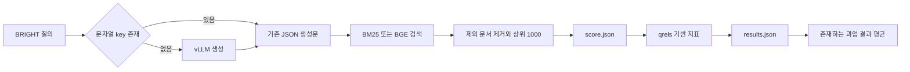

# 재작성 생성과 검색 평가

조사일 **2026-11-15**. [범위·커밋](../README.md), [용어집](chapter-00-glossary.md). BM25는 단어 일치를 사용하는 검색기이고, BGE는 문장을 벡터로 바꾸는 모델이다. 학습용 BGE-base와 평가용 BGE-large를 구분한다.

## 진입점과 입출력

근거: [question_rewriting.py](../../../code/reference-implementations/tongsearch-qr/scripts/evaluation/question_rewriting.py), [vllm_model.py](../../../code/reference-implementations/tongsearch-qr/scripts/evaluation/vllm_model.py), [bright_eval.py](../../../code/reference-implementations/tongsearch-qr/scripts/evaluation/bright_eval.py), [retrievers.py](../../../code/reference-implementations/tongsearch-qr/scripts/evaluation/retrievers.py), [print_eval_results.py](../../../code/reference-implementations/tongsearch-qr/scripts/evaluation/print_eval_results.py).

1. `question_rewriting.main`은 모델을 만들고 기존 JSON을 로드한 뒤 BRIGHT의 12개 하위 과업을 순회한다.
2. `reason_queries`는 `item['query']` 문자열이 JSON key에 있으면 생성을 생략한다. 없으면 문제 식별·단계별 추론·답변 초안 지시를 붙여 `model.predict`를 호출한다. 출력은 곧바로 `{원질의: 생성문}`에 넣어 전체 JSON을 다시 쓴다.
3. `VllmModel.predict`는 system/user 메시지로 생성하고 첫 응답 텍스트를 반환한다. 기본 출력 500토큰, temperature .7·top_p .8·top_k 20, repetition penalty 1.05다. think 모드는 answer 구간을 추출하지만 매치가 없으면 원문 전체를 반환한다. 이는 학습 보상의 -1 처리와 다르다.
4. `bright_eval`은 질의 ID·문서 ID·관련 문서 ID·제외 ID를 읽고 `RETRIEVAL_FUNCS[args.model]`을 호출한다. 검색 결과는 `{qid: {docid: score}}`, 평가 출력은 `results.json`이다.

## 검색 분기와 파일 경계

| 분기 | 실제 소비와 주의점 |
|---|---|
| `retrieval_bm25_with_reasoner` | `reasoner_file`을 읽고 모든 질의를 `query_map[query]`로 교체한다. 원질의 자동 연결·5회 반복은 없다. key 누락은 `KeyError`로 전파 |
| BM25 점수 | Lucene analyzer·Gensim LuceneBM25Model, k1=.9·b=.4. 제외 ID를 지운 뒤 상위 1,000개 반환 |
| `retrieval_sbert_bge_with_reasoner` | 전달된 `reasoner_file` 대신 `question_query_map_cv.json`을 읽는다. 모델 경로도 저자 환경의 절대 경로다. 생성문 뒤 검색 instruction을 적용하고 BGE-large 벡터 비교 |
| 기존 `score.json` | 출력 폴더가 `{task}_{model}_long_{flag}`로 같으면 재검색을 생략한다. 재작성 JSON·checkpoint·설정 해시가 폴더 식별에 포함되지 않음 |
| 문서 embedding cache | task·모델 이름·long_context·batch가 경로에 포함됨. 문서 본문·checkpoint 해시 검증은 선택 경로에서 확인되지 않음 |

예를 들어 동일 출력 폴더에서 서로 다른 두 RQR checkpoint의 JSON을 평가하면, 두 번째 실행은 기존 `score.json`을 읽을 수 있다. **코드에서 도출한 조건부 시나리오**이며 실제 오염 사례를 재현한 것은 아니다. 자체 실험에는 입력·질의·코퍼스·모델 해시가 다른 실행을 구분해야 한다.

## 상태·실패·집계

| 상태 변화 | 확인한 경계 |
|---|---|
| 미생성 → JSON key 추가 | 질의 하나마다 전체 파일을 `w`로 저장. 임시 파일 교체·동시 쓰기 lock·부모 경로 생성은 해당 함수에 없음 |
| 생성 실패 | 별도 항목 실패 기록/재시도 없이 예외 전파. 이미 저장한 key는 다음 실행에서 재사용 가능 |
| 캐시 없음 → 검색 → score 저장 | 제외 ID와 gold ID 겹침 assertion. cache 문서 ID는 `zip`으로 순서 비교하나 이 비교 자체에 두 길이 동일 assertion은 없음 |
| score 로드 → 지표 저장 | 관련성은 gold ID마다 1. `calculate_retrieval_metrics`는 pytrec_eval 결과 질의 수로 평균. 전체 평가 질의와 결과 질의의 coverage는 별도로 검증해야 함 |
| 과업 결과 → 평균 | `print_eval_results`는 폴더명에 target 문자열이 있고 `results.json`이 존재하는 결과의 NDCG@10만 평균. 12과업 완전성 검사는 없음 |

`run_bright_eval.sh`는 12개 과업을 순서대로 호출하지만 `set -e`가 없다. 중간 실패 후 뒤 과업·평균이 진행될 수 있다. 따라서 평균과 함께 예상 12과업 목록·완료 수·실패를 보고해야 한다. 최종 답변 생성/정확도는 이 검색 평가 경로에 포함되지 않는다.

## 확인과 남은 작업

소스의 assertion은 gold/excluded 불교집합·일부 배열 길이·cache ID 순서·제외 ID의 결과 미포함을 확인한다. assertion 존재와 실행 통과는 다르다. 전용 테스트는 파일명 검색에서 찾지 못했고 이번에 모델·검색·테스트를 실행하지 않았다.

학습/평가 프롬프트는 각각 [구축 소스](../../../code/reference-implementations/tongsearch-qr/scripts/data_process/build_dataset.py)와 [생성 소스](../../../code/reference-implementations/tongsearch-qr/scripts/evaluation/question_rewriting.py)에 원문으로 보존한다. 논문 부록 원문은 [N31 PDF 13쪽](../../../.codex/research/planning-decomposition-rewriting/papers/pdf/N31_2025.emnlp-main.1078.pdf#page=13)이며 전체 전사·시각 대조는 미완료다. 코드 프롬프트를 부록 전문으로 표시하지 않는다. ReasonIR 등 다른 검색기·논문 checkpoint·오류 규모·실제 성능은 후속 범위다.
