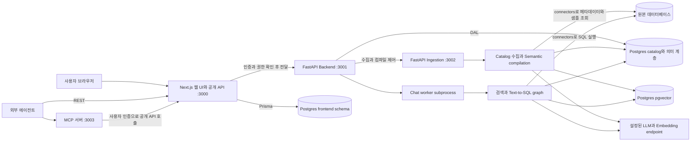
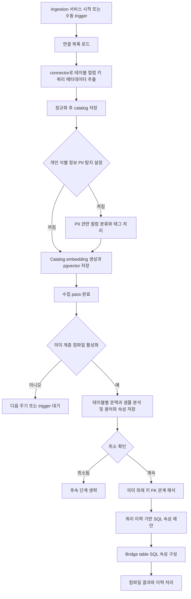
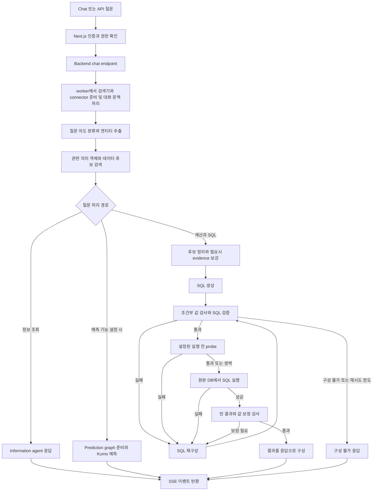

# Chapter 01. 전체 아키텍처와 주요 컴포넌트

- 분석일: 2026-11-07
- 범위: 제공된 로컬 소스의 서비스 경계, 실행 진입점, 주요 모듈과 대표 흐름. 이 chapter는 개요이며 상세 내용은 [모듈 지도](chapter-02-component-map.md)와 [실제 호출·상태](chapter-03-runtime-traces.md)에서 이어진다.
- 확인 방식: README·배포 설정과 실제 진입점·호출 코드를 대조한 정적 분석
- 실행 여부: 서비스 기동, DB 연결, 모델 호출 및 테스트 실행은 수행하지 않았다.

## 읽기 전에 알아둘 표현

아래 용어는 프로젝트 구조를 이해하는 데 필요한 최소 설명이다. 더 많은 예시와 코드별 의미는 [용어집](chapter-00-glossary.md)에 정리했다.

| 본문 표기 | 뜻 |
| --- | --- |
| 의미 계층·온톨로지 | 실제 테이블·컬럼에 업무 개념과 계산식·관계를 연결한 정의 모음 |
| API / MCP | 프로그램이 기능을 호출하는 창구 / AI 에이전트가 도구를 연결해 호출하는 표준 프로토콜 |
| Backend / gateway | 서버의 핵심 처리 영역 / 외부 요청을 인증·검사해 내부 서버로 전달하는 관문 |
| Catalog / connector / ingestion | DB 구조를 기록한 목록 / 원본 DB 조회 코드 / 내부 목록과 검색 자료를 만드는 수집 처리 |
| LLM / embedding / VDB | 언어·코드를 해석·생성하는 모델 / 의미를 숫자 목록으로 표현하는 변환 / 그 숫자로 유사 검색하는 저장소 |
| Graph / node / workflow | 처리 단계의 연결 구조 / 개별 단계 / 실행 흐름. 온톨로지 graph는 업무 개념 간 관계를 뜻하므로 실행 graph와 구분한다. |
| Schema / DAL | DB의 테이블 이름 공간 또는 구조 정의 / 내부 DB 읽기·쓰기 코드 계층 |
| Worker / scheduler | 실제 처리 작업을 실행하는 담당 / 정해진 주기·요청에 맞춰 작업을 시작하는 관리자 |

그림에 나오는 Next.js는 웹 화면·API 프레임워크, FastAPI는 Python API 프레임워크다. Prisma와 Alembic은 각각 웹 쪽 DB 접근·구조 관리와 Python 쪽 DB 구조 변경 관리에 쓰인다. pgvector는 Postgres 안에서 숫자 벡터를 저장·검색하는 확장이다.

## 1. 어떤 툴인가

Auto-Ontology는 데이터베이스의 구조를 수집하고, 그 위에 업무 용어와 계산식·관계를 정리한 의미 계층을 만들어 자연어 질의에 활용하는 도구다. 사용자는 연결을 등록하고, 생성된 정의를 검토·수정한 뒤 Chat 또는 API·MCP로 질문한다.

핵심은 질문을 SQL로 바꾸는 단계 앞에 데이터의 의미를 준비하는 단계가 있다는 점이다. 예를 들어 `매출`이라는 표현을 어느 테이블의 어떤 계산식으로 해석할지, 필요한 테이블을 어떻게 연결할지 정의하고 검색할 수 있게 한다. 자동 생성된 정의를 사람이 검토할 수 있지만, 모든 정의가 검토·인증되었다고 전제해서는 안 된다.

README의 Generate → Certify → Answer 설명을 출발점으로 삼되, 실제 구성은 아래 코드에서 확인했다. [제품 설명](../../../code/auto-ontology/README.md), [semantic compilation 진입점](../../../code/auto-ontology/auto_ontology/semantic/compile.py), [질의 그래프](../../../code/auto-ontology/auto_ontology/retrieval/text_to_sql/text_to_sql_graph.py)

## 2. 서비스는 어떻게 나뉘는가

그림의 세 저장소 노드는 논리적인 책임 구분이다. 기본 Compose에서는 Postgres 서비스 하나에 저장하며, pgvector가 별도 벡터 DB 서버인 것은 아니다. `frontend` schema는 Prisma가, backend의 `public` schema는 Alembic이 관리한다. 원본 데이터베이스는 질의 대상이고 이 Postgres는 애플리케이션 저장소라는 역할 차이가 있다. 샘플 구성에서는 같은 DB 서버에 별도 데이터베이스로 둘 수도 있다.

MCP는 독립 프로젝트이며 기본 Compose 서비스 목록에 포함되어 있지 않다. `:3003`은 MCP 코드의 기본값이다. pgAdmin은 DB 관리 보조 도구이고, Vault는 선택적 자격 증명 저장소다. 이 둘은 핵심 질의 흐름에서 생략했다. 예측 기능도 선택 분기이므로 별도로 설명한다.

근거: [Compose 서비스·migration 구성](../../../code/auto-ontology/docker-compose.yml), [Backend 앱 생성](../../../code/auto-ontology/auto_ontology/server/__main__.py), [수집 앱 생성](../../../code/auto-ontology/auto_ontology/ingestion_service/__main__.py), [MCP 설정](../../../code/auto-ontology/mcp/auto_ontology_mcp/config.py), [DAL schema](../../../code/auto-ontology/auto_ontology/dal/schema.py), [Prisma schema](../../../code/auto-ontology/frontend/prisma/schema.prisma)

## 3. 주요 컴포넌트와 책임

아래의 ‘목적’은 코드의 책임으로 해석한 설명이다. 개발 당시의 모든 설계 의도를 확인한 것은 아니다.

| 컴포넌트 | 역할과 목적 | 입력 → 출력 | 대표 근거 |
| --- | --- | --- | --- |
| Web UI·API gateway | Chat, 데이터 탐색, 설정과 용어 관리 화면을 제공하고 요청의 인증·권한을 확인한다. | 사용자 요청 → 인증된 API 호출·화면 | [frontend/app](../../../code/auto-ontology/frontend/app), [withPermission](../../../code/auto-ontology/frontend/auth/with-auth.ts) |
| FastAPI Backend | chat, connections, datasources, terms, exploration 등 도메인 API를 등록한다. | API 요청 → 도메인 처리·응답 | [create_app](../../../code/auto-ontology/auto_ontology/server/__main__.py) |
| Chat worker | 무거운 검색기·connector 초기화를 재사용하고, 에이전트 처리를 별도 프로세스에서 수행한다. | 질문·대화 이력·설정 → 에이전트 이벤트 | [worker.py](../../../code/auto-ontology/auto_ontology/server/chat/worker.py) |
| Ingestion service·scheduler | 시작 시·주기적·수동 수집과 의미 계층 컴파일을 조율한다. | 연결·설정·trigger → 수집·컴파일 작업 | [lifespan](../../../code/auto-ontology/auto_ontology/ingestion_service/__main__.py), [DataScheduler](../../../code/auto-ontology/auto_ontology/ingestion_service/data_scheduler.py) |
| Connectors | 서로 다른 SQL 엔진의 메타데이터 조회와 SQL 실행을 공통 인터페이스로 연결한다. | 연결 설정·SQL → 스키마·조회 결과 | [SQLDatabase](../../../code/auto-ontology/auto_ontology/connectors/base.py), [등록·로드](../../../code/auto-ontology/auto_ontology/connectors/registry.py) |
| Catalog | 테이블·컬럼·키·쿼리 정보 등을 추출·정규화해 내부 catalog에 기록한다. | connector 메타데이터 → 내부 catalog | [ingest_catalog](../../../code/auto-ontology/auto_ontology/catalog/ingest.py), [extract.py](../../../code/auto-ontology/auto_ontology/catalog/extract.py) |
| Semantic compilation | catalog와 샘플 등을 이용해 업무 용어·속성·관계를 구성하고 검색용 표현을 만든다. | catalog·문맥 → 의미 계층·embedding | [compile.py](../../../code/auto-ontology/auto_ontology/semantic/compile.py), [process_table](../../../code/auto-ontology/auto_ontology/semantic/visit_enter.py) |
| Retrieval·Text-to-SQL | 질문의 의도와 엔티티를 분석하고 후보 정의를 검색해 SQL을 생성·검증·실행한다. | 질문·retrievers·connectors → SQL·결과·응답 | [main.py](../../../code/auto-ontology/auto_ontology/retrieval/text_to_sql/main.py), [graph](../../../code/auto-ontology/auto_ontology/retrieval/text_to_sql/text_to_sql_graph.py) |
| DAL·schema | catalog와 의미 계층을 관계형 테이블과 연관 테이블로 저장·조회한다. | 도메인 데이터 → Postgres 읽기·쓰기 | [schema.py](../../../code/auto-ontology/auto_ontology/dal/schema.py), [session.py](../../../code/auto-ontology/auto_ontology/dal/session.py) |
| VDB·retrieval data access | embedding과 DB·label 필터로 관련 데이터·의미 객체 후보를 찾는다. | 질의 embedding·범위 → 후보 목록 | [PostgresVDB](../../../code/auto-ontology/auto_ontology/vdb/postgres.py), [semantic_search.py](../../../code/auto-ontology/auto_ontology/retrieval/data_access/semantic_search.py) |
| MCP server | 의미 계층 조회와 질문 기능을 외부 에이전트 도구로 노출한다. 정의 수정 기능은 제공하지 않는다. | MCP 도구 호출 → 공개 API 응답 | [server.py](../../../code/auto-ontology/mcp/auto_ontology_mcp/server.py), [tools.py](../../../code/auto-ontology/mcp/auto_ontology_mcp/tools.py) |

컴포넌트와 프로세스는 일대일이 아니다. 예를 들어 catalog와 semantic은 별도 웹 서버가 아니라 ingestion 서비스에서 사용하는 Python 모듈이고, retrieval은 Chat worker 안에서 호출된다.

## 4. 의미 계층에는 무엇이 들어가는가

| 개념 | 의미 | 코드에서 확인할 대상 |
| --- | --- | --- |
| Catalog | 실제 데이터베이스·schema·테이블·컬럼과 키 정보를 표현한다. | `catalog_database`, `catalog_schema`, `catalog_table`, `catalog_column` |
| Term | Customer와 같은 업무 개념을 표현한다. | `term`, `table__term` |
| ColumnAttribute | 컬럼에 대응하는 의미 속성과 Term의 연결을 표현한다. | `column_attribute`, `column_attribute__term`, `column__has_attribute` |
| SqlAttribute | 업무 개념에 연결된 SQL 표현을 저장한다. | `sql_attribute`, `sql_attribute__term`, `sql_attribute__sql` |
| 관계 | 물리 키·추론한 의미 관계·join 경로를 표현한다. | `column__foreign_key`, `column__semantic_fk`, `table__join`, `join_path_edge` |

여기서 온톨로지 그래프는 업무 개념과 관계의 표현이다. 제공된 구현은 이 정보를 Postgres 테이블에 저장하므로 별도 그래프 DB 서버를 가정할 필요가 없다. 각 테이블의 정확한 cardinality, 인증 필드와 수정 보존 정책은 의미 계층·저장소 상세 분석에서 확인한다. [schema 정의](../../../code/auto-ontology/auto_ontology/dal/schema.py)

## 5. 데이터 준비 workflow

**PII(Personally Identifiable Information)**는 이메일·전화번호처럼 개인을 식별할 수 있는 정보다. 여기서 PII 처리는 컬럼명·테이블명·설명으로 분류하고 내부 catalog에 태그를 붙이는 기능이다. 원본 값을 지우거나 가리는 마스킹과 다르다. **PK**는 행을 구별하는 기본 키, **FK**는 다른 행을 참조하는 외래 키다. **Bridge table**은 두 테이블의 관계를 연결하는 중간 테이블이다. [PII 입력과 태그 코드](../../../code/auto-ontology/auto_ontology/pii_detection/service.py), [용어별 예시](chapter-00-glossary.md)

이 그림은 준비 작업의 의존 순서를 단순화했다. 실제로는 `DataScheduler`와 `SemanticScheduler`가 별도로 동작하며, 시작 시 semantic 쪽이 첫 ingest pass 종료를 기다린다. 두 작업을 하나의 직렬 함수나 매번 강제 연결된 작업으로 해석하면 안 된다. 또한 첫 pass가 종료했다는 사실은 모든 연결의 수집 성공을 보장하지 않는다.

`DataScheduler`는 시작 시 한 번, 이후 이전 작업 종료부터 기본 24시간 간격으로 동작하며 연결 목록을 다시 읽는다. 의미 계층 컴파일은 설정이 활성화되어야 시작한다. 테이블별 의미 처리는 `compile_semantic_layer()`에서 수행하고, 그 뒤의 FK·SQL 속성·bridge 단계는 `run_semantic_compilation()`이 조율한다. 테이블 처리는 병렬화하되 충돌하는 용어 이름의 저장 순서는 일정하게 맞추는 코드가 있다.

원본 테이블 전체를 애플리케이션 Postgres에 복제하는 ETL이라고 단정할 수는 없다. 확인한 수집 경로의 중심은 메타데이터와 embedding이며, 의미 처리 중 원본 값의 샘플 조회도 발생한다. query history·PII 전파·태그 규칙 재적용의 세부 시점은 후속 분석 대상이다.

근거: [run_ingest](../../../code/auto-ontology/auto_ontology/ingestion_service/ingest.py), [catalog 추출](../../../code/auto-ontology/auto_ontology/catalog/extract.py), [data scheduler](../../../code/auto-ontology/auto_ontology/ingestion_service/data_scheduler.py), [semantic scheduler](../../../code/auto-ontology/auto_ontology/ingestion_service/semantic_scheduler.py), [compile orchestration](../../../code/auto-ontology/auto_ontology/semantic/compile.py), [table pipeline](../../../code/auto-ontology/auto_ontology/semantic/pipeline.py)

## 6. 질문 처리 workflow

질문에서 찾은 **entity**는 ‘고객·주문·매출’ 같은 대상·개념이고, **candidate**는 그 대상과 관련 있어 보이는 검색 후보다. **Evidence**는 질문 해석에 덧붙인 설명·힌트다. **Probe**는 SQL을 본 실행하기 전에 값·연결 등을 확인하는 제한된 조회다. **SSE(Server-Sent Events)**는 서버가 단계·SQL·답변을 한 HTTP 응답에서 순차적으로 보내는 방식이다.

그림은 정상 진입과 주요 분기를 표현한다. resume 진입, 전체 파이프라인 재시도, 각 soft check의 생략 조건 등은 생략했다. 실제 그래프는 `decision`, 실패 이력과 기능 설정으로 이동 경로를 결정한다. `MAX_RECONSTRUCTION_ATTEMPTS = 7`은 그래프의 재구성 한도이며, `main.py`의 전체 파이프라인 재시도와는 구분해야 한다. 따라서 요청 전체의 최대 호출 횟수가 7회라고 해석하지 않는다.

Web의 chat route는 `withPermission({ chat: ['use'] })`로 권한을 검사하고 Backend의 SSE를 전달한다. worker는 `stream_agent_response()`를 호출한다. 대화 이력이 있으면 후속 질문을 해석하고, 전달받은 사용자 토큰이 있으면 사용자 인증 connector를 구성하는 경로가 있다.

결과에는 SQL과 응답이 포함되며, 대화 ID를 사용한 요청은 추가 권한과 이력 저장 흐름을 갖는다. chat route 설명상 실행 결과가 있는 대화에서는 차트 이벤트가 뒤따를 수 있고, 대화 ID 없는 요청은 이력·차트 단계를 생략한다. 세부 이벤트 계약과 재접속·취소 동작은 인터페이스 단계에서 검토한다.

근거: [Next.js chat route](../../../code/auto-ontology/frontend/app/api/chat/completions/route.ts), [Backend chat router](../../../code/auto-ontology/auto_ontology/server/chat/router.py), [worker loop](../../../code/auto-ontology/auto_ontology/server/chat/worker.py), [graph edges와 routers](../../../code/auto-ontology/auto_ontology/retrieval/text_to_sql/text_to_sql_graph.py), [stream 실행](../../../code/auto-ontology/auto_ontology/retrieval/text_to_sql/main.py), [SQL 실행](../../../code/auto-ontology/auto_ontology/retrieval/text_to_sql/agents/sql_execution.py)

## 7. 기능 사이에는 어떤 사용 흐름이 있는가

설치 절차 대신 사용자 행동과 내부 처리의 연결을 정리한다. 각 API·함수의 구체적 호출과 실패 경계는 [상세 호출 분석](chapter-03-runtime-traces.md)에서 다룬다.

1. 연결을 등록·변경하면 connection service가 저장·cache 갱신·수집 trigger 여부를 처리한다.
2. 수집 과정은 catalog와 검색용 vector를 갱신한다. 비동기 trigger 응답과 실제 완료를 구분해야 한다.
3. 의미 계층 컴파일을 요청하면 테이블별 Term·속성 생성과 후속 관계·SQL 속성 처리를 수행한다.
4. 사용자는 용어·속성·관계를 탐색하고 정의를 수정·검토한다.
5. Chat·REST·MCP 질문은 관련 정의를 검색해 응답한다. Chat의 의미 계층 gate는 특정 source의 Term 존재 여부를 검사하며 전체 컴파일 성공을 보장하지 않는다.

MCP가 권장하는 도구 흐름은 첫 사용 시 `check_readiness`, 용어 확인에 `search_terms`, 필요시 범위 확인에 `check_answerable`, 실제 응답에 `ask_question`이다. 이는 서버가 제공하는 안내이며, 모든 도구 호출을 매번 강제하는 파이프라인은 아니다. `check_answerable`은 의미 계층의 질문 범위 확인용이고, DB 질의 결과의 정확성을 보증하는 검증은 아니다. MCP의 공개 도구 표면은 읽기용이고 정의 수정은 웹/API 경로를 사용한다. [MCP instructions](../../../code/auto-ontology/mcp/auto_ontology_mcp/server.py), [제품 사용 설명](../../../code/auto-ontology/README.md)

## 8. 차이점과 후속 확인 사항

| 항목 | 현재 확인한 사실 | 후속 분석 |
| --- | --- | --- |
| 예측 기능 | README는 API 키와 hosted service 중심으로 설명하지만 graph는 `KUMO_RFM_API_URL` 존재로 예측 노드를 추가한다. | 환경 설정과 prediction 구현을 대조해 정확한 서비스·데이터 전달 경로 확인 |
| 모델 기본값 | README 내 embedding·reranker 모델 표기가 서로 다르다. | `.env.example`과 실제 설정 해석 코드를 기준으로 역할별 endpoint·fallback 확인 |
| 데이터 준비 완료 | semantic scheduler는 첫 ingest pass 종료를 기다린다. | 부분 실패 시 readiness와 UI 상태가 어떻게 달라지는지 확인 |
| SQL 검증 | 그래프에는 재구성·probe·빈 결과 보정과 한도 분기가 있다. | 구문·의도·값 검사별 보장과 생략 조건, 테스트 사례 확인 |
| 사람의 수정과 인증 | README에 검토·인증 흐름이 있고 schema에 관련 필드가 있다. | 실제 수정 endpoint와 재컴파일 시 보존 정책 확인 |
| 인증과 배포 | Next.js가 공개 gateway이고 Compose는 3001·3002도 호스트에 노출한다. | Helm 네트워크 구성과 내부 요청 신뢰 경계를 별도로 확인 |

설치·배포 안내는 분석 범위에서 제외한다. 다음 두 chapter에서 아키텍처를 보강한 뒤 데이터 모델 → 연결·수집 → 의미 계층 → 검색·질의 순으로 함수 호출, 데이터 구조와 예외 흐름을 분석한다. [전체 계획](../../../.codex/plan/auto-ontology/01_plan.md)
