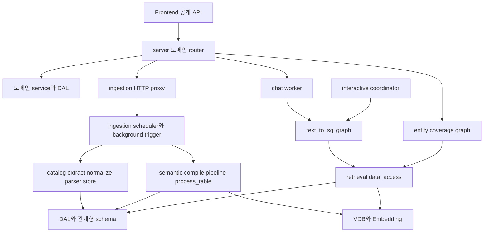

# Chapter 02. 모듈과 기능 책임 지도

- 분석일: 2026-11-07
- 범위: 실제 패키지와 API 등록 관계, 처리·저장 책임. 설치·배포 절차는 제외한다.
- 분석 수준: 아래에 연결한 진입점과 핵심 함수를 읽은 정적 분석이다. 개별 API의 모든 분기까지 검증한 문서는 아니다.
- 선행: [시스템 개요](chapter-01-overview.md). 다음: [실제 호출과 상태](chapter-03-runtime-traces.md).

## 이 chapter의 용어

이 문서는 코드의 영문 이름을 그대로 연결하므로, 아래 뜻을 먼저 붙여 읽으면 된다. 전체 목록은 [용어집](chapter-00-glossary.md)에서 찾을 수 있다.

| 표현 | 이 문서에서의 뜻 |
| --- | --- |
| Catalog / metadata / ingestion | 원본 DB 구조를 기록한 목록 / 테이블명·자료형·키 등 구조 정보 / 이 정보를 읽어 저장하는 수집 처리 |
| Parser / normalize / diff | 데이터를 내부 표현으로 바꾸는 코드 / 형식을 맞추는 처리 / 이전 저장 상태와 차이를 계산하는 처리 |
| Writer / reader / DAL | 데이터를 저장하는 코드 / 읽는 코드 / 내부 DB 접근을 모은 계층 |
| DataFrame / ID / schema | Python에서 행·열로 다루는 표 / 객체 식별자 / 테이블의 소속 공간 또는 구조 정의 |
| Term / ColumnAttribute / SqlAttribute | 업무 개념 객체 / 실제 컬럼을 업무 개념에 연결한 속성 객체 / 업무 개념에 연결한 SQL 표현 객체 |
| PK / FK / junction·bridge | 행의 기본 키 / 다른 행을 참조하는 외래 키 / 두 대상을 잇는 중간 테이블 |
| Embedding / retrieval / candidate | 의미를 숫자로 표현 / 관련 자료 검색 / 검색된 후보 |
| Coverage / coordinator | 질문 대상을 의미 정의가 얼마나 덮는지 평가 / 단계·사용자 질문·SQL 제출을 조율하는 코드 |
| Transaction / ContextVar | 함께 확정·취소할 저장 단위 / 실행 문맥별로 별도 값을 유지하는 Python 도구 |

PII는 아래 수집 표에서 등장하는 **개인 식별 정보(Personally Identifiable Information)**다. 이 프로젝트는 이메일 등의 실제 값을 가리는 대신, 관련 컬럼인지 분류해 내부 catalog에 표식을 연결하는 경로를 갖는다.

## 1. 패키지 이름보다 실행 경로를 먼저 본다

이 코드는 `server`, `ingestion_service`, `retrieval` 세 폴더만 읽으면 끝나는 구조가 아니다. 수집은 `catalog` 내부 parser·service·store로 내려가고, 질의는 의미 객체 검색·관계 조회·SQL 생성·검증·실행으로 갈라진다. 또 질문 범위만 평가하는 별도 graph와 외부 orchestrator가 사용할 수 있는 interactive coordinator가 존재한다.

`interactive → SQL`은 라이브러리 호출 관계다. Web Chat이 coordinator를 거쳐 간다는 의미가 아니다. 아래 6절에서 별도 경로로 구분한다.

## 2. 수집 패키지는 다섯 책임으로 나뉜다

| 위치 | 책임·대표 처리 | 다음에 전달하는 데이터 |
| --- | --- | --- |
| `connectors/` | `SQLDatabase` 및 엔진 구현이 원본 DB의 테이블·컬럼·키·쿼리 등을 조회한다. registry가 연결 객체를 구성·캐시한다. | DataFrame·조회 결과·connector |
| `catalog/extract.py` | `create_dataframe()`이 metadata를 모으고 relation filter를 적용한다. 테이블 목록에 있지만 컬럼 설명이 없는 relation을 검사한다. | 원본 catalog 구성 요소 |
| `catalog/normalize.py`, `catalog/parsers/`, `catalog/model/` | 필드 정규화와 내부 객체·schema 구조 변환을 담당한다. | 내부 Schema와 테이블·컬럼 표현 |
| `catalog/write.py`, `catalog/services/`, `catalog/store/` | `populate_tabular_data()`가 신규·기존 schema를 구분하고 diff, PK·FK, 쿼리 연결을 저장한다. | 내부 ID를 반영한 catalog |
| `ingestion_service/ingest.py`, `utils/embedding_rows.py`, `utils/embedding.py` | `run_ingest()`가 PII 관련 컬럼 분류 분기, embedding 입력 변환, chunk(작게 나눈 묶음)별 embedding과 VDB 기록을 연결한다. | 검색용 텍스트·metadata·vector |

중요한 계약은 `ingest_catalog(connector) → (tables_df, columns_df)`이다. 반환값에는 저장 과정에서 할당한 ID가 포함되므로 embedding 입력을 만들기 위해 전체 catalog를 다시 읽을 필요를 줄인다. `populate_tabular_data()`가 내부에서 구성한 Schema들을 반환하고, `ingest_catalog()`가 이를 합친다.

`extract.py`의 `_validate_relation_column_coverage()`는 단순한 방어 코드가 아니다. 컬럼이 없는 테이블을 검색 후보로 제공한 뒤 SQL이 실패하는 상황을 저장 전에 막는 경계다. 다만 실제 엔진에서 일부 relation 조회 실패를 어디까지 허용할지는 connector별 구현에서 따로 확인해야 한다.

근거: [connector base](../../../code/auto-ontology/auto_ontology/connectors/base.py), [extract](../../../code/auto-ontology/auto_ontology/catalog/extract.py), [ingest_catalog](../../../code/auto-ontology/auto_ontology/catalog/ingest.py), [populate_tabular_data](../../../code/auto-ontology/auto_ontology/catalog/write.py), [run_ingest](../../../code/auto-ontology/auto_ontology/ingestion_service/ingest.py)

## 3. Semantic은 문서 생성이 아니라 연결된 정의의 생성이다

| 처리 단위 | 대표 진입점 | 역할과 후속 소비자 |
| --- | --- | --- |
| DB 단위 orchestration | `compile.py::run_semantic_compilation()` | 테이블별 의미 처리 뒤 semantic FK·SQL 속성 제안·bridge 처리를 순서대로 연결한다. |
| 테이블 선택과 병렬 작업 | `pipeline.py::compile_semantic_layer()` | Term 없는 테이블을 고르고 context를 읽어 병렬 처리하되 저장 순서를 정렬한다. |
| 값·형식 profiling | `visit_enter.py::calculate_columns_profiling()` | 샘플·유일성·날짜 형식 등을 계산한다. Term·FK 추론과 검색 문맥에 영향을 준다. |
| FK 역할 제안 | `fk_suggester.py`, `visit_enter.py::process_table()` | 선언 FK와 제안 FK 컬럼을 합쳐 일반 속성과 구분한다. 제안 결과를 물리 FK로 곧바로 저장한다고 가정하면 안 된다. |
| 속성 spec과 Term 할당 | `deterministic.py`, `term_extractor.py`, `process_table()` | 비-FK 컬럼의 속성 후보를 만들고 LLM이 용어와 컬럼 할당을 제안한다. |
| 충돌 처리와 저장 | `visit_enter.py::_commit_terms()` | table-private Term을 upsert하고 속성을 연결한다. 같은 이름의 충돌을 처리한다. |
| 의미 검색 인덱스 | `embed.py::SemanticEmbedder` | 저장한 Term과 속성을 검색 가능한 embedding으로 표현한다. |
| 관계·계산식 보강 | `semantic_fk.py`, `sql_attribute_suggester.py`, `bridge_tables.py` | 테이블 단위 용어 생성만으로 부족한 관계·재사용 SQL 표현을 보강한다. |

예를 들어 `orders(customer_id, amount)`의 `customer_id`가 FK 역할로 판단되면 일반 측정 속성과 같은 방식으로 취급하지 않는 경로가 있다. `amount`에 어떤 업무 이름을 붙일지는 Term 추출·할당 단계의 출력에 따라 달라진다. 이는 구조를 설명하는 예시이며 실제 모델 출력은 아니다.

근거: [compile](../../../code/auto-ontology/auto_ontology/semantic/compile.py), [pipeline](../../../code/auto-ontology/auto_ontology/semantic/pipeline.py), [process_table과 commit](../../../code/auto-ontology/auto_ontology/semantic/visit_enter.py), [속성 spec](../../../code/auto-ontology/auto_ontology/semantic/deterministic.py), [Term 추출](../../../code/auto-ontology/auto_ontology/semantic/term_extractor.py)

## 4. 질의는 검색·문맥 구성·생성·검증을 분리한다

여기서 **intent**는 질문 의도, **entity**는 질문에 언급된 대상·개념, **subject**는 중심 대상이다. **Anchor**는 관련 테이블·컬럼을 묶거나 범위를 잡는 기준이고, **evidence**는 질문 해석에 보탠 추가 설명이다. **LLM**은 자연어·SQL을 해석하고 생성하는 대규모 언어 모델이다.

| 단계 | 코드 | 중요한 차이 |
| --- | --- | --- |
| 질문 의미 파악 | `question_intent`, `question_extraction` | 질문 유형 분류와 검색에 쓸 entity·subject 추출은 서로 다른 노드다. |
| 후보 검색 | `CandidateRetrievalAgent` | 엔티티별 label 검색·중복 제거·의도 필터를 수행한다. 가까운 벡터를 찾았다고 바로 SQL에 넣지 않는다. |
| SQL 문맥 준비 | `CandidatePreparationAgent` | 후보에서 실제 테이블·SQL 속성·custom analysis·join 경로 등을 확장하고 관련성을 판단한다. |
| evidence 처리 | `EvidenceRefinementAgent` | evidence가 있고 skip 설정이 아닐 때 문맥을 보강한다. 항상 실행되는 노드가 아니다. |
| SQL 생성 | `SQLFromCandidatesAgent` | 준비한 스키마·의미 정의·질문으로 SQL을 만든다. |
| 검증과 보정 | parse validation, value validation, combined precheck, reconstruction | 구문·의도·값·원본 DB probe 등 서로 다른 실패 원인과 재시도 정책을 가진다. |
| 실행과 응답 | `SQLExecutionAgent`, empty-result checks, `ResponseAgent` | 원본 DB 실행 성공 이후에도 빈 결과·값 보정 검사를 거친다. |

`retrieval/data_access/`는 graph 노드 자체와 다르다. `semantic_search.py`, `relevant_tables.py`, `graph_schemas.py`, `candidates.py` 등의 조회 함수를 노드에서 사용한다. `utils/retriever.py::Retriever.query()`는 텍스트를 embedding한 뒤 `PostgresVDB.retrieval()`을 호출하는 더 낮은 계층이다.

근거: [graph 등록과 edge](../../../code/auto-ontology/auto_ontology/retrieval/text_to_sql/text_to_sql_graph.py), [후보 검색](../../../code/auto-ontology/auto_ontology/retrieval/text_to_sql/agents/candidates_retrieval.py), [후보 준비](../../../code/auto-ontology/auto_ontology/retrieval/text_to_sql/agents/candidates_preparation.py), [retriever](../../../code/auto-ontology/auto_ontology/utils/retriever.py)

## 5. 저장소는 세 종류의 데이터를 별도로 관리한다

**Upsert**는 있으면 갱신하고 없으면 추가하는 저장 방식이다. **Commit**은 저장 확정, **rollback**은 작업 취소이며, **원자적 변경**은 전체가 반영되거나 전혀 반영되지 않는 변경을 뜻한다. 아래의 `public`, `frontend`, `vdb`는 Postgres 안의 저장 영역을 구분하는 schema 이름이다.

| 저장 영역 | 실제 데이터·소유 코드 | 주의할 경계 |
| --- | --- | --- |
| `public` | catalog·Term·속성·관계·관리 정의. DAL의 SQLAlchemy Core와 catalog store | `dal/session.py`가 SQLAlchemy 연결의 `search_path`를 고정한다. |
| `frontend` | 사용자·세션·대화·메시지·설정 등. Prisma schema에 정의 | Python chat 코드도 대화 처리에 관여하므로 ‘frontend만 접근’한다고 해석하지 않는다. |
| `vdb` | `data_objects_layer`, `semantic_layer` collection | `database_name`과 label을 이용해 검색·삭제 범위를 구별한다. |

`store()`는 활성 transaction이 없으면 문장별 transaction을 사용한다. `write_transaction()` 안에서는 연결을 재사용하고, 중첩 scope는 바깥 작업을 재사용한다. 따라서 여러 함수 호출이 한 번의 원자적 변경인지 여부는 함수 이름이 아니라 실제 transaction scope로 판단해야 한다.

Catalog 저장과 embedding 기록은 별도 경로다. 원본 schema를 갱신하고 embedding 호출이 실패한 경우를 전체 롤백하는 단일 transaction으로 읽어서는 안 된다. 다음 chapter에서 첫 chunk 전·후 실패를 구분한다.

근거: [DAL session](../../../code/auto-ontology/auto_ontology/dal/session.py), [schema](../../../code/auto-ontology/auto_ontology/dal/schema.py), [Prisma](../../../code/auto-ontology/frontend/prisma/schema.prisma), [VDB factory](../../../code/auto-ontology/auto_ontology/vdb/__init__.py), [conversation DAL](../../../code/auto-ontology/auto_ontology/server/chat/conversation_dal.py)

## 6. 기존 개요에 빠졌던 두 질의 경로

### Entity coverage

`server/metadata/router.py`의 `/question-entity-coverage`는 별도 graph를 사용한다. `question_extraction → retrieve_candidates → coverage_grade → END`이며 SQL 생성·실행 노드는 없다. 최대 거리와 질문을 받고, 의미 후보가 엔티티를 얼마나 덮는지 평가한다. 반환 실패는 route에서 422로 변환한다. 이는 질문 가능 범위를 추정하는 기능이며 SQL 실행 성공·결과 정확성과는 다른 판단이다.

근거: [metadata route](../../../code/auto-ontology/auto_ontology/server/metadata/router.py), [coverage graph](../../../code/auto-ontology/auto_ontology/retrieval/entity_coverage/graph.py)

### Interactive coordinator

`retrieval/interactive/`는 `create_session()`, `step()`, `apply_user_answer()`, `apply_submit_result()`를 제공한다. `step()`은 `TurnType`을 명시적으로 받아 INITIAL·DEBUG·FOLLOW_UP 처리를 구분하고 `AskUserAction` 또는 `SubmitSQLAction`을 반환한다. 외부 orchestrator가 사용자에게 물을지 SQL을 제출할지 조율할 수 있는 라이브러리 경계다.

Web Chat worker의 확인된 경로는 `stream_agent_response()` 직접 호출이다. 따라서 interactive coordinator가 웹에서 항상 실행된다고 쓰지 않는다. 저장소 밖의 실제 소비자와 통합 프로토콜은 이번 분석에서 확인하지 않았다.

근거: [coordinator](../../../code/auto-ontology/auto_ontology/retrieval/interactive/coordinator.py), [public exports](../../../code/auto-ontology/auto_ontology/retrieval/interactive/__init__.py), [Web worker](../../../code/auto-ontology/auto_ontology/server/chat/worker.py)

## 7. Backend API는 기능별로 더 나뉜다

`server/__main__.py::create_app()`에서 실제로 등록한 router 기준의 지도다. 폴더가 있다는 이유만으로 별도 router가 공개된다고 간주하지 않았다.

| 등록 router | 대표 기능 | 후속 분석에서 확인할 처리 |
| --- | --- | --- |
| `connections` | 연결 목록·테스트·생성·변경·삭제 | secret 보존, 범위 변경 감지, cache refresh와 ingest trigger |
| `datasources` | DB·schema·테이블·컬럼과 custom/PQL 분석 정의 | schema-qualified 조회, 분석 SQL 검증·저장 |
| `terms`, `sql_attributes` | 용어와 컬럼 속성·SQL 정의 조회·수정 | certified·edited 처리와 embedding 재반영 |
| `exploration` | 데이터·의미 graph와 상세·경로 조회 | 노드·edge 생성, 필터와 join path |
| `metadata` | 질문 entity coverage | graph 입력·distance·coverage 판정 |
| `semantic_compilation` | trigger·reset·status | HTTP 제어와 이력 직접 조회의 차이 |
| `chat` | completions·watch·cancel | slot, identity, queue, SSE, persistence |
| `rules`, `tags`, `zones` | 분류·태그·영역 관리 | 규칙 평가·재적용, 대상 관계와 owner 처리 |
| `users` | owner·group 관련 처리 | frontend identity와 backend 그룹 관계 |
| `model_interchange` | 의미 모델 import/export | 변환 형식, 충돌·검증·저장 단위 |
| `search`, `health` | 검색과 상태 확인 | 검색 대상·필터, liveness와 dependency 상태 |

API별 service·DAL와 권한까지 읽어야 이 지도가 상세 분석이 된다. 현재 표는 등록 관계와 route 선언을 확인한 기능 분류다. [실제 router 등록](../../../code/auto-ontology/auto_ontology/server/__main__.py), [datasources route](../../../code/auto-ontology/auto_ontology/server/datasources/router.py), [terms route](../../../code/auto-ontology/auto_ontology/server/terms/router.py), [semantic status](../../../code/auto-ontology/auto_ontology/server/semantic_compilation/router.py)

## 8. 다음 상세 분석의 출발점

이 모듈 지도를 기준으로 먼저 데이터 모델의 writer·reader를 연결한다. 이어서 connector 계약, catalog diff, 테이블별 의미 생성, 관계 추론, 후보 준비와 SQL 검증을 각각 여러 chapter로 나눈다. 모든 항목의 구현을 읽었다는 의미가 아니며 진행 여부는 [전체 계획](../../../.codex/plan/auto-ontology/01_plan.md)에서 추적한다.
