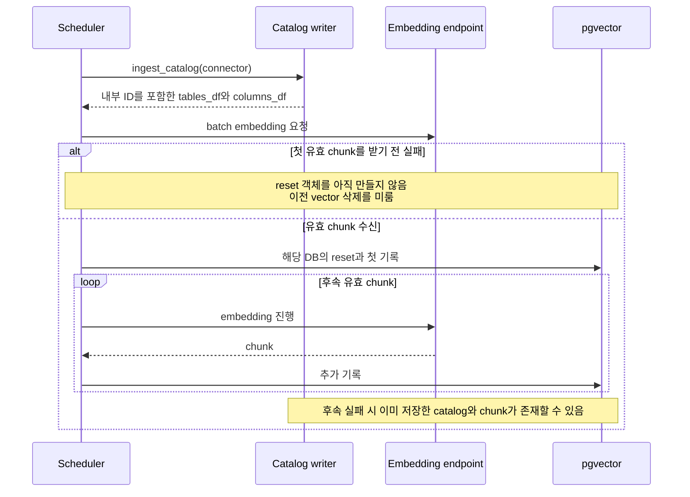
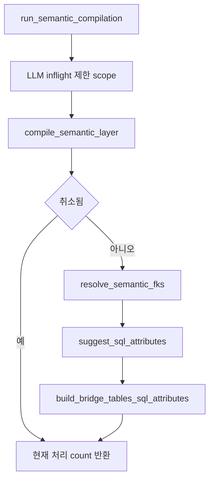
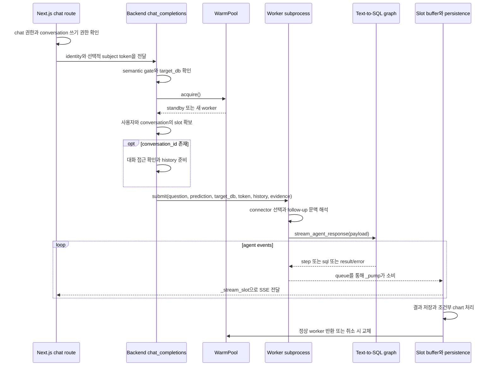

# Chapter 03. 수집·컴파일·질의의 실제 호출과 상태

- 분석일: 2026-11-07
- 범위: 주요 함수의 호출 순서, 중간 데이터, 동시성·실패 경계
- 검증: 코드와 일부 관련 테스트를 읽었다. 서비스·DB·모델·테스트는 실행하지 않았다.
- 이 문서의 예시는 흐름 설명용이며 실제 추론 결과가 아니다.

## 호출 사슬을 읽기 위한 용어

함수명은 코드와 대조할 수 있게 유지하되, 동작은 아래 뜻으로 읽는다. 자세한 예시는 [용어집](chapter-00-glossary.md)에 있다.

| 표현 | 뜻 |
| --- | --- |
| Connector / catalog / ingestion | 원본 DB 조회 담당 코드 / 내부에 기록한 DB 구조 목록 / 이 목록과 검색 자료를 만드는 수집 작업 |
| Scheduler / trigger / pass | 반복 실행 관리자 / 작업 시작 요청 / 대상 목록을 한 차례 처리하는 실행 |
| DataFrame / chunk / vector | Python의 행·열 표 / 나눠 처리하는 묶음 / embedding으로 만든 의미 비교용 숫자 목록 |
| PII | Personally Identifiable Information, 개인 식별 정보. 여기서는 관련 컬럼의 분류·태그 처리를 가리킨다. |
| PK / FK / diff | 행 식별용 기본 키 / 다른 행 참조용 외래 키 / 이전 상태와의 변경분 |
| Transaction / atomic / best-effort | 함께 확정·취소할 저장 단위 / 전부 반영되거나 전혀 반영되지 않음 / 실패를 허용하고 가능한 처리를 계속함 |
| Profiling / sampling breaker | 값·형식 특징 조사 / 샘플 조회가 반복 실패할 때 더 시도하지 않도록 하는 차단기 |
| Term / ColumnAttribute | 업무 개념 객체 / 물리 컬럼과 업무 개념을 연결하는 의미 속성 객체 |

`_함수명()`은 내부 함수 이름, `A → B`는 호출·처리 순서를 나타낸다. **Thread pool**은 같은 프로세스 안에서 작업을 나눠 실행하는 흐름들의 묶음이고, **subprocess**는 별도로 실행되는 프로세스다. 이 둘은 같은 실행 단위가 아니다.

## 1. Catalog 수집의 실제 호출 사슬

```text
DataScheduler._run_once()
  ├─ invalidate_connectors_cache() → get_connectors()
  └─ 연결별 asyncio.to_thread(run_ingest, connector)
       ├─ get_embed_params()
       ├─ _shared_connection(connector)
       │    └─ ingest_catalog(connector)
       │         ├─ extract_tabular_db_data(connector)
       │         └─ populate_tabular_data(data, num_workers=4, dialect=...)
       │              ├─ populate_db(): 신규 schema 추가 / 기존 schema diff / 사라진 schema 삭제
       │              ├─ populate_fks()
       │              ├─ populate_pks()
       │              └─ populate_queries()
       ├─ PII 설정에 따라 _run_pii_detection()
       ├─ CatalogEmbeddingRowsOp((tables_df, columns_df))
       └─ batch_embed_chunks(...)의 chunk마다
            ├─ to_vdb_records(chunk)
            └─ get_data_vdb(reset=True)의 run(records)
```

마지막 VDB 객체 생성은 매 chunk가 아니라 **첫 유효 record chunk에 한 번** 발생한다. 이후에는 같은 객체에 기록한다. Catalog 저장 단계는 `_shared_connection()` 범위 안에서 실행되지만, 이 원본 DB connection 공유를 애플리케이션 저장소 전체의 단일 transaction으로 해석하면 안 된다.

근거: [DataScheduler._run_once](../../../code/auto-ontology/auto_ontology/ingestion_service/data_scheduler.py), [run_ingest](../../../code/auto-ontology/auto_ontology/ingestion_service/ingest.py), [ingest_catalog](../../../code/auto-ontology/auto_ontology/catalog/ingest.py), [populate_tabular_data](../../../code/auto-ontology/auto_ontology/catalog/write.py)

### 1.1 처리 사이에 전달되는 데이터

| 경계 | 데이터 | 다음 단계에서 필요한 이유 |
| --- | --- | --- |
| Connector → extract | tables·columns·views·queries·PK·FK 조회 결과 | 원본 구조를 내부 catalog로 표현한다. |
| extract → write | `database_name`, `tables`, `columns`, `views`, `pks`, `fks`, `queries`를 담은 dict | DB 식별과 각 구조의 writer를 선택한다. |
| write → ingest_catalog | schema별 내부 객체와 tables/columns DataFrame | 저장 ID와 schema 구분을 embedding 단계에 전달한다. |
| ingest_catalog → run_ingest | `(tables_df, columns_df)` | 별도 전체 재조회 없이 embedding 입력을 만든다. |
| chunk → VDB | 텍스트·metadata·embedding을 포함한 record | 검색 결과를 원본 내부 객체 ID와 연결한다. |

필드의 실제 타입·정규화·누락값 처리는 데이터 모델·수집 chapter에서 더 내려간다. 여기서는 확인한 함수 사이 계약을 구분한다.

### 1.2 부분 실패는 어느 시점에 발생하는가



이 구조는 embedding endpoint가 처음부터 실패했을 때 기존 검색 데이터가 먼저 사라지는 상황을 줄인다. 첫 기록 뒤의 전체 교체를 원자적으로 보장하는 구조는 아니다. 별도 catalog 변경이 이미 저장될 수 있으므로 “이전 vector 유지”를 “이전 시스템 상태 전체 유지”로 확대해서는 안 된다.

`populate_fks()`는 FK 추가와 오래된 FK 정리를 `write_transaction()`으로 묶는다. `populate_pks()`도 전체 PK reset과 신규 PK 반영을 같은 transaction으로 묶는다. 반면 schema별 diff는 thread pool에서 실행되며, `list(executor.map(...))`로 결과를 소비해 worker 예외가 호출자에 전달되게 한다. 즉 일부 저장 단위의 원자성과 전체 ingestion 원자성은 구분해야 한다.

`DataScheduler`는 연결 하나의 예외를 잡고 다음 연결을 계속 처리한다. `_run_pii_detection()`은 탐지 실패를 로그로 남기고 catalog 흐름을 계속하는 경로를 갖는다. 따라서 전체 작업 상태, 연결별 성공, PII 처리, embedding 생성은 하나의 boolean으로 표현할 수 없다. [write transaction 사용](../../../code/auto-ontology/auto_ontology/catalog/write.py), [PII·chunk 처리](../../../code/auto-ontology/auto_ontology/ingestion_service/ingest.py)

## 2. 수집 trigger와 완료는 다르다

연결 생성·변경 쪽 backend는 `server/ingestion/proxy.py`를 통해 ingestion 서비스에 HTTP 요청을 보낸다. 이 proxy는 무거운 ingestion 모듈을 직접 import하지 않는 경계다. `trigger_ingest()`는 요청 실패를 로그로 처리하는 best-effort 함수다.

Ingestion의 `POST /ingest`는 `trigger_ingest(connection)`을 호출한 뒤 202를 반환한다. 실제 작업은 daemon thread에서 connector cache를 무효화하고 DB명으로 connector를 찾은 뒤 `run_ingest()`를 호출한다. 이 직접 trigger 경로는 scheduler의 전체 pass와 다르며, 수집 뒤 태그 규칙도 재적용한다.

따라서 다음 세 가지를 구분해야 한다.

| 상태 | 의미 | 의미하지 않는 것 |
| --- | --- | --- |
| Backend가 accepted 반환 | 비동기 요청 경로가 종료됨 | HTTP proxy 호출이 항상 성공했다는 보장 |
| Ingestion이 202 반환 | background 작업을 시작하도록 요청함 | 실제 수집이 끝남 |
| run_ingest 성공 로그 | 해당 함수의 마지막까지 도달함 | 모든 연결·의미 계층·후속 질의의 준비 완료 |

근거: [HTTP proxy](../../../code/auto-ontology/auto_ontology/server/ingestion/proxy.py), [Ingestion route](../../../code/auto-ontology/auto_ontology/ingestion_service/router.py), [background trigger](../../../code/auto-ontology/auto_ontology/ingestion_service/ingest.py)

## 3. 의미 계층 생성은 두 수준의 파이프라인이다

### 3.1 DB 수준과 table 수준

`run_semantic_compilation(database_name)`은 LLM(대규모 언어 모델)의 동시 진행(inflight) 요청 수 제한을 해당 실행 동안 적용하고 `_run_semantic_compilation()`을 호출한다. 내부에서는 대상 DB의 업무 분야 요약(domain summary)과 의미를 숫자로 변환·저장하는 embedder를 준비하고 다음 단계를 실행한다.



`compile_semantic_layer()`는 `fetch_all_tables_without_term()`으로 대상을 가져와 DB·schema·table·ID 기준으로 정렬한다. `_WORKERS = 3`인 thread pool에 작업을 제출하고, 각 작업은 context에 columns가 없으면 건너뛴다. 테이블 처리 예외는 기록한 뒤 `None`으로 처리해 다른 테이블을 계속한다.

중요하게도 이 entry는 매번 모든 테이블의 Term을 무조건 재생성하지 않는다. 정확한 대상 조회 조건과 reset·사용자 수정 보존 정책은 후속 chapter에서 DAL까지 추적해야 한다.

근거: [DB orchestration](../../../code/auto-ontology/auto_ontology/semantic/compile.py), [table selection·pool](../../../code/auto-ontology/auto_ontology/semantic/pipeline.py)

### 3.2 process_table 안에서는 무엇이 일어나는가

| 순서 | 함수·처리 | 조건과 결과 |
| --- | --- | --- |
| 1 | `_resolve_connector()`와 profiling | connector가 없거나 sampling breaker가 열린 경우 샘플을 생략한다. profiling 예외도 기록 후 진행한다. |
| 2 | `suggest_potential_foreign_keys()` | 선언 FK와 제안 FK의 source column 이름을 합친다. |
| 3 | junction 표식 | 컬럼이 2개보다 많고, LLM junction 판단과 FK 역할 2개 이상 조건을 함께 만족할 때 표식한다. |
| 4 | `column_attribute_specs()` | 비-FK 컬럼 속성 후보를 만든다. 후보가 없으면 빈 `ProcessTableResult`로 반환한다. |
| 5 | `extract_term()`와 display name 반영 | Term과 컬럼 할당을 제안한다. 실제 할당된 Term이 없으면 빈 결과로 반환한다. |
| 6 | `_commit_terms()` | commit slot 안에서 충돌 안전 이름 할당, Term upsert와 ColumnAttribute 연결을 수행한다. |
| 7 | 저장한 Term·속성 재조회와 `embed_term()` | embedding 실패는 warning으로 처리하며 이미 저장한 Term 전체를 되돌리지 않는다. |
| 8 | `ProcessTableResult` 반환 | `term_names`, `attr_names`를 반환한다. |

샘플링의 distinct 설정은 컬럼별 DISTINCT probe를 제어한다. 정상 connector가 있는 일반 경로의 제한된 row sample 자체를 꺼버리는 설정과 혼동하면 안 된다. 또 profiling 실패가 허용되므로 “샘플이 있다”를 모든 테이블에서 보장하지 않는다.

근거: [process_table과 _commit_terms](../../../code/auto-ontology/auto_ontology/semantic/visit_enter.py)

### 3.3 병렬 추론과 순서 있는 저장을 분리한다

아래의 **commit slot**은 테이블별 저장 차례를 제어하는 객체다. 뒤에서 설명하는 Chat의 **slot**은 진행 중인 대화 작업을 관리하는 객체이므로 같은 것으로 읽지 않는다.

여러 테이블의 LLM 호출은 동시에 끝날 수 있다. 먼저 끝난 테이블이 공통 Term 이름을 차지하면 실행할 때마다 이름 소유자가 달라질 수 있다. pipeline은 `_OrderedCommitQueue`와 `_OrderedCommitSlot`으로 저장 차례를 정렬한다. `process_table()`은 비싼 추론을 slot 바깥에서 수행하고 실제 Term 저장과 inline embedding을 slot 안에서 수행한다.

취소·빈 컬럼·예외로 저장하지 않은 작업은 `skip_if_unused()`로 차례를 넘긴다. skip은 자기 차례를 기다리지 않고 기록되며, 앞선 작업이 끝나면 연속된 skip을 소모한다. 취소된 대기 작업들이 pool을 계속 점유하거나 순서가 막히는 상황을 피하려는 구조다. 이 목적은 코드 주석과 queue 구현에서 확인된다.

### 3.4 count와 준비 상태를 과대해석하지 않는다

pipeline의 `count`는 future 결과가 `None`이 아니면 증가한다. 빈 `ProcessTableResult()`도 `None`이 아니다. 따라서 다음 식은 성립하지 않는다.

```text
처리 count == 새 Term 수 == embedding 성공 수 == 질문 가능한 테이블 수
```

`dal/terms.py::semantic_layer_calculated()`는 `term.source == SEMANTIC_SOURCE`인 레코드를 하나 찾으면 True다. 모든 연결·테이블·관계·vector의 완료 상태를 검사하지 않는다. chat router의 gate도 이 함수를 사용한다.

`semantic-compilation/status`는 `calculated`와 `running`, 마지막 성공·실패 시각을 따로 반환한다. `running`은 live ingestion HTTP 조회가 실패하면 False로 내려가지만, 성공·실패 이력은 Backend가 Postgres에서 직접 읽는다. idle 표시와 ingestion 프로세스가 정상이라는 판단은 다르다.

근거: [count 증가 조건](../../../code/auto-ontology/auto_ontology/semantic/pipeline.py), [semantic_layer_calculated](../../../code/auto-ontology/auto_ontology/dal/terms.py), [status route](../../../code/auto-ontology/auto_ontology/server/semantic_compilation/router.py), [running 조회 실패 처리](../../../code/auto-ontology/auto_ontology/server/ingestion/proxy.py)

## 4. 질문 한 건이 worker로 들어가는 경로

**Worker**는 실제 질문 처리 담당 프로세스다. **WarmPool**은 초기화를 끝낸 worker를 대기시켜 재사용하는 코드이고 **standby**는 그 유휴 worker다. **Slot**은 진행 중인 대화 작업을 추적하는 객체다. **Queue**는 이벤트를 주고받는 통로, **buffer**는 재접속 시 다시 보여줄 이벤트 보관 목록이다. **SSE(Server-Sent Events)**는 이 이벤트를 HTTP로 순차 전송하는 방식이다.

**Identity**는 호출자 신원, **subject token**은 이 요청에서 사용자별 DB 인증에 전달하는 토큰이다. **Gate**는 실행 전 통과 조건이다. **Persistence**는 대화·결과를 저장하는 처리이고, **stateless**는 대화 이력을 이어 쓰지 않는 요청을 뜻한다. Stateless에서도 별도 사용 통계(analytics)가 저장될 수 있다.



이 순서도는 정상 처리 중심이다. slot 충돌, 잘못된 대화 접근, 저장 실패 등은 아래 표로 분리한다.

| 시점 | 분기·상태 변화 | 확인된 결과 |
| --- | --- | --- |
| 요청 진입 | 의미 계층 Term gate False | worker 실행 전에 409 |
| target DB 해석 | DB 식별자·이름을 resolve | 잘못된 대상 처리는 별도 resolver에서 결정 |
| slot 확보 | key는 `user_id:conversation_id`, stateless는 임의 UUID | 같은 key에 살아 있는 client가 있으면 409 |
| slot 충돌 | 먼저 얻은 worker를 반환 | 충돌로 warm worker를 소모하지 않음 |
| 대화 준비 | 접근 불가 / 저장소 오류 | 각각 404 / 503과 slot release |
| stateless analytics | 기록 실패 | 로그 후 질의 진행 |
| result/error 저장 | 최종 SQL이 없으면 마지막 streamed SQL 사용 | 실패한 SQL도 대화 결과에 남길 수 있음 |
| chart 처리 | chart 예외 | 기록 후 기존 SSE 결과 유지 |
| 자연 종료 | `_release()` | worker를 standby로 반환 가능 |
| cancel 처리 | `cancelled` 후 release | worker kill·replace 경로 |

`WarmPool`은 전체 동시 질문을 1개로 제한하는 semaphore(동시 실행 수 제한 장치)가 아니다. 유휴 standby 하나를 유지하고, standby가 없으면 `acquire()`가 새 프로세스를 만든다. 별도 대화는 동시에 실행될 수 있고, 같은 대화는 slot 규칙의 영향을 받는다. `return_alive()` 시 standby가 이미 있으면 여분 worker를 종료한다.

근거: [Next.js route](../../../code/auto-ontology/frontend/app/api/chat/completions/route.ts), [chat_completions·slot·pump](../../../code/auto-ontology/auto_ontology/server/chat/router.py), [WarmPool과 worker loop](../../../code/auto-ontology/auto_ontology/server/chat/worker.py)

## 5. Graph 입력은 질문 문자열 하나가 아니다

여기서 **graph**는 실행 단계(node)와 다음 단계 연결(edge)로 구성한 처리 흐름이다. **Payload**는 호출에 전달하는 데이터 묶음, **state**는 단계들이 공유하는 처리 상태다. **Snapshot**은 재시작에 사용할 특정 시점의 보관본이다. **Evidence**는 추가 설명·근거 문맥이며, **value anchor**는 특정 값을 해석할 때 참고하는 힌트다.

worker는 검색기·connector를 준비하고 대화 이력에서 `processing_question`을 만든 뒤 `TextToSQLPayload`를 구성한다. `_build_state()`는 이를 `AgentState`로 변환하고 재시작용 snapshot도 남긴다.

| state | 의미 | 잘못 해석하기 쉬운 점 |
| --- | --- | --- |
| `initial_question` | 제출한 질문 | follow-up 재작성 질문으로 덮어쓰는 필드가 아니다. |
| `path_state.processing_question` | 후속 문맥을 반영한 질문 | 원문·정규화 질문·evidence와 구분한다. |
| `evidence`, `sql_examples`, `value_anchors` | 보조 근거·SQL 예시·값 힌트 | 모두 실제 원본 schema의 확정 사실인 것은 아니다. |
| `data_retriever`, `semantic_retriever` | 두 collection용 검색기 | 같은 이름의 단일 검색기나 모든 후보의 동일 취급을 가정하지 않는다. |
| `connectors`, `path_state.target_db` | 실행·검색 대상 | 다중 DB에서는 대상 선택이 별도 문제다. |
| `decision` | conditional edge의 경로 선택 값 | 자연어 설명이 아니라 graph 제어 데이터다. |
| `path_state` | 후보·SQL·실패·노드 방문 등 중간 상태 | 모든 키가 처음부터 존재하는 고정 schema는 아니다. |
| `restore_from`, `full_pipeline_attempt` | 최초 경계와 전체 시도 번호 | graph 안의 SQL 재구성과 별도 수준이다. |

`state.py`의 TypedDict는 개발 시 계약 표현이며 런타임 입력 검증기와 같지 않다. `_build_state()`와 실제 node에서 필드 존재·기본값을 확인해야 한다. [state 정의](../../../code/auto-ontology/auto_ontology/retrieval/text_to_sql/state.py), [_build_state](../../../code/auto-ontology/auto_ontology/retrieval/text_to_sql/main.py)

## 6. Graph의 조건 분기와 재시도는 서로 다르다

**Resume**는 중간 상태에서 재개, **reconstruction**은 SQL 재작성, **full pipeline retry**는 질문 분석부터 다시 시도하는 것이다. **Probe**는 값·연결 등을 확인하는 제한 조회, **precheck**는 본 실행 전 검사다. **Soft check**는 반복 실패 시 처리를 계속 막지 않도록 생략될 수 있는 보조 검사이고, **fallback**은 정상 경로가 실패했을 때의 대체 처리다.

| 분기 | 실제 조건·노드 | 결과 |
| --- | --- | --- |
| 일반 진입·resume | `_entry_router_fn()`의 `_resume_from` | 기본 intent, 필요시 reconstruct 진입 |
| metadata 질문 | 후보 검색 후 `question_type == information` | information agent에서 END |
| 예측 | graph 생성 시 `_prediction_enabled()`와 후보 준비 후 prediction 유형 | prediction graph 준비·Kumo로 분기 |
| evidence | evidence가 비어 있지 않고 skip이 아님 | refinement 실행 |
| SQL 값 검증 | `validate_sql_values` | 생성·재생성 SQL 뒤 추가 값 검사 |
| 사전 probe | graph 생성 시 probe 설정 | combined precheck 노드를 실행 앞에 삽입 |
| 일반 SQL 실패 | `route_sql_validation()`의 invalid 상태와 failed_attempts | 재구성 또는 한도 후 구성 불가 |
| soft check 실패 | `_make_soft_check_router()` | 임계치를 넘으면 체크가 계속 막지 않도록 통과시킴 |
| full pipeline retry | 종료 노드가 unconstructable, SQL 없음, snapshot 존재, 전체 시도 2 미만 | 초기 경계로 복원하고 intent부터 재시작 |

graph의 SQL 재구성 상한은 7이고, 전체 pipeline 시도 상한은 2다. 이 둘을 곱해 모든 요청의 모델 호출·DB 실행 횟수 상한이라고 계산하면 안 된다. soft check, 정보 질문, 예측, infrastructure 실패와 최종 fallback이 서로 다르기 때문이다.

실패 없는 검사도 모두 강제되는 것은 아니다. 특히 soft check가 반복 실패 뒤 생략되는 것은 “그 검사가 성공했다”와 다르다. 세부 보장 범위는 SQL 검증 chapter에서 각 agent의 입력·출력·decision 갱신까지 추적한다.

근거: [graph routers와 등록](../../../code/auto-ontology/auto_ontology/retrieval/text_to_sql/text_to_sql_graph.py), [_should_retry_full_pipeline와 restore](../../../code/auto-ontology/auto_ontology/retrieval/text_to_sql/main.py)

## 7. SSE 전송과 실제 작업 수명은 분리된다

**Upstream**은 현재 코드가 요청을 전달한 상대 서버다. **Append-only**는 기존 항목을 고치기보다 끝에 계속 추가한다는 뜻이다. `tee()`는 하나의 스트림을 두 갈래로 나누고, **drain**은 한쪽을 계속 읽어 소비하는 처리다.

`_pump()`는 요청 스트림과 독립적인 thread에서 worker queue를 읽어 slot의 append-only buffer에 저장한다. `_stream_slot()` 소비자는 이 buffer를 처음부터 재생하고 이후 이벤트를 따라간다. `watch`가 재접속 때 진행을 관찰할 수 있는 기반이다.

`_watch_disconnect()`는 client 연결 상태를 내리지만 즉시 worker를 취소하는 코드로 읽으면 안 된다. 명시적 cancel, client 없는 이전 slot을 새 요청이 대체하는 경우, 자연 종료를 분리해야 한다. `_release()`는 중복 반환 방지 상태를 두고 정상 worker 반환과 취소 worker 교체를 선택한다.

또 Next.js route는 upstream body를 `tee()`로 나누고 별도 drain을 유지한다. 브라우저 쪽 응답 수명과 upstream 처리 수명을 분리하는 처리가 gateway에도 존재한다. 정확한 timeout·메모리 buffer 한계·다중 프로세스 적용 범위는 Chat runtime 상세 단계에서 확인한다.

근거: [pump·watch·release](../../../code/auto-ontology/auto_ontology/server/chat/router.py), [Next.js tee와 after](../../../code/auto-ontology/frontend/app/api/chat/completions/route.ts)

## 8. 이번에 읽은 테스트가 확인하는 범위

**Assertion**은 ‘이 값·동작이어야 한다’는 테스트 조건 검사이고, **mock**은 실제 DB·모델 대신 테스트에 사용하는 모형이다. Mock 기반 호출 순서 검증과 실제 서비스 실행 검증은 구분한다.

| 테스트 | 확인한 assertion | 확인하지 못하는 것 |
| --- | --- | --- |
| `test_pipeline.py::test_compile_processes_all_tables` | mock table 2개에 count 2, process 호출 2회 | 실제 Term·embedding 생성 성공 |
| `test_pipeline.py::test_term_commits_follow_canonical_order_when_llm_completion_is_reversed` | 완료 순서를 뒤집어도 commit이 alpha → zeta | 실제 endpoint 지연 분포나 DB transaction 성능 |
| `test_pipeline.py::test_compile_skips_columnless_table` | column 없는 context에서 process 미호출·count 0 | 원본 DB의 컬럼 권한 문제 복구 |
| `test_pipeline.py::test_compile_continues_after_error` | process 예외가 전체 loop를 중단하지 않음·count 0 | 모든 테이블 실패를 UI가 어떻게 표시하는지 |
| `test_full_pipeline_retry.py::test_restore_discards_failed_attempt_mutations_and_messages` | 최초 질문·근거 복원과 실패 상태 제거, 시도 번호 증가 | 실제 모델 재시도 시 답변 개선 |
| `test_full_pipeline_retry.py::test_stream_stops_after_two_unconstructable_attempts` | 전체 시도 2개 뒤 빈 SQL의 result 종료 | node별 재구성 총횟수나 모든 DB 호출 상한 |

위 항목은 테스트 소스와 assertion을 읽어 확인한 의도다. 이번 작업에서 테스트를 실행해 통과를 확인한 것은 아니다. [semantic pipeline tests](../../../code/auto-ontology/auto_ontology/semantic/tests/test_pipeline.py), [full retry tests](../../../code/auto-ontology/auto_ontology/retrieval/text_to_sql/tests/test_full_pipeline_retry.py)

Chat에는 SQL 이벤트·마지막 SQL 보존, worker connector 재조회, 대화 이력 제한 등을 다루는 별도 테스트도 존재한다. 이 테스트들은 파일·이름을 확인했으며 모든 assertion을 읽지는 않았다. 해당 단계에서 이어서 검증한다. [Chat tests](../../../code/auto-ontology/auto_ontology/server/chat/tests)

## 9. 다음 분석에서 확정할 것

- Catalog ID·unique·cascade와 Term·속성 관계를 schema와 writer·reader 양쪽에서 연결한다.
- FK 제안과 semantic FK 저장의 실제 구분, join 경로 우선순위·탐색 한도를 확인한다.
- 같은 이름·다중 Term·수동 수정·인증된 값이 재수집·재컴파일에서 어떻게 유지되는지 확인한다.
- 검색 label별 후보 수, 거리 필터, LLM relevance와 anchor·bridge 확장 조건을 추적한다.
- 예측 활성화는 URL을 검사하지만 일부 오류 문구는 API 키를 지칭하는 불일치를 관련 기능 단계에서 정리한다.

이 문서는 아키텍처를 호출·상태 수준으로 연결한 결과다. 각 알고리즘·프롬프트·데이터 모델의 완전한 분석은 [전체 계획](../../../.codex/plan/auto-ontology/01_plan.md)의 기능별 chapter로 이어간다.
