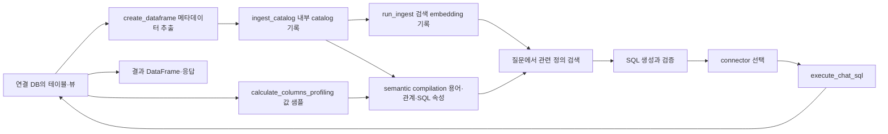

# Chapter 04. 메달리온과의 책임 경계: 데이터를 옮기는가, 의미를 만드는가

- 분석일: **2026-11-07**.
- 요청: 메달리온을 쓰지 않는 것처럼 보이는 Auto Ontology의 구조를 확인한다.
- 범위: catalog 수집·값 샘플링·semantic compilation·SQL 실행·connector 선택의 경계.
- 검증: 로컬 소스 정적 분석과 관련 테스트 assertion 확인. 서비스·DB·모델·테스트 실행 없음.
- 소스 식별: `code/auto-ontology/`는 자체 Git 저장소가 아닌 로컬 사본이다. upstream revision은 미확인이다.

## 1. 개념과 결론

**메달리온**은 원본 보존 Bronze, 상세 정제 Silver, 업무용 Gold로 데이터를 조직하는 패턴이다. **의미 계층**은 테이블·컬럼에 업무 용어·계산식·관계를 연결하는 정의다. **Connector**는 연결 DB의 구조와 값을 조회하는 실행 코드다. **Embedding**은 관련 정의를 검색하기 위해 텍스트를 숫자 벡터로 바꾼 것이다. 프로젝트 용어는 [용어집](chapter-00-glossary.md), 외부 아키텍처 비교는 [조사 문서](../../../.codex/research/data-platform-architecture/01_medallion_vs_semantic_layer.md)를 참조한다.

**[확인 사실]** 아래 수집·컴파일·질의 경로는 catalog·의미 정의·검색 자료를 준비하고 연결 DB에서 SQL을 실행한다. **[해석]** 이 경로를 업무 데이터의 Bronze→Silver→Gold 적재·변환기로 이해하는 것은 맞지 않는다.

그러나 연결 대상이 이미 Gold 테이블을 제공하는지 여부는 별개다. 소스에서 Bronze/Silver/Gold라는 이름을 찾지 못했다고 연결 DB까지 메달리온을 쓰지 않는다고 단정할 수 없다.

## 2. 호출 사슬과 저장 경계

아래 경로는 준비 작업과 질문 처리의 관계를 단순화한 것이며, 두 작업을 매 요청마다 연속 실행한다는 뜻은 아니다.

| 단계 | 함수·코드 근거 | 입력→출력·저장 |
|---|---|---|
| 연결 정보 수집 | [create_dataframe](../../../code/auto-ontology/auto_ontology/catalog/extract.py) | connector → 테이블·컬럼·뷰·질의·PK/FK DataFrame |
| catalog 기록 | [ingest_catalog](../../../code/auto-ontology/auto_ontology/catalog/ingest.py) | 추출 모델 → `populate_tabular_data` → ID가 붙은 tables/columns DataFrame |
| 검색 자료 생성 | [run_ingest](../../../code/auto-ontology/auto_ontology/ingestion_service/ingest.py) | catalog → embedding row → batch embedding·VDB 저장 |
| 원본 값 관찰 | [calculate_columns_profiling](../../../code/auto-ontology/auto_ontology/semantic/visit_enter.py) | 연결 DB의 제한 샘플 → sample_values·고유성·형식 등의 catalog 정보 |
| 의미 구성 | [run_semantic_compilation](../../../code/auto-ontology/auto_ontology/semantic/compile.py) | catalog·domain summary → 의미 정의·semantic FK·SQL 속성·embedding |
| 대상 DB 결정 | [resolve_connector_from_tables](../../../code/auto-ontology/auto_ontology/retrieval/text_to_sql/connector_routing.py) | 관련 table dict와 connectors → 단일 connector 또는 오류 |
| SQL 실행 | [_run_sql](../../../code/auto-ontology/auto_ontology/retrieval/text_to_sql/agents/sql_execution.py), [execute_chat_sql](../../../code/auto-ontology/auto_ontology/retrieval/text_to_sql/chat_sql.py) | SQL·connector → DataFrame·JSON 응답 또는 error |

### 데이터와 메타데이터의 구별

`catalog/extract.py::create_dataframe()`은 `get_tables`, `get_columns`, `get_views`, `get_queries`, `get_pks`, `get_fks`를 부른다. 여기의 DataFrame은 일반 업무 테이블 전체를 애플리케이션 저장소에 복제한 결과와 다르다.

다만 `semantic/visit_enter.py::calculate_columns_profiling()`은 실제 값의 제한 샘플을 조회하며 sample_values 등을 저장한다. 따라서 ‘원본 값이 전혀 저장되지 않는다’는 설명도 부정확하다. **전체 분석 데이터 복제**와 **샘플·프로파일·검색 자료 저장**을 구별해야 한다.

### SQL 속성과 물리화 테이블의 구별

`semantic/compile.py`는 semantic FK 해석, 질의 이력 기반 SQL 속성 제안, bridge 관련 SQL 속성 구성을 호출한다. 여기서 SQL 식·관계를 모델에 기록하는 일은 그 계산 결과를 Gold 데이터셋으로 지속 적재하는 일과 다르다. 전체 compiler의 모든 구현을 재분석한 것은 아니며, 세부 생성·수정 보존 정책은 기존 계획의 semantic compilation 단계에 남긴다.

## 3. 조건 분기·실패가 의미하는 것

| 지점 | 조건·처리 | 비교에 주는 의미 |
|---|---|---|
| `ingest_catalog` | connector/추출 결과가 없으면 빈 DataFrame 쌍 | 수집 호출 자체가 데이터 준비 성공을 보장하지 않음 |
| `create_dataframe` | table filter 적용·컬럼 coverage 확인 | 검색 범위를 제한할 수 있지만 원본 권한 적용과는 별도 |
| `run_ingest` | catalog 기록 뒤 embedding 단계 진행 | 업무 데이터 정제 완료 gate가 아님 |
| `_run_semantic_compilation` | cancellation이면 후속 FK·SQL 속성·bridge 단계 생략 | 중간 의미 객체 존재와 전체 완료는 다를 수 있음 |
| `resolve_connector_from_tables` | 여러 `database_name`이면 ValueError | 자동 분산 JOIN 엔진으로 보면 안 됨 |
| 같은 함수 | DB 이름이 없고 connector가 여러 개면 오류 | 임의 DB에서 실행하지 않도록 모호성을 거부 |
| `execute_chat_sql` | timeout 지원 connector에만 시간 제한 전달 | 실제 실행 통제는 connector 지원에 의존 |
| `_run_sql` | 실행 예외를 error 응답으로 변환 | 의미 모델이 있어도 연결 DB 실패가 질의에 영향 |

## 4. 교차 DB 실행 제한

`resolve_connector_from_tables()`는 관련 테이블의 `database_name` 집합을 만든다. 값이 둘 이상이면 `a single statement cannot be routed across them`이라는 오류를 발생시킨다.

**[확인 사실]** 이 코드 경로는 서로 다른 Auto Ontology 연결 DB를 자동으로 JOIN하지 않는다. **[주의]** 하나의 connector가 연결된 상위 엔진에서 이미 여러 catalog를 조회할 수 있는 경우까지 불가능하다는 뜻은 아니다. 그 가능성은 엔진·권한·생성기·라우팅의 실제 설정을 검증해야 한다.

연결 여러 개 등록 → 개념 통합 → 실행 통합을 같은 기능으로 취급하지 않는다. 메달리온 방식의 물리적 통합이나 별도 federation이 필요한 환경인지 따져야 한다.

## 5. Databricks와 Gold·Silver 연결 가능성

[DatabricksDatabase](../../../code/auto-ontology/auto_ontology/connectors/databricks.py)는 `execute`, `get_tables`, `get_columns`, `get_views` 등을 제공하고 schema 필터와 catalog/schema/table 식별자를 처리한다.

**[해석]** Gold·Silver가 해당 connector에서 조회 가능한 테이블·뷰로 노출되어 있다면 그것을 Auto Ontology의 연결 대상으로 삼는 구성을 검토할 수 있다. 메달리온이라는 이름을 인식할 필요 없이 실행 가능한 관계형 객체로 다룰 수 있기 때문이다.

**[미확인]** 특정 metric view의 목록 추출·표현·쿼리 문법, 실제 Gold 데이터 접근 권한, 대용량 성능은 실행 검증하지 않았다. Databricks 지원이라는 사실을 모든 Unity Catalog 고급 객체의 완전 지원으로 확대하지 않는다.

## 6. 관련 테스트를 어디까지 확인했나

- [test_connector_routing.py](../../../code/auto-ontology/auto_ontology/retrieval/text_to_sql/tests/test_connector_routing.py): 테이블의 DB에 맞는 connector 선택, 여러 connector에서 DB 누락 오류, 단일 connector fallback, target DB 정규화·미등록 거부 assertion을 확인했다.
- [test_databricks.py](../../../code/auto-ontology/auto_ontology/connectors/tests/test_databricks.py): schema filter에 의한 introspection 범위와 registry 생성 assertion을 확인했다.
- 현재 routing 코드의 교차 DB 거부는 직접 읽었다. 위 테스트 파일에서 교차 DB 거부 assertion까지 확인했다고 주장하지 않는다.
- 테스트 실행·라이브 DB 연결은 하지 않았다. 테스트가 존재한다는 사실을 실제 배포 성공의 증거로 사용하지 않는다.

## 7. 사용자 관찰에 대한 판단

| 판단 | 상태 |
|---|---|
| 자체 메달리온 정제 파이프라인이 확인한 주경로의 역할은 아니다 | 코드에 근거한 해석·높음 |
| 기존 메달리온 데이터 위에서도 의미 계층으로 동작할 수 있다 | 코드에 근거한 설계 가능성, 실제 연결 미검증 |
| upstream 데이터가 메달리온을 사용하지 않는다 | 미확인 |
| Auto Ontology가 데이터 정제·역사 보존·교차 DB JOIN을 모두 대신한다 | 근거 없음; routing은 자동 교차 DB 실행 거부 |
| 메달리온 미채택의 내부 설계 이유 | 직접 확인하지 않음 |

후속 비교의 핵심은 **연결된 데이터가 어느 품질·집계 단계에 있고, 의미 모델이 어떤 승인된 객체를 참조하는가**다. 장단점·결합안·실험 설계는 [외부 조사](../../../.codex/research/data-platform-architecture/01_medallion_vs_semantic_layer.md)에 정리했다.
