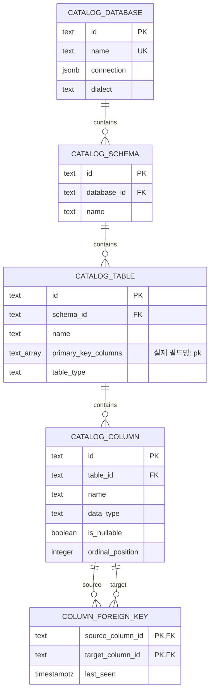
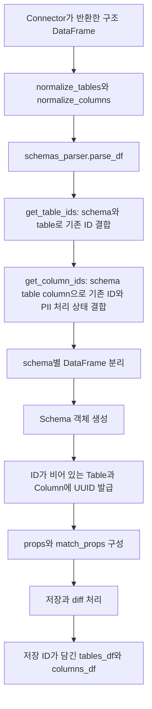
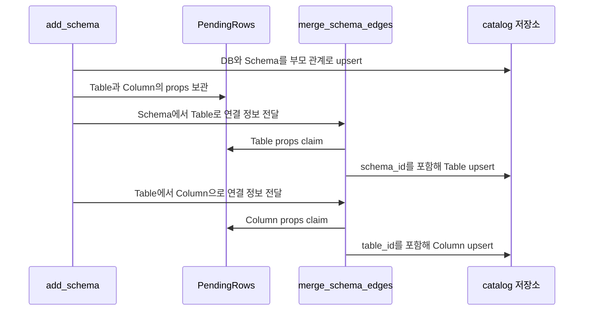

# Chapter 01. Catalog 엔티티와 식별자

- 분석일: 2026-11-07
- 대상: `dal/schema.py`, `catalog/model/`, `catalog/parsers/`, catalog 저장·차이 계산 코드, `dal/datasources.py`
- 목표: 원본 DB 구조를 어떤 객체로 저장하며, 재수집·수정·삭제 후에도 무엇을 같은 객체로 취급하는지 이해한다.
- 검증: 코드와 관련 테스트의 조건·assertion을 읽은 정적 분석이다. DB·모델 호출과 테스트 실행은 하지 않았다.
- 선행: [아키텍처 개요](../01-architecture/chapter-01-overview.md), [전체 용어집](../01-architecture/chapter-00-glossary.md)

## 1. 먼저 구분할 용어

| 용어 | 이 chapter에서의 뜻 |
| --- | --- |
| Catalog | 원본 DB의 이름·구조·키·설명을 앱 안에 기록한 목록. 원본 데이터 행 전체를 저장한 사본은 아니다. |
| Entity, 엔티티 | 별도 ID를 갖고 저장하는 대상. 여기서는 DB·schema·테이블·컬럼이다. |
| Schema | DB 안의 테이블 이름 공간. `sales.orders`에서 `sales`에 해당한다. 코드의 `Schema` 클래스는 이 공간의 테이블·컬럼을 묶은 메모리 객체다. |
| PK / FK | Primary Key(행 식별용 기본 키) / Foreign Key(다른 행을 참조하는 외래 키). 원본 테이블의 키와 catalog 내부 객체 간 키를 구분한다. |
| UUID / 대리 키 | 이름과 별도로 발급하는 고유 식별자 / 업무 이름 대신 내부 참조에 쓰는 키. 여기서는 UUID 문자열을 `id`에 저장한다. |
| 자연 키 | 해당 대상을 업무·구조상 구별하는 값의 조합. 예: 같은 schema 안의 테이블명. |
| Unique / nullable / NULL | 중복 금지 제약 / 값이 비어도 되는 성질 / 값이 없거나 미확정인 저장 상태. Python의 `None`, pandas의 `pd.NA`와 변환이 필요하다. |
| Cascade / transaction | 부모 삭제에 연결된 자식 삭제 / 함께 저장을 확정·취소할 작업 단위. |
| Upsert / diff | 이미 있으면 갱신하고 없으면 추가 / 이전 저장 상태와 새 입력의 차이 계산. |
| DataFrame / parser / reader·writer | Python의 행·열 표 / 내부 표현 변환 코드 / 저장소를 읽는·쓰는 코드. |
| PII | Personally Identifiable Information, 개인 식별 정보. `pii_processed`는 컬럼의 분류 처리 여부이며 PII 여부 자체와 다르다. |

이 chapter의 `DB id`, `table id`, `column id`는 내부 catalog 객체의 ID다. 예를 들어 고객 테이블의 원본 기본 키 `customer_id=42`와 그 **테이블 객체**의 `id="t-customer"`는 완전히 다른 값이다. 뒤의 짧은 ID들은 설명용이며 실제 생성값은 UUID 문자열이다.

## 2. 무엇을 왜 저장하는가

질문 처리에는 ‘orders라는 이름이 있다’보다 더 많은 정보가 필요하다. 어느 DB·schema의 orders인지, 어떤 컬럼이 있으며 값의 자료형은 무엇인지, 다른 테이블과 어떤 키로 연결되는지 알아야 한다. 또한 사용자 설명·의미 속성·검색 결과가 같은 테이블·컬럼을 다시 가리킬 수 있어야 한다.

이를 위해 catalog는 네 종류의 객체에 별도 ID를 부여하고 부모 관계를 저장한다. 실제 구조 정의는 SQLAlchemy Core의 `Table` 객체다. SQLAlchemy Core는 Python에서 SQL과 테이블 구조를 표현하는 도구이며, 여기의 Table 객체는 원본 테이블이 아니라 **애플리케이션 저장 테이블 정의**다.

도식의 `o{`는 부모 하나에 자식이 0개 이상 존재할 수 있다는 뜻이다. `UK`는 unique key(중복 금지 키)다. Schema·Table·Column의 부모와 이름을 묶은 복합 unique 제약은 아래에서 따로 설명한다. `COLUMN_FOREIGN_KEY`는 실제 저장명 `column__foreign_key`를 도식용으로 표현했다.

원본의 `orders.customer_id → customer.customer_id` 관계는 catalog의 **두 column ID를 연결하는 행**이 된다. 반면 ‘컬럼이 어떤 테이블에 속하는가’는 `catalog_column.table_id`에 직접 저장한다. 부모·자식 관계마다 별도 edge 행을 만드는 구조가 아니다.

근거: [catalog와 column__foreign_key 정의](../../../code/auto-ontology/auto_ontology/dal/schema.py), [엔티티·부모 매핑 registry](../../../code/auto-ontology/auto_ontology/catalog/store/registry.py)

## 3. 객체를 구별하는 키는 무엇인가

| 객체 | 저장 테이블 | 내부 PK | 자연 키·unique 제약 | 부모 연결 |
| --- | --- | --- | --- | --- |
| Database | `catalog_database` | `id` | `name` 전체에서 유일 | 없음 |
| Schema | `catalog_schema` | `id` | `(database_id, name)` | `database_id` NOT NULL |
| Table | `catalog_table` | `id` | `(schema_id, name)` | `schema_id` NOT NULL |
| Column | `catalog_column` | `id` | `(table_id, name)` | `table_id` NOT NULL |
| 원본 FK 관계 | `column__foreign_key` | `(source_column_id, target_column_id)` | 두 내부 컬럼 ID 조합 | 양쪽 모두 catalog column 참조 |

따라서 `sales.orders`와 `archive.orders`는 이름이 같아도 부모 schema가 다르므로 다른 객체다. DB명은 catalog 전체에서 유일해야 하므로 서로 다른 접속 대상에 같은 database 이름을 넣는 문제를 host·port까지 자연 키로 구별해 주는 구조는 아니다.

`_id()`는 Text PK와 서버 기본값 `(gen_random_uuid())::text`를 정의한다. `gen_random_uuid()`는 Postgres의 UUID 생성 함수다. 하지만 catalog parser는 보통 저장 전에 Python에서 UUID를 만든다. 즉 ‘항상 DB가 id를 만든다’도, ‘항상 parser만 만든다’도 정확하지 않다. 일반 수집은 parser가 준비한 값을 쓰고, id를 생략한 insert에는 DB 기본값이 쓰일 수 있다.

`imported_id`는 모델 import/export에서 전달된 외부 ID를 보관하는 별도 필드다. unique 제약이 없으며 실제 `id`를 대체하는 PK가 아니다. 같은 원본 모델을 여러 DB에 가져오는 경우를 고려한 설계라고 코드 주석에 설명되어 있다.

근거: [_id·_imported_id·unique 제약](../../../code/auto-ontology/auto_ontology/dal/schema.py), [자연 키 registry](../../../code/auto-ontology/auto_ontology/catalog/store/registry.py), [CatalogNode 생성](../../../code/auto-ontology/auto_ontology/catalog/model/node.py)

## 4. 필드마다 출처와 의미가 다르다

### 4.1 Database와 Schema

| 필드 | 타입·조건 | 의미 |
| --- | --- | --- |
| `name` | Text, NOT NULL | 이름. Database는 전체 unique, Schema는 부모 안에서 unique |
| `connection` | Database의 JSONB, nullable | 웹에서 관리하는 연결 정보. Vault라는 별도 자격 증명 저장소 사용 시 이 필드는 비워 둘 수 있다. JSONB는 Postgres의 JSON 저장 형식이다. |
| `dialect` | Database의 Text | 원본 DB의 SQL 문법 종류 |
| `description` | Text, nullable | 설명. 원본 주석·사용자 작성 내용과 갱신 경로를 구분해야 한다. |
| `description_certified` | Boolean, NOT NULL, 기본 false | 사용자가 설명을 검토·인증했는지 나타내는 필드 |
| `owner_id` | Text, nullable | 사용자 또는 그룹의 소유권 ID. 서로 다른 종류를 담으므로 단일 FK로 연결하지 않는다. |
| `created` / `pulled` | Database의 timezone-aware 시각 | catalog DB 행 생성 / 수집 시각 기록. `pulled`를 모든 후속 작업 완료 신호로 간주하면 안 된다. |

`owner_id`는 Table에도 있지만 Column에는 없다. 코드 주석상 Column은 소속 Table의 소유자를 보여주는 방식이다. 삭제된 사용자·그룹을 FK cascade로 강제 정리하는 필드는 아니며, 이 장에서는 권한 판정까지 다루지 않는다.

### 4.2 Table

| 필드 | 타입·조건 | 의미·writer |
| --- | --- | --- |
| `pk` | `ARRAY(Text)`, nullable | 원본 기본 키의 **컬럼 이름 목록**. catalog 행 자신의 PK가 아니다. `add_pks()`가 기록한다. |
| `table_type` | Text, nullable | base table·view 같은 원본 relation 종류 |
| `is_junction_table` | Boolean, NOT NULL, 기본 false | 다른 대상을 연결하는 중간 테이블이라고 의미 처리에서 표식한 값. 이 표식을 불확실한 후속 추론만으로 지우지 않는 정책이 있다. |
| `description`, `description_certified`, `owner_id`, `imported_id` | 위 역할 참조 | 사용자가 관리한 정의·소유권과 외부 모델 ID |

원본 테이블의 `created` 값은 parser의 props에 들어갈 수 있지만 `catalog_table`에는 해당 저장 컬럼이 없다. 실제 writer의 `registry.projected()`는 저장 컬럼이 아닌 속성을 걸러낸다. DataFrame에 필드가 있다는 이유만으로 DB에도 같은 필드가 보존된다고 보면 안 된다.

### 4.3 Column

| 필드 | 타입·기본값 | 의미·주요 작성 경로 |
| --- | --- | --- |
| `data_type` | Text | 원본 자료형. 수집에서 갱신 |
| `ordinal_position` | Integer | 테이블 안 컬럼 위치. 원본 PK 구성 순서의 ordinal과는 다른 문맥 |
| `is_nullable` | nullable Boolean | NULL을 허용하는지. True·False·미확정 세 상태 |
| `sample_values` | **Text** | JSON으로 표현된 샘플 값 문자열. JSONB 컬럼이 아니다. profiling 등 후속 처리에서 기록 |
| `format` | Text | `YYMMDD`처럼 값이 적힌 형식. 값의 자료형과 다름 |
| `is_unique` | nullable Boolean | profiling이 판단한 유일성. 원본 DB의 unique constraint가 자동 생성된다는 의미가 아님 |
| `pii_processed` | Boolean, NOT NULL, 기본 false | PII 분류 처리를 수행했는지. 태그를 사람이 지웠다고 자동으로 미처리로 되돌리지 않는 정책 |
| `description`, `description_certified`, `imported_id` | 위 역할 참조 | 설명·검토 상태·외부 모델 ID |

자료형이 `text`인 `birthday` 값이 `950324`로 적혀 있다면 `data_type`은 저장 종류를, `format`은 비교할 값의 표기법을 설명한다. 이 구분은 날짜 조건 SQL 생성에서 필요하다.

근거: [필드와 설계 주석](../../../code/auto-ontology/auto_ontology/dal/schema.py), [속성 projection](../../../code/auto-ontology/auto_ontology/catalog/store/registry.py), [profiling 결과 writer](../../../code/auto-ontology/auto_ontology/dal/datasources.py)

## 5. 원본 메타데이터에서 내부 객체까지

### 5.1 정규화는 문자열·불리언 혼동을 막는다

`normalize_tables()`는 필요한 기본 필드를 채우고 table type의 누락값을 base table로 맞춘다. 시각은 UTC로 변환하고 마이크로초를 제거한다. 원본 `owner` 컬럼은 제거하지만 내부용 `id` 같은 추가 필드는 남긴다.

`normalize_columns()`는 위치를 숫자로 변환하고 nullable을 `coerce_nullable()`로 처리한다. **`bool("NO")`는 True**이므로 문자열의 존재 여부로 nullable을 읽으면 의미가 뒤집힌다. 함수는 다음처럼 명시적으로 변환한다.

| 입력 예 | 변환 |
| --- | --- |
| `True`, `"YES"`, `"TRUE"`, `"1"` | True |
| `False`, `"NO"`, `"FALSE"`, `"0"` | False |
| `None`, `pd.NA`, 숫자 NaN, 빈 문자열 | None에 해당하는 미확정 값 |
| `"maybe"` 등 인식 불가 | ValueError |

정규화 결과는 pandas의 nullable `boolean` 타입이다. 이후 `Schema.reset_columns_props()`에서 `pd.NA`를 Python `None`으로 바꿔 DB driver에 전달한다. 단순한 타입 정리가 아니라 잘못된 NULL 허용 정보·저장 실패를 막는 데이터 계약이다.

### 5.2 이름을 소문자로 쓰는 부분과 그렇지 않은 부분

`Schema`는 내부 조회 보조 필드 `table_name_lower`, `column_name_lower`와 `full_name`을 만든다. 컬럼의 보조 이름에서는 양쪽 큰따옴표도 제거한다. 하지만 기존 ID 결합은 `table_schema`, `table_name`, `column_name` 원래 필드로 DataFrame merge를 한다. Unique 제약도 이름에 대해 별도 lower 표현식을 정의한 형태가 아니다.

따라서 일부 내부 검색이 소문자를 쓴다는 사실을 ‘모든 식별·재수집이 대소문자 무시’로 확대할 수 없다. 대소문자가 다른 quoted identifier(큰따옴표로 구분한 DB 이름)의 동시 처리는 connector별 별도 확인이 필요하다.

근거: [normalize](../../../code/auto-ontology/auto_ontology/catalog/normalize.py), [parse_df](../../../code/auto-ontology/auto_ontology/catalog/parsers/schemas_parser.py), [Schema 초기화·props](../../../code/auto-ontology/auto_ontology/catalog/model/schema.py), [기존 ID 결합](../../../code/auto-ontology/auto_ontology/catalog/store/schemas.py)

## 6. ID 유지에는 두 겹의 장치가 있다

### 6.1 저장 전 기존 ID 조회

`get_table_ids(tables_df, database_name)`은 지정 DB의 저장 목록을 읽어 `(table_name, table_schema)`로 left merge한다. Left merge는 새 원본 목록을 모두 유지하면서 일치하는 저장 ID를 덧붙이는 결합이다.

`get_column_ids()`는 같은 방식에 `column_name`을 더하고 `pii_processed`도 가져온다. 그 뒤 `Schema.__init__()`은 ID가 비어 있는 행에만 UUID를 발급한다.

| 원본 경로 | 이전 catalog ID | 새 parser ID |
| --- | --- | --- |
| `shop.sales.orders` | `t-orders` | `t-orders` 재사용 |
| `shop.sales.orders.total` | `c-total` | `c-total` 재사용 |
| 새 컬럼 `shop.sales.orders.discount` | 없음 | 새 UUID |
| `shop.archive.orders` | 다른 schema의 별도 ID | 해당 ID 재사용 또는 신규 발급 |

Database node는 이름으로 찾고, Schema node는 DB명과 schema명으로 찾는다. Table·Column처럼 모든 node의 임시 UUID를 그대로 최종 ID로 고정하는 구조가 아니다.

### 6.2 저장 시 기존 ID 보존

`upsert_row()`의 핵심 순서는 다음과 같다.

1. `registry.entity_spec(label)`로 저장 테이블·부모 컬럼·자연 키를 고른다.
2. `registry.projected()`로 실제 저장 컬럼만 남긴다.
3. `resolve_id()`로 ID 또는 자연 키에 해당하는 행을 찾는다. Schema의 DB명은 실제 부모 DB ID로 해석한다.
4. 기존 행이 있으면 **기존 id를 유지**하고 `on_match`에 전달한 갱신 속성만 반영한다.
5. 없으면 insert한다. 동시에 같은 자연 키를 추가한 요청이 충돌하면 `ON CONFLICT`로 병합하고 기존 ID를 덮어쓰지 않는다.
6. 실제 저장된 id를 반환한다.

`ON CONFLICT`는 unique 제약 충돌 때 수행할 동작을 정하는 Postgres 구문이다. 이 분기에서 자연 키 조회와 충돌 대상이 불일치해 ID를 재해석하지 못하면 RuntimeError를 내므로, 잘못된 ID를 다음 자식 저장으로 넘기는 것을 막는다.

이 두 겹의 장치는 Term(업무 개념 객체) 연결·SQL 참조·vector metadata 등이 재수집만으로 다른 객체를 가리키는 문제를 줄인다. Vector는 의미 검색에 쓰는 숫자 목록이고, metadata는 검색 결과에 붙이는 객체 ID 등의 부가정보다. 다만 모든 동시 수집·이름 변경 상황의 안전성까지 보증한 것은 아니다.

근거: [get_table_ids·get_column_ids](../../../code/auto-ontology/auto_ontology/catalog/store/schemas.py), [resolve_id·upsert_row](../../../code/auto-ontology/auto_ontology/catalog/store/rows.py)

## 7. ‘노드 생성 뒤 연결’이 곧바로 insert 두 번은 아니다

`add_schema()`는 DB→Schema 연결을 저장한 뒤 Table·Column node들을 만들고 계층 edge를 처리한다. 여기서 edge는 호출 데이터의 관계 표현이며 항상 별도 관계 테이블을 뜻하지 않는다.

관계형 저장소에서는 Table의 `schema_id`, Column의 `table_id`가 NOT NULL이라 부모 ID 없이 자식을 먼저 insert할 수 없다. `merge_schema_nodes()`는 이 자식 props를 `PendingRows`에 잠시 보관하고, `merge_schema_edges()`에서 부모 ID를 알게 됐을 때 `upsert_row(parent_id=...)`를 호출한다.

`PendingRows`는 `add_schema()` 호출마다 별도로 만들고 lock으로 보호한다. Claim은 보관한 항목을 꺼내 제거하는 동작이다. 이름이 node·edge·graph인 코드를 보고 현재 저장소를 별도 그래프 DB로 오해하지 않도록 이 경계를 구분해야 한다.

근거: [add_schema](../../../code/auto-ontology/auto_ontology/catalog/services/schema.py), [PendingRows·merge_schema_nodes·merge_schema_edges](../../../code/auto-ontology/auto_ontology/catalog/store/schemas.py)

## 8. 재수집 시 무엇을 유지하고 바꾸는가

`write.py::populate_db()`는 DB의 자식 schema가 있는지 보고 초기 저장과 diff를 나눈다. 기존 DB에서는 schema 추가·갱신·삭제를 구분한다. 기존 schema의 table·column 변경은 `update_diff_from_existing_schema()`가 계산한다.

| 원본 변화·상태 | 확인한 처리 | ID·부가 정보에 미치는 영향 |
| --- | --- | --- |
| 같은 경로·변화 없음 | 저장 ID를 재사용하고 변화 집합을 계산 | 기존 객체를 새 객체로 만들 이유가 없음 |
| 컬럼 자료형·nullable 변경 | 두 필드를 비교해 update 후보를 만듦 | 기존 column ID를 지정해 갱신 |
| 같은 테이블의 type 변경 | `table_type` 등 원본 소유 필드를 비교 | 기존 table ID로 갱신 |
| 새 테이블·컬럼 | 계층 edge writer로 추가 | 새 ID와 부모 관계 |
| 삭제된 테이블·컬럼 | 내부 catalog 객체 삭제 | FK cascade·별도 정리 범위가 적용됨 |
| 컬럼 이름 변경 | 이름 기반 diff에서 이전 이름 삭제·새 이름 추가 | 기존 객체에 붙은 설명·속성이 새 이름으로 자동 이동한다고 볼 수 없음 |
| 사용자 설명이 이미 있음 | update writer는 `coalesce(기존 description, 새 description)` 사용 | 기존 설명이 NULL이 아니면 유지. 인증 여부만을 조건으로 삼는 것은 아님 |

`coalesce`는 앞에서부터 첫 번째 NULL 아닌 값을 고르는 SQL 함수다. 기존 설명이 빈 문자열이어도 NULL과 다르므로 유지될 수 있다. 한편 일반 upsert의 기존 행 갱신은 `on_match`에 명시한 필드만 반영한다. 설명을 포함한 `properties`를 전달했다는 사실만으로 기존 값을 덮어쓴다고 판단하면 안 된다.

현재 column diff의 update 후보 판정은 `data_type`, `is_nullable` 비교다. `ordinal_position`만 변한 경우 같은 update 경로가 실행된다고 단정할 수 없다. 반면 다른 구조 필드 변경으로 update가 선택되면 전체 전달 props에 위치가 함께 포함될 수 있다. 이 점은 source-owned 필드 목록과 실제 diff 조건을 함께 봐야 드러난다.

`load_schema_from_graph()`는 저장 테이블 또는 컬럼 목록이 비어 있으면 None을 반환하고, diff 함수는 이때 바로 return한다. ‘불완전한 schema를 발견하면 반드시 이번 pass에서 복구한다’고 설명할 수는 없다. 이 상태의 실제 복구 조건은 수집 상세 단계에서 이어 확인한다.

근거: [DB별 초기·재수집 분기](../../../code/auto-ontology/auto_ontology/catalog/write.py), [실제 column diff](../../../code/auto-ontology/auto_ontology/catalog/diff.py), [description 보존 writer](../../../code/auto-ontology/auto_ontology/catalog/store/db.py), [source-owned 갱신 목록과 loader](../../../code/auto-ontology/auto_ontology/catalog/store/schemas.py)

## 9. 원본 PK·FK는 어떻게 표현하는가

### 9.1 원본 PK는 Table의 문자열 배열

`add_pks()`는 DB 범위의 `(schema, table) → table_id` 지도를 읽고 원본 PK 컬럼들을 테이블별로 묶는다. `ordinal_position`이 있으면 숫자로 바꾸고 안정 정렬해 복합 키 순서를 보존한다. 이 위치는 **PK 내부의 순서**이며 catalog column의 테이블 내 위치와 다를 수 있다.

`(order_id, line_no)` 복합 키는 `catalog_table.pk = ["order_id", "line_no"]`로 기록된다. `write.py::populate_pks()`는 기존 PK reset과 새 목록 반영을 하나의 transaction으로 묶는다. 이 배열이 catalog_column.id의 목록인 것은 아니다.

### 9.2 원본 FK는 column ID 쌍

`add_fks()`는 같은 DB 범위의 `(schema, table, column) → column_id` 지도를 만들고 원본 FK 양끝을 해석한다. 수집 범위 밖의 테이블을 참조해 어느 한쪽 ID가 없으면 건너뛴다. 같은 쌍을 중복 제거한 뒤 `(source_column_id, target_column_id)`로 upsert하며 `last_seen`을 이번 시각으로 갱신한다.

`delete_old_fks()`는 **이번 DB에서 출발하는 관계 중** last_seen이 NULL이 아니고 이번 시각과 다른 것을 제거한다. NULL인 imported FK를 무조건 오래된 관계로 지우지 않는 조건이 있다. FK 추가와 오래된 FK 정리는 같은 transaction으로 묶는다.

이 저장 모델은 컬럼 쌍을 표현한다. 복합 FK의 constraint 이름·그룹·원본 제약 전체를 보존하는 모델이라고 확대해서는 안 된다. 의미 FK와 join 경로는 후속 관계 분석 범위다.

근거: [add_pks·add_fks·delete_old_fks](../../../code/auto-ontology/auto_ontology/catalog/store/schemas.py), [PK·FK transaction](../../../code/auto-ontology/auto_ontology/catalog/write.py)

## 10. 삭제와 조회의 경계

### 삭제

catalog 부모 FK는 `ON DELETE CASCADE`다. Database 삭제는 Schema·Table·Column, Schema 삭제는 Table·Column, Table 삭제는 Column 삭제로 이어진다. FK 관계 행도 양끝 column 참조에 cascade가 있어 대상 컬럼 삭제에 영향을 받는다.

`delete_schema()`, `delete_table()`, `delete_columns_batch()`는 삭제 대상 컬럼과 연결된 의미 속성의 PII 태그 정리를 먼저 하고 실제 삭제와 같은 transaction으로 묶는다. 그렇다고 관련 의미 정의·vector가 전부 자동으로 삭제된다고 가정하면 안 된다. 각 참조 테이블의 FK와 별도 reset 경로를 확인해야 하며, 이 부분은 다음 chapter와 저장 경계 chapter에서 이어 다룬다.

### 조회

`get_schema_columns()`는 Column→Table→Schema→Database를 join해 DB명·schema명으로 범위를 제한하고, diff가 기대하는 `database`, `table_schema`, `table_name`, `column_name`, `id` 등을 반환한다.

`fetch_table_context(table_id)`는 컬럼의 ID·자료형·설명·위치·샘플·형식과 FK 대상 표식, 해당 테이블의 FK 목록을 제공한다. 의미 추론과 질의 준비가 실제 구조를 읽는 연결 지점이다.

반면 `find_table_id_by_name(table_name, database_name)` 같은 일부 편의 함수는 schema를 입력받지 않는다. DB명이 없고 여러 후보가 나오면 None을 반환하지만, DB명으로 제한된 경우에는 limit 1을 쓴다. 따라서 **같은 DB 안 여러 schema의 동명 테이블**까지 항상 모호성을 차단한다고 볼 수 없다. 데이터 모델의 완전한 식별 경로와 각 reader의 입력 범위를 구분해야 한다.

근거: [삭제 처리](../../../code/auto-ontology/auto_ontology/catalog/store/db.py), [schema reader](../../../code/auto-ontology/auto_ontology/catalog/store/schemas.py), [context·이름 조회 함수](../../../code/auto-ontology/auto_ontology/dal/datasources.py)

## 11. 작은 예시로 전체 변화 보기

가상 원본 DB `shop`에 `sales.customer(customer_id, name)`와 `sales.orders(order_id, customer_id, total)`가 있다고 하자.

| 상황 | 원본과 내부 표현 |
| --- | --- |
| 최초 수집 | `shop → sales → orders → total` 각각의 내부 객체와 ID를 만든다. orders 원본 PK는 `["order_id"]`다. |
| FK 기록 | orders.customer_id의 **column ID**와 customer.customer_id의 **column ID**를 관계 행으로 잇는다. |
| 사용자 설명 저장 | total 객체의 description에 ‘주문 합계’를 적는다. |
| total의 자료형 변경 | 이름·소속으로 기존 ID를 찾아 자료형을 갱신한다. 기존 설명은 보존 writer의 영향을 받는다. |
| total을 amount로 rename | total 삭제·amount 추가로 계산한다. 기존 설명·의미 속성이 자동으로 따라간다고 가정하지 않는다. |
| archive.orders 추가 | sales.orders와 다른 schema_id 아래 별도 table ID를 갖는다. |
| sales.orders 삭제 | 내부 table과 자식 column, 관련 FK 행의 cascade를 확인해야 한다. 모든 의미·vector 자료까지 한 번에 삭제되는지는 별도 문제다. |

이 예시는 식별 규칙을 설명한 것이며 실제 코드를 실행한 결과가 아니다.

## 12. 테스트로 확인한 의도와 남은 질문

| 근거 테스트 | 읽어 확인한 기대 조건 | 이번 실행 여부 |
| --- | --- | --- |
| `test_rows_and_links.py::test_insert_then_match_returns_the_same_row` | 같은 자연 키로 두 번 저장하면 같은 ID와 행 1개 | 미실행 |
| `test_stored_id_survives_a_match_with_a_different_incoming_id` | 다른 incoming ID가 있어도 기존 ID 보존 | 미실행 |
| `test_unknown_properties_are_dropped_not_rejected` | 저장 컬럼이 아닌 props는 무시 | 미실행 |
| `test_incremental_ingest.py::test_reingest_without_changes_is_a_no_op` | 재수집 전후 객체 수 동일. ID 전체 동일성을 직접 검사하는 assertion은 아님 | 미실행 |
| `test_changed_column_type_is_updated_in_place` | 자료형이 바뀌어도 기존 column ID 유지 | 미실행 |
| `test_renamed_column_is_add_plus_drop` | 새 이름이 있고 이전 이름이 없음. 부가 정의의 이동까지 직접 검사하지는 않음 | 미실행 |
| `test_normalize_nullable.py`의 변환 테스트 | `"NO"`→False, 미확정값 유지, 미인식 값 예외 | 미실행 |
| `test_ingest.py::test_concatenates_every_schema_and_keeps_them_distinguishable` | 반환 DataFrame이 schema 구분과 ID를 유지 | 미실행 |

재수집·저장 테스트에는 실제 Postgres와 임시 원본 DB를 사용하는 코드가 있다. 이번에는 분석 문서 작업으로 테스트 소스만 읽었고, 해당 DB 생성·삭제나 서비스 호출은 하지 않았다.

근거: [row·link 테스트](../../../code/auto-ontology/auto_ontology/catalog/store/tests/test_rows_and_links.py), [재수집 테스트](../../../code/auto-ontology/auto_ontology/catalog/tests/test_incremental_ingest.py), [nullable 테스트](../../../code/auto-ontology/auto_ontology/catalog/tests/test_normalize_nullable.py), [ingest 반환 계약 테스트](../../../code/auto-ontology/auto_ontology/catalog/tests/test_ingest.py)

다음 chapter에서는 Term(업무 개념), ColumnAttribute(컬럼과 업무 개념을 연결한 의미 속성), SqlAttribute(업무 개념에 연결한 SQL 표현)의 관계와 catalog 삭제·수정이 이 객체들에 미치는 영향을 추적한다. 남은 쟁점은 대소문자·동명 schema 조회, 불완전한 schema의 복구 조건, ordinal만 바뀐 재수집, 전체 삭제·vector 정합성이다. 발견한 조건은 문서화했으며 이번 작업에서 원본 코드를 변경하지 않았다. [진행 계획](../../../.codex/plan/auto-ontology/01-2_data-model.md)
