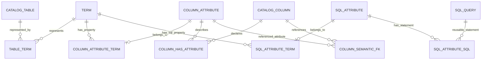
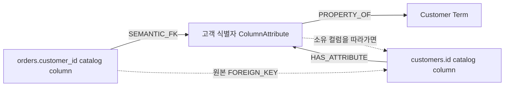
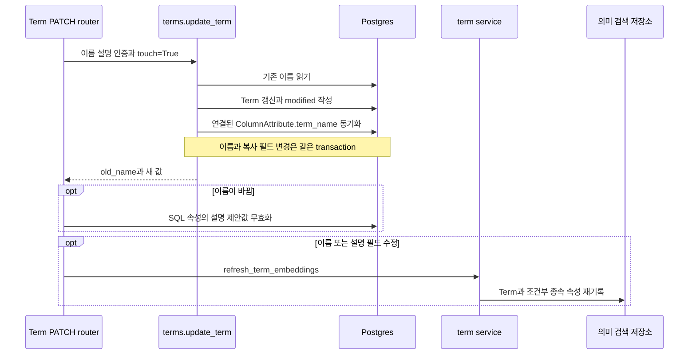

# Chapter 02. 의미 계층의 객체·관계와 수정·인증

- 분석일: 2026-11-07
- 범위: Term·ColumnAttribute·SqlAttribute의 저장 제약, 생성·수정 함수, 관계 조회, 인증 집계와 삭제 경계
- 방법: schema·DAL·service·router와 관련 테스트를 대조한 정적 분석. 서비스·DB·모델·테스트는 실행하지 않았다.
- 선행: [Catalog 엔티티와 식별자](chapter-01-catalog-entities.md), [프로젝트 용어집](../01-architecture/chapter-00-glossary.md)

## 1. 이 chapter의 용어와 예시

| 용어 | 쉬운 뜻 |
| --- | --- |
| 의미 계층 | 실제 데이터 구조에 업무 개념·속성·계산식·관계를 연결한 정의 모음 |
| Term | Customer·Order 같은 업무 개념을 저장한 객체 |
| ColumnAttribute | 물리 컬럼에 업무 의미를 붙이고 Term에 연결하는 속성 객체 |
| SqlAttribute | 재사용할 SQL 표현을 저장하고 업무 개념 등에 연결하는 객체 |
| PK / FK / unique | 저장 행 식별용 기본 키 / 다른 행 참조 / 중복 금지 제약 |
| 연관 테이블 | 두 종류 객체의 ID 쌍을 저장하는 연결용 테이블 |
| Cardinality | 하나의 객체에 몇 개의 다른 객체를 연결할 수 있는지 나타내는 관계 수 |
| DAL / service / router | DB 접근 코드 / 여러 처리를 조율하는 코드 / HTTP 요청을 함수로 연결하는 코드 |
| Upsert / merge key | 없으면 추가하고 있으면 갱신 / 같은 객체로 취급할 필드 조합 |
| 비정규화 복사 필드 | 다른 객체의 이름 등을 빠른 조회를 위해 한 번 더 저장한 필드. 원본 변경 시 동기화가 필요함 |
| Certified / certification | 사용자가 정의를 검토했다는 표식 / 여러 표식을 합친 상태. 쓰기 잠금과 같은 개념이 아님 |
| Embedding / VDB | 의미 검색용 숫자 표현 / 이 숫자를 저장·검색하는 저장소 |
| PII | Personally Identifiable Information, 개인 식별 정보. 이 코드의 PII 태그는 관련 정보 분류 표식이다. |

가상 테이블 `customers(id, name)`와 `orders(id, customer_id, amount)`를 예로 사용한다. `Customer`는 Term, `customers.id`의 ‘고객 식별자’는 ColumnAttribute, 주문 금액을 집계하는 SQL은 SqlAttribute의 후보 예시다. 실제 LLM 출력이나 실행 결과를 재현한 것은 아니다.

## 2. 세 객체를 분리한 이유

Catalog의 column은 ‘어디에 어떤 자료형의 값이 있는가’를 표현한다. ColumnAttribute는 ‘그 컬럼이 어떤 업무 속성인가’를 표현한다. Term은 여러 속성을 묶는 업무 개념이고, SqlAttribute는 원본 컬럼 하나만으로 표현할 수 없는 계산이나 재사용 SQL을 연결한다.

| 구분 | 가상 예시 | 물리 데이터와의 연결 |
| --- | --- | --- |
| Catalog column | `customers.id` | 원본 DB·schema·table 소속과 자료형 |
| Term | `Customer` | `table__term`을 통해 customers와 연결 |
| ColumnAttribute | `고객 식별자` | Term 연결과 물리 column 연결을 각각 가짐 |
| SqlAttribute | `고객별 주문 합계` | 저장 SQL을 통해 참조 테이블·컬럼을 추적하고 Term에 연결 가능 |

이렇게 나누면 질문의 ‘고객’을 테이블 이름과 별개로 찾고, ‘매출’ 같은 계산을 저장한 SQL 정의로 해석할 수 있다. 이는 코드의 책임으로 해석한 목적이며, 모든 질의에서 검토된 정의만 쓰도록 강제된다는 뜻은 아니다.

## 3. 저장 모델의 관계 수와 자동 생성 정책



도식의 0개 가능 표시는 DB 제약의 허용 범위다. 정상 생성 함수가 의도한 연결과 미완성·import 상태를 모두 구분하기 위해 표시했다.

| 연결 | 저장 제약에서 확인한 범위 | 일반 처리 정책과 주의점 |
| --- | --- | --- |
| Table ↔ Term | `table__term`의 PK는 두 ID 쌍. 양쪽 단독 unique 없음 | 한 테이블에 여러 Term, 한 Term에 여러 테이블을 허용한다. 자동 compiler는 별도 table-private 정책을 사용한다. |
| ColumnAttribute → Term | 연결 행의 `attribute_id`에 unique | 한 속성이 동시에 여러 Term에 연결되지 않음. 연결 없는 속성 자체의 존재를 막지는 않는다. |
| Column ↔ ColumnAttribute | `column__has_attribute`는 두 ID 쌍만 unique | DB 제약상 다대다. 일반 merge는 지정 table·source column 하나를 연결하지만 모든 속성에 물리 컬럼이 정확히 하나라고 보장하지 않는다. |
| Column → 참조 ColumnAttribute | `column__semantic_fk`도 두 ID 쌍만 unique | 단일 컬럼별 unique가 없다. `use_in_join_paths`로 join 경로 사용 여부를 구분한다. |
| SqlAttribute → Term | `attribute_id` unique | 최대 한 Term. CustomAnalysis 경유 속성 등 Term 연결 없는 경우도 구분한다. |
| SqlAttribute ↔ SQL | ID 쌍 PK | 여러 SQL 연결·SQL 재사용을 모델상 허용한다. |

`_terms_with_assignments()`는 테이블별 추론 결과의 여러 Term 중, 실제 속성 후보에 연결되는 컬럼 할당이 하나 이상 있는 것만 남긴다. 즉 자동 처리에서도 무조건 ‘1 table = 1 Term’인 것은 아니다.

근거: [schema의 semantic tier](../../../code/auto-ontology/auto_ontology/dal/schema.py), [실제 할당이 있는 Term 선택](../../../code/auto-ontology/auto_ontology/semantic/visit_enter.py), [여러 물리 컬럼을 고려하는 속성 reader](../../../code/auto-ontology/auto_ontology/dal/terms.py)

## 4. Term의 필드와 이름 충돌 처리

### 4.1 Term의 식별 기준

| 필드 | 의미·제약 |
| --- | --- |
| `id` | 내부 식별자. 이름 변경에도 유지하는 참조 기준 |
| `name`, `source` | 둘의 조합이 catalog 전체에서 unique. DB별 unique가 아님 |
| `description` | 설명 |
| `synonyms` | 동의어 문자열 배열 |
| `name_certified`, `description_certified` | 이름·설명을 각각 검토했는지. 기본 false |
| `owner_id` | 소유 사용자·그룹 식별자 |
| `created`, `modified`, `created_by`, `modified_by` | 생성·사용자 수정의 시각·작성자 |
| `imported_id` | 외부 모델의 ID를 별도로 보관하는 값 |

자동 생성의 `source`는 `semantic`이다. 같은 source에서 `Customer` 이름을 여러 DB가 공유하면 unique 충돌이 날 수 있어 `upsert_table_term()`이 소유 테이블을 확인한다.

### 4.2 upsert_table_term의 실제 선택 순서

```text
table_id로 DB·schema·table 확인
  없으면 None
이름 후보를 순서대로 시도
  1. 제안 이름
  2. 제안 이름 (database.schema.table)
  3. 제안 이름 (table_id)
각 후보에 대해
  기존 Term이 있고 연결된 테이블 집합이 정확히 {현재 table_id}
    → 같은 Term ID로 description·synonyms 갱신
  기존 Term이 다른 소유 상태
    → 다음 후보
  기존 Term이 없음
    → insert 후 table__term 연결
세 후보 모두 실패하면 RuntimeError
```

기존 Term이 여러 테이블을 대표하거나 테이블 연결이 없는 경우도 첫 갱신 조건을 만족하지 않는다. 이것은 모델의 다대다 허용과 별개로, 자동 생성이 다른 테이블의 정의를 임의로 공유하지 않도록 하는 정책이다.

예를 들어 sales.orders가 `Record`를 먼저 가지면 다른 테이블의 같은 제안은 `Record (shop.sales.invoices)`처럼 저장될 수 있다. 테이블별 저장 차례를 정렬하는 pipeline은 이런 이름 소유가 LLM 응답 완료 순서에만 좌우되는 일을 줄인다.

근거: [upsert_table_term](../../../code/auto-ontology/auto_ontology/dal/terms.py), [정렬된 저장 차례](../../../code/auto-ontology/auto_ontology/semantic/pipeline.py)

## 5. ColumnAttribute는 ID 연결과 문자열 복사를 함께 가진다

ColumnAttribute의 unique merge key는 다음 다섯 필드다.

```text
(name, source_column, term_name, table_id, source)
```

`source_column`은 컬럼 이름이고 `term_name`은 Term 이름의 복사본이다. `table_id`는 Text이지만 **catalog_table을 참조하는 FK가 아니다**. Import에서 연결 문맥을 찾지 못해 빈 문자열을 넣는 경로를 허용하기 위한 결정이라고 schema 주석에 설명되어 있다.

따라서 세 문자열만 보고 참조 무결성이 모두 DB에서 보장된다고 생각하면 안 된다. 실제 연결은 별도의 `column__has_attribute`, `column_attribute__term`에 저장한다. 속성 목록 조회는 일부 경로에서 `term_name`을 사용하기 때문에 ID 연결과 이름 복사본도 함께 일치해야 한다.

### merge_column_attribute의 저장 단위

1. `table_id + source_column`으로 실제 catalog column을 찾는다.
2. `term_name + source=semantic`으로 Term을 찾는다.
3. 어느 한쪽이 없으면 None을 반환하고 속성을 만들지 않는다.
4. unique key로 ColumnAttribute를 insert/upsert한다.
5. `HAS_ATTRIBUTE`와 `PROPERTY_OF` 연결을 추가한다.

4·5는 같은 transaction, 즉 함께 확정하거나 취소하는 저장 단위로 묶인다. 이미 존재하면 datatype과 description을 갱신한다. 이때 description은 다음 순서다.

```sql
coalesce(새 description, 기존 description)
```

새 설명이 NULL이면 기존 설명을 유지하지만, **새 설명이 있으면 기존 사용자 설명도 대체될 수 있다**. Catalog chapter에서 본 `coalesce(기존 설명, 새 설명)`과 순서가 반대다. 같은 ‘설명 보존’이라는 표현으로 두 writer를 묶으면 안 된다.

또 속성 이름은 merge key 일부다. 사용자가 이름을 바꾼 뒤 예전 이름으로 merge를 직접 호출하면 같은 ID로 갱신될 것이라고 보장할 수 없다. 일반 compiler의 대상 선택 조건도 함께 봐야 한다.

근거: [column_attribute 제약](../../../code/auto-ontology/auto_ontology/dal/schema.py), [merge_column_attribute·update_column_attribute](../../../code/auto-ontology/auto_ontology/dal/attributes.py), [이름 복사본을 쓰는 조회 조건](../../../code/auto-ontology/auto_ontology/dal/terms.py)

## 6. HAS_ATTRIBUTE와 SEMANTIC_FK는 다른 주장이다

**HAS_ATTRIBUTE**는 ‘이 컬럼이 이 속성을 직접 나타낸다’, **SEMANTIC_FK**는 ‘이 컬럼이 다른 곳의 그 속성을 참조한다’는 관계다. 원본 DB의 물리 FK와도 표현 대상이 다르다.



점선과 실선은 설명을 위한 구분이다. 마지막 역조회는 새 저장 edge가 아니라 기존 연결을 거꾸로 읽는 동작이다.

이를 조합하면 `orders.customer_id`를 Customer와 연결하면서, SQL join에 필요한 `customers.id`까지 찾을 수 있다. 하지만 모든 의미 관계가 SQL join은 아니다. `semantic/constants.py`에 `PART_OF`, `IS_A`, `ROLE` 등이 정의되어 있다는 것만으로 각각의 저장 테이블·writer·SQL 변환이 구현되어 있다고 단정하지 않는다.

`merge_semantic_fk()`는 source column과 target 속성의 DB 문맥을 조회해 서로 다른 DB로 이어지는 관계를 거부한다. 이 제한은 이 writer의 동작이며 schema의 FK 하나가 두 객체의 DB 일치를 자동 검증하는 구조는 아니다.

`use_in_join_paths`의 기본값은 true다. 이 표식과 실제 FK·소유 컬럼을 join 탐색에서 어떻게 소비하는지는 관계·검색 chapter에서 자세히 분석한다. schema의 `join_path_edge` view는 코드 주석상 현재 Python 경로 탐색에서 사용하지 않으므로 이를 현재 탐색 엔진이라고 설명하지 않는다.

근거: [두 연결 테이블과 view 주석](../../../code/auto-ontology/auto_ontology/dal/schema.py), [DB 경계 검사·관계 writer](../../../code/auto-ontology/auto_ontology/dal/attributes.py), [관계 상수](../../../code/auto-ontology/auto_ontology/semantic/constants.py)

## 7. SqlAttribute는 expression만 저장하는 객체가 아니다

| 필드·연결 | 의미 |
| --- | --- |
| `name` | 전체에서 unique. Term별 중복 이름을 허용하는 제약은 아님 |
| `expression` | SQL 표현 문자열. 단일 컬럼의 스칼라 계산식만 가능하다고 가정하지 않음 |
| `source` | NULL 또는 `manual`, `sql`, `table`, `bridgeTable`. DB check constraint로 허용값 제한 |
| `certified` | 속성의 검토 표식. 기본 false |
| `description_suggestion` | LLM이 제안한 설명의 임시 저장값. 확정 description과 별도 |
| `pii_processed` | 관련 컬럼에서 PII 표식을 반영했는지 기록 |
| `sql_attribute__term` | 최대 한 Term에 대한 소속 연결 |
| `sql_attribute__sql` | SQL 객체 연결. 그 SQL의 table·column 연결을 통해 참조 범위 파악 |

`source`는 생성 경로 구분값이다. 각 자동 생산자가 어떤 값을 쓰고 중복 SQL을 어떻게 판정하는지는 다음 SQL·분석 정의 chapter에서 이어 확인한다.

### 생성 호출 사슬

```text
server/sql_attributes/service.py::create_sql_attribute()
  ├─ 이름 중복 확인
  ├─ Term 존재 확인
  ├─ 같은 Term의 동등 SQL 표현 중복 확인
  ├─ validate_sql(): catalog·dialect 기준 파싱과 해석
  ├─ CatalogNode(SqlAttribute) 준비
  ├─ _persist_attr_with_sql() → add_query(): SQL과 연결 저장
  ├─ link_to_term(): 기존 다른 Term 연결 제거 후 새 연결
  └─ _embed_sql_attribute(): 저장 결과를 조회해 의미 검색 자료 기록
```

Dialect는 DB마다 다른 SQL 문법이다. 여기의 validate_sql 호출을 원본 DB에서 쿼리를 실행해 결과까지 검증하는 단계로 해석하면 안 된다.

`link_to_term()`의 연결 교체는 transaction으로 묶지만, 이 service에 표시된 생성 단계 전체와 외부 embedding 호출까지 하나의 DB transaction으로 묶인 것은 아니다. DB 저장 후 embedding이 실패할 가능성과 복구 방식은 저장 경계 chapter에서 다룬다.

SQL 연결을 바꿀 때 `detach_existing_sql_edges()`는 연결만 삭제하고 SQL 객체는 남긴다. SQL은 쿼리 이력·다른 속성과 공유될 수 있기 때문이다.

근거: [create·update service](../../../code/auto-ontology/auto_ontology/server/sql_attributes/service.py), [link_to_term·detach_existing_sql_edges](../../../code/auto-ontology/auto_ontology/dal/sql_attributes.py), [sql_attribute 제약](../../../code/auto-ontology/auto_ontology/dal/schema.py)

## 8. 사용자 수정은 어떤 값을 함께 바꾸는가

### 8.1 Term 이름 변경



Term의 ID는 그대로 두고 이름을 바꾼다. `update_term()`은 연결된 ColumnAttribute의 `term_name`을 같은 transaction에서 바꾼다. 이를 빠뜨리면 ID 연결은 살아 있어도 이름 기반 목록에서 속성이 사라질 수 있다.

Router는 실제 이름 변경일 때 SqlAttribute의 설명 제안값을 지우고 종속 속성의 검색 자료를 다시 만든다. 설명만 바꿀 때와 인증 표식만 바꿀 때는 같은 처리를 하지 않는다. VDB 갱신 예외는 router에서 warning으로 기록하므로 DB 수정 성공과 검색 자료 갱신 성공은 구분해야 한다.

### 8.2 ColumnAttribute 수정

`update_column_attribute(attr_id, term_id, ...)`는 속성이 해당 Term 소유인지 확인한다. URL의 두 ID가 불일치하면 None을 반환하고 route는 404로 처리한다. 이름·설명·certified의 생략된 값은 유지한다.

속성 화면에서 sample_values를 수정해도 실제 저장 위치는 **원본 catalog column의 sample_values**다. Service는 자료형이 샘플 수정을 허용하는지 먼저 확인하고, 물리 column의 데이터 검색 자료와 의미 속성 검색 자료를 갱신한다. 원본 DB 행을 UPDATE하는 작업으로 읽으면 안 된다.

인증만 바꾸면 embedding을 다시 만들지 않는다. 이름을 바꿔 unique merge key가 충돌하면 DAL에서 IntegrityError가 발생할 수 있고, 이를 조용히 무시하는 코드가 아니다.

### 8.3 SqlAttribute 수정

- Expression이 있으면 name·term_id를 요구하고 SQL을 다시 파싱한다. 기존 SQL 연결을 끊고 새 SQL·Term 관계를 연결한 뒤 재임베딩한다.
- Expression이 바뀌면 PII 표식을 재정렬하는 처리도 있다.
- Expression이 없으면 metadata·certified·owner를 선택적으로 수정한다. 인증·소유자만 바꾸는 경우 의미 텍스트 재생성은 생략한다.
- Expression 수정 분기에서는 service가 `certified` 인자를 DAL에 전달하지 않고 반환값도 기존 인증 상태를 사용한다. 따라서 ‘SQL을 바꾸면 자동으로 미인증이 된다’고 설명할 근거가 없다.

근거: [Term PATCH](../../../code/auto-ontology/auto_ontology/server/terms/router.py), [Term update](../../../code/auto-ontology/auto_ontology/dal/terms.py), [속성 수정 service](../../../code/auto-ontology/auto_ontology/server/terms/service.py), [속성 update DAL](../../../code/auto-ontology/auto_ontology/dal/attributes.py), [SQL 속성 service](../../../code/auto-ontology/auto_ontology/server/sql_attributes/service.py)

## 9. Certified는 보호 장치와 동일하지 않다

Term의 화면 상태는 이름·설명 인증 2개에 연결된 ColumnAttribute·SqlAttribute의 certified 수를 더해 계산한다.

```text
total = 2 + 연결된 컬럼 속성 수 + 연결된 SQL 속성 수
approved = 이름 인증 + 설명 인증 + 인증된 각 속성 수
approved == total → certified
approved == 0     → pending
그 밖           → partial
```

Pending은 검토된 항목이 없음, partial은 일부만 검토됨을 뜻한다. 속성이 없을 때도 Term 자신의 두 표식으로 결정된다. Zone(접근 범위를 묶는 영역) 필터가 주어지면 보이는 속성만 집계하므로 사용자에게 보이는 범위에 따라 상태가 달라질 수 있다.

### 자동 갱신과 보존을 실제 조건으로 비교하기

| 처리 | 확인한 갱신 조건 | 인증 보호에 대한 결론 |
| --- | --- | --- |
| 일반 table compile 대상 선택 | `table__term` 연결이 없는 테이블 | 이미 연결된 테이블이 보통 건너뛰어지는 것은 certified 검사 때문이 아님 |
| `upsert_table_term()` 기존 전용 Term | description·synonyms 직접 갱신 | name_certified·description_certified를 검사해 잠그는 조건 없음 |
| `merge_column_attribute()` 기존 속성 | datatype 갱신, 새 description이 NULL이 아니면 갱신 | certified가 True라는 이유로 새 설명을 거부하지 않음 |
| `update_term()`·속성 metadata PATCH | 생략한 필드 유지, 전달한 필드 수정 | 내용을 바꿀 때 인증을 자동 해제한다는 공통 규칙 없음 |
| `_edited()` 필드 | touch=True인 사용자 저장에서 modified·modified_by 기록 | `modified`는 수정 이력이지 모든 자동 writer가 검사하는 잠금값이 아님 |

`edited`라는 공통 Boolean 필드를 두고 모든 생성을 막는 구조로 이해하면 안 된다. 실제 schema에는 생성·수정 시각과 작성자 필드가 있으며, 어떤 값을 보존하는지는 각 writer에서 확인해야 한다. 인증 표식의 존재와 검토된 정의만 질의에 사용한다는 강제 정책도 구분한다.

근거: [인증 집계 _certification](../../../code/auto-ontology/auto_ontology/dal/terms.py), [compile 대상 선택](../../../code/auto-ontology/auto_ontology/dal/datasources.py), [_edited와 인증 필드](../../../code/auto-ontology/auto_ontology/dal/schema.py), [컬럼 속성 merge](../../../code/auto-ontology/auto_ontology/dal/attributes.py)

## 10. 삭제하면 연결과 객체 중 무엇이 사라지는가

연관 테이블의 양쪽 FK에는 `ON DELETE CASCADE`가 있다. 이는 **연결 행**이 따라 삭제된다는 뜻이지 반대쪽 객체 자체도 항상 삭제된다는 뜻은 아니다.

| 삭제 대상 | DB cascade로 확인한 효과 | 자동 보장하지 않는 것 |
| --- | --- | --- |
| Term | table__term, column_attribute__term, sql_attribute__term 등 참조 연결 삭제 | 연결됐던 ColumnAttribute·SqlAttribute 행 자체의 삭제 |
| Catalog column | HAS_ATTRIBUTE·SEMANTIC_FK·원본 FK 관계의 해당 연결 삭제 | 반대편 속성 행 삭제 |
| Catalog table | 자식 column·table__term 연결 삭제 | FK가 아닌 ColumnAttribute.table_id 문자열의 정리 |
| SqlAttribute | Term·SQL 등 해당 속성 연결 삭제 | 공유 SQL 객체 자체 삭제 |

따라서 ‘연결이 없는 의미 객체가 남을 수 있는가’를 별도 질문으로 봐야 한다. Term 목록은 대표 테이블 연결과 source·scope 조건을 사용하므로, DB에 객체가 남아 있다는 사실과 UI 목록에 보인다는 사실도 다르다.

명시적 `delete_semantic_layer()`는 의미 객체와 vector를 별도로 지우는 더 넓은 작업이다. 코드 설명상 사용자 작성 custom analysis도 포함하며 자동 컴파일로 재생성된다고 가정할 수 없다. 세부 삭제 범위·트랜잭션·embedding 일치 여부는 다음 chapter들과 reset 분석에서 이어 다룬다.

근거: [참조와 cascade](../../../code/auto-ontology/auto_ontology/dal/schema.py), [Term 목록과 scope](../../../code/auto-ontology/auto_ontology/dal/terms.py), [delete_sql_attribute_node](../../../code/auto-ontology/auto_ontology/dal/sql_attributes.py), [의미 계층 reset](../../../code/auto-ontology/auto_ontology/dal/reset.py)

## 11. 읽은 테스트와 확인 범위

Assertion은 테스트에서 기대하는 값·동작을 검사하는 조건이다. 아래는 테스트 코드를 읽어 확인한 내용이며 이번 작업에서 실행한 결과가 아니다.

| 테스트 | 확인한 assertion·의도 |
| --- | --- |
| `test_terms.py::test_upsert_table_term_is_idempotent_for_one_table` | 같은 테이블·제안 이름에 같은 ID 반환, 설명은 rebuilt로 갱신 |
| `test_upsert_table_term_qualifies_only_a_cross_table_name_collision` | 다른 테이블의 동명 Term은 다른 ID와 qualified 이름 사용 |
| `test_a_rename_rewrites_term_name_on_every_attribute` | Term 이름 변경 뒤 속성 목록 유지, 복사 이름 동기화 |
| `test_update_leaves_omitted_fields_alone` | 이름만 바꿔도 기존 설명·인증 표식 유지 |
| `test_an_edit_from_the_app_records_who_and_when` | touch 수정에서 시각·작성자 기록, 일반 갱신은 그 이력 유지 |
| `test_attributes.py::test_merge_is_idempotent_and_preserves_a_curated_description` | 같은 merge key에 동일 ID, **새 설명 None일 때** 기존 설명 유지, datatype은 변경 |
| `test_merge_writes_nothing_when_the_column_is_missing` | 실제 column이 없으면 속성을 만들지 않음 |
| `test_update_rejects_a_term_that_does_not_own_the_attribute` | 잘못된 Term·attribute 조합으로 이름 수정 불가 |
| `test_terms.py`의 certification 테스트들 | 속성 없는 Term의 두 인증 표식, 미인증 속성 추가에 따른 partial, 범위별 집계 차이 |

특히 ‘curated description 보존’이라는 테스트 이름만 보고 새 설명이 있을 때도 보존된다고 결론 내리면 안 된다. 테스트는 두 번째 merge의 description=None 조건을 확인하며 실제 writer의 coalesce 순서와 일치한다.

근거: [Term 테스트](../../../code/auto-ontology/auto_ontology/dal/tests/test_terms.py), [ColumnAttribute 테스트](../../../code/auto-ontology/auto_ontology/dal/tests/test_attributes.py)

## 12. 다음 분석으로 넘길 항목

- SQL 객체 자체의 식별·동등 SQL 판정·table/column 연결은 Chapter 03에서 추적한다.
- 수동·이력 기반·bridge 생성 SqlAttribute가 source·중복·인증을 어떻게 다루는지 생산자별로 확인한다.
- DB metadata 수정 뒤 vector 실패 시의 응답·재시도·정합성은 저장 경계 Chapter 04에서 분석한다.
- FK 역할 컬럼의 제외, 여러 Term 할당, semantic FK·join path 선택 알고리즘은 생성·관계 상세 단계에서 다룬다.
- Import·reset은 일반 compile와 보존 범위가 다르므로 같은 ‘재생성’으로 묶지 않는다.

[데이터 모델 진행 계획](../../../.codex/plan/auto-ontology/01-2_data-model.md)
