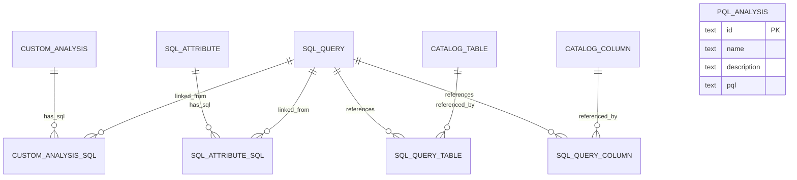
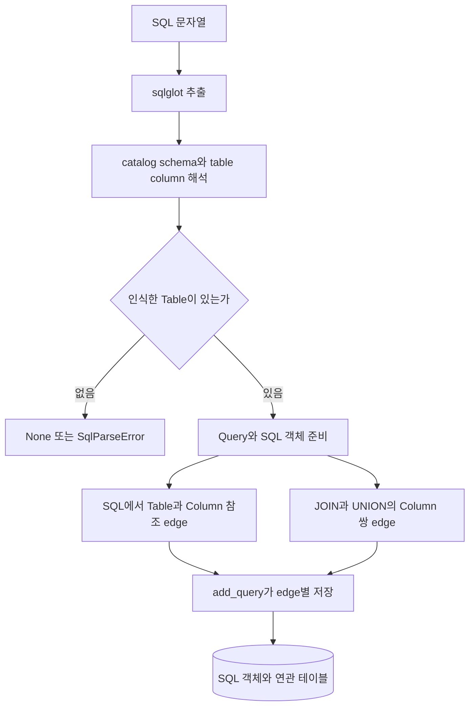
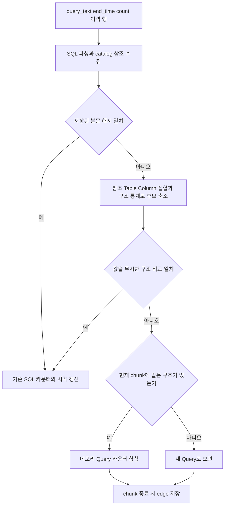
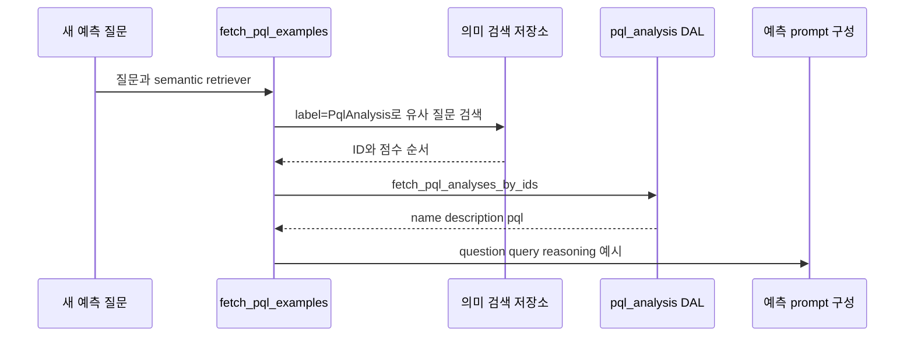

# Chapter 03. SQL·분석 정의의 저장과 재사용

- 분석일: 2026-11-07
- 범위: SQL 참조 모델, 이력 중복 제거, CustomAnalysis·PqlAnalysis, SqlAttribute 생산자와 검색·삭제 연결
- 검증: 로컬 소스와 관련 테스트의 assertion을 읽은 정적 분석. DB·모델·테스트는 실행하지 않았다.
- 선행: [Catalog 객체](chapter-01-catalog-entities.md), [의미 계층 객체](chapter-02-semantic-entities.md), [용어집](../01-architecture/chapter-00-glossary.md)

## 1. 먼저 구분할 용어

| 용어 | 이 chapter에서의 뜻 |
| --- | --- |
| SQL 객체 | 쿼리 문자열과 집계 정보 등을 `sql_query`에 저장한 객체. 실제 실행 결과를 담은 객체가 아님 |
| CustomAnalysis | 사람이 이름·설명·SQL로 관리하는 분석 정의. SQL 객체를 연결해서 사용 |
| SqlAttribute | 업무 개념인 Term에 연결할 수 있는 재사용 SQL 정의 |
| PQL / PqlAnalysis | 예측용 질의 언어 / 질문·설명·PQL을 저장한 예측 예시 객체 |
| AST | Abstract Syntax Tree, SQL의 문법 구조를 트리로 표현한 것. 구조 크기 등을 비교하는 데 사용 |
| Literal, 리터럴 | SQL에 직접 적힌 값. 예: `amount > 100`의 `100` |
| 정규화 / 중복 제거 | 비교를 위해 표현을 일정하게 바꿈 / 같은 것으로 판단한 입력을 묶음 |
| Dialect | DB 엔진마다 다른 SQL 문법 |
| 참조·lineage | 어떤 정의가 어떤 SQL·테이블·컬럼에서 왔거나 이를 읽는지 나타내는 연결. 생성 원본과 현재 읽는 데이터는 구분 |
| Embedding / metadata / label | 검색용 숫자 표현 / 객체 ID·DB명 같은 부가정보 / 객체 종류 표식 |
| Few-shot 예시 | 새 질의를 만들 때 모델에 참고로 보여주는 소수의 질문·쿼리 쌍 |
| Transaction / cascade | 함께 확정·취소하는 저장 단위 / 참조 대상 삭제 시 연결 행 등이 따라 삭제되는 규칙 |
| Source / certified | 생성 경로 구분값 / 사용자 검토 표식. 자동 생성 자체가 검토 완료를 뜻하지 않음 |

가상 SQL과 객체 이름을 예시로 사용한다. 쿼리 실행이나 모델의 실제 출력은 아니다.

## 2. 저장 대상 네 가지는 같은 객체가 아니다

| 객체 | 실제 저장 내용 | 연결·사용 방식 |
| --- | --- | --- |
| `sql_query` | `sql_full_query`, 관측 횟수·시각, 구조 통계 | 테이블·컬럼 참조, 이력과 재사용 SQL의 공통 저장 단위 |
| `custom_analysis` | 이름·설명·외부 ID | `custom_analysis__sql`로 SQL 객체 연결 |
| `sql_attribute` | 이름·설명·expression·source·certified 등 | Term과 SQL 객체 연결. 세부 필드는 앞 chapter 참조 |
| `pql_analysis` | 이름·설명·PQL 문자열·외부 ID | 확인한 schema에는 SQL·Term·DB 연결 테이블 없음 |

### 사용 상황을 짧은 예시로 보면

아래는 용도를 설명하기 위한 가상 예시다.

| 객체 | 어떤 상황에서 어떻게 쓰는가 |
| --- | --- |
| `sql_query` | DB 이력에서 `SELECT SUM(amount) FROM orders`를 수집하면 본문과 `orders` 참조를 저장한다. 나중에 주문 관련 SQL을 모아 재사용할 계산식 후보를 찾는 데 쓴다. |
| `CustomAnalysis` | 사람이 ‘월별 매출 분석’이라는 이름으로 SQL을 등록한다. 사용자가 ‘지난해 월별 매출’을 물으면 관련 분석을 검색해 새 SQL을 만들 때 참고한다. |
| `SqlAttribute` | ‘주문’에 ‘순매출 = 결제액 - 환불액’이라는 SQL 정의를 연결한다. 사용자가 ‘지역별 순매출’을 물으면 모델이 그 계산 기준을 참고해 SQL을 만든다. |
| `PqlAnalysis` | ‘다음 달 구매할 고객’이라는 질문과 PQL을 예시로 등록한다. 비슷한 예측 질문이 들어오면 해당 질문·PQL 쌍을 모델에 보여줘 새 PQL을 만들 때 참고한다. |

근거: [이력 SQL에서 속성 제안](../../../code/auto-ontology/auto_ontology/semantic/sql_attribute_suggester.py), [SQL 생성에 분석·속성 전달](../../../code/auto-ontology/auto_ontology/retrieval/text_to_sql/agents/sql_from_semantic.py), [예측 예시 검색](../../../code/auto-ontology/auto_ontology/retrieval/kumo/rag.py)

CustomAnalysis에는 `sql` 문자열 필드가 없다. API에서 SQL을 받더라도 SQL 본문은 `sql_query`에 저장하고 연결을 만든다. 반면 PqlAnalysis는 `pql` 필드에 본문을 직접 저장한다.

CustomAnalysis와 PqlAnalysis에는 schema상 `certified` 필드가 없다. 예측 코드의 ‘verified examples’라는 명칭만으로 별도의 인증 상태 검사가 있다고 해석하면 안 된다.



위 연결은 모두 ID 쌍을 PK로 하는 연관 테이블이다. SQL 하나가 여러 테이블·컬럼을 읽을 수 있고, 하나의 SQL 객체를 여러 정의가 연결하는 것도 저장 모델상 가능하다. PQL 객체는 의도적으로 도식에서 다른 객체와 연결하지 않았다.

근거: [SQL·analysis 저장 schema](../../../code/auto-ontology/auto_ontology/dal/schema.py)

## 3. SQL의 식별자와 통계

| 필드 | 실제 역할·주의점 |
| --- | --- |
| `id` | SQL 객체의 내부 식별자. parser가 임시 UUID를 만들거나 DB 기본값으로 발급 가능 |
| `sql_full_query` | 전체 SQL 문자열. 같은 뜻의 SQL까지 하나로 만드는 정규형 필드는 아님 |
| `md5(sql_full_query)` unique index | 본문을 해시로 비교하는 중복 금지 인덱스. 긴 SQL 문자열을 인덱스 키에 직접 담는 한계를 피함 |
| `total_counter` | 관측 횟수 누적. 이력 중복 처리에서 기존 값에 추가 |
| `last_query_timestamp` | 관측 SQL의 시각. 실제 쓰기 경로는 전달된 시각을 대입하므로 항상 `max()`로 최신값을 계산하는 것은 아님 |
| `nodes_count`, `join_count`, `union_count` | 문법 트리 크기·추출된 join/union 쌍 수. 구조 비교 전 후보를 좁히는 자료 |
| `created`, `last_seen`, `query_count` | schema에 존재. 필드 이름만으로 total_counter와 같은 방식으로 모든 값이 갱신된다고 가정하지 않음 |

해시 인덱스는 저장 본문 식별 규칙이다. 뒤의 ‘구조적으로 같은 SQL 묶기’와는 별도다. `registry`와 `get_sql_by_full_query()`는 양쪽에 같은 md5 표현을 써 인덱스를 활용한다. 여기서 md5는 해시 함수 이름이며 SQL 의미를 분석하는 함수가 아니다.

`Query.__init__()`는 메모리 props에 `count_월_연도`도 만든다. 하지만 현재 SQL 저장 schema에는 그 동적 필드가 없고 writer는 실제 컬럼만 남긴다. 따라서 이 메모리 값을 DB의 월별 사용량 통계라고 설명할 수 없다.

근거: [sql_query 정의](../../../code/auto-ontology/auto_ontology/dal/schema.py), [Query 객체](../../../code/auto-ontology/auto_ontology/catalog/model/query.py), [본문 조회·카운터 갱신](../../../code/auto-ontology/auto_ontology/catalog/store/queries.py), [SQL 자연 키](../../../code/auto-ontology/auto_ontology/catalog/store/registry.py)

## 4. 파싱은 테이블·컬럼 연결로 바뀐다

`parse_query_single()`은 SQL 한 개로 `Query`를 만들고 `parse_query_slim()`을 호출한다. 후자는 sqlglot이라는 SQL 분석 라이브러리의 extractor 결과를 받아 객체 연결을 구성한다.

1. 추출된 테이블과 schema 문맥으로 catalog Table을 찾는다.
2. 인식한 Table을 `query_obj.tables_ids`에 추가하고 SQL→Table edge를 만든다.
3. 테이블에 실제로 있는 컬럼을 확인해 SQL→Column edge를 만든다.
4. JOIN·UNION에서 추출된 컬럼 쌍을 각각 관계 edge로 만든다.
5. 구조 크기·join·union 수·해석한 dialect를 Query에 기록한다.

Edge는 여기서 ‘writer에 넘기는 두 객체와 연결 종류’라는 메모리 표현이다. 이 표현이 관계형 연결 테이블의 행으로 변환된다.



`server/sql_utils.py::validate_sql()`의 중요한 성공 기준은 파싱 결과가 있고 catalog에서 참조 테이블을 찾았는가다. 원본 DB에서 쿼리를 실행해 값·권한·결과 정확성을 확인하지 않는다.

또 `parse_query_slim()`은 일부 컬럼·join 해석 실패를 건너뛰고, 인식한 Table이 하나 이상이면 성공할 수 있다. Schema를 찾지 못하면 bare table name(소속을 뺀 테이블명)으로 여러 schema를 순회하는 fallback도 있다. 따라서 저장된 참조 목록이 SQL의 모든 의존성을 완벽히 증명한다는 전제는 피해야 한다.

근거: [parse_query_slim·parse_query_single](../../../code/auto-ontology/auto_ontology/catalog/sql_parse.py), [validate_sql](../../../code/auto-ontology/auto_ontology/server/sql_utils.py)

## 5. 저장의 기본 단위는 SQL 전체보다 작은 edge다

`add_query(edges)`는 각 edge에 대해 `_write_link()`를 호출한다. `_write_link()`는 연결 속성에서 SQL 참조인지, HAS_SQL인지, JOIN·UNION인지 선택하고 다음을 하나의 transaction으로 실행한다.

```text
source 객체 upsert
target 객체 upsert
두 실제 ID로 연관 테이블 insert 또는 갱신
```

SQL→Table은 `sql_query__table`, SQL→Column은 `sql_query__column`로 저장한다. JOIN·UNION 컬럼 쌍에는 `refs` 배열이 붙으며 `"SQL ID|조건"` 형태의 문자열을 누적한다. 중복된 refs는 배열 결합 후 중복 제거한다.

이 transaction은 **edge 하나의 양끝과 연결**을 묶는다. `add_query()` 자체가 모든 edge를 하나의 바깥 transaction으로 감싸지는 않는다. 호출자가 별도 transaction을 열지 않았다면 중간 실패 전에 일부 참조가 저장될 수 있다.

또 `_write_link()`는 `upsert_row()`가 돌려준 실제 ID로 관계를 저장한다. Parser의 SQL ID가 기존 본문과 병합돼도 DB 관계는 실제 ID를 사용할 수 있다. 반면 `refs` 안의 문자열은 전달된 값이며 같은 방식으로 다시 작성하는 코드가 없다. 그러므로 refs의 문자열 ID를 항상 FK로 검증된 객체 참조처럼 다뤄서는 안 된다.

여기서 관측 SQL의 `column__join`과 모델 import가 쓰는 `table__join`은 별도다. 실제 join 탐색의 현재 소비 경로까지 같은 의미로 묶지는 않는다.

근거: [add_query·_write_link·_dedupe](../../../code/auto-ontology/auto_ontology/catalog/store/queries.py), [관계 registry](../../../code/auto-ontology/auto_ontology/catalog/store/registry.py), [join 저장 schema](../../../code/auto-ontology/auto_ontology/dal/schema.py)

## 6. 이력 SQL의 중복 제거 workflow

Connector의 query history는 ‘원본 DB에서 관측한 SQL 이력’이다. 이를 처리하는 `populate_queries()`는 500개 단위로 나누고 저장 목록을 읽어 `parse_queries_df()`에 전달한다.



메모리 비교도 Table·Column 집합, AST 크기, join·union 수를 먼저 확인하고 dialect별 정규화 결과를 비교한다. `ignore_literals=True`가 사용되므로 아래 두 쿼리는 조건이 맞으면 같은 구조 후보로 묶일 수 있다.

```sql
SELECT amount FROM orders WHERE amount > 100;
SELECT amount FROM orders WHERE amount > 200;
```

이는 ‘두 SQL이 같은 결과를 낸다’는 판정이 아니라 이력의 반복 패턴을 모으는 정책이다. 구조 병합된 입력의 모든 본문과 모든 literal을 별도 이력으로 보관한다고 가정하면 안 된다.

파싱 예외는 failed_queries에 모으지만, 인식한 테이블이 없어 건너뛴 행은 같은 방식의 예외 목록이 아닐 수 있다. 저장 future의 예외는 로그로 남기고 계속하며, 그 실패를 failed_queries에 추가하는 코드는 없다. 마지막 ‘Finished inserting’ 로그와 반환 목록만으로 모든 SQL 저장 성공을 판정해서는 안 된다.

근거: [parse_queries_df·populate_queries·구조 비교](../../../code/auto-ontology/auto_ontology/catalog/sql_parse.py), [비교기](../../../code/auto-ontology/auto_ontology/catalog/parsers/query_comparator.py)

## 7. 서로 다른 중복 기준을 구분한다

| 경로 | 범위·비교 규칙 | 의미 |
| --- | --- | --- |
| DB SQL 본문 identity | `md5(sql_full_query)` | 저장 문자열 기준의 객체 식별 |
| 이력 수집 | 정확 본문 또는 catalog 참조·구조·literal 무시 비교 | 반복 SQL 패턴과 관측 횟수 집계 |
| CustomAnalysis SQL 등록 | 연결된 SQL의 본문 정확 일치 | 공백·대소문자 정규화 비교가 아님 |
| SqlAttribute expression 등록 | 같은 Term 안에서 `" ".join(split()).lower()` | 공백·대소문자 정리. DB 실행 의미 동등성 증명은 아님 |
| PqlAnalysis 등록 | name 또는 pql 문자열 정확 일치 검사 | SQL 파싱·구조 정규화 없이 service에서 검사 |

SqlAttribute의 문자열 소문자 변환은 SQL AST 기반 의미 분석이 아니다. 예를 들어 문자열 literal의 대소문자까지 변할 수 있으므로 이 규칙을 일반적인 ‘정답이 같은 SQL’ 판정으로 설명하지 않는다.

CustomAnalysis.name은 DB unique 제약이 있다. PqlAnalysis의 name·pql은 확인한 schema에 unique 제약이 없고 service의 사전 조회가 중복을 검사한다. 동시 요청까지 같은 수준으로 보장되는 구조는 아니다.

근거: [CustomAnalysis 비교](../../../code/auto-ontology/auto_ontology/dal/custom_analyses.py), [SqlAttribute 비교](../../../code/auto-ontology/auto_ontology/dal/sql_attributes.py), [PQL 비교·upsert](../../../code/auto-ontology/auto_ontology/dal/pql_analyses.py), [schema 제약](../../../code/auto-ontology/auto_ontology/dal/schema.py)

## 8. CustomAnalysis의 생성·수정·검색

생성 service는 이름과 정확 SQL 중복을 확인하고 catalog 기준 SQL 검증을 한다. 이어 CustomAnalysis와 Query를 HAS_SQL로 연결하고 embedding을 생성한다. Bulk loader용 `embed=False`를 주면 embedding은 호출자의 책임이다.

수정은 기존 ID를 유지한다. 새 SQL 검증을 먼저 하므로 파싱 실패가 이전 연결을 먼저 끊지는 않는다. 검증 후에는 기존 SQL 연결 삭제 → 이름·설명·새 SQL 연결 저장 → 이전 vector 삭제 → 재임베딩 순서다. 전체가 한 번에 확정된다는 보장은 이 service에 없다.

검색 문서의 텍스트는 대략 다음 요소로 구성된다.

```text
custom_analysis: 이름, description: 설명, sql: SQL 본문
```

Label은 `CustomAnalysis`, metadata에는 내부 ID와 DB명 등을 둔다. DB명은 Analysis→SQL→Table→Schema→Database 경로로 찾는다. 여러 DB가 나오면 정렬 후 첫 DB 하나만 고르는 lossy 처리다. Lossy란 여러 정보를 한 값으로 줄이면서 일부를 잃는다는 뜻이다. 따라서 이 metadata를 완전한 참조 DB 집합으로 보면 안 된다.

DB명을 찾지 못하면 unscoped(특정 DB에 묶이지 않음) embedding으로 저장할 수 있고, DB 필터가 있는 검색에서는 보이지 않을 수 있다.

일반 SQL 후보 준비는 검색한 analysis ID를 `fetch_custom_analyses_with_sql()`에 전달해 SQL을 다시 읽고 관련 테이블을 준비한다. Vector만으로 SQL 본문·관계 전체를 확정하는 구조가 아니다.

근거: [CustomAnalysis service](../../../code/auto-ontology/auto_ontology/server/custom_analyses/service.py), [분석 조회·문서·DB명 추적](../../../code/auto-ontology/auto_ontology/dal/custom_analyses.py), [질의 후보 준비](../../../code/auto-ontology/auto_ontology/retrieval/text_to_sql/agents/candidates_preparation.py)

## 9. SqlAttribute는 어떤 생산 경로에서 오는가

| 경로 | 확인한 source | 저장·검색 특징 |
| --- | --- | --- |
| 수동 생성 service | 기본 `manual` | Term·이름·표현 검증 후 SQL 연결과 embedding 생성 |
| Query history suggester | `sql` | Term의 연결 테이블에서 SQL을 모아 표현 후보 추출·LLM 판단·유효 SELECT 구성 후 공통 생성 service 사용 |
| Bridge table 생성 | `bridgeTable` | 중간 연결 테이블 후보에 대해 SQL 제안과 소유 Term을 정한 뒤 공통 service 사용 |
| `table` | 허용 상수·schema 값 존재 | 이번에 확인한 자동 생산자에서는 이 값을 직접 쓰는 경로를 찾지 못함. 활성 기능으로 단정하지 않음 |

Bridge table은 다른 대상들을 연결하는 중간 테이블이다. 자동 producer도 사람이 검토하는 `certified` 값을 true로 전달하지 않으므로 생성 자체를 인증 완료로 해석할 수 없다.

### 9.1 사용량 기반 순위라는 설명과 실제 구현의 차이

`suggest_sql_attributes()`의 설명에는 ‘최근 사용량으로 정렬한 top 10’을 LLM에 보낸다고 되어 있다. 그러나 현재 `_usage_score()`는 **모든 입력에 0.0을 반환**한다. 코드와 테스트가 이 동작을 명시적으로 고정하고 있다.

`_rank_expressions()`는 표현별 점수를 합산해 정렬하지만, 점수가 모두 같으면 실제 사용량 우선순위가 생기지 않는다. 따라서 많이 쓰는 계산식이 자동으로 우선 제안된다고 설명하면 틀린다. 이번 분석에서는 이 동작을 기록했고 원본 코드는 수정하지 않았다.

### 9.2 ‘원본 SQL 출처를 연결한다’도 확인 범위를 나눈다

`_rank_expressions()`는 표현의 source SQL ID를 함께 반환한다. Suggester는 이를 원본 SQL 문자열 수집과 유효 SELECT 구성에 사용한다. 하지만 확인한 저장 경로에서는 `create_sql_attribute()`로 **생성된 SELECT**를 저장한 뒤 원본 ID에 대해 추가 연결을 쓰는 호출을 찾지 못했다.

그러므로 docstring의 ‘원본 source Sql nodes에 새 속성을 연결’ 문구만으로 모든 생성 출처가 DB에 보존된다고 결론 내리지 않는다. `test_ranking_still_carries_source_query_ids`도 **중간 반환값의 ID 목록**을 확인하며 최종 DB lineage를 검사하는 테스트는 아니다.

근거: [공통 생성 service](../../../code/auto-ontology/auto_ontology/server/sql_attributes/service.py), [history suggester와 _usage_score](../../../code/auto-ontology/auto_ontology/semantic/sql_attribute_suggester.py), [bridge producer](../../../code/auto-ontology/auto_ontology/semantic/bridge_tables.py), [점수·출처 ID 테스트](../../../code/auto-ontology/auto_ontology/semantic/tests/test_usage_score.py)

## 10. PqlAnalysis는 예측용 질문·쿼리 쌍이다

PQL은 Predictive Query Language(예측용 질의 언어)로, 이 프로젝트에서는 Kumo 예측 엔진에 무엇을 예측할지 전달한다. SQL로 ‘지난달 주문 건수’를 조회한다면, PQL로는 ‘앞으로 30일 내 주문 발생 가능성’을 예측한다. `create_pql_analysis()`는 name·pql 중복을 service에서 검사하고 새 ID를 발급해 본문을 저장한다. 일반 분석의 `validate_sql()` 단계는 없다. 저장 service 설명상 PQL의 테이블 해석은 예측 시점의 graph에서 수행한다.

Embedding은 **name과 description**만 사용하고 PQL 본문은 포함하지 않는다. 질문과 비슷한 질문을 검색하고, 매칭된 ID로 PQL을 다시 읽는 구조다.



예를 들어 **‘앞으로 30일 안에 구매할 고객은?’**이라는 새 질문이 들어왔다고 하자. 아래는 실제 저장값이 아닌 설명용 예시다.

1. `Q → R`: 새 질문을 `fetch_pql_examples()`에 전달한다.
2. `R → V → R`: 비슷한 질문을 검색해, 미리 등록된 **‘앞으로 7일 안에 구매할 고객은?’** 예시의 ID를 얻는다.
3. `R → D → R`: 그 ID로 이름·설명·PQL 본문을 읽는다. DAL(Data Access Layer)은 저장소를 읽고 쓰는 코드 계층이다.
4. `R → P`: 아래 질문·설명·PQL을 참고 예시로 프롬프트에 넣는다.

```text
question: 앞으로 7일 안에 구매할 고객은?
reasoning: 고객별로 향후 7일 내 주문 발생 여부를 예측한다.
query: PREDICT COUNT(orders.*, 0, 7, days) > 0
       FOR EACH customers.customer_id
```

이 PQL은 ‘고객마다 향후 7일 동안 주문이 한 번 이상 발생할 가능성’을 예측하라는 뜻이다. 이후 모델은 이 예시를 참고해 새 질문의 기간인 `30`을 사용한 PQL을 만들 수 있다. **위 다이어그램은 참고 예시 전달까지이며, 새 PQL 생성과 실제 예측 실행은 다음 단계다.**

`fetch_pql_examples()`는 name을 질문, description을 추론 설명, pql을 query로 구성하고 검색 순서를 유지한다. 검색·조회 실패는 빈 예시로 내려가 예측 자체를 계속할 수 있다.

이 검색에는 DB명 필터 인자가 전달되지 않는다. PqlAnalysis도 DB 연결이 없으므로 DB 범위를 지정한 semantic reset이 이를 자동으로 포함하지 않는다는 schema 주석과 일치한다. 전역 reset과 특정 DB reset을 구분해야 한다.

근거: [PQL service](../../../code/auto-ontology/auto_ontology/server/pql_analyses/service.py), [PQL 저장·embedding 문서](../../../code/auto-ontology/auto_ontology/dal/pql_analyses.py), [few-shot 검색](../../../code/auto-ontology/auto_ontology/retrieval/kumo/rag.py), [PQL 문법·예시](../../../code/auto-ontology/auto_ontology/retrieval/kumo/prompts.py), [schema](../../../code/auto-ontology/auto_ontology/dal/schema.py)

## 11. 삭제·수정에서 공유 SQL을 주의해야 한다

| 동작 | 확인한 실제 처리 |
| --- | --- |
| SqlAttribute의 SQL 교체 | 연결만 끊고 SQL 객체는 남김 |
| SqlAttribute 삭제 | 속성과 연결 삭제. 공유 SQL 자체는 별도 |
| CustomAnalysis SQL 수정 | 옛 연결을 끊고 새 SQL 연결. 이 detach 함수는 옛 SQL을 삭제하지 않음 |
| CustomAnalysis 삭제 | 연결된 SQL ID를 수집하고 분석과 해당 SQL 객체를 모두 삭제하는 명시적 transaction |
| PqlAnalysis 삭제 | 해당 행 삭제 후 해당 ID의 vector 삭제. SQL 연결 없음 |

CustomAnalysis 삭제 함수의 주석은 분석 SQL을 독점 소유한다고 설명하지만, SQL 본문은 전역 중복 처리되고 schema는 공유 연결을 허용한다. 실제 삭제 함수에는 ‘다른 SqlAttribute·Analysis가 참조하는 SQL인지’ 확인하는 조건이 없다.

따라서 같은 SQL 객체를 다른 정의가 공유하는 상황이라면 해당 SQL의 참조 연결도 cascade 삭제될 수 있다는 조건부 위험을 읽을 수 있다. 이는 코드에서 도출한 시나리오이며 이번에 DB 실행으로 재현한 결함 보고는 아니다. SQL 공유가 실제로 허용되는 호출 조합과 삭제 회귀 테스트는 후속 확인이 필요하다.

DB 작업과 vector 삭제·재기록은 별도 호출이므로 ‘화면에서 삭제 성공’·‘DB 연결 정리’·‘검색 자료 정리’를 한 상태로 취급하지 않는다.

근거: [CustomAnalysis detach·delete](../../../code/auto-ontology/auto_ontology/dal/custom_analyses.py), [SqlAttribute detach·delete](../../../code/auto-ontology/auto_ontology/dal/sql_attributes.py), [PQL 삭제 service](../../../code/auto-ontology/auto_ontology/server/pql_analyses/service.py)

## 12. 테스트 근거와 다음 확인 사항

Assertion은 테스트가 확인하는 조건이다. 아래 항목은 테스트 소스를 읽었으며 실제 실행하지 않았다.

| 테스트 | 실제 확인 범위 |
| --- | --- |
| `test_rows_and_links.py::test_sql_edge_becomes_a_row` | SQL→Table 연결 행 1개 생성 |
| `test_repeated_sql_link_does_not_duplicate` | 같은 연결을 두 번 써도 연결 행 1개 |
| `test_sql_attributes.py::test_find_by_expression_ignores_case_and_whitespace` | 같은 Term의 대소문자·공백 차이 expression 중복 판정 |
| `test_find_by_expression_is_scoped_to_the_term` | 다른 Term의 같은 expression은 그 검사에서 충돌하지 않음 |
| `test_usage_score.py::test_score_is_currently_always_zero` | 사용량 500을 전달해도 점수 0 |
| `test_every_expression_currently_ties` | 추출된 표현 점수 집합이 `{0.0}` |
| `test_ranking_still_carries_source_query_ids` | 표현 후보 반환값에 source ID 유지. DB 출처 저장 검증과 다름 |

근거: [row/link 테스트](../../../code/auto-ontology/auto_ontology/catalog/store/tests/test_rows_and_links.py), [SqlAttribute 테스트](../../../code/auto-ontology/auto_ontology/dal/tests/test_sql_attributes.py), [usage score 테스트](../../../code/auto-ontology/auto_ontology/semantic/tests/test_usage_score.py)

다음 Chapter 04에서는 DB transaction·connection 수명, catalog와 vector 저장 경계, 대화·설정의 별도 schema와 실패 후 상태를 묶어 분석한다. 이번에 남긴 질문은 공유 SQL 삭제, partial parsing과 불완전한 참조, DB명이 여러 개인 분석의 embedding 범위, 구조 중복·출처 기록의 한계다. [진행 계획](../../../.codex/plan/auto-ontology/01-2_data-model.md)
