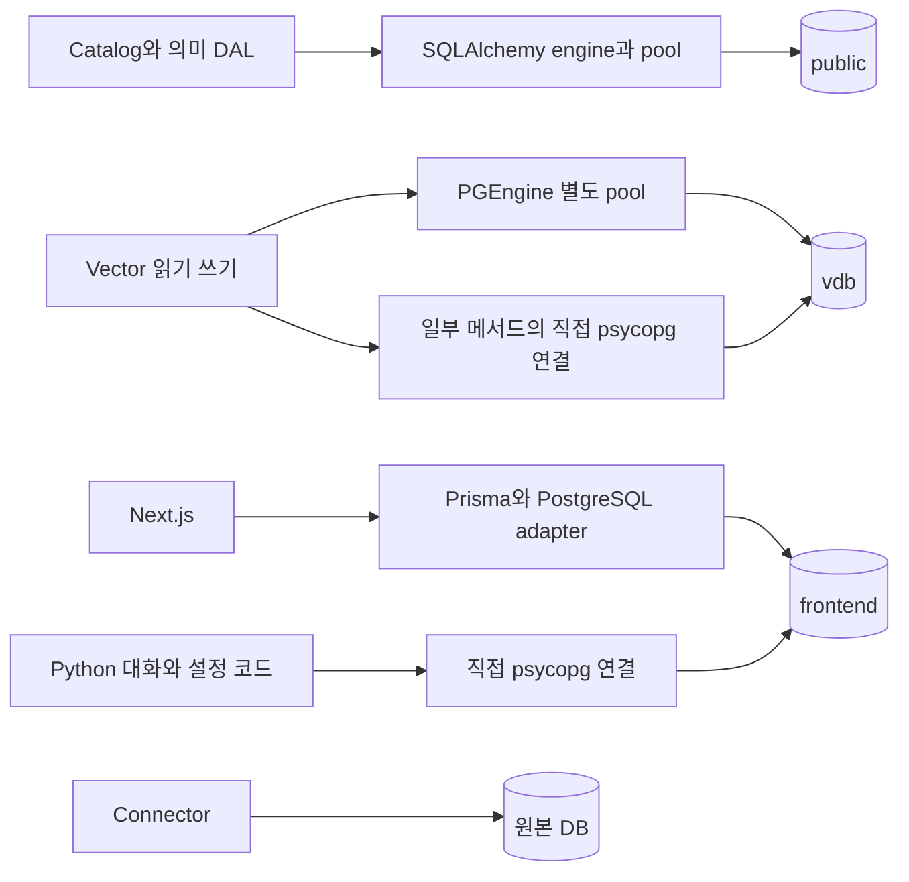
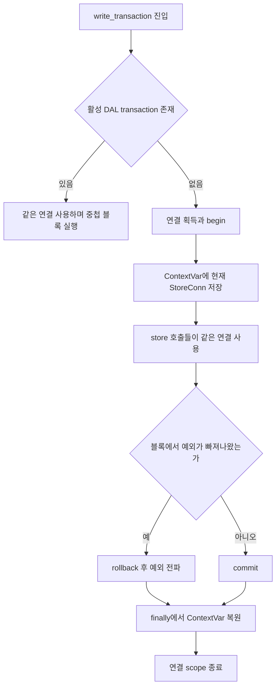
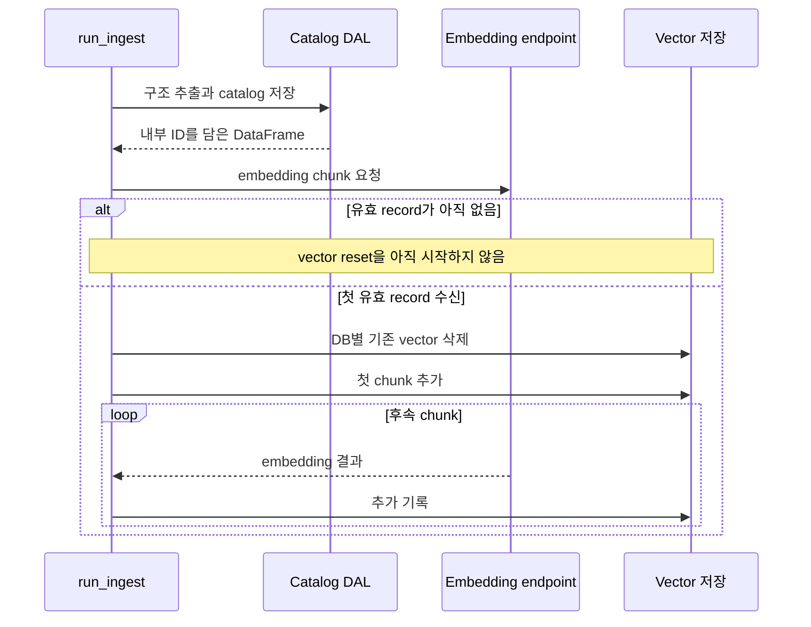
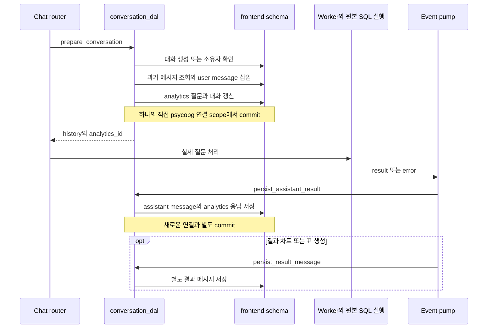

# Chapter 04. 저장소·연결 수명·트랜잭션 경계

- 분석일: 2026-11-07
- 범위: 내부 Postgres의 저장 영역, 연결·pool, DAL transaction, vector 기록·삭제, 대화·설정 저장과 부분 실패
- 검증: 코드와 관련 테스트 assertion을 읽은 정적 분석. DB·모델·테스트 실행 및 원본 수정은 하지 않았다.
- 선행: [Catalog 객체](chapter-01-catalog-entities.md), [의미 계층](chapter-02-semantic-entities.md), [SQL·분석 정의](chapter-03-sql-and-analysis-definitions.md), [용어집](../01-architecture/chapter-00-glossary.md)

## 1. 이 chapter의 용어

| 용어 | 쉬운 뜻 |
| --- | --- |
| Schema | DB 안에서 테이블들을 나누는 이름 공간. 여기서는 `public`, `frontend`, `vdb` |
| Connection / engine / pool | DB와 통신하는 연결 / 연결·SQL 실행을 관리하는 객체 / 재사용할 연결들의 묶음 |
| DAL / SQLAlchemy / psycopg / PGEngine | 내부 DB 접근 계층 / Python의 SQL·연결 도구 / Python용 Postgres driver / 여기서 vector 저장 연결을 관리하는 LangChain 객체 |
| Transaction | 여러 저장 작업을 함께 확정하거나 취소하는 실행 단위 |
| Commit / rollback / autocommit | 변경 확정 / 취소 / 문장별 즉시 확정 방식 |
| Atomic, 원자적 | 변경 전부가 반영되거나 전혀 반영되지 않는 성질 |
| ContextVar | 실행 문맥별 값을 보관하는 Python 도구. 여기서는 현재 DAL transaction 연결을 찾는 데 사용 |
| Savepoint | transaction 내부 일부 작업만 되돌릴 수 있게 만드는 지점. 이 DAL의 중첩 scope는 이를 만들지 않음 |
| Vector / embedding / VDB | 의미 비교용 숫자 목록 / 그 표현을 생성하는 처리 / 숫자를 저장·검색하는 저장소 |
| Collection / metadata | 벡터 데이터 묶음 / 객체 ID·종류·DB명 등 부가정보 |
| Append / idempotent | 기존 자료 뒤에 추가 / 같은 작업을 반복해도 최종 상태가 달라지지 않음 |
| Event loop / thread / subprocess | 비동기 작업 실행 루프 / 프로세스 안 실행 흐름 / 별도로 실행되는 프로세스 |
| SSE / persistence / analytics | HTTP 이벤트 순차 전송 / 대화·결과 저장 / 질문·응답 사용 통계 |
| Orphan, 고아 객체 | 더 이상 유효한 참조가 없는 저장 객체 |

핵심 질문은 ‘어느 DB에 저장하는가’뿐 아니라 **어느 연결에서 어떤 작업까지 함께 commit하는가**다. 같은 Postgres 서버 안의 변경도 연결이 다르면 자동으로 하나의 transaction이 되지 않는다.

## 2. 저장 구조의 소유자와 실제 접근자를 구분한다

| 영역 | 내용 | 구조 정의·관리 | 실제 읽기·쓰기 |
| --- | --- | --- | --- |
| `public` | catalog·Term·속성·SQL·분류·컴파일 이력 등 | `dal/schema.py`와 Alembic | Python DAL·catalog store 등 |
| `frontend` | 사용자·세션·대화·메시지·설정·용어 약어·프롬프트 등 | Prisma schema | Next.js의 Prisma와 Python의 직접 SQL 양쪽 |
| `vdb` | `data_objects_layer`, `semantic_layer` vector collection | VDB가 LangChain의 PGEngine·PGVectorStore로 준비 | 수집·의미 생성·검색·수정·reset 경로 |
| 원본 DB | 실제 업무 테이블과 행 | 이 프로젝트 밖의 원본 시스템 | connector로 구조·샘플·질의 결과 조회 |

Prisma는 TypeScript 쪽 DB 도구, Alembic은 Python 쪽 DB 구조 변경 이력 도구다. 여기서는 설치 절차가 아니라 어느 구조를 관리하는지 구분하려고 언급한다.



`public`, `frontend`, `vdb`는 기본 구성에서 같은 내부 DB의 영역이다. 그림의 분리는 서버가 세 개라는 뜻이 아니라 접근·저장 책임을 나눈 것이다. 원본 DB의 SELECT와 내부 메시지 INSERT도 별도 실행이다.

근거: [DAL schema](../../../code/auto-ontology/auto_ontology/dal/schema.py), [Prisma schema](../../../code/auto-ontology/frontend/prisma/schema.prisma), [공통 Postgres 주소·frontend 상수](../../../code/auto-ontology/auto_ontology/infra/postgres.py), [VDB factory](../../../code/auto-ontology/auto_ontology/vdb/__init__.py)

## 3. Catalog DAL의 연결은 언제 열리고 닫히는가

`dal/session.py::get_engine()`은 프로세스 전역 `_engine`을 최초 사용 시 만든다. 설정된 Postgres 주소를 psycopg 3용 SQLAlchemy URL로 바꾸고 다음 연결 정책을 적용한다.

| 설정 | 코드 기본값·의미 |
| --- | --- |
| `pool_size` | 5. 평상시 재사용 연결 수 설정 |
| `max_overflow` | 5. 필요시 pool_size를 넘어 추가로 허용할 수 |
| `pool_pre_ping` | true. 빌리기 전 연결 생존 확인 |
| `pool_recycle` | 1800초. 오래 유지한 연결 교체 기준 |
| `connect_timeout` | 3초. 연결 수립 대기를 제한하며 모든 SQL 실행시간 상한과는 다름 |
| `search_path` | `public`로 고정. 이름 공간을 생략한 catalog SQL의 대상 결정 |

이 pool은 원본 DB connector의 연결 pool도, VDB의 pool도 아니다. Chat worker는 새 Python 프로세스로 시작하므로 부모의 전역 engine 객체를 그대로 재사용하지 않는다. 각 프로세스·VDB 인스턴스가 만들 수 있는 연결을 따로 고려해야 하며 위 값이 앱 전체 연결 수 한도는 아니다.

`StoreConn.query_read()`와 `query_write()`는 둘 다 같은 `query()`를 호출한다. 함수 이름의 read/write 구분만으로 읽기 전용 DB 연결이나 다른 서버로 라우팅되는 것은 아니다.

근거: [get_engine·StoreConn](../../../code/auto-ontology/auto_ontology/dal/session.py), [Chat worker](../../../code/auto-ontology/auto_ontology/server/chat/worker.py)

## 4. store()와 write_transaction()의 실제 차이

### 4.1 명시적 transaction 바깥

`store()`는 연결을 고정하지 않은 `StoreConn()`을 돌려준다. `query()`를 호출할 때 pool에서 연결을 빌려 AUTOCOMMIT으로 문장을 실행하고 반환한다.

```text
store().query_write(A) → A 확정 후 연결 반환
store().query_write(B) → B 실패
결과: A가 B 실패 때문에 자동으로 취소되지는 않음
```

### 4.2 명시적 transaction 안

`write_transaction()`은 연결 하나와 transaction을 만들고 `_active` ContextVar에 `StoreConn(connection)`을 저장한다. 같은 문맥에서 `store()`를 부르면 그 연결을 사용한다.



블록 안에서 예외가 나 바깥으로 전파되면 rollback하고, 정상 종료하면 commit한다. `finally`에서 이전 ContextVar 값으로 복원하므로 이후 요청이 이미 끝난 transaction을 붙잡지 않게 한다.

예를 들어 **‘월별 매출’ 분석 정보 저장(A)과 해당 분석의 SQL 연결 저장(B)을 하나로 묶는다**고 하자. 아래는 transaction 동작을 설명하는 가상 흐름이며, 특정 service 전체가 이렇게 묶인다는 뜻은 아니다.

1. **Enter → Active → Begin**: `write_transaction()`에 들어간다. 진행 중인 DAL transaction이 없으면 pool에서 연결 하나를 빌리고 transaction을 시작한다.
2. **Set**: `_active` ContextVar에 ‘현재 실행 흐름에서 사용할 연결’을 담은 `StoreConn` 객체를 기록한다. 예를 들어 연결 7번을 담아 두면, 같은 실행 문맥의 `store()` 호출은 그 객체를 반환한다. 7번은 설명용 번호다.
3. **Body**: A와 B를 각각 `store().query_write(...)`로 실행한다. 둘 다 연결 7번을 사용하며, A 실행 직후에는 아직 commit하지 않는다.
4. **Exit → Commit 또는 Rollback**: A·B가 모두 성공해 블록을 정상 종료하면 둘 다 확정한다. B에서 오류가 나 예외가 블록 밖으로 나가면, 먼저 실행한 A도 함께 취소한다.
5. **Reset → Return**: 성공·실패 어느 쪽이든 `_active`를 이전 값으로 돌린다. 처음에 활성 transaction이 없었다면 다시 ‘없음’이 되고, 연결은 pool로 반환된다.

| 예시 분기 | 저장 결과 |
| --- | --- |
| A 성공 → B 성공 → 블록 정상 종료 | 분석 정보와 SQL 연결을 함께 commit |
| A 성공 → B 실패 → 예외가 블록 밖으로 전파 | A도 rollback되어 분석 정보만 남는 상황을 방지 |
| A를 처리하는 내부 함수가 다시 `write_transaction()` 호출 | `Active → Reuse`로 가서 연결 7번을 그대로 사용. 내부 블록 종료 시 따로 commit하지 않고 바깥 블록의 종료를 기다림 |

#### Set 단계: 연결을 함수마다 전달하지 않아도 되는 이유

`ContextVar`는 현재 실행 문맥에서 사용할 값을 보관하는 Python 도구다. 여기의 `_active`에는 **‘연결 7번이 사용 중’이라는 상태 표시만 저장하는 것이 아니라, 실제 연결 객체를 감싼 `StoreConn`을 저장한다.** 그래서 `store()`가 그 객체를 반환하고 DB 작업은 그 안의 연결을 사용할 수 있다.

아래 함수명은 설명용이다. 두 함수 모두 내부에서 `store().query_write(...)`를 호출한다고 가정한다.

```python
with write_transaction():
    save_analysis()  # store() → 연결 7번을 담은 StoreConn
    save_sql_link()  # store() → 위와 동일한 StoreConn
```

`write_transaction()`이 먼저 `_active`에 `StoreConn`을 넣고, 두 함수의 `store()`가 각각 `_active`를 읽는다. 따라서 함수마다 연결을 인자로 넘기지 않아도 **같은 연결·같은 transaction으로 두 작업을 실행**한다.

여기서 ‘같은 실행 문맥’은 위 블록에서 이어지는 동기 함수 호출 흐름으로 이해하면 된다. 별도 스레드 작업까지 자동으로 이 연결을 공유한다는 뜻은 아니다.

즉, **ContextVar는 현재 transaction의 연결을 찾게 해 주고, commit·rollback은 그 연결에서 실행한 변경을 함께 확정·취소한다.** 별도 연결로 쓰는 vector 저장까지 자동으로 묶이지는 않는다.

### 4.3 중첩은 별도 transaction도 savepoint도 아니다

활성 transaction이 있으면 중첩 `write_transaction()`은 그냥 yield한 뒤 반환한다. 따라서 안쪽 함수가 끝났어도 안쪽 변경만 먼저 commit되지 않는다. 반대로 안쪽에서 발생한 Python 예외를 바깥 transaction 내부에서 잡아 버리면, 안쪽 scope 자체가 자동 rollback해 주는 구조도 아니다.

아래는 제어 흐름 설명이며 실제 DB 실행 예시가 아니다.

```python
with write_transaction():
    write_a()
    try:
        with write_transaction():
            write_b()
            raise ValueError("설명용 Python 예외")
    except ValueError:
        pass
    # 예외가 바깥 scope로 나가지 않음.
    # 안쪽 scope가 별도 rollback을 하지 않으므로 A와 B가 commit될 수 있음.
```

DB 자체가 낸 오류는 transaction을 실패 상태로 만들 수 있으므로 위 Python 예외 예시와 동일시하지 않는다. 이 구분이 필요한 이유는 ‘예외를 잡았다’와 ‘저장 상태를 되돌렸다’가 다른 동작이기 때문이다.

근거: [store·write_transaction 구현](../../../code/auto-ontology/auto_ontology/dal/session.py)

## 5. transaction이 전파되는 범위는 제한적이다

| 호출 경로 | 바깥 DAL transaction 참여 여부 |
| --- | --- |
| 같은 문맥에서 다시 `store()` 호출 | 활성 StoreConn을 사용 |
| 내부 helper의 중첩 `write_transaction()` | 같은 바깥 연결 재사용 |
| 별도 ThreadPoolExecutor 작업 | thread의 문맥에 따라 별도 처리. 바깥 scope가 자동으로 모든 thread를 묶는다고 가정하지 않음 |
| Chat worker subprocess | 별도 프로세스·연결 |
| `psycopg.connect()` 직접 호출 | 별도 연결이므로 DAL ContextVar를 사용하지 않음 |
| PGEngine·PGVectorStore 호출 | 별도 VDB 연결이므로 DAL transaction에 참여하지 않음 |
| Next.js Prisma 요청 | 별도 런타임·클라이언트 |
| 원본 DB connector 조회 | 별도 원본 연결 |

ContextVar가 있다는 사실만으로 모든 비동기 task가 서로 다른 transaction을 보장하는 것도 아니다. 문맥 전달과 동일 연결의 동시 사용 여부를 구체적인 호출자에서 확인해야 한다. 이번에 읽은 session 테스트는 별도 thread의 commit·rollback 격리를 확인하는 사례다.

앞 chapter의 edge별 transaction, 속성·연결 transaction, 이름·복사 필드 transaction이 의미 있는 이유도 이 범위 안에서만 여러 문장을 한 단위로 묶기 때문이다.

## 6. Vector record의 객체 ID와 저장 행 ID는 다르다

`vdb/records.py`는 embedding이 붙은 입력을 VDB record로 변환한다. `metadata["embedding"]`이 없거나 비어 있거나, 본문이 비어 있으면 기록 대상에서 제외한다. 원본 입력 metadata는 복사해 변환한다.

```text
입력 row
  text, path, page_number, metadata
  metadata: id, label, name, database_name, embedding, ...
→ to_vdb_records()
  document_type, metadata.content, content_metadata, source_metadata, ...
→ write_to_index()
  searchable text + 별도 embedding + embedding을 뺀 metadata
```

상위 metadata의 `id`, `label`, `name`, `database_name`은 검색 후 DAL 객체를 다시 찾는 계약이다. `content_metadata` 안에만 숨겨 놓으면 같은 형태로 읽을 수 없다.

| 식별자·필터 | 저장 방식 | 사용 |
| --- | --- | --- |
| VDB 행 ID | PGVectorStore의 저장 행 식별자 | vector 행 자체의 삭제 등 |
| `metadata.id` | JSONB metadata의 내부 catalog·의미 객체 ID | `delete_by_id()`가 해당 객체의 vector 행들을 모두 찾음 |
| `database_name`, `label` | 일반 metadata와 별도로 실제 컬럼으로 승격 | DB별 삭제·객체 종류 필터 |
| 그 밖의 metadata | JSONB 문서 | 이름·schema·기타 문맥. 모든 키가 같은 typed filter 방식으로 동작한다고 가정하지 않음 |

JSONB는 Postgres의 구조화 JSON 저장 형식이다. `delete_by_id()`는 일반 행 ID를 지우는 함수가 아니라 `langchain_metadata ->> 'id'`가 주어진 객체 ID와 같은 행을 지운다. 이 때문에 같은 객체에 중복 vector가 있어도 모두 지우는 의미가 있다.

근거: [record 변환](../../../code/auto-ontology/auto_ontology/vdb/records.py), [write_to_index·delete_by_id](../../../code/auto-ontology/auto_ontology/vdb/postgres.py), [검색기 반환 계약](../../../code/auto-ontology/auto_ontology/utils/retriever.py)

## 7. Collection 생성·쓰기·검색의 수명

`get_data_vdb()`와 `get_semantic_vdb()`는 `vdb` schema의 서로 다른 collection을 가리키는 `PostgresVDB`를 만든다. 클래스 생성자의 schema 기본값은 public이지만 앱 factory가 vdb를 전달한다.

VDB의 `_get_engine()`은 인스턴스별 PGEngine과 별도 pool을 지연 생성한다. 기본 pool_size와 overflow는 각각 10이다. 존재 확인·schema 생성·일부 삭제는 직접 psycopg 연결을 따로 사용하므로 모든 VDB 호출이 같은 pool·transaction을 통과하는 것은 아니다.

`_get_store()`는 테이블이 없으면 생성하고 PGVectorStore를 연결한다. `create_index()`뿐 아니라 검색·DB별 삭제 등에서도 `_get_store()`를 호출하므로 메서드 이름이 read라고 항상 순수 읽기만 하는 것은 아니다. 현재 생성자의 vector_size 기본값은 2048이며, 기존 collection 차원과 모델 출력이 자동으로 맞춰지는 코드는 이 경계에서 확인되지 않는다.

검색 인덱스 생성은 embedding 컬럼을 `halfvec`로 바꾸고 HNSW 인덱스를 준비한다. Halfvec는 낮은 정밀도로 벡터를 저장하는 형식, HNSW는 가까운 벡터를 빠르게 찾는 근사 검색 인덱스다. 실제 값의 정밀도 변경이 있으며 코드가 인덱스 생성 실패를 warning으로 처리하므로 자료 저장과 인덱스 준비도 별도 상태다. 외부 버전 일반화가 아니라 제공된 코드의 선택을 설명한 것이다.

### 쓰기는 기본적으로 append 경로다

`write_to_index()`는 문서·embedding을 모아 기본 500개 batch로 `store.add_embeddings()`에 전달한다. 호출에는 catalog 객체 ID를 VDB 행 ID로 강제하는 `ids` 인자가 없다. 같은 `metadata.id`가 자동 unique upsert된다고 볼 수 없다.

이 때문에 수정 service는 자주 `delete_by_id()` 후 새 embedding을 기록한다. Bulk 생성에서 inline embedding과 별도 batch embedding을 모두 수행하면 중복이 생길 수 있다는 CustomAnalysis service 주석과도 연결된다.

검색은 `retrieval()`에서 숫자 벡터로 유사 검색하고 본문·metadata·거리 `_distance`를 반환한다. 검색 실행 예외 일부는 로그 후 빈 결과로 반환하므로 ‘검색 후보가 없다’와 ‘저장소 검색이 실패했다’를 응답만으로 항상 구별할 수 있는 것은 아니다.

근거: [factory](../../../code/auto-ontology/auto_ontology/vdb/__init__.py), [VDB lifecycle·batch 쓰기·검색](../../../code/auto-ontology/auto_ontology/vdb/postgres.py), [중복 embedding 관련 service](../../../code/auto-ontology/auto_ontology/server/custom_analyses/service.py)

## 8. Catalog 수집과 vector 교체는 한 transaction이 아니다



`run_ingest()`는 첫 유효 record가 생길 때 `get_data_vdb(database_name=..., reset=True)`를 만든다. 생성자는 **DB명이 있고 reset=True일 때** 해당 DB vector를 삭제한다. Reset=True만으로 항상 collection 전체를 지우는 구조는 아니다.

| 실패 시점 | 코드에서 가능한 상태 |
| --- | --- |
| catalog 저장 전·도중 | 개별 transaction 범위에 따라 일부 이전 작업은 남을 수 있음 |
| catalog 저장 후 첫 유효 embedding 전 | catalog는 바뀌었지만 이전 vector는 남아 있을 수 있음 |
| 첫 DB별 vector 삭제 후 첫 쓰기 실패 | catalog는 남고 검색 자료가 비거나 감소할 수 있음 |
| 후속 chunk 실패 | 성공한 chunk만 새 자료로 남을 수 있음 |
| record 변환에서 전부 제외 | vector 쓰기 0개. 변경 없음과 embedding 미생성을 로그·상태로 구분할 필요 |

‘기존 vector를 가능한 늦게 지운다’는 보호와 ‘전체 교체가 원자적이다’는 보장은 다르다. 이번 범위에서는 버전별 collection 교체나 DB·vector를 묶는 분산 transaction을 확인하지 못했다.

근거: [run_ingest의 지연 reset](../../../code/auto-ontology/auto_ontology/ingestion_service/ingest.py), [VDB reset 생성자](../../../code/auto-ontology/auto_ontology/vdb/postgres.py)

## 9. 수정과 reset도 실패 경계를 나눠야 한다

| 경로 | 순서 | 후반 실패 시 가능한 상태 |
| --- | --- | --- |
| Term 이름 수정 | DB 이름·복사 필드 함께 저장 → vector 갱신 | DB의 새 이름과 이전·누락 vector가 함께 존재할 수 있음. router는 vector 오류를 warning으로 처리 |
| 의미 속성 수정 | metadata 저장 → 관련 vector 삭제 → 재기록 | 내용 저장은 됐지만 검색 자료가 없을 수 있음 |
| SQL·분석 정의 생성 | 객체·SQL 연결 저장 → embedding | 요청 실패와 DB에 객체가 없다는 판단이 같지 않음 |
| 의미 계층 reset | DAL 의미 행 삭제 commit → 의미 vector 삭제 | 행이 사라지고 vector가 남을 수 있음 |
| 데이터 계층 reset | catalog·고아 SQL 정리 commit → data vector 삭제 | 이전 vector가 삭제된 catalog ID를 가리킬 수 있음 |

`delete_semantic_layer()`와 `delete_data_layer()`는 코드 자체에서 transaction 부분과 vector 부분을 분리한다. 순서를 행 commit 후 vector 삭제로 정했지만, 후반 실패가 앞선 DB commit을 되돌리지는 않는다. 반환 count도 **지운 vector 행 수**이지 전체 의미 객체 수가 아니다.

고아 SQL 정리는 네 종류 참조를 함께 확인한다: SQL→Table, SQL→Column, SqlAttribute→SQL, CustomAnalysis→SQL. 특정 DB reset에서는 대상 후보 SQL ID로 정리 범위를 좁혀 다른 DB 수집 중의 임시 상태를 전역으로 지우지 않도록 한다.

이는 앞 chapter의 CustomAnalysis 직접 삭제 함수와 다른 정책이다. 같은 ‘SQL 삭제’라도 호출 경로별 공유 보호를 확인해야 한다.

근거: [reset의 transaction·vector 분리와 고아 SQL 검사](../../../code/auto-ontology/auto_ontology/dal/reset.py), [Term 수정 route](../../../code/auto-ontology/auto_ontology/server/terms/router.py), [속성 수정 service](../../../code/auto-ontology/auto_ontology/server/terms/service.py)

## 10. frontend는 Python도 직접 읽고 쓴다

Prisma schema는 frontend만 관리한다고 명시한다. 그러나 Python의 `conversation_dal.py`, `settings_dal.py`, `infra/feature_flags.py`는 같은 영역에 psycopg로 직접 접근한다. **구조 소유권과 데이터 접근 권한은 다른 개념**이다.

Catalog engine의 search_path는 public이므로 frontend 테이블은 `FRONTEND_SCHEMA` 상수로 이름 공간을 명시한다. 이를 빼면 설정·대화 테이블을 못 찾거나 다른 이름 공간을 볼 수 있다. Python의 fallback 처리 때문에 이런 조회 실패가 단순히 기능 꺼짐·빈 설정처럼 보일 수도 있다.

Frontend Prisma client는 PostgreSQL adapter를 통해 별도 연결을 사용한다. Python의 `write_transaction()`에 자동 참여하지 않는다. Prisma 모델에는 Conversation·Message·User 관계의 cascade가 있고, ConversationAnalytics는 사용자별 질문·응답·SQL·시각을 저장한다.

근거: [Prisma 모델](../../../code/auto-ontology/frontend/prisma/schema.prisma), [Prisma client](../../../code/auto-ontology/frontend/lib/prisma.ts), [공통 schema 상수](../../../code/auto-ontology/auto_ontology/infra/postgres.py), [대화 저장](../../../code/auto-ontology/auto_ontology/server/chat/conversation_dal.py)

## 11. 대화 한 턴도 여러 번의 저장으로 나뉜다



`prepare_conversation()`은 DB connection context 안에서 대화 생성·소유자 확인, 이력 읽기, 새 사용자 메시지, analytics 질문, updated_at 갱신을 수행한다. 기존 대화 경로는 소유자 조회에 FOR UPDATE를 사용한다. FOR UPDATE는 해당 행에 대한 수정 경합을 조율하는 잠금이며, 모든 대화 실행의 전역 잠금을 뜻하지 않는다.

응답은 SQL 실행 후 새 연결에서 저장한다. 차트·표 결과 메시지도 별도 연결이다. 따라서 사용자 질문은 저장됐지만 worker 실패로 응답이 없거나, 텍스트 응답은 있고 차트 메시지는 없는 상태가 가능하다.

`_pump()`는 저장 실패를 로그로 처리하고 SSE 이벤트 전송을 계속할 수 있다. **화면에 답이 보였음이 DB 저장 성공의 증거는 아니다.** 실패 응답에 SQL이 없으면 마지막 streamed SQL을 저장하려는 fallback도 있어 성공 결과와 실패 시도 SQL을 구분해야 한다.

Stateless 요청은 대화 이력을 남기지 않는 의미지만 인증된 요청의 analytics는 별도로 생성될 수 있다. ‘아무 데이터도 저장하지 않음’과 같은 말이 아니다.

근거: [prepare·persist 함수들](../../../code/auto-ontology/auto_ontology/server/chat/conversation_dal.py), [pump의 저장 실패 처리](../../../code/auto-ontology/auto_ontology/server/chat/router.py)

### 저장 이력과 모델에 전달하는 이력도 다르다

`_rows_to_history()`는 저장 메시지 전체 중 완료된 질문·답변을 고른다. 결과 데이터 메시지·차트·일부 실패 응답을 제외하고, 최근 최대 5턴과 문자 제한을 적용한다. 각 질문·응답·SQL의 제한도 따로 있다. 이는 DB 저장 행을 삭제하는 처리가 아니라 모델 문맥을 만들기 위한 선택·축약이다.

따라서 화면 이력, DB 저장 메시지, 모델에 전달된 문맥이 항상 같은 개수·내용인 것은 아니다. 정확한 다중 턴·재접속·취소는 Chat runtime 단계에서 더 분석한다.

## 12. 설정 조회 실패는 기본값으로 보일 수 있다

| 설정·자료 | 확인한 Python 기본 동작 |
| --- | --- |
| 의미 계층 컴파일 활성화 | 설정 없음·조회 실패 시 false |
| PII 탐지 | 설정 없음·조회 실패 시 false |
| 컬럼별 distinct probing | 설정 없음·조회 실패 시 true |
| SQL 질의 timeout | 기본 30초. 저장값은 허용 범위·형식 검사 |
| 시각화 | 설정 없음·조회 실패 시 true인 별도 reader |
| Acronym·custom prompts | 조회 실패 시 빈 목록·빈 문자열 |

PII는 개인 식별 정보 관련 컬럼 분류, distinct probing은 컬럼의 서로 다른 값을 확인하는 제한 조회다. Acronym은 사용자가 등록한 약어·용어 설명이다.

`read_configuration_flag()`는 문자열을 trim·lower한 뒤 true/false만 유효한 결정으로 보고 나머지는 기본값으로 처리한다. 반면 시각화 전용 reader는 별도 구현이다. 모든 설정이 같은 파서·캐시 정책을 공유한다고 단정하지 않는다.

이 때문에 ‘기능이 꺼져 있다’는 결과가 사용자 선택인지 저장소 조회 실패인지 로그와 함께 구분해야 한다. 연결 성공·설정 읽기·의미 계층 준비·검색 성공도 각각 다른 상태다.

근거: [공통 flag·timeout reader](../../../code/auto-ontology/auto_ontology/infra/feature_flags.py), [컴파일 설정](../../../code/auto-ontology/auto_ontology/ingestion_service/config.py), [채팅 설정 reader](../../../code/auto-ontology/auto_ontology/server/chat/settings_dal.py)

## 13. 종료 처리는 어느 자원을 닫는가

`close_store()`는 DAL의 `dispose_engine()`을 호출해 catalog SQLAlchemy engine을 정리한다. 여러 번 호출해도 괜찮게 구현되어 있고 이후 필요하면 engine을 다시 만들 수 있다.

VDB에는 별도 `close()`가 있다. PGEngine의 event loop thread 안에서는 dispose를 예약하고 기다리지 않으며, 바깥에서는 loop가 살아 있을 때 제한 시간을 두고 기다린다. Loop가 이미 멈췄으면 기다리지 않는다. 자기 thread를 기다리거나 종료된 loop에 작업을 보내 무한 대기하는 일을 피하려는 코드다.

`close_retrievers()`는 두 singleton 검색기의 VDB를 닫고 참조를 비운다. 단 이 helper가 존재한다는 사실과 모든 실행 경로에서 반드시 호출된다는 보장은 다르다. Backend lifespan에서 확인한 호출은 `shutdown_pool()`과 `close_store()`다. Worker·CLI·임시 embedder의 종료와 모든 VDB 인스턴스 정리 여부는 각 실행 경로에서 별도 확인해야 한다.

근거: [close_store](../../../code/auto-ontology/auto_ontology/dal/__init__.py), [VDB close](../../../code/auto-ontology/auto_ontology/vdb/postgres.py), [retriever cleanup](../../../code/auto-ontology/auto_ontology/utils/retriever.py), [Backend lifespan](../../../code/auto-ontology/auto_ontology/server/__main__.py)

## 14. 테스트 근거와 보장의 한계

Assertion은 테스트가 검사하는 기대 조건이다. 다음은 테스트를 읽어 확인한 범위이며 실행 통과를 보고하는 표가 아니다.

| 테스트 | 확인한 조건 |
| --- | --- |
| `test_session.py::test_commits_on_clean_exit` | 정상 scope의 저장이 남음 |
| `test_rolls_back_on_exception` | 실패한 scope의 두 insert가 남지 않음 |
| `test_nesting_reuses_the_outermost_transaction` | 안쪽 정상 종료도 바깥 실패 시 함께 rollback |
| `test_contextvar_is_cleared_after_failure` | 실패 뒤 활성 transaction 문맥이 해제됨 |
| `test_concurrent_threads_get_separate_transactions` | 한 thread의 rollback이 다른 thread의 commit을 지우지 않음 |
| `test_close_store.py` | engine.dispose 호출, 전역 참조 초기화와 반복 호출 |
| `test_records.py`의 record 테스트 | 상위 객체 metadata 유지, 입력 불변, vector·본문 없는 row 제외 |
| `test_written_rows_come_back_from_a_search` | 실제 VDB round trip에서 ID·label·본문 반환과 DB 필터, embedding 호출은 모형으로 대체 |
| `test_vector_index.py::test_search_uses_the_index` | 테스트가 만든 collection의 SQL 실행계획에서 index 사용 검사 |
| `test_conversation_dal.py` | 모델용 이력의 결과·차트·오류 제외, 최근 5턴·문자 제한 |
| `test_frontend_schema_qualified.py` | Python 소스의 frontend 테이블 이름 공간 명시 검사 |

Session·vector round trip·index 테스트는 DB를 필요로 한다. History·source scan 테스트와 같은 수준으로 ‘실제 저장이 검증됐다’고 묶지 않는다. 이번에는 모두 소스 분석만 수행했다.

근거: [session 테스트](../../../code/auto-ontology/auto_ontology/dal/tests/test_session.py), [종료 테스트](../../../code/auto-ontology/auto_ontology/dal/tests/test_close_store.py), [record 테스트](../../../code/auto-ontology/auto_ontology/vdb/tests/test_records.py), [vector index 테스트](../../../code/auto-ontology/auto_ontology/vdb/tests/test_vector_index.py), [history 테스트](../../../code/auto-ontology/auto_ontology/server/chat/tests/test_conversation_dal.py), [schema 명시 테스트](../../../code/auto-ontology/auto_ontology/infra/tests/test_frontend_schema_qualified.py)

## 15. 데이터 모델 분석 결과와 남은 질문

Chapter 01~04에서 객체 식별, 의미 관계, SQL 재사용, 저장 단위를 연결했다. 이 범위에서 핵심 단위는 **객체·연결을 보존하는 개별 transaction**이며 catalog·vector·모델 호출·대화 전체를 아우르는 단일 transaction은 확인하지 못했다.

후속 단계에서는 다음을 이어 확인한다.

- Connector별 원본 연결 재사용·close·timeout·사용자 인증: 다음 `03-connectors/`.
- Scheduler·중간 실패·빈 catalog의 재수집: 수집 상세 단계.
- 수정 후 vector 실패의 실제 복구·재색인과 임시 VDB 수명: 생성·운영 단계.
- Slot buffer의 프로세스 재시작 내구성·대화 저장 재시도·취소: Chat runtime 단계.
- 모델 import의 바깥 transaction이 어떤 DAL 호출까지 묶는지: 모델 교환 상세 단계.

분석 문서의 링크·코드 블록 검증과 실제 서비스·DB·모델 실행 검증은 구분한다. 원본 코드와 AGENTS.md는 이번 작업에서 수정하지 않았다. [전체 계획](../../../.codex/plan/auto-ontology/01_plan.md)
