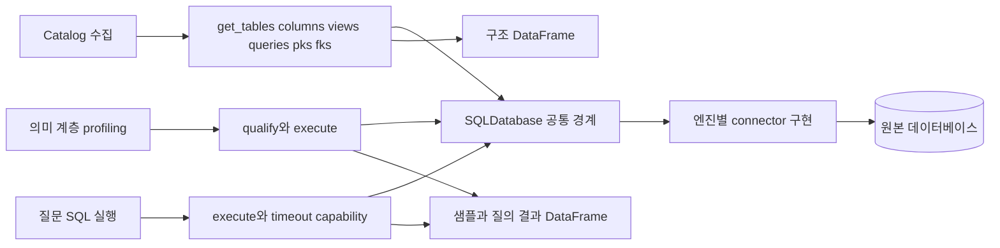
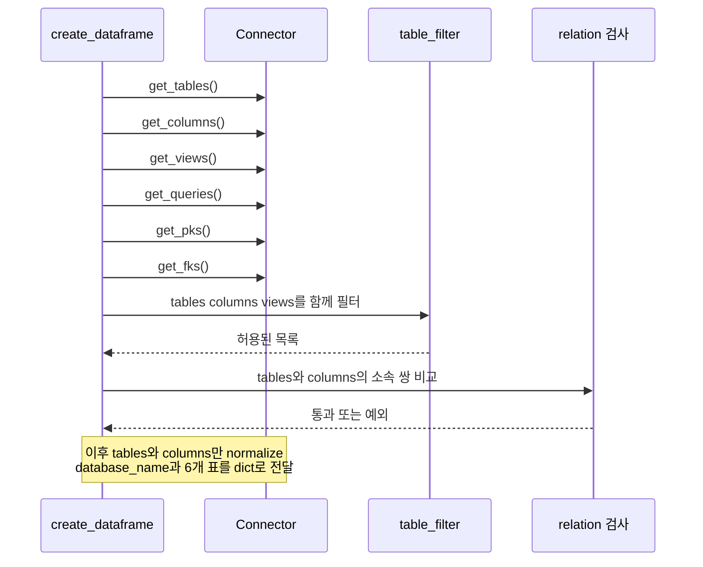
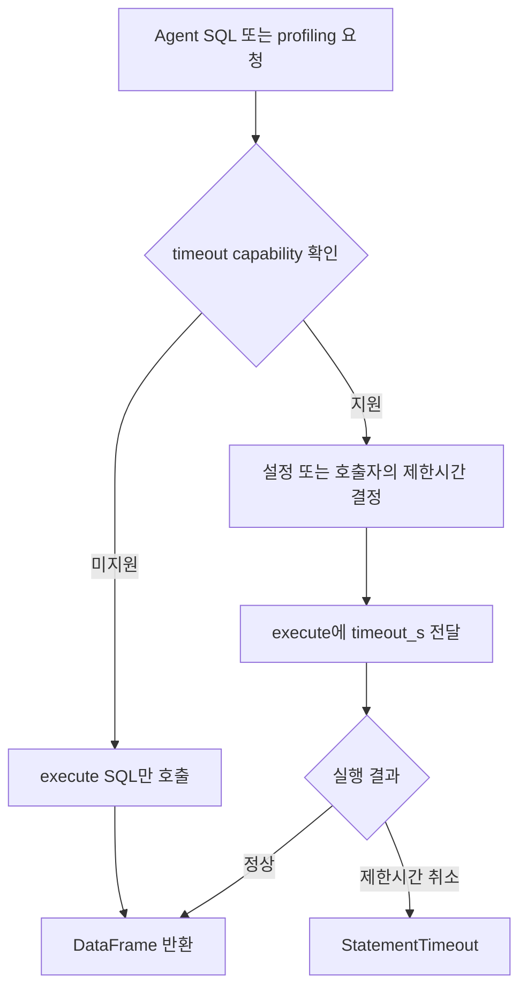

# Chapter 01. SQLDatabase 공통 계약과 수집·질의 연결

- 분석일: 2026-11-07
- 범위: 공통 인터페이스, 반환 데이터, catalog 소비·검사, 이름 한정, timeout·연결 수명 경계
- 검증: 제공 코드와 관련 테스트의 assertion을 읽은 정적 분석. 원본 DB 접속·서비스·모델·테스트 실행은 하지 않았다.
- 선행: [Catalog 객체와 ID](../02-data-model/chapter-01-catalog-entities.md), [저장 경계](../02-data-model/chapter-04-storage-boundaries.md), [용어집](../01-architecture/chapter-00-glossary.md)

## 1. 이 chapter의 용어

| 용어 | 쉬운 뜻 |
| --- | --- |
| Connector | DB 종류별 접속·구조 조회·SQL 실행을 담당하는 코드 |
| Contract, 계약 | 호출자가 기대하는 메서드·입출력·동작 조건 |
| ABC / abstract method | Abstract Base Class, 추상 기반 클래스 / 하위 클래스가 구현해야 하는 메서드 |
| DataFrame | pandas에서 데이터를 행·열로 다루는 표 형태 객체 |
| Metadata / catalog | 테이블·컬럼명·자료형 등 구조 정보 / 이를 내부에 기록한 목록 |
| Relation / view | 여기서는 테이블·뷰 같은 조회 대상 / SQL로 정의한 가상 테이블 |
| Schema / catalog / database | DB 엔진의 이름 공간. 엔진에 따라 계층과 의미가 다르므로 이름만 보고 접속 경로를 조립하지 않음 |
| PK / FK | Primary Key, 원본 행 식별 키 / Foreign Key, 다른 행을 참조하는 키 |
| Nullable / NULL | 값이 비어도 되는지 / 비어 있거나 확인되지 않은 값 |
| Dialect / identifier / qualify | 엔진별 SQL 문법 / 테이블·컬럼 같은 대상 이름 / 소속과 인용 부호를 붙여 이름을 완성하는 처리 |
| Probe / profiling | 값을 확인하는 제한 조회 / 샘플·형식·유일성 등 데이터 특징 조사 |
| Timeout / capability | 실행시간 제한 / 추가 동작을 지원하는지 나타내는 기능 표식 |
| Context manager / cache | `with` 진입·종료 동작을 제공하는 객체 / 재사용하도록 보관한 객체·결과 |

아래에서 **내부 catalog**는 애플리케이션 저장 모델을 뜻한다. Trino 등의 **원본 catalog 이름 공간**과 다른 문맥이다. 같은 이름의 용어를 구분해 읽어야 한다.

## 2. Connector를 경계로 삼는 이유

수집기는 DB마다 다른 시스템 테이블·driver를 직접 다루지 않고 공통 메서드를 호출한다. 의미 계층은 샘플 조회를, 질의 graph는 생성 SQL 실행을 같은 connector 계열에 맡긴다.



이는 기능 의존 관계도이며 메서드가 실제 base 구현으로 다시 위임된다는 뜻은 아니다. 실행할 때는 하위 클래스의 구현을 호출한다.

`SQLDatabase`는 내부 Postgres DAL과 다르다. 내부 DAL은 앱이 관리하는 객체·관계를 저장하고, connector는 원본 DB의 구조·데이터에 접근한다. 두 연결의 transaction도 자동으로 같아지지 않는다.

근거: [SQLDatabase](../../../code/auto-ontology/auto_ontology/connectors/base.py), [수집 소비자](../../../code/auto-ontology/auto_ontology/catalog/extract.py), [profiling 소비자](../../../code/auto-ontology/auto_ontology/semantic/visit_enter.py), [질의 실행 경계](../../../code/auto-ontology/auto_ontology/retrieval/text_to_sql/chat_sql.py)

## 3. 추상 인터페이스가 요구하는 것

| 항목 | 형태 | 책임 |
| --- | --- | --- |
| `__init__(connection_string)` | 추상 메서드 | 연결 문자열·경로로 객체 초기화. 실제 연결 시점은 구현별 확인 필요 |
| `execute(sql, parameters=None)` | 추상 메서드 | SQL 실행 결과를 DataFrame으로 반환 |
| `get_tables()` | 추상 메서드 | 테이블 목록 |
| `get_columns()` | 추상 메서드 | 컬럼 목록과 자료형·NULL 허용 정보 |
| `get_views()` | 추상 메서드 | 뷰 목록과 정의 |
| `get_queries(hours=24)` | 추상 메서드 | 지원하는 경우 최근 SQL 이력 |
| `get_pks()`, `get_fks()` | 추상 메서드 | 원본 PK·FK 메타데이터 |
| `dialect`, `database_name` | 추상 property | 문법 종류·원본 대상 식별 |
| `close()` | 추상 메서드 | 연결·자원 정리 |
| `qualify(schema, table)` | 기본 구현 제공 | 기본 2단계 이름 인용. 일부 엔진은 재정의 |
| `__enter__`, `__exit__` | 기본 구현 제공 | with 진입 시 자기 자신, 종료 시 close |
| `supports_statement_timeout`, `table_filter` | 기본 속성 제공 | 선택 기능의 표식·테이블 필터 전달 위치 |

추상 메서드가 하나라도 구현되지 않으면 객체를 생성할 수 없다. 하지만 ABC는 반환 DataFrame의 열 이름·값·완전성을 검사하는 모델이 아니다. Python 타입 힌트도 실제 반환 표를 자동 검증하지 않는다. 메서드가 있어도 잘못된 데이터를 반환하면 수집·파싱·실행 단계에서 실패할 수 있다.

선택 메서드인 `reuse_connection()`이나 일부 엔진의 schema 목록 조회는 이 추상 목록에 없다. 호출자는 존재 여부와 구현별 동작을 따로 확인해야 한다.

근거: [abstract surface와 기본 구현](../../../code/auto-ontology/auto_ontology/connectors/base.py), [인터페이스 테스트](../../../code/auto-ontology/auto_ontology/connectors/tests/test_base.py)

## 4. 메서드별 DataFrame 계약

### 4.1 구조와 이력

| 메서드 | 공통 문서의 기대 필드 | 소비 코드와 함께 볼 점 |
| --- | --- | --- |
| `get_tables()` | `table_schema`, `table_name`; 선택 `table_type` | description·created가 없으면 normalizer가 기본 필드 채움. table_type 누락은 base table로 처리 |
| `get_columns()` | `table_schema`, `table_name`, `column_name`, `data_type`, `is_nullable` | ordinal_position·description도 normalizer가 다룸. 빠진 필드는 미확정 값으로 채울 수 있음 |
| `get_views()` | `table_schema`, `table_name`, `view_definition` | 별도 반환을 자동으로 tables에 합치는 처리는 extract에 없음 |
| `get_queries(hours=24)` | `end_time`, `query_text` | count는 이력 parser가 있으면 사용하고 없으면 1로 처리 |
| `get_pks()` | `table_schema`, `table_name`, `column_name`, `ordinal_position` | ordinal_position은 복합 PK 내부 순서 |
| `get_fks()` | `table_schema`, `table_name`, `column_name`, `referenced_schema`, `referenced_table`, `referenced_column` | 참조 대상이 수집 범위 밖이면 내부 ID를 못 찾아 후속 저장에서 건너뛸 수 있음 |

원본 Column의 `ordinal_position`은 테이블 안의 위치, PK DataFrame의 같은 이름은 키 구성 순서다. 문자열 키 이름뿐 아니라 필드의 의미도 맞춰야 한다.

### 4.2 빈 결과와 미지원 기능

Query history를 지원하지 않는 구현은 `end_time`, `query_text` 열이 있는 빈 DataFrame을 반환하는 것이 공통 문서의 계약이다. ‘메서드 없음’과 ‘기능 미지원이라 빈 표’는 다르다.

일부 후속 함수는 None도 방어하지만 이를 모든 반환값의 공식 계약으로 확대할 수는 없다. 예를 들어 query history 소비자는 DataFrame의 `.empty`, `.to_dict()` 등을 사용한다. `get_queries()`가 None을 반환해도 전 경로가 안전하다고 볼 수 없다.

기능이 실제로 비어 있는지, 권한 부족인지, 조회 실패인지를 모두 빈 표로 바꾸면 호출자는 구분하기 어렵다. 엔진별 구현이 예외와 부분 성공을 어디서 나누는지는 후속 chapter에서 확인한다.

### 4.3 nullable은 세 상태다

`is_nullable`은 True·False·미확정으로 구분한다. Connector의 권장 반환은 실제 Boolean이며 문자열 `"NO"`를 그대로 bool로 해석하면 True가 되는 문제가 있다. `coerce_nullable()`는 호환 경계에서 `YES/NO` 등도 명시 변환하지만 미인식 값은 예외로 처리한다.

Normalizing 뒤 pandas의 미확정 값 `pd.NA`는 저장 props를 만들 때 Python `None`으로 바뀐다. None을 ‘NULL 허용 안 됨=False’로 자동 해석하지 않는다.

근거: [필드 계약](../../../code/auto-ontology/auto_ontology/connectors/base.py), [정규화](../../../code/auto-ontology/auto_ontology/catalog/normalize.py), [Query 이력 소비](../../../code/auto-ontology/auto_ontology/catalog/sql_parse.py), [PK·FK 저장](../../../code/auto-ontology/auto_ontology/catalog/store/schemas.py)

## 5. 실제 추출 호출 순서

`create_dataframe()`은 다음 여섯 호출을 순서대로 한다. 여기서 호출한 이력 함수에는 hours를 따로 넘기지 않으므로 각 구현의 기본값도 중요하다.



`data_for_populate_tabular()`의 반환은 다음 모양이다.

```text
{
  database_name: connector.database_name,
  tables: 정규화된 DataFrame,
  columns: 정규화된 DataFrame,
  views: 필터된 원본 DataFrame,
  queries: 원본 DataFrame,
  pks: 원본 DataFrame,
  fks: 원본 DataFrame
}
```

Connector가 None이면 바깥 `extract_tabular_db_data()`는 빈 dict를 반환한다. 실제 connector 호출 예외를 전부 빈 dict로 바꾸는 포괄 catch는 이 함수에 없다.

근거: [create_dataframe·data_for_populate_tabular·extract_tabular_db_data](../../../code/auto-ontology/auto_ontology/catalog/extract.py)

## 6. 필터와 ‘완전성’ 검사는 어디까지 보장하는가

### 6.1 필터가 먼저 적용된다

TableFilter는 정규식으로 relation 이름의 허용·제외 여부를 결정하는 객체다. 추출기는 connector에 붙은 `table_filter`를 읽어 tables·columns·views의 `table_name`에 함께 적용한다. Connector가 개별적으로 정규식 처리 코드를 만들 필요는 없다.

이는 **메타데이터를 가져온 뒤 적용하는 중앙 필터**다. 원본 DB가 제외 테이블에 대한 조회를 처음부터 하지 않게 만드는 pushdown과는 다르다. Pushdown은 제한 조건을 원본 조회 단계로 내려 보내는 방식이다.

이 함수에서 PK·FK·query history는 같은 relation filter로 직접 잘라내지 않는다. 후속 writer의 ID 해석·SQL 파싱 범위가 따로 영향을 준다. 따라서 필터 하나가 모든 원본 조회와 모든 후속 자료에 동일하게 적용된다고 설명하지 않는다.

### 6.2 검사 대상은 tables의 relation 키다

`_relation_keys()`는 `(table_schema, table_name)` 집합을 만든다. `_validate_relation_column_coverage()`는 tables의 각 소속 쌍이 columns에도 하나 이상 존재하는지 확인한다. 누락이 있으면 `IncompleteCatalogExtractionError`를 내고 catalog write 전에 중단한다.

| 상황 | 실제 검사 결과 |
| --- | --- |
| tables·columns 모두 비어 있음 | 허용 |
| orders가 있고 orders 컬럼이 1개 이상 있음 | 이 검사 통과 |
| orders가 있는데 orders 컬럼이 0개 | 예외 |
| 원본 컬럼은 20개지만 1개만 반환 | 이 검사만으로 누락을 알 수 없음 |
| views에만 있고 tables에는 없는 view | 이 함수는 views를 직접 받지 않으므로 독립 검사하지 않음 |
| columns에만 있는 추가 relation | tables의 누락 집합만 검사하므로 이 조건만으로 예외를 내지 않음 |

즉 class 이름과 docstring의 ‘complete inventory’ 표현을 원본 전체 컬럼의 정확성·개수 검증으로 확대하면 안 된다. 이 검사는 **목록에 있는 테이블의 컬럼이 전혀 없는 상태**를 막는 장치다.

권한 때문에 특정 relation을 읽을 수 없는 경우 connector가 tables와 columns에서 함께 제외할지, 전체 추출 실패로 처리할지는 엔진별 책임이다. 중앙 검사가 모든 의미상 부분 실패를 알아낼 수는 없다.

### 6.3 Views 반환과 실제 catalog 저장도 분리한다

`views`는 추출 dict에 포함되지만 확인한 `populate_tabular_data()`의 주된 구조 저장은 tables·columns를 사용한다. 별도 views 표를 그 자리에서 tables와 합치는 경로는 없다. 따라서 connector가 view를 get_tables에 어떻게 포함하고 table_type을 어떤 값으로 주는지 확인해야 한다. `get_views()` 구현이 있다는 사실만으로 view 저장의 전체 동작을 확정하지 않는다.

근거: [실제 coverage 검사](../../../code/auto-ontology/auto_ontology/catalog/extract.py), [중앙 filter](../../../code/auto-ontology/auto_ontology/catalog/table_filter.py), [구조 저장 진입점](../../../code/auto-ontology/auto_ontology/catalog/write.py)

## 7. database_name과 SQL 대상 이름을 구분한다

`database_name`은 내부 catalog·vector 범위·대상 connector 선택 등에 사용하는 원본 식별자다. 그런데 원본 엔진에 따라 DB 이름일 수도 있고 catalog 이름일 수도 있다. 따라서 호출자가 무조건 `database_name.schema.table`로 연결하면 안 된다.

`qualify(schema, table)`의 기본 구현은 `qualified_name()`으로 각 이름을 dialect에 맞게 인용한다. 기본 모양은 2단계이며 schema가 없으면 table만 쓴다.

```text
qualify("public", "orders") → "public"."orders"
qualify(None, "orders")     → "orders"
```

공백이 있는 `Sales Orders`나 예약어 이름을 원본 대상으로 정확히 전달하려면 인용이 필요하다. `quoted_identifier()`는 sqlglot으로 인용하고 알 수 없는 dialect 예외에는 큰따옴표 방식으로 fallback한다.

Kyuubi·Trino·Databricks는 3단계 이름을 만들기 위해 qualify를 재정의한다. 정확한 catalog 선택은 다음 registry·엔진 chapter에서 다룬다. 공통 호출자는 connector.qualify에 위임하는 것이 현재 계약이다.

반면 `dialect` 값은 sqlglot이 인식하는 이름이어야 한다. 엔진의 제품 이름과 parser의 dialect 이름이 항상 같은 것은 아니다. 이름 인용의 fallback 존재가 registry의 문법 호환성 검사를 대신하지 않는다.

근거: [qualify 계약](../../../code/auto-ontology/auto_ontology/connectors/base.py), [identifier 인용](../../../code/auto-ontology/auto_ontology/utils/sql_identifiers.py), [등록 dialect 테스트](../../../code/auto-ontology/auto_ontology/connectors/tests/test_registry_dialects.py)

## 8. execute의 기본 계약과 timeout 확장은 다르다

추상 `execute()`의 시그니처에는 sql·parameters만 있다. 실제 구현이 timeout_s를 추가해 지원할 수 있지만 그 지원은 `supports_statement_timeout`으로 확인한다. Base 기본값은 false다.



그림은 timeout 분기만 나타낸다. SQL 문법·권한·연결 등 다른 오류의 종류와 정규화는 엔진별 구현에서 확인해야 한다. 공통 ABC가 모든 오류를 한 타입으로 바꾸지는 않는다.

`execute_chat_sql()`은 flag가 있으면 설정된 SQL 제한시간을 읽어 전달한다. Profiling의 `_execute_capped()`는 flag가 정확히 True인지 보고 별도 샘플 제한시간을 전달한다. 두 호출자는 기본 입력과 목적이 다르므로 원본 메타데이터 조회까지 모두 같은 짧은 상한이 적용된다고 보면 안 된다.

`StatementTimeout`은 timeout_s·elapsed_s를 가진 공통 예외다. 측정 시간이 요청 상한의 90%보다 짧으면 원본 DB·warehouse 자체의 더 낮은 상한이 취소했을 가능성을 나타내는 문구를 만든다. 실제 원인을 서버 설정에서 직접 조회해 증명한 결과는 아니라 경과시간 기반 설명 분기다.

Base의 capability 주석에는 Databricks timeout 비용 관련 과거 설명이 있지만 현재 Databricks 구현의 flag는 True다. 또한 등록 connector의 flag를 검사하는 테스트도 있다. 실제 지원 판정은 현재 클래스 값과 execute 구현을 기준으로 하고 주석만으로 지원하지 않는다고 결론 내리지 않는다.

근거: [기본 execute·StatementTimeout](../../../code/auto-ontology/auto_ontology/connectors/base.py), [Chat timeout 전달](../../../code/auto-ontology/auto_ontology/retrieval/text_to_sql/chat_sql.py), [profiling timeout 전달](../../../code/auto-ontology/auto_ontology/semantic/visit_enter.py), [Databricks 구현](../../../code/auto-ontology/auto_ontology/connectors/databricks.py)

## 9. 연결 수명은 객체 소유자와 함께 본다

`with connector:`는 종료 시 close를 호출한다. 본문에서 예외가 발생해도 close한다. 그러나 캐시된 connector를 사용하는 모든 작업에서 with를 쓰는 것은 아니다.

`run_ingest()`는 caller가 connector 수명을 소유한다고 명시하며 스스로 close하지 않는다. Scheduler가 캐시된 객체를 반복 사용하기 때문이다. 대신 추출 구간에는 `_shared_connection()`을 쓰고, connector에 `reuse_connection()`이 있을 때만 그 hook으로 원본 연결을 공유한다.

| 코드 | 의미 | 보장하지 않는 것 |
| --- | --- | --- |
| Base의 with 종료 | close 호출 | 엔진별 close가 어떤 자원을 언제 해제하는지 |
| `_shared_connection()` | hook이 있으면 추출 동안 그 scope 사용 | 모든 connector에 같은 hook이 있음 |
| run_ingest가 close하지 않음 | caller·cache의 객체 수명 존중 | 연결이 프로세스 종료까지 항상 살아 있음 |
| execute 반환 | DataFrame으로 결과 전달 | transaction commit·autocommit·세션 재사용 정책이 모든 엔진에서 동일함 |

동일 connector가 thread-safe한지도 base에 공통 보장으로 선언되어 있지 않다. Worker·수집기·캐시의 동시 사용은 구체적 engine과 registry에서 확인해야 한다.

근거: [base lifecycle](../../../code/auto-ontology/auto_ontology/connectors/base.py), [수집의 공유 연결과 수명 주석](../../../code/auto-ontology/auto_ontology/ingestion_service/ingest.py)

## 10. 작은 예시로 호출과 데이터를 연결하기

가상 DB shop에 `sales.orders(id, customer_id, amount)`가 있다고 하자. 다음은 원본에서 기대하는 **구조 데이터 예시**이며 실제 DB 반환 결과는 아니다.

```text
get_tables():
  table_schema="sales", table_name="orders", table_type="base table"

get_columns():
  ("sales", "orders", "id",          "integer", False)
  ("sales", "orders", "customer_id", "integer", True)
  ("sales", "orders", "amount",      "numeric", True)
  # 순서: table_schema, table_name, column_name, data_type, is_nullable

get_pks():
  ("sales", "orders", "id", 1)

get_queries():
  end_time=<관측 시각>, query_text="SELECT SUM(amount) FROM sales.orders"
```

추출기는 여섯 메타데이터 메서드를 호출하고 필터·coverage 검사를 통과시킨다. 정규화 후 내부 catalog writer는 이 구조에 객체 ID를 붙여 저장한다. 이후 profiling은 connector.qualify로 대상 이름을 만들고 execute로 샘플을 읽는다. Chat은 생성 SQL을 같은 execute 경계에 전달하지만 timeout·원본 세션 정책은 별도로 적용한다.

여기서 원본 orders의 id 값과 내부 catalog의 column ID는 다르다. Connector는 원본 구조를 보고하고, 내부 객체 ID 재사용·저장은 앞 데이터 모델 chapter의 역할이다.

## 11. 테스트가 확인하는 범위

Assertion은 테스트가 검사하는 기대 조건이다. 아래는 소스에서 확인했으며 실행한 결과가 아니다.

| 테스트 | 확인한 범위와 한계 |
| --- | --- |
| `test_base.py::test_abstract_surface_is_exactly_the_documented_contract` | 추상 메서드·property 이름 집합. 반환 DataFrame의 실제 의미는 검사하지 않음 |
| `test_cannot_instantiate_without_implementing_everything` | 불완전한 하위 클래스 생성 거부 |
| context manager 테스트 2개 | 정상·예외 종료 모두 fake connector의 close가 호출됨 |
| `test_get_queries_defaults_to_24_hours` | base 시그니처의 기본 24. 각 엔진 이력 SQL의 시간 조건 전체를 검사한 것은 아님 |
| `test_every_shipped_connector_subclasses_the_base` | 해당 테스트의 명시된 5개 클래스 검사. 패키지의 모든 엔진을 전부 열거한 검사는 아님 |
| qualify 테스트들 | 2단계·schema 없는 이름·공백 있는 이름 인용 |
| `test_registry_dialects.py` | registry의 dialect 이름이 parser가 아는 이름인지 확인. 실제 원본 SQL 실행 테스트와 다름 |
| `test_extract.py` | 빈 catalog·schema 미확정 키·relation별 컬럼 존재·누락 오류 |
| `test_statement_timeouts.py`의 flag·문구 테스트 | 등록 클래스 flag 확인과 상한 출처 문구 분기. 실제 취소 구현은 별도 엔진 테스트 |

`test_table_filter.py`에는 filter 적용·검사 순서 관련 사례도 있다. 세부 정규식 규칙과 cache 전달은 다음 chapter에서 assertion까지 이어 확인한다.

근거: [공통 계약 테스트](../../../code/auto-ontology/auto_ontology/connectors/tests/test_base.py), [dialect 테스트](../../../code/auto-ontology/auto_ontology/connectors/tests/test_registry_dialects.py), [추출 검사 테스트](../../../code/auto-ontology/auto_ontology/catalog/tests/test_extract.py), [timeout 테스트](../../../code/auto-ontology/auto_ontology/connectors/tests/test_statement_timeouts.py), [filter 테스트](../../../code/auto-ontology/auto_ontology/catalog/tests/test_table_filter.py)

## 12. 다음 분석의 시작점

공통 계약은 메서드 이름뿐 아니라 표의 필드·소속·빈 결과·추출 범위·문법·연결 수명까지 포함한다. 현재 단계에서 엔진별 기능이 모두 동일하다고 확정하지 않았다.

다음 Chapter 02는 registry의 연결 선택과 cache다. 저장한 연결과 환경 문자열이 어떻게 합쳐지는지, schema/table 필터가 언제 붙는지, 연결 변경 뒤 worker가 새 설정을 언제 보는지 추적한다. 이후 엔진별 추출·실행·timeout·인증으로 내려간다. [진행 계획](../../../.codex/plan/auto-ontology/01-3_connectors.md)
