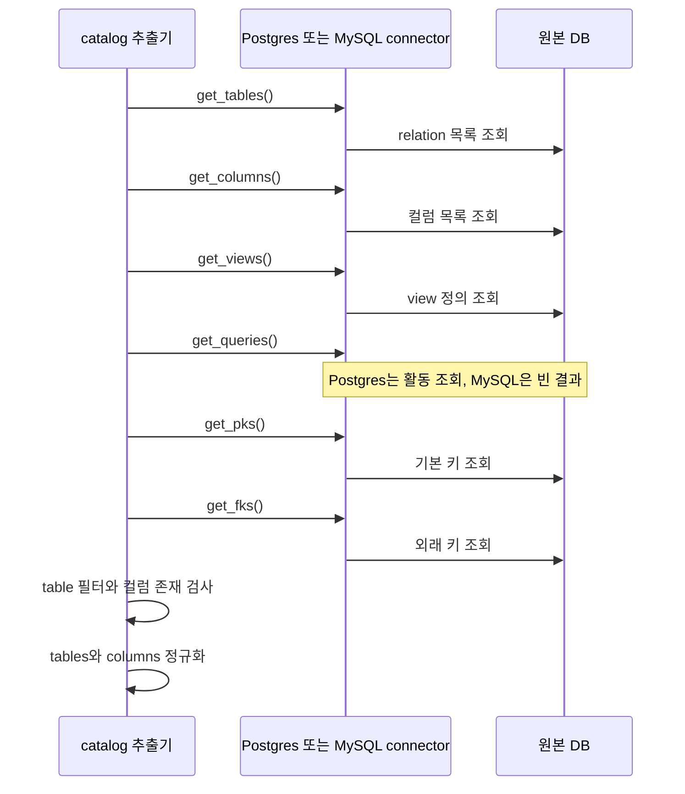
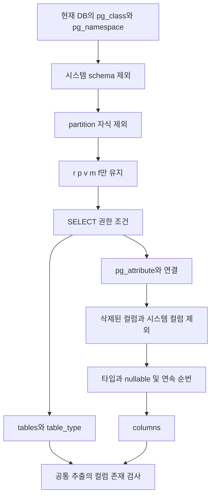
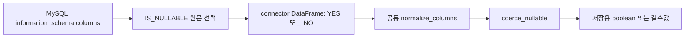

# Chapter 03. Postgres·MySQL의 메타데이터 추출

Postgres와 MySQL connector는 DB 서버가 제공하는 구조 정보를 읽어 공통 DataFrame으로 반환한다. DataFrame은 이름이 붙은 열과 행으로 구성된 표다. 두 구현 모두 테이블·컬럼·view·키를 조회하지만, **조회 범위·자료형 표현·권한 조건·SQL 이력의 의미가 다르다.** 공통 인터페이스가 같다는 이유로 수집 내용까지 같다고 볼 수 없다.

이 장은 로컬 소스와 테스트의 정적 분석이다. DB·서비스·테스트는 실행하지 않았다. [공통 계약](chapter-01-common-contract.md), [Registry](chapter-02-registry-and-cache.md), [용어집](../01-architecture/chapter-00-glossary.md)을 함께 참고한다.

## 1. 무엇을 위한 컴포넌트인가

introspection은 프로그램이 DB의 테이블 이름·컬럼·제약조건 등을 조회하는 작업이다. 이 프로젝트는 그 결과를 catalog, 즉 원본 DB의 구조를 보관하는 저장소에 넣고 검색·SQL 생성의 근거로 사용한다. 이 단계의 `get_columns()`는 업무 데이터 전체를 읽는 함수가 아니다. 컬럼별 실제 값의 표본 추출과 통계 계산은 의미 계층 생성 단계에서 별도로 이루어진다.

| 항목 | PostgresDatabase | MySQLDatabase |
| --- | --- | --- |
| 원본 파일 | `connectors/postgres.py` | `connectors/mysql.py` |
| DB 접근 라이브러리 | `psycopg`, `psycopg_pool` | `mysql.connector` |
| 생성 시 동작 | 연결 pool 생성 후 `SELECT current_database()` | URL 파싱 후 `ping()` |
| `database_name` | 서버가 반환한 현재 DB 이름 | URL 경로에서 읽은 DB 이름 |
| 구조 조회 범위 | 현재 DB의 비시스템 schema들 | `TABLE_SCHEMA = DATABASE()`인 현재 DB |
| 객체 수명 | pool의 연결을 빌려 쿼리 실행 | 작업마다 새 연결을 열고 종료 |

pool은 여러 DB 연결을 보관하고 빌려 주는 장치다. Postgres pool은 최소 1개·최대 4개 연결을 사용한다. MySQL은 여기서 pool을 사용하지 않으며, 생성 시 확인한 연결도 `ping()` 후 닫는다. 따라서 성공한 생성은 그 시점의 연결 확인이며 이후 모든 메타데이터 조회의 성공 보장은 아니다.

schema는 테이블 이름의 소속 범위다. Postgres의 `analytics.orders`에서 `analytics`가 schema다. 이 MySQL 구현의 `table_schema`에는 연결된 DB 이름이 들어간다. 이를 별개의 DB·schema 두 단계가 언제나 존재한다는 뜻으로 해석하지 않는다.

근거: [PostgresDatabase](../../../code/auto-ontology/auto_ontology/connectors/postgres.py), [MySQLDatabase](../../../code/auto-ontology/auto_ontology/connectors/mysql.py).

## 2. 공통 호출 순서와 반환 계약



view는 SQL 정의를 통해 다른 테이블의 결과를 보여 주는 객체다. PK(Primary Key, 기본 키)는 행을 식별하는 컬럼이고, FK(Foreign Key, 외래 키)는 다른 테이블의 컬럼을 참조하는 연결이다. 여러 컬럼을 함께 사용하는 키는 복합 키라고 한다.

| 반환 표 | 두 구현의 실제 선택 필드 |
| --- | --- |
| tables | `table_schema`, `table_name`, `table_type` |
| columns | `table_schema`, `table_name`, `column_name`, `data_type`, `is_nullable`, `ordinal_position` |
| views | `table_schema`, `table_name`, `view_definition` |
| queries | `end_time`, `query_text` |
| pks | `table_schema`, `table_name`, `column_name`, `ordinal_position` |
| fks | `table_schema`, `table_name`, `column_name`, `referenced_schema`, `referenced_table`, `referenced_column` |

`ordinal_position`은 순번이다. columns에서는 컬럼 표시 순서이며 pks에서는 키 내부 순서다. 두 순서가 반드시 같지는 않다. FK 결과에는 제약조건 이름이나 복합 FK 내부 순번을 반환하지 않는다.

공통 추출기는 이 여섯 함수를 순차 호출하고 tables·columns·views에 테이블 필터를 적용한 뒤 tables에 나열된 각 대상에 컬럼이 하나 이상 있는지 검사한다. 이후 tables·columns만 정규화한다. 어느 한 컬럼이 누락되거나 키의 대응이 잘못된 경우까지 검사하는 구조는 아니다.

근거: [extract.py](../../../code/auto-ontology/auto_ontology/catalog/extract.py), [normalize.py](../../../code/auto-ontology/auto_ontology/catalog/normalize.py).

## 3. Postgres: pg_catalog로 조회 대상을 맞춘다

### 3.1 get_tables의 포함·제외 기준

`pg_catalog`는 Postgres의 시스템 메타데이터다. 구현은 relation, 즉 테이블이나 view처럼 조회 가능한 관계 객체의 정보를 담은 `pg_class`를 `pg_namespace`와 연결한다. 여기서 `relkind` 값에 따라 catalog의 `table_type`을 결정한다.

| relkind | 객체 뜻 | 저장용 table_type |
| --- | --- | --- |
| `r` | 일반 테이블 | `base table` |
| `p` | partitioned table의 부모. partition은 한 논리 테이블을 여러 조각으로 나눈 구조 | `base table` |
| `v` | 일반 view | `view` |
| `m` | materialized view. 조회 결과를 미리 저장해 두는 객체 | `materialized view` |
| `f` | foreign table. 외부 데이터에 접근하는 테이블 객체 | `base table` |

추가 조건은 다음과 같다.

- `pg_catalog`, `information_schema`, `pg_`로 시작하는 schema를 제외한다.
- `c.relispartition = false`로 partition 자식은 제외한다. 부모와 자식을 별도 후보로 중복 노출하지 않으려는 선택이다.
- `has_table_privilege(c.oid, 'SELECT')`가 참인 객체만 포함한다.
- schema·테이블 이름순으로 정렬한다.

일반 view와 materialized view 모두 tables 표에 포함시키므로, `get_views()` 결과를 tables에 합치는 별도 동작이 없어도 테이블 후보가 된다. 다만 각 view의 정의 SQL을 얻는 경로는 아래처럼 다르다.



여기서 권한 조건은 **수집에 사용하는 역할의 테이블 SELECT 권한 검사**다. 사용자별 모든 실행 권한이나 외부 테이블의 원격 서버 상태까지 검증했다고 볼 수 없다. 이 메타데이터 SQL은 각 테이블의 데이터를 실제로 읽어 보지 않는다.

### 3.2 get_columns는 get_tables와 같은 relation 조건을 사용한다

`pg_attribute`를 relation 정보에 연결하며 tables와 같은 schema·relkind·partition·SELECT 조건을 적용한다. 추가로 `a.attnum > 0`, `NOT a.attisdropped`를 요구한다. 시스템 컬럼과 삭제된 컬럼을 제외하기 위한 조건이다.

| 필드 | 만드는 방식 | 의미·한계 |
| --- | --- | --- |
| `data_type` | `format_type(a.atttypid, NULL)` | 타입 이름을 유지하되 길이·정밀도 같은 수식 정보는 전달하지 않음 |
| `is_nullable` | `NOT a.attnotnull` | `YES/NO` 문자열이 아닌 boolean |
| `ordinal_position` | relation별 `row_number()`를 `attnum` 순으로 계산 | 삭제된 컬럼 자리 때문에 내부 번호가 1·3·4라도 1·2·3으로 반환 |

enum은 미리 정한 문자열 값의 집합이고, array는 한 컬럼에 같은 타입의 여러 값을 담는 타입이다. 테스트가 기대하는 타입 예시는 enum `mpaa_rating`, array `text[]`다. 둘을 `USER-DEFINED`, `ARRAY`로만 뭉개지 않아 SQL 작성에 필요한 타입 단서를 유지한다. 다만 enum의 허용 값 목록이나 숫자 정밀도를 별도 필드로 추출하지는 않는다.

설명용 결과는 다음과 같다. 실제 DB 실행 결과가 아니다.

```text
tables
analytics | rental_by_category | materialized view

columns
analytics | rental_by_category | category | text   | True  | 1
analytics | rental_by_category | rentals  | bigint | False | 2
```

### 3.3 get_views는 다른 메타데이터 경로다

`get_views()`는 `information_schema.views`의 `view_definition`을 읽고 두 시스템 schema를 제외한다. `get_tables()`와 같은 `pg_class` 기반 쿼리는 아니다. `pg_get_viewdef` 같은 별도 정의 조회도 하지 않는다.

따라서 이 구현은 **materialized view의 존재·컬럼은 수집하면서 정의 SQL을 같은 방식으로 수집하지 않는 구조**다. 일반 view도 DB가 정의를 반환하는 권한 범위에 좌우되며, 함수는 `view_definition`이 비어 있는지 추가 검증하지 않는다. tables·columns와 views의 대상 집합이 완전히 같다는 보장은 없다.

## 4. MySQL: 현재 DB의 information_schema를 읽는다

`information_schema`는 DB 객체의 구조를 SQL로 조회하는 메타데이터 공간이다. MySQL 구현은 tables·columns·views·키 쿼리 모두 현재 DB 범위를 명시한다.

### 4.1 테이블과 컬럼

`get_tables()`는 `TABLE_SCHEMA = DATABASE()`와 `TABLE_TYPE IN ('BASE TABLE', 'VIEW')`를 적용한다. `VIEW`를 `view`, 나머지를 `base table`로 바꾼다. 이 함수에는 materialized view를 별도 분류하는 분기가 없다.

`get_columns()`는 다음과 같이 원본 필드를 선택한다.

| 원본 필드 | 반환 필드 | 이번 구현의 특징 |
| --- | --- | --- |
| `DATA_TYPE` | `data_type` | `COLUMN_TYPE` 전체 선언을 선택하지 않음 |
| `IS_NULLABLE` | `is_nullable` | SQL에서 boolean으로 바꾸지 않고 원문 선택 |
| `ORDINAL_POSITION` | `ordinal_position` | 서버가 제공한 순번 사용 |

nullable은 컬럼에 NULL, 즉 값이 없다는 상태를 허용하는지 나타낸다. 이 구현에서 `IS_NULLABLE`이 `YES/NO`로 오면 **connector 직후 값은 문자열**이다. `normalize_columns()`가 `coerce_nullable()`을 적용해 `YES → True`, `NO → False`로 바꾸므로 공통 수집 경로에서는 보정된다.



이 차이는 주석과도 대조해야 한다. 공통 base·normalize의 설명은 모든 내장 connector가 boolean을 반환한다고 적지만 현재 MySQL SQL에는 변환식이 없다. 따라서 직접 `get_columns()`를 쓰는 소비자와 공통 정규화를 거치는 소비자를 구분해야 한다. 문자열 `"NO"`에 단순히 `bool()`을 적용하면 `True`가 되므로 변환 함수를 우회할 수 없다.

`DATA_TYPE`만 선택하므로 enum의 값 목록·문자열 길이·unsigned 같은 선언 전체를 이 결과의 별도 필드로 보존하지 않는다. Postgres의 `format_type()`과 표현 수준이 같은 타입 정보라고 가정하지 않는다.

### 4.2 view와 권한

`get_views()`는 현재 DB의 `VIEW_DEFINITION`을 반환한다. `get_tables()`에도 view가 포함되므로 view의 존재와 정의 SQL을 서로 다른 표로 반환한다. `view_definition`의 비어 있음이나 실제 view 조회 가능 여부를 connector가 추가 검증하지는 않는다.

Postgres의 `has_table_privilege()`와 동일한 명시적 권한 검사식은 이 SQL에 없다. 메타데이터 노출과 실제 쿼리 성공 여부는 서버 권한·상태에 영향을 받으므로, 목록에 나왔다고 모든 조회가 성공한다고 판단하지 않는다.

## 5. PK·FK: 이름뿐 아니라 컬럼 대응을 확인해야 한다

### 5.1 PK의 반환 형태

두 구현 모두 `table_constraints`와 `key_column_usage`를 연결해 `PRIMARY KEY`를 읽고, 컬럼별 행과 `ordinal_position`을 반환한다.

설명용 테이블의 컬럼 순서가 `order_id`, `tenant_id`, `amount`이고 PK가 `(tenant_id, order_id)`라면 PK 순서는 다음과 같다.

```text
table_name | column_name | ordinal_position
orders     | tenant_id   | 1
orders     | order_id    | 2
```

이는 columns의 표시 순서와 다를 수 있다. PK 결과에는 제약조건 이름·인덱스 상세·unique 제약조건 전체가 포함되지 않는다.

MySQL의 PK join은 constraint schema·constraint name·table schema·table name을 함께 비교한다. Postgres의 join은 constraint name·table schema만 비교하고 table name은 비교하지 않는다. 같은 schema에서 제약조건 이름이 겹치는 경우의 결과는 후속 검증 항목이다.

### 5.2 MySQL FK는 같은 메타데이터 행에서 참조 대상을 읽는다

`information_schema.key_column_usage`에서 `REFERENCED_TABLE_NAME IS NOT NULL`인 행을 선택한다. 해당 행의 참조 schema·테이블·컬럼을 그대로 반환하므로 별도 두 컬럼 집합을 결합하지 않는다.

다만 결과에서 constraint 이름과 키 내부 순번을 선택하지 않는다. 각 컬럼의 연결은 있어도 어느 여러 컬럼이 하나의 FK 제약조건을 구성했는지는 이 표만으로 온전히 보존되지 않는다. 출력 정렬도 컬럼 이름순이며 키 정의 순서 보장이 아니다.

### 5.3 Postgres FK join의 미검증 경계

Postgres는 `table_constraints tc → key_column_usage kcu → constraint_column_usage ccu`를 연결한다. `ccu`와의 join 조건은 다음 두 개다.

```sql
tc.constraint_name = ccu.constraint_name
AND tc.table_schema = ccu.table_schema
```

**코드상 사실:** 원본 컬럼과 참조 컬럼을 키 내부 순서로 대응시키는 조건이 없고, `ccu.table_schema`와 원본 constraint의 table schema를 같게 요구한다.

**추론·미재현 시나리오:** 같은 constraint에 원본 컬럼 2개와 대상 컬럼 2개의 메타데이터 행이 있다면 순서 조건 없는 join은 올바른 두 쌍만 고르지 못하고 조합을 늘릴 수 있다. 예를 들어 `(tenant_id, customer_id) → (tenant_id, id)`가 의도였는데 `tenant_id → id` 같은 잘못된 후보가 섞일 수 있다. 다른 schema를 참조하는 FK도 `ccu.table_schema` 조건 때문에 누락되는지 확인이 필요하다.

이 분석은 실제 DB에서 잘못된 키가 저장되었다는 재현 보고가 아니다. 현재 확인한 테스트가 이런 복합 키·교차 schema 경계를 보장하는지도 별도로 구분한다. 원본 쿼리를 수정하지 않았다.

## 6. SQL 이력: Postgres 활동 조회와 MySQL 미지원

| 항목 | Postgres `get_queries(hours=24)` | MySQL `get_queries(hours=24)` |
| --- | --- | --- |
| 데이터 출처 | `pg_stat_activity` | 조회하지 않음 |
| 시간 필드 | `state_change AS end_time` | 빈 `end_time`, `query_text` 표 |
| 조건 | 현재 backend 제외, 비어 있지 않은 query, 최근 hours | hours 인자는 사용하지 않음 |
| 실패 처리 | `psycopg.Error`면 필드가 있는 빈 표 | 원래부터 빈 표 |

backend는 여기서 DB 서버의 연결 처리 프로세스를 뜻한다. Postgres는 자신이 실행하는 메타데이터 쿼리의 backend를 제외하지만, 다른 세션의 시스템 조회 SQL까지 모두 제외하는 조건은 없다.

`state_change`를 `end_time`으로 이름 붙였어도 이것이 모든 SQL의 정확한 종료 시각을 보관하는 완전한 감사 이력이라는 뜻은 아니다. 쿼리의 실행 상태 조건이나 현재 DB로 제한하는 `datname` 조건도 없다. 이 구현이 읽는 것은 `pg_stat_activity`가 그 시점에 제공하는 활동 정보다. SQL 이력의 범위·권한을 테이블 메타데이터 범위와 동일시하지 않는다.

MySQL은 선택적 Performance Schema 설정·권한 의존성을 피하기 위해 빈 표를 반환한다는 주석이 있다. **이 프로젝트 구현의 미지원**이며 MySQL 엔진 전체가 이력 기능을 제공하지 않는다는 뜻은 아니다. 수집 성공 여부와 이력 확보 여부는 다르다.

## 7. 빈 결과·부분 실패·정규화

| 상황 | 확인한 처리 |
| --- | --- |
| Postgres 메타데이터 SELECT가 0행 | `_fetch_frame()`이 `pd.DataFrame(rows)`를 만들어 컬럼 이름도 없는 빈 표가 될 수 있음 |
| MySQL SELECT가 0행 | cursor description으로 컬럼 목록을 지정하므로 필드가 있는 빈 표 |
| Postgres 활동 조회의 DB 오류 | 필드가 있는 빈 queries로 대체 |
| tables·columns·views·PK·FK SQL 오류 | 이 두 connector의 해당 메서드에서는 잡지 않고 전파 |
| 나열된 테이블에 컬럼 0개 | 공통 coverage 검사에서 예외. coverage는 테이블별 컬럼 존재 검사 |
| 한 컬럼·FK가 일부 누락 | 위 존재 검사만으로 발견한다고 볼 수 없음 |
| 테이블 설명·생성 시각 없음 | 정규화에서 필드를 추가하지만 설명이나 시각을 새로 알아내지는 않음 |

여섯 조회를 한 번의 metadata snapshot(같은 시점의 일관된 상태)으로 묶는 코드가 없다. Postgres도 각 `execute()`가 pool에서 연결을 빌리고, MySQL은 매번 새 연결을 연다. 조회 사이 원본 구조가 바뀌는 경우의 일관성은 별도 실행 검증이 필요하다.

이 경로의 메타데이터 호출은 `execute()`에 `timeout_s`를 지정하지 않는다. 객체가 시간제한 기능을 지원한다는 사실만으로 여섯 조회에 프로젝트의 statement timeout이 모두 적용된다고 볼 수 없다. 서버 자체 제한과 후속 표본 조회의 timeout은 다른 분석 대상이다.

## 8. 테스트 근거와 아직 보장되지 않는 내용

| 테스트 | 읽은 assertion·조건 |
| --- | --- |
| `test_postgres.py::test_partitioned_parent_is_catalogued` | fixture의 payment 부모를 한 행·base table로 기대 |
| `test_partition_children_are_not_catalogued` | partition 자식 이름들이 제외됨을 기대 |
| `test_materialized_view_is_catalogued` | rental_by_category를 materialized view로 기대 |
| `test_columns_reach_every_catalogued_relation` | fixture의 public relation마다 컬럼이 있음을 기대 |
| `test_declared_types_are_reported_not_placeholders` | enum·array 타입 이름이 보존됨을 기대 |
| `test_system_schemas_are_excluded`, `test_nullability_is_a_real_boolean` | fixture schema 집합과 boolean·nullable 혼합 값 검사 |
| `test_mysql.py::test_registry_creates_mysql_connector` | 가짜 연결로 클래스 선택·이름·ping과 close 확인 |
| `test_execute_returns_dataframe_and_closes_connection` | 가짜 cursor 결과·인자 전달·연결 종료 검사 |
| `test_live_mysql_connector_end_to_end` | 명시적으로 활성화한 실제 DB에서 metadata 표·필드·DB 범위 확인. 비활성 시 skip |
| `test_normalize_nullable.py` | YES/NO 변환, 미확인 문자열 예외, nullable boolean dtype 검사 |

Postgres fixture 테스트는 환경 설정이 없거나 DB에 접근하지 못하면 skip한다. 해당 테스트가 존재한다는 것만으로 이번 환경에서 통과했다고 말할 수 없다. 이 장에서는 위 테스트를 실행하지 않았다. 특히 위에서 제기한 복합 FK·교차 schema·정의 권한·동시 구조 변경을 테스트 표의 일반 항목으로 검증했다고 확대하지 않는다.

근거: [Postgres 테스트](../../../code/auto-ontology/auto_ontology/connectors/tests/test_postgres.py), [MySQL 테스트](../../../code/auto-ontology/auto_ontology/connectors/tests/test_mysql.py), [정규화 테스트](../../../code/auto-ontology/auto_ontology/catalog/tests/test_normalize_nullable.py).

다음 [SQLite·DuckDB 추출](chapter-04-sqlite-and-duckdb-extraction.md)에서는 같은 계약을 파일 기반 DB가 어떻게 구현하는지, 어떤 정보가 비거나 기본값으로 바뀌는지 확인한다.
