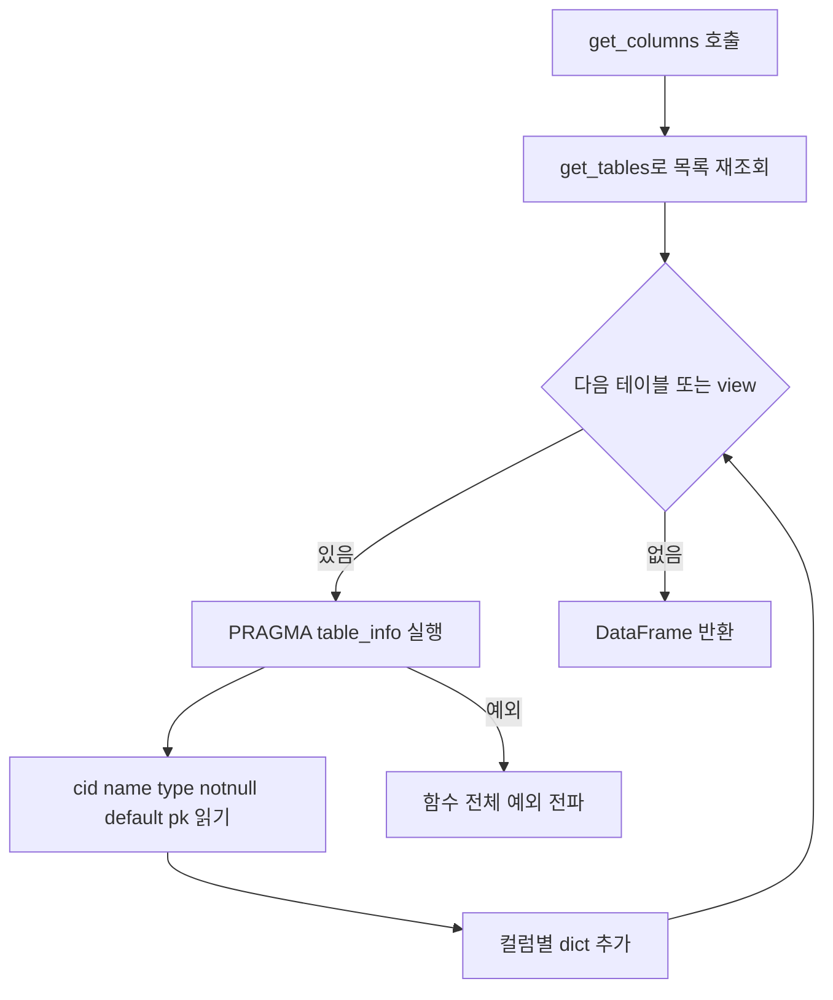
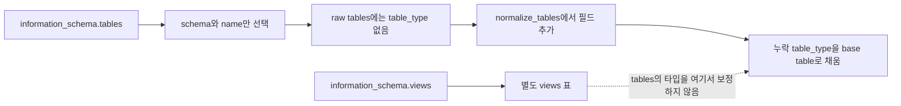
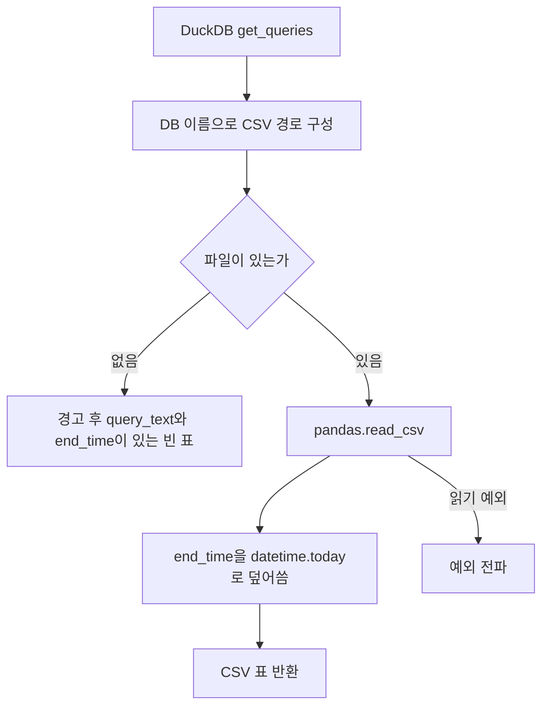

# Chapter 04. SQLite·DuckDB의 메타데이터 추출

SQLite와 DuckDB connector는 파일 기반 DB를 열어 공통 메타데이터 표를 만든다. 하지만 **SQLite는 테이블별 PRAGMA로 컬럼·키를 반복 조회하고, DuckDB는 information_schema를 일괄 조회하면서 PK·FK는 반환하지 않는다.** DuckDB의 SQL 예시는 실제 실행 이력 대신 선택적인 CSV 파일에서 온다.

이 장은 로컬 코드·테스트의 정적 분석이다. DB·테스트는 실행하지 않았다. [공통 계약](chapter-01-common-contract.md), [Registry](chapter-02-registry-and-cache.md), [Postgres·MySQL](chapter-03-postgres-and-mysql-extraction.md), [용어집](../01-architecture/chapter-00-glossary.md)을 함께 참고한다. 파일 경로 예시는 동작 설명용이며 설치 절차가 아니다.

## 1. 객체 생성과 DB 식별

| 구분 | SQLiteDatabase | DuckDBDatabase |
| --- | --- | --- |
| 구현 | Python 표준 라이브러리 `sqlite3` | `duckdb` Python 라이브러리 |
| 입력 | `sqlite:` URL 또는 클래스에 직접 주는 파일 경로 | `duckdb://`를 제거한 경로 또는 클래스에 직접 주는 경로 |
| 파일 검사 | `Path.exists()`가 거짓이면 `FileNotFoundError` | connector 자체에서 exists 검사를 하지 않고 `duckdb.connect()`에 전달 |
| 기본 열기 방식 | `sqlite3.connect(path)` | `duckdb.connect(database=path, read_only=True)` |
| `database_name` | 확장자를 제외한 파일 이름 `Path.stem` | `SELECT current_database()` 결과 |
| 연결 보관 | thread마다 별도 연결 | 기본 `self.conn` 하나 |

thread는 한 프로세스 안에서 작업을 실행하는 단위다. SQLite는 `threading.local()`에 현재 thread의 연결을 보관해 다른 thread와 같은 연결을 공유하지 않도록 한다. 생성 thread에서는 즉시 연결을 한 번 열고, 다른 thread에서는 처음 사용할 때 연다. 연결 목록은 `_all_conns`에 따로 기록한다.

SQLite의 `database_name`은 파일 전체 경로가 아니다. 예를 들어 `a/sales.sqlite`와 `b/sales.sqlite`는 둘 다 `sales`라는 이름을 갖는다. Registry의 중복 이름 경고·SQL 대상 연결 선택과 연결되는 식별 경계다.

DuckDB는 `_connection_string`에 파일 절대 경로 또는 `:memory:` 뒤에 counter를 붙인 값을 저장하지만, `database_name`은 여전히 서버 쿼리 결과를 쓴다. 내부 경로용 counter가 catalog DB 이름까지 고유하게 만든다고 해석하지 않는다.

클래스가 파일 경로를 받을 수 있어도 Registry의 `create_connector()`는 scheme을 요구한다. 또한 앞 장에서 확인했듯 저장 dict를 URL로 바꾸는 factory에는 두 엔진의 분기가 없다. 직접 클래스 사용·환경 URL 사용·저장 dict 사용은 서로 같은 진입 경로가 아니다.

근거: [sqlite.py](../../../code/auto-ontology/auto_ontology/connectors/sqlite.py), [duckdb.py](../../../code/auto-ontology/auto_ontology/connectors/duckdb.py), [Registry와 factory](chapter-02-registry-and-cache.md).

## 2. SQLite: 목록을 읽고 각 대상에 PRAGMA를 실행한다

PRAGMA는 SQLite의 설정·구조 정보를 조회하는 명령이다. 여기서는 `table_info()`로 컬럼과 PK를, `foreign_key_list()`로 FK를 읽는다. PK(Primary Key, 기본 키)는 행 식별에 쓰는 키이고 FK(Foreign Key, 외래 키)는 다른 테이블을 참조하는 키다.

### 2.1 get_tables와 get_views

`get_tables()`는 `sqlite_master`에서 `type IN ('table', 'view')`, `name NOT LIKE 'sqlite_%'` 조건을 사용한다. 반환 schema는 조회 결과에서 가져오는 값이 아니라 문자열 **`main`으로 고정**한다.

| 반환 필드 | 만드는 방식 |
| --- | --- |
| `table_schema` | `'main'` |
| `table_name` | `name` |
| `table_type` | type이 view면 `view`, 아니면 `base table` |

`get_views()`도 `sqlite_master`에서 type이 view인 행을 읽고 `sql AS view_definition`을 반환한다. 해당 원문 SQL을 따로 파싱하거나 다른 엔진과 같은 정의 형식으로 변환하지 않는다. 이 메서드에는 `get_tables()`의 이름 제외 조건이 없다.

**범위의 의미:** connector에는 attached DB 목록을 순회하거나 `temp`·각 attached DB별 목록을 수집하는 코드가 없다. attached DB란 한 연결에 추가로 붙인 다른 DB 파일을 뜻한다. 현재 반환 schema도 `main` 고정이므로, 여러 파일을 붙인 전체 환경의 schema 지도를 수집한다고 볼 수 없다.

### 2.2 get_columns의 루프와 필드



`get_columns()`는 `get_tables()` 결과의 각 `table_name`에 다음 조회를 실행한다.

```text
PRAGMA table_info("테이블이름")
```

| PRAGMA 값 | 반환 필드·처리 |
| --- | --- |
| `cid` | `ordinal_position = cid + 1` |
| `name` | `column_name` |
| `data_type` | `data_type` 그대로. 빈 값이면 `TEXT` |
| `notnull` | `is_nullable = not notnull` |
| `_default` | 읽지만 반환하지 않음 |
| `_pk` | 컬럼 조회에서는 읽지만 사용하지 않음 |

`is_nullable`은 NULL, 즉 값이 없는 상태를 허용하는지 나타낸다. 여기서는 PRAGMA의 notnull 플래그만 반전한다. PK 여부와 합쳐 판단하는 추가 로직은 없다. 타입이 비었을 때의 `TEXT`도 실제 데이터 값을 검사해 추론한 타입이 아니라 구현의 기본값이다.

이 함수는 `table_info`의 여섯 값을 해석하는 경로다. `table_xinfo`를 호출하거나 generated/hidden column을 별도 합치는 코드는 없다. generated column은 식으로 계산되는 컬럼이고 hidden column은 일반 컬럼과 다르게 노출되는 컬럼이다. 이런 객체의 실제 반환 범위는 SQLite 버전·테이블 종류별 확인이 필요하며, 이번 정적 분석에서 “모든 컬럼을 완전히 수집한다”고 보장하지 않는다.

### 2.3 PK와 FK도 목록부터 다시 읽는다

`get_pks()`는 목록을 다시 읽고 각 대상에 `table_info()`를 실행한다. `pk > 0`인 컬럼만 반환하고 `ordinal_position = pk`로 저장한다. 컬럼 표시 순번인 `cid + 1`과 복합 PK 내부 순번인 `pk`를 구분한다.

`get_fks()`는 다시 목록을 읽은 뒤 각 대상에 `foreign_key_list()`를 실행한다. 다음 필드를 변환한다.

| 원본 값 | 반환 필드 |
| --- | --- |
| 현재 테이블 이름·from_col | `table_name`, `column_name` |
| ref_table·ref_col | `referenced_table`, `referenced_column` |
| 현재·참조 schema | 모두 `main` 고정 |
| `_id`, `_seq`, 나머지 원본 필드 | 반환하지 않음 |

따라서 각 컬럼의 FK 연결은 전달하지만, 여러 컬럼을 하나의 제약조건으로 묶는 식별자·순번과 삭제·갱신 동작 등 원본 나머지 필드는 보존하지 않는다. `ref_col`이 비어 있는 경우 대상 PK를 찾아 채우는 코드도 없다.

설명용으로 컬럼 순서가 `order_id`, `tenant_id`이고 PK가 `(tenant_id, order_id)`이면 columns와 pks는 다음처럼 다르다. 실제 실행 결과는 아니다.

```text
columns ordinal: order_id=1, tenant_id=2
pks ordinal:     tenant_id=1, order_id=2
```

### 2.4 반복 조회 횟수와 필터의 위치

대상 개수가 변하지 않고 각 메서드가 끝까지 성공한다고 가정하면, 공통 `create_dataframe()` 한 번에 SQLite는 다음을 수행한다.

- `get_tables()` 쿼리 4회: 직접 호출과 columns·pks·fks 내부 호출.
- `get_views()` 쿼리 1회.
- 테이블/view N개 각각에 컬럼·PK·FK PRAGMA: `3N`회.
- `get_queries()`는 DB 조회 없이 빈 표 반환.

즉 코드상 SQL 호출 수는 `5 + 3N`이다. 컬럼용 table_info 결과를 PK 조회에서 재사용하는 캐시가 없다. N에는 목록에 포함된 view도 들어간다.

테이블 정규식 필터는 이 메서드들이 모두 반환한 **뒤** 공통 추출기에서 적용된다. 그러므로 제외할 테이블의 PRAGMA 호출 비용까지 없애 주지 않으며, 그 PRAGMA가 먼저 실패하면 필터 적용 전에 추출이 중단된다.

## 3. DuckDB: 일괄 조회와 누락 필드의 기본값

information_schema는 테이블·컬럼 같은 구조를 SQL로 조회하는 메타데이터 공간이다. DuckDB 구현은 테이블별 Python 루프 대신 세 개의 조회로 tables·columns·views를 읽는다.

| 메서드 | 실제 반환 필드 | 특징 |
| --- | --- | --- |
| `get_tables()` | `table_schema`, `table_name` | `table_type`, `table_catalog`를 선택하지 않음 |
| `get_columns()` | schema·table·column·data_type·nullable·ordinal | `is_nullable = 'YES'`로 SQL에서 boolean 변환 |
| `get_views()` | schema·table·view_definition | `table_catalog`로 정렬하지만 결과 필드에는 넣지 않음 |
| `get_pks()` | 필드 없는 빈 DataFrame | 키 메타데이터 조회 없음 |
| `get_fks()` | 필드 없는 빈 DataFrame | 키 메타데이터 조회 없음 |

세 쿼리에는 현재 catalog나 schema로 제한하는 WHERE 조건과 시스템 schema 제외 조건이 없다. 어느 객체가 실제로 보이는지는 엔진의 메타데이터 노출 범위에 달려 있다. connector가 추가로 접근 가능한 업무 테이블만 선별하거나 읽기 권한을 시험하는 구조는 아니다.

### 3.1 table_type 누락은 정규화에서 base table이 된다



`normalize_tables()`는 빠진 `table_type`을 결측값으로 추가하고 `base table`로 채운다. 따라서 원본 tables 조회에 view가 반환되어도 이 경로는 해당 행을 view로 판별할 정보를 선택하지 않는다. 별도 views 표를 보고 table_type을 되돌리는 동작도 이 추출·정규화 코드에는 없다.

이는 DuckDB 엔진이 view 구분을 못 한다는 뜻이 아니다. **현재 connector가 타입 필드를 선택하지 않는 데서 생기는 정보 손실**이다. 다른 엔진의 tables 결과와 분류 수준이 다르다.

### 3.2 attached catalog의 이름 구분은 결과에 남지 않는다

DuckDB 쿼리는 `table_catalog`를 반환하지 않는다. 공통 추출 결과의 상위 `database_name`도 connector의 현재 DB 하나다. 따라서 만약 여러 attached catalog에 같은 schema·table 이름이 노출되면, 이 표만으로 어느 catalog에 속한 행인지 구분하기 어렵다.

**확인한 사실:** catalog 제한 조건·반환 catalog 필드가 없다. **미검증 시나리오:** 실제 attached 환경에서 동명 테이블이 조회되었을 때의 충돌·저장 결과는 재현하지 않았다. 단일 파일 테스트가 이런 다중 catalog 보장까지 제공하지 않는다.

### 3.3 PK·FK 미수집의 의미

두 메서드는 항상 `pd.DataFrame()`을 반환한다. 실제 DB에 키가 존재하는지 조사한 뒤 없다고 답하는 함수가 아니다. 따라서 “catalog에 FK가 없다”를 “원본 데이터에 FK가 없다”로 해석하면 안 된다.

원본 키가 입력되지 않는 점은 후속 관계 추론과 연결된다. 다만 의미 계층의 자동 관계 생성이 어떤 조건에서 이를 보완하는지는 별도 관계 chapter에서 확인해야 하며, 여기서 자동 복구를 가정하지 않는다.

## 4. 이력 SQL: SQLite는 비어 있고 DuckDB는 CSV 예시다

CSV(Comma-Separated Values)는 표의 각 행을 쉼표 등으로 구분해 저장하는 텍스트 파일 형식이다. DuckDB의 `get_queries()`는 다음 경로를 계산한다.

```text
connectors/benchmarks/{database_name}/sample_queries.csv
```



이 구현은 다음을 의미한다.

- 현재 실행한 SQL을 DB에서 모으지 않는다. 코드 옆의 예제 파일을 읽는다.
- `end_time`은 SQL의 실제 종료 시각이 아니라 **파일을 읽을 때의 현재 시각**으로 채운다. 원래 CSV에 같은 필드가 있어도 덮어쓴다.
- CSV에 `query_text`가 있는지 이 함수에서 검사하거나, 각 SQL이 유효한지 파싱하지 않는다.
- 파일이 없으면 빈 표로 계속하지만 파일이 존재하면서 읽기 오류가 나면 이 메서드는 예외를 삼키지 않는다.
- base의 `get_queries(hours=24)`와 달리 이 구현의 서명은 `get_queries(self)`다. 공통 추출은 인자 없이 호출해 통과하지만 `hours=`를 주는 다른 호출과 호환된다고 볼 수 없다.

DuckDB 파일 상단 예시는 과거 모듈명·클래스명·반환 형태를 설명한다. 실제 현재 클래스는 `DuckDBDatabase`이고 실행 결과는 DataFrame이므로 현재 구현을 기준으로 읽는다.

SQLite는 `get_queries(hours=24)`에서 `end_time`, `query_text` 필드만 있는 빈 표를 반환한다. 이력 미수집은 테이블·컬럼 추출 실패와 다른 상태다.

## 5. 빈 결과·실패·완전성의 경계

| 상황 | SQLite | DuckDB |
| --- | --- | --- |
| SELECT 결과 0행 | cursor description으로 빈 표 필드 유지 | driver의 `.df()` 결과를 반환 |
| 컬럼·PK·FK 누적 결과 0행 | `pd.DataFrame(rows)`라 필드가 없는 빈 표 가능 | PK·FK는 항상 필드 없는 빈 표 |
| 한 테이블 구조 조회 실패 | 루프 내부 catch 없음, 함수 전체 실패 | 테이블별 루프 없음, 조회 예외 전파 |
| SQL 예시 파일 없음 | 해당 없음 | 명시적 필드가 있는 빈 queries |
| 목록에는 있으나 컬럼 0개 | 공통 coverage 검사에서 실패 가능 | 동일 |
| 일부 컬럼만 누락 | 컬럼이 하나라도 있으면 coverage만으로 잡지 못함 | 동일 |

SQLite는 table 이름을 PRAGMA SQL의 큰따옴표 안에 직접 넣는다. 그 이름 자체에 큰따옴표가 있을 때 이스케이프하는 처리는 해당 루프에 없다. base의 `qualify()`가 식별자, 즉 테이블·컬럼 이름을 안전하게 인용하더라도 **이 PRAGMA 생성 코드가 그 함수를 호출하지 않는다는 점**을 구분해야 한다. 특수한 이름으로 인한 추출 실패는 미재현 검증 항목이다.

조회 사이 구조 변경을 막는 메타데이터 전용 트랜잭션도 이 함수들에는 없다. SQLite가 목록을 네 번 다시 읽는 동안 대상이 변하는 상황, DuckDB에서 tables와 columns 조회 사이 객체가 변하는 상황은 별도 검증이 필요하다.

`create_dataframe()`의 여섯 메서드 호출은 두 엔진에서도 `timeout_s`를 지정하지 않는다. SQLite의 PRAGMA 일부는 `execute()`를 통하지 않고 `_conn.execute()`를 직접 쓴다. 그러므로 시간제한 capability가 참이어도 이 추출 전체에 자동 제한이 걸리는 것은 아니다.

정리 시 SQLite는 `_all_conns`를 순회하며 close를 시도하고 예외를 기록한 뒤 목록을 비운다. 다른 thread에서 만든 연결을 종료할 때의 실제 보장과 DuckDB 기본 연결의 동시 사용·timeout용 별도 cursor는 자원·실행 chapter에서 추가 분석한다. 이 장에서는 단순 close 호출의 존재를 자원 해제 성공 전체와 동일시하지 않는다.

## 6. 테스트 근거와 인계

| 테스트·구현 | 확인한 범위 |
| --- | --- |
| `test_nullability.py::test_sqlite_returns_booleans` | 임시 파일의 NOT NULL·nullable 컬럼이 False·True로 반환됨을 기대 |
| `test_duckdb_returns_booleans` | 임시 파일에서 같은 nullable 값과 Python bool 타입을 기대 |
| `test_duckdb_column_dtype_is_bool_not_object` | DuckDB 반환 표의 nullable dtype 검사 |
| `test_base.py::test_get_queries_defaults_to_24_hours` | **base 서명**만 검사. DuckDB override의 hours 호환성을 검사하지 않음 |
| `test_base.py::test_every_shipped_connector_subclasses_the_base` | 포함된 클래스가 추상 메서드 없이 생성 가능한 클래스인지 검사. 메타데이터 전체 의미 계약 검사가 아님 |
| `test_normalize_nullable.py` | 공통 정규화가 boolean·문자열·결측값을 처리하는 기대 동작 |

위 테스트 소스를 확인했으며 실행하지 않았다. 임시 파일의 단순 컬럼 테스트를 복합 PK/FK·특수 식별자·generated/hidden column·attached catalog·view 분류까지 검증한 것으로 확대하지 않는다. 별도의 timeout 테스트는 존재하지만 이번 장의 구조 추출 보장과 분리한다.

근거: [nullable 테스트](../../../code/auto-ontology/auto_ontology/connectors/tests/test_nullability.py), [base 테스트](../../../code/auto-ontology/auto_ontology/connectors/tests/test_base.py), [정규화](../../../code/auto-ontology/auto_ontology/catalog/normalize.py), [공통 추출](../../../code/auto-ontology/auto_ontology/catalog/extract.py).

이제 기본 4개 엔진의 추출 차이를 확인했다. 다음은 Databricks에서 여러 schema 조회와 일부 대상 실패를 어떻게 처리하는지 분석한다. Snowflake는 사용자 요청으로 상세 분석에서 제외했다. 상세 순서는 [Connector 계획](../../../.codex/plan/auto-ontology/01-3_connectors.md)에서 이어간다.
