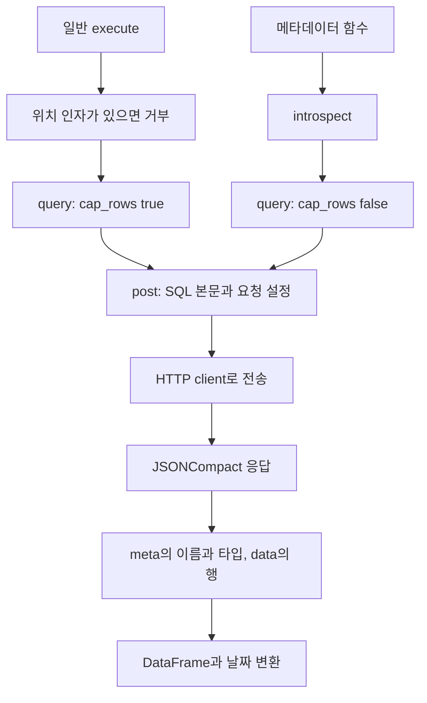
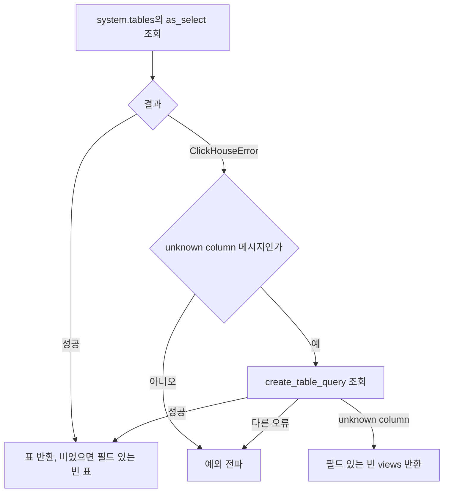
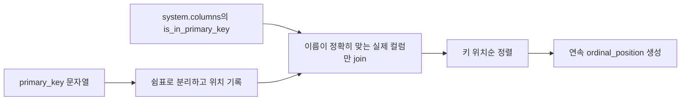

# Chapter 06. ClickHouse의 HTTP 메타데이터 추출과 키의 의미

ClickHouse connector는 SQL을 HTTP로 보내고 JSON 결과를 DataFrame으로 바꾼다. DataFrame은 이름이 붙은 열과 행으로 구성된 표다. 구조 정보는 `information_schema` 대신 `system.tables`, `system.columns`에서 읽는다. **일반 쿼리에는 행 제한을 적용하지만 메타데이터 조회에는 적용하지 않으며, 반환하는 PK는 행의 유일성을 보장하는 관계형 DB의 제약조건과 구분해야 한다.**

이 문서는 로컬 소스·테스트의 정적 분석이다. 실제 DB·모델·테스트는 실행하지 않았다. [공통 계약](chapter-01-common-contract.md), [Registry](chapter-02-registry-and-cache.md), [용어집](../01-architecture/chapter-00-glossary.md)을 함께 참고한다. Snowflake는 사용자 요청으로 건너뛰었으며 Chapter 06은 ClickHouse 분석에 사용한다.

## 1. 이 컴포넌트가 맡는 일과 이름 범위

ClickHouse는 분석용 쿼리를 처리하는 DB다. 이 프로젝트의 connector는 전용 DB driver 대신 `httpx.Client`로 HTTP 요청을 보낸다. HTTP는 서버에 요청을 보내고 응답을 받는 통신 방식이며, 여기서는 요청 본문이 SQL이고 URL query parameter가 실행 설정이다.

| 값·함수 | 역할 |
| --- | --- |
| `_parse_connection_string()` | host·DB 이름·인증 정보·통신 방식·행 제한을 URL에서 읽음 |
| `_database_name` | URL 경로의 DB 이름. 원본 DB와 catalog 저장소를 연결하는 식별 값 |
| `_base_url` | 실제 HTTP 요청 대상의 scheme·host·port |
| `_ensure_client()` | 첫 요청 때 HTTP client를 만들고 재사용 |
| `_post()` | SQL과 요청 설정 전송·오류·JSON 응답 처리 |
| `_query()` | JSON의 meta·data를 DataFrame으로 변환 |
| `_introspect()` | 행 제한을 끄고 메타데이터 SQL 실행 |

생성자는 URL을 검증하고 내부 상태를 만들 뿐 서버를 조회하지 않는다. `ping()`이 별도로 `SELECT 1`을 보낸다. 이때도 요청에 DB 이름이 포함되므로 해당 endpoint·인증·DB 지정에 대한 확인을 시도한다. 전체 업무 테이블의 조회 가능 여부를 한 번에 검증하는 것은 아니다.

모든 구조 조회의 `table_schema`는 원본 `database` 필드를 바꾼 것이다. 예를 들어 연결 DB가 `analytics`이면 다음과 같다.

```text
database_name: analytics
table_schema: analytics
table_name: orders
원본의 테이블 이름 구조: analytics.orders
```

이 schema 필드는 공통 모델에 맞춘 대응이다. 별도의 하위 schema들을 순회하는 구조가 아니다. 다른 DB를 수집하려면 해당 DB를 지정한 연결이 필요하며, Registry가 전달하는 `schemas=` allowlist를 이 클래스가 받지는 않는다. allowlist는 포함할 대상 이름 목록이라는 뜻이다.

URL parser는 `system`, `information_schema`, `INFORMATION_SCHEMA` DB를 지정하면 거부한다. 이 검사는 코드의 집합에 대한 정확한 이름 비교다. 메타데이터 쿼리는 `_database_predicate()`로 `database = 'analytics'` 같은 조건을 붙인다. DB 문자열의 작은따옴표·역슬래시는 `_quoted_literal()`로 이스케이프한다.

근거: [clickhouse.py의 parser·생성자·메타데이터 함수](../../../code/auto-ontology/auto_ontology/connectors/clickhouse.py).

## 2. SQL이 표가 되는 과정과 행 제한



JSONCompact는 이 구현이 요청하는 JSON 응답 형식이다. 컬럼 설명은 `meta`, 각 행의 값 목록은 `data`에 있다고 해석한다. SQL 뒤에 무조건 FORMAT 문구를 붙이지 않고 요청 parameter의 `default_format=JSONCompact`로 지정한다.

설명용 응답과 결과는 다음과 같다.

```json
{
  "meta": [{"name": "table_name", "type": "String"}],
  "data": [["orders"], ["customers"]]
}
```

```text
table_name
orders
customers
```

| 요청 설정 | 일반 execute | `_introspect` |
| --- | --- | --- |
| `database` | 연결의 DB 이름 | 동일 |
| `default_format` | JSONCompact | 동일 |
| `max_result_rows` | 기본 50,000, URL의 `max_rows`로 변경 가능 | 보내지 않음 |
| `result_overflow_mode` | `break` | 보내지 않음 |
| `max_execution_time` | timeout_s가 주어지면 설정 | 이 경로는 timeout_s를 주지 않음 |
| HTTP timeout 인자 | 기본 60초, 명시적 statement timeout이 있으면 grace 추가 | 기본 60초 |

행 제한 해제는 많은 컬럼을 가진 DB에서 구조 목록이 잘리는 것을 피하기 위한 선택이다. 테이블별 컬럼이 하나라도 있으면 통과하는 공통 coverage 검사만으로는 일부 컬럼 누락을 모두 잡지 못한다. coverage는 나열된 테이블에 컬럼이 존재하는지 확인하는 검사다.

**행 제한이 없다는 것과 자원·시간 제한이 없다는 것은 다르다.** 메타데이터 응답 전체를 메모리에 읽고 DataFrame으로 만든다. 이 코드에 metadata 전용 페이지 순회나 chunk 처리는 없다. HTTP timeout의 숫자를 연결·전송·DB 작업 전체의 엄격한 총 소요 시간 상한이라고 해석하지 않는다.

일반 쿼리는 결과 행 수가 제한값 이상이면 경고를 남긴다. `_query()`가 서버의 완전성 표식을 검증하는 대신 `len(rows) >= _max_rows`를 검사하므로, 정확히 그 행 수가 나온 완전한 결과와 실제 잘린 결과를 이 조건만으로 확정 구분하지는 못한다. 이 경고를 metadata에도 적용하지 않는다.

## 3. tables·columns의 조회 범위와 반환 필드

### 3.1 엔진 이름으로 view를 분류한다

`get_tables()`는 `system.tables`에서 연결 DB의 객체를 읽는다. `NOT is_temporary`로 임시 객체를 제외하며 다음 필드를 반환한다.

| 반환 필드 | 원본·계산 |
| --- | --- |
| `table_schema` | database |
| `table_name` | name |
| `table_type` | engine 이름에 따른 multiIf 분류 |

| engine | 공통 table_type |
| --- | --- |
| `MaterializedView` | `materialized view` |
| `View`, `LiveView`, `WindowView` | `view` |
| 나머지 | `base table` |

view는 다른 데이터의 조회 정의를 가진 객체다. materialized view는 일반 view와 구분되는 별도 타입으로 catalog에 기록한다. 이는 **현재 구현의 engine 이름 대응표**이며 향후 모든 엔진 이름까지 자동 판별하는 규칙은 아니다.

함수는 원본의 전체 생성 SQL·owner·설명을 tables 표에 싣지 않는다. 조회된 모든 대상에 `SELECT ... LIMIT 1`을 실행해 읽을 수 있는지 검사하지도 않는다. 메타데이터에 존재하는 것과 실제 쿼리가 성공하는 것은 다르다.

### 3.2 nullable은 타입 문자열의 바깥 표현을 본다

`get_columns()`는 `system.columns`에서 DB 범위를 제한하고 다음을 읽는다.

```text
database → table_schema
table    → table_name
name     → column_name
type     → data_type
position → ordinal_position
```

이후 `data_type`에 `_is_nullable()`을 적용하고 `astype(bool)`로 `is_nullable`을 만든다. nullable은 컬럼 값 자체가 NULL, 즉 값 없음 상태일 수 있는지를 뜻한다. 단순히 타입 문자열 어딘가에 Nullable이 들어가는지만 검사하지 않는다.

| data_type | is_nullable | 이 코드의 판단 |
| --- | --- | --- |
| `UInt64` | False | nullable 접두어 없음 |
| `Nullable(String)` | True | 컬럼 자체를 Nullable로 감쌈 |
| `LowCardinality(Nullable(String))` | True | 지원하는 두 번째 접두어 |
| `LowCardinality(String)` | False | 저장 표현 wrapper만 있음 |
| `Array(Nullable(String))` | False | 배열 원소의 NULL과 컬럼 자체 NULL을 구분 |

wrapper는 타입을 바깥에서 감싸는 표현이다. LowCardinality는 여기서 값의 저장 표현과 관련된 wrapper로 취급한다. `_is_nullable()`은 위 두 nullable 접두어만 검사하며 임의의 타입 표현 전체를 파싱하지 않는다.

타입 문자열 자체도 반환하므로 Array·Nullable 같은 표현은 유지된다. comment·default 식은 이 쿼리가 선택하지 않는다. 공통 정규화가 없는 설명 필드를 추가해도 원본 설명을 새로 조회하는 것은 아니다.

## 4. view 정의는 특정 오류일 때만 대체 조회한다

`get_views()`는 같은 DB의 view engine들을 골라 먼저 `as_select AS view_definition`을 요청한다. 해당 컬럼을 모른다는 오류일 때만 `create_table_query AS view_definition`으로 다시 시도한다. fallback은 실패 시 사용하는 대체 경로라는 뜻이다.



오류 판별은 문자열에서 `Code: 47`, `Code: 16`, `unknown identifier`, `missing column` 같은 marker를 찾는 방식이다. 모든 접속·권한 오류에 무조건 대체 조회를 하지 않는다. 두 컬럼 모두 unknown-column 판정이면 빈 결과를 반환한다.

두 결과의 정의 형식은 같지 않을 수 있다. 코드 설명은 `as_select`를 SELECT 본문, `create_table_query`를 CREATE 문 전체로 취급한다. 함수는 두 형태를 공통 SELECT 본문으로 다시 파싱하지 않고 그대로 전달한다. 또한 첫 조회가 성공했지만 정의 문자열만 비어 있는 경우, 두 번째 컬럼으로 보충하는 분기는 없다.

tables와 달리 이 view 쿼리에는 `NOT is_temporary` 조건이 없다. 최종적으로 어떤 임시 view가 노출되는지까지 이번 코드 분석에서 보장하지 않는다. 공통 추출기가 views를 tables 목록에 자동 합치는 것도 아니다.

## 5. PK는 유일성 보장이 아닌 인덱스 키 단서다

PK(Primary Key)는 일반 관계형 DB에서는 행의 유일성을 나타내는 기본 키다. 그러나 이 모듈의 설명은 ClickHouse MergeTree의 primary key를 **정렬키의 일부를 사용하는 sparse index 키**로 다룬다. sparse index는 모든 행 대신 데이터의 일부 지점을 색인하는 구조다. 따라서 여기서 반환하는 키를 유일한 행 ID라고 단정해서는 안 된다.

이 프로젝트는 같은 `get_pks()` 인터페이스에 그 정보를 싣는다. 함수는 다음 순서로 SQL을 만든다.

1. `system.tables.primary_key`가 비어 있지 않은 행을 읽는다.
2. `splitByChar(',', primary_key)`로 조각을 나누고 원래 위치를 기록한다.
3. `system.columns`에서 `is_in_primary_key`인 컬럼 목록을 읽는다.
4. DB·테이블·조각 이름이 실제 컬럼 이름과 정확히 일치하는 것만 INNER JOIN으로 남긴다.
5. 남은 결과를 키 조각 위치순으로 정렬하고 `row_number()`로 1부터 순번을 다시 매긴다.



컬럼 정의 순서가 `(id, day)`이고 키 문자열이 `day, id`라면 반환 순서는 `day=1`, `id=2`가 되도록 작성되어 있다. 테이블의 컬럼 순서와 키의 순서는 다른 값이다.

**표현식 키의 한계:** 키가 `toYYYYMM(day), id`라면 첫 조각 `toYYYYMM(day)`는 실제 컬럼 이름 `day`와 일치하지 않는다. 이 쿼리는 표현식을 파싱해 내부 컬럼을 복원하지 않으므로, 이름이 직접 일치하는 `id`만 남을 수 있다. 함수 안 쉼표도 단순 분리되며, 실제 이름과 맞지 않는 조각을 제거할 뿐 모든 표현식 의미를 복구하지 않는다. 남은 키 순번도 다시 1부터 시작한다.

즉 모듈 주석의 “실제 컬럼만 남긴다”는 설명을 **표현식에 사용된 모든 컬럼을 추출한다는 보장**으로 확대하지 않는다. 키의 존재·완전성·유일성은 각각 다른 속성이다. 이 결과를 후속 join 추론이 어떻게 사용하는지는 관계 분석 chapter에서 이어간다.

FK(Foreign Key, 외래 키)는 다른 테이블을 참조하는 관계다. 현재 `get_fks()`는 DB를 조회하지 않고 참조 schema·table·column 필드를 갖춘 빈 표를 반환한다. 이 함수가 값의 관계를 분석하거나 자동 FK를 추론하는 것은 아니다.

## 6. SQL 이력은 선택적 보강 자료다

`get_queries(hours=24)`는 `system.query_log`를 다음 조건으로 조회한다.

| 조건·필드 | 코드의 선택 |
| --- | --- |
| 기록 종류 | `type = 'QueryFinish'` |
| 기간 | `event_time >= now() - INTERVAL int(hours) HOUR` |
| DB 범위 | `has(databases, 연결 DB 이름)` |
| 반환 | `event_time AS end_time`, `query AS query_text` |
| 정렬 | end_time 내림차순 |

같은 쿼리의 시작 기록·오류 기록을 함께 가져오는 형태는 아니다. 다만 쿼리에 여러 DB가 포함될 수 있고, 시스템 조회·현재 수집 요청·특정 사용자 등을 추가로 제외하는 조건은 이 SQL에 없다. 이 함수가 선택한 이벤트를 모든 업무 SQL의 완전한 감사 이력으로 해석하지 않는다.

`get_queries()`는 `ClickHouseError`를 잡아 필드 있는 빈 표로 바꾼다. 권한 부족·로그 미사용뿐 아니라 이 타입으로 포장된 접속 오류도 해당한다. 따라서 **빈 이력은 실제 실행 SQL이 0개라는 증명이 아니다.** 다른 예외 타입은 이 catch가 처리하지 않는다.

날짜 처리도 반환 경로의 일부다. `_coerce_datetimes()`는 JSON meta의 타입에서 Nullable·LowCardinality wrapper를 벗기고 Date로 시작하는 타입에 `pd.to_datetime(..., errors='coerce', utc=True)`를 적용한다. 변환할 수 없는 값은 날짜 결측값이 될 수 있다. 데이터 값이 `Date`인 enum이나 Array(DateTime)를 날짜 컬럼으로 오인하지 않도록 바깥 타입부터 판단한다.

## 7. 실패·빈 표·연결 수명의 경계

| 상황 | 실제 처리 |
| --- | --- |
| tables·columns·PK 조회 오류 | 해당 메서드에서 일반적으로 예외 전파 |
| view의 unknown-column 오류 | 지정된 정의 컬럼만 대체 시도 |
| view의 접속·기타 오류 | 예외 전파 |
| 이력 조회의 ClickHouseError | 빈 이력으로 대체 |
| 응답에 meta 없음 | `_query()`는 필드 없는 빈 표. 각 메타데이터 메서드는 빈 결과 필드를 보충 |
| 비어 있는 HTTP 본문 | `_post()`는 빈 dict 반환 |
| 400 이상 HTTP 응답 | 서버 메시지를 포함한 ClickHouseError, 명시적 timeout 경로는 별도 변환 |
| HTTP 전송 실패 | ClickHouseError로 포장. statement timeout을 지정한 ReadTimeout은 별도 StatementTimeout |

일괄 system 조회이므로 Databricks 단일 schema처럼 테이블별 실패 대상을 제거하는 루프·성공 집합은 없다. 메타데이터 조회 자체가 성공해도 실제 각 테이블을 읽을 수 있는지는 별개다. 공통 테이블 regex 필터는 원본 조회 이후 tables·columns·views에 적용된다.

구조 조회들 사이를 하나의 일관된 snapshot으로 묶거나 metadata 결과를 connector에 캐시하는 코드도 없다. snapshot은 여러 조회가 같은 시점의 상태를 보도록 하는 개념이다. 조회 사이 원본 구조가 바뀌거나 일부 컬럼만 빠지는 상황은 공통 coverage 하나로 모두 해결되지 않는다.

HTTP client는 첫 요청에 만들어 재사용하고, 생성·close는 `RLock`으로 보호한다. 요청 전체를 이 lock으로 직렬화하지는 않는다. `close()`는 client 종료를 시도한 뒤 `_client = None`으로 만든다. 객체 자체를 영구 종료 상태로 바꾸지 않으므로 이후 요청은 client를 다시 만들 수 있다. 실행 중 close·재생성과 동시 요청의 관계는 자원·동시성 후속 분석으로 넘긴다.

## 8. 테스트가 확인하는 범위

테스트는 `httpx.MockTransport`로 응답을 미리 구성하고 요청 SQL·parameter를 기록한다. **실제 ClickHouse에서 SQL을 평가하는 테스트가 아니다.**

| 테스트 | 읽은 assertion |
| --- | --- |
| `test_execute_decodes_a_jsoncompact_body` | meta·data가 필드와 행으로 변환됨 |
| `test_execute_binds_the_database_and_response_format` | DB·JSONCompact 요청 설정 |
| `test_get_tables_classifies_views_by_engine` | SQL에 system.tables·MaterializedView·임시 객체 제외·DB 조건 포함 |
| `test_get_columns_derives_nullability_from_the_type` | Nullable·LowCardinality·Array의 nullable 구분 |
| `test_get_columns_nullability_is_a_bool_dtype` | 실제 bool dtype |
| `test_get_views_prefers_as_select_and_falls_back` | unknown column 이후 정의 컬럼 대체와 반환값 |
| `test_get_views_does_not_swallow_a_connectivity_failure` | 502 응답이 빈 views가 되지 않고 예외 발생 |
| `test_get_pks_numbers_columns_within_the_key`, `test_get_pks_orders_by_the_key_not_the_table` | 준비된 반환 순번과 SQL의 primary_key 분리·컬럼 join·키 위치 정렬 조건 |
| `test_get_fks_is_always_empty` | FK 요청은 SQL을 보내지 않음 |
| `test_get_queries_filters_to_finished_queries_touching_this_database` | 기간·QueryFinish·DB 조건 |
| `test_get_queries_is_empty_when_the_log_is_unreadable` | 로그 권한 오류에 빈 표 |
| `test_introspection_is_not_row_capped`, `test_user_queries_are_still_row_capped` | metadata에는 max_result_rows 없음, 일반 쿼리에는 50000 |

PK 테스트가 SQL 문자열과 준비된 응답을 확인한다는 사실을, 모든 복잡한 표현식 키를 실제 서버에서 검증했다는 뜻으로 읽지 않는다. 이번 작업에서는 테스트를 실행하지 않았다.

근거: [ClickHouse 테스트](../../../code/auto-ontology/auto_ontology/connectors/tests/test_clickhouse.py), [공통 추출](../../../code/auto-ontology/auto_ontology/catalog/extract.py), [정규화](../../../code/auto-ontology/auto_ontology/catalog/normalize.py).

후속 검증은 표현식·특수 이름을 포함한 키의 손실, 메타데이터가 큰 환경의 메모리·서버 응답, 원본별 권한·조회 실패, 이력의 지연·누락, HTTP client 동시 종료를 구분해서 진행해야 한다. 실제 오류 재현이나 수정은 이번 분석에 포함하지 않았다.

Trino·Kyuubi·HeavyDB는 아직 사용하지 않아 사용자 요청으로 상세 분석에서 제외했다. 다음은 실행할 DB를 선택하고 SQL 결과·오류·시간제한을 처리하는 공통 흐름이다. [공통 SQL 실행 계획](../../../.codex/plan/auto-ontology/01-3-4_sql-execution-and-lifecycle.md)에서 이어간다.
