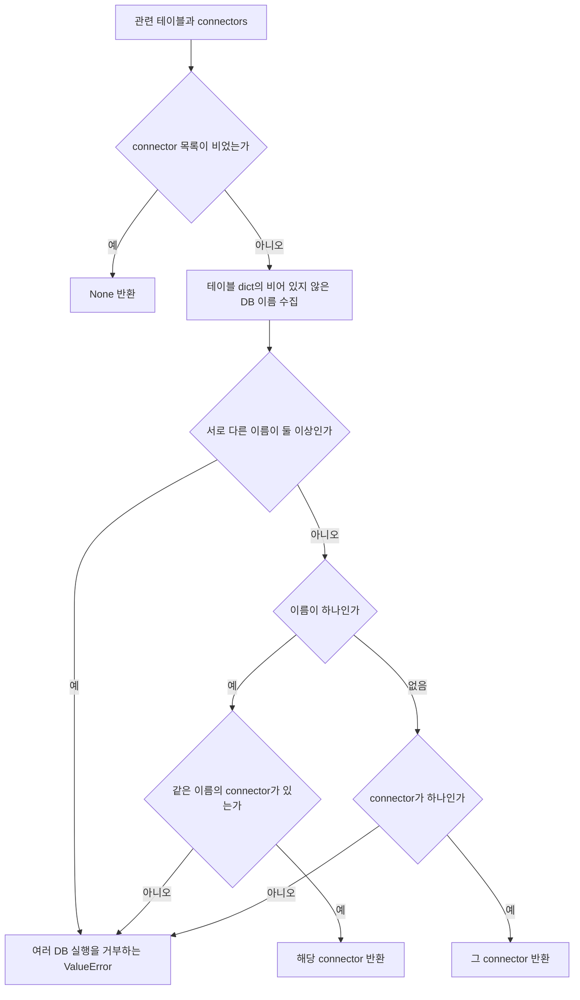
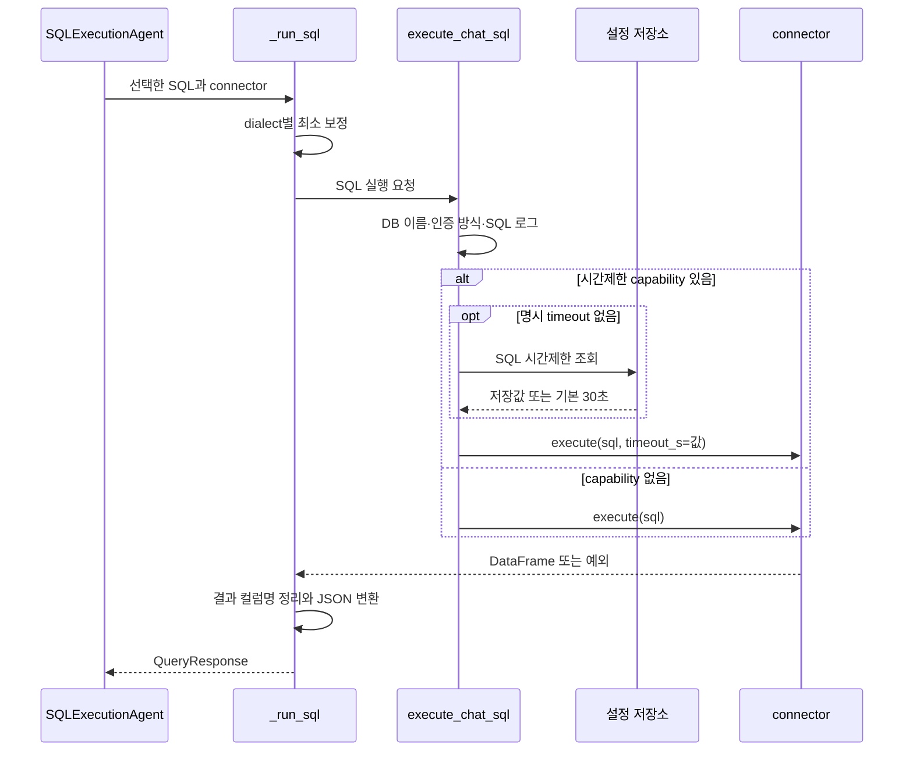
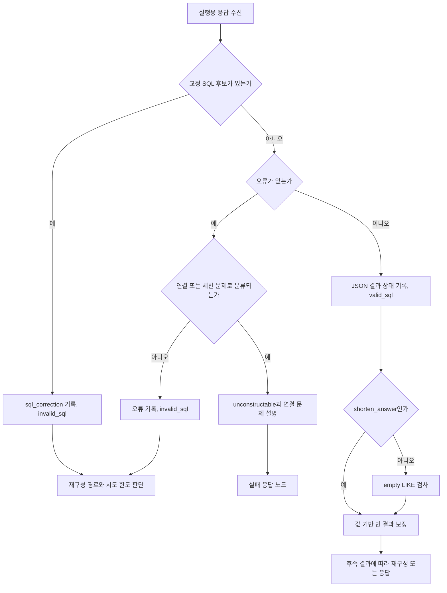

# Chapter 10. 실행 DB 선택과 Chat SQL의 결과·오류 경계

생성한 SQL은 관련 테이블의 `database_name`으로 실행 connector를 고른 뒤 실행된다. 결과는 DataFrame에서 JSON 문자열로 변환되어 상태에 기록된다. **DB 선택, SQL 실행, 결과 변환, 후속 보정은 서로 다른 단계이며, 실행 성공이 곧 최종 답변 확정을 뜻하지 않는다.**

이 문서는 로컬 소스·테스트의 정적 분석이다. 실제 DB·LLM·테스트는 실행하지 않았다. [공통 계약](chapter-01-common-contract.md), [Registry](chapter-02-registry-and-cache.md), [용어집](../01-architecture/chapter-00-glossary.md)을 함께 참고한다. Snowflake·Trino·Kyuubi·HeavyDB의 상세 분석은 사용자 요청으로 제외했고 예정 Chapter 07~09를 건너뛰었다.

## 1. 실행 경로의 구성 요소와 상태

connector는 DB 접속·SQL 실행을 담당하는 객체다. agent는 작업 흐름의 한 단계를 처리하는 컴포넌트이며, 이 실행 agent 자체가 LLM으로 SQL을 생성하지는 않는다. graph는 각 단계를 연결하고 결과에 따라 다음 단계를 고르는 실행 흐름이다.

| 파일·함수 | 역할 |
| --- | --- |
| `main.py::_build_state` | 요청의 target_db를 설정된 DB 이름으로 확인하고 초기 상태 구성 |
| `connector_routing.py::resolve_connector_from_tables` | 관련 테이블이 가리키는 DB의 connector 선택 |
| `agents/sql_execution.py::SQLExecutionAgent` | 실행 입력 선택·응답 판정·결과 상태 갱신 |
| 같은 파일의 `_run_sql` | SQL 보정·실행·컬럼명 정리·결과 직렬화·실행용 응답 구성 |
| `chat_sql.py::execute_chat_sql` | 질문에 사용된 SQL 로그와 시간제한 전달 |
| `infra/feature_flags.py` | 저장된 SQL 시간제한 조회, 기본값 처리 |
| `connectors/db_errors.py` | 연결·세션 문제와 SQL 문제를 오류 메시지로 구분 |
| `text_to_sql_graph.py` | 실행 결과를 재구성·빈 결과 보정·응답 단계로 연결 |

`state`는 실행 단계들이 공유하는 상태다. 그 안의 `path_state`는 현재 SQL 처리 경로의 중간값을 모은 사전이다.

| 입력 필드 | 의미 |
| --- | --- |
| `state.connectors` | 실행 가능한 connector 객체 목록 |
| `path_state.target_db` | 요청 또는 앞 단계가 선택한 DB 이름. 실행 router가 직접 읽는 필드는 아님 |
| `path_state.relevant_tables` | SQL 생성에 사용한 관련 테이블 목록. 실행 DB 선택의 근거 |
| `path_state.sql_code` | 검증·수정된 SQL이 있으면 우선 사용 |
| `path_state.sql_generation_result.sql_code` | 위 SQL이 없거나 공백일 때 사용하는 생성 결과 |
| `state.numeric_type_alignment` | 특수 호출자의 숫자 타입 정합성 기록·SQL 교정 요청 활성화 |
| `state.shorten_answer` | 성공 후 일부 빈 결과 검사 경로를 생략하는 선택 |

근거: [실행 agent](../../../code/auto-ontology/auto_ontology/retrieval/text_to_sql/agents/sql_execution.py), [초기 상태](../../../code/auto-ontology/auto_ontology/retrieval/text_to_sql/main.py), [graph](../../../code/auto-ontology/auto_ontology/retrieval/text_to_sql/text_to_sql_graph.py).

## 2. target_db 확인과 실제 실행 DB 선택은 다르다

### 2.1 요청의 DB 이름을 먼저 정리한다

`resolve_target_database_name()`은 입력 앞뒤 공백을 제거하고 설정된 connector 이름들과 비교한다.

1. 정확히 같은 이름이 있으면 그대로 반환한다.
2. 아니면 대소문자를 무시한 일치가 **정확히 하나**일 때 설정된 원래 이름을 반환한다.
3. 일치하지 않거나 대소문자 무시 일치가 여러 개면 사용 가능한 DB 이름을 포함한 `ValueError`를 발생시킨다.

예를 들어 설정 이름이 `sales` 하나라면 요청 `SALES`는 `sales`로 정리된다. 설정 목록이 `Sales`, `sales`라면 정확한 이름으로 지정하는 경우와 `SALES`처럼 모호하게 지정하는 경우의 결과가 다르다.

초기 상태 생성은 payload의 target_db가 있으면 이 함수를 호출한다. target_db가 없고 connector가 하나면 그 DB 이름을 초기 상태에 넣는다. **DB 연결 객체 선택은 다음 함수에서 관련 테이블의 메타데이터로 다시 수행한다.**

### 2.2 실행은 relevant_tables의 database_name을 기준으로 한다



실행 router는 SQL 텍스트를 파싱해 접속 대상을 결정하지 않는다. `relevant_tables` 중 dict인 항목의 비어 있지 않은 `database_name`을 모은다. 비교는 **정확한 문자열 일치**이며 요청 DB 확인 함수의 대소문자 보정을 여기서 반복하지 않는다.

| 입력 상황 | 실제 결과 |
| --- | --- |
| 테이블들이 모두 sales, 연결 sales·hr | sales 선택 |
| 테이블에 sales·hr 혼재 | 여러 DB의 테이블을 한 문장으로 라우팅할 수 없다는 예외 |
| 테이블에 unknown, 연결은 sales | connector가 하나여도 unknown 이름을 무시하지 않고 예외 |
| 테이블 이름만 있고 DB 이름 없음, 연결 하나 | 유일한 connector 선택 |
| DB 이름 없음, 연결 여러 개 | 선택 불가 예외 |
| DB 이름이 있는 테이블 하나와 없는 테이블 하나 | 없는 값은 수집에서 제외되므로 알려진 이름 하나로 선택 가능 |
| 같은 DB 이름의 connector 여러 개 | dict를 만들 때 나중 객체가 앞 객체를 덮어씀 |

따라서 함수 설명의 “모든 테이블의 소유 DB”를 각 행의 필수 필드 검증까지 수행한다는 뜻으로 읽지 않는다. dict가 아닌 항목과 비어 있는 이름은 건너뛴다. Registry의 중복 이름 경고가 실행의 유일성 강제까지 제공하지 않는다는 앞 장의 관찰도 여기서 이어진다.

**경계:** 이 선택 함수는 target_db를 인자로 받지 않는다. target_db를 지정했더라도 실행 시 관련 테이블의 DB 표기가 맞아야 한다. SQL 본문의 테이블과 해당 메타데이터가 실제로 같은지 검증하는 일은 앞선 SQL 검증 단계의 책임이다. 이 router 자체는 권한 검사·읽기 전용 검사·교차 DB 쿼리 조합을 수행하지 않는다.

근거: [connector_routing.py](../../../code/auto-ontology/auto_ontology/retrieval/text_to_sql/connector_routing.py).

## 3. 실행 입력 검증과 예외 처리 위치

`SQLExecutionAgent.validate_input()`은 우선 SQL이 비어 있지 않은지 확인한다. `path_state.sql_code`가 없거나 공백이면 생성 결과 객체의 `sql_code`를 사용한다. 이 검사는 SQL 문법·SELECT 여부·접근 권한까지 확인하는 검사가 아니다.

graph는 `agent_wrapper(SQLExecutionAgent())`를 사용한다. wrapper는 입력 검증 실패와 실행 중 예외에 대해 실행 agent의 `failure_decision="invalid_sql"`을 적용한다. 앞 노드의 `valid_sql` 결정이 남아 실패한 실행을 성공으로 처리하지 않도록 한다.

| 실패 위치 | 반환되는 상태 |
| --- | --- |
| SQL이 없음 | wrapper가 `AgentInputValidationError` 정보와 invalid_sql 반환 |
| DB 선택 함수의 ValueError | `_run_sql` 바깥에서 발생. wrapper가 오류 dict와 invalid_sql 반환 |
| connector가 None | `_run_sql`이 문자열 오류를 가진 QueryResponse 반환 |
| DB 실행 또는 실행 후 결과 처리 예외 | `_run_sql`이 예외 문자열을 QueryResponse.error에 기록 |

`path_state.error`는 모든 경로에서 같은 타입이 아니다. wrapper 오류는 `{type, message, agent}` dict, `_run_sql` 오류는 문자열, SQL 교정 요청은 `"sql_correction"` 코드다. 후속 소비자는 이 차이를 고려해야 한다.

실행 agent의 docstring은 “첫 connector를 사용”한다고 설명하지만 실제 코드가 호출하는 것은 위 router다. 출력 설명도 QueryResponse 객체를 저장한다고 적혀 있지만, 정상 경로에서는 **객체의 result 값만** `sql_response_from_db`에 저장한다.

근거: [BaseAgent·wrapper](../../../code/auto-ontology/auto_ontology/retrieval/text_to_sql/base.py), [실행 agent](../../../code/auto-ontology/auto_ontology/retrieval/text_to_sql/agents/sql_execution.py).

## 4. Chat SQL wrapper: 로그와 시간제한을 전달한다



capability는 객체가 어떤 기능을 지원한다고 알리는 속성이다. `supports_statement_timeout`이 거짓이거나 없으면 wrapper는 **시간제한 인자 없이** `execute(sql)`을 호출한다. 명시 timeout을 주었더라도 이 분기는 같다. 외부 connector가 지원하지 않는 인자를 받아 실패하는 일을 피하려는 구조다.

지원 속성이 참이면 명시 `timeout_s`를 우선하고, 없으면 `get_sql_query_timeout_seconds()`를 호출한다. 설정값은 frontend가 관리하는 configurations 표의 `sql_query_timeout_seconds`에서 매 문장마다 읽는다.

| 저장값·조건 | 실제 선택 |
| --- | --- |
| 정수 문자열 1~3600 | 그 초 값 |
| 행 없음·DB 조회 오류 | 기본 30초 |
| 정수가 아님·허용 범위 밖 | 30초. 최소·최대값으로 잘라 맞추지 않음 |
| 명시 timeout_s 있음 | wrapper에서 위 범위를 재검증하지 않고 그대로 전달 |
| capability 없음 | 설정 조회도 생략하고 기본 execute |

설정 조회는 매번 별도 Postgres 연결을 열며 `connect_timeout=3`을 사용한다. 연결·설정 읽기·서버 실행 대기·fetch가 모두 하나의 총 30초 제한에 포함된다고 볼 수 없다. 실제 중단 방법과 시간 범위는 엔진 구현에 달려 있으며 Chapter 11에서 대조한다. 속성이 참이라는 사실도 모든 서버의 실제 제한 지원을 증명하지는 않는다.

로그에는 DB 이름, 있으면 `auth_mode` 설명, SQL 본문이 들어간다. SQL 본문은 앞 4000자와 생략 길이로 제한한다. **이것은 로그 길이 제한이지 실제 실행 SQL 길이 제한이나 민감 값 마스킹이 아니다.**

근거: [chat_sql.py](../../../code/auto-ontology/auto_ontology/retrieval/text_to_sql/chat_sql.py), [설정 조회](../../../code/auto-ontology/auto_ontology/infra/feature_flags.py).

## 5. DataFrame 결과가 상태에 기록되는 형태

직렬화는 메모리의 결과 표를 전달 가능한 JSON 텍스트로 바꾸는 과정이다. `_run_sql()`의 실행 순서는 다음과 같다.

1. connector가 없으면 실행 없이 오류 응답을 만든다.
2. dialect를 읽고 SQLite이면 `PUBLIC.` 문자열을 정규식으로 제거한다.
3. `execute_chat_sql()`로 실행한다.
4. 숫자 정합성 모드이면 교정 SQL 후보를 계산한다.
5. 중복 결과 컬럼명을 정리한다.
6. 숫자 모드이면 결과 숫자 타입과 값 digest를 만든다.
7. `to_json(orient="records", date_format="iso", default_handler=str)`로 변환한다. 0행이면 `"[]"`를 쓴다.
8. JSON 문자열을 **리스트 하나로 감싸** 반환한다.

설명용으로 DB 결과가 `[{"count": 12}]`에 해당하는 표라면 저장 모양은 다음과 같다.

```python
path_state["sql_response_from_db"] = ['[{"count":12}]']

# 0행일 때도 None이나 빈 리스트가 아니다.
path_state["sql_response_from_db"] = ["[]"]
```

JSON 문자열이 든 리스트이며 Python dict 목록과 다르다. 이 계층은 DB에 결과를 저장하거나 대화 이력을 기록하지 않고 **실행 상태를 반환**한다. 대화 저장·최종 응답 형식은 별도 계층의 책임이다.

### 5.1 중복 컬럼명은 기존 이름을 침범하지 않게 바꾼다

예를 들어 join 결과 컬럼이 `ID, ID, ID__2`이면 `ID, ID__3, ID__2`로 바꾼다. 이미 고유한 `ID__2` 이름을 예약하고 중복 ID에 사용 가능한 suffix를 붙이는 방식이다.

이름 변경이 필요하면 DataFrame을 복사하므로 원래 표의 컬럼명은 유지된다. 실행 SQL의 alias까지 이 이름으로 다시 작성하는 것은 아니다. 최종 JSON의 키가 원래 SQL alias와 달라질 수 있다.

### 5.2 QueryResponse의 실제 필드

| 필드 | 의미·주의 |
| --- | --- |
| result | 성공 시 `[JSON 문자열]`, 실패 시 None. 타입 주석은 list[str]이지만 오류 경로는 None 사용 |
| sliced | 이 함수에서는 항상 False. 드라이버나 SQL의 결과 제한을 검사해 정하는 값이 아님 |
| error | 실행·후처리 실패 문자열 또는 None |
| statement | 실제 실행에 사용한 SQL. 생성된 SQL과 다를 수 있음 |
| numeric_kinds | 활성 모드에서 출력 컬럼별 float·decimal·None |
| values_digest | 활성 모드에서 정규화한 결과값의 비교용 지문 |
| sql_correction | 재구성 단계에 전달할 교정 SQL 후보 |

`sliced=False`가 전체 원본 결과를 빠짐없이 받았다는 증명은 아니다. 예를 들어 [ClickHouse의 일반 실행 행 제한](chapter-06-clickhouse-extraction.md)이 있어도 이 함수는 이를 해당 필드에 반영하지 않는다.

**오류 경계:** 위 실행·교정 후보·컬럼명 정리·숫자 분석·JSON 변환은 하나의 try에 들어 있다. DB 실행 후 숫자 분석이나 직렬화가 실패해도 동일한 QueryResponse.error로 돌아온다. 오류가 있다는 사실만으로 SQL이 원본 DB에서 아예 실행되지 않았다고 단정할 수 없다.

SQLite의 `PUBLIC.` 제거는 SQL 구문 트리 기반 수정이 아니라 정규식이다. 문자열 literal이나 주석 내부까지 영향을 줄 수 있는 코드 경로가 있다. 특수 입력의 실제 재현은 하지 않았다. 이 계층 자체에는 SELECT 전용 검사나 쓰기 SQL 차단이 없으며, 앞선 검증을 통과한 SQL이라는 호출 전제와 구분해야 한다.

## 6. 숫자 정합성 모드의 교정은 일반 Chat과 분리된다

`numeric_type_alignment=True`인 호출만 추가 기록·교정을 활성화한다. Decimal은 소수 값을 표현하는 타입이고 float는 부동소수점 숫자 타입이다. 이 모드는 결과를 비교하는 특수 호출자의 숫자 타입 차이를 다루기 위한 것으로, 모든 질문에 기본 적용되는 동작은 아니다.

- 결과 컬럼의 첫 non-null 값을 중심으로 decimal·float·기타를 분류한다. NULL 때문에 실수형이 된 정수 컬럼은 추가 조건으로 기타 처리한다.
- `values_digest`는 타입을 정규화한 값의 지문이다. 숫자를 소수 둘째 자리까지 half-up 방식으로 반올림하고 행·컬럼 순서를 유지해 계산한다. 원래 숫자 정밀도까지 동일하다는 증명이 아니다. 날짜도 정규화되므로 원본 전체 동일성 검사로 쓰지 않는다.
- PostgreSQL에서 JSONB의 숫자 값을 텍스트로 추출한 projection이 소수 문자열만 반환하면 NUMERIC cast 후보를 만든다. JSONB는 JSON 문서를 저장하는 Postgres 타입이며 projection은 SELECT의 출력 식이다.
- SQLite의 PUBLIC 보정 등으로 실제 실행 SQL이 생성 SQL과 다르면 그 문장도 교정 후보가 된다.

교정 후보가 있으면 agent는 `error="sql_correction"`, `sql_correction=후보`를 기록하고 **invalid_sql로 반환**한다. 이미 쿼리가 실행되었더라도 그 결과를 여기서 곧바로 채택하지 않는다. 재구성 단계가 교정문을 설치하고 검증 경로로 보내도록 분리한다.

모드가 꺼져 있으면 이 추가 후보·숫자 metadata 기록은 수행하지 않는다. JSON 변환 자체가 Decimal의 타입·정밀도를 그대로 보존한다는 보장도 별개다. 실제 숫자 교정 알고리즘 전체는 SQL 검증 단계에서 추가 분석한다.

근거: [numeric_types.py](../../../code/auto-ontology/auto_ontology/retrieval/text_to_sql/numeric_types.py), [숫자 모드 테스트](../../../code/auto-ontology/auto_ontology/retrieval/text_to_sql/tests/test_numeric_types.py).

## 7. 정상·오류·빈 결과의 다음 단계



| 상황 | agent 결정·상태 |
| --- | --- |
| 정상 결과 또는 0행, 교정 없음 | `valid_sql`, `sql_response_from_db=response.result` |
| 교정 후보 있음 | `invalid_sql`, error 코드·후보 SQL. 이번 결과는 정상 결과 필드로 새로 기록하지 않음 |
| 일반 실행·변환 오류 | `invalid_sql`, 오류 문자열·재작성 예정 진행 메시지 |
| 연결 실패로 분류한 오류 | `unconstructable`, 원래 오류와 사용자용 연결 문제 설명 |

정상 반환은 기존 path_state를 펼쳐 결과 필드를 덧붙인다. 이전 error·보정 플래그를 이 agent가 전부 초기화하지는 않는다. 재구성 후 어떤 중간값을 지우고 유지하는지는 상태 복구·SQL 생성 분석에서 확인할 항목이다.

`SQLExecutionAgent` 안에는 같은 SQL을 다시 실행하는 루프가 없다. graph router가 재구성 경로를 결정하며 `failed_attempts` 수가 7 이상이면 포기한다. **이 숫자는 재구성 횟수 기준**이지 DB 접속·probe·driver 재시도를 모두 합한 실행 횟수 상한이 아니다.

연결 오류는 현재 재구성 루프를 피한다. 하지만 상위 `main.py`에는 별도의 full-pipeline retry 조건이 있다. 실패 응답 노드 종료·restore_from 존재·최대 2회 이내·반환 SQL 없음 등의 조건을 판단하므로 “연결 오류는 전체 시스템에서 어떤 상황에도 단 한 번만 시도한다”고 확대하지 않는다. 이 계층의 재시도와 전체 파이프라인 재시도는 SQL 생성 단계에서 함께 분석한다.

### 7.1 메시지 기반 오류 분류

`is_infrastructure_error()`는 `connection refused`, `could not connect`, `Invalid SessionHandle` 등 문자열 marker를 사용한다. 세션은 서버가 특정 연결의 실행 상태를 관리하는 단위다. 타입을 잃고 문자열로 보관된 오류에도 적용하기 위한 방식이다.

SQL 안에 `'connection reset'`이라는 필터 값이 있었다고 연결 오류로 오인하지 않도록, 오류 메시지에서 echo된 SQL과 인용 값 일부를 제거한 다음 비교한다. 실제 실행 SQL인 `response.statement`를 우선 전달하는 이유다.

이 분류는 원인 진단의 절대적 보장이 아니다. 새로운 드라이버 문구·네트워크 오류·timeout 메시지가 marker에 맞지 않으면 일반 오류 경로로 갈 수 있다. 모든 timeout이 여기서 자동으로 infrastructure 오류가 되는 것도 아니다. 자세한 드라이버 예외·시간제한은 Chapter 11에서 다룬다.

진행 메시지는 graph 노드 이름 `execute_sql_query`로 기록한다. 오류는 공백을 한 줄로 합치고 최대 300자 뒤에 생략 기호를 붙인다. 전체 오류 문자열을 상태에서 제거하거나 민감 값을 마스킹하는 동작은 아니다.

### 7.2 빈 결과는 별도 보정이 판단한다

실행 단계에서 `["[]"]`는 오류가 아니다. 일반 답변은 `check_empty_like_result → check_value_repair`를 거치고, `shorten_answer=True`여도 LIKE 검사만 건너뛰며 값 보정은 거친다.

값 보정 노드는 0행이면 실제 값의 불일치를 조사하거나, 원인을 찾지 못하면 한 번 재생성하는 경로를 가진다. 따라서 “실행 성공”과 “수정 없이 그대로 최종 응답”은 다르다. 비어 있지 않은 결과라도 질문에 맞는 정답인지 이 실행 agent가 새로 의미 검증하는 것은 아니다. 보정 알고리즘은 SQL 검증 chapter에서 상세히 다룬다.

근거: [오류 분류](../../../code/auto-ontology/auto_ontology/connectors/db_errors.py), [graph 라우팅](../../../code/auto-ontology/auto_ontology/retrieval/text_to_sql/text_to_sql_graph.py), [빈 결과 보정](../../../code/auto-ontology/auto_ontology/retrieval/text_to_sql/agents/empty_result_value_repair.py), [실패 응답](../../../code/auto-ontology/auto_ontology/retrieval/text_to_sql/agents/sql_unconstructable.py).

## 8. probe SQL도 같은 실행 wrapper를 쓴다

probe는 최종 답을 바로 만드는 쿼리 대신 데이터 값이나 조건을 확인하는 작은 시험 조회다. `ProbeExecutor.run()`은 호출 예산·SQL 형태·LIMIT을 검사한 뒤 같은 `execute_chat_sql()`을 `kind="probe SQL"`로 호출한다.

| 항목 | 최종 실행 `_run_sql` | probe |
| --- | --- | --- |
| DB 객체 | 관련 테이블로 선택 | 호출자가 넘긴 객체 |
| 추가 SQL 형태 검사 | 이 함수 내부에는 없음 | SELECT/WITH 시작·금지어·세미콜론 검사 |
| LIMIT 처리 | wrapper가 추가하지 않음 | LIMIT 문구가 없으면 추가 |
| 시간제한 | Chat wrapper가 전달 | 같은 wrapper가 전달 |
| 결과 형식 | JSON 문자열을 감싼 리스트 | dict의 rows·row_count·truncated·error 등 |
| 오류 처리 | QueryResponse → agent 상태 | 오류를 기록한 entry를 반환 |

probe 파일 상단 설명은 LIMIT·호출 예산에 의존한다고 적지만 현재 실행 본문은 Chat wrapper도 사용하므로 시간제한 전달 경로가 존재한다. 반대로 문자열 기반 SQL·LIMIT 검사만으로 임의 SQL의 모든 부작용·실행량을 엄밀히 증명한다고 볼 수는 없다. 예를 들어 기존 LIMIT을 더 작은 값으로 재작성하는 것은 `_ensure_limit()`의 역할이 아니다. 세부 검증은 probe 분석 단계에 남긴다.

근거: [ProbeExecutor](../../../code/auto-ontology/auto_ontology/retrieval/text_to_sql/db_probe/executor.py).

## 9. 테스트 근거와 인계

아래는 테스트 소스의 assertion을 읽은 결과이며 테스트 실행 결과가 아니다.

| 테스트 파일 | 실제로 확인하는 기대 동작 |
| --- | --- |
| `test_connector_routing.py` | 관련 테이블 DB로 선택, 여러 연결에서 DB 미표기 거부, 유일 연결 허용, target 이름 보정·unknown 거부 |
| `test_chat_sql.py` | 인증 방식·probe 로그, 4000자 생략, 기본 30초·설정 변경·명시 timeout 우선, capability 없는 객체 호환, 설정 실패 기본값 |
| `test_sql_execution.py` | 중복 컬럼 `ID, ID, ID__2 → ID, ID__3, ID__2`, 원본 표 유지, 고유명 유지, 숫자 metadata 실패를 오류로 반환 |
| `test_graph_state_failures.py` | 입력·실행 실패가 이전 valid_sql 결정을 invalid_sql로 교체 |
| `test_infrastructure_failure.py` | 연결 문제 포기·SQL 오류 재구성·short answer 라우팅·7회 재구성 한도·사용자 설명 최종 반영 |
| `test_numeric_types.py`의 실행 관련 테스트 | 숫자 모드에서만 metadata 기록, JSONB 소수 문자열·SQLite 실제 실행문 차이를 교정 요청으로 전달 |
| `connectors/tests/test_db_errors.py` | 세션·접속·SQL 오류 구분, SQL echo·필터 literal 때문에 잘못 분류하지 않도록 처리 |

테스트 대부분은 가짜 connector·DataFrame·설정 조회를 사용한다. 실제 DB별 취소·접속·fetch 지연·직렬화 정밀도·동시 사용까지 검증했다는 뜻이 아니다. 또한 routing 함수의 모든 경계가 위 테스트에 독립 assertion으로 있다는 뜻도 아니다.

근거: [routing 테스트](../../../code/auto-ontology/auto_ontology/retrieval/text_to_sql/tests/test_connector_routing.py), [Chat wrapper 테스트](../../../code/auto-ontology/auto_ontology/retrieval/text_to_sql/tests/test_chat_sql.py), [실행 테스트](../../../code/auto-ontology/auto_ontology/retrieval/text_to_sql/tests/test_sql_execution.py), [상태 실패 테스트](../../../code/auto-ontology/auto_ontology/retrieval/text_to_sql/tests/test_graph_state_failures.py), [인프라 오류 테스트](../../../code/auto-ontology/auto_ontology/retrieval/text_to_sql/tests/test_infrastructure_failure.py), [오류 분류 테스트](../../../code/auto-ontology/auto_ontology/connectors/tests/test_db_errors.py).

다음은 엔진별 execute·시간제한·연결 수명이다. 특히 capability와 실제 서버 지원, 접속·실행·fetch 중 제한 범위, 취소 이후 연결 재사용을 확인한다. [공통 실행 세부 계획](../../../.codex/plan/auto-ontology/01-3-4_sql-execution-and-lifecycle.md)에 상태와 남은 검증 항목을 남긴다.
