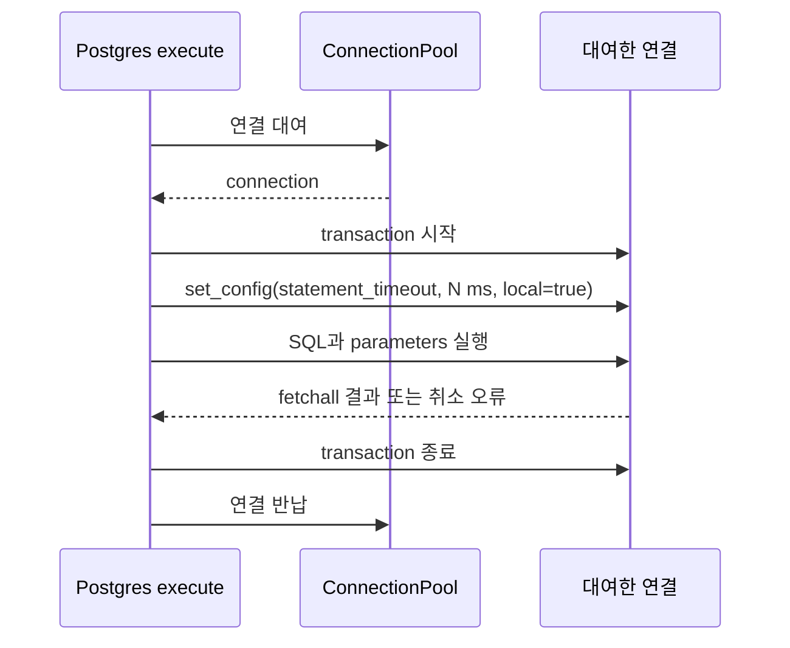
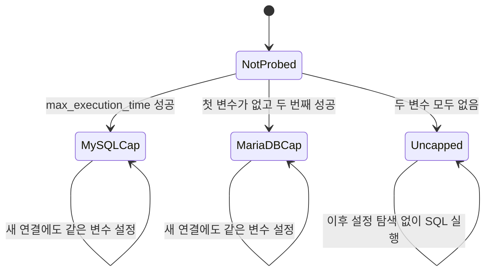
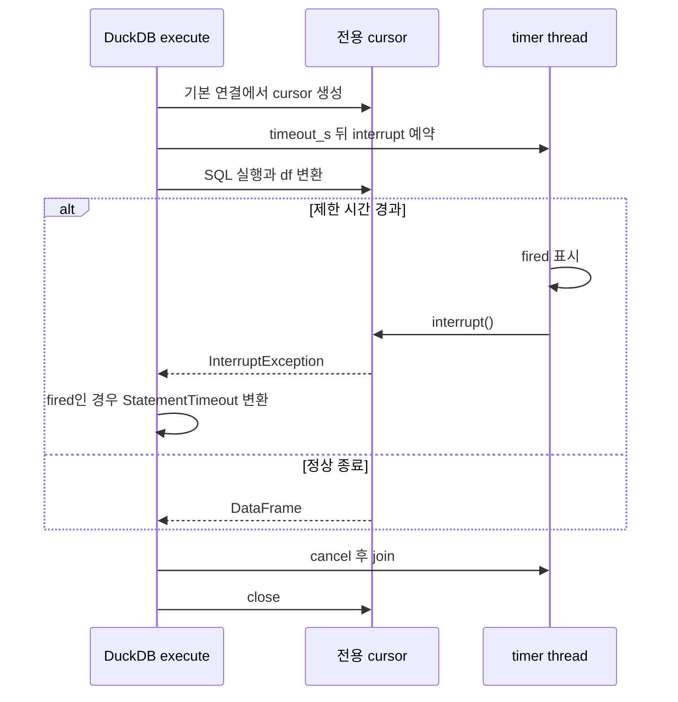

# Chapter 11. 엔진별 SQL 실행·시간제한·연결 수명

여섯 connector는 모두 SQL 결과를 DataFrame으로 반환하지만, **연결을 재사용하는 단위와 시간을 제한하는 방법은 다르다.** Postgres는 pool, SQLite는 thread별 연결, DuckDB는 기본 연결과 제한 쿼리용 cursor, Databricks는 작업별 또는 수집 블록의 세션, ClickHouse는 HTTP client를 사용한다. MySQL은 작업마다 연결을 연다.

이 장은 소스·테스트를 읽은 정적 분석이다. 테스트·실제 DB·모델을 실행하지 않았다. [실행 DB 선택과 Chat SQL](chapter-10-sql-execution-boundary.md), [Registry](chapter-02-registry-and-cache.md), [용어집](../01-architecture/chapter-00-glossary.md)을 함께 참고한다. 사용자 요청으로 제외한 Snowflake·Trino·Kyuubi·HeavyDB는 상세 비교에 포함하지 않는다.

## 1. 먼저 구분할 실행 단계와 용어

| 용어 | 이 문서에서의 뜻 |
| --- | --- |
| connection | DB 서버 또는 DB 파일에 접근하는 연결 객체 |
| session | 서버가 연결의 설정·실행 상태를 보관하는 단위 |
| cursor | SQL을 보내고 결과를 읽는 실행 객체. 실제 범위는 driver마다 다름 |
| pool | 연결을 보관하고 작업에 빌려 주는 장치 |
| fetch | DB가 만든 결과를 프로그램으로 가져오는 작업 |
| statement timeout | 한 SQL 실행에 설정한 시간제한. 질문 전체 처리 시간과 구분 |
| interrupt | 진행 중인 실행에 중단을 요청하는 동작 |
| thread | 한 프로세스 안의 작업 실행 단위. 서로 다른 thread가 같은 객체를 만질 수 있음 |
| finally | 정상 반환·예외와 관계없이 정리 코드를 실행하는 Python 구문 |

실제 SQL 호출은 대략 다음 단계를 거친다.

`timeout_s=30`이 위 단계 전체를 한 타이머로 감싼다는 공통 구현은 없다. 서버의 SQL 제한, driver의 전송 제한, Python의 timer는 서로 다른 범위를 제어한다. 따라서 “30초를 전달했다”와 “함수가 정확히 30초 안에 반환한다”를 구분해야 한다.

## 2. 연결·실행·반환 계약 비교

| 엔진 | 실행 연결 | 결과 변환 | 작업 종료 시 정리 |
| --- | --- | --- | --- |
| Postgres | `_pool.connection()`에서 대여 | dict_row cursor의 fetchall → DataFrame | cursor 종료, 연결 pool 반납 |
| MySQL | 매 execute마다 `mysql.connector.connect()` | dictionary cursor·description·fetchall → DataFrame | cursor·connection close |
| SQLite | 현재 thread의 `_conn` 재사용 | sqlite3.Row → dict 목록·description → DataFrame | 제한 handler만 해제. 연결은 유지 |
| DuckDB | 제한 없으면 `self.conn`, 있으면 별도 `self.conn.cursor()` | execute 결과의 `.df()` | 제한 경로의 timer·cursor 정리, 기본 연결 유지 |
| Databricks | 기본 작업별 연결. 수집 훅 안에서는 제한 없는 작업에 공유 세션 | description을 소문자로 정리, fetchall → DataFrame | 작업별 연결 close 또는 바깥 수집 블록이 공유 연결 close |
| ClickHouse | 공유 HTTP client로 요청 | JSON meta·data → DataFrame·날짜 변환 | HTTP 요청 결과 처리 후 client 유지 |

여기서 DataFrame은 결과 행과 컬럼을 가진 표다. 일반 경로는 결과를 전부 가져온 뒤 반환한다. 공통 `execute()`가 결과를 조금씩 소비하는 iterator를 반환하지 않는다. ClickHouse의 서버 행 제한과 나머지 SQL의 LIMIT 여부는 메모리 크기에도 영향을 준다.

### 2.1 parameter 지원도 동일하지 않다

parameter binding은 SQL 문장과 값을 분리해 driver에 전달하는 방식이다.

| 엔진 | 코드가 전달하는 방법 |
| --- | --- |
| Postgres·MySQL | cursor.execute(sql, parameters) |
| SQLite | connection.execute(sql, parameters or []) |
| DuckDB | parameters가 참인 경우 execute(sql, parameters), 없으면 execute(sql) |
| Databricks | cursor.execute(sql_text, parameters) |
| ClickHouse | 비어 있지 않은 위치 parameter 목록이면 ValueError. 빈 목록은 거부 조건에 걸리지 않음 |

각 driver의 placeholder 문법까지 공통 문자열로 번역하지는 않는다. 예를 들어 관련 테스트는 Postgres·MySQL의 `%s`, SQLite·Databricks의 `?` 계열 사용을 보여 준다. Chat wrapper는 현재 SQL 문자열만 넘기며 값을 별도 목록으로 구성하지 않는다. **driver가 parameter를 지원한다는 사실만으로 생성 SQL의 literal을 자동으로 binding했다고 볼 수 없다.**

결과 형식도 세부 차이가 있다. Postgres는 0행 SELECT에서 `pd.DataFrame(rows)`만 사용하므로 필드 없는 빈 표가 될 수 있고, MySQL·SQLite·Databricks는 description으로 빈 결과의 컬럼을 유지할 수 있다. Databricks는 출력 컬럼명을 소문자로 바꾼다. dict 기반 변환과 원래의 중복 컬럼 처리도 driver에 의존하므로, [Chat 결과 컬럼명 보정](chapter-10-sql-execution-boundary.md)이 모든 driver에서 이미 소실된 정보를 복원한다고 볼 수 없다.

근거: [Postgres](../../../code/auto-ontology/auto_ontology/connectors/postgres.py), [MySQL](../../../code/auto-ontology/auto_ontology/connectors/mysql.py), [SQLite](../../../code/auto-ontology/auto_ontology/connectors/sqlite.py), [DuckDB](../../../code/auto-ontology/auto_ontology/connectors/duckdb.py), [Databricks](../../../code/auto-ontology/auto_ontology/connectors/databricks.py), [ClickHouse](../../../code/auto-ontology/auto_ontology/connectors/clickhouse.py).

## 3. Postgres: pool 연결에서 한 트랜잭션에만 제한을 둔다

Postgres 생성자는 autocommit=True인 pool을 만든다. autocommit은 명시적 트랜잭션 밖의 작업을 자동 확정하는 연결 설정이다. pool은 최소 1개·최대 4개, max_idle=300초, max_lifetime=1800초이며 연결 대여 시 `check_connection`을 사용한다. 이 값은 쿼리 제한값과 다르다.

`execute()`는 제한이 없으면 cursor 조회를 바로 실행한다. 제한이 있으면 다음을 수행한다.

설정값은 `max(1, int(timeout_s * 1000))`을 붙인 ms 문자열이다. `local=true`로 트랜잭션에 한정하므로, 제한을 다음 대여자에게 세션 설정으로 남기지 않으려는 구조다. 트랜잭션은 작업을 성공 시 확정하거나 오류 시 취소하는 실행 묶음이다.

`psycopg.errors.QueryCanceled` 중 메시지에 `statement timeout`이 있을 때만 공통 `StatementTimeout`으로 바꾼다. 운영자가 취소한 `user request` 같은 다른 QueryCanceled는 원래 예외로 둔다.

**시간 경계:** elapsed 측정은 pool에서 연결을 얻은 뒤 시작한다. pool 대기·연결 점검은 이 숫자에 포함되지 않는다. 서버 statement_timeout은 Python의 fetchall·DataFrame 생성 전체에 적용하는 별도 Python 타이머가 아니다. 전송·정리까지 포함한 엄격한 총 반환 시간은 이 코드만으로 보장하지 않는다.

`execute()`에 SQL 오류를 다시 보내는 재시도 루프는 없다. pool의 연결 재활용·점검과 SQL 자체 재실행은 구분한다. `close()`는 finalizer를 해제하고 열려 있는 pool을 닫는다. finalizer는 객체가 정리되거나 프로세스가 종료될 때 pool 종료를 시도하도록 등록한 보조 장치이며, 정상 close를 대신하는 모든 상황의 보장은 아니다.

## 4. MySQL: 제한 설정을 학습하고 작업 연결을 닫는다

매 execute마다 새 연결과 dictionary cursor를 만든다. 제한이 있으면 `_set_statement_timeout()`이 다음 순서로 설정을 시도한다.

1. `max_execution_time`: 초를 ms 정수로 변환하고 최소 1ms.
2. 첫 설정이 unknown system variable, errno 1193이면 `max_statement_time`: 초 float.
3. 성공한 변수 이름을 `_timeout_variable`에 기억해 다음 작업부터 그 방법만 사용한다.
4. 둘 다 없으면 `_timeout_variable=None`으로 기억하고 경고 후 SQL을 **시간제한 설정 없이** 실행한다.

기억하는 것은 연결 자체가 아니라 서버가 받아들인 변수 이름이다. MariaDB는 MySQL과 호환되는 별도 DB이며 이 대체 변수 경로로 처리한다. unknown-variable 외 오류는 대체 사유로 삼지 않고 전파한다.

`supports_statement_timeout=True`여도 서버가 두 변수를 모두 거부하면 해당 객체의 호출은 계속 무제한 경로일 수 있다. capability는 **인자를 받아 처리할 구현이 있다는 표시**이지 모든 서버에서 취소가 작동했다는 검증 결과가 아니다. 두 변수 모두 없는 상태를 기억한 뒤 나중에 서버 구성이 바뀌었을 때 자동 재탐색하는 코드도 없다.

timeout_s가 있고 driver errno가 3024 또는 1969이면 `StatementTimeout.since()`로 변환한다. 다른 MySQL 오류는 원래 타입으로 전파한다. 모듈 설명은 MySQL 변수의 대상이 읽기 전용 SELECT임을 명시한다. 이 connector가 모든 종류의 SQL을 같은 방식으로 제한하는 안전 장치라고 해석하지 않는다.

elapsed는 connection과 cursor를 만든 뒤부터 측정한다. 연결 생성 지연은 포함하지 않는다. 제한 설정·SQL 실행·fetch는 try 안에 있지만 실제 서버 제한이 그 모든 Python 작업을 하나의 타이머로 중단시키는 것은 아니다.

finally에서 cursor와 connection을 닫는다. `MySQLDatabase.close()`는 별도 보관 연결이 없어 아무 작업도 하지 않는다. 또한 이 execute 구현에는 명시적 commit 호출이 없다. 공통 분석용 조회 계약을 임의의 쓰기 SQL 확정까지 보장하는 계약으로 확대하지 않는다.

## 5. SQLite: thread별 연결의 실행 진행 상황을 확인한다

SQLite는 파일 경로를 바탕으로 thread별 연결을 만든다. 현재 thread가 처음 접근할 때 `_local.conn`을 생성하고 전체 목록에도 기록한다. 다른 thread의 쿼리를 하나의 connection에 같이 보내지 않으려는 선택이다.

제한이 없으면 `_execute()`를 직접 호출한다. 제한이 있으면 다음과 같다.

1. 현재 thread의 connection을 확보한다.
2. `deadline = monotonic() + timeout_s`를 계산한다.
3. progress handler를 등록한다. DB 가상 머신의 10,000개 명령 간격마다 deadline이 지났는지 확인해 1을 반환하면 중단을 요청한다.
4. `_execute()`에서 SQL·fetchall·DataFrame 생성을 수행한다.
5. `OperationalError`이고 deadline 경과·메시지의 `interrupted` 조건이 맞으면 `StatementTimeout`으로 변환한다.
6. finally에서 handler를 제거한다.

progress handler는 실행 진행 중 호출되는 함수다. 별도 thread가 Python 함수를 강제로 종료하는 방식이 아니다. connection 생성은 deadline보다 앞이고, DB 명령의 검사 지점 밖 대기·Python 결과 변환을 모두 즉시 중단시키는 총 시간제한도 아니다.

handler를 제거해야 다음 쿼리에 이전 deadline이 남지 않는다. 관련 테스트는 timeout 후 잠시 기다렸다가 제한 없는 재귀 쿼리가 정상 수행되기를 검사한다. 이것은 같은 실행 흐름의 복구 기대이지 모든 thread 종료·lock 대기까지 검증한 것은 아니다.

`_execute()`에는 cursor를 명시적으로 close하는 finally나 commit 호출이 없다. `close()`는 `_all_conns`의 각 연결에 close를 시도하고 예외를 기록한 뒤 목록·thread-local 저장소를 비운다. 소스도 연결이 생성 thread에 묶인다고 설명한다. 다른 thread에서 생성한 연결까지 한 thread에서 닫을 때 실제로 모두 종료되는지는 검증이 필요하다. **close 시도 후 추적 목록을 비웠다는 사실과 실제 자원 해제 성공은 구분**한다.

## 6. DuckDB: 제한 쿼리마다 별도 cursor를 중단한다

제한 없는 execute는 기본 `self.conn`을 사용한다. 제한이 있으면 같은 DB의 별도 client context인 cursor를 만들고 그 cursor만 timer의 interrupt 대상으로 둔다.

`fired`는 timer가 실행되었는지 알리는 Event다. 다른 원인의 `InterruptException`을 전부 자기 timeout으로 바꾸지 않는다. finally의 `timer.cancel(); timer.join(); cursor.close()`는 콜백과 정리가 겹친 채 다음 실행으로 넘어가지 않도록 한다.

한 connector로 두 제한 쿼리를 병렬 실행해도 각자 cursor를 interrupt하도록 작성되어 있다. 테스트는 긴 정상 쿼리와 짧은 제한의 끝나지 않는 쿼리를 겹쳐, 후자의 timeout이 전자의 결과를 중단하지 않는지 확인한다.

이 보장을 **제한 없는 기본 self.conn의 임의 병렬 사용**까지 확대하지 않는다. 또 cursor 생성은 timer 시작 전이며 Python 전체를 강제 종료하는 장치는 아니다. `close()`는 기본 connection을 닫으며, 실행 중 cursor들과의 동시 종료를 조정하는 별도 lock은 이 클래스에 없다.

## 7. Databricks: 제한 쿼리는 공유 세션을 우회한다

기본 `_connect()`는 작업마다 연결을 열고 finally에서 닫는다. 다만 수집 진입점은 `reuse_connection()` 훅을 사용해 여러 메타데이터 SQL이 같은 세션을 쓸 수 있게 한다.

| 호출 조건 | 선택하는 연결 |
| --- | --- |
| 공유 블록 없음, 제한 없음 | 새 작업별 연결 |
| 공유 블록 있음, 제한 없음 | `_shared_connection` 대여, 개별 작업이 닫지 않음 |
| 제한 있음 | 공유 블록 안이어도 새 연결. `session_configuration.statement_timeout=int(timeout_s)` |

이유는 제한을 세션 생성 설정으로 전달하기 때문이다. 기존 수집 세션에 제한을 설정했다가 되돌리는 구현이 아니다. 중첩 reuse 블록은 바깥 블록이 소유하며, 끝나면 현재 공유 연결을 닫고 None으로 만든다.

`execute()`는 제한이 있고 오류에 `QUERY_EXECUTION_TIMEOUT_EXCEEDED` 또는 **SQLSTATE로 표시된 57KD0**가 있으면 `StatementTimeout`으로 바꾼다. SQLSTATE는 DB 오류의 분류 코드다. SQL literal에 단순히 57KD0라는 값이 포함되었다고 timeout으로 판단하지 않도록 정규식이 제한되어 있다.

측정 시작은 `_connect()` 이전이므로 elapsed에는 연결을 얻는 시간이 들어갈 수 있다. 그러나 세션의 statement_timeout이 연결 생성·warehouse scheduling 전체를 제한한다는 뜻은 아니다. SQL warehouse는 원격 SQL 실행 자원이며 대기 시간과 실제 실행 시간이 다를 수 있다.

### 7.1 자동 재연결은 공유 세션에 한정된다

execute의 `_run()`에서 세션 소실 오류가 나고 현재 연결이 공유 연결이면 다음을 수행한다.

- stale 연결의 close를 시도한다.
- 공유 연결을 새로 열어 객체에 저장한다.
- 같은 SQL을 한 번 `_run()`으로 다시 실행한다.
- 이후 블록의 쿼리는 교체된 공유 연결을 사용한다.

임의 SQL 오류, 새 작업별 연결의 오류, 제한 쿼리의 전용 연결 오류를 모두 재연결하지 않는다. 재시도한 `_run()`을 반복 감싸는 루프도 없다.

[Databricks 추출](chapter-05-databricks-extraction.md)의 DESCRIBE 루프는 `_run()`을 직접 사용하므로 execute의 재연결 분기를 거치지 않는다. 연결 재사용 훅의 존재만으로 수집의 모든 SQL이 자동 복구된다고 볼 수 없다.

`DatabricksDatabase.close()`는 현재 아무 작업도 하지 않는다. 일반 경로는 context manager가 정리하고 공유 경로는 reuse 블록이 정리한다. 따라서 Registry의 connector.close가 진행 중인 공유 블록을 찾아 취소·종료하는 동작은 아니다.

## 8. ClickHouse: 서버 제한과 HTTP 제한을 함께 사용한다

ClickHouse는 요청마다 다음을 보낸다.

| 항목 | 코드 처리 |
| --- | --- |
| 서버 실행 제한 | `max_execution_time = max(1, int(timeout_s))` |
| HTTP timeout 인자 | 제한이 있으면 timeout_s+10초, 없으면 60초 |
| 서버 timeout 식별 | 응답 header의 코드 159. header가 없으면 TIMEOUT_EXCEEDED 문구 |
| 제한이 있는 ReadTimeout | 공통 StatementTimeout으로 변환 |
| ConnectTimeout·다른 HTTP 오류 | Could not connect 문구를 포함한 ClickHouseError |

ReadTimeout은 요청 후 응답을 읽는 동안 발생하는 시간 초과다. ConnectTimeout은 연결 생성 단계의 시간 초과다. 둘을 같은 “서버에 도달할 수 없음”으로 처리하지 않는다. 반대로 timeout_s를 주지 않은 ReadTimeout은 현재 ClickHouseError로 포장한다.

HTTP 응답을 받지 못해 StatementTimeout을 반환해도 원격 쿼리가 그 순간 반드시 종료됐는지 확인하는 별도 상태 조회·cancel 요청은 이 경로에 없다. 서버 제한이 먼저 동작하도록 여유 시간을 두려는 설계와, 원격 종료 확인은 구분한다.

HTTP client는 `_ensure_client()`가 한 번 만들고 재사용한다. 생성·close에만 lock을 쓰며 요청 전체를 그 lock으로 직렬화하지 않는다. `close()` 후 `_client=None`이므로 같은 객체를 다시 사용하면 client를 재생성할 수 있다. 재요청이 자동으로 이전 실패 SQL을 재실행하는 재시도 정책이라는 뜻은 아니다.

응답 JSON 파싱·DataFrame·날짜 변환은 HTTP 응답을 얻은 뒤 수행한다. 해당 Python 처리까지 HTTP timeout으로 제한하지는 않는다. 일반 행 제한과 metadata 제한 해제는 [ClickHouse 추출](chapter-06-clickhouse-extraction.md)에서 분석했다.

### 8.1 작은 소수 timeout의 처리 차이

명시적 API 호출은 소수 timeout을 줄 수 있다. 같은 0.2초라도 현재 코드 변환은 다음과 같다.

| 엔진 | 실제 제한 전달 |
| --- | --- |
| Postgres·MySQL 첫 변수 | 200ms |
| MariaDB 대체 변수 | 0.2초 |
| SQLite | 현재 시각+0.2초 deadline |
| DuckDB | 0.2초 timer |
| Databricks | int 변환으로 0 전달. 원격에서 0을 어떻게 해석하는지는 미검증 |
| ClickHouse | 최소 1초 서버 제한, HTTP에는 10.2초 |

일반 UI 설정은 [Chapter 10](chapter-10-sql-execution-boundary.md)에서 본 정수 범위를 쓰지만, execute의 직접 호출까지 모두 같은 단위·반올림·유효성 검사라고 가정하면 안 된다.

## 9. 공통 StatementTimeout은 중단 원인을 어떻게 설명하는가

`StatementTimeout`은 Python `TimeoutError`의 하위 타입이며 `timeout_s`, 선택적인 `elapsed_s`를 담는다. Postgres·MySQL·ClickHouse는 `.since()`로 경과 시간을 계산하고, Databricks는 직접 elapsed를 전달한다. SQLite·DuckDB는 현재 이 경로에서 elapsed 없이 생성한다.

| 조건 | 생성하는 메시지의 방향 |
| --- | --- |
| elapsed 없음 또는 elapsed ≥ timeout×0.9 | Agent Settings의 SQL 제한을 초과했다는 안내 |
| elapsed < timeout×0.9 | DB/warehouse 자체의 더 낮은 제한이 먼저 작동했다는 안내 |

예를 들어 요청 제한이 300초인데 10초 만에 취소되면 DB 쪽 설정을 확인하라고 안내한다. **이것은 시간 비율을 이용한 추정이다.** 모든 서버에서 실제 발동한 설정 이름을 조회해 확정한 결과는 아니며, 엔진별 측정 시작점도 다르다. 메시지 문구를 정확한 원인 증명으로 사용하지 않는다.

Chat 실행은 이후 예외를 문자열로 바꾸고 오류 분류기를 적용한다. 일반 StatementTimeout 메시지는 연결 불가로 오인되지 않도록 테스트되어 있다. 따라서 현재 graph는 보통 SQL 재구성 가능 오류 쪽으로 보낼 수 있으며, 제한 초과를 무조건 인프라 장애·즉시 종료로 처리하지 않는다.

근거: [base.py의 StatementTimeout](../../../code/auto-ontology/auto_ontology/connectors/base.py), [Chat 실행](chapter-10-sql-execution-boundary.md), [오류 분류](../../../code/auto-ontology/auto_ontology/connectors/db_errors.py).

## 10. 수집·표본 조회·사용자 취소·캐시 폐기는 다른 동작이다

| 호출 경로 | 적용 방식 |
| --- | --- |
| 일반 메타데이터 추출 | 메서드가 기본 execute 사용. 공통 Chat SQL 제한을 자동 적용하지 않음 |
| 의미 계층의 profiling 조회 | `_execute_capped()`가 capability가 정확히 True인 객체에 120초 전달 |
| Chat 최종 실행·probe | `execute_chat_sql()`이 명시값 또는 설정값 전달 |
| 사용자의 Chat 취소 | worker 프로세스 종료·교체 경로 |
| Registry cache 무효화 | 캐시 객체마다 close 시도 후 목록을 None으로 변경 |

profiling은 컬럼 값의 표본·통계를 얻는 조회다. `_SamplingCircuitBreaker`는 timeout·접속 실패가 연속될 때 남은 sampling을 건너뛰게 한다. circuit breaker는 반복 실패 중 추가 작업을 차단하는 장치다. 이 계층은 StatementTimeout이 TimeoutError라는 사실을 이용하며, Chat의 메시지 기반 오류 분류와 다른 정책이다. 구체적인 표본·중단 기준은 의미 계층 생성 분석에서 다룬다.

사용자 취소 시 Chat slot 해제는 `pool.replace(worker)`를 호출한다. worker.kill은 프로세스 terminate → 대기 → 필요 시 kill 순서다. **이것은 connector의 SQL cancel API를 직접 호출하는 공통 경로가 아니다.** 강제 종료되면 정상 finally가 실행된다고 가정할 수 없으며 원격 쿼리의 즉시 종료도 이 코드만으로 확인되지 않는다. Chat 취소·재접속 전체는 별도 runtime 분석으로 넘긴다.

Registry 무효화는 실행 중인 SQL을 기다리는 공통 참조 카운트나 실행 lock 없이 connector.close를 순회한다. close 실패는 기록하고 다음 객체를 처리한 뒤 캐시를 비운다. 엔진별 close가 서로 다르므로 **캐시에서 제거했다는 것과 모든 실행·연결이 종료되었다는 것은 다른 상태**다.

finally가 있다고 정리 자체의 성공까지 보장되는 것도 아니다. 일부 작업별 경로의 close는 예외를 따로 잡지 않는다. 정리 실패가 원래 SQL 오류를 가리는지, 동시 무효화와 실행이 겹칠 때 어떤 영향이 있는지는 실제 driver 환경에서 확인할 항목이다. 이번에는 원본 코드를 변경하지 않았다.

근거: [표본 조회·breaker](../../../code/auto-ontology/auto_ontology/semantic/visit_enter.py), [수집 공유 연결](../../../code/auto-ontology/auto_ontology/ingestion_service/ingest.py), [Chat slot 정리](../../../code/auto-ontology/auto_ontology/server/chat/router.py), [worker 종료](../../../code/auto-ontology/auto_ontology/server/chat/worker.py), [Registry 무효화](../../../code/auto-ontology/auto_ontology/connectors/registry.py).

## 11. 테스트 근거와 검증 한계

아래는 assertion을 읽은 결과다. 이번 작업에서 테스트를 실행하지 않았다.

| 테스트 | 확인하려는 기대 동작 |
| --- | --- |
| `test_every_registered_connector_supports_a_timeout` | 등록 클래스의 capability=True. 실제 서버 지원 검사 아님 |
| SQLite deadline·handler 정리·fast query 테스트 | 임시 DB에서 느린 실행 중단, 이후 제한 없는 쿼리 정상, 빠른 쿼리 통과 |
| DuckDB deadline·connection 재사용·자기 statement만 중단 테스트 | 메모리 DB에서 timeout 뒤 재사용·병렬 cursor 영향 분리 |
| Postgres transaction scope·제한 없는 실행 테스트 | 가짜 pool에서 BEGIN→설정→쿼리→COMMIT 순서, 제한 없으면 설정 미전송 |
| `test_live_postgres_cancels_and_does_not_leak_the_cap` | 실제 DB에서 pg_sleep 취소 후 SHOW statement_timeout=0 기대. 접속 조건 없으면 skip |
| MySQL·MariaDB 변수 선택·무제한 fallback 테스트 | 첫 변수·대체 변수 학습, 둘 다 없음 경고 1회, 다른 오류 전파 |
| Postgres·MySQL cancellation 변환 테스트 | timeout 메시지/errno만 공통 예외로 변환, 다른 오류 유지 |
| ClickHouse ReadTimeout·ConnectTimeout·서버 timeout 테스트 | MockTransport에서 읽기 timeout과 연결 오류, 코드 159·다른 오류 구분 |
| Databricks timeout·SQLSTATE 문맥 테스트 | 가짜 cursor 오류의 timeout 변환, SQL literal의 코드 오인 방지 |
| `test_timeout_message_names_the_limit_that_fired` | 경과 시간에 따른 안내 문구 선택. 실제 원격 설정 확인 테스트 아님 |

Databricks의 별도 테스트는 공유 연결의 동일성·블록 종료 close·세션 소실 시 1회 재연결·일반 SQL 오류 재실행 없음·중첩 reuse·제한 쿼리의 별도 세션 설정을 확인한다. 이들은 가짜 연결을 사용하므로 원격 warehouse의 모든 운영 조건까지 검증하는 테스트는 아니다.

근거: [시간제한 테스트](../../../code/auto-ontology/auto_ontology/connectors/tests/test_statement_timeouts.py), [Databricks 테스트](../../../code/auto-ontology/auto_ontology/connectors/tests/test_databricks.py), [MySQL 실행 테스트](../../../code/auto-ontology/auto_ontology/connectors/tests/test_mysql.py), [ClickHouse 테스트](../../../code/auto-ontology/auto_ontology/connectors/tests/test_clickhouse.py).

후속 실행 검증은 pool 대기·연결 생성·서버 queue·fetch·Python 변환 시간을 따로 재고, timeout 후 다음 쿼리·동시 이웃 쿼리·원격 잔존 쿼리·정리 실패를 각각 확인해야 한다. 설정값 하나를 전달한 테스트만으로 총 시간·메모리·원격 종료를 모두 보장했다고 판단하지 않는다.

다음은 연결 비밀 정보와 사용자별 인증이다. Vault·catalog의 저장 경계와 Databricks subject token의 교환·실패 시 거부·캐시·정리를 [공통 실행 계획](../../../.codex/plan/auto-ontology/01-3-4_sql-execution-and-lifecycle.md) Chapter 12에서 이어간다.
