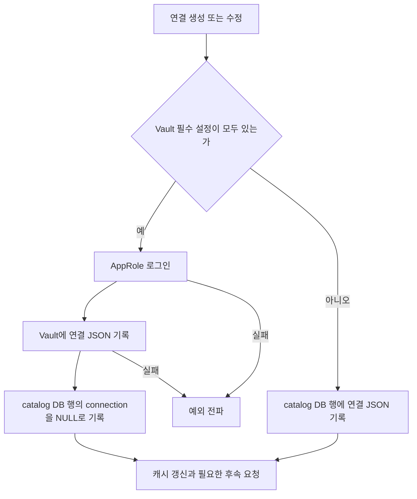
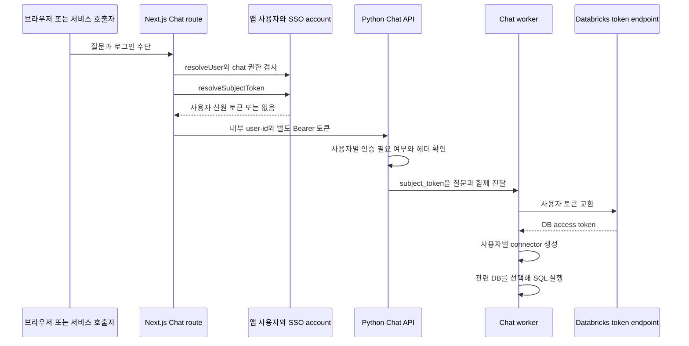
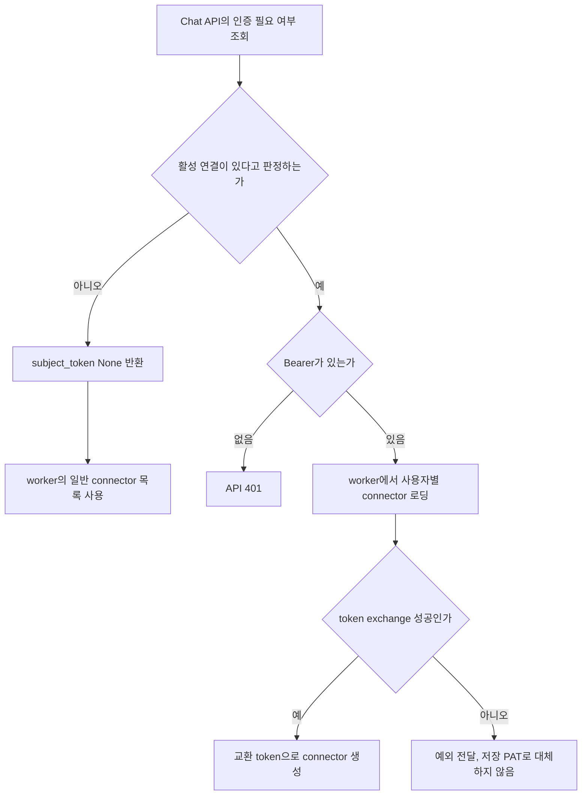
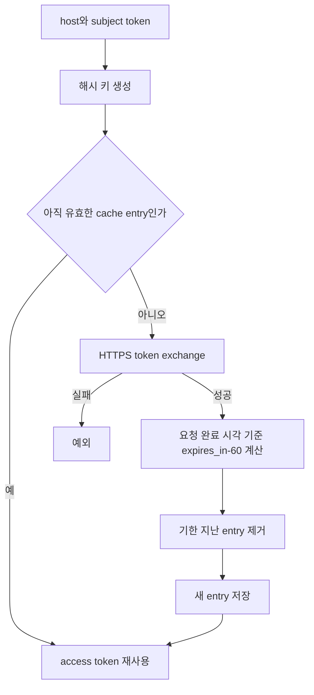

# Chapter 12. 연결 비밀 정보와 사용자별 인증

이 프로젝트는 **앱 사용자의 로그인, 저장된 DB 접속 정보, 사용자별 DB 실행 토큰을 서로 다른 경로로 처리한다.** Vault는 연결 설정을 보관하는 선택적 저장소이고, Databricks 토큰 교환은 로그인 사용자의 신원으로 SQL을 실행하기 위한 별도 기능이다. Vault를 사용한다고 모든 SQL이 사용자별 권한으로 실행되는 것은 아니다.

이 장은 로컬 코드·테스트의 정적 분석이다. 실제 인증 서버·Vault·DB·LLM·테스트를 호출하지 않았다. [Registry와 연결 변경](chapter-02-registry-and-cache.md), [실행 경계](chapter-10-sql-execution-boundary.md), [연결 수명](chapter-11-execution-timeout-and-resources.md), [용어집](../01-architecture/chapter-00-glossary.md)을 함께 참고한다. 설치·인증 서비스 구성 절차와 제외한 엔진의 상세 분석은 다루지 않는다.

## 1. 먼저 구분해야 할 인증 정보

| 용어 | 뜻과 이 프로젝트에서의 사용 |
| --- | --- |
| secret | 비밀번호·접근 토큰·개인 키처럼 공개하면 안 되는 접속 정보 |
| Vault | HashiCorp의 비밀 정보 저장 서비스. 여기서는 연결 dict 전체를 저장하는 선택적 경로 |
| AppRole | 애플리케이션이 role_id·secret_id로 Vault에 로그인하는 인증 방식 |
| SSO(Single Sign-On) | 한 로그인 신원을 다른 서비스에서도 사용하는 방식 |
| JWT(JSON Web Token) | 사용자·발급자·만료 등 정보를 담는 토큰 형식. 내용을 읽는 것과 서명을 검증하는 것은 다름 |
| OAuth | 접근 토큰을 발급·교환하는 인증 연동 체계. 여기서는 Databricks token exchange 호출에 사용 |
| PAT(Personal Access Token) | DB 연결에 저장된 개인 접근 토큰. 현재 질문한 사용자의 토큰과 다를 수 있음 |
| subject_token | Databricks에 교환 요청하는 외부 사용자 신원 토큰 |
| access_token_override | 교환한 DB 토큰을 연결 문자열에 우선 적용하기 위한 내부 필드 |
| fail-closed | 필요한 인증을 얻지 못하면 다른 권한으로 대신 실행하지 않고 거부하는 정책 |
| TTL(Time To Live) | 캐시 값을 재사용할 수 있는 유효 기간 |

인증과 권한도 나눈다. 인증은 누구인지 확인하는 것이고, 권한은 그 사용자가 어떤 작업을 할 수 있는지 판단하는 것이다. 앱의 `chat:use`, `connection:manage` 권한과 원본 DB의 테이블 조회 권한은 같은 검사 결과가 아니다.

## 2. 연결 설정은 Vault 또는 catalog 행에 저장한다

`server/connections/service.py`는 연결 생성·수정 시 `is_vault_configured()`를 확인한다. 이 함수는 `VAULT_ADDR`, `VAULT_NAMESPACE`, `VAULT_ROLE_ID`, `VAULT_SECRET_ID`가 모두 있는지 판단한다. 값 일부만 있으면 경고하고 Vault 미사용으로 취급한다. 인증 성공 여부를 미리 검사하는 함수는 아니다.



Vault의 경로 키는 catalog DB 이름이다. `get_client()`가 `hvac.Client`를 만들고 AppRole로 로그인한다. `write_secret()`은 KV v1, 즉 key-value 비밀 저장 API의 `create_or_update_secret()`을 호출하며 다음 형태를 쓴다.

```text
Vault path: DB 이름
secret payload:
  connection: JSON 문자열로 직렬화한 연결 dict 전체
```

비밀번호 필드만 따로 저장하는 구조가 아니다. 주소·DB 이름·schema 목록·사용자별 인증 플래그 등도 연결 dict에 있으면 함께 들어간다. catalog에는 DB 이름의 행이 남아 연결을 발견하는 기준점이 된다.

Vault를 쓰지 않는 경로는 연결 JSON을 catalog의 connection 값으로 기록한다. 이 함수에는 기록 전 별도 애플리케이션 암호화 코드가 없다. 다만 이것만으로 DB 저장 매체·네트워크·백업의 암호화 여부까지 판단하지 않는다.

### 2.1 저장 성공과 전체 작업 성공은 분리된다

- Vault 로그인·쓰기 실패는 예외를 전파한다. **Vault가 구성되어 있지만 쓰기에 실패했을 때 catalog로 자동 대체 저장하는 경로는 없다.**
- Vault 쓰기 후 catalog 행 기록이 실패하면 두 저장소를 함께 되돌리는 공통 트랜잭션은 없다.
- 연결 수정의 Vault 경로는 기존 catalog JSON을 NULL로 만들어 비밀 정보 사본을 줄인다.
- 반면 `set_sso_federation()`의 Vault 경로는 secret만 다시 쓰고 같은 catalog 비우기를 수행하지 않는다. 전용 토글과 전체 수정의 저장 동작을 동일시하지 않는다.

트랜잭션은 여러 쓰기를 전부 성공하거나 전부 취소하도록 묶는 단위다. 여기서는 외부 Vault와 catalog DB가 그 한 묶음에 들어 있지 않다.

근거: [Vault 접근](../../../code/auto-ontology/auto_ontology/connectors/vault.py), [연결 service](../../../code/auto-ontology/auto_ontology/server/connections/service.py), [DAL 저장](../../../code/auto-ontology/auto_ontology/dal/connections.py).

## 3. 읽기·삭제의 실패 정책은 쓰기와 다르다

### 3.1 읽기 실패는 “secret 없음”으로 바뀐다

`dal/connections.py::list_connections()`는 catalog DB 행을 이름순으로 읽고 각 행마다 Vault secret을 먼저 확인한다.

1. 값이 있는 Vault 객체가 있으면 그 객체 전체를 사용한다.
2. 없으면 catalog 행의 connection을 사용한다. 문자열이면 JSON decode를 한다.
3. 둘 다 없으면 해당 행은 연결 목록에서 제외한다.

`read_secret()`는 Vault 미구성 시 빈 문자열을 반환한다. 또한 로그인·요청·JSON 해석 등의 예외를 잡아 경고 후 빈 문자열을 반환한다. 호출자는 secret이 실제로 없었던 경우와 Vault 장애였던 경우를 같은 대체 경로로 처리한다.

| Vault 상태 | catalog에 JSON 있음 | catalog connection이 NULL |
| --- | --- | --- |
| secret 읽기 성공 | Vault 객체 우선 | Vault 객체 사용 |
| secret 없음·조회 실패 | 저장 JSON 사용 | 연결 목록에서 제외 |

즉 “Vault 장애면 항상 기존 연결이 유지된다”도, “Vault 장애면 반드시 전체 조회가 실패한다”도 아니다. catalog에 남은 값에 따라 다르다. Vault와 catalog의 필드를 합치는 병합도 없으며, Vault에만 있고 catalog DB 행이 없는 secret은 이 함수가 나열하지 않는다.

이 목록을 사용하는 Registry에는 저장 연결 목록이 비었거나 구성 중 예외가 발생하면 환경 URL 목록을 사용하는 별도 경로가 있다. 정확한 전체 대체 순서는 [Chapter 02](chapter-02-registry-and-cache.md)에 기록했다.

### 3.2 삭제는 Vault 먼저, 연결 행 해제는 그다음이다

연결 삭제 service는 Vault가 구성되어 있으면 secret부터 삭제한다. Vault 값이 우선되는 구조에서 catalog만 먼저 비웠다가 secret 삭제가 실패하면 연결이 다시 보일 수 있기 때문이다. 이후 catalog 행의 connection을 NULL로 바꾸고 캐시 갱신·수집 데이터 삭제 요청을 한다. 여기서 catalog DB 행 자체를 바로 삭제하지는 않는다.

`delete_secrets(database_name)`은 한 경로를 지우고, 이름이 없으면 mount의 키 목록을 읽어 순서대로 삭제한다. 전체 삭제에는 원자적 보장이 없고 중간 실패는 전파된다. 미구성일 때는 아무 작업도 하지 않는다. Vault 모듈의 “실패를 no secret으로 취급”이라는 개요는 **read 경로에 해당**하며 write·delete까지 모두 예외를 삼킨다는 뜻이 아니다.

## 4. 응답에서 감추는 필드와 로그 정리의 실제 범위

연결 API의 `_serialize_connection()`은 다음 SECRET_FIELDS를 응답 dict에서 제외한다.

```text
password, password_env, private_key,
private_key_passphrase, truststore_password
```

이는 고정된 이름의 제외 목록이다. 연결 dict의 임의 필드를 의미 분석해 모두 비밀 정보인지 판별하는 함수는 아니다. 내부 DAL이나 Vault에서 읽을 때부터 비밀번호를 제거하는 것도 아니다. 실행 connector 생성에는 실제 비밀 정보가 필요하다.

수정에서는 `_with_stored_secrets()`가 위 필드의 새 값이 비었으면 저장 값을 보충한다. UI가 비밀번호를 받지 못해 빈 값으로 다시 보낸다고 기존 접속 정보가 지워지는 것을 막는다. 따라서 일반 수정 요청의 빈 password가 “비밀번호 삭제”를 의미하지 않는다. 다른 일반 필드까지 모두 자동 병합하는 함수도 아니다.

Registry의 `_redact()`는 URL password를 `***`로 바꾸고 truststore_data를 축약한다. 그러나 모든 query parameter·예외 문자열을 통합 정리하는 기능은 아니다. `create_connector()`의 예외 자체에 원문 URL이 들어가는 분기도 있어 **로그의 인자 하나를 가렸다는 사실만으로 전체 traceback 비밀 정보 제거를 보장하지 않는다.**

토큰 교환 실패 응답은 error_description을 출력하지 않고 HTTP 상태와 짧은 error 필드만 전달한다. 이는 원격 설명이 subject token을 되비추는 경우를 줄이는 처리다. 반면 임의 서버가 error 필드에도 비밀을 넣지 않는다는 것까지 코드가 보장하지는 않는다. Chat SQL 본문 로그의 길이 제한도 값 마스킹과 별개다.

근거: [연결 응답](../../../code/auto-ontology/auto_ontology/server/connections/router.py), [secret 보존](../../../code/auto-ontology/auto_ontology/server/connections/service.py), [Registry 로그 정리](../../../code/auto-ontology/auto_ontology/connectors/registry.py), [토큰 교환 오류](../../../code/auto-ontology/auto_ontology/connectors/databricks_oauth.py).

## 5. 앱 로그인 신원과 DB 토큰은 어떻게 전달되는가



### 5.1 Next.js는 앱 사용자와 권한을 먼저 확인한다

`/api/chat/completions`는 `withPermission({chat:['use']})`로 감싼다. `conversation_id`가 있으면 conversation write 권한도 확인한다. `resolveUser()`의 순서는 브라우저 session → 앱 API token → 앱 OAuth token → SSO bearer다. 토큰 종류에 맞는 검증 결과로 앱 사용자를 찾는다.

SSO bearer 검증은 provider의 JWKS, 즉 서명 확인용 공개 키 집합을 사용한다. `bearer.ts`는 issuer·서명·시간 조건을 검증하는 호출을 하고 audience 옵션은 주지 않는다. issuer는 발급자, audience는 토큰이 대상으로 하는 수신 앱을 뜻한다. 주석도 다른 앱에 발급된 같은 SSO 신원을 받기 위한 의도라고 설명한다. 이 장은 그 신뢰 모델을 확인한 것이며 모든 provider 구성의 적합성을 실행 검증한 것은 아니다.

### 5.2 DB에 전달할 subject token을 별도로 고른다

`resolveSubjectToken(headers, user.id)`는 다음 순서다.

| 순서 | 동작 |
| --- | --- |
| 1 | 요청에 Bearer가 있으면 그 문자열을 우선 반환 |
| 2 | user의 최근 SSO account에서 만료 60초 이상 남은 idToken 사용 |
| 3 | 저장 idToken이 오래됐으면 refreshToken으로 provider에 새 idToken 요청 |
| 4 | 갱신 불가·실패면 아직 유효한 account accessToken 사용 |
| 5 | 얻지 못하면 null |

refresh token은 새 토큰을 받는 데 쓰는 비밀 정보다. 성공 시 account에 새 토큰들을 저장하려고 시도하지만, 저장 실패가 있어도 현재 요청에는 새 idToken을 반환한다. 이후 갱신 시 저장 상태에 따라 재로그인이 필요할 수 있다. local password account는 SSO account 조회에서 제외한다.

JWT의 exp를 읽는 이 helper는 서명을 검증하지 않는다. 자체 만료 판단용 decode와 앞선 앱 로그인 검증·원격 DB 토큰 검증을 구분한다. 또한 API 토큰으로 앱 인증이 성공한 경우도 DB token exchange까지 자동 성공한다는 뜻은 아니다. 이 helper는 전달된 Bearer 문자열을 우선하므로 Databricks가 받아들일 subject token인지 별도 경계가 남는다.

### 5.3 Python이 신뢰하는 내부 user-id는 DB 토큰과 다르다

Next route는 신원이 확인된 `user.id`로 내부 헤더를 새로 만들고, 얻은 subject token은 `Authorization: Bearer`로 별도 전달한다. `server/identity.py`는 내부 user-id 헤더를 독립 인증 없이 신뢰한다. 소스는 사설 Next gateway 뒤의 Python이라는 신뢰 전제를 명시한다.

따라서 내부 user-id는 대화 소유자·저장용 앱 식별자이고, Bearer는 사용자별 DB 실행용 신원 정보다. 같은 값도 같은 검증도 아니다. 이 분석은 gateway 접근 전제를 설명하며 실제 배포의 외부 노출 여부를 확인한 것은 아니다.

근거: [Chat Next route](../../../code/auto-ontology/frontend/app/api/chat/completions/route.ts), [앱 사용자 확인](../../../code/auto-ontology/frontend/auth/resolve-user.ts), [권한 wrapper](../../../code/auto-ontology/frontend/auth/with-auth.ts), [subject token 선택·갱신](../../../code/auto-ontology/frontend/auth/sso-token.ts), [bearer 검증](../../../code/auto-ontology/frontend/auth/bearer.ts), [내부 identity](../../../code/auto-ontology/auto_ontology/server/identity.py).

## 6. 사용자별 DB 인증을 요구하는 조건과 실패 경계

연결의 `sso_federation`이 True 또는 문자열 1·true·yes이면 `uses_sso_federation()`은 활성으로 판단한다. 이 helper 자체에는 엔진 type을 추가 검사하는 조건이 없다. 전용 설정 route는 connection manage 권한 뒤에 있고 service는 기존 연결의 플래그만 바꾼다. 수집은 저장 토큰을 쓰므로 이 토글만으로 재수집을 요청하지 않는다.

Python Chat의 `_subject_token()`은 **설정된 연결 중 하나라도 활성인지** 먼저 조회한다. 현재 target_db만 검사하는 함수는 아니다.



### 6.1 교환 경로 안에서는 실패 시 거부한다

`get_connectors_for_subject_token()`은 저장 연결을 다시 읽는다. 활성 연결이 있으면 subject token을 요구하고, 각 연결의 토큰을 교환한 뒤 `access_token_override`를 넣어 URL을 만든다. 이 경로의 저장 목록 조회·토큰 교환·객체 생성 오류는 저장 PAT 대체로 넘어가지 않고 전파된다.

연결 문자열 factory는 override를 저장 password보다 우선하고 `auth=sso`를 붙인다. Databricks connector는 어떤 자격증명 종류인지 `auth_mode`로 설명하며 SQL 로그에 그 모드가 들어간다.

### 6.2 활성 여부 조회 실패는 같은 정책이 아니다

`any_connection_uses_sso_federation()`은 저장 목록 조회 예외를 잡고 False로 처리한다. 결과를 30초 TTL로 캐시한다. 또한 Vault 읽기 실패로 연결이 목록에서 빠져 활성 연결을 발견하지 못하는 경로도 있다.

**코드상 조합:** 활성 여부 판정이 False가 되면 `_subject_token()`은 Bearer가 전달되어 있어도 None을 반환한다. worker는 subject_token이 None이면 부팅 시 보유한 일반 connector 목록을 사용한다. 그 목록이 저장 PAT로 만든 기존 객체라면 사용자별 토큰 교환을 거치지 않는 경로가 가능하다.

이것은 교환 경로 내부의 fail-closed와 다른 **조회 장애 시 가용성 우선 처리**다. 주석과 관련 테스트도 조회 오류를 False로 처리하는 기대를 명시한다. 따라서 전체 흐름을 “어떤 장애에서도 항상 사용자별 인증을 강제한다”고 설명할 수 없다. 실제 장애 조건과 실행 권한을 재현하지는 않았다. 원본 코드도 수정하지 않았다.

### 6.3 target DB와 인증 대상 목록의 범위가 다르다

활성 여부 확인과 사용자별 connector 생성은 전체 저장 연결을 대상으로 한다. target_db에 해당하는 활성 연결만 교환하는 인자가 없다. 따라서 선택한 질문 DB와 별개로 다른 활성 연결의 토큰 교환 실패가 질문 시작을 막을 수 있는 구조다.

근거: [Chat subject token 판단](../../../code/auto-ontology/auto_ontology/server/chat/router.py), [flag·exchange helper](../../../code/auto-ontology/auto_ontology/connectors/databricks_oauth.py), [사용자별 Registry](../../../code/auto-ontology/auto_ontology/connectors/registry.py), [worker 선택](../../../code/auto-ontology/auto_ontology/server/chat/worker.py).

## 7. token exchange의 입력·출력과 두 종류 캐시

`exchange_subject_token()`은 host의 scheme·끝 슬래시를 정리하고, `https://{host}/oidc/v1/token`에 form 데이터를 보낸다.

| 요청 항목 | 값·의미 |
| --- | --- |
| grant_type | token-exchange |
| subject_token | 호출자의 외부 토큰 |
| subject_token_type | JWT 타입 식별자 |
| scope | all-apis |
| HTTP timeout | 15초 인자 |

host·subject token이 없으면 거부한다. 비200 응답, HTTP 오류, 성공 JSON 해석 실패, 빈 access token은 `DatabricksOAuthError`를 만든다. 성공 응답은 access_token을 문자열로, expires_in을 숫자로 해석한다. expires_in이 없으면 3600초다. 원격 provider의 trust policy·실제 테이블 권한을 이 함수가 자체 구성하는 것은 아니다.

| 캐시 | 저장 위치·키 | 유효 기간·갱신 |
| --- | --- | --- |
| SSO 활성 여부 | API 프로세스의 bool | 30초 또는 명시 invalidate |
| 교환 access token | 사용하는 프로세스의 `(host, SHA-256(subject_token))` | expires_in-60초, 최소 0 |
| connector 목록 | Registry 모듈 | 명시 invalidate까지 |
| Chat standby | WarmPool | 설정 변경 시 대기 worker 교체 |

SHA-256은 입력을 고정 길이 지문으로 바꾸는 해시다. subject token 원문을 dict key로 쓰지 않는다는 뜻이지 모든 토큰을 메모리에서 암호화했다는 뜻은 아니다. 교환 access token은 cache value와 connector 설정에 보관된다.



캐시의 상세 경계는 다음과 같다.

- 같은 workspace·같은 subject token은 재사용하고 다른 subject token은 다른 키를 쓴다. 같은 사용자가 로그인 토큰을 교체해도 새 키가 된다.
- expires_in이 60초보다 작아 TTL 0이어도 방금 받은 token은 현재 호출에 반환한다. 다음 호출에서는 재사용하지 않는다.
- 교환 요청 전 시각이 아니라 응답을 받은 뒤의 현재 시각부터 TTL을 계산한다.
- 지난 entry 제거는 성공한 새 exchange를 cache에 쓰는 시점에 수행한다. 주기적인 정리 thread나 고정 최대 entry 개수는 이 코드에 없다.
- lock은 cache 조회·저장에 사용하며 HTTP 교환 전체를 잠그지 않는다. 동시에 같은 키가 miss면 교환이 중복될 수 있다.
- `clear_cache()`는 존재하지만 이번 소스 호출 검색에서는 테스트 외 운영 호출을 찾지 못했다. `_refresh_connection_caches()`는 활성 플래그 cache를 비우며 이 교환 cache를 직접 clear하지 않는다.

각 worker는 별도 프로세스이므로 캐시를 서로 공유하지 않는다. standby 교체가 모든 활성 worker의 메모리를 즉시 정리하는 것도 아니다. 토큰별 권한 철회·원격 만료·실행 도중 만료까지 이 캐시만으로 보장하지 않는다.

## 8. 사용자별 connector의 실행·수명과 저장 토큰의 역할

사용자별 Registry는 활성 연결을 모두 교환·생성한 뒤, 같은 DB 이름이 아닌 일반 공유 connector를 합친다. 대상 DB 이름 비교는 정확한 문자열 기준이다. 실행 agent는 이후 관련 테이블의 DB로 실제 객체를 고른다.

worker는 질문을 받을 때 사용자별 목록을 만들고 해당 질문의 agent payload에 넣는다. 이 새 목록 자체를 전역 Registry cache에 저장하지 않는다. 반면 교환 token은 OAuth helper의 메모리 cache에 남을 수 있다.

질문의 finally는 완료 이벤트를 보내지만 사용자별 connector 목록을 순회해 close하거나 token을 revoke, 즉 원격에서 폐기하는 코드가 아니다. Databricks의 일반 연결은 [Chapter 11](chapter-11-execution-timeout-and-resources.md)의 작업별 context에서 닫는다. **DB 세션 종료, connector 객체 폐기, 교환 token cache 제거, 원격 token 폐기는 각각 다르다.**

수집 scheduler는 subject token을 받지 않고 일반 `get_connectors()`를 사용한다. 사용자별 인증 플래그가 켜져도 메타데이터 수집은 저장 토큰 권한으로 수행된다. 따라서 저장된 catalog가 모든 질문 사용자에게 같은 원본 조회 권한을 보장한다는 뜻은 아니다. 검색 메타데이터 범위와 실제 사용자 DB 권한의 관계는 검색·거버넌스 단계에서 추가 확인한다.

worker에서 교환 오류가 나면 공통 예외 처리로 부모에게 오류 이벤트를 보낸다. 이미 API가 stream을 시작한 뒤 worker에서 발생한 오류를 모두 최초 HTTP 401로 반환하는 구조는 아니다. 토큰 없음의 API 거부와 교환 실패의 비동기 오류 전달을 구분한다.

## 9. 테스트 근거와 남은 검증

아래는 테스트 소스를 읽은 결과이며 이번에 실행하지 않았다.

| 테스트 파일·항목 | assertion이 확인하는 범위 |
| --- | --- |
| `test_databricks_oauth.py`의 exchange 요청·host 정리 | endpoint·grant·scope·subject token 전달. HTTP는 가짜 응답 |
| 같은 파일의 caller별 cache·expired refetch | 같은 token 재사용, 다른 token 분리, TTL 0 재요청 |
| exchange 거부·오류 설명 비노출 | 401 오류 전파, error_description에 들어간 subject token은 예외 메시지에서 제외 |
| `test_any_connection_fails_soft_when_lookup_errors` | 저장 목록 조회 오류이면 False |
| `test_set_sso_federation_updates_only_the_flag` | 기존 저장 자격증명·schema 보존하며 flag 변경 |
| token rotation·purge 테스트 | 지난 cache entry 제거, 유효 entry 유지 |
| `dal/tests/test_analyses.py`의 연결 테스트 | 연결 없는 DB 제외, Vault 객체가 행 JSON보다 우선. Vault 읽기는 대체 함수 |
| `server/connections/tests/test_service.py` | 응답 secret 필드 제외, 빈 secret 보존, Vault 삭제→행 해제 순서 |
| `server/tests/test_identity.py` | 전달된 내부 user-id 사용, 필수 누락 401, stateless 생략 허용 |

이 테스트 목록이 실제 Vault의 AppRole·권한·토큰 만료, frontend 전체 로그인·refresh, Python API부터 worker·DB까지의 end-to-end 강제 인증을 보장하는 것은 아니다. 특히 플래그 조회 실패 후 캐시된 저장 connector 사용은 구성 경로를 합쳐 도출한 시나리오이며 실제 권한 차이로 재현하지 않았다.

근거: [OAuth 테스트](../../../code/auto-ontology/auto_ontology/connectors/tests/test_databricks_oauth.py), [DAL 테스트](../../../code/auto-ontology/auto_ontology/dal/tests/test_analyses.py), [연결 service 테스트](../../../code/auto-ontology/auto_ontology/server/connections/tests/test_service.py), [identity 테스트](../../../code/auto-ontology/auto_ontology/server/tests/test_identity.py).

Connector 단계의 정적 분석 범위는 여기까지다. 실제 Vault/DB 장애·권한 철회·인증 플래그의 프로세스별 갱신·민감 로그·동시 교환·원격 토큰 폐기는 실행 검증이 필요한 항목으로 남긴다. 다음은 catalog 수집의 scheduler·실제 저장·diff·embedding·부분 실패 흐름이며, [수집 세부 계획](../../../.codex/plan/auto-ontology/01-4_catalog-ingestion.md)에 따라 진행한다.
