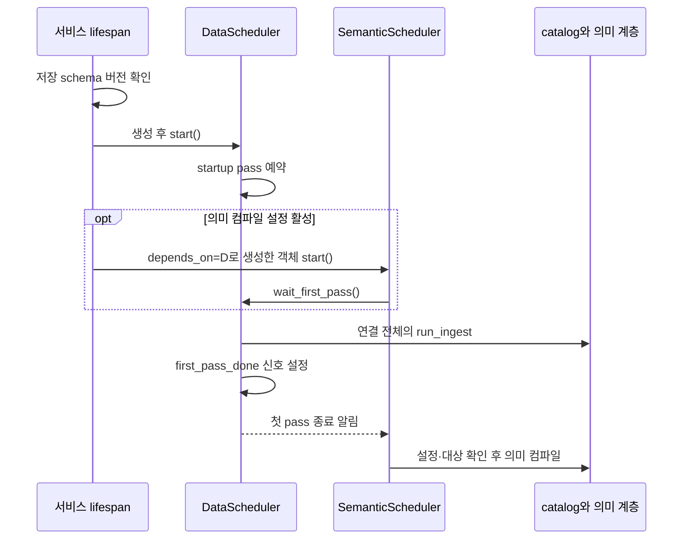
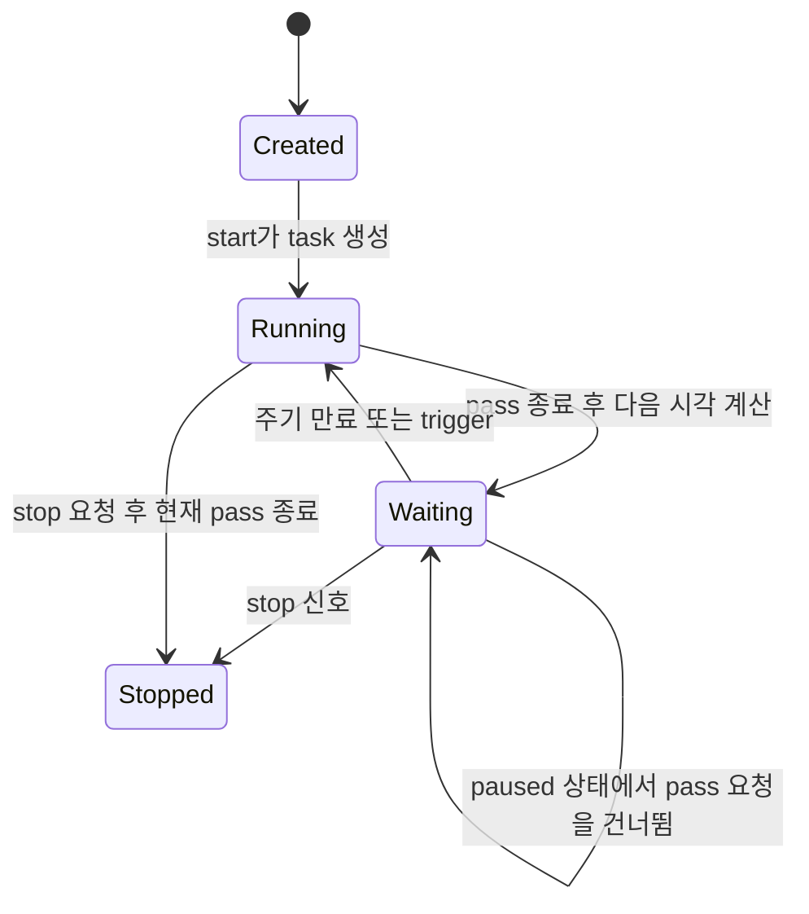
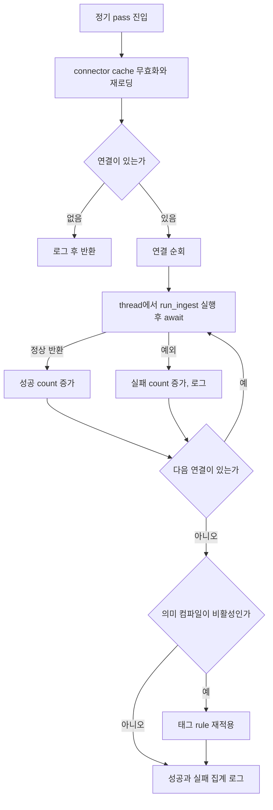
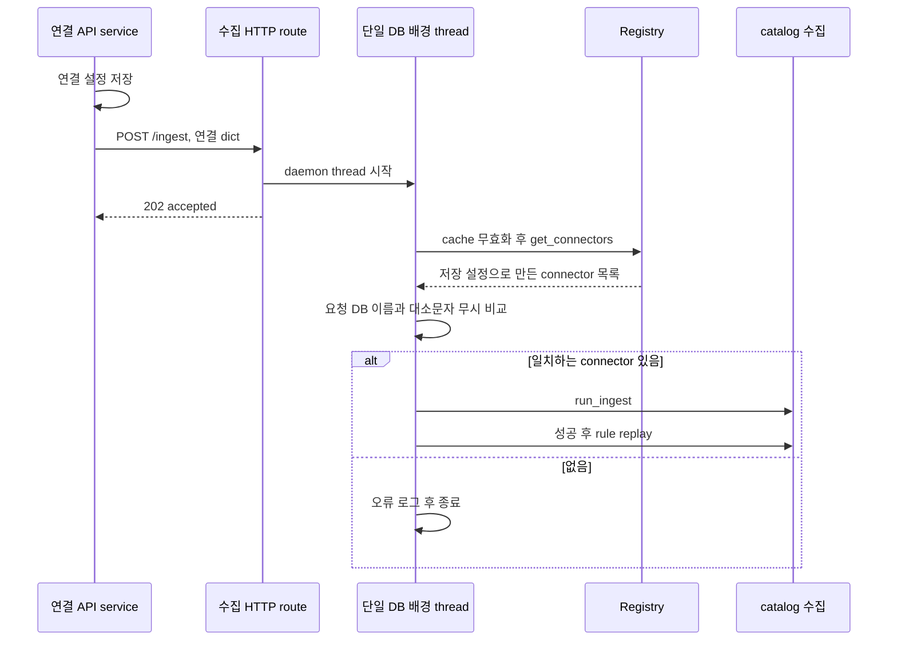

# Chapter 01. Catalog 수집의 시작·예약·즉시 요청

Catalog 수집은 두 경로로 시작한다. **정기 경로는 DataScheduler가 연결 전체를 순차 처리하고, `POST /ingest`는 별도 배경 thread가 지정 DB 하나를 처리한다.** 두 경로는 같은 `run_ingest()`를 호출하지만 실행 시각·동시 실행 제어·상태 표시를 공유하지 않는다.

이 장은 제공된 로컬 소스·테스트의 정적 분석이다. 서비스·DB·모델·테스트는 실행하지 않았다. [전체 아키텍처](../01-architecture/chapter-01-overview.md), [Registry](../03-connectors/chapter-02-registry-and-cache.md), [연결 수명](../03-connectors/chapter-11-execution-timeout-and-resources.md), [용어집](../01-architecture/chapter-00-glossary.md)을 함께 참고한다. 설치·배포 절차는 제외한다.

## 1. 이 장의 용어와 컴포넌트

| 용어·컴포넌트 | 쉬운 뜻과 역할 |
| --- | --- |
| catalog | 원본 DB의 테이블·컬럼 등 구조와 관련 분석 정보를 보관하는 저장소 |
| ingestion service | 원본 구조를 읽고 catalog·검색용 데이터를 갱신하는 별도 Python 서비스 |
| scheduler | 작업의 시작과 다음 실행 시각을 관리하는 객체 |
| pass | scheduler가 작업 한 바퀴를 수행하는 단위. DataScheduler에서는 연결 목록 전체 순회 |
| trigger | 예약 시각을 기다리지 않고 작업을 요청하는 신호 |
| thread | 같은 프로세스 안에서 동기 작업을 실행하는 단위 |
| asyncio task | 이벤트 루프에서 대기·진행을 조율하는 비동기 작업 |
| event | 신호가 켜졌는지 저장하는 장치. 여기서는 요청 횟수를 쌓는 queue가 아님 |
| lifespan | FastAPI 서비스 시작·종료 때 실행하는 초기화·정리 구간 |
| semantic compilation | catalog를 바탕으로 용어·속성·관계를 만드는 의미 계층 생성 작업. 구조 수집과 별도 |

| 파일 | 실제 책임 |
| --- | --- |
| `ingestion_service/__main__.py` | 서비스 수명과 두 scheduler 생성·시작·종료 |
| `scheduler.py::IntervalScheduler` | startup pass·주기·trigger·pause·abort·실행 상태 |
| `data_scheduler.py::DataScheduler` | connector 재로딩과 전체 연결 수집 |
| `router.py::ingest_connection` | 단일 DB 비동기 수집 요청 접수 |
| `ingest.py::trigger_ingest` | 배경 thread 생성·connector 선택·단일 수집 |
| `semantic_scheduler.py` | 의미 컴파일과 첫 수집 pass 종료 대기 |
| `history.py` | **의미 컴파일**의 최근 성공·실패 이력 |

근거: [서비스 진입점](../../../code/auto-ontology/auto_ontology/ingestion_service/__main__.py), [기본 scheduler](../../../code/auto-ontology/auto_ontology/ingestion_service/scheduler.py), [DataScheduler](../../../code/auto-ontology/auto_ontology/ingestion_service/data_scheduler.py).

## 2. 서비스 시작 시 수집이 어떻게 예약되는가

lifespan은 먼저 `require_current_schema()`로 저장소 schema가 현재 코드와 맞는지 확인한다. 여기서 schema는 DB 저장 구조의 버전을 뜻하며 원본 테이블의 이름 공간과 구분한다. 불일치·실패로 예외가 발생하면 이 시작 경로는 진행하지 않는다.

이후 `DataScheduler()`와 `SemanticScheduler(depends_on=data_scheduler)`를 만들고 `app.state`에 보관한다. data scheduler는 항상 start한다. semantic scheduler는 `semantic_compilation_enabled` 설정이 참일 때만 시작한다. 설정 미존재·조회 오류의 기본값은 False다.

`start()`는 `_run_forever()`를 task로 예약한다. start가 반환했다는 것은 수집이 끝났다는 뜻이 아니다. `_run_forever()`는 다음 주기를 기다리기 전에 startup pass를 한 번 실행한다.

### 2.1 첫 pass 종료는 성공 보장이 아니다

`_run_pass()`는 `_run_once()`의 예외를 기록하고, finally에서 `_running=False`, `_first_pass_done.set()`을 수행한다. 따라서 다음 경우도 첫 pass 종료로 취급된다.

- 연결이 없어 DataScheduler가 그대로 반환함.
- 연결별 수집이 일부 또는 전부 실패했지만 순회가 끝남.
- connector 로딩 등에서 잡지 못한 예외가 발생해 기본 scheduler가 기록함.

의미 scheduler의 `wait_first_pass()`는 이 종료 신호만 기다린다. 전체 catalog 완성·vector 최신화·수집 성공 여부를 검사하는 별도 barrier는 아니다. barrier는 다음 단계가 진행하기 전에 기다리는 동기화 지점을 뜻한다.

이 신호는 한 번 켜지면 계속 유지된다. **매 의미 컴파일 pass가 직전 수집 pass와 동기화되는 구조는 아니다.** 이후 두 scheduler는 각자의 종료 시각 기준 주기를 가지므로 겹칠 수 있다. `__main__.py`의 “첫 시작 경쟁 방지”를 영구적인 수집·컴파일 상호 배제로 확대하지 않는다.

## 3. IntervalScheduler의 상태와 주기

### 3.1 시작·실행·대기·종료

표의 Running은 실제 pass를 수행하는 상태를 뜻한다. 객체의 `_task`는 대기 중에도 존재하지만 `running` 속성은 False다.

| 내부 값 | 의미 |
| --- | --- |
| `_task` | 배경 loop task. start의 중복 호출 방지 기준 |
| `_running` | `_run_pass()`가 실제 `_run_once()`를 수행 중인지 |
| `_trigger` | 다음 pass를 빨리 실행하라는 신호 |
| `_stop` | loop를 종료하라는 신호 |
| `_abort` | 현재 pass를 안전한 지점에서 중단해 달라는 신호 |
| `_paused` | 새 pass 진입을 건너뛰게 하는 상태 |
| `_first_pass_done` | 첫 pass가 종료됐다는 누적 신호 |

`start()`는 `_task is not None`이면 False를 반환한다. 실행 중인지뿐 아니라 task가 할당되어 있는지를 검사한다. stop 이후 `_task`·stop 신호를 초기화해 같은 객체를 재시작하는 코드는 없다. start의 중복 방지를 완전한 restart 기능으로 해석하지 않는다.

### 3.2 24시간은 이전 실행의 종료 시점부터 잰다

DataScheduler의 기본 interval은 24시간이다. `_run_forever()`는 pass가 끝난 시각의 UTC 현재 시각에 interval을 더한다. 고정된 매일 특정 시각이나 “시작 시각+24시간”이 아니다.

설명용으로 11월 8일 00:00에 시작한 수집이 00:20에 끝났다면 다음 정기 pass는 11월 9일 00:20 기준이다. 이 예시는 코드 설명용이며 실행 기록이 아니다.

`_wait_for_next()`는 남은 시간 동안 stop·trigger 두 event를 함께 기다린다. 기다림은 최대 500초 단위지만 신호가 오면 그 chunk가 끝나기 전에도 깨어난다. 남은 시간 계산은 UTC datetime 차이이므로 시스템 시계 변경의 실제 영향은 별도 검증 대상이다.

### 3.3 trigger는 작업 queue가 아니다

기본 `trigger()`는 `_trigger.set()`만 한다. loop는 신호를 소비하고 `_run_pass()`를 await하므로 **이 scheduler loop 자체의 pass는 순차 실행**된다.

- 대기 중 trigger: 다음 pass를 앞당긴다.
- 실행 중 trigger: 현재 pass가 끝난 뒤 바로 추가 pass를 실행할 수 있다.
- 소비 전 trigger 여러 번: event는 켜짐/꺼짐만 보관하므로 여러 요청이 하나로 합쳐질 수 있다.
- pass 완료 후 다음 interval을 다시 계산하므로 이 scheduler의 trigger는 자동 실행 시각을 미룬다.

단, 뒤에서 설명할 HTTP `POST /ingest`는 **DataScheduler.trigger를 호출하는 endpoint가 아니다.** 위 시간 변경 설명을 해당 HTTP 요청에 그대로 적용하면 안 된다.

## 4. abort·pause·stop의 범위와 한계

| 메서드 | 기본 클래스가 실제로 하는 것 | 보장하지 않는 것 |
| --- | --- | --- |
| abort | `_abort` 켜고 대기 trigger를 지움 | 이미 실행 중인 DB 호출 강제 취소 |
| pause | `_paused=True` | 진행 중 pass 자동 종료 |
| resume | `_paused=False` | 즉시 실행·대기 loop 깨우기 |
| stop | `_stop` 켜고 loop task를 await | worker thread 강제 종료·현재 pass 즉시 반환 |

pause된 `_run_pass()`는 진입 전에 반환하므로 running·first_pass_done을 변경하지 않는다. 시작부터 pause된 객체는 실제 첫 pass 종료 신호도 아직 생기지 않는다. pause 중 들어온 trigger가 소비되면 pass는 건너뛰고 다음 interval을 기다릴 수 있다. resume만으로 놓친 요청을 다시 실행하지 않는다.

abort는 자식 작업이 `aborting`을 확인해야 의미가 있다. **DataScheduler의 현재 `_run_once()`는 DB 순회 중 abort·stop 신호를 검사하지 않는다.** stop은 실행 중 pass가 반환할 때까지 기다릴 수 있다. 무한히 기다리는 driver 호출이 있다면 기본 scheduler가 자체 시간제한으로 끊는 코드도 없다.

SemanticScheduler는 별도 abort override와 의미 컴파일 취소 신호를 사용한다. 의미 reset에서 pause·abort·대기·삭제·resume을 조합하는 이유는 이 차이 때문이다. 그 취소·삭제 상세는 후속 reset chapter에서 분석하며, semantic의 중단 동작을 DataScheduler에도 있다고 가정하지 않는다.

서비스 종료의 lifespan은 data.stop, semantic.stop을 순서대로 await한다. 이것은 두 scheduler의 정리이며, 별도 단일 DB 수집 thread를 모두 추적해 join하는 종료 관리까지 포함하지 않는다.

## 5. DataScheduler의 한 pass가 하는 작업

1. `invalidate_connectors_cache()`로 자기 프로세스의 기존 connector에 close를 시도하고 캐시를 비운다.
2. `get_connectors()`로 설정을 다시 읽는다.
3. 목록이 없으면 로그 후 반환한다.
4. 각 connector에 `await asyncio.to_thread(run_ingest, connector)`를 호출한다.
5. 개별 호출의 성공·실패를 집계하며 실패해도 나머지를 계속한다.
6. 의미 컴파일이 비활성이면 태그 rule을 재적용한다.
7. 성공·전체·실패 개수를 포함한 종료 로그를 남긴다.

`to_thread()`를 사용해도 이 for loop는 매 호출을 await하므로 DB 여러 개를 동시에 수집하는 방식은 아니다. 원본 DB에 오래 걸리는 A가 있으면 B는 A가 끝날 때까지 기다린다. `run_ingest()` 내부의 표·schema 병렬 처리는 다른 계층이다.

**실패 격리의 시작점:** connector 목록 생성은 개별 run_ingest try 바깥이다. 연결 객체 하나의 생성이 전체 로딩을 실패시키면 DB별 집계 루프까지 못 갈 수 있다. 기본 scheduler가 해당 예외를 기록하고 다음 tick까지 loop를 유지한다. “한 연결 문제는 언제나 다른 DB 수집에 영향이 없다”는 보장은 아니다.

성공 count는 `run_ingest()`가 예외 없이 반환했는지를 센다. 생성된 테이블 수·embedding 수·모든 부가 작업 성공 횟수가 아니다. 예를 들어 rule replay는 자체 오류를 기록하고 삼키며 일부 PII 보강 실패도 별도 처리한다. PII는 개인 식별 가능 정보라는 뜻이며 여기서는 metadata에 분류 태그를 붙이는 보강 작업이다. 상세 실패 영향은 후속 chapter에서 다룬다.

근거: [DataScheduler](../../../code/auto-ontology/auto_ontology/ingestion_service/data_scheduler.py), [run_ingest](../../../code/auto-ontology/auto_ontology/ingestion_service/ingest.py), [rule replay](../../../code/auto-ontology/auto_ontology/ingestion_service/rules.py).

## 6. 단일 DB 즉시 요청은 별도 배경 thread다

연결 생성 service는 저장 후 HTTP proxy로 ingestion service에 요청한다. 수집 범위가 바뀐 수정도 이 경로를 사용할 수 있다. proxy는 요청 실패를 기록하고 예외를 삼킨다.

ingestion service의 `POST /ingest`는 dict 본문을 받아 `trigger_ingest()`를 호출하고 `202 {status: accepted}`를 반환한다. HTTP 202는 여기서 **작업 완료가 아니라 비동기 작업 시작 요청을 받았다는 의미**다.

요청 dict에서 실제 선택에 쓰는 핵심 값은 database 이름이다. payload의 host·password를 즉석 connector 생성에 그대로 쓰지 않고 Registry가 다시 로딩한 설정을 사용한다. 이름은 요청 쪽 공백 제거와 casefold 후 비교하며 첫 일치 객체를 선택한다.

thread는 `daemon=True`, 이름은 `ingest-{database_name}`이다. 함수는 thread 핸들을 반환하지 않는다. 같은 이름의 요청을 여러 번 받았다고 동일 thread를 찾아 재사용하거나 deduplicate, 즉 중복 제거하는 코드가 아니다. database가 없거나 일치하는 연결이 없어도 thread가 시작된 뒤 로그로 끝날 수 있으며 route의 accepted만으로 대상 검증 완료를 판단할 수 없다.

이 경로는 scheduler의 `_running`, `_first_pass_done`, `_trigger`를 갱신하지 않는다. **정기 수집의 다음 시각도 재설정하지 않는다.** 또한 의미 컴파일을 즉시 요청하지 않으며, 성공한 단일 수집 뒤 rule replay만 조건 없이 수행한다.

## 7. 동시 실행은 어느 범위에서 막히는가

| 조합 | 코드상 제어 |
| --- | --- |
| 같은 scheduler loop의 pass끼리 | `_run_pass()`를 await하므로 순차 실행 |
| 같은 loop에 trigger 여러 개 | event 신호로 합쳐질 수 있음 |
| 단일 DB HTTP 요청끼리 | 요청마다 thread. 이 경로에는 DB별 실행 lock·중복 키 없음 |
| 정기 수집과 단일 DB thread | 별도 실행이며 이를 함께 직렬화하는 공통 lock 없음 |
| 최초 의미 컴파일과 startup 수집 | 첫 수집 pass 종료 신호 대기 |
| 두 scheduler의 이후 pass | 처음의 종료 신호는 이미 켜져 있으므로 지속 상호 배제 아님 |
| 의미 reset끼리 | 별도 reset lock·pause 경로 존재. 모든 수집의 lock은 아님 |

정기 경로와 thread 경로 모두 같은 프로세스의 connector cache를 무효화한다. **미검증 시나리오:** 한 실행이 사용 중인 객체를 다른 실행의 무효화가 close하려는 상황이 가능하다. 실제 영향은 [엔진별 close의 차이](../03-connectors/chapter-11-execution-timeout-and-resources.md)에 따라 달라지며, 이번에는 동시 실행으로 재현하지 않았다.

이 구조를 영속 job queue로 해석해서도 안 된다. 202 응답에는 추적용 job ID가 없고 이 함수는 요청을 DB 작업 queue에 기록하지 않는다. 프로세스가 중단되면 실행 중 daemon thread의 완료를 이 경로가 보장하지 않는다. 다음 정기 pass가 다시 시도할 기회와 해당 요청의 완료 보장은 다르다.

## 8. 상태·로그·이력은 무엇을 보여 주는가

### 8.1 수집의 성공 여부는 우선 로그 집계다

DataScheduler는 정상 완료·부분 실패·전부 실패를 로그에서 구분한다. 예를 들어 2개 중 1개가 실패하면 `1 of 2 ... succeeded, 1 failed`에 해당하는 집계를 남긴다. 개별 실패를 잡고 loop가 끝났다는 사실만으로 성공이라고 기록하지 않으려는 처리다.

이 집계의 성공은 run_ingest가 예외 없이 반환했다는 기준이다. embedding 오류가 내부에서 로그·빈 결과로 처리되면 vector 일부 또는 전부가 갱신되지 않아도 성공 집계에 포함될 수 있다. [Chapter 04의 실패·완료 로그 경계](chapter-04-embedding-and-vector-refresh.md)를 참고한다.

다만 이 클래스는 `history.record_run_start/finish()`를 호출하지 않는다. 단일 DB thread도 같은 semantic history를 기록하지 않는다. 해당 메서드들의 실제 호출자는 SemanticScheduler다.

### 8.2 history.py는 의미 컴파일 이력이다

| 값·API | 의미 |
| --- | --- |
| `scheduler.running` | 해당 scheduler의 현재 pass 실행 여부. 단일 DB 수집 thread를 합산하지 않음 |
| `first_pass_done` | 성공 여부와 무관한 첫 pass 종료 |
| `semantic_compilation_history` | 의미 컴파일 시작·종료·결과 이력 |
| history status succeeded·failed | 의미 컴파일의 기록된 완료 결과 |
| history status NULL | 실행 중·중단·disable·프로세스 종료 등 미확정 상태. 하나로 구분 불가 |
| `/semantic/status` | 의미 scheduler의 running·최근 성공·더 최근인 실패 |

history 기록은 best-effort, 즉 실패를 로그로 남기고 작업 자체를 중단하지 않는 방식이다. start 기록 실패는 None을 반환하고, finish에 run_id 또는 outcome이 None이면 업데이트하지 않는다. 따라서 이력 없음도 작업 미실행의 증명은 아니다.

`get_last_failure_if_most_recent()`는 마지막 성공보다 뒤에 있는 실패만 반환한다. 중단된 NULL 행이 최근이라고 failed로 표시하지 않는다. status의 running은 메모리, 최근 성공·실패는 DB에서 읽는 서로 다른 출처다.

공개 API의 semantic status route는 현재 running을 ingestion service에서 물어보고 이력 시각은 직접 DB에서 읽는다. HTTP proxy가 running 조회에 실패하면 False를 반환한다. 따라서 `running=False`가 서비스가 정상 유휴 상태임을 확정하지는 않는다. ingestion router의 설명 중 “API가 이 응답을 그대로 relay”한다는 표현보다 실제 호출을 기준으로 읽어야 한다.

### 8.3 health는 수집 결과의 완전성을 검사하지 않는다

`/health`는 저장소 접근·저장 schema 상태를 확인해 200 또는 503을 반환한다. `/health/live`는 의존성 조회 없이 ok를 반환한다. 원본 DB 전체·embedding 모델·최신 catalog·사용자가 질의 가능한 의미 계층을 이 health 경로가 모두 검증하지 않는다.

근거: [수집 service router](../../../code/auto-ontology/auto_ontology/ingestion_service/router.py), [의미 이력](../../../code/auto-ontology/auto_ontology/ingestion_service/history.py), [SemanticScheduler](../../../code/auto-ontology/auto_ontology/ingestion_service/semantic_scheduler.py), [API semantic status](../../../code/auto-ontology/auto_ontology/server/semantic_compilation/router.py), [HTTP proxy](../../../code/auto-ontology/auto_ontology/server/ingestion/proxy.py).

## 9. 수집과 의미 컴파일의 수동 요청을 혼동하지 않는다

| endpoint | 실제 시작 경로 | timer·상태 영향 |
| --- | --- | --- |
| `POST /ingest` | 단일 DB daemon thread | data scheduler 상태·다음 tick과 별개 |
| `POST /semantic/compile` | semantic scheduler.start, 이미 task가 있으면 trigger | scheduler loop에서 실행하고 interval 재계산 |
| `POST /semantic/stop` | semantic scheduler.abort | data 수집 stop이 아님 |
| `POST /ingest/delete` | 데이터 삭제용 별도 thread | 모든 수집 작업을 자동 중단하는 호출 아님 |
| `POST /semantic/reset` | 별도 비동기 reset 경로 | semantic pause·중단·삭제·재시작 순서는 후속 분석 |

semantic compile endpoint의 start/trigger 구분은 새 scheduler의 startup pass와 요청 pass를 이중 실행하지 않으려는 처리다. 이 endpoint가 `semantic_compilation_enabled` 설정까지 True로 바꾸지는 않는다. `_run_once()`가 설정을 다시 읽고 비활성이면 작업을 건너뛴다.

`__main__.py` 개요의 “DataScheduler는 POST /ingest로 trigger 가능”이라는 설명은 실제 route와 다르다. 구현은 독립 thread다. route의 202와 기본 scheduler의 trigger 동작을 각 코드에서 확인해야 하는 이유다.

## 10. 테스트 근거와 남은 검증

| 테스트 파일·항목 | 읽은 assertion |
| --- | --- |
| `test_completion_logs.py::test_data_scheduler_reports_success_tally` | 가짜 연결 2개 성공의 집계 로그 |
| 전부 실패·부분 실패 테스트 | finished successfully가 없고 실패 수가 맞음 |
| rule 재적용 활성 조건 테스트 | semantic 비활성 시 data pass가 수행, 활성 시 semantic pass에 맡김 |
| `test_a_failure_to_re_apply_does_not_fail_the_ingest` | rule 오류 후에도 원래 수집 성공 집계 유지 |
| `test_trigger_ingest_re_applies_the_rules` | 단일 DB thread 종료를 기다려 rule·PII 호출 여부 검사 |
| run_ingest extraction 실패 로그 테스트 | 추출이 예외면 완료 성공 로그가 없음 |
| `test_history.py` | 이력 모듈이 테이블을 자체 생성하지 않음, status 값·NULL이 DB 제약조건과 일치 |
| `test_semantic_reset_order.py`의 pause·resume 테스트 | 가짜 scheduler에서 삭제 동안 pause·실패 후 resume, 겹친 reset 순서 제어 |

이 테스트들은 주요 DB·모델 작업을 가짜 함수로 대체한다. 이번에 실행하지 않았다. 또한 테스트 검색에서 startup first-pass 대기·24시간 timer·trigger 합침·stop의 진행 중 작업 대기를 직접 검증하는 별도 IntervalScheduler 테스트는 찾지 못했다. 위 동작은 실제 구현을 읽어 분석한 것이며 테스트 통과로 증명했다고 표현하지 않는다.

근거: [완료 로그·rule 테스트](../../../code/auto-ontology/auto_ontology/ingestion_service/tests/test_completion_logs.py), [이력 테스트](../../../code/auto-ontology/auto_ontology/ingestion_service/tests/test_history.py), [semantic reset 순서 테스트](../../../code/auto-ontology/auto_ontology/ingestion_service/tests/test_semantic_reset_order.py).

실제 검증이 필요한 항목은 정기/즉시 요청 동시 실행, 원본 호출 장기 지연 중 shutdown, 첫 pass 실패 후 compile 결과, 프로세스 종료 때 요청 손실, timer 시계 변경·중복 요청·cache close의 영향이다. 저장·diff·vector 단계의 원자성은 아직 이 scheduler 분석으로 보장하지 않는다.

다음은 `run_ingest → ingest_catalog → 추출·정규화 → populate_tabular_data`의 저장 입력과 호출 순서다. [수집 세부 계획](../../../.codex/plan/auto-ontology/01-4_catalog-ingestion.md) Chapter 02에서 이어간다.
