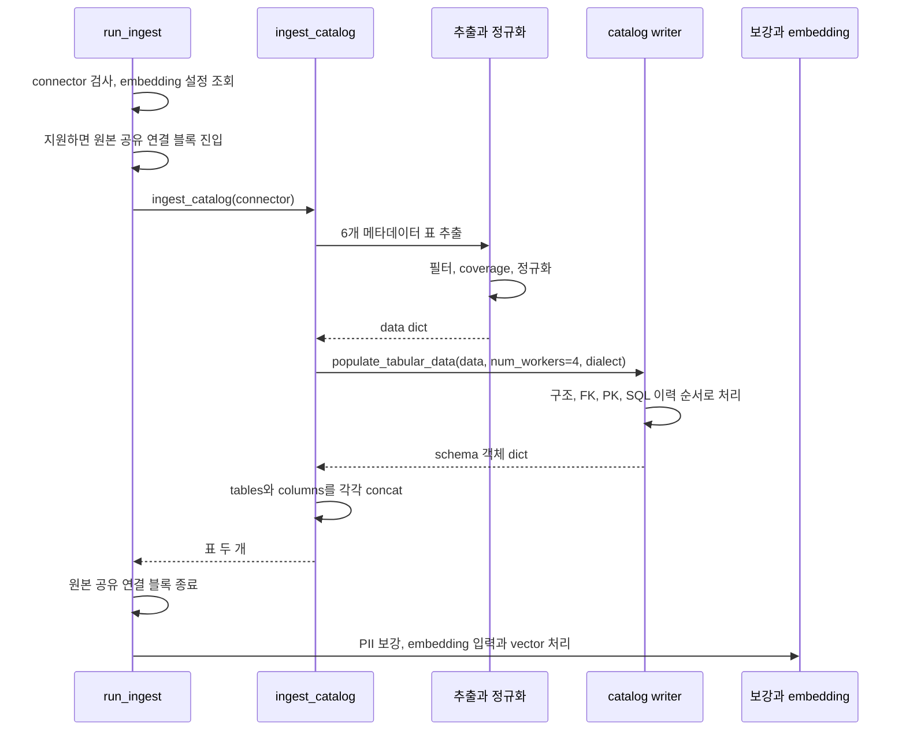
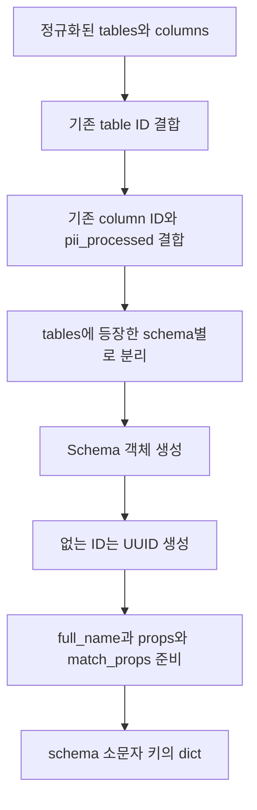
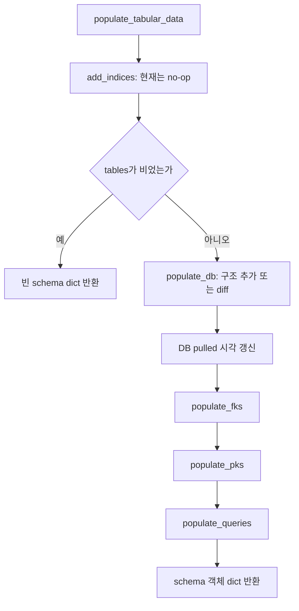
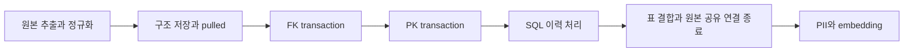

# Chapter 02. 추출·정규화에서 catalog 저장 입력까지

`run_ingest()`는 connector에서 구조를 추출하고, 저장용 표로 정규화한 뒤 schema별 catalog를 갱신한다. catalog는 수집한 DB 구조를 보관하는 목록이다. 그 결과의 테이블·컬럼 표 두 개를 개인 식별 정보 분류와 embedding 단계에 넘긴다. embedding은 검색할 정보를 숫자 벡터(vector)로 표현하는 작업이다. **원본 구조 조회 성공, catalog 저장 성공, 검색용 vector 갱신 성공은 서로 다른 단계다.**

이 장은 로컬 소스·테스트의 정적 분석이다. 서비스·DB·모델·테스트는 실행하지 않았다. [수집 시작·예약](chapter-01-ingestion-scheduling-and-triggers.md), [connector 공통 계약](../03-connectors/chapter-01-common-contract.md), [catalog 엔티티](../02-data-model/chapter-01-catalog-entities.md), [저장 경계](../02-data-model/chapter-04-storage-boundaries.md), [용어집](../01-architecture/chapter-00-glossary.md)을 함께 참고한다. 차이 비교 알고리즘과 embedding 세부 처리는 후속 chapter로 나눈다.

## 1. 함수별 입력·출력과 책임

connector는 원본 DB의 구조 조회·SQL 실행 객체다. DataFrame은 이름이 있는 열과 행으로 구성한 표이며, 정규화는 engine마다 다른 값을 저장에 필요한 공통 형태로 맞추는 작업이다.

| 함수 | 입력 → 출력 | 담당 경계 |
| --- | --- | --- |
| `run_ingest(connector)` | connector → 반환값 없음 | catalog 수집 뒤 보강·embedding·vector 쓰기까지 진행 |
| `ingest_catalog(connector)` | connector → `(tables_df, columns_df)` | 구조 추출·저장 호출·schema별 반환 표 합치기 |
| `extract_tabular_db_data(connector)` | connector → data dict | 추출 진입점. connector가 None이면 `{}` |
| `create_dataframe(connector)` | connector → 표 6개 tuple | 원본 조회·테이블 필터·컬럼 존재 검사 |
| `data_for_populate_tabular(connector)` | connector → data dict | 표 6개 조회, tables·columns 정규화, DB 이름 결합 |
| `populate_tabular_data(data, 4, dialect)` | data dict → schema 객체 dict | 구조 → FK → PK → SQL 이력 저장 조율 |
| `schemas_parser.parse_df()` | tables·columns → `(schemas, db_node)` | 기존 ID 결합과 schema별 메모리 객체 구성 |

schema는 원본 DB에서 테이블을 묶는 이름 공간이다. 여기서 `Schema` 객체는 schema 하나의 테이블·컬럼·연결 정보를 모은 **메모리 집합 객체**이며 DB에 쓰는 트랜잭션 자체가 아니다.

근거: [run_ingest](../../../code/auto-ontology/auto_ontology/ingestion_service/ingest.py), [ingest_catalog](../../../code/auto-ontology/auto_ontology/catalog/ingest.py), [extract](../../../code/auto-ontology/auto_ontology/catalog/extract.py), [write](../../../code/auto-ontology/auto_ontology/catalog/write.py).

## 2. 실제 호출 순서와 공유 연결의 범위

PII(Personally Identifiable Information)는 개인 식별이 가능한 정보다. 아래 흐름의 보강은 컬럼에 PII 분류 정보를 붙이는 후속 처리다.



`run_ingest()`는 먼저 `get_embed_params()`를 호출한다. 설정 처리에서 예외가 나면 catalog 호출에 도달하지 않는다. 이 단계가 끝나면 `_shared_connection()` 안에서 ingest_catalog 전체를 실행한다.

connector에 `reuse_connection()` 훅이 없으면 이 블록은 별도 연결을 만들지 않는다. 훅이 있으면 그 context를 사용한다. 실제 블록은 메타데이터 추출뿐 아니라 **catalog writer와 반환 표 결합까지** 감싼다. 따라서 원본 공유 연결이 catalog 저장 중에도 열려 있을 수 있다.

원본 공유 연결과 catalog 저장소 연결은 별개다. 이 블록이 원본 DB·catalog·vector를 하나의 트랜잭션으로 묶지는 않는다. `run_ingest()`가 connector 자체를 close하지 않는 이유는 scheduler·Registry가 그 객체를 소유하기 때문이다.

## 3. 원본에서 받은 표 6개가 저장 dict가 된다

호출 순서는 `get_tables → get_columns → get_views → get_queries → get_pks → get_fks`다. 하나가 실패하면 아직 필터·정규화·writer를 실행하지 않은 상태에서 예외가 전파될 수 있다. tables가 비었다고 나머지 조회를 즉시 생략하는 분기는 없다.

| data 키 | 내용 | 공통 정규화 여부 |
| --- | --- | --- |
| database_name | connector가 보고한 DB 식별 이름 | 그대로 |
| tables | schema·테이블 이름·타입 등 | normalize_tables |
| columns | 컬럼 이름·타입·nullable·순번 등 | normalize_columns |
| views | view 이름과 정의 | 이 경로는 정규화하지 않음 |
| queries | SQL 이력과 시각 | 이 경로는 정규화하지 않음 |
| pks | 기본 키 컬럼·키 내부 순서 | 이 경로는 정규화하지 않음 |
| fks | 외래 키의 원본·참조 컬럼 | 이 경로는 정규화하지 않음 |

view는 SQL로 정의한 조회 객체다. PK(Primary Key)는 기본 키, FK(Foreign Key)는 다른 테이블의 컬럼을 참조하는 외래 키다. 엔진별로 이 표들의 내용과 지원 정도가 다르며 앞선 connector chapter에서 구분했다.

### 3.1 테이블 필터 다음에 coverage를 검사한다

테이블 allow/deny 정규식은 tables·columns·views에 함께 적용된다. allow는 포함 조건, deny는 제외 조건이다. PK·FK·queries는 이 필터 함수의 입력이 아니다.

coverage는 tables에 있는 `(schema, table)`마다 columns에 **컬럼 행이 하나 이상 있는지** 확인한다. 테이블에 컬럼이 아예 없으면 저장 전에 예외를 낸다. 다음을 보장하는 검사는 아니다.

- 원본의 모든 컬럼을 빠짐없이 가져옴.
- 모든 컬럼에 이름·타입이 올바르게 채워짐.
- views 단독 목록과 columns가 전부 일치함.
- 키·쿼리 이력이 완전하고 정확함.
- 원본 테이블의 실제 값 조회가 성공함.

알 수 없는 extra 컬럼 행을 이 검사 하나가 전부 거부하지도 않는다. 이후 Schema가 tables에 속하지 않는 컬럼을 거르는 경로와 구분한다.

### 3.2 정규화는 필드 보충·형 변환이며 원본 조사 자체가 아니다

| 대상 | 실제 처리 |
| --- | --- |
| tables 누락 필드 | table_schema·table_name·table_type·created·description 보충 |
| table_type 결측 | base table로 채움 |
| created | UTC datetime으로 변환하고 초보다 작은 부분 제거 |
| owner | 존재하면 제거. 그 밖의 모든 extra 필드를 일괄 삭제하는 코드는 아님 |
| columns 누락 필드 | schema·table·column·ordinal·data_type·nullable·description 보충 |
| ordinal_position | 숫자로 변환 후 nullable Int16 dtype |
| is_nullable | YES/NO·True/False 등 인식 값을 boolean으로, 결측은 미확인으로 유지 |

nullable은 해당 컬럼에 NULL, 즉 값 없음 상태가 허용되는지를 뜻한다. 모르는 값은 False로 추정하지 않는다. `maybe`처럼 인식하지 못하는 nullable 값은 ValueError다. 정규화의 타입 변환·날짜 해석에서 생긴 예외도 writer 전에 전파된다.

공통 필드에 `pd.NA`를 추가했다고 필수 이름까지 정상 검증된 것은 아니다. 실제 이름이 없는 행·이상한 순번·넓은 테이블의 Int16 범위는 별도로 확인할 조건이다. 또한 비어 있는 입력은 필드만 있는 빈 표로 반환하며, 비어 있지 않은 입력과 동일한 dtype 변환을 모두 수행하는 것은 아니다.

근거: [추출·coverage](../../../code/auto-ontology/auto_ontology/catalog/extract.py), [정규화](../../../code/auto-ontology/auto_ontology/catalog/normalize.py), [table filter](../../../code/auto-ontology/auto_ontology/catalog/table_filter.py).

## 4. schema 분리 전에 기존 ID를 결합한다

`populate_db()`는 `schemas_parser.parse_df()`를 호출한다. 이 parser의 순서는 다음과 같다.

1. DB 이름을 가진 CatalogNode를 만든다. 이것만으로 DB에 저장되는 것은 아니다.
2. `get_table_ids()`가 같은 DB의 기존 table ID를 읽어 `(table_schema, table_name)`으로 left merge한다.
3. `get_column_ids()`가 `(table_schema, table_name, column_name)`으로 기존 column ID·pii_processed를 결합한다.
4. tables에 등장하는 schema 이름별로 tables·columns를 나눈다.
5. 각 `Schema`를 만들고 schema node를 연결한다.
6. 결과 dict의 키를 schema 이름의 소문자로 저장한다.

left merge는 새 추출 표의 행을 기준으로 기존 저장 정보를 덧붙이는 결합이다. 입력에 있던 대소문자 이름을 이 merge가 모두 소문자로 맞추는 것은 아니다. ID 매칭·이름 충돌의 전체 정책은 diff chapter에서 추적한다.



### 4.1 Schema에서 표에 추가하는 값

| 값 | 목적 |
| --- | --- |
| id | 기존 ID가 있으면 사용, 없으면 UUID 생성. UUID는 객체 식별용 고유 문자열 |
| table_name_lower·column_name_lower | 내부 이름 비교·조회 보조 |
| full_name | schema.table 또는 schema.table.column 형태의 설명용 전체 이름 |
| props | DB에 기록할 원본 소유 속성 dict |
| match_props | 주로 id를 담은 저장 매칭 입력 |
| pii_processed | 기존 개인 식별 정보 분류 상태의 후속 활용 |

Schema는 먼저 자신이 가진 tables의 이름 목록에 속한 columns만 남긴다. 따라서 columns에만 존재하는 table은 자동으로 새 catalog table이 되지 않는다. schema 순회도 tables 기준이므로 columns에만 있는 schema는 별도로 만들어지지 않는다.

저장 props를 만들 때 nullable·ordinal·description 등의 pandas 결측값을 Python None으로 바꾼다. 값이 있는 nullable은 bool, 순번은 int로 바꾼다. 정규화와 DB driver에 넘길 속성 생성이 두 단계로 나뉜 것이다.

schema dict의 소문자 키 때문에 원본에 대소문자만 다른 두 schema가 있다면 키가 겹칠 수 있다. 원본별 허용 여부와 실제 손실·식별 결과는 미재현 검증 항목이다. 이 chapter에서 모든 case-sensitive 이름을 안전하게 보존한다고 보장하지 않는다.

근거: [schemas_parser](../../../code/auto-ontology/auto_ontology/catalog/parsers/schemas_parser.py), [Schema](../../../code/auto-ontology/auto_ontology/catalog/model/schema.py), [ID 조회·결합](../../../code/auto-ontology/auto_ontology/catalog/store/schemas.py).

## 5. 최초 저장과 재수집의 진입 조건

`db_exists(db_node)`는 DB 행의 ID와, 그 아래 schema 행이 하나라도 있는지를 반환한다. 여기서 loaded는 완료 상태나 embedding 존재 여부가 아니다.

| 저장소 상태 | populate_db 경로 |
| --- | --- |
| DB 행 없음 | 새 schema 저장 경로 |
| DB 행은 있지만 schema 없음 | 기존 DB ID를 재사용하고 새 schema 저장 |
| schema가 하나 이상 있음 | schema 추가·갱신·삭제 비교 경로 |

연결을 미리 등록해 DB 행만 있는 상태가 두 번째 경우다. 한 schema만 부분 저장된 상태도 loaded=True일 수 있으므로 다음 재수집이 diff 경로로 들어간다는 점을 구분한다.

최초 저장 경로는 schema를 순서대로 `add_schema()`에 전달한다. 이 함수는 다음의 일을 한다.

- DB→schema 연결을 저장한다.
- table·column의 props를 최대 500개 단위로 준비·처리한다.
- schema→table 연결을 처리한다.
- table→column 연결을 ThreadPoolExecutor로 처리한다.

PendingRows는 부모 ID가 확인될 때까지 자식 행의 props를 잠시 보관하는 객체다. 그 schema 저장 호출에 한정해서 만들며 전역 저장 buffer가 아니다. 연결을 기록하는 단계가 자식 행을 실제 upsert하는 시점일 수 있으므로, “node 준비 루프가 끝남”을 모든 컬럼 저장 완료로 해석하지 않는다. upsert는 있으면 갱신하고 없으면 추가하는 저장 방식이다.

재수집 경로는 새 schema를 추가한 뒤 기존 schema를 worker에서 갱신하고, 빠진 schema를 삭제한다. 세부 table·column diff, 삭제 후 의미 계층 참조 정리는 Chapter 03의 범위다.

### 5.1 num_workers=4는 DB 네 개 병렬 수집이 아니다

`ingest_catalog()`는 writer에 num_workers=4를 전달한다. 이것은 schema 갱신·table-column 연결·query 저장 같은 내부 작업의 thread pool 크기에 사용된다. [이전 chapter](chapter-01-ingestion-scheduling-and-triggers.md)의 DataScheduler DB 순회는 여전히 순차다.

schema 갱신·새 schema의 table-column 연결에서는 `list(executor.map(...))`로 결과를 소비한다. worker 예외를 숨기지 않고 호출자에게 다시 전달하기 위한 코드다. **예외 전파는 전체 롤백과 다르다.** 다른 worker가 이미 저장했거나 executor 정리 중 작업을 마칠 수 있으며, 첫 예외만으로 전체 상태가 이전으로 돌아가지는 않는다.

## 6. 구조 저장 다음에 FK·PK·SQL 이력을 처리한다



`add_indices()`는 이름과 달리 현재 아무 DB 변경도 하지 않는다. 인덱스는 저장소 schema 관리에서 생성하도록 분리되어 있다. 이 함수가 먼저 호출돼도 원본 수집 때마다 인덱스를 다시 만드는 것은 아니다.

### 6.1 키 필드는 “존재하는가”로 호출한다

정상 추출 dict에는 fks·pks·queries 키가 항상 들어간다. writer는 해당 키가 있는지 확인하고 함수를 호출하며, 표가 비었는지를 호출 조건으로 삼지 않는다.

| 단계 | 실제 처리·단위 |
| --- | --- |
| FK | 새 키에 last_seen을 기록해 추가하고 오래된 키 정리. 이 두 작업은 write_transaction 한 묶음 |
| PK | DB의 기존 PK 값을 reset한 뒤 새 PK 컬럼 기록. 두 작업은 별도 write_transaction 한 묶음 |
| queries | SQL 이력 해석·참조 저장. 실패 항목 목록을 반환하지만 상위 writer는 그 반환값을 사용하지 않음 |

빈 PK 표라도 구조 저장이 진행된 경우 reset_pks는 실행되고 add_pks는 추가할 행이 없어 반환한다. **“키 미지원으로 빈 표”와 “기존 키 보존”은 같은 동작이 아니다.** 빈 FK 표도 add는 하지 않지만 stale-key 정리 단계는 실행된다. 세부 보존 조건·복합 키 순서·SQL 중복은 다음 chapter에서 확인한다.

queries 저장은 개별 persistence future의 예외를 기록하고 계속하는 경로가 있다. 따라서 populate_tabular_data가 정상 반환했다고 SQL 이력 전부가 성공 저장되었다는 뜻은 아니다. None 같은 잘못된 직접 입력까지 공통적으로 보정하는 writer도 아니다. 예를 들어 queries 함수는 len·empty를 바로 사용한다.

### 6.2 views는 받지만 이 writer가 정의를 저장하지 않는다

data dict에는 views가 있지만 `populate_tabular_data()`는 그 키를 별도 저장 단계에서 읽지 않는다. tables에 이미 포함된 view의 table_type과, views 표의 definition은 구분한다. view definition을 여기서 자동 병합한다고 가정하지 않는다.

그럼에도 추출 단계는 get_views를 호출하므로, writer가 쓰지 않는 정의 조회의 예외가 수집 전체를 저장 전에 막을 수 있다. 수집한 필드와 실제 소비한 필드를 각각 추적해야 하는 이유다.

### 6.3 pulled는 전체 run_ingest 완료 표시가 아니다

`latest_timestamp`는 populate_db에서 UTC 초 단위로 만들고 구조 처리 뒤 DB pulled에 기록한다. **FK·PK·SQL 이력 및 보강·embedding 단계보다 앞**이다. 따라서 pulled가 바뀌었는데 뒤 단계가 실패하는 상태가 가능하다. 이 timestamp 하나로 vector 최신화나 전체 파이프라인 성공을 판단하지 않는다.

근거: [writer의 순서](../../../code/auto-ontology/auto_ontology/catalog/write.py), [loaded·pulled 처리](../../../code/auto-ontology/auto_ontology/catalog/store/db.py), [PK/FK 저장](../../../code/auto-ontology/auto_ontology/catalog/store/schemas.py), [SQL 이력 저장](../../../code/auto-ontology/auto_ontology/catalog/sql_parse.py), [인덱스 no-op](../../../code/auto-ontology/auto_ontology/catalog/store/indexes.py).

## 7. 빈 입력은 어느 단계에서 멈추는가

| 조건 | 실제 처리 | 기존 catalog |
| --- | --- | --- |
| run_ingest(None) | ValueError | 이 함수의 저장 호출 없음 |
| ingest_catalog(None) | 빈 tables·columns 쌍 반환 | writer 호출 없음 |
| extract_tabular_db_data(None) | 빈 dict | writer 호출 여부는 호출자 책임 |
| 추출 dict 자체가 비었음 | ingest_catalog가 빈 쌍 반환 | writer 호출 없음 |
| 정상 dict인데 tables가 0행 | writer가 빈 schema dict 반환 → ingest_catalog가 빈 쌍 | 구조 diff·FK/PK/queries 처리 건너뜀 |
| 테이블 필터가 전부 제외함 | 최종 tables 0행 경로 | 전부 삭제로 해석하지 않음 |
| tables는 있으나 어느 테이블의 columns가 0행 | coverage 예외 | writer에 도달하지 않음 |

중요한 차이는 **일부 테이블을 남겨 둔 비어 있지 않은 목록과 전체가 빈 목록의 처리**다. 전자는 diff를 수행할 수 있지만 후자는 저장을 건너뛴다. 그러므로 “필터로 모두 제외하면 기존 catalog도 전부 지워진다”고 설명하면 틀린다. 일부 제외·누락 schema의 구체적인 삭제 정책은 Chapter 03에서 이어간다.

빈 표를 반환받았다고 run_ingest가 즉시 끝나는 것도 아니다. 이 함수는 이후 PII 설정 확인과 embedding 입력 생성 경로로 계속 간다. 빈 입력의 vector 보존·reset 여부는 Chapter 04에서 실제 소비자와 함께 확인한다.

## 8. 후속 단계에 반환하는 두 표

`ingest_catalog()`는 writer가 반환한 schemas의 tables_df·columns_df를 각각 모아 `pd.concat(ignore_index=True)`한다. 값이 None인 frame만 제외하며, 비어 있는 DataFrame은 None과 다른 값이다.

```text
설명용 tables 결과
id       | table_schema | table_name | full_name
table-A  | sales        | orders     | sales.orders
table-B  | archive      | orders     | archive.orders

설명용 columns 결과
id       | table_schema | table_name | column_name
column-A | sales        | orders     | id
column-B | archive      | orders     | id
```

같은 orders 이름이라도 table_schema가 행에 남아 구분된다. 후속 CatalogEmbeddingRowsOp도 schema·table을 기준으로 컬럼을 묶는다. 여기서 표를 하나로 합치는 것과 두 schema를 같은 테이블로 병합하는 것은 다르다.

반환 표는 parser와 Schema가 ID·props 등을 준비한 입력 집합을 기반으로 한다. **저장소 전체를 다시 읽은 완전한 snapshot이 아니다.** snapshot은 특정 시점의 일관된 상태를 뜻한다. 부분 저장 오류가 발생하면 이 정상 반환에 도달하지 않을 수 있고, 저장 중 일부 오류를 내부에서 처리했다면 함수 반환만으로 모든 부속 객체의 최신 상태를 보장할 수도 없다.

이 두 표는 run_ingest에서 PII 보강, embedding용 텍스트 구성에 사용된다. PII는 개인 식별 가능 정보이며 여기서는 컬럼 metadata를 분류·태그하는 작업이다. embedding은 검색에 쓸 숫자 벡터 표현이다. 실제 텍스트·chunk·vector 교체는 Chapter 04에서 분석한다.

근거: [반환 표 결합](../../../code/auto-ontology/auto_ontology/catalog/ingest.py), [embedding 입력 계약](../../../code/auto-ontology/auto_ontology/utils/embedding_rows.py).

## 9. 실패 시점과 남을 수 있는 상태



| 실패 시점 | 아직 하지 않은 것 | 이미 남을 수 있는 것 |
| --- | --- | --- |
| 추출·coverage·정규화 | 이 writer의 catalog 쓰기 전부 | 이 수집 호출이 쓰기 전에 중단 |
| schema A 저장 후 B 실패 | 나머지 schema·키·queries·후속 단계 | A와 B의 일부 catalog 쓰기 |
| diff worker 중 하나 실패 | 이후 삭제·pulled·키 단계에 못 갈 수 있음 | 다른 worker와 앞선 쓰기 |
| FK 단계 실패 | PK·queries·후속 단계 | 구조·pulled. FK 묶음은 rollback 대상 |
| PK 단계 실패 | queries·후속 단계 | 구조·pulled·앞 FK transaction. PK reset+add는 함께 rollback 대상 |
| SQL 이력의 처리되지 않은 예외 | 표 반환·보강·embedding | 구조와 키, 앞서 저장한 SQL 일부 |
| concat 또는 공유 연결 종료 실패 | 후속 보강·embedding | catalog 쓰기는 이미 끝났을 수 있음 |
| 후속 embedding 실패 | 전체 run 완료 | catalog는 이미 변경됨 |

트랜잭션은 여러 DB 작업을 전부 확정하거나 취소하도록 묶는 단위다. `populate_fks`, `populate_pks`, 일부 부모·자식 저장처럼 **국소적인 transaction**은 있지만 이 전체 호출에 하나의 외부 write_transaction은 없다. DAL은 활성 transaction이 없으면 개별 문장을 autocommit한다. thread worker 전체가 같은 transaction을 자동 공유하는 구조도 아니다.

따라서 worker 예외를 전파하고 성공 로그를 남기지 않는 것과, 모든 저장을 원상 복구하는 것은 다르다. 원본 DB를 읽는 공유 연결도 이 catalog transaction을 대신하지 않는다. 실제 rollback·동시 수집·재실행 복구는 후속 diff·부분 실패 chapter와 실행 검증으로 인계한다.

근거: [DAL transaction](../../../code/auto-ontology/auto_ontology/dal/session.py), [schema 저장](../../../code/auto-ontology/auto_ontology/catalog/services/schema.py), [writer](../../../code/auto-ontology/auto_ontology/catalog/write.py).

## 10. 테스트 근거와 아직 확인하지 않은 범위

| 테스트 파일 | 확인한 assertion·범위 |
| --- | --- |
| `test_ingest.py` | connector 없음·빈 추출 dict·writer가 빈 schemas 반환 → 빈 표 쌍. 여러 schema의 ID·schema를 보존해 concat, num_workers=4·dialect 전달, None frame 제외 |
| `test_extract.py` | 빈 catalog 허용, 누락 컬럼 relation의 coverage 예외, 결측 relation 이름 처리 |
| `test_table_filter.py` | table·column 동시 필터, deny 우선, 공통 추출에 필터 전달 |
| `test_normalize_nullable.py` | YES/NO·boolean·결측 변환, 모르는 값 예외, nullable dtype과 missing 유지 |
| `test_completion_logs.py`의 run_ingest 테스트 | 추출 실패 시 성공 로그 없음, catalog→PII→전파→embedding 순서, 보강 실패 경계 |

`test_returns_empty_pair_when_extraction_yields_nothing`의 설명은 테이블이 없으면 writer에 가지 않는다고 적지만 실제 mock은 `{}`다. **정상 data dict 안의 빈 tables** 경로는 writer까지 호출한 뒤 그 안에서 반환한다. 테스트 설명을 실제 호출 조건으로 확대하지 않는다.

이 테스트들은 대부분 추출·writer·보강을 대체한 단위 테스트다. 실제 여러 schema의 모든 저장·rollback·ID 매칭·worker 실패 전파를 한 번에 검증하는 end-to-end 결과는 아니다. 관련 incremental ingest 테스트는 실제 임시 원본 DB와 저장소를 요구하며, 여기서는 실행하지 않았다. 세부 assertion은 다음 diff chapter에서 확인한다.

근거: [ingest 계약 테스트](../../../code/auto-ontology/auto_ontology/catalog/tests/test_ingest.py), [coverage 테스트](../../../code/auto-ontology/auto_ontology/catalog/tests/test_extract.py), [필터 테스트](../../../code/auto-ontology/auto_ontology/catalog/tests/test_table_filter.py), [nullable 정규화 테스트](../../../code/auto-ontology/auto_ontology/catalog/tests/test_normalize_nullable.py), [보강·로그 테스트](../../../code/auto-ontology/auto_ontology/ingestion_service/tests/test_completion_logs.py).

다음은 실제 diff다. 기존 ID와 이름 매칭, table·column 추가·변경·삭제, 부분 제외와 전체 빈 입력의 차이, 키·SQL 이력·의미 계층 참조가 어떻게 갱신되는지 작은 이전/이후 예시로 추적한다. [수집 세부 계획](../../../.codex/plan/auto-ontology/01-4_catalog-ingestion.md) Chapter 03에서 이어간다.
