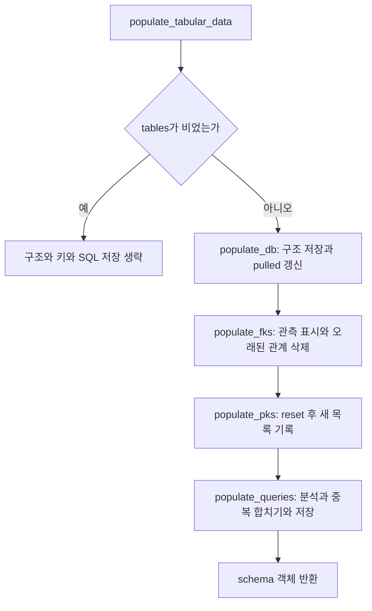
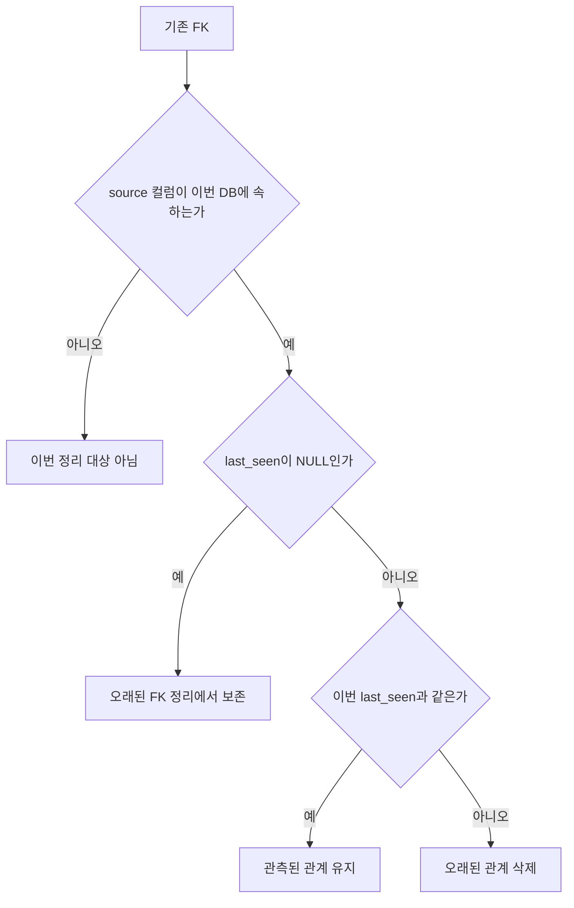
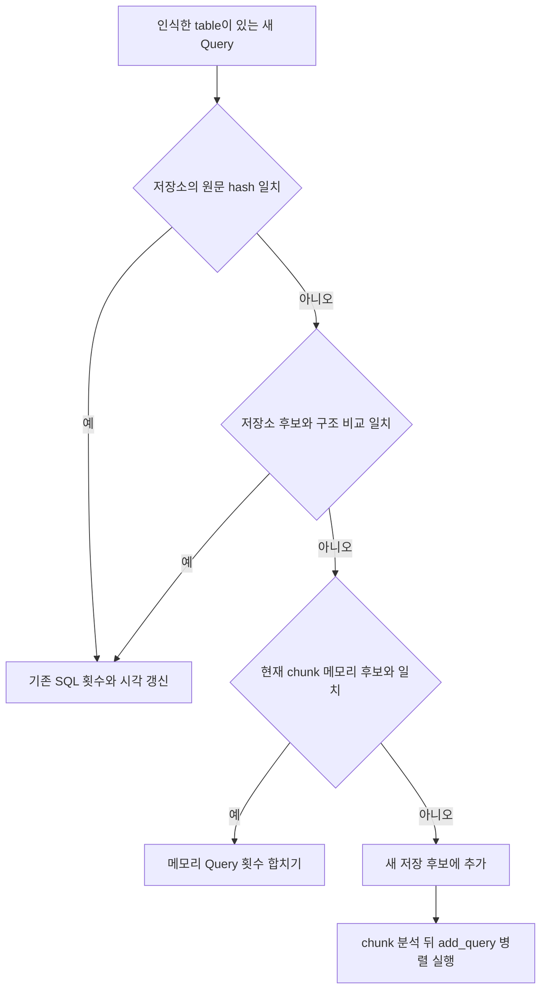
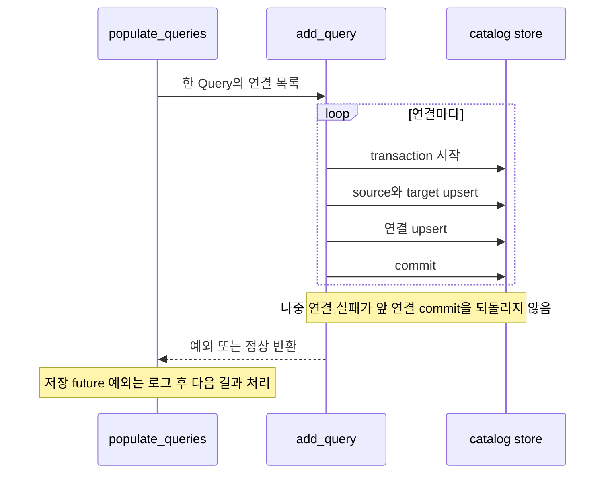

# Chapter 03-1. PK·FK 갱신과 SQL 이력의 저장·중복·실패

구조 저장이 끝나면 기본 키, 참조 키, SQL 이력을 처리한다. **PK는 DB 범위에서 다시 채우고, FK는 이번 수집에서 본 관계를 표시해 정리하며, SQL은 기존 문장과 비교해 합친다.** 세 작업은 같은 갱신 알고리즘이나 하나의 트랜잭션을 공유하지 않는다.

PK(Primary Key)는 행을 식별하는 기본 키, FK(Foreign Key)는 다른 컬럼을 참조하는 키다. 복합 키는 컬럼 여러 개를 함께 사용하는 키다. SQL 이력은 원본 DB에서 사용한 SQL 문장과 관측 시각·횟수다. 이 경로는 이력 SQL을 원본 DB에서 재실행하지 않고 문장을 분석한다.

이 문서는 로컬 코드와 테스트 assertion, 즉 테스트가 검사하는 조건을 읽은 정적 분석이다. 실제 DB·모델·서비스·테스트는 실행하지 않았다. [구조 diff](chapter-03-catalog-diff-and-relations.md), [저장 입력](chapter-02-extraction-to-catalog-write.md), [SQL 저장 모델](../02-data-model/chapter-03-sql-and-analysis-definitions.md), [용어집](../01-architecture/chapter-00-glossary.md)을 함께 참고한다.

## 1. 전체 호출 순서와 입력



각 단계는 data dict에 해당 키가 있을 때 호출한다. 정상 추출 dict에는 fks·pks·queries가 모두 있으므로, 표가 비어 있어도 호출에 진입한다. 단, tables 전체가 비면 이 단계 전부를 건너뛴다.

| 입력 | 주요 필드 | 소비 방식 |
| --- | --- | --- |
| pks | table_schema·table_name·column_name, 선택 ordinal_position | DB table의 pk 배열 |
| fks | table_schema·table_name·column_name·referenced_schema·referenced_table·referenced_column | column ID 쌍과 last_seen |
| queries | query_text·end_time, 선택 count | Query 객체·참조·통계 |
| schemas | schema 이름 → Schema 객체 | SQL 이름을 catalog의 table·column ID로 연결 |
| dialects | 실제 호출은 `[connector.dialect]` | SQL 문법 해석·비교 |

dialect는 DB마다 다른 SQL 문법이다. `Schema`는 수집한 테이블·컬럼과 ID를 묶은 메모리 객체다. 키 필드와 SQL 표에는 tables·columns와 같은 공통 정규화를 적용하지 않으므로, 엔진별 반환 계약과 잘못된 직접 입력을 구분해야 한다.

근거: [write.py](../../../code/auto-ontology/auto_ontology/catalog/write.py), [extract.py](../../../code/auto-ontology/auto_ontology/catalog/extract.py).

## 2. PK: 초기화한 다음 복합 키 순서대로 기록한다

`populate_pks()`는 `write_transaction()` 안에서 `reset_pks → add_pks`를 실행한다. 트랜잭션은 작업들을 함께 확정하거나 취소하는 묶음이다. reset은 특정 입력 table만이 아니라 **해당 DB에 속한 모든 catalog table의 pk를 NULL로 만든다.** NULL은 값이 없는 상태다.

add_pks의 순서는 다음과 같다.

1. 빈 표·None이면 추가 작업 없이 반환한다. 상위 reset을 되돌리는 반환은 아니다.
2. DB 안의 `(schema, table) → table ID`를 한 번에 읽는다.
3. ordinal_position이 있으면 숫자로 바꾸고 안정 정렬한다. 숫자로 바꿀 수 없는 값은 결측값이 된다.
4. 각 행을 table ID별 컬럼 이름 목록으로 묶는다. table을 못 찾으면 그 행을 건너뛴다.
5. `UPDATE ... FROM (VALUES ...)`로 각 table의 pk 배열에 목록을 붙인다. reset 뒤에는 빈 배열에서 시작하는 효과다.

안정 정렬은 순서 값이 같은 행끼리 입력 순서를 유지하는 정렬이다. 위치 필드가 아예 없으면 입력 순서를 사용한다. 결측 위치는 기본 정렬에서 뒤로 가므로, 일부만 위치가 있는 입력을 완전한 키 순서로 복구한다고 보장하지 않는다.

### 2.1 컬럼의 테이블 내 위치와 키 내 위치는 다르다

```text
테이블 컬럼 순서: item_id, order_id
기본 키 선언: PRIMARY KEY (order_id, item_id)

PK 입력 행:
item_id   ordinal_position=2
order_id  ordinal_position=1

저장 pk: [order_id, item_id]
```

여기서 ordinal_position은 기본 키 안의 위치다. columns 표에서 쓰는 테이블 전체 컬럼 순번과 같은 값이라고 가정하면 안 된다.

PK writer는 table 이름을 찾아 연결하지만, 각 column_name이 catalog_column에 실제로 있는지 다시 조회하지 않는다. 중복 PK 행도 명시적으로 제거하지 않고 목록에 append한다. 잘못된 컬럼 이름·중복 행·누락 위치는 connector 계약 또는 추가 검증이 필요한 조건이다.

### 2.2 빈 입력과 함수 직접 호출

| 조건 | 결과 |
| --- | --- |
| 정상 구조 + 빈 PK 표 | reset은 실행되므로 해당 DB pk는 NULL로 남음 |
| PK table 이름 불일치 | 그 행은 추가 안 됨. reset된 다른 값은 자동 복원되지 않음 |
| reset 후 add에서 예외 | PK 트랜잭션 전체 rollback 대상 |
| tables 전체가 빈 수집 | 상위 writer가 건너뛰어 PK reset도 하지 않음 |
| add_pks만 직접 반복 호출 | reset을 하지 않으므로 배열 추가가 누적될 수 있음 |

따라서 “PK 미지원으로 빈 표”가 기존 PK 보존을 뜻하지 않는다. 정상 수집에서 두 작업을 묶어 부르는 계약이 중요하다. PK 실패가 이미 끝난 구조·FK 변경까지 취소하지도 않는다.

근거: [populate_pks](../../../code/auto-ontology/auto_ontology/catalog/write.py), [reset_pks·add_pks·이름 조회](../../../code/auto-ontology/auto_ontology/catalog/store/schemas.py), [pk 배열 정의](../../../code/auto-ontology/auto_ontology/dal/schema.py).

## 3. FK: column ID 쌍에 이번 관측 시각을 찍는다

`populate_fks()`는 UTC 현재 시각 last_seen을 하나 만들고, 같은 트랜잭션에서 `add_fks → delete_old_fks`를 실행한다. last_seen은 이 수집에서 관계를 봤다는 표시다.

add_fks는 해당 DB의 `(schema, table, column) → ID` 사전을 한 번 읽고 입력의 양 끝을 찾아 연결한다. 한쪽이라도 없으면 그 FK 행을 건너뛴다. 두 끝 모두 같은 DB 이름으로 조회한 사전에서 찾으므로, 이 함수가 다른 DB의 target을 따로 찾아 연결하지는 않는다.

같은 `(source ID, target ID)`가 입력에 반복되면 Python set으로 제거한다. 이어서 한 INSERT에 모아 쓰고, 같은 쌍이 이미 있으면 last_seen만 갱신한다. upsert는 있으면 갱신하고 없으면 추가하는 저장 방식이다.

이 저장 구조에는 제약 이름·복합 FK의 그룹 ID·키 내부 위치가 없다. 복합 참조가 여러 컬럼 쌍으로 저장될 수 있지만, 각 쌍만으로 원래 하나의 복합 제약이었는지 복원한다고 보장할 수는 없다.

### 3.1 오래된 FK 삭제는 세 조건을 모두 사용한다



이 비교는 “현재 시각보다 과거인가”가 아니라 **이번 값과 다른가**다. 다른 DB의 source를 가진 관계는 삭제하지 않는다. 다만 같은 DB를 동시에 수집하면 서로 다른 last_seen을 사용하므로, 한쪽 정리가 다른 수집의 관계를 오래된 것으로 볼 가능성은 남는다. 이 트랜잭션이 DB별 수집 lock을 제공하는 것은 아니다.

모델 import는 FK 양 끝 ID를 쓰면서 last_seen을 주지 않는다. 새 import 관계가 NULL이면 위 정리에서 보존된다. 하지만 같은 쌍을 원본 수집에서도 발견해 last_seen을 채우면 이후에는 관측 여부에 따른 정리 대상이 된다. “import한 FK는 항상 영구 보존”이라는 정책이 아니다. 컬럼 자체 삭제에 따른 cascade도 별개다. cascade는 부모 삭제를 따라 연결 행이 함께 삭제되는 DB 동작이다.

### 3.2 빈 표와 필터의 영향

빈 FK 표는 add를 생략해도 delete_old_fks를 실행한다. 해당 DB의 last_seen이 채워진 기존 관계는 이번 값으로 갱신되지 않았으므로 정리 대상이다. NULL 관계는 남는다.

table 필터는 추출 단계에서 tables·columns·views에 적용하지만 fks 표에는 직접 적용하지 않는다. 최종 구조에 없는 endpoint는 ID 조회에서 찾지 못해 건너뛰고, 구조 삭제 시 연결이 cascade될 수 있다. 따라서 저장되는 FK는 원본 FK 표의 행 수와 같다고 볼 수 없다.

설명용 예시:

| 기존 관계 | 이번 입력 | 결과 |
| --- | --- | --- |
| orders.customer_id → customer.id, 이전 last_seen 있음 | 같은 쌍 있음 | 이번 시각으로 갱신·유지 |
| orders.legacy_id → legacy.id, 이전 last_seen 있음 | 없음 | 이번 DB source이면 삭제 |
| import 관계, last_seen=NULL | 없음 | stale 정리에서는 보존 |
| import 관계, last_seen=NULL | 같은 쌍 있음 | 시각을 채워 관측 관리 대상이 됨 |

근거: [FK 쓰기·정리](../../../code/auto-ontology/auto_ontology/catalog/store/schemas.py), [트랜잭션](../../../code/auto-ontology/auto_ontology/catalog/write.py), [import 입력](../../../code/auto-ontology/auto_ontology/dal/model_interchange.py).

## 4. SQL 이력은 최대 500행씩 분석한다

`populate_queries()`는 queries 표를 최대 500행씩 나눈다. 각 chunk마다 저장된 SQL과 table·column 참조를 다시 읽고, 아직 저장하지 않은 새 Query들을 담는 dict를 만든다. chunk는 여기서 한 번에 처리할 입력 묶음이다.

한 행에서 `query_text`, `end_time`, 선택 `count`를 읽는다. count가 없으면 1이고 문자열이면 int로 바꾼다. Query 생성자는 end_time의 month·year 속성을 바로 읽으므로 문자열 날짜를 공통으로 파싱해 주는 계층은 아니다.

Query 객체는 새 UUID, 원문 SQL, total_counter, last_query_timestamp, 임시 월별 횟수, table ID와 연결 목록을 가진다. UUID는 생성한 고유 식별 문자열이다. 이력 SQL의 실제 실행 성공·현재 권한·실제 결과값을 검증하는 객체는 아니다.

### 4.1 parser가 반환하는 것

sqlglot은 SQL 문법 분석 라이브러리다. AST(Abstract Syntax Tree)는 SQL을 연산·표현식의 트리로 나눈 구조다. parser는 다음 단계를 수행한다.

1. 주어진 dialect들을 순서대로 시도해 SQL을 AST로 만든다. 이 수집 호출은 dialect 하나를 넘긴다.
2. CTE, 즉 WITH로 만든 임시 이름을 원본 table 목록에서 제외하고 table·alias를 찾는다.
3. 수집한 schema 정보를 이용해 컬럼이 어느 table에 속하는지 보강한다. alias는 SQL에서 table에 붙인 별칭이다.
4. 보강 optimizer가 실패하면 기존 AST로 계속한다. 모든 이름을 완벽히 해석했다는 뜻은 아니다.
5. 모호한 컬럼은 일반적으로 생략하고, JOIN USING 등에서 얻은 연결 정보로 보충할 수 있다.
6. 최종적으로 컬럼이 하나도 연결되지 않은 table 항목은 반환에서 제외한다.

마지막 조건 때문에 SQL에 FROM이 있다는 이유만으로 저장 후보가 되는 것은 아니다. `parse_query_slim()`이 catalog에서 인식한 table ID를 하나 이상 얻어야 한다. 문법 오류는 예외지만, 인식한 table이 없는 문장은 실패 목록에 넣지 않고 그냥 건너뛸 수 있다.

schema가 없는 table 이름은 보유 schemas를 순회하며 처음 찾은 것을 사용할 수 있다. 명시 schema를 못 찾을 때도 bare name으로 fallback하는 경로가 있어, 동명 table·잘못된 schema·대소문자를 완전하게 거부한다고 보장하지 않는다.

근거: [sql_parse.py의 Query 생성·parse_query_slim](../../../code/auto-ontology/auto_ontology/catalog/sql_parse.py), [Query 모델](../../../code/auto-ontology/auto_ontology/catalog/model/query.py), [sqlglot 추출 진입점](../../../code/auto-ontology/auto_ontology/catalog/parsers/sqlglot_extractor.py).

## 5. 분석 결과는 SQL 참조와 관측 관계다

| 연결 | 저장 테이블 | 의미 |
| --- | --- | --- |
| SQL → table | sql_query__table | 이 문장이 참조하는 table |
| SQL → column | sql_query__column | 이 문장에서 연결할 수 있었던 column |
| column → column JOIN | column__join | SQL에서 관측한 join 조건 |
| column → column UNION | column__union | 집합 연산에서 대응하는 column |

JOIN은 테이블을 조건으로 결합하는 SQL 연산이다. UNION은 결과 집합을 합치는 연산이며 extractor는 관련 집합 연산의 위치 대응도 분석한다. 이 장에서는 extractor 출력의 저장 계약에 집중하고, 복잡한 하위 질의·연산자별 추출 알고리즘은 의미 관계 단계에서 분석한다.

JOIN/UNION에는 `refs=["SQL ID|조건 문자열"]`를 붙인다. 예를 들어 orders.customer_id = customer.id의 관측 근거를 기록한다. 저장 시 기존 배열과 합친 뒤 중복 문자열을 제거하며 순서는 보존하지 않는다. 이 문자열의 SQL ID는 외래 키 제약이 아니므로 SQL 행 삭제와 동일한 자동 정리를 기대하면 안 된다.

**SQL의 JOIN을 관측했다고 DB의 FK 제약을 새로 만드는 것은 아니다.** FK는 column__foreign_key, SQL 관측은 column__join/union, 의미 계층에서 추론한 참조는 별도 semantic FK다. 모델 import가 사용하는 table__join도 별도 테이블이다.

근거: [연결 생성](../../../code/auto-ontology/auto_ontology/catalog/sql_parse.py), [LinkSpec](../../../code/auto-ontology/auto_ontology/catalog/store/registry.py), [참조 배열 저장](../../../code/auto-ontology/auto_ontology/catalog/store/queries.py), [실제 테이블 정의](../../../code/auto-ontology/auto_ontology/dal/schema.py).

## 6. 중복 판단은 세 단계다



### 6.1 원문 일치: DB 범위가 조건에 없다

`get_sql_by_full_query()`는 원문 양쪽에 md5 hash를 적용해 ID를 조회한다. hash는 문자열을 고정 길이 값으로 바꾸는 함수다. SQL 저장소의 고유 인덱스도 이 hash를 사용한다. 코드에서는 hash 일치를 원문 일치로 취급하며 추가 원문 비교·DB 이름 조건은 없다.

같은 SQL 문자열을 서로 다른 DB에서 수집하면 같은 저장 SQL을 찾을 수 있다. 이 경로는 횟수·시각만 갱신하고 바로 반환하므로 새 DB의 table·column 연결을 추가하는 작업까지 수행하지 않는다. 전역 SQL 중복 기준과 DB별 참조 완전성은 구분해야 한다. hash 충돌 처리도 별도로 없으며 실제 재현은 하지 않았다.

### 6.2 구조 일치: 후보 다섯 조건 다음 SQL 정규화

저장소 후보는 table ID 집합, column ID 집합, AST node 수, 추출한 join 수, union 수가 모두 같아야 한다. node 수는 트리 구성 요소의 개수로 빠른 후보 필터다. SQL 의미가 같다는 증명은 아니다.

이후 comparator는 SQL을 다시 파싱해 다음처럼 정규화한다.

- 상수 literal을 `?`로 바꾼다. literal은 숫자·문자열 같은 값 표현이다.
- 각 SELECT의 출력 표현식을 정렬해 순서 차이를 무시한다.
- 최종 SQL 문자열을 소문자로 바꿔 비교한다.
- table이 붙지 않은 따옴표 식별자를 상수처럼 바꾸는 휴리스틱도 있다. 실제 컬럼 이름을 잘못 취급할 위험은 별도 확인 대상이다.

따라서 다음 두 SQL은 다른 조건을 통과하면 같은 패턴으로 합칠 수 있다.

```sql
SELECT id, name FROM shop.customer WHERE region = 'KR';
SELECT name, id FROM shop.customer WHERE region = 'US';
```

실제 결과의 값·출력 순서는 달라도 사용 패턴으로 묶는 비교다. 모든 Boolean·표현식을 동일하게 치환하거나 모든 수학적 동치 SQL을 판별하는 알고리즘은 아니다. 상수 길이·모호한 참조·정규화 결과가 후보 조건과 어떻게 결합되는지도 검증해야 한다.

### 6.3 메모리 중복: 같은 chunk의 새 Query를 합친다

아직 저장하지 않은 Query끼리는 table 집합으로 후보를 좁히고 같은 구조 조건·정규화 문자열을 비교한다. 일치하면 먼저 모은 Query의 total_counter와 임시 월별 값을 늘린다. 새 Query의 연결을 합치거나 last_query_timestamp를 최신값으로 고치는 코드는 이 경로에 없다.

chunk 경계에서는 앞 chunk가 저장된 뒤 저장소를 다시 읽으므로 다음 chunk는 저장소 중복 경로를 사용할 수 있다. 현재 chunk 안의 임시 Query까지 DB에 먼저 쓰는 것은 아니다.

근거: [중복 처리 세 함수](../../../code/auto-ontology/auto_ontology/catalog/sql_parse.py), [후보 다섯 조건](../../../code/auto-ontology/auto_ontology/catalog/query_stats.py), [SQL 정규화](../../../code/auto-ontology/auto_ontology/catalog/parsers/query_comparator.py), [hash 조회·저장 속성](../../../code/auto-ontology/auto_ontology/catalog/store/queries.py).

## 7. 횟수와 시각은 정확히 무엇을 뜻하는가

| 필드·상태 | 이 경로의 동작 | 주의점 |
| --- | --- | --- |
| 새 SQL total_counter | 입력 count 또는 1 | 실제 SQL 실행 횟수를 직접 측정하는 것이 아님 |
| 저장 SQL 중복 | 기존 total_counter + 이번 count | 같은 이력을 다시 가져오면 다시 더할 수 있음 |
| 저장 SQL last_query_timestamp | 이번 Query의 시각으로 대입 | MAX 비교가 없어 오래된 입력이 시각을 뒤로 바꿀 수 있음 |
| 메모리 중복 시각 | 최초 누적 Query 값 유지 | chunk 내 마지막/최신 시각 보장 아님 |
| count_월_년 | 메모리에서 생성·합침 | 현재 관계형 저장소는 이 동적 필드를 저장하지 않음 |
| catalog table/column 시각 | helper가 필드 존재 여부 확인 후 생략 | 해당 테이블에 last_query_timestamp 필드가 없음 |
| query_count | 이 경로의 total_counter 갱신과 별도 | total_counter가 늘어도 같은 값으로 바뀌지 않음 |

이 함수들에는 원본 이력의 고유 event ID로 이미 처리한 관측을 제외하는 단계가 없다. connector가 어떤 기간·횟수를 돌려주는지와 결합해야 하며, **무변경 재수집이 객체 수를 유지하는 것과 이력 횟수를 유지하는 것은 다르다.**

또한 기존 SQL을 찾으면 연결 재저장 없이 통계만 갱신한다. 앞선 구조 diff로 컬럼 연결이 삭제되었거나 과거 부분 실패로 일부 참조가 빠진 SQL도, 원문 중복 경로만으로 완전 복구된다고 보장할 수 없다.

## 8. SQL 저장의 원자성은 연결 하나 단위다

`add_query(edges)`는 연결들을 순회한다. `_write_link()`는 각 연결에서 양 끝 행과 연결 행을 하나의 트랜잭션으로 저장한다. JSON처럼 중첩된 dict·list 속성은 먼저 검사해 거부하고, 실제 저장 필드가 아닌 속성은 registry가 제외한다.



SQL→table/column 연결은 같은 쌍이 있으면 중복 행을 만들지 않는다. JOIN/UNION은 refs를 누적·중복 제거한다. **한 Query의 모든 연결이나 500행 chunk 전체를 묶는 외부 트랜잭션은 없다.** 분석 중 기존 SQL 통계를 갱신한 뒤 뒤의 다른 행이 실패해도 그 통계가 남을 수 있다.

기존 행을 찾았을 때 upsert는 기본적으로 기존 ID를 보존한다. 같은 chunk에서 별도 Query로 남았거나 동시 실행으로 자연 키가 충돌한 경우, 실제 SQL ID와 refs 문자열에 들어간 생성 ID의 일관성까지 이 함수가 모두 재작성하는 것은 아니다. 경쟁 조건은 실행 검증 항목이다.

## 9. 실패 목록·성공 로그·고아 SQL의 경계

| 조건 | 처리·보고 |
| --- | --- |
| 잘못된 SQL·필수 행 필드 오류 등 행 처리 예외 | parse_queries_df가 로그 후 해당 행을 failed_queries에 추가 |
| 인식한 table이 없는 문장 | 조용히 continue할 수 있음. 실패 목록에 반드시 포함되는 것이 아님 |
| 개별 column·JOIN·UNION 연결 해석 실패 | 해당 연결을 건너뛰고 나머지 계속 가능 |
| 개별 add_query future 실패 | 로그만 남기고 계속. 이 실패는 parse 실패 목록에 추가하지 않음 |
| chunk의 load_sqls_to_tables 실패 | 행별 try 밖이므로 상위로 전파 가능 |
| queries=None | len·empty 사용에서 실패 가능. 빈 표와 같지 않음 |
| 반환 failed_queries | 상위 populate_tabular_data가 반환값을 사용하지 않음 |

진행 막대는 future를 처리할 때 증가하며 성공 저장 수만 세는 지표가 아니다. 마지막 “Finished inserting” 로그도 모든 SQL·참조 저장 성공의 증거가 아니다.

### 9.1 구조 diff는 고아 SQL sweep을 호출하지 않는다

고아 SQL은 참조·소유 연결이 남지 않은 SQL 본문 행이다. table·column 삭제는 SQL 참조 연결을 cascade하지만 SQL 본문은 남을 수 있다. 일반 diff·populate_queries는 `_delete_orphaned_statements()`를 호출하지 않는다.

이 helper는 data reset 경로에 있다. SQL→table, SQL→column, SqlAttribute→SQL, CustomAnalysis→SQL 네 종류의 참조가 모두 없을 때 SQL 행을 삭제한다. SqlAttribute는 SQL로 계산하는 의미 속성이고 CustomAnalysis는 저장된 사용자 분석 정의다.

특정 DB reset은 삭제 전에 그 DB에 연결된 SQL ID를 모아 후보를 제한한다. 전역 무참조 SQL sweep과 범위가 다르다. reset 세부 순서·경쟁·vector 삭제는 Chapter 05에서 이어간다.

근거: [연결별 쓰기·통계](../../../code/auto-ontology/auto_ontology/catalog/store/queries.py), [행별 예외·chunk·future 처리](../../../code/auto-ontology/auto_ontology/catalog/sql_parse.py), [고아 SQL 정리](../../../code/auto-ontology/auto_ontology/dal/reset.py).

## 10. 후속 소비와 view 정의의 경계

구조 writer는 views 표의 정의를 별도로 소비하지 않는다. SQL 이력은 queries 표를 처리하므로 view 정의를 자동으로 SQL 이력에 합치는 것도 아니다. view가 tables에 포함되면 table_type 등 구조 목록에 들어갈 수 있다는 것과 구분한다.

FK 정보는 의미 계층의 참조 해석에 입력으로 사용된다. 예를 들어 `dal/attributes.py`는 아직 의미 속성 연결이 없는 컬럼을 조회하면서 선언 FK target 컬럼·table ID를 함께 읽는다. semantic FK와 HAS_ATTRIBUTE는 이후 별도 의미 연결이다. 이 장에서 FK 저장만으로 의미 컴파일이 끝났다고 보지 않는다.

PK·SQL 이력·JOIN 관측은 후속 컴파일·관계 탐색의 근거지만 누락·관측 빈도·중복 정책의 한계를 그대로 전달할 수 있다. [전체 계획](../../../.codex/plan/auto-ontology/01_plan.md)의 의미 컴파일·관계 단계에서 실제 소비 알고리즘을 추적한다.

근거: [미연결 컬럼과 선언 FK 조회](../../../code/auto-ontology/auto_ontology/dal/attributes.py), [writer의 views 미사용](../../../code/auto-ontology/auto_ontology/catalog/write.py).

## 11. 테스트 근거와 남은 검증

| 읽은 테스트 | 실제 assertion 범위 |
| --- | --- |
| test_primary_keys.py | 입력이 이름 순이어도 키 위치로 정렬, SQLite 선언 키 순서 유지, 위치 필드 없으면 입력 순서 |
| test_incremental_ingest.py의 FK 테스트 | 두 번 ingest 후 FK 컬럼 쌍 유지 |
| test_review_regressions.py의 join 테스트 | refs 기록, 여러 근거 누적, 같은 문자열 중복 제거 |
| test_rows_and_links.py의 SQL 연결 테스트 | SQL→table 연결 생성, 동일 연결 재저장 시 한 행 |
| test_review_regressions.py의 sweep 테스트 | DB 삭제 후 SQL 본문 잔존, sweep 후 제거, SqlAttribute 소유 SQL 보존 |

모두 테스트 코드를 읽은 근거이며 실행 통과 결과가 아니다. 저장 관련 테스트는 실제 catalog DB를 요구하고 일부는 준비되지 않으면 skip한다. 키 정렬 테스트의 특정 엔진 유래 입력은 공통 writer의 합성 행 검증으로만 참고했으며 제외된 엔진 상세 분석을 재개한 것은 아니다.

검색한 test 파일에서는 parse_queries_df·구조 comparator·FK last_seen 정리 전체를 직접 검증하는 별도 테스트를 찾지 못했다. 다음은 미재현 항목이다.

- 빈 PK/FK, FK NULL 보존 뒤 관측 관리 전환, PK 컬럼 미존재·중복 입력.
- 같은 DB 동시 수집의 last_seen 충돌과 key 단계 rollback.
- 여러 DB의 같은 SQL 문자열, 구조 변경 뒤 원문 중복 시 누락 참조 복구.
- 동명 schema/table·모호한 컬럼·별칭·복잡한 SQL의 연결 완전성.
- 같은 이력 반복 입력의 횟수 증가, 오래된 timestamp, chunk 내 시각 유지.
- 연결 일부 저장 뒤 future 실패, refs의 생성 ID와 실제 저장 ID 불일치.

테스트: [PK 순서](../../../code/auto-ontology/auto_ontology/catalog/store/tests/test_primary_keys.py), [incremental](../../../code/auto-ontology/auto_ontology/catalog/tests/test_incremental_ingest.py), [join·sweep 회귀](../../../code/auto-ontology/auto_ontology/catalog/store/tests/test_review_regressions.py), [행·연결](../../../code/auto-ontology/auto_ontology/catalog/store/tests/test_rows_and_links.py).

다음은 Chapter 04의 embedding 입력·모델 호출·chunk별 vector 교체다. [수집 계획](../../../.codex/plan/auto-ontology/01-4_catalog-ingestion.md)에서 catalog 저장 후 검색용 데이터가 언제 교체되고 실패 시 무엇이 남는지 이어간다.
