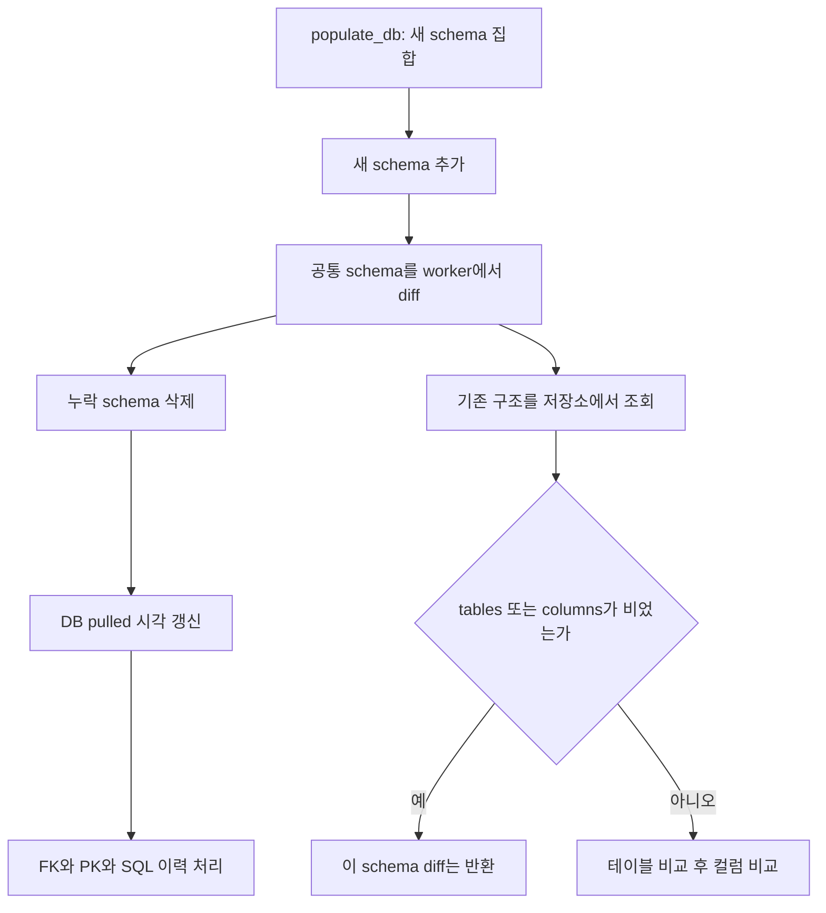
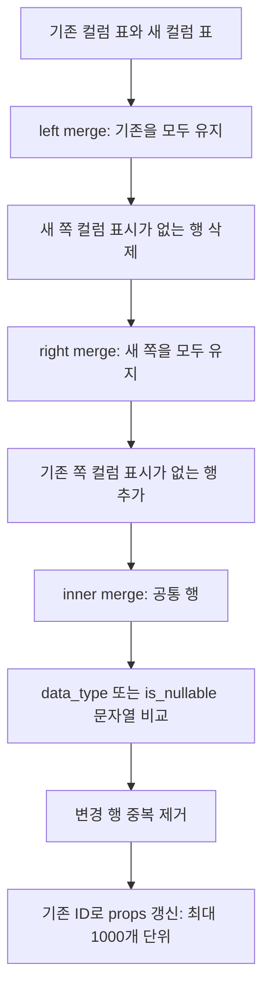
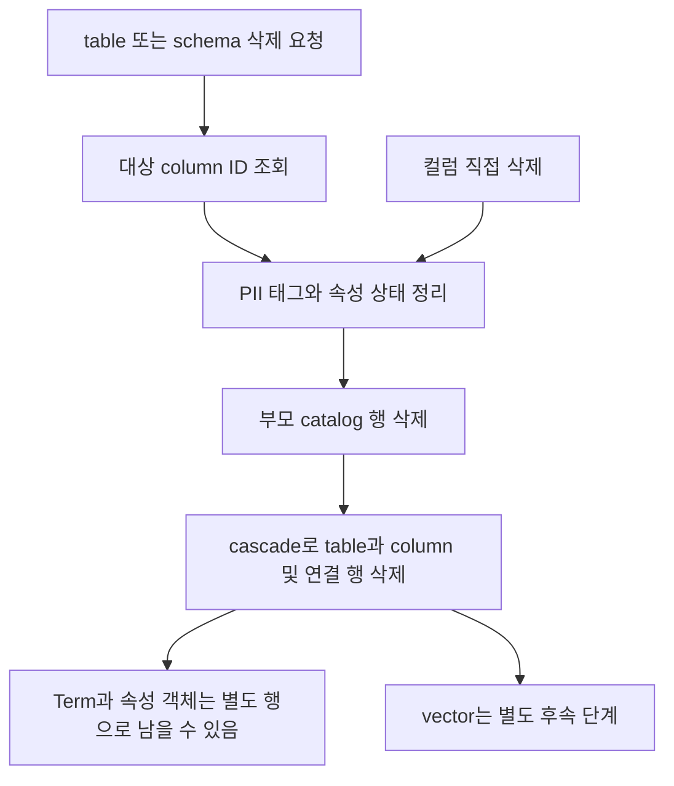
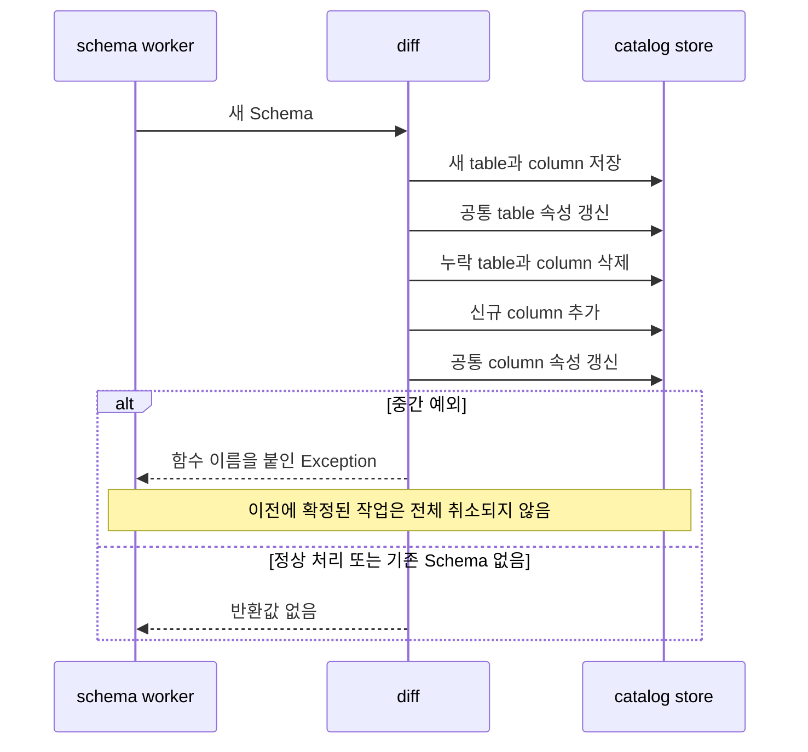

# Chapter 03. 기존 catalog와 구조 비교·갱신·삭제

재수집은 원본 DB를 수정하지 않는다. 새로 추출한 구조를 catalog, 즉 저장된 DB 구조 목록과 비교해 목록을 고친다. **이름이 같으면 기존 ID를 이어 쓰지만, 이름 변경을 자동 추적하지는 않는다.** 또한 목록에서 사라진 대상을 원본에서 삭제한 것인지, 필터·권한·추출 범위 때문에 빠진 것인지 이 비교 함수만으로 구분하지 않는다.

이 장은 구조 변경에 집중한다. PK·FK·SQL 이력의 상세 처리는 별도 보충 장에서 이어간다. PK(Primary Key)는 기본 키, FK(Foreign Key)는 참조 키다. 실제 DB·서비스·모델·테스트는 실행하지 않은 정적 분석이며, 예시는 코드에서 예상되는 동작을 설명한다.

선행: [추출에서 저장 입력까지](chapter-02-extraction-to-catalog-write.md), [catalog 엔티티](../02-data-model/chapter-01-catalog-entities.md), [의미 계층 객체](../02-data-model/chapter-02-semantic-entities.md), [용어집](../01-architecture/chapter-00-glossary.md).

## 1. 어디에서 비교를 시작하는가

schema는 테이블을 묶는 이름 공간이다. `populate_db()`는 기존 schema 이름과 새 schema 이름을 비교해 추가·갱신·삭제 대상을 나눈다. 기존 schema 갱신은 `_update_schema → update_diff_from_existing_schema`로 들어간다. 이때 넘기는 `Schema`는 새로 수집한 테이블·컬럼 표와 저장용 속성을 묶은 메모리 객체다.



schema 이름의 집합 비교는 소문자 이름을 사용한다. 반면 저장소에서 schema를 읽을 때는 DB 이름과 schema 이름의 동등 비교를 사용한다. 이 두 단계가 모든 대소문자 이름을 하나의 방식으로 처리하는 것은 아니다.

기존 schema 작업은 thread pool에서 실행한다. `list(executor.map(...))`가 worker 예외를 호출자에게 전달하지만, 모든 schema 변경을 한 번에 취소하는 트랜잭션은 없다. 트랜잭션은 작업들을 함께 확정하거나 취소하는 DB 단위다.

근거: [write.py의 populate_db·_update_schema](../../../code/auto-ontology/auto_ontology/catalog/write.py), [diff.py](../../../code/auto-ontology/auto_ontology/catalog/diff.py).

## 2. 기존 Schema는 저장소 전체 속성의 복사본이 아니다

`load_schema_from_graph()`는 이름에 graph가 남아 있지만 현재 구현은 관계형 catalog 테이블을 조회한다. 반환 표는 저장된 모든 속성이 아니라 비교에 필요한 일부 필드다.

| 조회 | 실제 읽는 값 | 읽지 않는 주요 값 |
| --- | --- | --- |
| get_schema_tables | DB·schema·table 이름, ID, description, table_type | pk·owner·인증·junction flag |
| get_schema_columns | DB·schema·table·column 이름, ID, data_type, is_nullable | description·ordinal_position·sample_values·format·pii_processed |

읽은 표는 다시 정규화하고 Schema로 감싼다. 정규화는 빠진 필드를 결측값으로 보충한다. 따라서 이 객체의 컬럼 description·순번이 비어 있다고 저장소의 실제 값까지 없다는 뜻은 아니다.

### 2.1 저장 상태가 비어 있으면 자동 재생성이 아니다

저장소 조회 결과에서 tables 또는 columns가 비면 loader는 None을 반환한다. diff는 이것을 확인하고 그대로 반환한다. 예외를 내지 않지만, 새 입력을 `add_schema()`로 다시 넣는 대체 경로도 이 함수 안에는 없다.

예를 들어 이전 실패로 schema·table만 저장되고 column이 전혀 없다면 다음과 같다.

1. schema 행이 있으므로 `populate_db()`는 기존 schema 갱신 대상으로 분류할 수 있다.
2. loader는 columns가 비어서 None을 반환한다.
3. diff는 작업 없이 끝난다.
4. 상위 작업은 이후 단계·pulled 갱신으로 진행할 수 있다.

따라서 **예외가 사라졌다는 것과 누락 컬럼이 복구되었다는 것은 다르다.** 다른 조건이 함께 복구하는지는 별도의 실행 검증이 필요하다. 함수 주석의 의도보다 실제 조기 반환을 기준으로 판단한다.

근거: [schemas.py의 get_schema_tables·get_schema_columns·load_schema_from_graph](../../../code/auto-ontology/auto_ontology/catalog/store/schemas.py), [Schema 생성](../../../code/auto-ontology/auto_ontology/catalog/model/schema.py).

## 3. 무엇을 같은 객체로 보는가

자연 키는 UUID 같은 생성 ID 대신 실제 이름과 소속으로 객체를 구분하는 값이다. UUID는 객체 식별에 사용하는 고유 문자열이다. 이 경로에는 추출 표 결합, diff 비교, DB upsert라는 서로 다른 매칭 단계가 있다. upsert는 기존 행이 있으면 처리하고 없으면 새로 넣는 저장 방식이다. PII(Personally Identifiable Information)는 개인 식별 가능 정보이며 컬럼별 분류 처리 상태도 ID와 함께 읽는다.

| 단계 | 매칭 기준 | 역할 |
| --- | --- | --- |
| parser의 table ID 결합 | DB 범위 안 `(table_schema, table_name)` | 새 표에 기존 ID 결합 |
| parser의 column ID 결합 | DB 범위 안 `(table_schema, table_name, column_name)` | 기존 ID·PII 처리 상태 결합 |
| schema 내부 table diff | table_name 집합 | 추가·공통·삭제 구분 |
| column diff | table_schema·table_name·column_name | 기존·신규 표 merge |
| 저장소의 schema 자연 키 | database_id·name | 같은 DB의 같은 schema |
| 저장소의 table 자연 키 | schema_id·name | 같은 schema의 같은 table |
| 저장소의 column 자연 키 | table_id·name | 같은 table의 같은 column |

merge는 공통 필드를 기준으로 두 표를 결합하는 pandas 연산이다. column diff의 결합 키에는 database가 없다. 이미 한 DB의 Schema 안에서 비교하므로 DB는 그 범위에 포함된다. 실제 필드 이름은 `table_schema`이며 `schema`라는 필드로 결합하지 않는다.

이 비교들은 원래 이름을 사용한다. Schema 내부의 `table_name_lower`·`column_name_lower` 보조 값이 있다고 merge 키도 모두 소문자로 바뀌는 것은 아니다. 대소문자만 다른 이름, 따옴표로 감싼 이름, 중복 행은 별도 경계 사례다.

### 3.1 rename은 이름이 같은 객체의 수정으로 보지 않는다

```text
이전: shop.customer.email   ID=c-email
새 입력: shop.customer.contact

결과: email 삭제 + contact 추가
contact는 기존 email ID와 설명·태그·연결을 자동으로 승계하지 않음
```

테이블 이름 변경이나 schema 이동에도 이를 찾아 이어 붙이는 rename 알고리즘은 이 diff에 없다. 기존 위치에서 사라지고 새 위치에 생긴 구조로 다룬다. ID를 유지하는 타입 변경과 구분해야 한다.

`upsert_row()`는 기존 ID를 덮어쓰지 않는다. ID가 없거나 새 ID가 들어와도 부모·이름의 자연 키로 기존 행을 찾을 수 있으며, insert 경쟁에서는 DB의 고유 제약으로 충돌을 처리한다. 이것은 한 행의 중복 방지이며, 동시 수집 전체를 직렬 실행시키거나 반환 표의 ID까지 항상 재정렬하는 보장은 아니다.

근거: [기존 ID 조회](../../../code/auto-ontology/auto_ontology/catalog/store/schemas.py), [자연 키 registry](../../../code/auto-ontology/auto_ontology/catalog/store/registry.py), [resolve_id·upsert_row](../../../code/auto-ontology/auto_ontology/catalog/store/rows.py).

## 4. table 비교: 추가 → 공통 속성 갱신 → 삭제

기존 이름 집합을 O, 새 이름 집합을 N이라고 하면 다음 세 가지다.

| 집합 | 뜻 | 처리 |
| --- | --- | --- |
| N - O | 새 테이블 | 기존 schema→새 table, 새 table→각 column 저장 |
| N ∩ O | 양쪽에 있는 테이블 | 허용된 source 속성의 변경만 갱신 |
| O - N | 새 목록에서 사라진 테이블 | delete_table 호출 |

source 속성은 원본 구조가 알려주는 table_type 같은 값이다. 공통 테이블의 비교 코드는 `table_type`, `pk`를 후보로 삼지만 **새 props에 들어 있는 필드만** 비교한다. 정상 Schema의 table props는 name·table_type·created·description·id이며 pk는 별도 PK 단계에서 기록한다. 이 table diff가 통상 PK 변경까지 완료한다고 해석하면 안 된다.

table description은 이 변경 후보에 포함하지 않는다. 원본 설명이 달라져도 이 경로에서 기존 table description을 교체하지 않는다. 인증·owner·junction flag도 이 갱신 입력에 없다.

추가 table의 컬럼은 먼저 이 단계에서 쓰고, 뒤의 전체 column 비교에서도 신규 컬럼으로 다시 등장할 수 있다. 후속 저장이 upsert이므로 동일 이름을 무조건 두 행으로 늘리는 방식은 아니다. 저장 호출 횟수와 최종 객체 수를 구분한다.

## 5. column 비교: 세 번의 merge



left merge는 기존 표를 기준으로 새 값을 붙이고, right merge는 새 표를 기준으로 기존 값을 붙인다. inner merge는 양쪽에 공통으로 있는 행만 남긴다. 코드의 `_graph`, `_files` 접미사는 각각 기존 저장소 값과 새 추출 값을 구분하는 이름이다. 파일 업로드를 뜻하는 별도 수집 경로는 아니다.

### 5.1 삭제·추가 판정

left 결과의 `column_name_lower_files`가 비면 삭제 대상이다. 기존 props의 ID들을 모아 `delete_columns_batch()`에 전달한다. 앞 단계에서 이미 삭제한 table의 컬럼도 기존 메모리 표에는 남아 있을 수 있다. 이 중복 삭제 입력이 곧 새로운 컬럼 삭제를 뜻하지는 않는다.

right 결과의 `column_name_lower_graph`가 비면 추가 대상이다. 새 table props·match_props와 새 column props·match_props를 부모/자식 저장 입력으로 조립해 `add_schemas_edge_batch()`에 넘긴다. 이 batch 함수는 각 부모·자식을 순회해 upsert하며 batch 전체를 한 트랜잭션으로 묶지는 않는다.

### 5.2 변경을 감지하는 값과 저장하는 값은 다르다

공통 컬럼은 `data_type`, `is_nullable` 두 값만 각각 문자열로 바꿔 비교한다. 두 값이 모두 달라 같은 행이 두 번 후보가 되면 props·match_props dict 필드를 제외한 값으로 중복 제거한다.

| 새 입력의 변화 | 이 diff의 갱신 후보가 되는가 | 실제 의미 |
| --- | --- | --- |
| data_type만 변경 | 예 | 기존 ID로 새 props 갱신 |
| is_nullable만 변경 | 예 | 기존 ID로 새 props 갱신 |
| ordinal_position만 변경 | 아니오 | 순번만 달라서는 갱신 안 함 |
| description만 변경 | 아니오 | 설명만 달라서는 갱신 안 함 |
| 타입 변경 + 순번 변경 | 예 | 타입·nullable뿐 아니라 새 props의 순번도 기록 |
| 이름 변경 | 공통 행이 아님 | 삭제 + 추가 |

nullable은 NULL, 즉 값 없음이 허용되는지 나타낸다. 문자열 비교는 SQL 타입의 의미가 같은지 판단하는 타입 체계가 아니다. 표현이 달라지면 변경으로 잡힐 수 있다. 결측값 표현 차이·중복 입력에 대한 실제 결과도 검증해야 한다.

갱신 후보에서는 `accumulate_updated_column()`이 새 column props의 ID를 기존 props의 ID로 맞춘다. 실제 저장은 `update_properties_in_graph_batch()`가 한다. 이름과 달리 단일 대형 UPDATE가 아니라 항목별 UPDATE이며, 호출 입력은 최대 1000개씩 나눈다.

### 5.3 기존 설명은 NULL일 때만 채운다

실제 UPDATE는 저장 테이블에 있는 필드만 남기고 id를 갱신 대상에서 뺀다. description은 새 값이 None이 아닐 때만 `coalesce(기존 description, 새 description)`으로 쓴다. coalesce는 앞 값이 NULL이면 뒤 값을 쓰는 함수다.

- 기존 설명이 있으면 새 원본 설명으로 덮지 않는다.
- 기존 설명이 NULL이고 타입·nullable 변경으로 UPDATE까지 도달했다면 새 설명을 채울 수 있다.
- 빈 문자열은 NULL이 아니므로 기존 빈 문자열도 그대로 남는다.
- 기존 인증 flag·sample_values·format·PII 처리 상태 등은 새 props에 없어 이 UPDATE가 초기화하지 않는다.

**보존과 최신성은 별개다.** 타입이 바뀌어도 이전 샘플·포맷·의미 분류를 이 함수가 재검사하거나 지우지는 않는다. 후속 의미 컴파일이 어떤 조건으로 갱신하는지는 해당 단계에서 확인한다.

근거: [column merge와 갱신 후보](../../../code/auto-ontology/auto_ontology/catalog/diff.py), [Schema props 생성](../../../code/auto-ontology/auto_ontology/catalog/model/schema.py), [UPDATE의 description 보존](../../../code/auto-ontology/auto_ontology/catalog/store/db.py).

## 6. 작은 이전/이후 예시

다음은 실행 결과가 아닌 설명용 입력이다. 테이블 일부가 남아 있어 diff에 진입하는 상황을 가정한다.

| 이전 shop.customer | 새 추출 | 판정 |
| --- | --- | --- |
| customer_id: integer, ID=c1 | 동일 | 유지 |
| name: varchar, ID=c2, 순번 2 | text, 순번 3 | ID=c2 유지, 타입과 순번 갱신 |
| email: varchar, ID=c3 | 없음 | 삭제 |
| 없음 | contact: varchar | 새 ID로 추가 |
| age: integer, 순번 4 | integer, 순번 5 | 타입·nullable 같으면 이 diff는 순번 갱신 안 함 |

name의 설명을 사용자가 이미 작성했다면 타입 갱신과 함께 들어오는 원본 설명이 덮지 않는다. email을 contact로 바꿨더라도 위 표만으로는 rename임을 알 수 없으므로 c3의 의미 연결을 contact로 이동시키지 않는다.

## 7. 필터에서 빠진 것과 원본 DROP은 diff에 같은 누락이다

| 새 수집 상태 | 처리 |
| --- | --- |
| customer는 남고 orders만 필터 제외 | 해당 schema diff에서 orders 삭제 대상 |
| 다른 schema 테이블은 남고 shop 전체 누락 | populate_db가 기존 shop schema 삭제 가능 |
| 필터가 모든 table을 제외 | tables 0행이므로 writer 자체가 구조·키 저장 생략 |
| 원본 DROP 뒤 다른 table은 남음 | 누락 table 삭제 대상 |
| table은 남았지만 column 표가 완전히 누락 | 앞선 coverage 검사에서 예외, writer 도달 전 중단 |

coverage는 목록에 있는 각 테이블의 컬럼 행이 하나 이상 존재하는지 보는 검사다. 컬럼 일부만 빠진 상황까지 완전하게 검증하지 않는다. 따라서 일부 컬럼이 빠진 채 검사를 통과하면 diff가 그 컬럼을 삭제 대상으로 볼 수 있다.

수집 범위를 좁히는 변경은 단순히 “앞으로 추가 수집 안 함”에 그치지 않을 수 있다. 반대로 **전체 빈 목록은 기존 catalog를 모두 비우라는 명령이 아니다.** 이 비대칭은 이전 장의 빈 입력 분기에서 발생한다.

## 8. 삭제는 어디까지 전파되는가

cascade는 부모 행을 삭제할 때 외래 키 제약을 따라 관련 자식·연결 행을 함께 지우는 DB 동작이다. 연결 행 삭제가 연결의 반대편 객체 삭제까지 뜻하지는 않는다.



PII(Personally Identifiable Information)는 개인 식별 가능 정보다. `delete_schema`, `delete_table`, `delete_columns_batch`는 PII 정리와 실제 삭제를 각각 하나의 국소 트랜잭션으로 감싼다.

| 대상 | catalog 삭제 시의 경계 |
| --- | --- |
| schema의 table·table의 column | 부모 외래 키 CASCADE로 삭제 |
| column 간 FK·join 연결 | 해당 column을 참조하는 연결 행 삭제 |
| table→Term 연결 | 연결 행 삭제. Term 자체 삭제 명령은 아님 |
| column→ColumnAttribute 연결 | 연결 행 삭제. ColumnAttribute 자체 삭제 명령은 아님 |
| column의 semantic FK | 연결 행 삭제. 참조 속성 객체 삭제 명령은 아님 |
| SQL→table/column 참조 | 연결 행 삭제. SQL 본문 행의 일괄 삭제는 이 diff의 책임 아님 |
| table/column 자체 태그 | 해당 대상 연결이 cascade 삭제됨 |
| 검색용 embedding/vector | 이 함수들에서 동시 삭제하지 않음 |

Term은 업무 개념, ColumnAttribute는 컬럼의 의미를 나타내는 속성 객체다. ColumnAttribute의 `table_id`는 현재 schema에서 일반 문자열이며 catalog_table 외래 키가 아니다. 따라서 table 삭제가 이 값만으로 속성 객체를 함께 삭제하지 않는다. 인증된 객체도 삭제된 원본 컬럼에 다시 자동 연결되는 것은 아니다.

### 8.1 PII는 삭제 전에 관련 속성 상태를 정리한다

PII 태그가 존재하면 대상 컬럼의 PII 태그를 먼저 모두 떼고 각 컬럼의 의미 속성 상태를 정리한다. 컬럼의 HAS_ATTRIBUTE는 “이 컬럼이 이 의미 속성의 사례”라는 연결이다. 여기에 붙은 ColumnAttribute의 PII 태그를 제거하고 pii_processed=False로 바꾼다. semantic FK처럼 단순히 참조하는 속성에는 같은 처리를 적용하지 않는다.

SQL로 계산하는 SqlAttribute는 다른 PII 컬럼을 아직 읽는지 확인한다. 읽으면 PII 상태를 유지하고, 읽지 않으면 태그를 제거하고 처리 상태를 초기화한다. 이 정리에는 다른 helper가 호출하는 중첩 트랜잭션도 포함되며 기존 활성 트랜잭션을 재사용한다.

이 경로는 단순히 “자동 생성 태그만 정리”하는 것으로 설명할 수 없다. 정리 helper는 대상 속성의 PII 태그 출처를 따로 판정하지 않는다. 공유 속성·여러 원본·수동 태그와의 구체적인 상호작용은 거버넌스 단계의 검증 항목이다.

근거: [삭제 함수와 트랜잭션](../../../code/auto-ontology/auto_ontology/catalog/store/db.py), [PII 정리 helper](../../../code/auto-ontology/auto_ontology/dal/pii.py), [외래 키·의미 객체 정의](../../../code/auto-ontology/auto_ontology/dal/schema.py).

## 9. 예외·부분 실패와 재실행의 한계



diff의 큰 try/except는 오류에 함수 이름을 붙여 다시 던진다. 전체 diff용 write_transaction은 없다. 개별 부모·자식 저장이나 삭제 helper의 트랜잭션은 그 묶음만 보호한다. batch라는 이름도 전체 원자성을 보장하지 않는다. 원자성은 묶음의 일부만 적용된 상태를 남기지 않는 성질이다.

새 table을 쓰고 뒤의 column 작업에서 실패하면 그 table이 남을 수 있다. 다음 수집은 그 상태를 기존 구조로 다시 읽는다. 자연 키로 중복을 줄일 수 있지만, 앞서 설명한 빈 기존 Schema 조기 반환·동시 수집 경쟁까지 모두 복구된다고 단정할 수 없다.

이 단계에서 catalog만 바뀌고 vector 갱신 전에 실패할 수도 있다. embedding은 검색용 숫자 벡터 표현이며 catalog DB와 별도 저장 경계에 있다. vector 교체와 재시도는 Chapter 04, reset·복구는 Chapter 05에서 분석한다.

## 10. 테스트가 확인하는 범위

[test_incremental_ingest.py](../../../code/auto-ontology/auto_ontology/catalog/tests/test_incremental_ingest.py)의 assertion을 읽었다. 테스트는 임시 원본 Postgres DB에 테이블을 만들고 변경하며 실제 catalog 저장소를 사용한다. 여기서는 실행하지 않았다.

| 테스트 | assertion |
| --- | --- |
| 최초 수집 | customer·orders와 customer 컬럼 목록 생성 |
| 무변경 재수집 | entity_counts 동일. 모든 필드 무갱신·쓰기 없음까지 검증하지는 않음 |
| table 추가·삭제 | 새 table과 컬럼 등장, 삭제 table 및 컬럼 소멸 |
| deny 필터 변경 | orders 제외 후 catalog에서 table·column 제거 |
| column 추가·삭제 | phone 추가, email 삭제 |
| column rename | email 없음·contact 있음. 설명·태그 이동 여부를 직접 검증하는 assertion은 아님 |
| column 타입 변경 | 타입이 text로 바뀌고 기존 column ID 유지 |
| 임시 table 추가 후 삭제 | 이름 소멸·entity_counts 기준값 복귀 |
| 새 schema | 새 schema의 stock 등장 |
| FK 재수집 | 기존 참조 컬럼 쌍 유지. 보충 장에서 상세 확인 |

실행 전제는 원본 Postgres 자격 정보와 접근 가능한 catalog schema다. 준비되지 않으면 skip할 수 있다. 파일 주석의 여러 backend 설명만으로 현재 모든 저장 구현을 검증했다고 판단하지 않는다.

이번에 실행·재현하지 않은 핵심 조건은 다음과 같다.

- ordinal만 바뀌는 경우, description NULL·빈 문자열·인증 상태의 보존.
- 빈 기존 Schema에서 누락 구조 복구, 대소문자·따옴표·중복 추출 행.
- 일부 컬럼 누락이 삭제로 반영되는 경우와 전체 빈 필터의 기존 데이터 보존.
- PII 정리 중 예외와 삭제 rollback, 공유 속성·수동 태그 처리.
- 일부 worker 실패·동시 수집·중간 종료 뒤 catalog와 vector의 불일치.

다음 작업은 PK·FK와 SQL 이력이다. 구조 diff와 분리된 키 초기화·오래된 FK 정리·SQL 참조/중복/실패를 [상세 계획](../../../.codex/plan/auto-ontology/01-4-1_catalog-diff-details.md)의 2번에서 추적한다.
