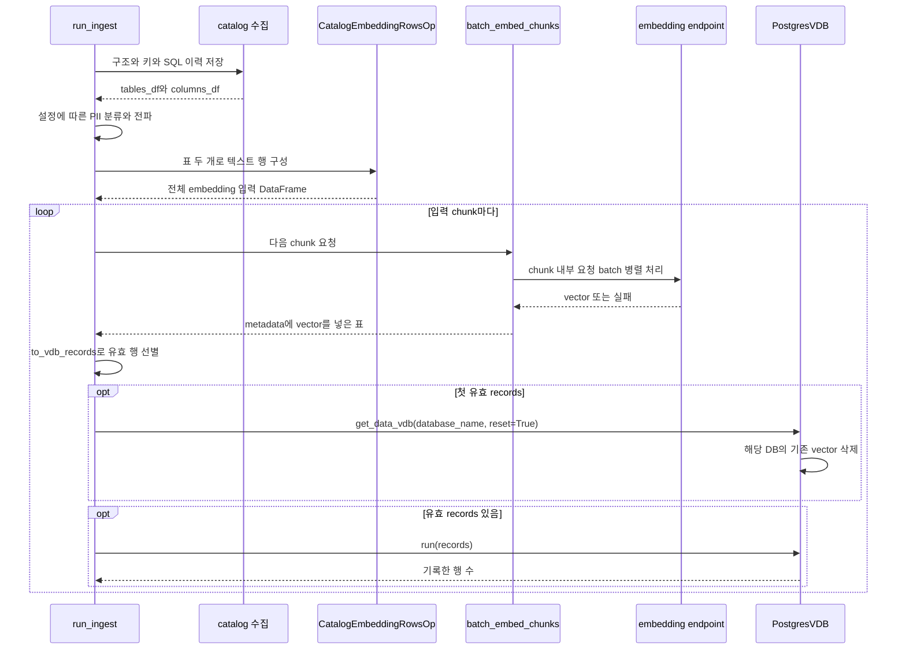
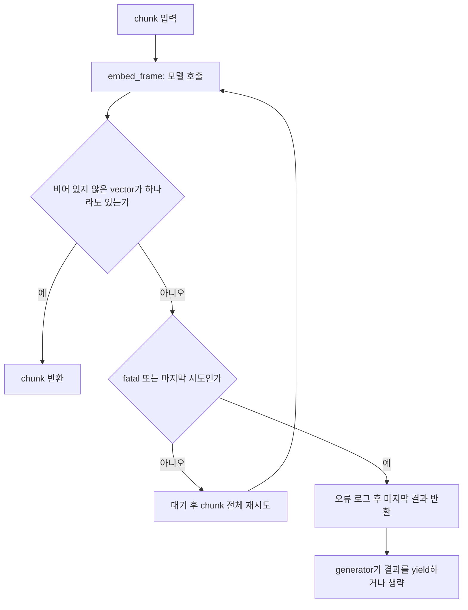
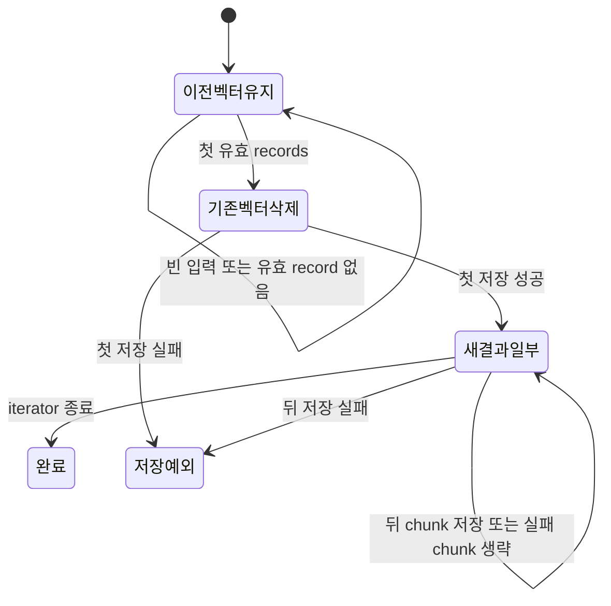

# Chapter 04. 검색용 텍스트·embedding 생성과 vector 교체

catalog 저장 뒤에는 테이블·컬럼을 설명하는 텍스트를 만들고 숫자 벡터로 바꿔 검색 저장소에 기록한다. embedding은 의미가 비슷한 텍스트를 가까운 숫자 벡터로 표현하는 작업이다. **catalog의 구조 갱신과 검색용 vector 교체는 별개이며, 전체를 한 번에 교체하는 트랜잭션은 없다.**

기존 vector는 첫 유효 저장 결과가 나올 때까지 유지한다. 이후에는 해당 DB의 기존 vector를 지우고 성공한 묶음을 차례로 추가한다. 따라서 처음부터 모델이 실패하면 이전 vector가 남지만, 교체 도중 실패하면 일부 새 vector만 남을 수 있다.

이 문서는 로컬 소스·테스트의 정적 분석이다. 모델·DB·서비스·테스트는 실행하지 않았다. [저장 입력](chapter-02-extraction-to-catalog-write.md), [구조 diff](chapter-03-catalog-diff-and-relations.md), [키·SQL 이력](chapter-03-1-keys-and-query-history.md), [저장 경계](../02-data-model/chapter-04-storage-boundaries.md), [용어집](../01-architecture/chapter-00-glossary.md)을 참고한다.

## 1. 어떤 함수들이 연결되는가



endpoint는 모델 요청을 받는 HTTP 주소다. DataFrame은 이름이 있는 열과 행으로 구성한 표다. metadata는 검색 결과를 catalog 객체에 다시 연결하는 ID·이름·분류 등의 부가 정보다. PII(Personally Identifiable Information)는 개인 식별 가능 정보이며, 이 장에서는 분류 알고리즘 대신 실행 순서만 다룬다.

`run_ingest()`는 catalog가 반환한 표를 그대로 row builder에 넘긴다. 저장소 전체를 다시 조회하지 않는다. 이 표에 없는 사용자 수정 설명·프로파일링 결과를 builder가 저장소에서 따로 읽어 보충하지도 않는다.

근거: [run_ingest](../../../code/auto-ontology/auto_ontology/ingestion_service/ingest.py), [ingest_catalog의 반환](../../../code/auto-ontology/auto_ontology/catalog/ingest.py).

## 2. 표 두 개를 table·column별 텍스트 행으로 만든다

`CatalogEmbeddingRowsOp.process()`는 정확히 `(tables_df, columns_df)` tuple을 요구한다. 다른 입력 형태면 DB 이름을 담은 TypeError를 낸다. tuple 안의 None까지 빈 표로 자동 보정하는 계약은 아니다.

columns를 `(schema 이름 소문자, table 이름 소문자)`로 먼저 묶는다. 그 뒤 tables를 순회하며 table 행 하나, 그 table의 column 행들을 만든다. 입력 순서를 따르며 컬럼을 ordinal_position으로 다시 정렬하지 않는다.

| 조건 | 행 생성 |
| --- | --- |
| table 1개와 그 column 3개 | Table 1행 + Column 3행 |
| public.users와 archive.users | schema가 달라 각각의 컬럼 집합 사용 |
| table 없이 column만 있음 | table 순회에서 도달하지 않아 해당 column 행 생성 안 함 |
| table은 있고 대응 column 없음 | table 설명 행은 생성 가능 |
| 양쪽 모두 빈 DataFrame | 선언된 4개 열만 가진 빈 결과 |

대소문자를 무시해 묶으므로 표 사이의 Public/Orders와 public/orders는 연결될 수 있다. 반대로 원본이 대소문자만 다른 객체를 별도로 허용한다면 이 grouping이 안전한지는 검증이 필요하다. 앞선 diff의 원래 이름 비교와 같은 정책이라고 가정하지 않는다.

### 2.1 table 텍스트와 column 텍스트

다음은 설명용 입력이다.

```text
DB: shop, schema: sales, table: orders
table 설명: 주문 목록
column: total, type: numeric, 설명: 주문 금액
sample_values: [10, 20, 30]
```

생성되는 텍스트 형식은 다음과 같다.

```text
Table:
database_name: shop, schema_name: sales, table_name: orders, table_description: 주문 목록, columns: {name: total, data_type: numeric, description: 주문 금액}

Column:
database_name: shop, schema_name: sales, table_name: orders, column_name: total, data_type: numeric, column_description: 주문 금액, sample_values: 10, 20, 30
```

table에는 전체 컬럼의 이름·타입·설명을 이어 붙인다. column에는 자신의 이름·타입·설명과 존재하는 샘플을 넣는다. 빈 설명은 생략하고 결측 설명이 문자열 nan으로 들어가지 않도록 처리한다. table 텍스트의 columns 키는 컬럼이 없어도 유지한다.

PK·FK·nullable·인증·태그·owner·SQL 이력은 이 텍스트 template에 직접 들어가지 않는다. template은 필드 이름과 쉼표를 포함한 문자열이며 JSON 문서를 생성하는 함수가 아니다. template 문구를 바꾸면 같은 원본도 다른 모델 입력이 되므로 기존 저장 vector와 검색 입력의 관계를 다시 확인해야 한다.

### 2.2 sample_values는 입력에 있을 때만 쓴다

builder는 `(column.get("sample_values") or [])[:5]`로 앞 다섯 항목을 취한다. 이 단계에서 원본 데이터를 조회해 샘플을 수집하지 않는다. catalog에 이전 샘플이 저장되어 있어도 반환 표에 없으면 자동 반영되지 않는다.

입력이 list라는 가정도 중요하다. JSON 문자열을 파싱하는 코드는 여기 없으므로 문자열이면 앞 다섯 문자를 취할 수 있고, pd.NA처럼 참/거짓 판정이 불가능한 값은 오류가 될 수 있다. DB의 저장 형식과 builder에 전달하는 형식을 구분해야 한다.

샘플이 실제 들어오면 모델 요청 텍스트에 포함된다. 이 builder에는 PII 태그를 보고 샘플을 마스킹하거나 제외하는 분기가 없다. PII 분류가 먼저 실행된다는 사실만으로 모델 입력이 익명화된다고 설명해서는 안 된다.

근거: [행 생성·텍스트 template](../../../code/auto-ontology/auto_ontology/utils/embedding_rows.py), [Schema 저장용 표 구성](../../../code/auto-ontology/auto_ontology/catalog/model/schema.py).

## 3. ID·label·path는 검색 결과를 catalog에 연결한다

출력 열은 `text, path, page_number, metadata` 네 개다. label은 Table 또는 Column이라는 객체 종류다. ID는 catalog의 UUID, 즉 객체를 식별하는 고유 문자열을 사용한다.

```text
text: 위에서 생성한 설명 문자열
path: auto_ontology:<catalog ID>
page_number: -1
metadata:
  id, label, name, source_path, schema_name, database_name
  content_metadata: 위 식별 필드의 복사본
```

path는 파일을 읽을 위치가 아니라 출처를 나타내는 문자열이다. page_number=-1도 문서 페이지를 추출한 결과가 아니다. top-level metadata와 content_metadata 양쪽에 식별자를 넣으며, 검색 소비자는 top-level 필드도 사용한다.

`build_embed_row()`는 ID가 없으면 unknown path를 만들지만 상위 builder는 먼저 `str(id)`를 사용한다. 따라서 None·NaN 같은 잘못된 ID를 이 helper 하나가 모두 정상 검증한다고 보장할 수 없다. 정상 경로는 앞선 parser가 ID를 준비한다는 계약에 의존한다.

## 4. 서로 다른 세 가지 batch를 구분한다

batch는 한 번에 처리할 묶음이다. chunk도 묶음을 뜻하지만 이 경로에서는 다음 세 단위가 각각 다르다.

| 단위 | 기본값·계산 | 담당 |
| --- | --- | --- |
| HTTP 요청 batch | inference_batch_size=32 | 한 embedding API 요청에 보낼 텍스트 수 |
| embedding chunk | 32 × nim_http_max_concurrent 32 = 1024행 | 재시도·로그·yield 단위 |
| vector 저장 batch | write_to_index의 batch_size=500 | add_embeddings 호출 단위 |

기본 입력이 2050행이면 embedding chunk는 1024·1024·2행이다. 첫 chunk가 모두 유효하면 HTTP 요청은 최대 32개로 나누고, vector 기록은 500·500·24행으로 나뉜다. 빈 텍스트는 HTTP 입력에서 제외하므로 실제 요청 수는 줄 수 있다. 이 수치는 코드 기본값의 계산이며 측정 결과가 아니다.

### 4.1 chunk 간 호출은 순차다

`batch_embed_chunks()`는 generator다. generator는 결과를 하나씩 yield하고 소비자가 다음 결과를 요청할 때 다시 실행한다. 한 chunk 안에서는 ThreadPoolExecutor로 HTTP batch들을 병렬 처리하지만, `run_ingest()`는 yield된 chunk를 변환·저장한 뒤 다음 chunk를 요청한다.

따라서 코드 주석의 “다음 chunk embedding과 현재 쓰기 겹침”을 실제 prefetch, 즉 다음 작업을 미리 실행하는 구조로 해석하면 안 된다. 별도 producer나 queue가 이 호출 사슬에 없다.

전체 입력 텍스트 행도 이미 DataFrame으로 메모리에 만든 상태다. chunk 저장 덕분에 모든 vector 결과를 마지막까지 모아 두지는 않지만, 전체 입력·중간 dict·문자열까지 오직 한 chunk만 메모리에 존재하는 것은 아니다.

근거: [EmbedParams·embed_chunk_size·batch_embed_chunks](../../../code/auto-ontology/auto_ontology/utils/embedding.py), [vector 저장 batch](../../../code/auto-ontology/auto_ontology/vdb/postgres.py).

## 5. 모델 요청과 응답의 계약

`get_embed_params()`는 model_name·endpoint·API key를 가져오고 나머지 batch·concurrency·timeout은 EmbedParams 기본값을 쓴다. EMBED별 설정은 공통 DEFAULT_MODELS 설정과 기존 변수로 fallback할 수 있다. 이 모듈의 endpoint·model·key는 import 시 resolve한 값이므로 매 호출마다 환경 변수를 다시 읽는 구조는 아니다.

`embed_texts()`는 텍스트를 strip하고 공백뿐이거나 문자열이 아닌 입력은 보내지 않는다. 원래 입력 길이의 결과 배열을 만들고 생략한 위치에는 None을 둔다.

| 요청 항목 | 실제 값·정책 |
| --- | --- |
| API 경로 | OpenAI client의 embeddings.create |
| base URL | 끝의 /embeddings를 제거한 주소 사용 |
| model | params.model_name |
| input | 정리한 텍스트 배열 |
| encoding_format | float |
| input_type | 수집은 passage |
| truncate | END |
| modality | 기본 text |
| timeout | 기본 request_timeout_s=600초 |
| 인증 | key가 없으면 Authorization header 생략 |

passage는 저장할 설명 문서라는 모델 입력 역할이고 query는 검색 질문 역할이다. 검색 쪽은 query를 사용한다. 특정 model 이름에 `nemotron-3.5-embed-1b-nvfp4`가 포함되면 텍스트에도 `passage: ` 또는 `query: `를 붙인다. 모든 모델에 같은 prefix를 붙이지 않는다.

모델 응답은 batch 안에서 index가 정확히 0부터 입력 개수-1까지 한 번씩 있는지 검사한다. 누락·중복이면 RuntimeError다. 응답 순서가 바뀌어도 index로 원래 위치에 넣는다. 다만 vector 차원·수치의 유효성까지 이 검사에서 확인하는 것은 아니다.

한 HTTP batch라도 예외면 `embed_texts()`가 예외를 낸다. `_embed_frame()`은 모델 호출 예외를 잡아 chunk의 attrs에 embed_error·embed_error_fatal을 붙이고, 정상 builder 입력이라면 embedding 없는 행들을 반환한다. 다른 HTTP batch의 성공 vector도 이 실패 호출에서 표에 부분 반영하지 않는다. 단, frame 복사·metadata 준비 같은 try 밖 오류까지 전부 삼키는 함수는 아니다.

근거: [모델 호출·응답 검사](../../../code/auto-ontology/auto_ontology/utils/embedding.py), [설정 resolve](../../../code/auto-ontology/auto_ontology/utils/model_config.py), [검색 query 역할의 왕복 테스트](../../../code/auto-ontology/auto_ontology/vdb/tests/test_records.py).

## 6. 두 겹의 재시도와 포기 조건



첫 번째는 OpenAI client의 요청별 재시도다. 코드에서 max_retries=5를 설정한다. 두 번째는 `_embed_with_retry()`의 chunk 단위 재시도로 기본 최대 4회 시도한다. 두 계층이 함께 적용되므로 4회의 HTTP 요청만 보낸다고 해석하면 안 된다.

chunk 대기는 기본 15·30·60초이며 4회 시도 사이에 일어난다. 최대 지연 상수는 120초지만 기본 4회만으로는 그 대기까지 도달하지 않는다. 요청별 timeout·재시도와 chunk 대기를 합친 전체 완료 시간 제한은 이 함수에 없다.

fatal은 기다려도 해결되지 않는 요청 오류라는 뜻이다. `_is_fatal()`은 APIStatusError 중 4xx에서 408·409·429를 제외한 상태를 분류한다. 예를 들어 401은 chunk 재시도를 중단한다. 429는 요청 한도 초과로 재시도 대상이다. fatal이어도 이 구현이 run_ingest 전체를 즉시 예외 종료시키는 것은 아니다. 다음 chunk는 별도로 시도할 수 있다.

**성공 판정은 전체 행 성공이 아니라 vector가 하나라도 있는가다.** 정상 endpoint의 index 검사는 누락 응답을 막지만, 빈 vector·공백 입력·대체 embed 함수 등으로 일부 행만 유효한 결과에서는 나머지 행을 다시 시도하지 않을 수 있다. iterator는 비어 있지 않은 실패 표도 yield하고 유효 행 수를 로그로 남긴다.

진행 로그의 done은 처리한 입력 행 수다. with_embeddings·embedded_total과 다르며 모두 저장된 행 수를 뜻하지 않는다. 저장 단계의 rows_written은 다시 별개다.

## 7. 저장 가능한 record만 남긴 뒤 reset한다

`to_vdb_records()`는 embedding이 비어 있지 않고 사용할 텍스트가 있는 행만 남긴다. 결과는 `[records]` 형태이며 없으면 `[]`다. `[[]]`를 반환하지 않아 run_ingest의 빈 결과 판정이 동작한다.

| 변환 | 처리 |
| --- | --- |
| text 선택 | text → content → metadata.content 중 첫 비공백 문자열 |
| 식별 metadata | top-level id·label·name·database_name 등 유지 |
| content | 선택한 원문 문자열 저장 |
| page_number | row와 content_metadata의 변환 가능한 숫자 중 큰 값 |
| source_metadata | source_path 또는 path를 source_id·source_name으로 보충 |
| embedding | vector 저장 단계까지 metadata 안에 유지 |

첫 유효 records를 얻은 뒤에만 `get_data_vdb(database_name=..., reset=True)`를 호출한다. 다음 유효 chunk들은 같은 객체를 사용해 추가한다. reset을 매 chunk 반복하지 않는다.



이것은 원자적인 교체가 아니다. 원자성이란 전체 작업이 전부 적용되거나 전부 취소되는 성질이다. 삭제와 최초 insert 사이에 빈 검색 결과가 보일 수 있고, 뒤 chunk가 생략되면 일부 객체만 새 vector를 가진다. 이전 결과를 임시 collection에 보존한 뒤 한 번에 전환하는 방식은 이 경로에 없다.

근거: [record 변환](../../../code/auto-ontology/auto_ontology/vdb/records.py), [lazy reset 호출](../../../code/auto-ontology/auto_ontology/ingestion_service/ingest.py), [reset 순서 테스트](../../../code/auto-ontology/auto_ontology/ingestion_service/tests/test_ingest_reset.py).

## 8. PostgresVDB가 실제 쓰는 것

VDB(Vector Database)는 벡터 검색 저장소다. 이 경로의 factory는 PostgresVDB를 만들고 pgvector가 활성화된 Postgres의 `vdb.data_objects_layer`를 사용한다. 의미 계층은 별도 `vdb.semantic_layer` collection이다. collection은 여기서 vector들을 보관하는 테이블에 해당한다.

생성자에서 database_name이 참이고 reset=True이면 해당 DB의 vector를 조회·삭제한다. 이름이 없는 reset이 collection 전체 삭제로 자동 바뀌지는 않는다. 정상 ingestion은 connector의 DB 이름을 넘긴다.

### 8.1 저장소 준비·차원·인덱스

`run()`은 저장소 준비 뒤 write_to_index를 호출한다. 테이블이 없으면 schema·vectorstore table을 만들며 기본 vector_size는 2048이다. 수집 factory는 모델 응답에서 차원을 읽어 이 값을 바꾸지 않는다. 기존 테이블 차원을 모델에 맞춰 자동 migration하지도 않는다.

초기 생성에서는 embedding 컬럼을 halfvec로 바꾸고 HNSW cosine 인덱스를 만드는 처리를 시도한다. halfvec는 벡터 값을 더 낮은 정밀도로 저장하는 타입이며, HNSW는 가까운 벡터 후보를 빠르게 찾기 위한 근사 검색 인덱스다. 이 최적화 실패는 경고 후 계속한다. 설치 지침이나 실제 성능 측정은 이 장의 범위가 아니다.

**모델 결과를 얻었다고 저장 성공이 보장되지는 않는다.** 잘못된 차원·수치 형 변환·DB 쓰기는 그 뒤에 실패할 수 있다. 최초 유효 records 때문에 이미 reset한 뒤 발생한 오류라면 이전 vector가 남는다는 보장도 없다.

### 8.2 append와 catalog ID의 차이

write_to_index는 embedding을 float 목록으로 바꾸고 text·metadata를 Document로 조립한다. 저장 metadata에서 embedding 자체는 빼고 database_name·label을 필터용 실제 컬럼으로 사용한다. catalog ID 등 나머지는 metadata에 보관한다.

각 최대 500행마다 `PGVectorStore.add_embeddings()`를 호출하며 미리 만든 vector를 넘긴다. 저장 중 모델을 다시 호출하는 방식은 아니다. catalog ID를 vector 행의 저장 ID로 전달해 upsert하는 코드도 없다. 같은 metadata.id가 있어도 run(records) 자체는 기존 객체를 찾아 교체하는 계약이 아니다.

따라서 전체 DB reset 없이 동일 records를 다시 쓰는 경로는 중복 vector를 만들 수 있다. 정상 run_ingest는 최초 DB reset으로 이전 실행의 데이터를 지우지만, 동시 수집·중간 재호출까지 중복과 누락을 방지하는 것은 아니다.

여러 add_embeddings 호출을 묶는 외부 transaction·보상 삭제·기존 버전 복구 코드는 없다. 뒤 저장 batch에서 실패하면 앞 호출의 결과가 남을 수 있다. 라이브러리 내부의 각 호출 commit 범위는 실제 의존성·실행 검증과 구분한다.

근거: [factory와 collection](../../../code/auto-ontology/auto_ontology/vdb/__init__.py), [PostgresVDB 생성·쓰기·삭제](../../../code/auto-ontology/auto_ontology/vdb/postgres.py).

## 9. 무변경 재수집과 빈 결과를 구분한다

이 수집 경로에는 텍스트 hash로 이전 embedding을 재사용하거나 바뀐 객체만 모델에 보내는 분기가 없다. ingest_catalog가 반환한 모든 table·column을 row builder가 다시 처리한다. 구조 diff에서 변경이 없었다고 embedding 입력이 자동으로 0행이 되지 않는다.

따라서 run_ingest의 “unchanged catalog이면 빈 embedding이 예상된다”는 로그·주석은 이 호출 사슬의 변경 감지로 뒷받침되지 않는다. 정상적인 비어 있지 않은 재수집은 다시 모델을 호출하고 첫 유효 결과부터 vector를 교체할 수 있다.

| 상황 | 기존 vector·새 vector | 함수 완료·로그 |
| --- | --- | --- |
| 추출 tables 전체 빈 결과 | reset 없이 이전 vector 유지 | 0행 기록·완료 로그 가능 |
| 첫 chunk부터 모델 오류·재시도 소진, 전부 무효 | 이전 vector 유지 | 예외 없이 끝나 완료 로그 가능 |
| 앞 chunk 무효, 뒤 chunk 유효 | 뒤 chunk 직전에 이전 전체 삭제 | 앞 무효 chunk 객체는 새 collection에 없을 수 있음 |
| 첫 chunk 성공, 뒤 chunk 모델 오류 | 이전 전체 삭제·성공 chunk만 기록 | 오류가 표로 처리되면 완료 로그 가능 |
| 첫 유효 결과 뒤 vector 저장 예외 | 기존 삭제 뒤 0행 또는 일부 새 결과 | 예외 전파·마지막 완료 로그 없음 |
| 모델·저장 모두 정상 | 입력에서 생성한 유효 결과를 교체·추가 | 기록 행 수와 완료 로그 |

**“finished successfully”는 여기까지 전파된 예외가 없다는 뜻으로 읽어야 한다.** 모델 오류를 _embed_frame이 흡수하고 chunk가 생략될 수 있으므로, source 주석의 “모든 단계가 실패를 예외로 전달한다”는 설명보다 실제 분기를 우선한다. PII 보강·SQL 개별 실패도 앞선 장에서 별도로 구분했다.

catalog의 pulled 시각은 더 앞의 구조 저장에서 바뀐다. pulled·완료 로그·embedded_total·rows_written 중 하나만으로 원본 구조와 검색 데이터가 모두 일치한다고 판단하지 않는다. 별도 전체 행 수 검증·실패 chunk 재개 checkpoint는 이 경로에 없다. checkpoint는 재시작 위치를 지속 저장하는 기록이다.

## 10. 테스트가 확인하는 것과 남은 검증

| 읽은 테스트 | 확인한 assertion |
| --- | --- |
| test_embedding_rows.py | 정확한 template, 선택 설명 생략, metadata 양쪽 식별자, schema별 grouping·대소문자, 샘플 다섯 개, 결측 설명, 빈 입력·tuple 계약 |
| test_embedding.py 요청 테스트 | URL·header·passage/query·prefix·batch 순서·응답 index 누락/중복·빈 텍스트·timeout 전달·429 재시도 |
| test_embedding.py frame·retry 테스트 | 입력 metadata 미변경, 모델 오류 attrs·fatal, 재시도 회복·지연·포기 로그·fatal 즉시 반환 |
| test_ingest_reset.py | 모두 embedding 없음이면 VDB 미생성, 뒤 chunk에 첫 유효 행이 있을 때 한 번 reset하고 유효 행만 쓰기 |
| test_records.py 단위 테스트 | 식별 metadata·content·source 유지, 빈 embedding/텍스트 제거, DataFrame·빈 결과 계약 |
| test_records.py 왕복 테스트 | 실제 pgvector에 두 행 쓰고 대체 query vector로 검색·DB 필터·metadata 확인 |
| test_completion_logs.py | 0 embedding이어도 0행·완료 로그, 추출 예외 시 완료 로그 없음 |

요청 테스트는 MockTransport로 HTTP를 대체하고, reset 테스트도 가짜 VDB로 실행 순서를 확인한다. 실제 모델 품질·실제 pgvector reset 후의 검색 공백을 재현한 증거가 아니다. 왕복 테스트는 실제 DB가 필요하고 접근 불가 시 skip한다. 이 장에서는 모든 테스트를 읽기만 했다.

인계할 실행 검증은 다음과 같다.

- 모델 전체 실패·일부 빈 vector·한 batch 실패와 실제 재시도 횟수·전체 시간.
- 첫 reset 직후 DB 오류·500행 일부 저장·차원 불일치 이후 검색 상태.
- 동시 수집·동시 검색·프로세스 종료 뒤 중복·누락·catalog 불일치.
- 사용자 수정 설명·샘플이 저장소에만 있을 때 실제 embedding 입력의 차이.
- 문자열/pd.NA 샘플·동명 대소문자 객체·잘못된 ID와 매우 넓은 table의 입력 길이.
- template·모델 변경 뒤 재생성, 인덱스 준비 실패·실제 검색 품질.

근거 테스트: [행 생성](../../../code/auto-ontology/auto_ontology/utils/tests/test_embedding_rows.py), [모델 요청·retry](../../../code/auto-ontology/auto_ontology/utils/tests/test_embedding.py), [lazy reset](../../../code/auto-ontology/auto_ontology/ingestion_service/tests/test_ingest_reset.py), [record 변환·검색 왕복](../../../code/auto-ontology/auto_ontology/vdb/tests/test_records.py), [완료 로그](../../../code/auto-ontology/auto_ontology/ingestion_service/tests/test_completion_logs.py).

다음은 Chapter 05의 reset·보강·부분 실패 복구다. [수집 계획](../../../.codex/plan/auto-ontology/01-4_catalog-ingestion.md)에서 scheduler 중단·삭제·PII·rule replay와 catalog/의미 계층/vector의 상태를 함께 추적한다.
