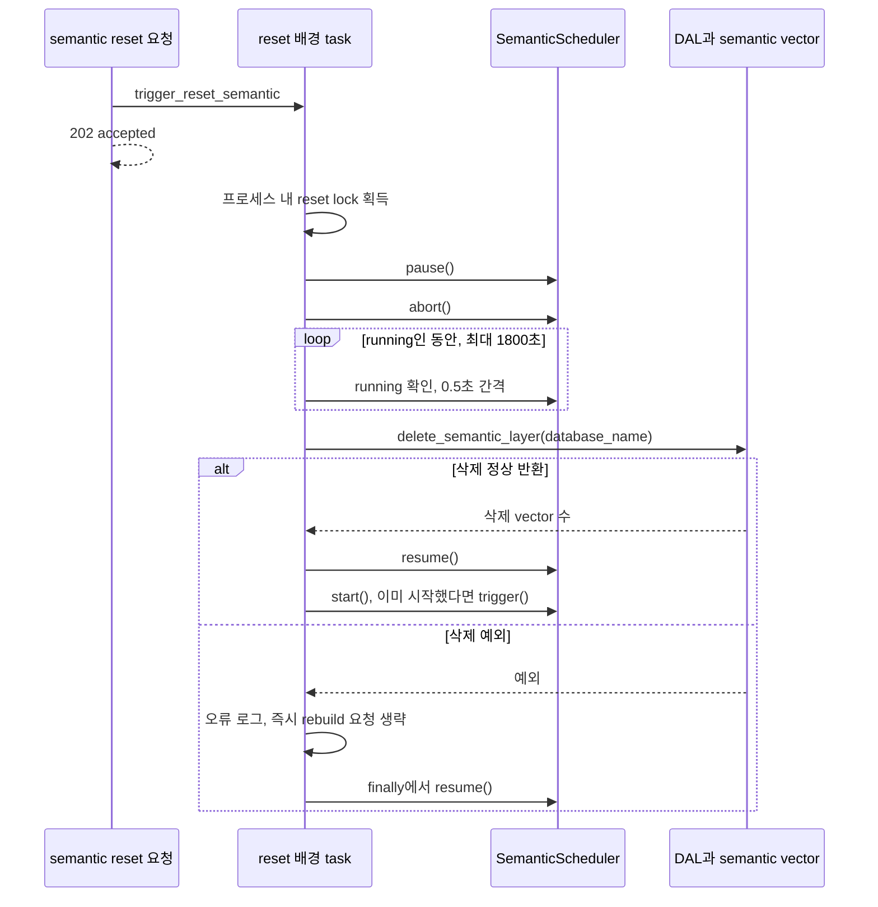
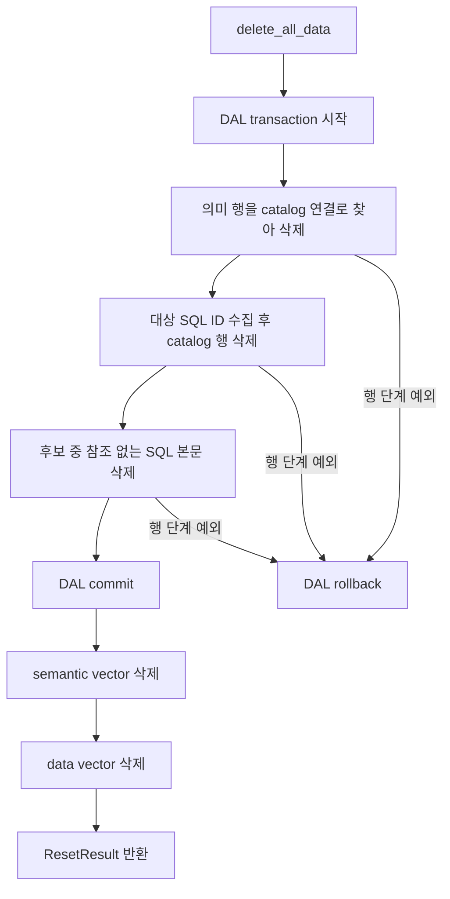
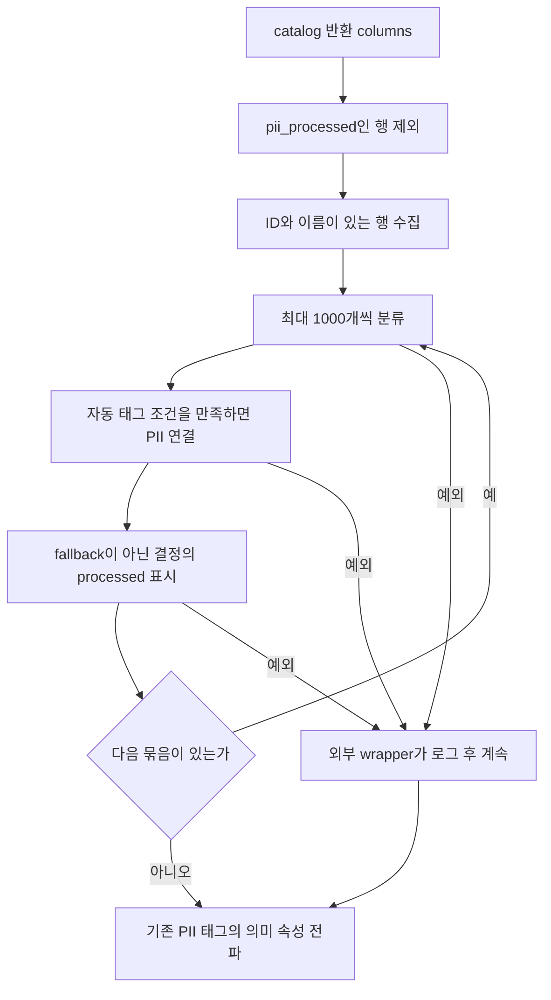
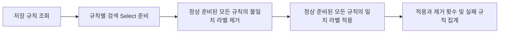

# Chapter 05. reset·보강·부분 실패와 복구의 경계

reset은 진행 중인 수집을 되돌리는 기능이 아니다. 저장된 catalog·의미 계층·검색 vector를 정해진 범위로 삭제하는 기능이며, 의미 reset만 별도로 재컴파일을 요청한다. **원본 DB·저장 행·vector·사용자 작성 분석·실행 이력은 서로 다른 수명과 삭제 조건을 가진다.**

catalog는 수집한 DB 구조 목록, 의미 계층은 업무 개념과 속성·관계를 붙인 결과다. vector는 텍스트를 숫자 배열로 표현한 검색 데이터다. 컴파일은 구조와 샘플을 분석해 의미 계층을 생성·연결하는 작업이며 원본 DB의 테이블을 다시 만드는 작업은 아니다.

로컬 코드·테스트를 읽은 정적 분석이다. 실제 reset·서비스·DB·모델·테스트는 실행하지 않았다. 앞선 [예약·trigger](chapter-01-ingestion-scheduling-and-triggers.md), [구조 diff](chapter-03-catalog-diff-and-relations.md), [키·SQL 이력](chapter-03-1-keys-and-query-history.md), [vector 교체](chapter-04-embedding-and-vector-refresh.md), [용어집](../01-architecture/chapter-00-glossary.md)을 연결한다.

## 1. 같은 reset이라는 이름 아래 서로 다른 진입점이 있다

| 진입점 | 삭제·재실행 | 진행 작업과의 조율 |
| --- | --- | --- |
| POST /ingest/delete?database_name=shop | delete_all_data(shop), 재수집 요청 없음 | 별도 daemon thread. scheduler pause·abort·drain 없음 |
| POST /semantic/reset?database_name=shop | 의미 행·vector 삭제 뒤 컴파일 pass 요청 | 의미 scheduler pause·abort·대기·resume |
| POST /semantic/reset, 이름 생략 | 전체 의미 계층 삭제 뒤 컴파일 pass 요청 | 같은 의미 reset 조율 경로 |
| DAL delete_data_layer | catalog 행·data vector만 삭제 | 호출자가 조율해야 함 |
| DAL delete_all_data(None) | 전체 의미·catalog·두 vector collection 삭제 | 함수 자체가 scheduler를 멈추지 않음 |

POST는 HTTP 요청 방식이며 202 응답은 배경 작업 요청을 접수했다는 뜻이다. 실제 삭제·재구성이 완료되었다는 응답은 아니다. DAL(Data Access Layer)은 DB 읽기·쓰기를 담당하는 계층이다. daemon thread는 프로세스 종료 시 작업 완료까지 기다려 주지 않는 배경 thread다.

/ingest/delete는 database_name이 필수다. helper의 None 기본값이 있다고 HTTP 경로도 이름 없이 전체 삭제를 수행한다고 해석하면 안 된다. 이 분석은 호출 계약을 설명하며 실제 요청을 보낸 기록이 아니다.

API server의 proxy는 HTTP 요청 실패를 로그로 남기고 삼킨다. 특히 `trigger_semantic_reset()` 주석에는 재컴파일 없이 삭제한다고 적혀 있지만 실제 ingestion router는 삭제 후 컴파일을 요청한다. 이 장에서는 proxy의 오래된 설명 대신 최종 소비자의 동작을 기준으로 한다.

근거: [router](../../../code/auto-ontology/auto_ontology/ingestion_service/router.py), [배경 작업 helper](../../../code/auto-ontology/auto_ontology/ingestion_service/ingest.py), [proxy](../../../code/auto-ontology/auto_ontology/server/ingestion/proxy.py).

## 2. 의미 reset: pause → abort → drain → delete → resume → rebuild 요청



pause는 새 pass, 즉 scheduler가 DB들을 한 차례 처리하는 작업을 막는다. abort는 현재 pass가 안전한 지점에서 멈추도록 요청하고 대기 중 trigger를 지운다. drain은 이미 진행 중인 작업이 실제로 끝날 때까지 기다리는 과정이다. pause 없이 abort만 하면 다음 timer·compile 요청이 새 pass를 시작할 수 있어 둘을 함께 사용한다.

`_reset_lock`은 동일 프로세스 안의 의미 reset들을 DB 이름과 무관하게 직렬화한다. 두 reset이 겹쳐 한쪽이 다른 쪽 삭제 중 pause를 해제하지 않도록 한다. 여러 프로세스·일반 수집·/ingest/delete·다른 writer까지 잠그는 분산 lock은 아니다.

배경 asyncio task는 `_background_tasks` set에 넣고 종료 시 제거한다. asyncio는 비동기 작업을 조율하는 Python 기능이다. 이 set은 실행 중 객체를 유지하는 장치이며 DB에 저장된 queue나 프로세스 종료 후 재개 기록이 아니다.

### 2.1 abort는 강제 thread 종료가 아니다

SemanticScheduler.abort는 프로세스 공통 cancellation Event와 scheduler abort flag를 함께 설정한다. Event는 thread 사이에서 공유하는 중단 표시다. pipeline은 **각 table 작업을 시작할 때** 확인하므로 대기 중 table은 건너뛰지만 이미 실행한 table은 끝날 때까지 쓸 수 있다.

compile 진입점은 table pipeline 뒤의 취소 상태를 보고 FK 해석·SQL 속성 제안·bridge 후속 단계를 생략할 수 있다. 여기서 FK(Foreign Key)는 참조 관계, bridge는 여러 객체 사이를 잇는 연결 구조다. 다만 읽은 compile.py는 이 분기를 후속 단계에 들어가기 전에 한 번 검사한다. 이미 후속 함수에 들어간 작업이 즉시 중단된다는 보장은 없다. cancellation 모듈 설명을 모든 단계 사이에 개별 검사가 있다는 뜻으로 확대하지 않는다.

기다리는 coroutine만 취소하면 thread가 멈춘다고 볼 수도 없다. coroutine은 중단·재개 가능한 비동기 함수 실행이다. 실제 reset은 scheduler.running을 확인하며 기다리고 강제 kill을 사용하지 않는다.

### 2.2 30분 뒤에는 실행 중이어도 삭제한다

`_ABORT_DRAIN_TIMEOUT_S=1800`, polling 간격은 0.5초다. 시간 초과 시 경고를 남기고 삭제를 계속한다. 따라서 “어떤 경우든 모든 writer가 멈춘 뒤 삭제”가 절대 조건은 아니다. 장기 모델·DB 호출, 다른 프로세스·writer와의 경쟁은 실행 검증 대상이다.

삭제 실패 시 `finally`로 resume하지만 그 요청에서 start/trigger는 하지 않는다. **영구적으로 컴파일을 금지하는 것은 아니다.** 기존 scheduler의 다음 timer나 별도 요청은 다시 실행할 수 있다.

### 2.3 shop만 지워도 재컴파일 pass는 shop 전용이 아니다

database_name은 삭제 범위에 넘긴다. 이후 scheduler.trigger에는 DB 이름 인자가 없다. 새 pass는 resolve_database_names로 연결 목록을 다시 읽고 설정된 DB들을 처리한다. “shop만 즉시 재컴파일”하는 별도 queue 항목이 아니다.

컴파일 활성 flag도 pass마다 검사한다. 비활성 상태에서 reset이 삭제를 마쳐도 새 pass는 작업 없이 끝날 수 있다. 재컴파일 요청이 사용자 작성 분석·설명·인증을 원상 복원한다는 뜻도 아니다.

근거: [reset 조율](../../../code/auto-ontology/auto_ontology/ingestion_service/ingest.py), [scheduler](../../../code/auto-ontology/auto_ontology/ingestion_service/scheduler.py), [SemanticScheduler](../../../code/auto-ontology/auto_ontology/ingestion_service/semantic_scheduler.py), [취소 Event](../../../code/auto-ontology/auto_ontology/semantic/cancellation.py), [table 취소 확인](../../../code/auto-ontology/auto_ontology/semantic/pipeline.py), [후속 단계 분기](../../../code/auto-ontology/auto_ontology/semantic/compile.py).

## 3. 삭제 함수의 transaction과 vector는 분리되어 있다

transaction은 여러 DB 작업을 함께 확정하거나 취소하는 묶음이다. commit은 확정, rollback은 그 묶음의 취소다.



의미 행을 먼저 지우는 이유는 범위 판정에 catalog 연결이 필요하기 때문이다. catalog를 먼저 지우면 어떤 Term·SQL 속성이 해당 DB 소유인지 추적할 연결이 없어질 수 있다.

| 함수 | 같은 transaction에 들어가는 행 | commit 이후 |
| --- | --- | --- |
| delete_semantic_layer | 대상 의미 행 | semantic vector 삭제 |
| delete_data_layer | 대상 catalog와 고아 SQL 정리 | data vector 삭제 |
| delete_all_data | 의미 행 + catalog + 고아 SQL 정리 | semantic vector → data vector |

vector는 별도 연결로 쓰므로 DAL transaction에 합류하지 않는다. semantic vector 삭제가 실패하면 뒤 data vector 삭제에 도달하지 않는다. 행 삭제 성공 뒤 vector 오류가 나도 DB 행은 자동 복원되지 않는다.

ResetResult의 data_rows·semantic_rows는 이름과 달리 각각 **삭제한 vector 행 수**다. catalog·Term 개수가 아니다. 함수가 마지막 반환까지 도달해야 결과를 받으며, HTTP trigger는 이 결과를 응답에 전달하지 않는다.

## 4. 특정 DB의 의미 객체를 어떻게 고르는가

Term은 업무 개념, ColumnAttribute는 컬럼의 의미 속성, SqlAttribute는 SQL 계산으로 표현하는 의미 속성이다. CustomAnalysis는 사용자가 저장한 SQL 분석이며 PqlAnalysis는 예측 질의 분석이다.

| 객체 | DB별 reset의 선택 기준 | 보존 조건·한계 |
| --- | --- | --- |
| Term | table__term으로 연결된 table이 대상 DB 안에 하나 이상 있고 바깥에는 없음 | 다른 DB와 공유하면 보존 |
| ColumnAttribute | table_id가 대상 DB의 table ID에 속함 | 사용자 수정·인증 여부를 조건으로 보호하지 않음 |
| SqlAttribute | 연결 SQL이 참조하는 table들이 대상 DB에만 속하고 내부 참조가 있음 | 다른 DB 참조도 있으면 보존 |
| CustomAnalysis | SqlAttribute와 같은 SQL→table 범위 판단 | 대상 DB 전용 사용자 분석은 삭제될 수 있음 |
| TextAttribute·Analysis·PqlAnalysis | 이 경로에서 DB 소속을 판정하지 않음 | 특정 DB reset에서는 남음 |

이 조건은 소유 관계를 모델의 연결로 판정한다. table과 연결이 아예 없는 Term·SQL 속성은 단지 이름이 비슷하다는 이유로 선택하지 않는다. 따라서 과거 실패로 연결이 이미 없어진 객체까지 DB별 reset이 모두 찾아 지운다고 보장할 수 없다.

전체 reset(None)은 Term·ColumnAttribute·SqlAttribute·TextAttribute·Analysis·PqlAnalysis·CustomAnalysis를 모두 순회해 지운다. 특정 DB reset과 같은 조건을 모든 DB에 반복 적용하는 방식이 아니다.

### 4.1 공유 객체 예시

```text
shop.orders --------> Term: Order       shop에만 연결 → 삭제 대상
shop.products -----> Term: Product <--- warehouse.stock
                                         양쪽 공유 → 보존

CustomAnalysis A → SQL → shop.orders             → 삭제 대상
CustomAnalysis B → SQL → shop.orders + warehouse.stock → 보존
```

보존된 Product나 분석 B도 shop table을 삭제하면 shop 쪽 연결은 없어질 수 있다. 객체 보존과 모든 입력·관계의 보존은 다르다. 또한 scope를 판정하는 의미 행 조건과 metadata.database_name으로 지우는 vector 조건은 별개이므로 두 저장소의 삭제 집합이 항상 일치한다고 단정하지 않는다.

인증·편집 flag를 보고 자동 생성 객체만 삭제하는 분기는 없다. 재컴파일은 새 의미 결과를 만들 수 있지만 사용자 작성 분석의 내용과 인증을 복원하는 백업 기능은 아니다.

근거: [scoped·unscoped 의미 삭제](../../../code/auto-ontology/auto_ontology/dal/reset.py), [의미 모델·연결 정의](../../../code/auto-ontology/auto_ontology/dal/schema.py).

## 5. catalog·SQL·설정·이력의 서로 다른 수명

catalog는 대상 catalog_database 행을 삭제한다. cascade, 즉 부모 삭제를 따라 자식·연결 행이 함께 지워지는 DB 제약으로 schema·table·column·키·join·태그 대상 연결 등이 제거된다. 원본 DB에 DROP TABLE을 보내는 경로가 아니다.

고아 SQL은 참조가 없어진 SQL 본문이다. 특정 DB reset은 catalog 삭제 전에 연결된 SQL ID를 후보로 모은다. 삭제 후 SQL→table, SQL→column, SqlAttribute→SQL, CustomAnalysis→SQL 네 참조가 모두 없는 후보만 정리한다. 다른 DB나 보존된 분석이 참조하는 SQL은 남을 수 있다. 전체 reset은 전역 무참조 SQL 정리를 사용한다.

| 상태 | 이 reset 함수들의 범위 |
| --- | --- |
| 원본 DB 구조·업무 데이터 | 조회 대상이며 이 삭제 함수가 원본을 삭제하지 않음 |
| catalog의 연결 metadata | catalog_database 행 자체를 지우면 함께 없어짐 |
| Vault 비밀 정보 | DAL reset이 별도로 삭제하지 않음 |
| 환경 변수 연결 정의 | 이 함수들이 수정하지 않음 |
| semantic_compilation_history | reset 대상 테이블 목록에 없음 |
| 대화·메시지·feedback | 이 reset의 명시적 삭제 목록에 없음 |
| 태그·규칙 정의 | 정의 자체를 지우는 코드 없음. 대상 연결은 cascade될 수 있음 |
| cache된 connector·실행 중 thread | DAL 삭제만으로 정리·종료하지 않음 |

직접 reset과 연결 삭제 service는 다르다. `delete_connection()`은 먼저 Vault 비밀을 지우고, 저장 연결 정보를 clear하고, cache를 갱신한 뒤 proxy로 graph reset을 요청한다. proxy 실패를 삼키므로 연결 제거와 잔여 catalog 정리가 하나의 transaction으로 완료되는 것은 아니다.

반대로 /ingest/delete만 직접 호출하면 Vault·환경 연결이 남아 다음 scheduler pass에서 수집 대상이 될 수 있다. 삭제 요청 자체는 즉시 재수집을 trigger하지 않는다. DB 이름만으로 재수집 여부를 판단하지 말고 연결의 실제 등록 출처를 함께 봐야 한다.

### 5.1 PII 삭제 정리는 일반 diff와 동일하지 않다

일반 table·column diff의 삭제 helper는 관련 속성의 PII를 정리한 뒤 삭제한다. 이 reset 경로는 catalog_database를 직접 삭제하며 같은 `untag_attributes_of_columns_being_deleted()` helper를 호출하지 않는다.

다른 DB와 공유되어 살아남은 SQL 속성이 삭제된 컬럼 때문에 PII였던 경우 등에는, cascade로 참조가 사라지는 것과 속성의 PII 상태를 재평가하는 것이 다를 수 있다. 해당 상태가 후속 전파만으로 교정되는지는 미재현 항목이며, 거버넌스 단계에서 추가 확인한다.

근거: [catalog·SQL 삭제](../../../code/auto-ontology/auto_ontology/dal/reset.py), [일반 diff 삭제 helper](../../../code/auto-ontology/auto_ontology/catalog/store/db.py), [연결 삭제 service](../../../code/auto-ontology/auto_ontology/server/connections/service.py), [proxy 실패 처리](../../../code/auto-ontology/auto_ontology/server/ingestion/proxy.py).

## 6. PII 분류는 일부 성공을 저장하고 다음 수집에서 이어간다

PII(Personally Identifiable Information)는 개인 식별 가능 정보다. 수집은 catalog 저장 뒤 설정 flag가 켜져 있으면 `detect_and_tag_pii()`를 호출한다. 이 서비스는 컬럼 이름·table 이름·description을 입력으로 사용하고 샘플 값은 ColumnInput에 넣지 않는다. 구체적인 탐지 규칙·모델 판단은 거버넌스 단계에서 다룬다.



pii_processed는 이 컬럼을 이미 분류했다는 저장 표시다. False·결측만 처리하고 ID·이름이 없으면 건너뛴다. 기본 묶음은 IN_QUERY_BATCH=1000개다. 자동 태그 임계값은 기본 0.9이며 이 서비스는 detector의 should_auto_tag 결과를 사용한다.

각 묶음에서 분류→필요 태그 연결→processed 표시 순서다. PII가 아니라는 정상 결정도 처리 완료로 표시한다. 모델 실패 등에 따른 fallback 결정은 완료로 표시하지 않아 다음 수집의 재시도 대상이 된다.

서비스 전체를 묶은 transaction은 없다. 뒤 묶음이 실패해도 앞 묶음의 완료 표시가 남으며, 같은 묶음에서 일부 태그를 붙인 뒤 표시 전에 실패할 수도 있다. 다음 수집은 기존 태그를 확인해 이미 붙은 경우를 구분한다. 이 재시도는 즉시 별도 작업을 등록하는 것이 아니라 다음 수집에서 미처리 행을 다시 발견하는 방식이다.

### 6.1 태그를 수동으로 뗐다고 자동 재분류하지 않는다

기존 catalog ID로 pii_processed=True가 이어지면 다음 수집은 해당 컬럼을 다시 분류하지 않는다. 사용자가 자동 태그를 제거해도 marker를 자동으로 False로 바꾸는 계약이 아니므로 수동 판단을 덮지 않을 수 있다. 반면 원본 컬럼을 삭제·재생성해 새 객체가 되면 다른 상태로 시작할 수 있다.

`_run_pii_detection()`은 탐지 예외를 잡은 뒤에도 전파 helper를 실행한다. 전파 helper도 오류를 로그로 남기고 삼킨다. 따라서 보강 실패가 run_ingest의 catalog·embedding 처리 전체를 실패로 표시하지 않을 수 있다.

### 6.2 전파는 탐지 결과가 아니라 현재 태그를 읽는다

`propagate_pii_to_attributes()`는 현재 PII 태그가 붙은 컬럼을 기준으로 의미 속성에 전파한다. 수동으로 붙인 PII 태그도 입력이 된다. helper에 넘기는 label/database_name 문자열은 로그용이며 전파 함수에는 DB 필터를 전달하지 않는다.

새 의미 속성은 컴파일 뒤 만들어지므로 semantic pass 끝에서도 전파한다. 순서는 PII 전파 다음 규칙 재적용이다. 수집의 PII flag가 꺼지면 수집 wrapper는 분류·전파를 모두 건너뛰지만, 완료된 semantic pass의 전파 호출에는 같은 flag 검사가 없다. 설정 하나가 모든 PII 관련 후속 작업을 비활성화한다고 가정하지 않는다.

근거: [탐지 저장·marker](../../../code/auto-ontology/auto_ontology/pii_detection/service.py), [수집 wrapper](../../../code/auto-ontology/auto_ontology/ingestion_service/ingest.py), [전파 wrapper](../../../code/auto-ontology/auto_ontology/ingestion_service/pii.py), [속성 전파 DAL](../../../code/auto-ontology/auto_ontology/dal/pii.py).

## 7. 규칙 재적용은 어떤 시점에 실행되는가

규칙은 저장한 검색 조건과, 그 조건에 맞는 객체에 붙일 태그의 조합이다. replay는 수집·컴파일 뒤 현재 목록에 같은 규칙을 다시 적용하는 작업이다.

| 호출자 | 조건 |
| --- | --- |
| 단일 연결 trigger_ingest | run_ingest 정상 반환 뒤 항상 replay |
| DataScheduler | 연결 순회 종료 뒤 의미 컴파일이 꺼져 있을 때 |
| SemanticScheduler | pass 끝에서 stop·disable 상태가 아니면 PII 전파 후 replay |

DB 하나가 컴파일에 실패해도 나머지 순회를 마치면 semantic post 작업을 수행할 수 있다. 중간 abort·disable이나 마지막 DB 처리 도중의 abort는 post 작업을 건너뛴다. 연결이 아예 없거나 시작부터 컴파일이 꺼져 반환하면 이 후속 작업에도 도달하지 않는다.

replay는 호출 DB 한 개로 제한된 작업이 아니라 저장된 규칙 전체를 읽는다. wrapper의 label은 로그용이다. 상위 wrapper가 replay 오류를 잡으므로 규칙 실패가 이전 catalog·컴파일 성공을 취소하지 않는다.

### 7.1 모든 규칙의 제거를 먼저, 적용을 나중에 한다



Select는 SQLAlchemy의 조회문 객체다. 준비한 값이 동일 시점에 고정된 모든 검색 결과 ID의 snapshot이라고 가정하면 안 된다. 이후 각 단계가 그 조회문을 사용한다.

두 규칙이 같은 태그를 붙이는 상황에서, 먼저 라벨을 소유한 규칙이 더 이상 일치하지 않아 제거해도 다른 규칙이 같은 pass에 다시 붙일 수 있도록 순서를 분리했다. 규칙별 제거→적용을 반복하면 이름 순서에 따라 라벨이 사라질 수 있기 때문이다.

검색 준비에 실패한 규칙은 제거·적용에서 모두 제외한다. 검색 실패를 매칭 0건으로 취급해 라벨을 모두 떼지 않는다. 한 규칙의 제거 단계가 실패해도 적용 단계는 시도할 수 있고, 다른 규칙들도 계속한다.

단계 전체가 하나의 transaction은 아니다. 제거 후 적용 전에 종료되면 일부 라벨이 빠진 상태가 남을 수 있다. 다음 replay가 복구할 수 있지만 실행·성공을 보장하는 별도 queue는 없다. 적용/제거 집계와 실패 로그를 pass 성공 여부와 구분한다.

근거: [호출 정책 wrapper](../../../code/auto-ontology/auto_ontology/ingestion_service/rules.py), [규칙의 두 단계](../../../code/auto-ontology/auto_ontology/server/rules/service.py), [수집 scheduler](../../../code/auto-ontology/auto_ontology/ingestion_service/data_scheduler.py), [의미 scheduler](../../../code/auto-ontology/auto_ontology/ingestion_service/semantic_scheduler.py).

## 8. 실패 시점별로 남는 상태와 다음 동작

| 실패·중단 시점 | 남을 수 있는 상태 | 재실행의 한계 |
| --- | --- | --- |
| 일반 수집 schema 중간 실패 | catalog 일부 변경·이전 vector | 재수집이 다시 비교하지만 빈 기존 Schema 복구는 보장하지 않음 |
| PII 뒤 묶음 실패 | 앞 marker·태그 저장, 뒤 미처리 | 다음 수집에서 미처리 컬럼 재검토 |
| embedding 최초 유효 결과 이전 실패 | 변경 catalog + 이전 vector | 다음 수집 모델 호출이 필요 |
| vector reset 뒤 일부 chunk 실패 | 변경 catalog + 일부 새 vector | 다음 전체 embedding 교체 전까지 불일치 가능 |
| delete_all_data의 DAL 행 단계 예외 | 해당 transaction rollback, vector 단계 전 | 이전에 별도 확정된 다른 작업까지 rollback하지 않음 |
| DAL commit 후 semantic vector 삭제 실패 | 행 삭제 확정·vector 잔존, data 삭제 미실행 | reset 재실행도 범위 연결이 사라진 객체를 모두 재발견하지는 못함 |
| semantic vector 삭제 뒤 data vector 실패 | 행 삭제·의미 vector 삭제, data vector 잔존 | 후속 cleanup 또는 재수집 검증 필요 |
| 의미 reset 삭제 실패 | 행 rollback 또는 행/vector 불일치 | scheduler resume, 해당 요청의 즉시 rebuild 없음 |
| rebuild 요청 후 컴파일 비활성 | 의미 삭제 상태 | 활성 상태·후속 실행 필요. 사용자 작성 내용은 자동 복원 아님 |
| rule 제거 후 적용 실패 | 일부 라벨 누락 | 다음 replay 대상·성공을 별도로 확인 |
| 프로세스 종료 | thread/task 중단·부분 저장 | 요청 queue·진행 checkpoint의 자동 재개 보장 없음 |

최대 대기 뒤 삭제, 일반 ingest와 delete thread의 동시 실행, 여러 프로세스 reset은 이 표보다 더 많은 interleaving, 즉 작업 순서 섞임을 만들 수 있다. 문서의 순차 예시는 동시 실행 검증을 대신하지 않는다.

의미 실행 이력도 복구 증거가 아니다. abort·disable은 status=NULL로 남을 수 있고 reset 자체는 history에 별도 실행 결과를 기록하지 않는다. 기존 성공 이력이 남아 있어도 방금 reset의 삭제·재구성 완료를 뜻하지 않는다. /semantic/status의 running도 reset task 자체가 아니라 scheduler의 pass 실행 상태다.

## 9. 읽은 테스트와 검증하지 않은 것

| 테스트 | 확인한 assertion·제약 |
| --- | --- |
| test_semantic_reset_order.py | pause·abort·drain·delete·resume·start 순서, timeout 후 진행, 실패 시 rebuild 없음·resume 유지, start=False면 trigger, 동시 reset 직렬화 |
| dal/tests/test_reset.py | DB별 catalog cascade, 다른 DB·공유 Term·교차 DB 분석 보존, 전용 속성/분석 삭제, scoped PQL 보존·전체 삭제, 의미 reset의 catalog 보존, 반환 vector 수 |
| pii_detection/tests/test_service.py | processed 생략, 묶음별 marker, 뒤 실패 시 앞 marker 유지, 태그 실패 시 그 묶음 marker 미기록 |
| rules/tests/test_service.py | 전체 제거 후 전체 적용, 검색 실패 규칙은 양 단계 제외, 다른 규칙 계속 |
| test_completion_logs.py | 호출자별 replay 조건, PII 실패 격리, 마지막 DB 중 abort 시 후속 작업 생략, 일부 DB 실패 뒤 replay 수행 |

reset 순서 테스트는 가짜 scheduler·삭제 함수로 순서를 검증한다. 실제 모델 thread의 안전한 중단 증거가 아니다. DAL reset 테스트는 실제 catalog DB를 쓰지만 vector를 대체한다. 전체 삭제 테스트는 외부 transaction을 rollback하도록 구성되어 있으나 이 장에서는 실행하지 않았다.

미재현 인계: 실제 writer drain·30분 timeout·task 취소 중 삭제 thread, 두 vector 저장소 장애·공유 객체 metadata 범위, 일반 수집/연결 삭제와 reset 경쟁, Vault·cache와 연결 재등장, 공유 PII 잔존·규칙 적용 중단, history와 reset 상태의 차이.

근거 테스트: [의미 reset 순서](../../../code/auto-ontology/auto_ontology/ingestion_service/tests/test_semantic_reset_order.py), [DAL reset](../../../code/auto-ontology/auto_ontology/dal/tests/test_reset.py), [PII 저장](../../../code/auto-ontology/auto_ontology/pii_detection/tests/test_service.py), [규칙 재적용](../../../code/auto-ontology/auto_ontology/server/rules/tests/test_service.py), [보강·완료 로그](../../../code/auto-ontology/auto_ontology/ingestion_service/tests/test_completion_logs.py), [의미 이력 구현](../../../code/auto-ontology/auto_ontology/ingestion_service/history.py).

수집 단계의 예정 정적 분석은 이 장까지다. 실제 운영 복구·동시성은 미검증으로 남기며, 다음은 의미 컴파일의 대상 선택·table별 처리·sampling·profiling·LLM 판단·저장/embedding·기존 수정 보존을 [전체 계획](../../../.codex/plan/auto-ontology/01_plan.md) 01-5에서 세분화한다.
