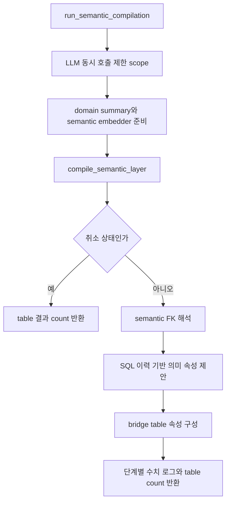
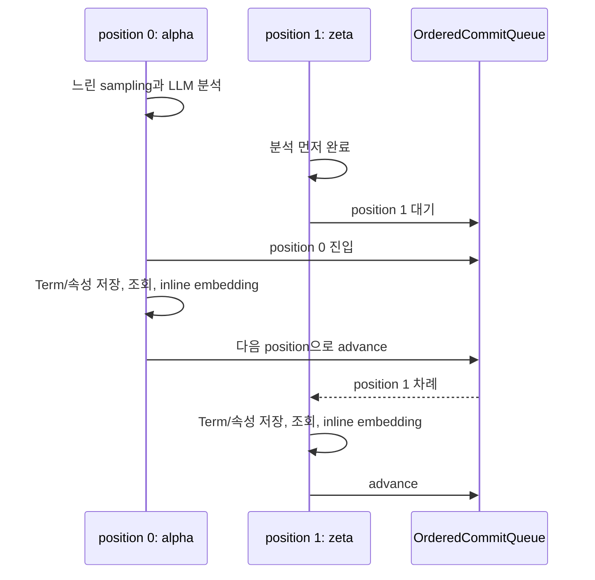
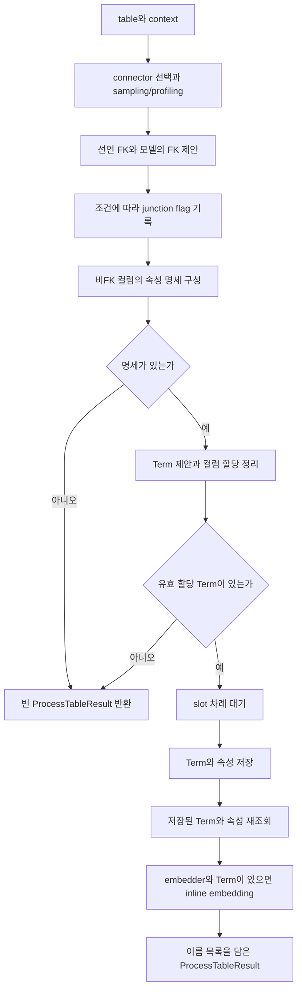
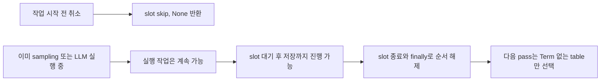

# Chapter 01. 의미 컴파일의 대상 선택·병렬 분석·저장 순서

의미 컴파일은 catalog의 테이블·컬럼을 업무 개념과 의미 속성에 연결한다. catalog는 수집한 DB 구조 목록이고, Term은 주문·고객 같은 업무 개념, ColumnAttribute는 주문 금액처럼 컬럼의 의미를 표현하는 속성이다. **기본 table pipeline은 모든 테이블을 매번 다시 분석하지 않고, Term 연결이 없는 테이블만 선택한다.**

선택한 테이블은 병렬로 분석하지만 Term 이름 결정·저장·inline embedding은 정해진 테이블 순서로 실행한다. inline embedding은 해당 테이블을 저장하는 과정에서 바로 검색용 숫자 벡터를 생성하는 작업이다. 이 순서 조율과 DB transaction은 별개다.

이 장은 로컬 소스·테스트를 읽은 정적 분석이다. 실제 DB·모델·서비스·테스트는 실행하지 않았다. [수집 이후 실제 호출](../01-architecture/chapter-03-runtime-traces.md), [의미 객체](../02-data-model/chapter-02-semantic-entities.md), [reset·취소·복구](../04-catalog-ingestion/chapter-05-reset-and-partial-failure.md), [용어집](../01-architecture/chapter-00-glossary.md)을 함께 참고한다. sampling·prompt·이름 충돌·속성 저장·embedding 상세는 후속 chapter에서 나눈다.

## 1. 두 컴파일 진입점의 범위가 다르다

| 함수 | 입력 → 출력 | 담당 |
| --- | --- | --- |
| run_semantic_compilation | database_name, 선택 domain_summary → int | 호출 제한, table pipeline, 후속 의미 관계·SQL 속성·bridge |
| compile_semantic_layer | database_name, 선택 summary·embedder → int | 대상 조회·정렬·table worker·저장 순서·결과 집계 |
| process_table | table dict, ctx dict, summary·embedder·flags·slot → ProcessTableResult | 한 table의 원본 profiling·의미 판단·저장·inline embedding |

LLM(Large Language Model)은 텍스트를 해석하고 생성하는 대규모 언어 모델이다. compile.py의 진입점은 LLM 동시 호출 제한을 열고, 도메인 요약을 읽고, semantic embedder를 reset=False로 구성한 뒤 pipeline을 실행한다.



FK(Foreign Key)는 참조 관계다. 여기서 semantic FK는 업무 속성을 기준으로 해석한 의미 참조이며 원본 DB 제약을 생성하는 작업이 아니다. bridge는 여러 개념을 이어 주는 연결 구조다. 후속 단계 알고리즘은 관계 분석 단계에서 다룬다.

table count가 0이어도 취소되지 않았으면 후속 세 단계에 도달한다. 따라서 “0 table(s)”와 “DB 전체 의미 작업이 아무것도 하지 않음”은 같지 않다. compile.py는 table pipeline 뒤 한 번 취소를 검사하며, 이미 후속 단계에 진입한 작업을 모든 호출 사이에서 다시 검사하는 형태는 아니다.

pipeline을 직접 호출하면 compile.py의 LLM 제한·embedder 생성·후속 단계가 자동으로 붙지 않는다. 직접 호출과 scheduler가 사용하는 상위 진입점을 구분해야 한다.

근거: [compile.py](../../../code/auto-ontology/auto_ontology/semantic/compile.py), [pipeline.py](../../../code/auto-ontology/auto_ontology/semantic/pipeline.py).

## 2. 도메인 입력·설정은 언제 읽는가

DomainSummary는 업무 맥락을 담는 입력 모델이다. domains는 업무 영역 목록, core_entities는 중심 개념 목록, business_rules는 업무 규칙 설명 목록이며 모두 기본 빈 목록이다. 상위 호출자가 요약을 넘기면 사용하고, 없으면 현재 작업 디렉터리 기준 `.semantic_summaries/{database_name}.json`을 읽는다.

파일이 없으면 None, 읽기·형식 검증에 실패하면 경고 후 None이다. 요약 파일을 이 함수가 자동 조사·생성하는 것은 아니다. 경로도 소스 파일 위치 기준이 아니라 상대 디렉터리다. 이 입력이 prompt에 어떻게 쓰이는지는 Term 추출 장에서 확인한다.

pipeline도 요약이 None이면 loader를 호출하므로 상위에서 요약을 못 얻었을 때 같은 loader에 다시 도달할 수 있다. 반대로 table별로 매번 새 요약을 읽지는 않는다.

| 준비 값 | 읽는 시점·범위 |
| --- | --- |
| SEMANTIC_LLM_MAX_INFLIGHT | compile 모듈 import 시 환경 값, 기본 6 |
| table worker 수 | pipeline의 _WORKERS=3 |
| DISTINCT 조회 flag | pipeline 시작 시 1회, 해당 pass의 table들에 같은 값 전달 |
| sampling breaker | 대상 DB에 대해 pass 시작 시 reset |
| semantic embedder | compile 시작 시 구성, reset=False |

DISTINCT는 중복을 제거한 값을 조회하는 SQL 연산이다. 그 flag가 꺼져도 일반 행 샘플까지 모두 꺼지는 것은 아니다. sampling breaker는 원본 표본 조회가 반복 실패할 때 추가 시도를 줄이는 장치이며 다음 장에서 분석한다.

semantic embedder는 API key가 없으면 경고 후 None이다. 이 경우 기본 의미 행 생성은 진행할 수 있지만 inline semantic vector 생성은 하지 않는다. 수집용 embedding client가 무인증 요청을 지원하는 것과 이 factory의 활성 조건은 별개다. 모델·vector 설정 전체의 호환성을 이 장에서 보장하지 않는다.

근거: [domain.py](../../../code/auto-ontology/auto_ontology/semantic/domain.py), [pass 초기화](../../../code/auto-ontology/auto_ontology/semantic/pipeline.py), [embedder 활성 조건](../../../code/auto-ontology/auto_ontology/semantic/embed.py).

## 3. 대상 선택은 table__term 존재 검사다

`fetch_all_tables_without_term(database_name)`은 catalog table에서 **table__term 행이 하나도 없는 것**을 선택한다. table__term은 table과 Term을 연결하는 저장 테이블이다. DB 이름이 주어지면 해당 DB로 제한하고, None을 직접 주는 DAL 호출은 전체 DB를 볼 수 있다.

반환 table dict는 id·name·description·schema_name이다. ID는 catalog 객체 식별자다. description은 table 자체 설명이며 Term 설명을 대체값으로 찾는 조회가 아니다.

| 상태 | 기본 후보 여부 |
| --- | --- |
| Term 연결 없음 | 후보 |
| Term 하나 연결, 속성 없음 | 후보에서 제외 |
| Term 연결 있음, semantic vector 없음 | 후보에서 제외 |
| Term 연결 있음, 원본 타입·컬럼 변경 | 그 변경만으로 후보가 되지 않음 |
| Term 연결 없음, view 타입 | 이 조회에는 table_type 제외 조건이 없음 |
| Term 연결 없음, column 없음 | 후보가 될 수 있지만 worker의 context 검사에서 건너뜀 |

이 조회는 완성도·실행 성공·변경 시각을 검사하는 상태 머신이 아니다. 상태 머신은 저장 상태와 조건에 따라 다음 처리를 정하는 구조인데, 이 선택은 Term 연결 유무라는 좁은 기준만 사용한다.

후보 목록은 pass 시작에 한 번 읽어 정렬·제출한다. worker마다 아직 Term이 없는지 같은 조건을 다시 확인하지 않으므로, 조회 후 다른 writer가 의미 정보를 붙인 경우와 reset 경쟁은 별도 경계다. 또한 후보·context를 한 번의 일관된 DB snapshot으로 읽는 외부 transaction도 여기에는 없다.

근거: [대상 조회](../../../code/auto-ontology/auto_ontology/dal/datasources.py), [후보 정렬·일괄 제출](../../../code/auto-ontology/auto_ontology/semantic/pipeline.py).

## 4. worker는 무엇을 받아 어떤 맥락을 읽는가

후보마다 position과 display_index를 붙인다. position은 저장 순서의 0부터 시작하는 번호, display_index는 로그에 보이는 1부터 시작하는 번호다. worker 실행 직전에 해당 table의 context를 읽는다.

| context | 주요 필드 |
| --- | --- |
| columns | id·name·data_type·description·ordinal_position·sample_values·format·is_foreign_key_target |
| fks | source_column·target_column·target_table·target_table_id |

columns는 ordinal_position 다음 ID 순서로 읽는다. is_foreign_key_target은 이 컬럼을 참조하는 FK가 있는지 표시한다. fks는 이 table에서 나가는 선언 FK다. 반대 방향 FK 전체를 같은 목록에 넣는 조회는 아니다.

table이 없거나 column이 없으면 빈 context가 될 수 있다. worker는 columns가 비면 process_table을 부르지 않고 None을 반환한다. 후보 조회 이후 원본이나 catalog가 변한 상황까지 table 객체·context가 항상 같은 시점이라고 보장할 수 없다.

## 5. 병렬 분석과 순서 있는 저장을 따로 조율한다

대상은 다음 키로 정렬한다.

```text
(DB명.casefold, schema명.casefold, table명.casefold,
 원래 DB명, 원래 schema명, 원래 table명, table ID)
```

casefold는 대소문자 차이를 줄여 비교하기 위한 문자열 변환이다. ID는 앞의 이름들이 같은 경우에도 순서를 결정할 보조 값이다. 이는 DB의 이름 비교 정책을 바꾸는 작업이 아니다.

왜 저장 순서가 필요한가? 서로 다른 table이 같은 Term 이름을 제안하면 먼저 저장한 쪽이 수식어 없는 이름을 차지할 수 있다. 모델 응답 속도가 이름의 소유자를 바꾸지 않도록 table 순서를 고정한다. 실제 충돌 이름의 형식·기존 사용자 객체 정책은 Chapter 04에서 분석한다.



### 5.1 OrderedCommitQueue와 Slot의 역할

Queue는 다음 저장 번호인 _next_position과 건너뛴 번호 집합을 가진다. Condition은 thread를 대기시키고 순서가 바뀌면 깨우는 동기화 도구다. Slot은 table 하나가 이 queue에서 차례를 얻고 넘기는 context manager다. context manager는 블록 진입·종료 시 정해진 처리를 수행한다.

| 동작 | 실제 처리 |
| --- | --- |
| slot 진입 | position이 next_position과 같아질 때까지 wait |
| slot 종료 | 예외 발생 여부와 무관하게 advance |
| 슬롯 미사용 종료 | skip_if_unused로 번호 포기 |
| 미래 번호 skip | 기다리지 않고 집합에 기록, 나중에 차례가 오면 연속 skip 소비 |
| advance/skip 이후 | notify_all로 대기 thread들을 깨움 |

예를 들어 0번이 실행 중인데 2번이 취소되어도 2번 worker는 자기 차례까지 기다리지 않고 반환한다. 0·1번이 끝나면 queue는 2번을 건너뛰고 3번으로 간다. 취소된 backlog, 즉 대기 작업 더미가 worker를 점유하지 않도록 만든 처리다.

단, 정상 분석을 끝내고 slot을 기다리는 thread는 pool worker를 차지한다. 먼저 오는 table이 느리면 뒤 table들의 저장·embedding도 기다린다. queue.wait에 timeout·취소 재검사로 빠져나오는 분기는 없다. 이미 작업을 시작해 slot을 기다리는 table은 abort 뒤에도 차례를 얻어 저장할 수 있다.

### 5.2 이 queue는 transaction이나 전역 lock이 아니다

한 compile_semantic_layer 호출마다 별도 queue를 만든다. 서로 다른 pipeline·프로세스·수동 호출 전체의 저장 순서를 하나로 통제하지 않는다. process_table 직접 호출은 slot이 없으면 프로세스 내부 `_term_commit_lock`을 쓰지만 pipeline의 각 queue가 이 lock까지 같이 잡는 것은 아니다.

또한 slot이 보호하는 것은 **Term 이름 결정·의미 저장·저장 결과 조회·inline embedding 구간**이다. sampling의 sample_values·format·unique 기록과 junction flag는 그 전에 실행될 수 있다. “table의 모든 DB 쓰기가 정렬 순서대로 발생한다”고 설명하면 틀린다.

`with commit_slot`이라는 이름에 commit이 들어가도 DB commit/rollback을 의미하지 않는다. Term upsert 등 하위 함수의 transaction은 따로 존재한다. 한 table의 모든 의미 행·vector를 묶는 외부 transaction이 이 블록에 있는 것은 아니다.

근거: [Queue·Slot·정렬 키](../../../code/auto-ontology/auto_ontology/semantic/pipeline.py), [직접 호출 lock·저장 블록](../../../code/auto-ontology/auto_ontology/semantic/visit_enter.py), [Term upsert transaction](../../../code/auto-ontology/auto_ontology/dal/terms.py).

## 6. worker 3개와 LLM 제한 6은 서로 다른 수치다

table pool은 최대 3개 worker로 전체 후보를 미리 제출한다. 한 table 안에도 여러 모델 요청·별도 병렬 작업이 있을 수 있어 단순히 “모델 동시 요청 3개”를 뜻하지 않는다.

compile 진입점은 `limit_inflight(기본 6)` scope를 사용한다. scope는 제한이 적용되는 코드 구간이다. LLM 호출 helper는 실제 invoke 주변에서 semaphore를 획득한다. semaphore는 동시 진입 수를 제한하는 동기화 도구다. 모델 요청을 기다리는 동안 table worker가 비워지는 방식은 아니다.

| 제한 | 적용 범위·한계 |
| --- | --- |
| table workers=3 | 이 pipeline의 _process 실행 수 |
| canonical slot | 이 queue의 Term 저장·inline embedding 구간 한 차례 |
| limit_inflight 기본 6 | 공통 helper의 LLM invoke. embedding HTTP 요청·원본 SQL 조회 제한과 별개 |
| 여러 active limit scope | 등록된 scope 중 가장 작은 값의 semaphore 선택 |
| max_inflight ≤ 0 | 새 제한을 등록하지 않음. 다른 scope의 제한을 해제하지 않음 |
| 마지막 scope 종료 | 환경 LLM_MAX_INFLIGHT 기준으로 복귀 |

scope 제한은 프로세스 공통 상태를 통해 worker에 전달된다. DB 하나에만 독립된 quota, 즉 요청 할당량은 아니다. 다른 호출 경로가 같은 helper를 사용하면 활성 제한의 영향을 받을 수 있다. 이미 획득한 semaphore·scope 전환 중 호출까지 재할당하는 구조는 아니므로 동적 전환 순간의 절대 동시 수 보장은 별도 검증해야 한다.

근거: [compile의 제한 scope](../../../code/auto-ontology/auto_ontology/semantic/compile.py), [limit_inflight와 invoke guard](../../../code/auto-ontology/auto_ontology/utils/llm_invoke.py).

## 7. process_table의 처리 단계를 지도화한다



profiling은 표본에서 고유성·값 형식 같은 특성을 알아보는 작업이다. junction은 두 개 이상의 업무 역할을 연결하는 table 구조다. attribute spec은 어떤 컬럼을 어떤 의미 속성으로 제안할지 담는 중간 명세다. sampling·키 판단·명세·prompt의 알고리즘은 Chapter 02~04에서 자세히 추적한다.

이 장에서 확인한 중단·오류 계약은 다음과 같다.

- connector가 없거나 sampling breaker가 열렸으면 표본을 생략할 수 있다. profiling 예외도 경고 후 계속한다.
- FK 제안·Term 추출 등은 process_table 전체를 감싸는 공통 try가 없으므로 예외가 worker로 갈 수 있다.
- 명세 또는 유효 컬럼 할당이 없으면 빈 ProcessTableResult를 반환한다. None이 아니다.
- _commit_terms는 Term 저장 뒤 각 속성을 순회한다. table 전체 transaction은 없고 중간 예외가 날 수 있다.
- 저장 결과 재조회와 inline embedding은 각각 경고로 실패를 처리할 수 있다. 이 경우에도 이름 목록 결과를 반환할 수 있다.

속성 merge가 None을 반환해도 _commit_terms는 현재 attr_names에 이름을 추가한다. 따라서 이 반환 목록은 모든 속성 행의 존재를 재검증한 목록이 아니다. 실제 식별 키·거부·보존 조건은 저장 장에서 확인한다.

## 8. count와 성공 로그가 보장하는 범위

ProcessTableResult는 term_names와 attr_names 두 목록이며 기본값은 빈 목록이다. pipeline은 future 결과가 None이 아니면 count를 1 늘린다. 생성 Term 수나 저장 속성 수를 더하는 코드가 아니다.

| worker 결과 | count | 가능한 저장 상태 |
| --- | --- | --- |
| column 없음·취소 → None | 증가 안 함 | 기본 의미 처리 생략 |
| 예외를 잡아 None 반환 | 증가 안 함 | 앞서 profiling·Term 일부를 썼을 수 있음 |
| 명세 없음 → 빈 결과 객체 | 1 증가 | Term 없음이어도 table은 집계됨 |
| 의미 저장 후 embedding 실패를 내부 처리 | 1 증가 가능 | 의미 행 있음·vector 누락 가능 |
| 이름 목록이 있는 결과 | 1 증가 | 이름 수 전체의 저장 성공을 입증하지는 않음 |

worker는 fetch_table_context·process_table 예외를 로그 후 None으로 바꾼다. pipeline이 table별 실패 목록이나 실패 count를 상위에 반환하지는 않는다. 따라서 모든 table 작업이 내부에서 실패해도 pipeline은 0을 반환하고 compile.py의 후속 단계·정상 반환으로 이어질 수 있다.

외부로 전파될 수 있는 예외도 있다. 후보 조회·설정 읽기·embedder.vdb.create_index는 worker의 try 밖이다. embedder가 있으면 후보가 0개여도 create_index에 도달한다. 이를 단순히 “후보가 없으니 DB 작업 없음”으로 해석하면 안 된다.

단계 로그의 `_step()`도 finally에서 `done in ...`을 남긴다. 예외가 있었어도 시간이 기록될 수 있으므로 done 문구만 성공 증거로 쓰지 않는다. scheduler의 DB 성공 집계 역시 진입점이 예외 없이 반환했다는 기준이다. 관련 범위는 [수집·보강·reset의 상태](../04-catalog-ingestion/chapter-05-reset-and-partial-failure.md)와 연결한다.

## 9. 취소·재실행이 모든 부분 결과를 복구하지는 않는다



취소 Event는 프로세스 공통이다. SemanticScheduler는 pass 시작에 clear_cancel하고 abort 시 request_cancel과 scheduler abort flag를 설정한다. pipeline·process_table 직접 호출은 새 pass 시작에 이 flag를 자동 초기화하지 않는다.

이미 시작한 table은 강제로 죽이지 않는다. ThreadPoolExecutor context는 진행 작업을 기다리고, slot 종료는 예외가 있어도 다음 순서를 넘긴다. 미진입 table은 finally의 skip_if_unused로 차례를 포기한다. 조건이 충족되지 않으면 영원히 대기할 수 있는 queue timeout·프로세스 장애까지 해결하는 지속성 장치는 없다.

설명용 부분 실패 예시:

```text
1. orders에 Term 연결을 저장함
2. 일부 속성 merge 또는 embedding 실패
3. worker가 예외를 None으로 바꾸거나 embedding 경고 후 반환
4. 다음 pass: orders는 table__term 존재로 기본 후보에서 제외
```

이런 상태에서 정기 컴파일만 다시 실행하면 누락 속성·vector가 모두 보충된다고 보장할 수 없다. 반면 빈 결과만 반환해 Term이 전혀 생기지 않았다면 다음 pass에도 후보로 남을 수 있다. reset은 사용자 객체 삭제를 포함할 수 있어 단순한 자동 재시도와 같지 않다.

queue 순서는 이름 소유권의 실행 간 변동을 줄이지만 LLM 출력·표본·기존 저장소·다중 프로세스 상태까지 동일하게 만드는 것은 아니다. deterministic이라는 코드·테스트 이름을 “동일한 의미 결과를 항상 생성”한다는 뜻으로 확대하지 않는다.

## 10. 읽은 테스트와 다음 분석

| 테스트 | 실제 확인한 조건 |
| --- | --- |
| test_pipeline.py | 2개 table 호출·count, LLM 준비 순서를 뒤집어도 alpha→zeta commit, column 없는 table 생략, table 오류를 잡아 count 0 반환 |
| test_cancellation.py | Event 설정·해제, queue backlog 취소, 미취소 전체 처리, scheduler abort 연결, 연속/미래 위치 skip 후 다음 slot 도달 |
| test_datasources_semantic.py | Term 연결 table 제외·DB 범위·table 자체 설명·컬럼 정렬·나가는 FK·없는 table의 빈 context |
| test_visit_enter_step_logs.py | sampling→FK→Term 추출→쓰기→embedding 로그 순서, connector 없음의 생략 로그 |
| test_llm_invoke.py | 제한 scope 종료·예외 해제, 겹친 scope·최소 active 제한, 비양수 scope가 타 제한을 해제하지 않음 |

pipeline·queue·모델 호출 테스트는 주로 대체 함수로 실행 순서와 계약을 검사한다. DAL 테스트는 실제 catalog DB를 요구한다. 어느 테스트도 이 장에서 실행하지 않았다. test_deterministic.py의 컬럼 후보·날짜 설명 등의 assertion은 이후 명세 장의 검증 대상으로 남긴다.

미재현 항목: 느린 선두 slot의 대기·이미 시작한 작업 취소, 여러 pipeline·직접 호출 경쟁, profiling 일부 저장 뒤 예외, Term 생성 후 속성/vector 누락, active semaphore 전환 순간의 동시 수, 요약 파일 위치·기존 Term과 모델 출력의 변화.

근거 테스트: [pipeline](../../../code/auto-ontology/auto_ontology/semantic/tests/test_pipeline.py), [취소·skip](../../../code/auto-ontology/auto_ontology/semantic/tests/test_cancellation.py), [DAL 대상·context](../../../code/auto-ontology/auto_ontology/dal/tests/test_datasources_semantic.py), [단계 로그](../../../code/auto-ontology/auto_ontology/semantic/tests/test_visit_enter_step_logs.py), [LLM 제한](../../../code/auto-ontology/auto_ontology/utils/tests/test_llm_invoke.py).

다음은 Chapter 02의 sampling·profiling이다. [의미 컴파일 계획](../../../.codex/plan/auto-ontology/01-5_semantic-compilation.md)에서 실제 원본 SQL·행/컬럼 한도·DISTINCT·샘플 변환·고유성·날짜 format·breaker·실패 저장을 추적한다.
