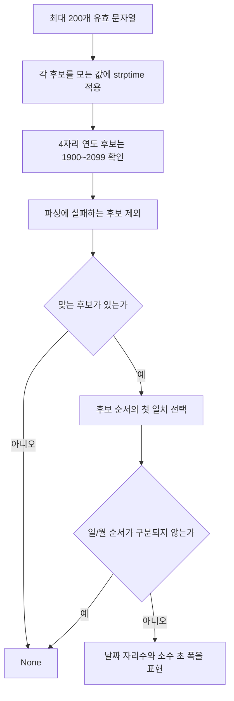
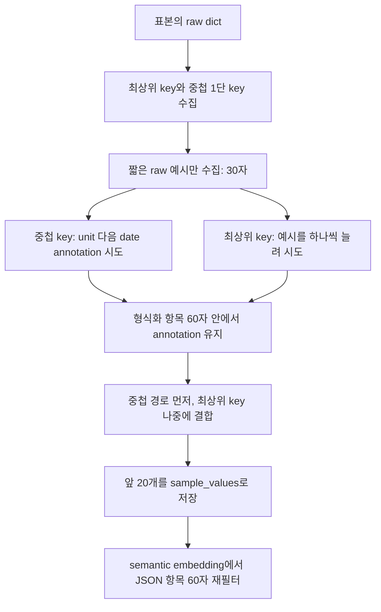

# Chapter 02-1. 날짜 형식 추론·혼합 경고와 JSON 표본 표현

profiling은 값의 업무 의미뿐 아니라 SQL 조건을 어떻게 써야 하는지에 필요한 표현 정보를 만든다. 같은 날짜도 `950324`와 `1995-03-24`는 다른 비교 문자열이 필요하고, JSON의 금액 값은 경로와 단위를 함께 알아야 해석할 수 있다. **확정 format, 혼합 경고, JSON 예시 문자열은 서로 다른 알고리즘의 결과다.**

format은 값의 저장 표기, JSON은 key·value·배열을 갖는 자료 형식이다. JSONB는 Postgres가 JSON을 구조화해 저장하는 타입이다. 여기서는 JSON 계열 타입에 적용하는 공통 코드 경로를 설명하며 실제 원본 DB·모델·테스트를 실행하지 않았다.

선행: [표본 조회·계산·저장](chapter-02-sampling-and-profiling.md), [대상·context](chapter-01-compilation-targets-and-orchestration.md), [용어집](../01-architecture/chapter-00-glossary.md).

## 1. 날짜 format을 추론할 대상과 입력

`calculate_columns_profiling()`은 선언 타입이 날짜 계열이거나 char·text·string 등 텍스트 계열이면 `infer_date_format(series)`를 호출한다. series는 표본 컬럼에서 결측을 뺀 pandas 값 목록이다. 선언 타입 검사도 substring, 즉 타입 문자열 일부 포함 여부다. 실제 DB 타입 파서로 정규화하는 단계는 아니다.

추론 함수는 다음처럼 입력을 줄인다.

1. None은 제외한다.
2. 각 값을 str로 바꾸고 공백을 제거한다. 실제 날짜 객체도 문자열 표현으로 읽는다.
3. 빈 문자열·40자 초과·이미 본 동일 문자열은 제외한다.
4. 첫 200개 서로 다른 유효 문자열까지 모은다.

따라서 “모든 값에 맞는 format”은 전체 DB·최대 1,000행 전체가 아니라 **추론에 남긴 최대 200개 값**의 범위다. 긴 이상 값은 추론을 실패시키는 증거로 남지 않고 생략될 수 있다. 후반에 다른 형식이 있어도 200개 이후면 반영되지 않을 수 있다.

## 2. 정규식 모양 대신 strptime으로 후보를 검증한다

strptime은 문자열이 지정한 날짜·시각 형식으로 해석되는지 확인하는 Python 함수다. 후보 format은 연도·월·일·시간·분·초·소수 초의 조합이며 다음 계열을 포함한다.

| 계열 | 표현 예시 |
| --- | --- |
| 날짜·시각 | YYYY-MM-DD HH:MM:SS, T 구분자, 소수 초, 분까지 |
| 날짜 | YYYY-MM-DD, YYYY/MM/DD, DD/MM/YYYY, MM/DD/YYYY, 하이픈·점 변형 |
| 짧은 연도 | DD/MM/YY 등, YYMMDD |
| 붙여 쓴 숫자 | YYYYMMDD, YYYYMM, YYYY |
| 시각만 | HH:MM:SS, HH:MM |



4자리 연도를 아는 `%Y` 후보는 1900~2099만 허용한다. `%y` 두 자리 연도에는 같은 검사를 적용하지 않는다. 이 기준은 코드의 선택이며 역사 자료·미래 날짜·시간대 표기를 모두 포괄하는 일반 날짜 인식기가 아니다.

### 2.1 모호한 일/월은 추측하지 않는다

| 입력 | 결과·이유 |
| --- | --- |
| 03/04/2011, 13/07/2011 | DD/MM/YYYY. 13월은 불가능 |
| 04/03/2011, 07/13/2011 | MM/DD/YYYY. 뒤 값의 일/월 후보가 갈림 |
| 03/04/2011, 05/06/2011 | None. 두 읽기가 모두 가능 |
| 201208, 201301 | YYYYMM. 후보 순서와 실제 연도 검증을 적용 |
| 950324, 970213 | YYMMDD |
| 2012-08-24, 24/08/2012 | 하나의 후보에 모두 맞지 않으면 None |

동시에 맞는 후보가 있으면 정의한 순서가 우선한다. 별도의 날짜 추론 모델로 맥락을 묻는 방식은 아니다. `_INDISTINGUISHABLE`에 등록한 쌍들이 함께 맞으면 결과를 내지 않는다. 후보 목록에 없는 시간대·언어·표기까지 지원한다고 확대하지 않는다.

### 2.2 저장 문자열의 자리수를 표현한다

strptime은 `4/4/20` 같은 한 자리 월·일도 읽을 수 있다. `_narrow_padding()`은 날짜만 있는 표기에서 한 자리 구성요소를 보면 MM/DD를 M/D로 좁힌다. 시간까지 있는 format은 월과 분을 혼동해 바꾸지 않도록 이 조정을 생략한다.

소수 초는 한 자리 `.0`과 여섯 자리 `.123456`를 구분해 `.f`, `.ffffff`로 표현한다. 자릿수가 섞였으면 관측한 최대 폭을 표시한다. 원본 값을 실제 변환하거나 모든 문자열의 폭을 통일하는 작업은 아니다.

## 3. format 미추론과 혼합 warning은 다르다

추론한 format은 반환 profile과 저장용 date_formats에 넣는다. None이면 저장 dict에 넣지 않으므로 **이전 catalog format은 유지**될 수 있다. “이번 표본은 형식이 섞여 추론 못 함”이 기존 format을 비우는 요청은 아니다.

별도 `_date_shapes_seen()`은 텍스트의 정규식 모양을 본다. 정규식은 문자 배열의 형태를 검사하는 규칙이다. 연-월-일·연/월/일·슬래시의 모호한 일/월·짧은 연도·영문 월 표기 몇 가지를 인식한다. 문자열이 아니면 건너뛰고 알 수 없는 모양도 세지 않는다.

이 모양 검사는 날짜의 실제 유효성을 strptime으로 확인하지 않는다. 첫 YYYY-MM-DD 패턴은 문자열 시작의 모양을 읽으므로 뒤 시각 등 나머지 전체 형식을 동일하게 검사하는 것도 아니다.

| 경로 | 보는 값 | 결과 |
| --- | --- | --- |
| infer_date_format | 남긴 최대 200개 서로 다른 40자 이하 문자열 | 하나의 format 또는 None |
| 일반 텍스트 혼합 검사 | 행 표본의 전체 비결측 series 중 문자열 | 서로 다른 인식 모양이 2개 이상이면 warning |
| JSON 내부 날짜 힌트 검사 | key별 제한된 짧은 예시 | 경로 문자열에 모양/혼합/예시 annotation |

일반 텍스트 혼합 경고는 저장할 sample_values의 끝에 추가한다. 반환 profile.sample_values 자체에 같은 경고를 넣는 코드는 아니다. 최대 빈도 다섯 값만으로 검사하지 않아 표본의 드문 형식도 잡을 수 있지만, 지원하지 않는 형식은 알 수 없다.

경고는 일반 문자열의 30자 필터를 적용한 뒤 추가하므로 그보다 긴 항목도 catalog에 저장될 수 있다. 이후 semantic embedding은 일반 항목 길이 30자를 다시 적용해 해당 warning을 제외할 수 있다. 저장·prompt·검색 vector가 모두 같은 경고를 본다고 가정하면 안 된다.

예를 들어 새 표본의 혼합 경고와 이전에 저장한 YYYY-MM-DD format이 함께 남을 수 있다. 속성 설명의 `_date_format_clause()`는 fresh format이 없으면 ctx.format을 사용한다. 이 불일치는 실행 검증 대상이며 추론 실패가 과거 확신을 자동 철회한다고 설명하지 않는다.

근거: [date_format.py](../../../code/auto-ontology/auto_ontology/semantic/date_format.py), [모양·저장 필터](../../../code/auto-ontology/auto_ontology/semantic/visit_enter.py), [기존 format 유지](../../../code/auto-ontology/auto_ontology/dal/datasources.py), [설명 format 소비](../../../code/auto-ontology/auto_ontology/semantic/deterministic.py).

## 4. JSON은 반환 profile와 저장 표본의 의미가 바뀐다

선언 타입에 json이 들어 있으면 일반 샘플 길이 필터 대신 별도 경로로 간다. 반환 profile에는 일반 집계에서 얻은 원본 JSON dict/list 등의 빈도 상위 값이 남지만, **저장 sample_values는 key·경로를 설명하는 문자열 목록**이 된다.

```json
{
  "amount": {"value": 45000, "currency": "KRW"},
  "event": {"start_date": "2024-01-02"},
  "status": "paid"
}
```

설명용 저장 표현은 다음과 같다.

```text
amount.value [unit: amount.currency]
amount.currency
event.start_date [date format: YYYY-MM-DD]
status [e.g. 'paid']
```

이 문자열은 JSON 경로 안내다. `->`, `->>` 같은 DB별 JSON 접근 SQL을 만들어 실행한 결과가 아니다. unit annotation도 실제 currency=KRW라는 값까지 저장하는 것이 아니라 단위가 담긴 sibling key의 경로를 알려 준다. sibling은 같은 부모 아래 있는 형제 key다.

### 4.1 top5 원본 JSON만 검사하는 것은 아니다

JSON 표현은 표본 DataFrame의 해당 컬럼에서 비결측 raw 값들을 다시 순회한다. dict인 값만 key 추출에 사용한다. 문자열로 들어온 JSON을 json.loads로 해석하거나 JSON 배열 안의 객체들을 재귀적으로 찾아가는 단계는 없다.

최상위 value가 dict이면 그 바로 아래 key들을 `부모.자식`으로 기록한다. 더 깊은 dict를 무한 재귀로 평탄화하지 않는다. value가 dict가 아니면 최상위 key와 가능한 예시를 수집한다. list도 이 최상위 분기에 들어갈 수 있으나 예시의 문자열 길이 제한을 받는다.

같은 key가 어떤 행에서는 dict이고 다른 행에서는 scalar라면 두 종류 표현이 함께 생길 수 있다. schema 검증이나 원본 구조 통일을 이 함수가 수행하지는 않는다.

## 5. 단위 key와 날짜 key에 붙는 annotation

annotation은 이름 뒤에 붙이는 추가 설명이다. 중첩 container마다 unit·units·uom·currency·measure라는 이름의 key를 대소문자 무시로 찾는다. 여러 개면 관측 key 순서에서 먼저 찾은 하나를 사용한다. 그 key 자신을 제외한 sibling들에 `[unit: 부모.단위key]`를 붙인다.

중첩 key 이름에 date·_dt·day·time·moment·schedule·_on·_at 중 하나가 포함되면 날짜 힌트로 취급한다. key별로 최대 3개 서로 다른 예시를 수집하며 None과 30자 초과 문자열은 제외한다. 이름 기반 휴리스틱, 즉 경험 규칙이라 실제 날짜인지 확정하는 조건은 아니다.

| 예시의 모양 | 날짜 annotation |
| --- | --- |
| 인식 모양 1개 | `[date format: 모양]` |
| 인식 모양 2개 이상 | 혼합 warning, 길면 짧은 warning 시도 |
| 인식 모양 없음 | 첫 raw 예시의 `[e.g. ...]` |
| 예시 없음 | 날짜 annotation 없음 |

이 경로의 date format이라는 문자열은 앞의 strptime 확정 format과 다르다. 모양에 따라 슬래시 일/월이 모호하다는 표현이 나올 수 있고 유효하지 않은 날짜가 모양만 맞을 수도 있다. 세 예시에 나타나지 않은 혼합 형식까지 보장하지 않는다.

최상위 scalar key는 날짜 힌트 여부와 무관하게 최대 5개 서로 다른 짧은 예시를 수집한다. 빈도순 5개가 아니라 원본 표본에서 먼저 관측한 서로 다른 예시들이다. 따라서 일반 top5 알고리즘과도 다르다.

## 6. 30자·60자·20개 제한의 적용 순서



30자는 raw 예시 하나를 모을지 결정하는 기준이다. 60자는 key와 대괄호·인용부호·예시·단위를 합친 최종 문자열의 annotation 예산이다. 둘을 같은 제한이라고 보면 안 된다.

중첩 경로의 `_safe_annotate()`는 unit·date 순서로 덧붙인다. 하나가 60자를 넘으면 break하며 이후 annotation을 더 시도하지 않는다. unit이 먼저 들어가 날짜 설명을 넣을 공간이 없어질 수 있고, unit 자체가 안 맞으면 뒤 날짜 설명도 시도하지 않을 수 있다.

혼합 날짜는 전체 모양을 나열한 warning이 길면 짧은 warning을 고르지만, unit까지 합친 최종 예산에서 탈락할 수 있다. 경고가 항상 저장되는 것은 아니다.

최상위 key는 예시 1개부터 개수를 늘려 60자 안에 들어가는 최대 prefix를 고른다. 하나도 안 맞으면 key만 남긴다. `_safe_annotate`도 base 자체의 길이를 자르지는 않는다. **key 이름만 이미 60자를 넘으면 catalog에는 남아도 embedding 재필터에서 항목 전체가 빠질 수 있다.** source 주석의 “key를 잃지 않는다”는 의도를 이 경우까지 확대하지 않는다.

최종 문자열은 중첩 container 경로를 먼저, 최상위 key를 나중에 넣고 앞 20개만 저장한다. 중요도·빈도·이름순 정렬은 없다. 넓은 JSON에서 후순위 key는 누락될 수 있다. 최상위 key와 경로에 점이 들어 있는 특수 입력의 모호성을 해결하는 escaping도 이 표현에 없다.

## 7. JSON 저장의 빈 결과와 후속 소비

dict key를 하나도 못 얻으면 그 JSON 컬럼을 저장 sample dict에 넣지 않는다. 이전 sample_values를 비우는 코드가 아니다. JSON array만 반환하는 컬럼·문자열 JSON·빈 dict가 계속 나와도 과거 값이 남을 수 있다.

반환 profile은 저장 annotation과 같은 목록으로 교체하지 않는다. 그래서 같은 table 처리에서 명세 생성은 원본 profile의 dict 문자열을 볼 수 있고, 이후 semantic embedding은 재조회한 저장 경로 문자열을 볼 수 있다. FK 제안은 profiling 전 ctx의 기존 샘플을 사용하므로 이번 저장 key가 즉시 반영되는 것도 아니다.

| 단계 | 값·표현 |
| --- | --- |
| 원본 집계 | Python dict/list → JSON grouping key |
| fresh profile | 자주 등장한 원본 JSON 값 |
| catalog sample_values | key·path·annotation 문자열 list를 JSON 문자열로 encode |
| display helper | parse 후 문자열 목록으로 render |
| semantic embedding | JSON 타입이면 항목 길이 60자 이하만 표시 |

semantic embedding이 전체 20개를 다시 자르는지, 속성 description에 어떻게 쓰는지는 의미 embedding 장에서 이어간다. 여기서는 sample 표시 함수가 타입별 30/60자 제한을 적용하고 긴 항목을 잘라 쓰는 대신 제외한다는 계약을 확인했다.

후속 확인: 기본 inline 속성 재조회에는 datatype이 없어 일반 30자 규칙으로 갈 수 있다. bulk 조회는 datatype을 제공한다. 따라서 builder의 JSON 60자 기능과 기본 compile의 실제 입력을 구분해야 한다. [Chapter 05](chapter-05-semantic-embedding-and-failure-boundaries.md)에서 이 차이를 추적했다.

근거: [JSON path·annotation 생성](../../../code/auto-ontology/auto_ontology/semantic/visit_enter.py), [sample 문자열 저장·복원](../../../code/auto-ontology/auto_ontology/utils/sample_values.py), [타입별 embedding 길이 필터](../../../code/auto-ontology/auto_ontology/semantic/embed.py).

## 8. 오류와 테스트 근거

일반 집계의 컬럼별 try가 JSON path 생성 전체를 감싸지는 않는다. 비정상 key 타입 등 annotation 단계에서 오류가 나면 profiling 함수가 최종 세 저장을 호출하기 전에 끝날 수 있다. 정상 JSON dict의 key가 문자열이라는 driver 계약과 임의 Python dict를 구분해야 한다.

| 읽은 테스트 | 확인한 assertion |
| --- | --- |
| test_date_format.py | 날짜/시간 표기·소수 초 폭·일/월 확정/모호성·6자리 구분·혼합 None·연도 범위·중복/None·native date |
| test_visit_enter.py 날짜 테스트 | format 저장, 날짜 선언 샘플 저장 제외, TEXT 날짜 샘플 유지 |
| test_visit_enter.py array 테스트 | 텍스트 선언 list를 날짜 regex에 넘겨도 비문자열을 건너뛰고 다른 컬럼 profiling 유지 |
| test_sample_values.py | JSON encode/decode·scalar/container 타입·표시 길이·None·빈 값의 저장 생략 |

JSON 중첩 unit/date annotation·60자 fallback·20개 cap 전체를 직접 검증하는 test 파일은 이번 검색에서 찾지 못했다. 해당 상세 분기는 코드로 추적했으며 테스트 통과로 검증했다고 표시하지 않는다.

미재현 항목: 201번째 이후 다른 날짜 형식·40자 초과 이상 값·시간대·한 자리 날짜 변형, 기존 format과 혼합 warning 공존, 경고/긴 key의 embedding 탈락, 여러 unit key·3단 중첩·배열 JSON·20개 초과·표본 순서 변화, 원본/저장/fresh ctx의 소비 차이.

테스트: [날짜 추론](../../../code/auto-ontology/auto_ontology/semantic/tests/test_date_format.py), [profiling·날짜·array](../../../code/auto-ontology/auto_ontology/semantic/tests/test_visit_enter.py), [sample helper](../../../code/auto-ontology/auto_ontology/utils/tests/test_sample_values.py).

다음은 table 역할·FK 제안과 의미 속성 명세다. [의미 컴파일 계획](../../../.codex/plan/auto-ontology/01-5_semantic-compilation.md) Chapter 03에서 어떤 컬럼을 모델에 주고 제외하는지, profile·기존 설명·format·샘플이 prompt와 결과 검증에 어떻게 쓰이는지 추적한다.
