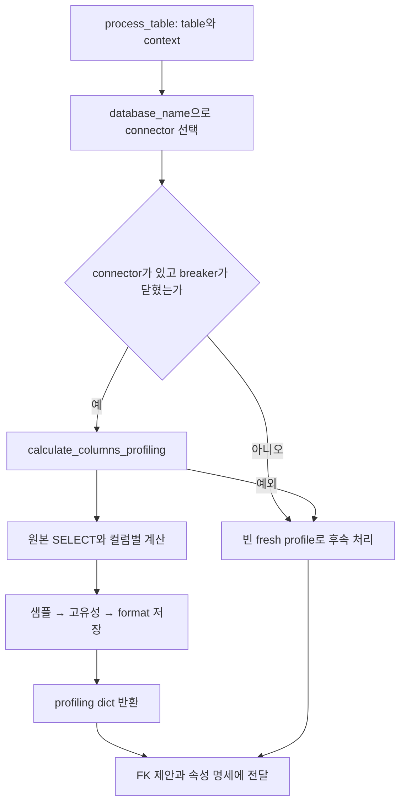
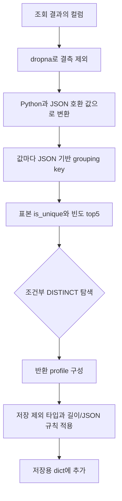
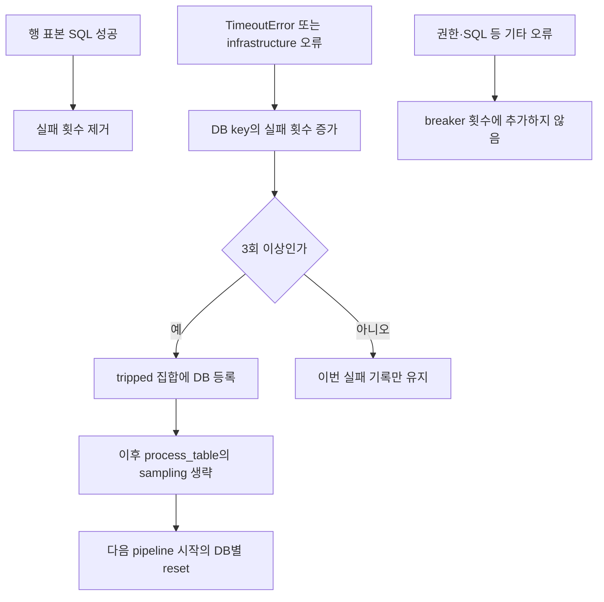

# Chapter 02. 원본 표본 조회·분포 계산·저장과 실패

sampling은 원본 행 일부를 읽는 작업이고 profiling은 그 값에서 중복·빈 값·자주 등장하는 값·표현 형식을 알아보는 작업이다. **여기서 얻는 고유성은 원본 전체에 대한 제약 검증이 아니라 최대 1,000행 표본의 관측 결과다.** 반환 profiling, catalog 저장값, 모델에 보여 주는 값도 서로 다르다.

이 장은 원본 조회·값 계산·저장·실패를 다룬다. [날짜 형식·JSON 표본 보충](chapter-02-1-date-formats-and-json-samples.md)에서는 별도 알고리즘을 자세히 설명한다. [대상 선택과 병렬 처리](chapter-01-compilation-targets-and-orchestration.md), [용어집](../01-architecture/chapter-00-glossary.md)을 함께 참고한다. 로컬 소스·테스트 정적 분석이며 실제 DB·모델·테스트를 실행하지 않았다.

## 1. process_table에서 어디에 놓이는가



connector는 원본 DB 조회 객체다. `_resolve_connector()`는 등록된 connector를 순회해 DB 이름을 casefold 비교하고 첫 일치 객체를 반환한다. casefold는 대소문자 차이를 줄이는 문자열 변환이다. DB 이름이 없거나 일치 객체가 없으면 표본을 생략한다. 같은 이름의 여러 connector 중 최적 대상을 고르는 추가 단계는 없다.

breaker는 원본 조회가 반복 실패할 때 더 이상 시도하지 않게 하는 회로 차단 장치다. 열려 있으면 table의 sampling을 생략하지만 의미 분석 전체를 중단하지 않는다. profiling에서 예외가 나도 process_table의 wrapper는 경고 후 빈 fresh profile로 후속 단계를 진행할 수 있다. fresh는 이번 실행에서 새로 얻은 값이라는 뜻이다.

이 처리는 [저장 순서 slot](chapter-01-compilation-targets-and-orchestration.md)보다 앞이다. table별 분석은 병렬이므로 profiling DB 쓰기도 table의 Term 저장 순서와 별도로 발생할 수 있다.

## 2. 어떤 SQL을 어디까지 실행하는가

`connector.qualify(schema_name, table_name)`가 원본 엔진의 규칙에 맞는 전체 table 이름을 만든다. 공통 코드가 schema.table 문자열을 임의로 조립하지 않는다.

```sql
-- 설명용 Postgres 형태. 실제 이름 표기는 connector가 결정한다.
SELECT * FROM "sales"."orders" LIMIT 1000;
```

ORDER BY·무작위 추출·전체 행 수 조회·컬럼별 projection은 이 SQL에 없다. projection은 읽을 컬럼을 골라내는 작업이다. 따라서 무작위 대표 표본을 보장하지 않으며, 저장 제외 타입도 SELECT *에서는 먼저 읽는다. 행 수 제한은 컬럼 수·문자열 크기·원본 처리 비용의 상한이 아니다.

| 조건 | 실행 |
| --- | --- |
| supports_statement_timeout이 정확히 True | execute(sql, timeout_s=120) |
| 그 외 | execute(sql), 별도 timeout 인자 안 줌 |
| query 예외 | 실패를 breaker에 전달, 경고 후 `{}` 반환 |
| None 또는 빈 DataFrame | `{}` 반환, 저장 호출 없음 |
| 정상 비어 있지 않은 DataFrame | 실제 반환 컬럼들을 순회 |

DataFrame은 이름이 있는 컬럼·행으로 구성한 표다. `is True` 검사라 임의의 truthy 값, 즉 참처럼 평가되는 값만으로 timeout 지원을 켜지는 않는다. 120초는 지원 connector에 넘기는 요청이며 전체 table profiling·pass의 제한 시간이 아니다. 지원하지 않는 connector의 실제 제한은 앞선 [실행·timeout 분석](../03-connectors/chapter-11-execution-timeout-and-resources.md)을 참고한다.

qualify 호출은 query try 블록 밖이다. 여기서 예외가 나면 calculate 함수의 query 실패 처리 대신 상위 process_table의 profiling wrapper까지 전파될 수 있다.

## 3. 반환 행의 컬럼마다 무엇을 계산하는가



NULL은 값이 없는 상태다. dropna는 pandas가 결측으로 판단한 값을 제외한다. 코드가 반환 결과의 컬럼을 순회하므로 목록에 있는 catalog 컬럼을 모두 반드시 프로파일링하는 것은 아니다. driver가 이름을 바꾸거나 일부 컬럼이 반환되지 않으면 저장 이름 매칭과도 차이가 날 수 있다.

### 3.1 원본 타입을 문자열 하나로 뭉개지 않는다

| 원본 값 | `_json_ready_sample()` 처리 |
| --- | --- |
| numpy scalar | item()을 지원하면 기본 Python 값으로 해제 |
| None·bool·int·float·str | 그대로 |
| Decimal | 정수값이면 int, 나머지는 float |
| 날짜·시각 객체 | isoformat 문자열 |
| bytes | UTF-8 decode, 오류 문자는 대체 |
| dict | key를 문자열로, value는 재귀 변환 |
| list·tuple·set 등 | 원소를 재귀 변환한 list |
| 기타 객체 | str(value) |

JSON은 문자열·숫자·배열·객체 등을 표현하는 데이터 형식이다. Decimal을 float로 바꾸면 정밀도 변화가 가능하고 set의 원래 순서는 보장되지 않는다. 이 함수가 driver 자료형을 원래 SQL 타입과 완전히 같은 의미로 보존하는 것은 아니다.

### 3.2 JSON key로 중복과 빈도를 센다

dict·list는 그대로 set·Counter의 key로 쓸 수 없어 `_sample_key()`가 JSON 문자열을 만든다. dict key 정렬과 default=str을 사용하고 변환에 실패하면 str로 fallback한다.

예를 들어 숫자 `1`, 문자열 `"1"`, Boolean `True`는 각각 다른 key를 갖는다. 같은 내용의 list·dict도 집계할 수 있다. 모든 수치 타입 차이·비표준 float·사용자 객체까지 SQL의 동등 비교와 같다는 보장은 아니다.

`is_unique = bool(keys and len(set(keys)) == len(keys))`다.

| 표본의 비결측값 | is_unique | 해석 |
| --- | --- | --- |
| `[10, 20, 30]` | True | 관측한 값은 모두 다름 |
| `[10, 10, 20]` | False | 표본 안에 중복 있음 |
| `[10]` | True | 단 한 값도 True가 될 수 있음 |
| 전부 NULL | False | 고유성 미확인과 별도 상태로 저장하는 것이 아님 |

NULL 개수·비율, 전체 table의 COUNT DISTINCT, DB의 UNIQUE 제약을 이 식이 검사하지 않는다. 이후 의미 관계가 이 marker를 근거로 사용하더라도 표본 기반이라는 한계는 남는다.

top5는 Counter의 빈도순 key 최대 다섯 개를 첫 원본 값으로 다시 바꾼 목록이다. 빈도가 같은 값은 관측 순서의 영향을 받는다. top5 정렬이 원본 SQL의 ORDER BY로 보장되는 것은 아니다.

## 4. 드문 범주 값을 찾는 DISTINCT 탐색

cardinality는 서로 다른 값의 개수다. 다음 네 조건이 모두 맞으면 낮은 cardinality 컬럼을 추가 조회한다.

1. DISTINCT 설정이 켜져 있다.
2. 표본 is_unique가 False다.
3. 표본 top5 개수가 5보다 작다.
4. 선언 타입에 char·text·string·clob·enum 중 하나가 포함된다.

```sql
SELECT DISTINCT "status" FROM "sales"."orders"
WHERE "status" IS NOT NULL LIMIT 26;
```

cap=25에 1을 더해 조회한다. 반환한 값이 25개 이하이면 범주 후보로 채택하고, 26개면 많다고 보고 None으로 돌아가 top5를 유지한다. 0행·오류도 None이며 table profiling 전체를 바로 실패시키지는 않는다.

기존 top5를 앞에 두고 DISTINCT에서 새로 발견한 값만 뒤에 붙인다. 이때 표본 is_unique는 다시 계산하지 않는다. DISTINCT 조회에 ORDER BY는 없고, 두 SQL 사이 snapshot도 고정하지 않으므로 concurrent 원본 변경까지 반영한 최종 전체 범주 목록이라고 보장할 수 없다.

예를 들어 표본에는 open·closed만 있었지만 추가 조회에서 banned가 발견되면 반환 sample_values가 늘어난다. 따라서 반환값이 항상 top5 또는 다섯 개 이하라는 함수 설명은 정확한 상한이 아니다. 안정된 원본에서는 최대 25개의 범주를 얻을 수 있고, 텍스트 혼합 날짜 warning 같은 별도 항목도 저장 목록에 추가될 수 있다.

**LIMIT 26은 결과 행 제한이지 전체 scan 비용 보장이 아니다.** 엔진 실행 방식에 따라 많은 원본 행을 읽을 수 있다. DISTINCT 설정을 꺼도 기본 SELECT * LIMIT 1000은 남는다.

## 5. 반환 profile와 저장 dict는 분리된다

반환 구조는 다음과 같다.

```text
{
  "status": {"sample_values": ["open", "closed", "banned"],
             "is_unique": False, "format": None},
  "created_at": {"sample_values": ["2024-01-01", "2024-01-02"],
                 "is_unique": True, "format": "YYYY-MM-DD"}
}
```

이 예시는 실행 결과가 아닌 설명용 구조다. 반환 profile은 저장 필터 전 값을 갖는다. 선언 타입에 date·time·timestamp·datetime·uuid가 있으면 해당 컬럼의 **샘플 저장만** 생략하며 uniqueness·format 계산·반환 항목은 별개다.

일반 문자열은 30자 이하여야 저장한다. 숫자·Boolean은 자릿수와 무관하게 보존하고 list·dict는 렌더링 길이로 판단한다. JSON 선언 타입은 일반 길이 필터 대신 key/path 표현으로 바꾸는 별도 경로를 사용한다. 날짜와 JSON 규칙은 [Chapter 02-1](chapter-02-1-date-formats-and-json-samples.md)에서 추적한다.

한 컬럼에서 dropna·변환·집계가 실패하면 그 컬럼을 로그 후 건너뛴다. 그러나 날짜 추론·JSON annotation 등 모든 후속 로직이 같은 컬럼별 try 안에 들어 있지는 않다. 그 뒤 예외는 함수 전체를 중단해 마지막 저장 호출에 도달하지 못할 수 있다.

## 6. 저장은 샘플 → 고유성 → format 세 번이다

`store_column_sample_values → store_column_uniqueness → store_column_date_formats`를 순서대로 호출한다. 세 함수를 감싸는 외부 write_transaction은 이 profiling 함수에 없다.

| 저장 항목 | 처리·기존 값의 경계 |
| --- | --- |
| sample_values | 타입을 유지한 list를 JSON 문자열로 저장 |
| 빈 list·전부 None | dump 결과 None이면 쓰지 않음. 이전 샘플 유지 가능 |
| 저장 제외 타입·길이 전부 초과 | 해당 컬럼을 저장 dict에 안 넣음. 이전 값을 지우지 않음 |
| is_unique | 계산에 성공한 컬럼은 bool로 기록, False도 갱신 |
| format | 추론한 비어 있지 않은 값만 기록. 미추론이면 기존 값 유지 |

각 항목은 table_id·column name으로 제한해 CASE UPDATE 한 문장으로 갱신한다. CASE UPDATE는 컬럼 이름별로 다른 값을 한 SQL UPDATE에 담는 방식이다. 반환 결과의 컬럼 이름이 catalog와 맞지 않으면 그 행이 갱신되지 않을 수 있다. 이 함수는 갱신 건수를 비교해 전체 성공을 검증하지 않는다.

샘플 저장 뒤 uniqueness 쓰기가 실패하면 앞 샘플이 남을 수 있고, 함수는 정상 profile 반환에 도달하지 않는다. 상위 wrapper가 오류를 잡으면 같은 table의 후속 모델 분석은 빈 fresh profile로 계속할 수 있다. **저장된 일부 새 값과 현재 메모리 입력이 달라지는 상태가 가능하다.**

또한 빈 표본·샘플 필터 탈락·format 미추론은 과거 관측을 초기화하지 않는다. 원본 분포나 날짜 표현이 바뀌었어도 이전 값이 남을 수 있음을 후속 소비자와 함께 확인해야 한다.

근거: [profiling 본체](../../../code/auto-ontology/auto_ontology/semantic/visit_enter.py), [3종 저장과 CASE UPDATE](../../../code/auto-ontology/auto_ontology/dal/datasources.py), [sample JSON encode·decode](../../../code/auto-ontology/auto_ontology/utils/sample_values.py).

## 7. breaker는 정확히 무엇을 세는가



기본 임계값은 3회다. 오류의 타입이 TimeoutError이거나 `is_infrastructure_error()`가 연결·세션 장애로 분류하면 센다. 그 classifier는 메시지 패턴도 사용한다. 샘플 호출은 statement 인자를 따로 전달하지 않으므로 그 분류가 원본 오류를 완벽하게 구분한다고 단정하지 않는다.

중요한 세부 동작은 다음과 같다.

- 정상 행 SELECT는 빈 DataFrame을 돌려줘도 query 뒤의 record_success에서 횟수를 지운다.
- 성공한 DISTINCT probe는 record_success를 부르지 않는다. 다른 종류 오류도 기존 횟수를 지우지 않는다.
- record_success는 실패 횟수만 지우며 이미 tripped된 상태를 닫지 않는다. 다음 pass의 reset이 필요하다.
- process_table 진입에서만 is_open을 확인한다. 진행 중 table의 각 DISTINCT 호출 사이에 즉시 중단 검사는 없다.
- 직접 calculate_columns_profiling을 반복 호출하면 breaker가 열렸다는 이유만으로 자체 생략하지 않는다.

따라서 “연속 실패”는 모든 SQL 결과의 엄격한 연속성을 뜻하지 않는다. 예를 들어 DISTINCT 장애 사이에 성공 DISTINCT가 있어도 횟수는 남고, 다음 table의 정상 행 SELECT는 횟수를 지울 수 있다. 병렬 table들의 성공·실패 도착 순서도 영향을 준다.

key는 connector DB 이름의 casefold이며 이름이 없으면 객체 ID 문자열이다. lock으로 자료구조 접근을 보호하지만 여러 실행의 DB 상태를 따로 분리하지는 않는다. 다음 pipeline은 해당 DB 이름만 reset해 다른 DB를 유지한다. 같은 DB를 두 pipeline이 동시에 처리하면 한쪽 reset이 다른 실행 상태에 영향을 줄 수 있다.

## 8. 모델 소비자는 같은 값을 보지 않는다

| 소비자 | 실제 입력 |
| --- | --- |
| FK 제안 | fresh profiling의 is_unique를 사용. 샘플 문자열은 기존 ctx column.sample_values에서 구성 |
| 속성 명세·설명 | `_get_column_samples()`는 fresh profile sample을 문자열화. 선언 날짜 타입은 제외 |
| format 설명 | fresh profile.format이 없으면 기존 ctx.format으로 fallback |
| 이후 별도 catalog 조회 | 저장된 JSON·marker·format을 읽음 |
| semantic embedding | 저장된 속성/context를 재조회한 뒤 별도 표시 길이 규칙 적용 |

ctx는 profiling 전에 fetch_table_context로 읽은 값이다. profiling이 DAL에 새 샘플을 썼다고 ctx dict가 자동 갱신되는 것은 아니다. FK 제안 코드도 fresh 샘플로 ctx를 덮는 대신 고유성만 별도 인자로 넣는다. 함수 주석에서 “표본을 후속 판단에 전달”한다고 적혀 있어도 필드별 소비를 구분해야 한다.

후속 prompt의 구체적 조합은 Chapter 03에서 분석한다. 이 profiler에는 PII 태그로 조회·샘플 저장을 제외하는 분기가 없다. PII는 개인 식별 가능 정보이며, 타입·길이 필터를 개인정보 판별로 해석하면 안 된다.

근거: [FK prompt 입력](../../../code/auto-ontology/auto_ontology/semantic/fk_suggester.py), [명세의 sample·format 소비](../../../code/auto-ontology/auto_ontology/semantic/deterministic.py), [semantic embedding 표시](../../../code/auto-ontology/auto_ontology/semantic/embed.py), [breaker 오류 분류](../../../code/auto-ontology/auto_ontology/connectors/db_errors.py).

## 9. 테스트 근거·실행 검증 인계

test_visit_enter.py에서 읽은 assertion은 다음 범위를 다룬다.

- connector qualify·공백 이름 quoting·LIMIT 1000, timeout 지원/비지원 인자.
- dict/list·텍스트 선언 array의 집계, 숫자/Boolean 타입 보존, 날짜/긴 값의 반환·저장 차이.
- 표본 top5가 충분할 때 DISTINCT 생략, flag가 꺼져도 기본 행 SELECT 수행.
- timeout 반복·SQL 오류 제외·성공 후 횟수 제거·DB별 reset·DISTINCT 장애 누적·process_table 생략·DB key 대소문자.

sample helper 테스트는 JSON 문자열·list·None·수치/문자 구분·표시 길이·round trip을 검사한다. 실제 원본 SQL 비용·대표성·전역 고유성을 증명하는 테스트가 아니다. 테스트는 모두 읽기만 했다.

미재현 항목: 큰 컬럼·원본 변경 중 두 SELECT·cap 초과/누락, 비표준 float/Decimal 정밀도·driver 컬럼명, 세 저장 중 실패·과거 샘플 잔존, 병렬 breaker 순서·같은 DB 중복 pass, fresh profile와 ctx의 실제 모델 입력 차이.

근거 테스트: [profiling·breaker](../../../code/auto-ontology/auto_ontology/semantic/tests/test_visit_enter.py), [sample helper](../../../code/auto-ontology/auto_ontology/utils/tests/test_sample_values.py).

이어서 [Chapter 02-1](chapter-02-1-date-formats-and-json-samples.md)에서 날짜의 모호성·혼합 경고, JSON 경로·단위·예시와 저장/embedding 한도를 설명한다. [상세 계획](../../../.codex/plan/auto-ontology/01-5-1_profiling-details.md)을 기준으로 다음 명세 분석에 인계한다.
