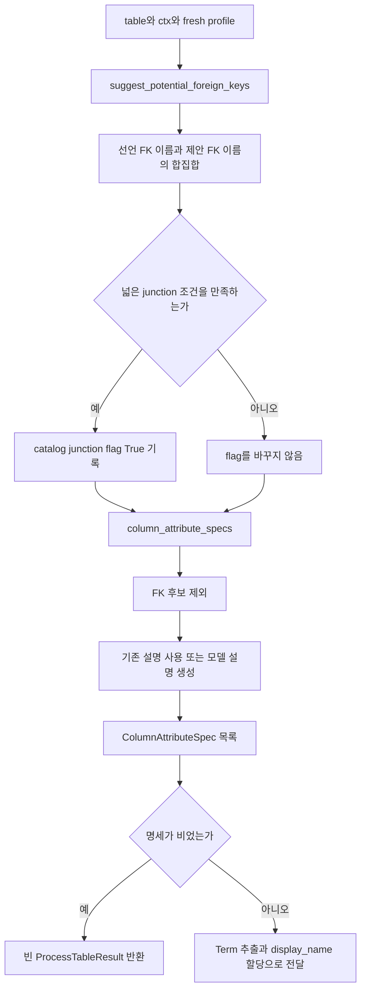
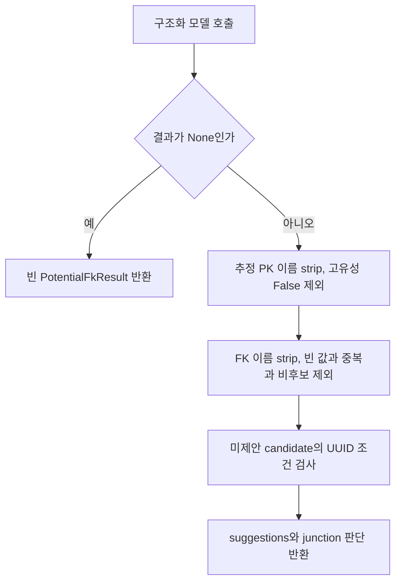
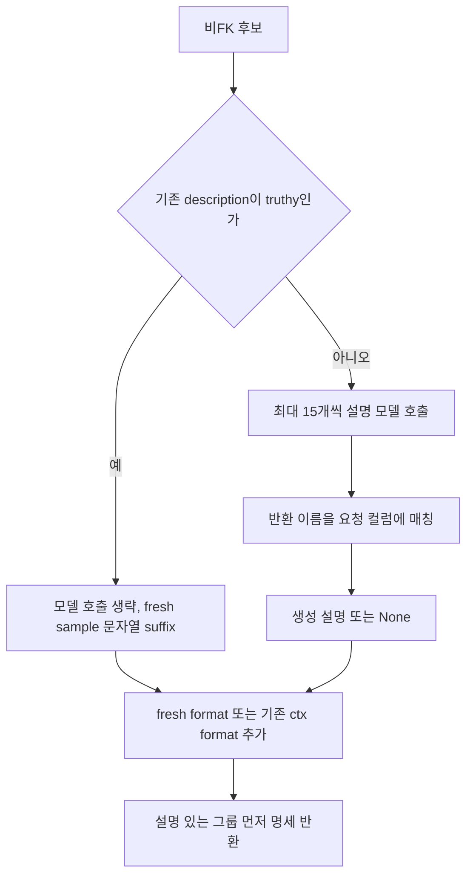

# Chapter 03. 테이블 역할·키 제안과 의미 속성 명세

표본을 얻은 뒤에는 어떤 컬럼이 다른 개체를 참조하는지 판단하고, 나머지 컬럼을 의미 속성 후보로 만든다. **이 단계의 FK 제안은 참조 대상과 연결을 확정하는 작업이 아니라, 컬럼의 역할을 추정해 이후 속성 후보에서 제외하는 판단이다.** 잘못된 제안은 실제 FK 행을 만들지 않아도 의미 속성 후보를 줄일 수 있다.

FK(Foreign Key)는 다른 컬럼을 참조하는 키, PK(Primary Key)는 행 식별에 쓰는 기본 키다. Term은 업무 개념이며 ColumnAttribute는 컬럼의 의미를 나타내는 속성이다. 명세(spec)는 아직 저장되지 않은 속성 후보의 이름·타입·설명 등을 담는 중간 데이터다.

로컬 소스·테스트 정적 분석이며 실제 DB·모델·테스트는 실행하지 않았다. [대상·context와 실행 순서](chapter-01-compilation-targets-and-orchestration.md), [표본과 소비 차이](chapter-02-sampling-and-profiling.md), [날짜·JSON 표현](chapter-02-1-date-formats-and-json-samples.md), [용어집](../01-architecture/chapter-00-glossary.md)을 참고한다. Term 할당·이름 충돌·최종 저장은 다음 장의 범위다.

## 1. process_table의 이 구간은 무엇을 연결하는가



ctx는 catalog에서 읽은 columns·나가는 FK 목록이다. fresh profile은 이번 표본의 고유성·샘플·format이다. junction table은 한 행이 둘 이상의 개체 역할 사이의 관계를 표현하는 테이블이다. 두 FK를 가졌다는 이유만으로 모든 테이블을 junction으로 보지는 않도록 모델에 지시한다.

| 책임 | 실제 함수·출력 |
| --- | --- |
| FK/PK 후보·table 역할에 대한 모델 응답 | FkAndPkResult |
| 필터와 보정을 마친 FK 후보·역할 | PotentialFkResult |
| table flag 저장 | mark_table_as_junction |
| 비FK 컬럼의 후보 명세 | column_attribute_specs → list[ColumnAttributeSpec] |
| 다음 단계 | extract_term → apply_display_names_to_specs |

근거: [process_table](../../../code/auto-ontology/auto_ontology/semantic/visit_enter.py), [자료 모델](../../../code/auto-ontology/auto_ontology/semantic/models.py).

## 2. 선언 PK·선언 FK·참조 대상 컬럼을 다르게 처리한다

FK 제안 함수의 candidate는 다음 조건이다.

```text
이름이 있음
AND 이름이 table.pk에 없음
AND 이름이 선언 FK의 source_column에 없음
AND is_foreign_key_target이 참이 아님
```

source는 참조를 보내는 쪽이고 target은 참조받는 쪽이다. is_foreign_key_target은 다른 FK가 이 컬럼을 가리키는지 나타낸다. 이름 비교는 여기서 대소문자 정규화 없이 수행한다.

이 filter는 measures·날짜·설명·flag 등을 코드로 전부 제거하지 않는다. 그런 역할의 제외는 주로 모델 system prompt의 지시다. system prompt는 모델의 작업 원칙, human prompt는 이번 테이블의 구체적 입력이다.

### 2.1 실제 pipeline에는 table.pk가 전달되지 않는다

`_pk_column_names()`는 table dict의 pk를 읽는다. 문자열이면 하나의 이름, 목록이면 이름 집합으로 만든다. 하지만 기본 `fetch_all_tables_without_term()`은 id·name·description·schema_name만 반환하고, fetch_table_context도 table.pk를 추가하지 않는다. process_table이 PK를 별도로 조회하는 단계도 이 호출 사슬에 없다.

따라서 **catalog에 PK가 저장되어 있는 것과 FK 제안 입력에 선언 PK가 들어 있는 것은 다르다.** 단위 테스트처럼 table.pk를 직접 제공하면 제외하지만 기본 pipeline에서는 pk_names가 비어 있을 수 있다. 참조받는 PK가 target flag로 제외될 수는 있어도 모든 PK를 대신하는 것은 아니다.

함수의 prompt·설명에 “기본 키 제외”가 적혀 있다는 이유만으로 실제 모든 선언 PK가 필터링된다고 보장하지 않는다. 이 차이는 PK 데이터 전달을 검증할 후속 실행 항목이다.

### 2.2 후보가 없으면 항상 모델을 생략하는가

candidate가 없고 전체 columns 개수가 2 이하일 때만 빈 PotentialFkResult로 바로 반환한다. 3개 이상이면 후보가 없어도 table의 행 역할을 판단하기 위해 모델을 호출한다. 이미 선언 FK들로 구성된 넓은 table도 junction 판단을 받을 수 있는 이유다.

근거: [PK·후보 선택](../../../code/auto-ontology/auto_ontology/semantic/fk_suggester.py), [대상과 context 반환 필드](../../../code/auto-ontology/auto_ontology/dal/datasources.py).

## 3. FK 모델은 어떤 정보를 받고 무엇을 반환하는가

human prompt에는 schema.table 이름, table 설명, PK 이름 목록, 선언 FK source 목록과 참조 table, 모든 컬럼, candidate 컬럼을 넣는다. 모든 컬럼·candidate는 별도 블록이며, candidate에서 뺀 target 컬럼도 전체 컬럼 블록에는 남는다.

| 컬럼 표시 정보 | 출처 |
| --- | --- |
| 이름·타입·설명 | ctx.columns |
| samples | ctx.sample_values를 parse/render, 항목별 30자 초과 제외 |
| is_unique | fresh profile에서 가져옴. 없으면 표시 안 함 |
| 참조 역할 | 선언 FK의 source→target table |
| domain summary | 이 함수의 prompt에는 전달하지 않음 |

fresh profile.sample_values로 ctx를 덮지 않는다. 따라서 같은 호출에서 새 고유성 marker와 이전에 읽은 sample이 함께 표시될 수 있다. 날짜·JSON profile의 소비 차이는 이전 장과 연결한다.

system prompt는 대략 다음 판단을 요구한다.

- 이름·타입·설명·sample상 다른 개체를 가리키는 identifier를 FK 후보로 판단한다. identifier는 식별값이다.
- bare id나 자기 table 식별자는 자체 PK일 수 있지만 표본 is_unique=False이면 PK로 추정하지 않는다.
- 측정량·이름·자유 텍스트·시각·flag는 일반적으로 FK 제안에서 제외한다.
- junction은 독립 개체 행이 아니라 적어도 두 역할의 관계 행이어야 한다. 같은 개체를 가리키는 서로 다른 역할도 허용한다.
- 단일 부모의 상세·확장 table이나 독립 생명주기를 가진 사건/거래 table은 보수적으로 분류한다.

이는 모델 지시이며 관계 존재의 증명이나 전체 데이터 검증은 아니다.

모델 client는 reasoning용 get_llm_client(temperature=0.0)를 사용한다. reasoning은 복잡한 판단을 담당하도록 구분한 모델 역할이다. 구조화 응답 wrapper에 FkAndPkResult를 요구하며 이 모델은 다음 기본값을 가진다.

```text
fk_suggestions: [{column_name, rationale}]   기본 []
pk_column_names: [이름]                     기본 []
is_junction_table: Boolean                 기본 False
junction_table_rationale: 문자열           기본 ""
```

추가 필드를 금지하는 형식 검증과, 실제 후보 이름·참조 의미의 검증은 다르다. PK 후보를 실제 catalog.pk에 저장하는 단계도 여기에는 없다.

## 4. 응답 필터와 UUID 보정의 정확한 범위



FK 응답은 이름·rationale의 양끝 공백을 정리한다. candidate에 없는 이름과 중복 이름은 제외한다. 이 코드가 FK의 target table·target column을 찾아 검증하지는 않는다. 반환 데이터에도 target 필드가 없다.

추정 PK 이름은 공백을 정리하고 fresh is_unique가 정확히 False인 것을 제외한다. 전체 후보 집합에 속하는지 동일하게 검증하는 별도 단계는 이 PK 집합에 없다. 이 집합은 UUID 보정에서 사용하고 최종 PotentialFkResult에는 담지 않는다. 모델이 PK로 추정한 이름이라고 명세 후보에서 자동 제거되는 것도 아니다.

### 4.1 UUID 보정은 모델 실패의 fallback이 아니다

UUID는 고유 식별자에 사용하는 값 형식이다. 모델 결과가 정상 반환된 뒤, 아직 FK로 선택되지 않은 candidate 중 다음 조건을 모두 만족하면 추가 FK 제안을 만든다.

1. 선언 data_type을 소문자로 바꾼 값이 정확히 uuid다.
2. 모델이 추정한 PK 집합에 이름이 없다.
3. fresh profile.is_unique가 정확히 False다.

UUID 포함 타입 문자열 전체를 정규화하는 검사는 아니다. sample 고유성이 True·미확인이거나 profile이 없으면 이 보정으로 추가하지 않는다. 모델이 False 고유성 컬럼을 PK라고 답했더라도 그 PK 추정이 먼저 제거되어 보정 후보가 될 수 있다.

모델 wrapper가 None을 돌려주면 위 보정에 도달하기 전에 빈 결과로 반환한다. 그러므로 “모델이 완전히 실패해도 UUID 규칙으로 FK를 찾는다”고 설명하면 틀린다.

또한 추정 PK 집합은 이미 모델이 제안한 FK를 다시 제거하는 필터가 아니다. 같은 이름을 두 목록에 내놓은 모순 응답까지 이 코드가 모두 정리한다고 보장하지 않는다. 표본 중복은 참조 관계의 증명이 아니므로 보정 판단도 실행 검증이 필요하다.

### 4.2 실패 경계

invoke_with_structured_output은 호출·형식 처리 실패를 None으로 만들 수 있다. 하지만 get_llm_client 생성은 그 wrapper 호출 전에 일어나고 FK 함수에는 별도 try가 없다. client 구성 오류나 응답 후처리 오류는 process_table worker까지 전파될 수 있다.

같은 wrapper를 쓰더라도 reasoning client이므로 비reasoning 실패용 2차 모델 전환을 자동으로 이 경로의 보장으로 볼 수 없다. 공통 재시도 상세는 횡단 관심사 단계에서 분석한다.

근거: [FK 응답 필터·UUID 보정](../../../code/auto-ontology/auto_ontology/semantic/fk_suggester.py), [client와 wrapper](../../../code/auto-ontology/auto_ontology/utils/llm_invoke.py).

## 5. junction 표시는 언제 영속화되는가

process_table은 선언 FK source 이름과 제안 FK 이름을 합쳐 all_fk_names를 만든다. 다음 세 조건이 모두 맞아야 mark_table_as_junction(table_id)를 호출한다.

| 조건 | 의미·한계 |
| --- | --- |
| 전체 columns 개수 > 2 | 2개짜리 순수 연결 table은 이 promotion에서 제외 |
| 모델 is_junction_table=True | 역할 판단은 모델 결과가 필요 |
| all_fk_names 개수 ≥ 2 | 다른 컬럼 이름 두 개 이상. target table 두 개 검사는 아님 |

예를 들어 order_id·product_id·quantity를 가진 관계 table은 두 선언 FK와 모델의 관계 행 판단이 있으면 True로 올릴 수 있다. customer_id·preference·updated_at처럼 부모 하나의 확장 정보는 모델이 과도하게 True를 내도 FK 이름 두 개 조건을 충족하지 않으면 저장하지 않는다.

두 source 컬럼이 하나의 복합 FK를 구성해도 이름 집합은 두 개일 수 있다. 구조적 gate만으로 서로 독립인 두 역할을 입증하지는 않는다. 모델 판단과 검증 범위를 함께 봐야 한다.

DAL은 기존 is_junction_table이 False인 행만 True로 바꾸고, 이후 False 응답이나 조건 미충족으로 다시 지우지 않는다. 이 flag 저장은 의미 Term 저장 slot 진입 전이므로 뒤에서 명세가 비거나 모델·저장이 실패해도 flag가 남을 수 있다.

근거: [process_table의 gate](../../../code/auto-ontology/auto_ontology/semantic/visit_enter.py), [False→True 갱신](../../../code/auto-ontology/auto_ontology/dal/datasources.py).

## 6. 비FK 컬럼을 속성 명세로 바꾼다

`column_attribute_specs()`는 선언 FK source와 suggested_fk_columns 합집합을 제외한다. 이름이 있는 나머지 컬럼을 명세 후보로 만든다. 이 filter에는 PK·FK target·날짜 타입을 별도 제외하는 조건이 없다.

| 예시 컬럼 | FK 제안 후보 | 의미 명세 후보 |
| --- | --- | --- |
| 선언 FK source | 제외 | 제외 |
| 다른 FK가 참조하는 target 컬럼 | 제외 | 다른 FK source/제안이 아니면 포함 |
| table.pk로 전달한 자체 PK | 제외 | source/제안이 아니면 포함 |
| 모델이 FK로 제안한 owner_uuid | 제안 후 결과에 포함 | 제외 |
| amount·created_at | 코드 후보 가능, 모델이 역할 판단 | FK가 아니면 포함 |

즉 FK 후보 filter와 의미 명세 filter는 서로 다르다. 선언/제안 FK 이름이 과도하게 늘면 table의 의미 속성 재료가 줄어들 수 있다. 전부 제외되면 process_table은 Term 생성을 생략하고 빈 결과 객체를 반환한다.

ColumnAttributeSpec은 source_column·name·display_name·datatype·description을 가진다. 이 단계의 display_name 기본값은 빈 문자열이고 다음 Term 할당 단계가 채운다. name은 내부 이름 변환 결과다.

```text
source_column: order_total
name: orderTotal
display_name: ""  → 다음 단계의 업무 표시 이름
datatype: numeric
description: 기존 또는 생성한 설명 + 가능한 format
```

내부 이름은 underscore/공백으로 나누고 첫 단어 소문자, 이후 단어 Capitalize로 만든다. 모든 camelCase·약어·특수문자를 하나의 정규화 규약으로 처리하는 함수는 아니다. 중복 이름을 이 명세 함수가 전체 해소하지도 않는다.

## 7. 설명이 있는 컬럼과 없는 컬럼의 경로



truthy는 값이 참처럼 평가된다는 뜻이다. 기존 설명 여부는 strip으로 공백을 먼저 제거하는 조건이 아니다. 공백 문자열도 참이면 기존 설명 그룹에 들어갈 수 있다.

기존 설명은 모델을 호출하지 않고, 선언 날짜 타입이 아닌 경우 fresh profile.sample_values를 str로 바꾼 suffix를 붙인다. 이 경로에는 각 sample의 30자 저장 필터를 다시 적용하지 않는다. 원본 profile의 긴 문자열·dict 표현이 설명에 들어갈 가능성이 있다. 이후 저장·embedding의 추가 필터와 구분한다.

설명이 없는 컬럼은 모델 생성 설명만 사용하고 같은 sample suffix를 기계적으로 다시 붙이지 않는다. 다만 모델은 설명 생성 시 sample을 근거로 본다. 모델이 아무 설명을 못 줘도 명세 자체는 제거하지 않는다.

두 그룹 모두 fresh format 또는 ctx.format을 `format:` suffix로 붙인다. 이미 description에 정확히 소문자 `format:`이 있으면 중복 추가를 생략한다. 해당 문자열의 내용이 최신·정확한지 검증하거나 대소문자를 통일하지는 않는다.

반환 명세는 **기존 설명 그룹 먼저, 설명 없는 그룹 나중**이다. 각 그룹 안에서는 입력 순서를 유지한다. catalog의 전체 ordinal 순서와 항상 같지는 않으며, 다음 Term prompt가 앞쪽 명세만 자르면 어떤 후보가 보이는지에 영향을 줄 수 있다.

## 8. 설명 모델의 batch·입력·응답 정리

설명 batch는 최대 15개 컬럼이다. 여러 batch이면 executor를 쓰지만 `_DESCRIPTION_MAX_WORKERS=1`이므로 현재 한 table의 설명 batch들은 실질적으로 한 worker에서 순차 실행한다. “병렬 설명 생성”이라는 주석을 현재 여러 요청 동시 실행의 근거로 삼지 않는다. 별도 table worker 간 동시 실행은 가능하다.

human prompt는 `Columns:` 아래 물리 컬럼 이름·타입·fresh sample을 나열한다. table 이름·schema·DB·domain summary를 별도 항목으로 전달하지 않는다. 선언 날짜 타입은 concrete sample, 즉 실제 날짜 값을 이 prompt에 넣지 않는다.

system prompt는 각 컬럼에 사실적인 한 문장과 물리 이름을 반환하도록 요구한다. ColumnDescriptionResult는 descriptions 목록이며 항목은 column_name·description이다. 수신 후에는 다음 규칙을 적용한다.

1. 빈 설명을 제거하고 설명의 양끝 공백을 정리한다.
2. 반환 column_name이 요청 이름과 정확히 같으면 채택한다.
3. 아니면 반환 이름의 prefix, 즉 시작 부분에 해당하는 요청 이름들을 찾고 가장 긴 것을 선택한다.
4. 같은 요청 컬럼에 여러 설명이 있으면 먼저 채택한 값을 유지한다.
5. 어느 이름에도 맞지 않으면 무시한다.

예를 들어 `Academic Year (TEXT)`를 `Academic Year`에 매칭하려는 보정이다. 하지만 prefix 경계·대소문자·의미를 검증하는 것은 아니므로 유사한 이름의 잘못된 응답도 접두사가 맞으면 들어갈 수 있다. 반환 행 수가 요청 컬럼 수와 정확히 같은지 검사하거나 빠진 설명을 재요청하는 단계는 없다.

이 함수는 client 생성·invoke 오류를 try로 잡고 `{}`를 반환한다. None 결과도 빈 map으로 처리한다. FK 함수의 client 생성 오류 처리와 다른 경계다. executor의 future 결과 전체를 무조건 성공 처리하는 것은 아니며 try 밖 후처리 오류는 상위로 갈 수 있다.

기존 설명이 없는 컬럼의 생성 설명이 끝내 없으면 description=None 또는 format만 있는 명세로 남는다. 단순히 spec 생성 성공을 모든 컬럼의 설명 생성 성공으로 해석하지 않는다.

근거: [명세·설명 생성·이름 보정](../../../code/auto-ontology/auto_ontology/semantic/deterministic.py), [ColumnAttributeSpec·ColumnDescriptionResult](../../../code/auto-ontology/auto_ontology/semantic/models.py).

## 9. 다음 Term 단계에 넘기는 것과 이 장의 저장 경계

이 단계가 FK 이름 후보를 얻었다고 column__foreign_key에 새 관계를 쓰거나 원본 DB의 PK/FK 제약을 바꾸지 않는다. 실제 저장은 앞서 profiling의 catalog 속성과 junction promotion 같은 일부 값이며, 명세의 설명도 아직 최종 ColumnAttribute 저장 전이다.

process_table은 명세를 `extract_term(table, ctx, specs, domain_summary)`에 전달한다. Term 모델 입력에는 table 이름·설명, 앞 40개 명세, domain의 domains 최대 8개와 core_entities 최대 12개가 들어간다. domain.business_rules를 이 prompt에서 사용하는 부분은 없다.

따라서 “도메인 요약이 FK 판단과 설명 생성에도 모두 들어간다”거나 “모든 명세가 모델 입력에 반드시 포함된다”고 설명하면 안 된다. 다음 장에서 40개 제한, 컬럼 할당 정리·fallback·display_name·누락 처리·이름 충돌과 실제 저장을 이어 분석한다.

설명용 전체 흐름:

```text
orders: id, customer_id, amount, created_at
선언 FK: customer_id
FK 제안: 없음

명세: id, amount, created_at
amount의 기존 설명 없음 → 설명 모델 시도, 실패해도 후보 유지
created_at은 날짜 sample 생략·format 표시 가능
명세를 Term 모델에 넘김 → 업무 표시 이름과 할당 → 다음 장의 저장
```

참조 대상 미확정·잘못된 FK 제안·설명 생성 누락은 서로 다른 품질 문제다. 후보에서 제외한 FK source가 나중에 실제 의미 참조로 연결되는지는 의미 관계 단계에서 별도로 확인한다.

근거: [Term 입력 경계](../../../code/auto-ontology/auto_ontology/semantic/term_extractor.py), [caller의 전달](../../../code/auto-ontology/auto_ontology/semantic/visit_enter.py).

## 10. 테스트 근거와 미검증 항목

| 읽은 테스트 | assertion 범위 |
| --- | --- |
| test_fk_suggester.py | 후보 없는 넓은 선언 FK table도 모델 호출·junction 반환, 보수적 prompt, nonunique UUID 보정·PK 추정 배제·profile 없으면 보정 없음 |
| 같은 파일의 sample·target 테스트 | JSON 문자열/list sample 표시, FK target은 전체 컬럼에 남고 candidate에서 제외 |
| test_deterministic.py | 선언·제안 FK 제외, 기존 설명 우선·생성 설명 fallback, fresh format 추가, 이름 변환 helper·target table 중복 제거 |
| test_visit_enter.py | FK만 남으면 Term 저장 안 함, 넓은 junction promotion, 2개 컬럼/단일 역할 gate가 모델 과잉 판단을 막음 |

모델 출력을 대체한 테스트이며 실제 모델 정확도·원본 참조 정합성을 검증한 결과가 아니다. 테스트를 실행하지 않았다. table.pk를 직접 넣은 테스트는 기본 DAL 후보 조회가 PK를 전달한다는 증거도 아니다.

이번 검색에서 설명 batch의 15개/worker 1·최장 prefix 보정·공백 설명·미반환 설명을 직접 검증하는 별도 테스트를 찾지 못했다. 다음은 미재현 인계다.

- 기본 pipeline의 선언 PK 누락 입력·FK/PK 모순 응답·대소문자 이름·변형 UUID 타입.
- 모델 None과 client 예외·표본 미확인·제안에 의한 잘못된 컬럼 제외.
- 복합 FK를 두 역할로 세는 경우·True junction의 후속 반전 불가·저장 중단.
- 설명 batch 일부 실패·prefix 오매칭·긴 sample·기존 format/공백 설명·명세 순서와 40개 제한.

테스트: [FK 제안](../../../code/auto-ontology/auto_ontology/semantic/tests/test_fk_suggester.py), [명세](../../../code/auto-ontology/auto_ontology/semantic/tests/test_deterministic.py), [process_table gate](../../../code/auto-ontology/auto_ontology/semantic/tests/test_visit_enter.py).

다음은 [의미 컴파일 계획](../../../.codex/plan/auto-ontology/01-5_semantic-compilation.md) Chapter 04의 Term 추출·컬럼 할당·충돌과 저장이다. 모델 응답이 실제 어떤 객체·ID·관계로 남는지, 기존 편집·인증 상태를 언제 보존하거나 갱신하는지 확인한다.
