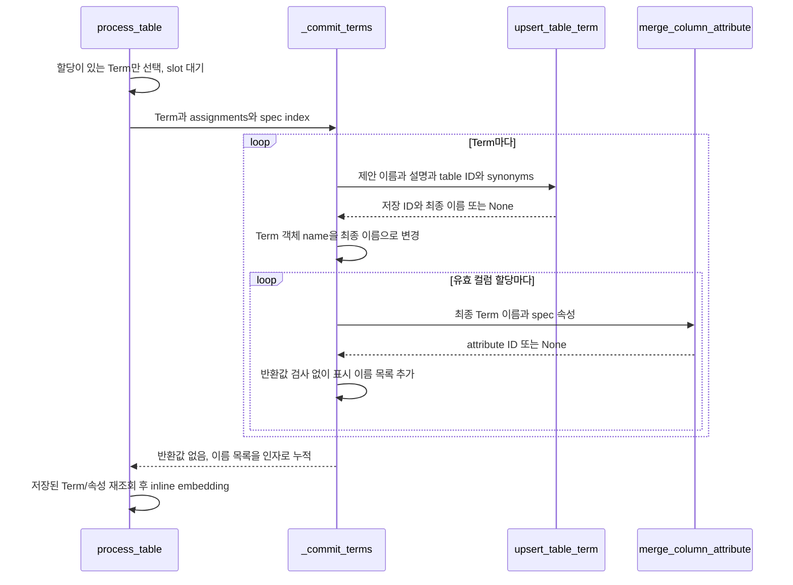
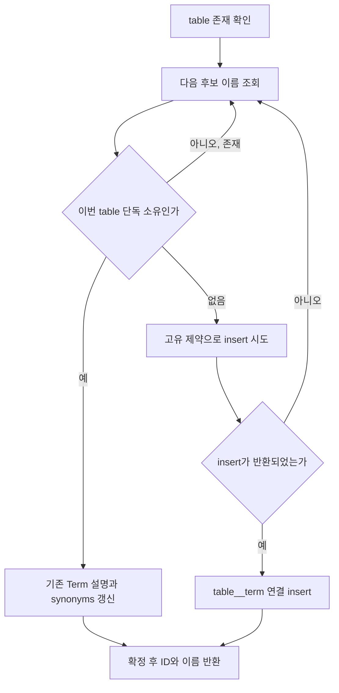
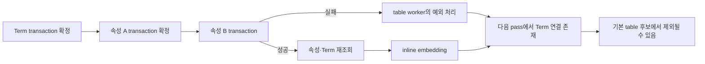

# Chapter 04-1. Term 이름 충돌·속성 식별과 실제 저장

Term과 컬럼 할당을 보정한 뒤 실제 저장은 table별 저장 차례 안에서 수행한다. **저장 차례는 실행 순서이고 transaction은 DB 확정 단위다.** Term 하나의 생성과 연결, 속성 하나의 생성과 연결은 국소 transaction으로 묶지만 한 table의 전체 결과와 검색 vector를 한 번에 확정하지는 않는다.

Term은 업무 개념, ColumnAttribute는 컬럼의 의미 속성, source는 객체의 출처 종류다. 이 컴파일 writer는 semantic source를 사용한다. [추출·할당](chapter-04-term-assignment-and-persistence.md), [저장 순서](chapter-01-compilation-targets-and-orchestration.md), [의미 모델](../02-data-model/chapter-02-semantic-entities.md), [용어집](../01-architecture/chapter-00-glossary.md)을 함께 참고한다.

로컬 코드·테스트 정적 분석이며 실제 DB·모델·테스트·동시 저장을 실행하지 않았다.

## 1. 실제 저장 호출은 _commit_terms다



upsert는 기존 객체가 맞으면 갱신하고 없으면 생성하는 저장 방식이다. spec index는 source_column으로 명세를 찾는 dict다. 할당의 source_column으로 spec을 찾고 속성 이름은 spec.display_name, 타입은 spec.datatype, 설명은 spec.description을 쓴다.

`semantic/loaders.py::build_tables_index()`는 전체 table을 이름으로 묶는 helper이며 동명이면 먼저 읽은 것을 남긴다. 이번 검색에서 정의·export 외 호출자를 찾지 못했고 현재 pipeline→process_table→_commit_terms 호출 사슬에도 없다. 이를 Term 저장 전 실행하는 후보 검색이나 충돌 해소 단계로 설명하지 않는다.

현재 writer는 먼저 저장된 비슷한 개념을 벡터로 찾아 하나로 합치는 방식이 아니다. 아래의 이름·소유 table 기준으로 독립 Term을 배정한다.

근거: [caller와 _commit_terms](../../../code/auto-ontology/auto_ontology/semantic/visit_enter.py), [loaders helper](../../../code/auto-ontology/auto_ontology/semantic/loaders.py).

## 2. Term은 이름·source와 소유 table을 함께 본다

DB의 고유 제약은 `(name, source)`다. source=semantic에서 같은 이름의 Term과 연결된 모든 table ID를 조회한다. unique constraint는 중복 행을 막는 DB 규칙이다.

후보 이름은 정확히 세 개이며 다음 순서로 시도한다.

```text
1. 제안 이름
2. 제안 이름 (database.schema.table)
3. 제안 이름 (table ID)
```

| 조회 결과 | 동작 |
| --- | --- |
| 같은 이름 존재·연결 table 집합이 정확히 이번 table 하나 | 기존 ID 유지, description·synonyms 갱신 |
| 같은 이름이 다른 table 소유 | 다음 후보 이름 |
| 같은 이름이 여러 table 공유 | 다음 후보 이름 |
| 같은 이름은 있지만 연결 table 없음 | 다음 후보 이름 |
| 이름 없음 | Term과 table→Term 연결 생성 |
| 원본 catalog table 자체 없음 | None 반환, 이 Term 저장 생략 |
| 세 후보 모두 할당 불가 | RuntimeError |

다른 source의 같은 이름은 이 semantic 조회와 고유 키에서 별도로 취급한다. 같은 의미의 공유 Term을 이름만으로 재사용하지 않으며, 연결이 없는 고아 Term도 이 writer가 자동으로 이번 table에 입양하지 않는다. 고아는 소유 연결이 없는 상태를 뜻한다.

### 2.1 이름 충돌 예시

```text
shop.sales.orders가 Record를 먼저 저장:
  Term ID=t1, name=Record

shop.sales.invoices도 Record 제안:
  다른 소유자이므로 ID=t2, name=Record (shop.sales.invoices)
```

같은 table에 같은 후보를 다시 저장하면 해당 소유 집합을 찾아 기존 ID로 반환할 수 있다. catalog ID·최종 이름을 함께 확인해야 하며, 모델의 제안 이름과 최종 저장 이름이 같다는 보장은 없다.

`_commit_terms()`는 반환된 이름으로 메모리 Term 객체를 바꾸고 이후 속성도 그 이름으로 저장한다. table 한 개가 여러 Term을 갖는 것은 금지하지 않는다.

## 3. Term 생성·경쟁·transaction의 범위

upsert_table_term은 table 존재·후보명 조회·기존 갱신 또는 새 Term+연결을 한 write_transaction으로 감싼다. transaction은 여러 DB 작업을 함께 확정하거나 취소하는 묶음이다.

새 insert는 `ON CONFLICT DO NOTHING`을 사용한다. 먼저 조회했을 때 없었어도 다른 writer가 이름을 차지하면 다음 이름으로 넘어간다. 기존 ID를 다른 ID로 바꾸는 갱신은 하지 않는다.



그림의 후보 반복은 최대 세 이름이다. 여러 pipeline·직접 호출·프로세스 전체를 canonical queue 하나가 통제하지 않으므로 동시 실행은 여전히 DB 충돌 경로에 들어갈 수 있다. 같은 table의 동시 최초 생성도 조회 후 경쟁 때문에 서로 다른 후보명으로 진행할 가능성을 별도 검증해야 한다.

DB 제약은 중복 이름을 막지만 여러 writer가 동일한 의도로 하나의 Term에 수렴한다는 전체 보장은 아니다. 표본·모델 출력이 바뀌어 제안 이름 자체가 달라지면 기존 의미 객체를 찾아 rename하는 별도 처리도 이 함수에는 없다.

근거: [upsert_table_term](../../../code/auto-ontology/auto_ontology/dal/terms.py), [name/source 제약과 table 연결](../../../code/auto-ontology/auto_ontology/dal/schema.py).

## 4. ColumnAttribute 식별은 다섯 필드다

속성은 `(name, source_column, term_name, table_id, source)` 고유 제약을 사용한다. name은 최종 표시 이름, source_column은 물리 컬럼 이름, term_name은 저장된 최종 Term 이름이다. table_id를 일반 문자열로 보관하는 점은 별도 연결의 외래 키와 구분한다.

쓰기 전에 table ID·물리 이름으로 catalog column을, 최종 Term 이름·semantic source로 Term을 찾는다. 하나라도 없으면 None을 반환하고 속성·연결을 생성하지 않는다. 이 두 조회는 속성 transaction 진입 전이므로 조회 직후 원본 삭제 같은 경쟁은 별도 예외가 될 수 있다.

하나의 속성을 생성/갱신한 뒤 다음 연결을 기록한다.

- column__has_attribute: 이 컬럼이 이 의미 속성의 사례라는 연결.
- column_attribute__term: 이 의미 속성이 이 Term에 속한다는 연결.

속성 row와 두 연결은 같은 write_transaction 안에 있다. 뒤 연결 쓰기가 실패하면 이 속성 묶음은 rollback, 즉 취소 대상이다. 이미 앞에서 확정한 Term이나 다른 속성까지 모두 취소하지는 않는다.

### 4.1 이름이 바뀌면 동일 속성 UPDATE가 아닐 수 있다

```text
이전 key:
  (Total Amount, amount, Order, table-1, semantic)

다음 모델 표시 이름:
  (Order Amount, amount, Order, table-1, semantic)
```

name이 merge key의 일부여서 새 표시 이름은 다른 속성 행으로 들어갈 수 있다. 이 함수는 이전 속성을 찾아 rename하거나 오래된 연결을 전부 삭제하는 diff가 아니다. 같은 source_column을 여러 속성과 연결하는 schema도 허용한다.

최종 Term 이름이 바뀌는 경우도 key가 달라질 수 있다. 모델 재실행을 항상 동일 ID의 안전한 덮어쓰기로 설명하면 안 된다. 수동 UI rename의 동기화와 컴파일의 insert/merge는 다른 경로다.

근거: [속성 merge](../../../code/auto-ontology/auto_ontology/dal/attributes.py), [5필드 제약·연결](../../../code/auto-ontology/auto_ontology/dal/schema.py).

## 5. 편집·인증·설명 보존은 writer마다 다르다

인증 flag는 사용자가 검토했다는 표식이고 modified·modified_by는 수정 시각·수정자다. 이 필드의 존재가 자동 writer의 내용 갱신을 항상 금지하는 것은 아니다.

| 대상·필드 | 이번 writer의 실제 동작 |
| --- | --- |
| 기존 단독 소유 Term description | 새 description으로 직접 대입, 빈 문자열도 가능 |
| 기존 단독 소유 Term synonyms | 입력 synonyms 또는 빈 목록으로 대입 |
| Term 인증·owner·modified | 이 UPDATE의 대상 아님. 값을 보고 내용 변경을 거부하지도 않음 |
| 기존 속성 datatype | 새 datatype으로 대입 |
| 기존 속성 description | coalesce(새 설명, 기존 설명) |
| 속성 인증·modified 상태 | 이 merge의 충돌 UPDATE에 넣지 않음. 인증을 검사해 차단하는 분기 없음 |
| description_suggestion | 이번 ColumnAttribute merge가 채우는 필드가 아님 |

coalesce는 앞 값이 NULL일 때 뒤 값을 쓰는 함수다. **속성 설명은 기존 값 우선이 아니라 새 값 우선**이다. 새 설명이 None이면 이전 설명을 유지하지만 새 설명이 빈 문자열이나 새 모델 문장이면 기존 설명을 바꿀 수 있다.

같은 프로젝트의 catalog 재수집 writer는 기존 description을 우선하는 경우가 있으므로 함수 이름이 비슷하다고 보존 정책을 통일하면 안 된다. Term writer는 description에 coalesce도 사용하지 않는다.

따라서 인증 flag가 True로 남아 있는 동안 내용이 바뀔 수 있다. 현재 writer는 내용 변경에 따라 인증을 자동 해제하거나 modified를 갱신하는 공통 정책을 적용하지 않는다. 이는 실제 UPDATE 필드에서 확인한 사실이며 인증된 객체에 대한 제품 정책이 올바른지는 별도 검토 대상이다.

### 5.1 기본 pipeline에서 기존 Term을 자주 갱신하는가

기본 대상 선택은 Term 연결이 없는 table이다. 정상적으로 연결된 table은 이 경로에서 제외되므로 위 overwrite가 매 pass 모든 객체에 적용되는 것은 아니다. 직접 호출·경쟁·연결/기존 상태 변화로 writer에 다시 들어갔을 때의 계약과, 평소 대상 선택을 구분해야 한다.

편집된 객체를 전부 보호하는 것과 이미 Term이 있는 table 전체를 처리하지 않는 것도 다른 정책이다. 누락 속성·vector까지 함께 재생성되지 않을 수 있다는 한계가 있다.

## 6. 부분 저장·반환 이름·후속 조회



한 table·모든 Term·모든 속성을 묶는 외부 transaction은 없다. slot은 순서만 조율한다. Term 연결이 확정된 뒤 속성 B가 실패하면 Term·속성 A가 남을 수 있다. 다음 pass는 table__term 존재로 이 table을 기본 후보에서 제외할 수 있다.

None 반환은 예외와도 다르다. Term upsert가 None이면 그 Term을 건너뛴다. 속성 merge가 None이면 caller는 반환값을 검사하지 않고 result_attr_names에 표시 이름을 추가한다. 따라서 결과 이름 목록이 실제 저장 행 수의 증거가 아니다.

저장 뒤 fetch_terms_and_attributes_for_table로 실제 행을 다시 읽고 Term 이름별 속성을 모아 embedder에 넘긴다. 재조회 실패는 경고로 처리하고, inline embedding 실패도 경고로 처리할 수 있다. 저장된 row·반환 이름·검색 vector가 모두 동시에 완성된다는 보장은 없다.

재조회는 이 실행에서 새로 만든 것만 반환하는 전용 목록이 아니다. table에 연결된 기존 의미 객체가 함께 읽힐 수 있으며 구체적 조회·embedding 텍스트·append 동작은 Chapter 05에서 추적한다.

## 7. 읽은 테스트의 주장 범위

| 테스트 | 확인한 assertion |
| --- | --- |
| test_terms.py의 동일 table upsert | 두 번째 호출의 ID·이름 유지, 설명은 rebuilt로 변경 |
| cross-table 충돌 | 첫 table은 원래 이름, 둘째는 DB/schema/table 수식 이름·별도 ID·각 소유 연결 |
| 없는 table | None 반환 |
| test_attributes.py의 생성·연결 | 속성 생성과 column/Term 연결 |
| idempotent/curated 설명 테스트 | 같은 key ID 유지·datatype 갱신, 두 번째 description=None일 때 기존 mine 보존 |
| 없는 column·없는 Term | None, 쓰기 거부 |

idempotent는 같은 입력을 반복해도 같은 식별 대상으로 수렴한다는 성질이다. 해당 속성 테스트는 **새 설명이 주어진 경우에도 기존 편집 설명을 지킨다는 assertion이 아니다.** 테스트 이름보다 입력과 coalesce 순서를 기준으로 판단한다.

이 DAL 테스트들은 실제 catalog DB를 요구하며 여기서는 실행하지 않았다. source 읽기로 확인한 transaction의 범위와 실제 동시 장애에서 rollback이 작동하는 결과도 구분한다.

미재현 인계: 인증된 Term 설명/동의어 재입력·nonNULL 속성 설명 overwrite·표시 이름 변경의 중복, 고아/공유 Term·세 후보 소진, 같은 table 동시 최초 생성·삭제 경쟁, 속성 중간 실패와 다음 후보 탈락, None 반환 뒤 결과 집계·embedding 누락.

테스트: [Term 식별·충돌](../../../code/auto-ontology/auto_ontology/dal/tests/test_terms.py), [속성 merge·연결](../../../code/auto-ontology/auto_ontology/dal/tests/test_attributes.py).

다음은 [의미 컴파일 계획](../../../.codex/plan/auto-ontology/01-5_semantic-compilation.md) Chapter 05의 의미 embedding·후속 단계·실패다. 이번 저장 결과를 어떤 텍스트·ID·vector로 만들며 이미 연결된 객체의 누락을 어떻게 다루는지 이어 확인한다.
