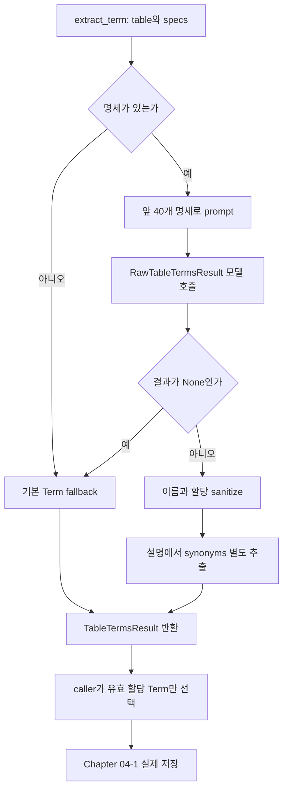
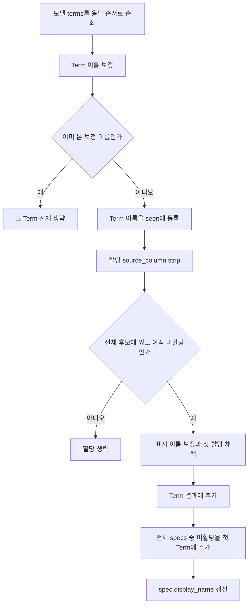
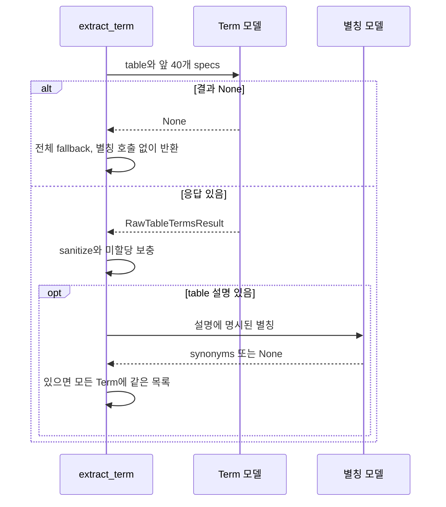

# Chapter 04. Term 추출·컬럼 할당·응답 보정

속성 명세를 만든 다음 모델은 업무 개념인 Term과 컬럼별 표시 이름을 제안한다. **모델 응답을 그대로 저장하지 않고, 이름·허용 컬럼·중복 할당을 정리한 뒤 빠진 컬럼을 첫 Term에 보충한다.** 모델 실패도 기본 Term으로 대체할 수 있으므로 저장된 개념이 반드시 모델의 성공적인 판단에서 나온 것은 아니다.

이 장은 추출·할당을 다루며 실제 이름 충돌·ID·편집/인증·DB 쓰기는 [Chapter 04-1](chapter-04-1-term-and-attribute-writes.md)에서 구분한다. [속성 명세](chapter-03-table-roles-and-attribute-specs.md), [표본](chapter-02-sampling-and-profiling.md), [용어집](../01-architecture/chapter-00-glossary.md)을 참고한다. 로컬 소스·테스트 정적 분석이며 실제 DB·모델·테스트를 실행하지 않았다.

## 1. 진입점과 자료 구조



fallback은 정상 결과를 얻지 못했을 때 기본값으로 대체하는 경로다. sanitize는 응답에서 허용하지 않는 값·중복을 제거하고 저장 전 형태를 맞추는 작업이다.

| 모델·중간 값 | 필드·책임 |
| --- | --- |
| ColumnAttributeSpec | source_column·내부 name·display_name·datatype·description |
| RawTableTermsResult | 모델이 제안한 terms 목록 |
| RawTermProposal | name·description·attributes |
| TermColumnRef | source_column·display_name |
| TermProposal | 보정 name·description·synonyms·컬럼 할당 |
| TableTermsResult | 보정된 TermProposal 목록 |

Raw 모델은 추가 필드를 금지하지만 terms가 최소 한 개라는 개수 제약은 없다. 형식 검증과 업무 개념의 정확성은 별개다. 실제 ctx 인자도 extract_term 안에서는 사용하지 않는다. 선언 FK·table 구조 전체를 이 함수가 ctx에서 다시 읽어 판단하는 것은 아니다.

근거: [term_extractor.py](../../../code/auto-ontology/auto_ontology/semantic/term_extractor.py), [모델 정의](../../../code/auto-ontology/auto_ontology/semantic/models.py).

## 2. 모델은 전체 명세를 모두 보지 않는다

prompt는 table 이름·table 설명·앞 40개 속성 명세를 포함한다. 각 명세는 물리 컬럼 이름·타입·설명 문자열이다. 앞 장에서 붙인 샘플·format이 description 안에 있으면 함께 들어간다. schema·DB 이름·junction flag를 별도 필드로 넣지는 않는다.

DomainSummary가 있으면 domains 앞 8개, core_entities 앞 12개를 추가한다. business_rules는 이 prompt에 넣지 않는다. DomainSummary는 업무 영역·중심 개념·규칙 설명을 담는 입력 모델이다.

system prompt는 다음을 요구한다.

- 기본적으로 table당 하나의 Term을 선호하고, 서로 다른 개체를 잇는 진짜 junction일 때만 두 번째 Term을 제안한다.
- 같은 개체의 핵심·감사·수명주기 컬럼을 따로 Term으로 쪼개지 않는다.
- 모든 후보 컬럼을 정확히 하나의 Term에 할당하고 읽기 쉬운 표시 이름을 만든다.
- IS_A·PART_OF·ROLE 관계를 제안하지 않는다.
- archive/history/staging 같은 table 변형이면 속성 표시 이름에 구분 단어를 붙인다.

junction은 한 행이 둘 이상의 개체 역할 사이의 관계를 나타내는 테이블이다. 위 지시는 prompt 정책이며 코드가 Term 개수를 최대 2개로 제한하거나 저장된 junction flag로 분할을 검증하는 것은 아니다. archive 접두사도 별도 코드 validator가 보장하지 않는다.

client는 reasoning 모델·temperature=0.0·max_tokens=4096을 사용한다. temperature는 응답 생성의 변동을 조절하는 값이며 0이라고 동일한 의미 결과를 항상 보장하지 않는다. 모델 응답 한도와 prompt의 40개 제한도 서로 다른 제약이다.

### 2.1 41번째 이후 컬럼은 삭제되는가

아니다. 모델 입력은 앞 40개지만 보정 함수의 allowed_columns는 **전체 specs**다. 응답에 없는 나머지 컬럼은 뒤에서 첫 Term에 붙인다. 모델이 보지 못한 컬럼도 결과에 포함되지만 해당 Term에 속하는지 모델이 판단한 것은 아니다.

명세는 기존 설명이 있는 그룹부터 반환되므로 단순 ordinal 순서와 다를 수 있다. 넓은 table에서는 그 그룹 순서가 모델이 직접 볼 컬럼을 결정한다. 40개 초과를 추가 모델 요청으로 나눠 처리하는 경로는 없다.

## 3. 이름 검사와 fallback 이름의 차이

`_normalize_label()`은 양끝 공백을 제거하고 unnamed·unknown·none·빈 이름을 거부한다. 또한 ASCII 영문 대문자로 시작하고 영숫자 단어·공백 형태인 정규식에 맞아야 한다. 정규식은 문자열 모양을 검사하는 규칙이다.

| 원래 이름 | 처리 |
| --- | --- |
| PurchaseOrder | 정규식 통과 뒤 to_term_name으로 Purchase Order |
| TotalAmount | Total Amount |
| unknown | Term이면 table 기반 기본 이름, 표시 이름이면 spec.name |
| purchase_order | 정규식 불일치로 해당 fallback 사용 |
| 한국어·괄호·하이픈 포함 모델 label | 이 정규식 기준으로 fallback될 수 있음 |

fallback 값을 다시 같은 정규식으로 검증하지는 않는다. 따라서 기본 표시 이름 amount·orderTotal처럼 소문자 내부 이름이 남을 수 있다. table 기반 to_term_name도 ASCII 중심 변환이므로 임의의 비영문 table에서 항상 적절한 업무 이름이 생긴다고 보장할 수 없다.

이 검사는 원본 컬럼 이름을 바꾸는 작업이 아니다. source_column은 물리 식별 이름으로 별도 유지하며, 표시 label에만 적용한다.

## 4. Term 중복·컬럼 할당을 정리하는 순서



Term 이름은 보정 후 문자열로 중복 제거한다. 같은 이름의 다음 Term을 합치는 것이 아니라 전체를 건너뛰므로 그 안의 할당도 즉시 읽지 않는다. 그 컬럼이 다른 곳에서 채택되지 않으면 마지막 보충 단계에 걸린다.

source_column은 공백을 제거한 뒤 전체 명세의 이름과 정확히 비교한다. 대소문자를 일괄 정규화하지 않는다. 빈 이름·없는 컬럼·이미 다른 Term에 할당한 컬럼은 버린다. 같은 컬럼을 여러 Term이 요청하면 응답 순서상 첫 할당이 이긴다.

설명은 strip한다. 컬럼별 표시 이름이 서로 같다는 이유로 여기서 중복 제거하지는 않는다. 서로 다른 source_column은 같은 display_name을 가질 수 있다. 이후 속성 식별 키에 source_column이 포함되는 이유와 연결된다.

### 4.1 미할당 컬럼은 첫 Term으로 보충한다

보정된 Term이 한 개 이상이면 첫 Term을 primary로 삼고 전체 specs에서 아직 할당하지 않은 컬럼을 순서대로 추가한다. 보충 표시 이름은 spec.name이다. 어느 Term이 가장 적합한지 재평가하거나 사용자의 선택을 요구하는 분기는 없다.

```text
specs: amount, status, internal_note
모델:
  Order → amount (Total Amount)
  Status → status (Order Status)

보정:
  Order → amount, internal_note
  Status → status
```

internal_note가 모델 입력 제한 때문에 안 보였든 단순 누락이었든 같은 보충 규칙을 사용한다. 모델이 정확히 하나씩 할당했다는 지시와 실제 결과의 완전성은 이 코드 보정이 연결한다.

## 5. 빈 Term과 전체 fallback은 구분한다

보정된 Term 목록이 아예 없으면 `_fallback_result()`를 사용한다. 반면 이름만 있고 할당이 없는 Term도 sanitizer 목록에는 남을 수 있다. 미할당 보충은 첫 Term에만 하므로 나머지 빈 Term은 계속 비어 있을 수 있다.

caller의 `_terms_with_assignments()`가 전체 명세에서 해석 가능한 할당이 하나 이상인 Term만 저장 후보로 남긴다. 모델 결과의 Term 수와 실제 저장 후보 수가 다를 수 있다.

| 조건 | 결과 |
| --- | --- |
| extract_term에 specs 없음 | 기본 Term 1개·할당 없음. 정상 process_table은 그전에 명세 없음을 반환 처리 |
| 모델 wrapper 결과 None | 기본 Term에 전체 specs 할당 |
| 모델 terms=[] | sanitize 안에서 같은 전체 fallback |
| 일부 Term의 할당만 없음 | 첫 Term 보충 뒤 caller가 여전히 빈 Term 제외 |
| client 생성·보정 로직 예외 | 이 함수의 None fallback으로 자동 변환되는 것은 아님 |

기본 Term 이름은 table 이름을 변환하고, 설명은 `Business entity represented by table <이름>`이다. 각 컬럼에는 spec.name을 표시 이름으로 사용한다. 원본 업무 의미를 추가 추론한 결과가 아니다.

`apply_display_names_to_specs()`는 결과를 반환할 뿐 아니라 전달받은 명세 객체의 display_name을 바꾼다. 이후 process_table도 이 함수를 호출하며 _commit_terms는 assignment 이름을 직접 쓰는 대신 대응 spec.display_name을 사용한다. 같은 명세 목록을 다른 코드가 재사용한다면 이 변경도 관찰할 수 있다.

## 6. synonyms는 별도 모델 호출로 얻는다

synonym은 동의어·약어·별칭이다. 정상 Term 응답을 보정한 뒤 table 설명이 있으면 전용 모델 호출로 명시된 별칭만 추출하도록 지시한다. 예를 들어 business unit (BU)의 BU다.

별칭 모델은 max_tokens=1024이며 입력은 table description뿐이다. 결과 문자열은 strip하고 빈 값만 제거한다. 중복 제거·실제 원문 포함 검사·약어 사전 검증은 코드에 없다. “원문 그대로 명시된 별칭만”은 모델 지시이지 완전한 검증 결과가 아니다.

별칭이 있으면 보정된 모든 Term에 같은 목록을 대입한다. table을 여러 Term으로 나눴을 때 어느 별칭이 어느 Term 소속인지 따로 판단하지 않는다.



모델 terms=[]인 경우는 sanitizer가 fallback을 만들지만 extract_term 흐름은 계속되므로 별칭 단계에 도달할 수 있다. 모델 결과 None으로 직접 fallback 반환하는 경로와 다르다.

별칭 wrapper가 None이면 빈 목록으로 계속한다. 그러나 별칭 client 생성이나 후처리 예외를 extract_term이 별도로 잡지 않으므로, Term 제안은 얻었어도 저장 전에 table worker가 실패할 수 있다.

근거: [fallback·보정·표시 이름·별칭](../../../code/auto-ontology/auto_ontology/semantic/term_extractor.py), [caller 저장 후보 필터](../../../code/auto-ontology/auto_ontology/semantic/visit_enter.py), [구조화 호출 wrapper](../../../code/auto-ontology/auto_ontology/utils/llm_invoke.py).

## 7. 테스트 근거와 미재현 범위

test_term_extractor.py의 첫 테스트는 PurchaseOrder·TotalAmount 변환과 누락 status를 첫 Term에 붙이는 동작, 원본 spec.display_name 갱신을 검사한다. 두 번째 `test_sanitize_assigns_orphan_specs_to_primary_term`은 이름과 달리 입력에서 amount·status를 둘 다 이미 할당하므로 실제 누락 보충의 추가 증거로 확대하지 않는다.

테스트는 모델 응답 객체를 직접 구성해 sanitizer에 넘긴다. 실제 모델 요청·정확한 업무 분할·별칭 품질을 검증한 결과가 아니다. 여기서는 실행하지 않았다.

미재현: 40개 초과와 그룹 순서, 같은 이름의 Term·중복 컬럼·Unicode/fallback 이름, 빈 Term과 중복 명세, 별칭의 중복·환각·client 예외, 모델이 보지 못한 컬럼의 첫 Term 보충, 변형 table 이름의 접두사 누락.

테스트: [Term 보정](../../../code/auto-ontology/auto_ontology/semantic/tests/test_term_extractor.py).

이어서 [Chapter 04-1](chapter-04-1-term-and-attribute-writes.md)에서 이 후보가 어떤 이름·ID·관계로 저장되며, 기존 편집·인증·설명이 어떻게 처리되는지 확인한다. [세부 계획](../../../.codex/plan/auto-ontology/01-5-2_term-extraction-and-writes.md)을 기준으로 저장 경계를 이어간다.
