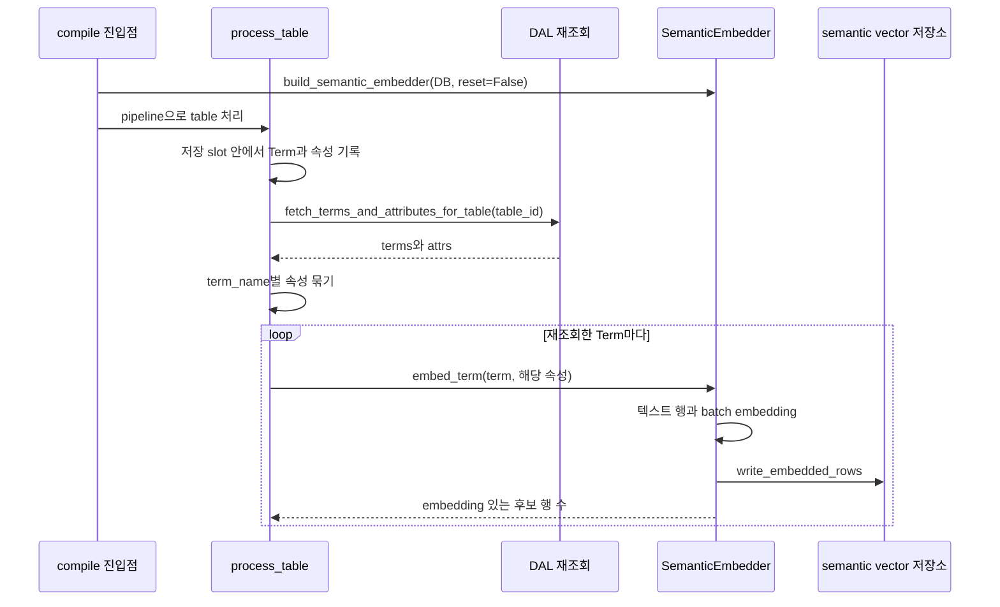
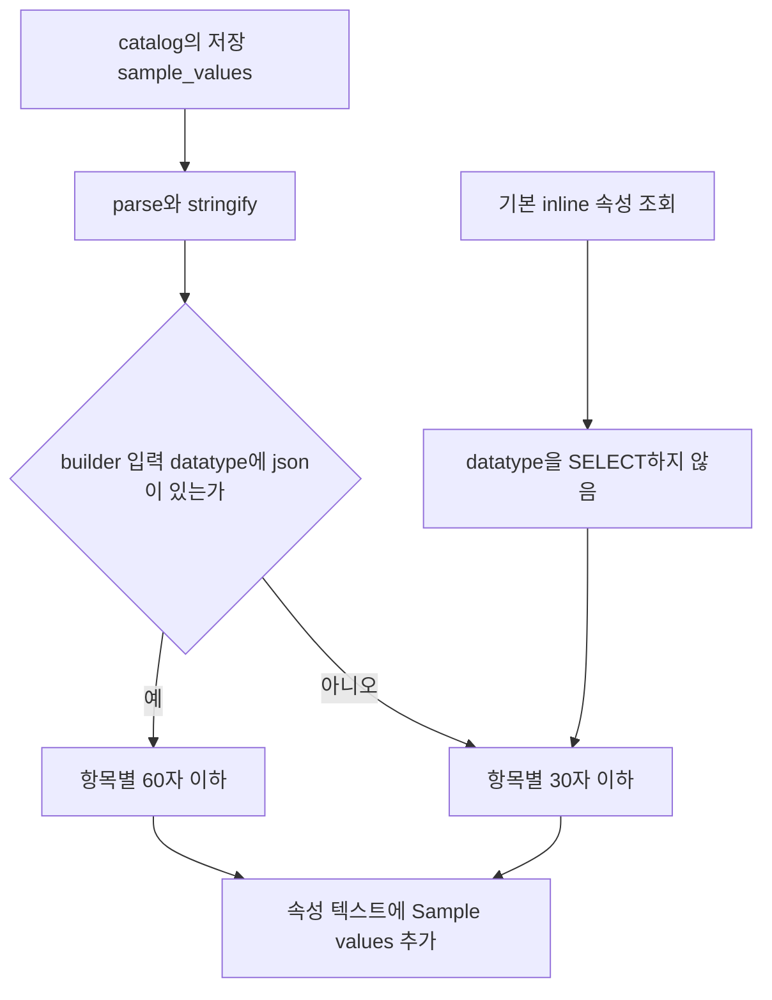
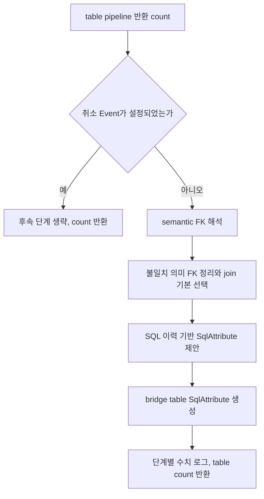
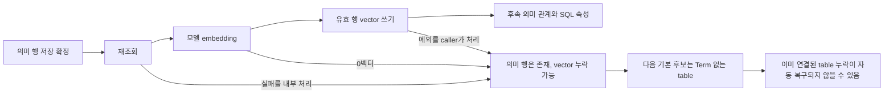

# Chapter 05. 의미 embedding·후속 단계와 실패 경계

Term·ColumnAttribute를 저장한 뒤에는 실제 저장값을 다시 읽어 검색용 텍스트와 숫자 벡터를 만든다. embedding은 텍스트의 의미를 숫자 배열로 표현하는 작업이다. **기본 컴파일은 기존 의미 vector를 전체 교체하지 않고, table 처리 중 Term별 결과를 추가한다.** 의미 행이 있다고 검색 vector도 완전하다는 보장은 없다.

이 장은 재조회·텍스트·metadata·모델 호출·vector 기록과 후속 단계의 경계를 다룬다. [추출·할당](chapter-04-term-assignment-and-persistence.md), [실제 저장](chapter-04-1-term-and-attribute-writes.md), [수집 vector 교체](../04-catalog-ingestion/chapter-04-embedding-and-vector-refresh.md), [reset·취소](../04-catalog-ingestion/chapter-05-reset-and-partial-failure.md), [용어집](../01-architecture/chapter-00-glossary.md)을 함께 참고한다.

로컬 소스·테스트 정적 분석이다. 실제 DB·모델·서비스·테스트·동시 검색은 실행하지 않았다.

## 1. 정상 경로는 table 저장 중 inline 생성이다



inline은 별도 야간 전체 생성이 아니라 해당 table 저장 과정 안에서 실행한다는 뜻이다. 저장 slot은 table별 확정 순서를 조율하는 구간이며 DB transaction 자체가 아니다. 모델 호출과 vector 쓰기도 이 구간 안이므로 앞 table의 embedding이 느리면 뒤 table의 의미 저장 차례가 기다릴 수 있다.

factory는 EMBED API key가 없으면 경고 후 None을 반환한다. endpoint는 모델 HTTP 요청 주소이고 API key는 요청 인증값이다. None이어도 의미 행 컴파일이 전부 중단되는 것은 아니다. 실제 factory가 비활성화하는 것과 공통 embedding client의 무인증 기능은 서로 다른 계약이다.

factory는 매 호출 resolve로 endpoint·model·key를 구성하며 `get_semantic_vdb()`로 `vdb.semantic_layer` 저장 객체를 만든다. compile.py는 reset=False를 넘긴다. 기본 pipeline은 embedder가 있으면 table worker를 시작하기 전에 create_index를 부르며 후보 table이 0개여도 저장소 준비 오류가 발생할 수 있다.

근거: [compile 진입](../../../code/auto-ontology/auto_ontology/semantic/compile.py), [pipeline 준비](../../../code/auto-ontology/auto_ontology/semantic/pipeline.py), [저장 뒤 재조회·반복](../../../code/auto-ontology/auto_ontology/semantic/visit_enter.py), [embedder factory](../../../code/auto-ontology/auto_ontology/semantic/embed.py).

## 2. 재조회는 이번 생성 목록만 읽는 것이 아니다

Term 조회는 table__term으로 이번 table에 연결되고 source=semantic인 객체를 읽는다. table__term은 table과 업무 개념 Term의 연결이다. name·description·synonyms·ID·schema_names를 가져오며 schema_names는 이 table 범위의 catalog schema에서 모은다.

속성 조회는 ColumnAttribute→HAS_ATTRIBUTE→catalog column→table→schema의 실제 연결을 따라간다. HAS_ATTRIBUTE는 이 컬럼이 해당 의미 속성의 사례라는 연결이다. 현재 table과 semantic source로 제한한다.

| inline 조회 항목 | 가져오는 값 |
| --- | --- |
| Term | name·description·synonyms·id·schema_names |
| 속성 | name·description·term_name·source_column·id |
| 원본 컬럼 정보 | sample_values·is_unique |
| 소속 | table_id·table_name·schema_name |
| 가져오지 않는 주요 값 | 속성 datatype·catalog data_type·format·인증·PII 태그 |

PII는 개인 식별 가능 정보다. 태그·인증을 이 텍스트 builder가 따로 읽어 표시하거나 필터링하는 경로는 없다. format이 앞선 단계에서 description에 들어갔다면 간접적으로 텍스트에 남을 수 있다.

새 result_term_names 목록을 조건으로 조회하는 것이 아니므로 같은 table의 기존 연결 객체도 포함될 수 있다. 반대로 속성이 catalog 컬럼과 실제 연결되지 않았으면 inner join 때문에 빠질 수 있다. inner join은 연결된 행이 양쪽에 모두 있어야 반환하는 조회다.

속성은 저장된 term_name 문자열로 묶어 각각의 Term 이름과 연결한다. 이 조회에서 ColumnAttribute→Term 연결을 다시 join해 이름 문자열과 관계가 항상 일치하는지 검증하는 것은 아니다. 재조회 결과도 transaction으로 고정한 전체 snapshot이 아니므로 동시 수정의 일관성은 별도 검증 대상이다.

## 3. 텍스트와 metadata는 서로 다른 목적이다

metadata는 검색 결과를 의미 객체·원본 구조와 다시 연결하기 위한 부가 정보다. `_build_rows()`는 이름이 있으면 Term 1행, 이름이 있는 속성마다 ColumnAttribute 1행을 만든다. 이름 없는 항목은 건너뛴다.

```text
설명용 입력:
Term: Order, 설명: 주문, synonyms: [PO], id: term-1
속성: Total Amount, term_name: Order, 설명: 주문 금액,
      sample_values: [10, 20], id: attr-1

Term 텍스트:
Term: Order. 주문

속성 텍스트:
ColumnAttribute: Total Amount of Term Order (PO). 주문 금액 Sample values: 10, 20.
```

Term의 synonyms는 **Term 행 텍스트에는 붙이지 않고 속성 텍스트의 소유 Term 이름 뒤**에 붙인다. Term 행이 별칭으로 직접 embedding된다고 설명하면 틀린다. 속성 이름·설명·Term 이름·별칭·샘플은 텍스트이고, table_id·is_unique 같은 값은 metadata다.

| 필드 | Term 행 | ColumnAttribute 행 |
| --- | --- | --- |
| label | Term | ColumnAttribute |
| id | 있으면 Term ID | 있으면 속성 ID |
| name | Term 이름 | 속성 표시 이름 |
| database_name | embedder가 지정한 DB | 같은 DB |
| schema 정보 | 비어 있지 않으면 schema_names 목록 | 있으면 schema_name |
| 원본 소속 | 별도 table_id 없음 | table_id·table_name·source_column |
| 고유성 | 없음 | is_unique, 없으면 None일 수 있음 |
| 타입 | 없음 | 입력 datatype이 있으면 data_type으로 기록 |

이 metadata를 top-level과 content_metadata 양쪽에 복사한다. label은 객체 종류이고 ID는 catalog table ID가 아니라 해당 의미 객체 ID다. 검색에서 물리 table로 돌아가려면 별도 table_id나 DAL 연결이 필요하다.

### 3.1 path는 실제 파일 경로가 아니다

Term path는 `semantic:term:<이름>`이다. 속성은 ID가 있으면 `semantic:attr:<ID>`, 없으면 `semantic:attr:<Term이름>:<source_column>`이다. page_number=-1과 함께 공통 row 계약을 맞춘 출처 문자열이다.

이름 기반 Term path와 ID 기반 metadata가 항상 같은 수명으로 바뀌는 것은 아니다. 이름 변경 뒤 과거 vector를 삭제하지 않고 append하면 예전 텍스트·path가 남을 수 있다. path를 vector 저장의 고유 ID로 사용해 자동 갱신하는 코드도 이 경로에는 없다.

근거: [텍스트·metadata builder](../../../code/auto-ontology/auto_ontology/semantic/embed.py), [재조회 필드](../../../code/auto-ontology/auto_ontology/dal/terms.py).

## 4. JSON의 60자 규칙이 inline에서는 활성화되지 않을 수 있다

샘플은 저장 JSON 문자열 또는 list를 parse한 뒤 문자열 목록으로 바꾼다. 일반 타입은 항목당 30자, 입력 datatype에 json이 포함되면 60자까지만 표시한다. 긴 값을 자르는 것이 아니라 그 항목을 제외한다. 이 함수에는 목록 전체를 다시 top5로 자르는 로직이 없다.



핵심은 `_embedding_attrs_for_table()`에 datatype 선택이 없다는 점이다. 따라서 기본 compile의 inline 재조회 결과만 전달하면 `_build_rows()`는 일반 30자 규칙을 사용하고 metadata.data_type도 만들지 않는다.

반면 bulk 재조회 `fetch_all_terms_and_attributes()`는 datatype을 읽는다. 같은 저장 JSON 항목이 inline에서는 빠지고 bulk 입력에서는 남을 수 있다. 31~60자의 JSON key·unit·date annotation은 이 차이에 영향을 받는다. 앞선 profiling의 60자 예산이 기본 컴파일 검색 텍스트에 끝까지 보존된다고 보장할 수 없다.

UI의 일부 재embedding context도 별도로 조립되므로 공통 builder의 기능과 각 caller가 실제 공급한 필드를 구분해야 한다. 이후 관계 탐색에서 타입 metadata를 기대하더라도 과거 행·누락 타입 행은 별도 fallback을 사용할 수 있다. 소비 알고리즘은 다음 관계·검색 단계로 인계한다.

## 5. 모델 호출은 Term별로 모으고 vector는 append한다

`embed_term()`은 Term+속성 텍스트를 만들고 `batch_embed()`로 결과를 받는다. batch_embed는 chunk generator 결과들을 모아 DataFrame 하나로 합치는 wrapper다. DataFrame은 컬럼·행 표이며, 한 번의 함수 호출이 HTTP 요청 한 번이라는 뜻은 아니다.

공통 기본값은 요청당 텍스트 32개·동시 요청 32개·chunk 1024행이다. 실패한 chunk의 재시도·fatal 분류·오류 attrs·빈 vector는 [수집 embedding 장](../04-catalog-ingestion/chapter-04-embedding-and-vector-refresh.md)의 같은 구현을 사용한다. passage는 저장할 설명 문서, query는 검색 질문이라는 모델 입력 역할이며 여기서는 passage를 사용한다.

한 Term이 큰 속성 목록을 가지면 여러 chunk가 끝난 뒤 모은 결과를 기록한다. run_ingest처럼 chunk가 나올 때마다 바로 쓰는 호출 경로는 아니다. 다만 다른 Term의 성공 결과는 먼저 저장되어 있을 수 있다.

유효 embedding이 있는 행만 남겨 `write_embedded_rows()`에 넘긴다. 공통 record 변환이 텍스트·embedding을 확인하고 PostgresVDB가 최대 500행 단위 add_embeddings를 실행한다. metadata.id를 vector 행의 upsert key로 전달하지 않으므로 기본 의미 컴파일은 기존 동일 객체를 찾아 대체하는 쓰기가 아니다.

| 경로 | 기존 vector 처리 |
| --- | --- |
| 기본 의미 compile | factory reset=False, 기존 행 삭제 없이 append |
| 원본 catalog run_ingest | 첫 유효 record에서 DB 범위 reset 뒤 chunk append |
| semantic reset | 의미 DB 행 확정 삭제 뒤 semantic vector 별도 삭제, 이후 compile 요청 |
| UI Term/속성 refresh | 일부 service가 ID별 삭제 후 embed 호출 |

같은 의미 객체를 다시 embedding하면 여러 vector 행이 같은 metadata.id를 가질 수 있다. 기본 대상 선택이 이미 Term 연결된 table을 제외해 재처리 빈도를 줄이지만, 중복 방지·누락 복구를 보장하는 장치는 아니다.

### 5.1 반환 count는 실제 저장 반환값을 그대로 쓰지 않는다

embed_term은 `write_embedded_rows()`의 int 반환값을 사용하지 않고 **embedding이 있는 후보 행 목록 길이**를 반환한다. embed_all도 같은 방식이다. 현재 builder의 정상 행은 보통 유효 텍스트를 가지지만, 이 반환값을 DB가 검증한 실제 삽입 건수라고 확대하면 안 된다.

process_table은 embed_term 반환 count도 합산하지 않는다. 그 상위 count는 None이 아닌 table 결과 수다. table 수·Term 수·vector 후보 수·DB 쓰기 수는 서로 다른 값이다.

근거: [embed_term·batch wrapper](../../../code/auto-ontology/auto_ontology/semantic/embed.py), [batch_embed](../../../code/auto-ontology/auto_ontology/utils/embedding.py), [record 변환](../../../code/auto-ontology/auto_ontology/vdb/records.py), [vector 쓰기](../../../code/auto-ontology/auto_ontology/vdb/postgres.py).

## 6. 전체 재생성 helper는 정상 compile의 자동 보완이 아니다

`embed_all_semantic_nodes()`는 저장소의 semantic Term 목록과 연결된 ColumnAttribute들을 읽어 Term 이름별로 묶는다. table별 inline query와 달리 datatype도 가져온다. 이 조회에는 database_name 인자가 없다.

전체 rows를 `embedder.database_name` 하나로 생성하므로 여러 DB의 의미 객체를 읽으면 metadata를 어느 DB로 분류할지 주의해야 한다. Term 목록에 포함되지 않은 이름의 attrs는 묶였어도 Term 순회에서 출력되지 않을 수 있다. 모든 의미 타입을 순회하는 것도 아니며 SqlAttribute·TextAttribute·분석 객체를 이 builder가 자동 embedding하지 않는다.

함수 설명에는 단일 HTTP 호출이라고 적혀 있지만 실제 batch_embed는 여러 요청·chunk로 나눈다. 전체 결과를 한 목록으로 만든 뒤 모아서 저장하므로 메모리 사용과 실패 시점도 inline Term별 생성과 다르다.

이번 Python 소스 검색에서는 이 helper의 정의·관련 문서 문자열 외 실제 호출자를 찾지 못했다. CLI도 run_semantic_compilation을 부르며 이 함수를 직접 호출하지 않는다. 따라서 “compile 마지막에 전부 다시 embedding해 누락을 복구한다”는 흐름은 현재 호출 사슬에 없다. 외부 소비자가 따로 호출하는지는 미확인이다.

`embed_column_attributes(attrs)`는 빈 Term dict로 embed_term을 호출해 속성만 생성한다. datasource sample 수정 service에서 사용하며 Term synonyms를 별도로 전달하지 않으면 속성 텍스트의 별칭 suffix도 없다. 같은 속성도 어떤 caller가 입력했는지에 따라 텍스트가 달라질 수 있다.

## 7. UI refresh와 compile의 실패 순서는 다르다

Term refresh service는 기존 Term ID, 필요하면 종속 속성 ID의 vector를 지운 뒤 embed_term을 호출한다. 컬럼 속성 편집 service도 ID 삭제 후 재embedding하는 경로가 있다. 이 경로에는 run_ingest의 “첫 유효 결과까지 기존 vector 유지”와 같은 순서가 적용되지 않는다.

모델이 빈 embedding을 반환해 0으로 끝나면 기존 vector를 지운 상태로 남을 수 있다. 의미 DB metadata를 수정하는 작업과 vector 재생성을 하나의 transaction으로 되돌리는 구조도 아니다. UI 편집 API·권한·인증 상세는 거버넌스 단계에서 별도로 분석한다.

반대로 tabular metadata refresh는 먼저 embed_rows로 생성한 뒤 기존 data vector를 삭제하는 경로가 있다. 같은 프로젝트에서도 collection·caller별 삭제 순서를 구분해야 한다.

근거: [Term·속성 refresh](../../../code/auto-ontology/auto_ontology/server/terms/service.py), [datasource refresh](../../../code/auto-ontology/auto_ontology/server/datasources/service.py), [bulk helper·속성 전용 helper](../../../code/auto-ontology/auto_ontology/semantic/embed.py).

## 8. 기본 table 처리 다음에 무엇을 실행하는가



semantic FK는 컬럼이 어떤 의미 속성을 참조하는지 연결한 관계다. SqlAttribute는 SQL로 계산하는 의미 속성이다. bridge table은 두 개념 사이 연결을 나타내는 테이블이며 해당 단계는 그 연결을 사용하는 SQL 속성을 만들 수 있다.

| 단계 | 이 장에서 확인한 진입·반환 경계 |
| --- | --- |
| resolve_semantic_fks | 아직 의미 연결 없는 컬럼을 처리하고, 불일치 정리·join 기본 선택까지 실행 |
| 반환 FK 수 | 해석 함수 보고 수에서 pruned 수를 뺌. 순수 신규 관계 개수만 뜻하지 않음 |
| suggest_sql_attributes | 이력 SQL을 바탕으로 제안·검증·service 저장. 반환은 보고한 새 속성 ID 수 |
| build_bridge_tables_sql_attributes | 구조 후보를 먼저 junction으로 표시, Term/모델/SQL 저장 조건을 거쳐 새 속성 수 반환 |

compile의 로그는 bridge table(s)라고 표현하지만 실제 반환은 생성한 SqlAttribute 수다. 구조 후보·표시한 junction·성공 생성한 SQL 속성의 개수는 다를 수 있다.

table count가 0이어도 취소되지 않았으면 후속 단계로 간다. embedding이 꺼졌거나 실패해도 별도의 전역 성공 gate로 막지는 않는다. 선언 FK의 의미 연결은 vector 없이 가능한 경로가 있고, VDB 추론은 key가 없으면 생략될 수 있다. VDB는 벡터 검색 저장소다.

각 함수 안에도 개별 오류를 잡는 경로가 있다. 예를 들어 semantic FK의 개별 추론 오류, SQL 속성 생성 충돌·검증 오류, bridge 생성 오류는 로그와 생략으로 처리될 수 있다. 반면 준비 조회·일부 직접 쓰기 등 밖으로 전파되는 예외도 있다. compile.py에 함수 호출이 순서대로 있다는 사실만으로 전체 관계 생성 성공을 보장하지 않는다.

이 장은 실제 호출·반환·후속 범위만 지도화했다. 후보 검색·거리·모델 선택·표본 SQL probe·관계 정리·join 경로·SQL 속성 알고리즘은 01-6에서 각각 분석한다.

## 9. 실패·취소·재실행 시 남는 상태



process_table은 재조회 오류를 경고로 처리한다. inline embedding도 Term 반복 전체를 하나의 try로 감싸므로 어떤 Term에서 예외가 나면 같은 table의 뒤 Term embedding은 시도하지 못할 수 있다. 0 반환은 예외가 아니어서 다음 Term을 계속 처리한다.

batch_embed가 일부 chunk 실패를 embedding 없는 결과로 돌려주면 유효 행만 저장할 수 있다. 따라서 의미 행은 전체가 있어도 vector는 일부만 생길 수 있다. 기본 compile은 reset하지 않아 앞 실행의 vector와 이번 일부 결과가 함께 남을 수 있다.

| 상태 | 정상 반환·다음 pass의 한계 |
| --- | --- |
| API key 없음 | embedder=None, 의미 행 생성은 진행 가능 |
| 모델 0벡터 | 경고·0 반환, table 결과·상위 성공 집계 가능 |
| 일부 vector만 유효 | 유효 행만 기록·누락 행 목록을 별도 지속 저장하지 않음 |
| vector DB 오류 | process_table의 경고 처리, 이미 저장한 의미 행/앞 Term 결과 유지 가능 |
| table Term 연결 존재 | 다음 기본 pipeline에서 제외, vector 완전성으로 재선택하지 않음 |
| UI refresh 삭제 뒤 실패 | 기존 vector도 잃을 수 있음 |
| 후속 단계 예외 | 앞 table·vector·관계 일부가 이미 저장되어 있을 수 있음 |

취소는 table worker 시작 전에는 queued table을 생략하지만 이미 실행한 table의 inline 작업을 강제 종료하지 않는다. compile은 table pipeline 반환 뒤 취소를 한 번 확인한다. 후속 단계에 진입한 뒤 모든 함수 사이에 취소 재검사가 있다고 보장할 수 없다.

완료 로그와 scheduler 성공은 전파된 예외가 없다는 기준이다. 내부에서 생략한 모델·vector·관계 결과까지 완전하다는 증거는 아니다. 사용자 객체 삭제를 동반하는 reset도 누락 vector만 선택적으로 고치는 복구 함수와는 다르다.

## 10. 테스트 근거와 다음 단계 인계

| 읽은 테스트 | 확인한 assertion |
| --- | --- |
| test_embed.py | JSON 문자열/list sample 표시, None 제거·빈 값·30자 초과 제외 |
| test_semantic_fk.py의 embedding 테스트 | 속성 metadata와 content_metadata에 table ID·table 이름·is_unique 유지 |
| test_terms.py의 table 재조회 테스트 | 연결 Term·속성 이름과 schema_names 반환 |
| 같은 파일의 단일 Term context 테스트 | Term DB 이름·속성 반환, 없는 Term은 None/빈 목록 |
| test_visit_enter_step_logs.py | inline embedding 단계 로그·순서. 실제 vector 완전성을 검사하는 테스트는 아님 |

test_embed.py는 단순 sample helper 테스트이며 embed_term의 재시도·실제 삽입 수·중복·inline datatype 누락을 검증하지 않는다. 이번 검색에서는 embed_all 호출자의 실행·DB 범위와 60자 JSON inline/bulk 차이를 직접 검사하는 테스트를 찾지 못했다. 테스트는 모두 읽기만 했다.

미재현 인계: datatype 누락과 JSON 정보 손실·검색 품질, 동일 metadata.id의 중복·stale metadata, global helper의 DB 분류, 첫/중간 Term embedding 예외와 부분 vector, UI 삭제 후 0벡터, 후속 관계의 보고 count와 실제 완전성·동시 reset/검색.

근거 테스트: [sample 표시](../../../code/auto-ontology/auto_ontology/semantic/tests/test_embed.py), [물리 소속 metadata](../../../code/auto-ontology/auto_ontology/semantic/tests/test_semantic_fk.py), [DAL 재조회](../../../code/auto-ontology/auto_ontology/dal/tests/test_terms.py), [단계 로그](../../../code/auto-ontology/auto_ontology/semantic/tests/test_visit_enter_step_logs.py).

의미 컴파일 단계의 예정 정적 분석은 여기까지다. 다음은 [전체 계획](../../../.codex/plan/auto-ontology/01_plan.md) 01-6의 의미 관계다. 선언 FK 직접 연결, VDB 후보·모델 선택·표본 검증, 관계 정리·join 기본 선택, 이력 SQL·bridge 속성을 별도 chapter로 추적한다.
