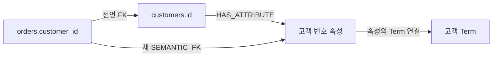
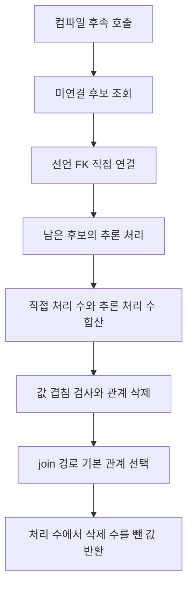
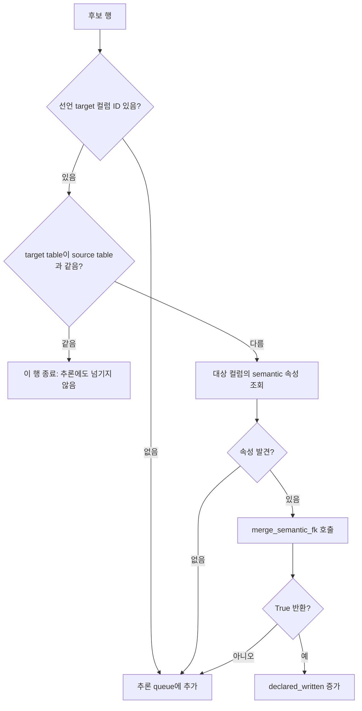
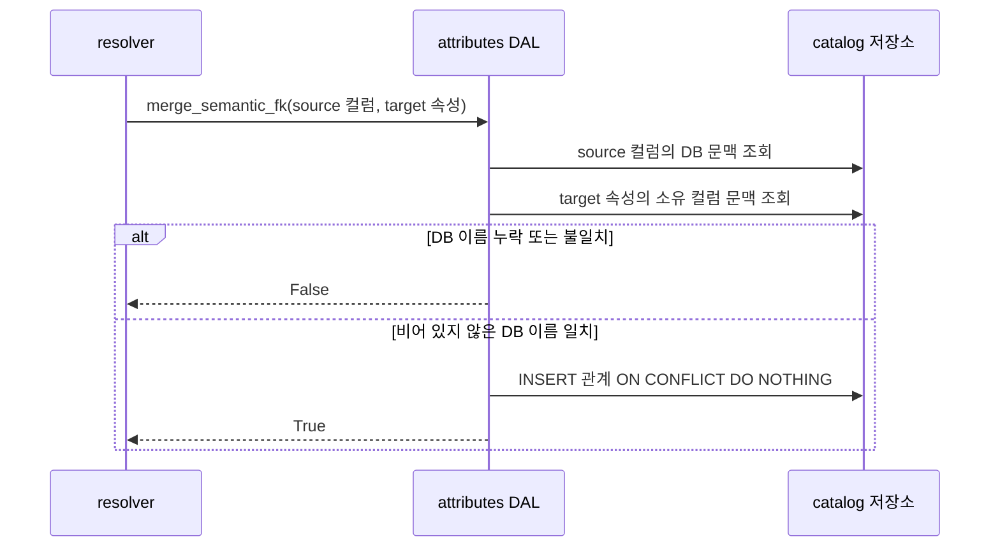

# Chapter 01. 관계 종류·후보 선택과 선언 외래 키 직접 연결

Auto-Ontology는 원본 DB의 외래 키 선언을 그대로 의미 계층의 관계로 사용하지 않는다. 먼저 참조 대상 컬럼을 설명하는 의미 속성을 찾고, 참조하는 컬럼에서 그 속성으로 별도 관계를 저장한다. 선언으로 연결하지 못한 후보는 벡터 검색과 모델 판단 단계로 넘긴다.

이 장은 후보 조회부터 선언 관계의 직접 연결·저장·추론 인계까지 분석한다. 실제 값으로 관계를 정리하거나 여러 관계 중 기본값을 고르는 알고리즘은 Chapter 03 범위다. 로컬 코드와 테스트 본문을 읽었으며 실제 DB·모델·테스트는 실행하지 않았다.

## 1. 먼저 구분할 용어와 관계

**FK(Foreign Key, 외래 키)**는 한 테이블의 컬럼 값이 다른 컬럼을 참조한다는 관계다. 예를 들어 `orders.customer_id → customers.id`는 주문의 고객 번호가 고객 테이블의 번호를 가리킨다는 뜻이다. **PK(Primary Key, 기본 키)**는 행을 식별하는 키다. 여기서 FK 후보를 찾는 쿼리가 참조 대상의 PK 여부까지 검사하는 것은 아니다.

**Catalog**는 수집한 DB·스키마·테이블·컬럼 구조를 저장하는 목록이다. **Term**은 고객·주문 같은 업무 개념이며, **ColumnAttribute**는 고객 번호·고객 이름처럼 컬럼의 의미를 설명하는 속성 객체다. 더 넓은 용어는 [용어집](../01-architecture/chapter-00-glossary.md), 객체 구조는 [의미 계층 데이터 모델](../02-data-model/chapter-02-semantic-entities.md)을 참고한다.

| 관계 | 저장 테이블과 양 끝 | 의미·생성 경계 |
|---|---|---|
| 선언 FK | `column__foreign_key`: 컬럼 → 컬럼 | 수집한 구조의 참조 선언. `last_seen`으로 재수집 관측을 관리한다 |
| `HAS_ATTRIBUTE` | `column__has_attribute`: 컬럼 → 속성 | 이 컬럼을 설명하는 속성이라는 소유 연결 |
| `SEMANTIC_FK` | `column__semantic_fk`: 컬럼 → 속성 | 이 컬럼이 다른 컬럼의 의미 속성을 참조한다는 연결 |
| 관측 JOIN | `column__join`: 컬럼 → 컬럼 | 이력 SQL의 JOIN, 즉 테이블 결합 조건에서 관측한 관계. `refs`에 SQL ID와 조건을 모은다 |
| 관측 UNION | `column__union`: 컬럼 → 컬럼 | 이력 SQL의 결과 합치기에서 관측한 컬럼 관계 |
| 테이블 JOIN | `table__join`: 테이블 → 테이블 | 모델 import가 기록하는 관계. `join_columns`를 저장하며 SQL 이력 수집 경로와 다르다 |

따라서 과거 SQL에 JOIN이 등장했다는 사실, 원본 DB가 외래 키를 선언했다는 사실, 의미 속성으로 연결했다는 사실은 서로 다르다. 이 장의 직접 연결은 선언 FK와 HAS_ATTRIBUTE를 읽어 SEMANTIC_FK를 만든다. 관측 JOIN과 테이블 JOIN을 이 함수에서 대체 입력으로 읽지는 않는다.



실제 SEMANTIC_FK의 목적지는 `customers.id`의 ID도, 고객 Term의 ID도 아닌 **속성 ID**다. 위 예시는 설명용이며 실제 Term 이름과 속성 이름은 컴파일 결과에 따라 달라진다.

근거: [관계 스키마](../../../code/auto-ontology/auto_ontology/dal/schema.py), [직접 연결 함수](../../../code/auto-ontology/auto_ontology/semantic/semantic_fk.py).

## 2. 호출 순서: 생성 이후에도 관계는 바뀐다

[의미 컴파일 후속 처리](../05-semantic-compilation/chapter-05-semantic-embedding-and-failure-boundaries.md)에서 호출하는 진입점은 `resolve_semantic_fks(database_name)`다.

```text
resolve_semantic_fks(database_name)
  created = _resolve_semantic_fks(database_name)
  created -= prune_disjoint_semantic_fks(database_name)
  select_semantic_fk_join_defaults(database_name)
  return created
```

1. `_resolve_semantic_fks`가 미연결 후보에서 관계를 만든다.
2. `prune_disjoint_semantic_fks`가 실제 값의 겹침이 없는 관계를 정리한다.
3. `select_semantic_fk_join_defaults`가 경로 탐색에 사용할 기본 관계를 선택한다.

**Join path**는 어떤 테이블들을 어떤 관계로 연결할지 찾은 경로다. `use_in_join_paths`는 해당 의미 관계를 이 경로에 사용할지 저장하는 플래그다. 생성 성공 직후의 관계가 최종적으로 남거나 경로에 선택된다는 보장은 없다.

`_resolve_semantic_fks`가 후보 없음으로 0을 반환해도 공개 진입점은 정리와 기본 선택을 계속 실행한다. 따라서 새 관계가 없어도 기존 관계에 대한 작업은 발생할 수 있다. 이 진입점 자체에는 취소 신호 확인이나 전체 작업을 감싸는 잠금이 없다.



선언 연결 자체는 모델이나 벡터 검색 없이 가능하다. 다만 **공개 진입점 전체**는 뒤의 정리·기본 선택도 포함하므로, 이를 원본 DB나 모델을 전혀 사용하지 않는 작업으로 이해하면 안 된다.

## 3. 후보는 ‘외래 키로 확정된 컬럼’ 목록이 아니다

**DAL(Data Access Layer, 데이터 접근 계층)**의 `find_unlinked_fk_columns(database_name)`가 관계 저장소를 조회한다. 함수 이름에 FK가 있지만 핵심 조건은 다음 두 연결이 모두 없는 것이다.

```text
해당 컬럼에서 나가는 SEMANTIC_FK 없음
AND 해당 컬럼에서 나가는 HAS_ATTRIBUTE 없음
AND 요청한 database_name에 속함
```

선언 FK는 LEFT JOIN, 즉 연결 행이 없어도 원래 컬럼을 남기는 방식으로 붙인다. 따라서 선언 FK가 전혀 없는 일반 컬럼도 후보가 된다.

| 조건 | 후보 조회의 실제 처리 |
|---|---|
| 선언 FK 존재 | 필수 아님. 있으면 참조 대상 정보를 추가 |
| HAS_ATTRIBUTE 존재 | 속성의 source나 Term 연결을 따로 검사하지 않고 제외 |
| SEMANTIC_FK 존재 | 하나라도 있으면 제외. `use_in_join_paths=False`여도 제외 |
| PK·고유성·데이터 타입 | 후보를 거르는 조건으로 사용하지 않음 |
| table에 Term 존재 | 검사하지 않음 |
| DB 범위 | 출발 컬럼의 테이블 → 스키마 → DB 이름으로 제한 |
| 인자 생략 | DAL은 전체 DB의 미연결 컬럼을 반환할 수 있음. 현재 resolver는 DB 이름 전달 |

이전 컴파일에서 FK 후보로 제안되었는지를 필수 조건으로 다시 확인하지도 않는다. 따라서 의미 속성 생성에서 빠진 컬럼을 후속으로 다룰 수 있지만, 이 목록 자체를 확정된 참조 관계로 볼 수는 없다.

### 3.1 반환 행의 필드

| 필드 | 출처와 용도 |
|---|---|
| `id`, `name`, `description` | 출발 컬럼의 ID·이름·설명 |
| `sample_values`, `is_unique` | 저장된 표본 값·고유성. 이후 추론 단계 입력 |
| `table_id`, `table_name` | 출발 테이블의 식별자·이름 |
| `fk_target_col_id` | 선언 FK 대상 컬럼 ID. 선언이 없으면 `None` |
| `fk_target_table_id` | 대상 컬럼의 테이블 ID. 자기 참조 판별에 사용 |

이 쿼리는 `datatype`이나 `schema_name`을 반환하지 않는다. 추론 단계가 사용할 수 있는 문맥은 별도 조회 여부까지 함께 살펴봐야 하며, Chapter 02에서 확인한다.

### 3.2 후보 행 수와 고유 컬럼 수가 다를 수 있다

선언 FK 저장 키는 `(source_column_id, target_column_id)` 쌍이다. 하나의 출발 컬럼이 여러 대상에 연결된 상태를 표현할 수 있으며 후보 조회에는 `DISTINCT`나 정렬이 없다. 따라서 같은 출발 컬럼이 대상별 여러 행으로 나타날 수 있다.

조회 결과는 처음에 한 번 받아 둔다. 첫 행에서 관계를 생성했다고 해서 뒤의 같은 컬럼 행을 다시 조회하거나 제외하지 않는다. 로그의 `candidate column(s)` 수와 진행 분모는 이 **조회 행 수**다. 복합 FK도 이 장의 처리에서는 제약조건 전체가 아니라 컬럼 쌍 단위로 전달된다.

근거: [후보 조회와 관계 쓰기](../../../code/auto-ontology/auto_ontology/dal/attributes.py), [선언 키 스키마](../../../code/auto-ontology/auto_ontology/dal/schema.py).

## 4. 선언 FK가 있을 때의 직접 연결

`_resolve_semantic_fks`는 후보를 순서대로 읽으며 다음 분기를 적용한다. 이 순서의 루프 자체는 병렬 실행하지 않는다.



### 4.1 자기 참조는 추론 대기열로도 넘기지 않는다

**자기 참조(self-reference)**는 `employees.manager_id → employees.id`처럼 같은 테이블 내부를 참조하는 경우다. 두 테이블 ID가 같으면 그 행을 `continue`로 종료한다. 이 경우 선언 관계는 catalog에 남아 있을 수 있지만 이 경로에서는 의미 관계를 만들지도, 다른 후보를 찾으라고 추론에 넘기지도 않는다.

동일한 테이블 이름 문자열이 아니라 ID를 비교한다. 서로 다른 스키마의 동명 테이블을 이름만 보고 같은 테이블로 취급하는 조건은 아니다.

이는 **현재 resolver의 처리 정책**이다. 데이터 모델이나 모든 저장 호출이 자기 참조를 금지한다고 확대 해석하면 안 된다. 뒤의 `merge_semantic_fk`에는 같은 테이블인지 검사하는 코드가 없다.

### 4.2 참조 대상에 semantic 속성이 있어야 한다

`find_column_attribute_by_column_id(target_column_id)`는 다음 순서로 찾는다.

1. 대상 컬럼의 HAS_ATTRIBUTE를 따라간다.
2. 연결된 속성의 `source == SEMANTIC_SOURCE`만 남긴다.
3. 속성 ID로 오름차순 정렬한 뒤 `LIMIT 1`을 적용한다.
4. 첫 속성 ID를 반환하고, 없으면 `None`을 반환한다.

대상 컬럼에 임의 출처의 속성이 있다는 것만으로는 충분하지 않다. 또한 컬럼 하나에 여러 속성이 붙을 수 있으므로, 이 조회는 모든 속성을 반환하지 않는다. ID 정렬은 선택을 일정하게 만들지만 설명·인증 상태·업무 적합성으로 최적 속성을 고르는 과정은 아니다.

이 조회는 Term 연결 존재를 조건으로 두지 않는다. 속성을 찾은 뒤 직접 연결할 때도 모델 판단, 타입 일치, PK 또는 고유성의 추가 검증은 없다. 실제 값 기반 정리는 이후 공개 진입점의 별도 단계다.

### 4.3 대상 속성 누락은 즉시 복구하지 않는다

선언 FK 대상이 있어도 속성 조회가 `None`이면 `(원래 진행 번호, 후보 행)`을 `llm_queue`에 추가한다. **Queue(대기열)**는 이후 처리할 입력 목록이며 여기서는 메모리의 리스트다.

이때 대상 속성이나 Term을 새로 생성하지 않는다. 이후 추론 경로가 어떤 속성을 선택할지는 별도 절차이며, 선언된 target만 다시 찾도록 이 분기에서 고정하지 않는다. 추론 전 검색기를 만들지 못하면 이 후보는 그대로 미연결 상태로 남는다.

## 5. 공통 저장 함수의 DB 경계와 중복 처리

`merge_semantic_fk(source_column_id, target_attribute_id)`는 먼저 `_same_database`를 호출한다. 벡터 검색 결과에 DB 필터가 있더라도 실제 catalog 문맥을 다시 확인하는 경계다.



### 5.1 속성의 DB는 소유 컬럼을 우선한다

출발 쪽은 `fetch_col_table_contexts`로 컬럼의 DB·스키마·테이블을 찾는다. 대상은 `fetch_attr_column_contexts(..., database_name=None)`로 속성의 문맥을 찾는다.

대상 조회는 HAS_ATTRIBUTE와 SEMANTIC_FK를 함께 읽지만 소유 연결인 HAS_ATTRIBUTE에 rank 0, 참조 연결에 rank 1을 준다. 속성 ID·rank·컬럼 ID로 정렬하고 속성별 **첫 행**을 유지하므로, 참조하는 다른 테이블보다 소유 컬럼이 우선한다. 소유 컬럼이 여러 개라면 컬럼 ID 순서에 따른 첫 문맥이다. 소유 연결이 없으면 참조 연결 문맥이 선택될 수 있다.

검사는 `bool(source_db_name) and source_db_name == target_db_name`이다. DB ID가 아니라 이름을 비교하며 대소문자 정규화는 없다. 두 문맥 조회 함수는 조회 예외를 잡고 `{}`를 반환하므로, 다른 DB뿐 아니라 문맥 조회 실패·누락도 최종적으로 `False`가 될 수 있다. 거부 로그의 문구가 cross-database라고 해서 실제 원인이 반드시 서로 다른 DB인 것은 아니다.

### 5.2 True는 새 행 수가 아니다

같은 DB로 확인되면 `(column_id, attribute_id)`를 삽입하되 충돌 시 아무것도 하지 않는 `on_conflict_do_nothing()`을 사용한다. 그 뒤 실제 삽입 행 수를 확인하지 않고 `True`를 반환한다.

- 같은 쌍을 반복 요청하면 저장 행은 늘지 않는 **멱등성**, 즉 반복해도 같은 상태를 유지하는 성질이 있다.
- 이미 같은 쌍이 있더라도 정상 실행되면 `True`다. `declared_written`은 순수한 신규 관계 수가 아니다.
- 다른 target 속성으로 향하는 관계는 동일 쌍 충돌이 아니므로 추가될 수 있다. 기존 관계를 교체하거나 삭제하지 않는다.
- 새 관계의 `use_in_join_paths`는 저장 스키마 기본값 `true`를 따른다. 충돌 처리로 기존 false를 true로 되돌리지는 않는다.

이 함수는 source의 HAS_ATTRIBUTE 존재나 자기 참조를 다시 검사하지 않는다. DB 문맥 읽기와 삽입 전체를 하나의 명시적 transaction, 즉 함께 성공·취소되는 작업 단위로 묶지도 않는다. 동시 수정 중 문맥 검사와 삽입 사이 상태가 바뀌는 시나리오는 실행 검증하지 않았다.

근거: [속성 문맥·조회·쓰기](../../../code/auto-ontology/auto_ontology/dal/attributes.py), [컬럼 문맥 조회](../../../code/auto-ontology/auto_ontology/dal/datasources.py), [관계 기본값·복합 키](../../../code/auto-ontology/auto_ontology/dal/schema.py).

## 6. 추론 인계·실패·재실행 경계

직접 연결이 끝나면 추론 대기열이 비었는지 확인한다. 비었으면 `declared_written`을 즉시 반환한다. 남은 입력이 있으면 검색기를 만들고, 만들지 못하면 경고 후 직접 처리 수만 반환한다. 검색기는 이름과 문맥을 벡터로 바꾸어 비슷한 속성을 찾는 도구이며 구성 조건은 Chapter 02에서 분석한다.

검색기를 확보하면 connector, 즉 원본 DB 접근 객체를 구한 뒤 worker 2개의 `ThreadPoolExecutor`에 대기열을 제출한다. 각 작업은 `_resolve_via_vdb`로 속성 ID를 받고 동일한 `merge_semantic_fk`를 호출한다. 완료된 작업 중 `True`인 수를 더한다. queue의 원래 진행 번호를 유지하므로 병렬 로그가 번호 순서대로 출력된다고 보장하지 않는다.

| 지점 | 오류·거부의 결과 |
|---|---|
| 선언 자기 참조 | 해당 후보 행 종료. 추론 인계 없음 |
| target 속성 없음 | 추론 대기열에 추가 |
| 공통 저장 함수가 False 반환 | 선언 경로에서는 추론 대기열로 이동 |
| source/target 문맥 조회 예외 | 조회 함수가 빈 문맥으로 바꿈. 저장 거부로 이어질 수 있음 |
| 후보 조회·target 속성 조회·직접 INSERT 예외 | 직접 루프의 후보별 try/except가 없어 상위로 전파. 앞서 쓴 관계는 전체 rollback하지 않음 |
| 추론 작업 내부 예외 | 해당 작업이 로그를 남기고 False 반환. 다른 작업은 계속 |
| 검색기 구성·connector 확보 단계 예외 | 이 바깥 단계에는 후보별 예외 흡수와 같은 보호가 없음 |
| 후속 정리·기본 선택 실패 | 이미 생성한 관계 전체를 되돌리는 공통 transaction 없음 |

정상 반환 값도 성공률로 해석하면 안 된다. 내부 합산은 직접·추론 작업의 True 수이며 공개 함수는 여기서 정리한 관계 수를 뺀다. 정리는 과거 관계도 다루므로 반환 값이 음수가 될 수도 있다. 순수 신규 행 수나 전체 유효 관계 수가 아니다.

재실행 시에는 이미 SEMANTIC_FK가 하나라도 있는 출발 컬럼이 후보에서 빠진다. 선언 FK의 target이 변경되었다고 이 함수가 기존 의미 관계와 비교하여 자동 교체하지 않는다. 반대로 추론 환경이 없어 미연결로 남은 컬럼은 다음 조회에도 후보가 될 수 있다. 정리에서 삭제된 관계의 재시도·기본 경로 선택은 Chapter 03에서 이어서 다룬다.

## 7. 예시로 확인하는 상태 변화

| 시작 상태 | 이번 생성 단계의 행동 | 남는 주의점 |
|---|---|---|
| orders.customer_id에 선언 FK, customers.id에 semantic 속성 | 직접 속성 ID로 연결 | 뒤의 값 정리에서 제거될 수 있음 |
| 선언 FK 있지만 target 속성 없음 | 추론 대기열에 추가 | target 속성을 만들어 주는 복구 작업은 아님 |
| employees.manager_id가 같은 employees.id 참조 | 이 행 제외 | 계층 조직처럼 실제로 유효한 자기 참조도 현재 정책 적용 |
| 선언 FK 없고 속성·의미 관계도 없음 | 추론 대기열에 추가 | 단순 미분류 컬럼일 수 있음 |
| 기존 관계가 있으나 경로 사용 false | 후보에서 제외 | false는 ‘다시 추론하라’는 표식이 아님 |
| source DB와 target 속성의 DB가 다름 | 공통 저장 거부 | 선언 루프라면 다른 추론을 시도할 수 있음 |
| 같은 source·target 쌍이 동시 요청 등으로 이미 생김 | INSERT 충돌 무시, True 반환 | 보고 처리 수가 실제 새 행보다 클 수 있음 |

## 8. 테스트에서 확인한 범위와 남은 검증

[DAL 테스트](../../../code/auto-ontology/auto_ontology/dal/tests/test_attributes.py)의 다음 assertion을 정적으로 확인했다.

- `test_unlinked_excludes_columns_with_either_link`: 소유 속성이 있는 id와 의미 참조가 있는 customer_id를 제외하고 `name`, `plain`만 후보로 남긴다.
- `test_unlinked_reports_a_declared_fk_target_when_there_is_one`: customer_id의 target ID를 확인하면서 선언이 없는 id도 target `None`으로 반환함을 확인한다.
- `test_unlinked_scopes_to_one_database`: 지정 DB의 x만 조회하고 DB 인자가 없을 때 다른 DB의 y도 조회한다.
- `test_merge_semantic_fk_is_idempotent`: 같은 쌍을 두 번 저장한 뒤 행이 하나임을 확인한다. True가 신규 행 수인지까지 검증하는 테스트는 아니다.
- `test_merge_semantic_fk_refuses_a_cross_database_edge`: 다른 DB에서 참조하면 False이고 실제 관계 행도 없음을 확인한다.

[의미 관계 테스트](../../../code/auto-ontology/auto_ontology/semantic/tests/test_semantic_fk.py)에서는 `test_resolution_logs_candidate_progress`가 두 미연결 컬럼의 진행 로그와 0 반환을 확인한다. `test_resolution_always_normalizes_join_defaults`는 생성 함수를 대체한 뒤 공개 진입점이 기본 선택을 한 번 호출하는지 확인한다. 이 assertion만으로 실제 DB의 관계 정리가 검증되는 것은 아니다.

이 장에서 확인한 테스트 본문은 선언 자기 참조의 전체 routing, 여러 semantic 속성 중 ID 우선 선택, 중복 후보·동시 삽입의 보고 수, 문맥 조회 장애와 직접 INSERT 실패 후 부분 저장을 모두 재현하지는 않는다. 해당 동작은 코드의 조건·예외 경계에서 확인한 정적 사실이며 실제 환경의 재현은 미확인이다.

다음 Chapter 02에서는 대기열을 받은 벡터 검색의 필터·문맥·후보 ID, 모델 선택과 실제 표본 SQL 검사, 검색 결과와 catalog 저장 사이의 경계를 분석한다. Mermaid는 작성했으며 렌더링 검증은 하지 않았다.
