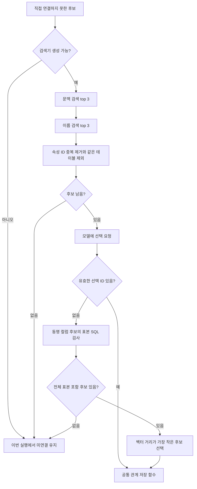
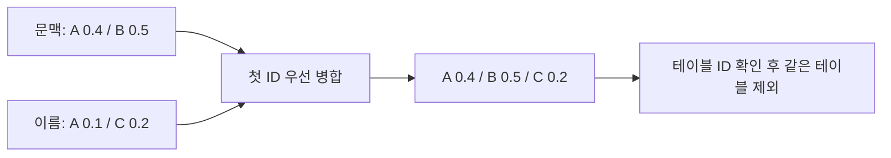
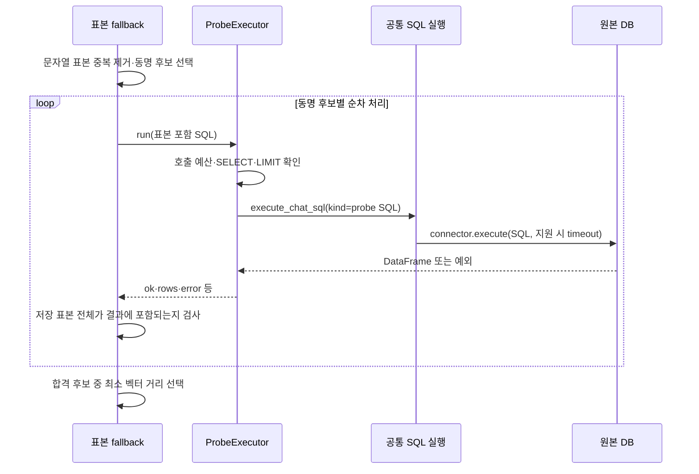

# Chapter 02. 벡터 후보 검색·모델 선택과 표본 SQL 검사

선언된 외래 키로 직접 연결하지 못한 컬럼은 의미 속성 검색으로 넘어간다. 현재 구현은 두 번의 벡터 검색 결과를 합쳐 모델에 선택을 요청한다. 모델이 선택하면 바로 저장 단계로 넘기고, 선택하지 않았을 때에만 컬럼 이름과 표본 값으로 대체 후보를 확인한다.

이 장은 [Chapter 01의 추론 대기열](chapter-01-declared-and-semantic-foreign-keys.md) 이후를 다룬다. 실제 DB·벡터 저장소·모델은 호출하지 않았고, 소스와 테스트 assertion을 정적으로 분석했다. 따라서 아래 SQL은 코드가 구성하는 형태를 보여주는 예시이며 실행 결과가 아니다.

## 1. 용어와 이번 단계의 책임

| 용어 | 뜻·이 문서에서의 의미 |
|---|---|
| FK(Foreign Key, 외래 키) | 주문의 고객 번호가 고객 테이블의 번호를 참조하는 것과 같은 관계. 여기서 입력 컬럼은 아직 FK로 확정되지 않은 미연결 후보일 수도 있다. |
| ColumnAttribute(컬럼 의미 속성) | 컬럼이 나타내는 고객 번호·상품 코드 같은 의미 객체. 최종 반환값은 이 속성의 ID다. |
| Embedding(임베딩) | 문장을 숫자 벡터로 바꾸는 작업. |
| VDB(Vector Database, 벡터 저장소) | 비슷한 벡터를 찾아 관련 문서를 반환한다. |
| Retriever(검색기) | 검색 문장을 임베딩한 뒤 VDB에 전달하는 객체다. |
| hit | 검색이 반환한 후보 한 건이다. |
| Metadata(메타데이터) | hit의 속성 ID·DB 이름·원본 테이블 등 검색 문서에 딸린 정보. |
| LLM(Large Language Model, 대규모 언어 모델) | 검색된 후보 중 참조 대상을 선택한다. |
| Probe(탐색 조회) | 실제 DB에 작은 확인용 SQL을 보내는 것. |
| Fallback(대체 경로) | 앞 단계가 선택하지 못했을 때 사용하는 다음 절차다. |

업무 객체·관계의 전체 뜻은 [용어집](../01-architecture/chapter-00-glossary.md), 벡터 문서가 만들어지는 과정은 [의미 embedding](../05-semantic-compilation/chapter-05-semantic-embedding-and-failure-boundaries.md)과 연결된다.



이 그림은 정상 분기다. 임베딩 요청이나 LLM client 생성이 예외를 발생시키면 SQL 대체 경로까지 도달하지 못할 수 있다. 예외 경계는 뒤에서 따로 구분한다.

## 2. 검색기 구성과 원본 DB connector 선택

`_build_retriever(database_name)`는 모듈 로딩 시 읽은 EMBED 역할의 모델·endpoint·API key를 사용한다. 코드 내부 변수 이름은 `_NVIDIA_API_KEY`지만 값은 `resolve("EMBED", "API_KEY")`에서 가져온다. 이 값이 비어 있으면 `None`을 반환하므로, 이 경로는 검색도 표본 SQL 대체 검사도 시작하지 않는다.

검색기를 만들 때 `get_semantic_vdb(database_name=...)`와 `EmbedParams`를 전달한다. 현재 factory는 Postgres 기반 `vdb.semantic_layer` 컬렉션을 사용하며, 컬렉션은 관련 벡터 레코드를 모아 둔 저장 단위다. 기본 `reset=False`이므로 검색기 생성이 기존 벡터를 지우는 요청은 아니다. DB별 이름 인자가 별도 물리 컬렉션을 뜻하지도 않는다.

다음 `_resolve_connector(database_name)`는 등록된 connector들의 `database_name`을 `casefold()`로 비교해 첫 일치 객체를 반환한다. 없으면 `None`이다. Connector는 원본 DB에 SQL을 실행하는 접근 객체다.

Connector가 없어도 벡터·모델 선택 경로는 가능하다. 다만 표본 SQL 대체 경로는 `None`을 반환한다. 반대로 connector가 있어도 검색기 구성에 실패하면 SQL만으로 전체 catalog에서 관계를 찾는 독립 경로는 없다.

근거: [semantic_fk.py의 구성·선택](../../../code/auto-ontology/auto_ontology/semantic/semantic_fk.py), [VDB factory](../../../code/auto-ontology/auto_ontology/vdb/__init__.py).

## 3. 검색 입력은 두 가지이며 각각 top 3을 요청한다

`_resolve_via_vdb`는 다음 검색을 **순서대로** 호출한다. Top k는 가까운 결과를 최대 k건 요청한다는 뜻이다.

| 검색 | 구성 | 요청 수 |
|---|---|---|
| 문맥 검색 | `column_name: 이름` + 비어 있지 않은 설명 + 짧은 표본 값 | `top_k=3` |
| 이름 검색 | `column_name: 이름` | `top_k=3` |

`_build_query_text`는 설명의 양끝 공백을 지우고, `_format_sample_values`로 표본을 붙인다. 표본이 없고 설명도 없으면 두 검색 문장이 같아질 수 있지만, 코드에 두 번째 호출을 생략하는 조건은 없다. 모듈 상단 주석의 top 5 설명과 달리 실제 실행 코드는 top 3 검색 두 번이다.

예를 들어 입력이 다음과 같다고 하자.

```text
name = customer_id
description = 주문 고객 식별자
sample_values = [72, null, 35, 72]

문맥 검색:
column_name: customer_id, description: 주문 고객 식별자, sample_values: 72, 35, 72

이름 검색:
column_name: customer_id
```

표본 문자열 변환은 native list, 즉 Python 목록과 그 목록을 담은 JSON 문자열을 모두 받는다. JSON은 배열·객체 같은 값을 표현하는 문자열 형식이다. `None` 항목은 제거한다. 문자열은 그대로, 숫자와 boolean은 Python 문자열로, 객체·배열은 JSON 문자열로 바꾼다.

검색과 모델 prompt에 넣는 표본은 **각 값의 길이가 30자 이하인 것만** 남긴다. 긴 값을 30자로 자르는 것이 아니라 통째로 제외한다. 이 단계에는 표본의 중복 제거가 없으며, 값 개수나 전체 검색 문자열 길이를 별도로 제한하는 코드도 없다.

### 3.1 검색 문장에 들어가지 않는 문맥

문맥 검색 문자열에는 출발 테이블 이름·DB·스키마·타입이 없다. 출발 테이블 이름은 뒤의 모델 prompt에는 들어간다. [후보 DAL 조회](chapter-01-declared-and-semantic-foreign-keys.md)가 반환하지 않는 `datatype`, `schema_name`을 `_resolve_via_vdb`가 추가 조회해 보충하지도 않는다.

따라서 유사성 검색 단계의 의미 판단은 컬럼 이름·설명·짧은 저장 표본에 의존한다. 원본 DB에서 매번 출발 표본을 새로 수집하는 절차도 아니다.

### 3.2 검색기로 전달하는 필터

두 요청 모두 같은 `where` 조건을 전달한다.

```json
{
  "label": "ColumnAttribute",
  "database_name": "요청 DB 이름",
  "is_unique": true
}
```

의도는 해당 DB의 컬럼 의미 속성 중 고유한 컬럼의 속성을 대상으로 검색하는 것이다. `is_unique=True`는 관측한 표본에서 계산·저장한 고유성 정보이며, 원본 DB의 PK 제약조건을 다시 확인한 결과와는 다르다. 필터가 그대로 적용된다면 false뿐 아니라 고유성 정보가 없는 후보도 조건을 충족하지 못한다.

**확인 범위:** 이 저장소의 `Retriever`는 조건을 그대로 VDB에 넘기며, `PostgresVDB.retrieval`도 외부 `PGVectorStore.similarity_search_with_score_by_vector(filter=...)`에 전달한다. 속성 중 `database_name`, `label`만 별도 메타데이터 컬럼으로 선언되어 있고 `is_unique`는 JSON 메타데이터에 들어간다. 이 장에서는 외부 라이브러리의 JSON 필터 해석이나 실제 SQL을 실행 검증하지 않았다. 그러므로 `is_unique` 조건의 전달 사실과 실제 후보 배제의 보장은 구분한다. 필터 관련 오류가 발생하면 VDB 검색 코드가 빈 결과로 바꿀 수 있다.

출발 컬럼 자신의 `is_unique` 값은 이 함수에서 검사하지 않는다. 또한 별도의 타입 호환 검사, 복합 키 묶음 비교, 배열·객체 표본의 제외 규칙은 없다. ‘고유 후보’라는 prompt 표현만으로 실제 참조 제약조건이 입증되는 것은 아니다.

## 4. 검색 호출의 결과·오류와 후보 병합

`Retriever.query`의 실제 순서는 다음과 같다.

```text
embed_texts([검색 문자열], input_type="query", timeout=60.0, retries=0)
→ 첫 벡터 선택
→ vdb.retrieval([벡터], top_k=3, where=조건)
→ {text, metadata, _distance} 목록 반환
```

60초는 검색 문자열을 임베딩하는 요청에 전달하는 timeout이다. 전체 관계 처리 시간이나 VDB SQL 전체의 제한으로 지정되는 값이 아니다. 이 호출은 SDK 재시도를 0으로 덮어쓰고, 의미 FK 경로에는 `_query_with_retry` 같은 별도 재시도 루프도 없다. Retriever 상단의 과거 재시도 설명만 보고 세 번 시도한다고 해석하면 안 된다.

임베딩 요청 예외는 위로 전파된다. `PostgresVDB.retrieval`은 검색 호출 내부 예외를 로그에 남기고 빈 결과로 바꾸지만, 그 앞의 `_get_store()` 초기화 등까지 같은 try 블록에 포함하지는 않는다. 따라서 ‘검색 결과 없음’에는 일부 검색 오류가 섞일 수 있고, 모든 오류가 빈 결과가 되는 것도 아니다.

### 4.1 최대 여섯 hit를 그대로 거리순 재정렬하지 않는다

병합 순서는 `문맥 검색 결과 + 이름 검색 결과`다.

1. 각 hit의 `metadata.id`를 읽는다.
2. ID가 비어 있으면 버린다.
3. 같은 ID가 처음 나왔을 때만 결과에 넣는다.
4. 출발 `table_id`가 있으면 target `metadata.table_id`가 없거나 같은 hit를 제외한다.
5. 남은 hit가 없으면 모델·SQL 검사 없이 `None`을 반환한다.

두 검색을 합쳐 최대 여섯 개의 서로 다른 속성 ID가 남을 수 있다. 이름 검색에서 같은 ID의 더 좋은 거리나 최신 메타데이터가 나와도 첫 문맥 hit를 교체하지 않는다. 병합 후 전체 거리순 정렬이나 최소 유사도 기준, 즉 너무 먼 후보를 제거하는 임계값도 없다.



출발 `table_id`가 누락된 입력에서는 같은 테이블 제외 블록 자체를 실행하지 않는다. 현재 정상 후보 조회에는 해당 ID가 포함된다. 후보의 실제 테이블을 catalog에서 재조회하여 메타데이터와 대조하는 과정은 여기에는 없다.

근거: [Retriever.query](../../../code/auto-ontology/auto_ontology/utils/retriever.py), [임베딩 요청](../../../code/auto-ontology/auto_ontology/utils/embedding.py), [VDB 검색·초기화](../../../code/auto-ontology/auto_ontology/vdb/postgres.py).

## 5. 모델 선택: 후보 ID 검사는 하지만 SQL 확인은 생략한다

`_llm_pick_hit`는 `get_llm_client(max_tokens=4096)`로 reasoning 역할 모델을 얻고, `invoke_with_structured_output`에 `FkHitSelection` 응답 형식을 전달한다. **Structured output(구조화 출력)**은 자유 문장 대신 지정한 필드 형태로 결과를 받는 방식이다.

| prompt 부분 | 실제 입력 |
|---|---|
| 출발 컬럼 | 이름·테이블 이름·설명·30자 이하 표본 문자열 |
| 각 후보 | `column_id={metadata.id} \| {hit.text의 앞 300자}` |
| 지시 | 확신할 때만 주어진 ID 선택, 아니면 null, ID를 지어내지 말 것 |
| 응답 | 필수 `selected_id: str 또는 None`, 선택적 `rationale` 문자열, 정의 외 필드 금지 |

Prompt의 `column_id`라는 이름은 실제 catalog 컬럼 ID를 뜻하지 않는다. 여기에 전달하는 값은 **ColumnAttribute ID**다. 후보의 전체 metadata나 `_distance`를 별도 필드로 모델에 모두 전달하지 않고, ID와 검색 문서의 앞 300자를 전달한다.

결과가 `None`, 선택 ID가 비어 있음, 주어진 후보 ID 목록에 없는 ID라면 선택을 폐기한다. 유효한 ID면 그대로 반환한다. `rationale`은 관계 저장의 근거나 점수 필드로 활용하지 않는다.

모델이 유효한 ID를 선택한 경우 `_resolve_via_vdb`는 **표본 SQL 검사를 호출하지 않는다**. 모델 선택과 표본 포함 검사가 항상 함께 충족되어야 관계를 만드는 구조가 아니다. 이후 공통 저장 함수의 DB 문맥 검사는 적용되며, 공개 진입점의 관계 정리는 Chapter 03의 별도 단계다.

### 5.1 ‘선택하지 않음’과 ‘선택 호출 전 예외’의 차이

공통 구조화 출력 wrapper는 호출·검증 재시도 후 실패를 `None`으로 바꿀 수 있다. 이 경우에는 표본 SQL 대체 검사로 이어진다. 그러나 `get_llm_client`는 wrapper에 들어가기 전에 실행된다. 예를 들어 `REASONING_API_KEY`가 없으면 client 생성에서 예외가 발생하고, 후보 작업 바깥의 예외 처리로 넘어가므로 SQL 대체 검사를 실행하지 않는다.

따라서 이 대체 경로를 모델 설정 없이 사용할 수 있는 독립 기능으로 해석하면 안 된다. 모델 호출 횟수와 재시도 세부 정책은 공통 LLM 분석 단계로 인계하며, 이 함수에 별도의 후보 재검색·모델 재선택 루프는 없다.

근거: [선택 함수](../../../code/auto-ontology/auto_ontology/semantic/semantic_fk.py), [FkHitSelection](../../../code/auto-ontology/auto_ontology/semantic/models.py), [LLM client와 wrapper](../../../code/auto-ontology/auto_ontology/utils/llm_invoke.py).

## 6. SQL 대체 검사: 같은 이름·모든 저장 표본 포함

`_match_hit_by_sample_values`는 모델이 선택하지 않았을 때 호출된다. Connector가 없거나 표본이 없으면 즉시 `None`이다.

### 6.1 표본은 문자열로 바꾸고 중복을 제거한다

`_distinct_samples`는 공통 문자열 변환 뒤 `dict.fromkeys`로 처음 등장한 순서를 유지하며 중복을 없앤다. 검색·모델 prompt와 달리 **값당 30자 제한을 적용하지 않는다**. 따라서 prompt에서 제외된 긴 값이 SQL 검사에는 들어갈 수 있다.

```text
[72, null, "35", 72] → ["72", "35"]
[1, "1"]             → ["1"]
```

타입을 보존한 비교가 아니라 문자열 비교이므로 숫자 1과 문자열 "1"은 하나로 합쳐진다. Boolean·날짜·JSON의 Python 표현과 DB의 TEXT 변환 결과가 다르면 실제로 연관된 값도 일치하지 않을 수 있다. 이를 보정하는 타입별 정규화는 이 함수에 없다.

### 6.2 후보의 물리 컬럼 이름이 같아야 한다

출발 `name`과 hit의 `metadata.source_column`을 문자열로 바꾸고 `.lower()`한 값이 같아야 한다. 양끝 공백 제거·별칭 해석·접미사 제거는 하지 않는다.

| 출발 컬럼 | 후보 물리 컬럼 | SQL 대체 검사 |
|---|---|---|
| `id` | `ID` | 대상 |
| `customer_id` | `customer_id` | 대상 |
| `customer_id` | `id` | 제외 |
| `id` | `lasteditedwhen` | 제외 |

마지막 두 경우에도 앞의 모델 선택은 가능하다. 동명 조건은 SQL 대체 경로에만 적용된다. 이름이 같은 후보가 하나도 없으면 SQL 실행 객체도 만들지 않는다.

### 6.3 후보 테이블의 값을 TEXT로 비교한다

`_sample_match_sql`는 target metadata의 `schema_name`, `table_name`, `source_column`과 문자열 표본을 받아 SQLGlot으로 SQL을 구성한다. SQLGlot은 SQL 구문 객체를 만들고 DB 방언에 맞게 출력하는 라이브러리다.

```sql
SELECT DISTINCT CAST("id" AS TEXT) AS "matched_value"
FROM "music"."torrents"
WHERE CAST("id" AS TEXT) IN ('72', '35')
LIMIT 2
```

- `table_name`, `source_column`, 표본 중 하나라도 없으면 SQL을 만들지 않는다. 스키마는 없어도 된다.
- 문자열 literal과 식별자는 구문 객체로 만들며 `identify=True`로 식별자 인용을 요청한다.
- Connector의 `dialect`를 출력에 사용하고, 그 과정에서 `ValueError`면 기본 SQL 출력으로 다시 시도한다.
- 출발 테이블을 조회하거나 실제 JOIN을 실행하지 않는다. **대상 컬럼에 저장 표본이 들어 있는지**만 검사한다.
- DB 이름을 SQL 경로에 넣거나 `connector.qualify`를 사용하지 않고 metadata의 스키마·테이블로 구성한다.

관계가 실제로 모든 출발 행을 참조하는지, 대상 컬럼 전체가 고유한지, 복합 키가 함께 맞는지 검사하는 SQL은 아니다. `LIMIT`도 반환 행 수를 제한할 뿐, TEXT 변환·DISTINCT·IN 조건 평가에 필요한 스캔 비용을 일정하게 만드는 보장은 없다.



## 7. ProbeExecutor의 제한과 실제 timeout 전달

`ProbeExecutor(connector, max_calls=동명 후보 수)`를 생성한다. 기본 전체 호출 예산 `DB_PROBE_MAX_CALLS=40`을 이 경로에서는 후보 수로 덮어쓰며, 후보 컬럼마다 새 executor가 만들어진다. 컴파일 전체가 공유하는 40회 예산은 아니다. 합친 후보는 최대 여섯 개이므로 일반적인 한 입력의 SQL 시도도 그 안에서 제한된다.

`DB_PROBE_MAX_ROWS` 기본값은 50이며 executor가 결과를 보관할 최대 행 수다. 해당 의미 FK 함수는 `DB_PROBE_PROACTIVE` 같은 질의 전 검사 활성화 플래그를 확인하지 않고 직접 executor를 사용한다.

| 순서 | 처리와 결과 |
|---|---|
| connector 없음 | 실패 entry 반환, 호출 수는 증가하지 않음 |
| 호출 예산 소진 | 실패 entry 반환 |
| 읽기 SQL 형식 검사 실패 | 실패 entry 반환, 호출 수는 증가하지 않음 |
| LIMIT 없음 | 최대 행 수 LIMIT을 붙임 |
| 실행 시작 | 호출 수 증가. 실패한 실제 실행도 예산 소비 |
| 실행 또는 결과 변환 실패 | error를 넣은 `ok=False` 반환 |
| 정상 결과 | `head(max_rows)`를 rows로 저장하고 실제 결과 길이·잘림 여부 기록 |

### 7.1 형식 검사는 문자열 규칙이다

검사는 SQL이 SELECT/WITH로 시작하는지, 내부 세미콜론이 없는지, INSERT·UPDATE·DELETE 등 금지 단어가 없는지 정규식으로 확인한다. 완전한 SQL 구문 분석이나 DB 권한 제어가 아니다. 단어 검사는 문자열 literal 안까지 적용되므로 표본 자체가 `update` 같은 금지 단어를 포함하면 정상적인 조회도 거부될 수 있다.

`_ensure_limit`는 `LIMIT` 단어가 이미 있으면 기존 SQL을 유지한다. 기존 LIMIT이 최대 행 수보다 큰지 재작성하지 않는다. 이 경로의 SQL은 표본 개수 LIMIT을 이미 포함하므로, 저장 표본이 50개보다 많으면 DB가 더 많은 결과를 반환해도 executor의 rows에는 앞 50개만 남을 수 있다. Fallback은 `truncated`를 확인하지 않으므로 전체 표본 포함 판정에 실패할 수 있다.

### 7.2 5초 설정을 이 실행기가 사용하지는 않는다

설정 모듈에는 `DB_PROBE_TIMEOUT_S` 기본 5초가 있지만 executor는 이를 읽지 않는다. 실제 호출 사슬은 다음과 같다.

```text
ProbeExecutor.run
→ execute_chat_sql(connector, sql, kind="probe SQL")
→ supports_statement_timeout이 참이면
     설정의 SQL Query Timeout(기본 30초)을 timeout_s로 전달
  아니면
     connector.execute(sql)로 실행
```

호출자는 timeout을 명시적으로 전달하지 않으므로 공통 SQL 실행 설정을 사용한다. 지원 플래그가 없거나 false면 시간 제한 인자도 전달하지 않는다. 각 DB에서 timeout이 실제 실행·연결·원격 작업 중 어디까지 적용되는지는 [connector 실행 경계](../03-connectors/chapter-11-execution-timeout-and-resources.md)에서 분석한 범위를 따른다.

Executor 자체는 별도 스레드를 만들어 강제로 중단하지 않고 호출 스레드에서 순차 실행한다. Context manager의 `close()`도 현재는 아무 자원을 닫지 않는 함수다. 공유 connector를 probe마다 종료하지 않는다.

근거: [ProbeExecutor](../../../code/auto-ontology/auto_ontology/retrieval/text_to_sql/db_probe/executor.py), [probe 설정](../../../code/auto-ontology/auto_ontology/retrieval/text_to_sql/db_probe/config.py), [공통 SQL 실행](../../../code/auto-ontology/auto_ontology/retrieval/text_to_sql/chat_sql.py), [timeout 설정 조회](../../../code/auto-ontology/auto_ontology/infra/feature_flags.py).

## 8. 모든 표본 포함 판정과 거리 선택

Probe 결과는 `sql`, `purpose`, `ok`, `rows`, `row_count`, `truncated`, `error`, `elapsed_ms` 필드를 가진다. 표본 검사 함수는 `ok=False`면 다음 후보로 넘어간다. 정상 rows에서는 각 행 첫 값 중 None이 아닌 값을 문자열로 바꿔 집합을 만든다.

합격 조건은 `set(samples).issubset(matched_values)`, 즉 **저장된 서로 다른 표본이 모두 결과에 포함되는 것**이다. 일부 일치나 빈 결과는 합격하지 못한다. 표본이 없는 경우에는 이미 앞에서 종료하므로 빈 집합이 자동 합격하지 않는다.

합격 후보를 처음 발견했다고 중단하지 않는다. 동명 후보들을 모두 처리하고 `min(matches, key=_hit_score)`로 `_distance`가 가장 작은 hit를 선택한다. `_distance`는 벡터 거리이며 작을수록 가깝다. 값이 없거나 숫자로 바꿀 수 없으면 무한대로 취급한다. 동률이면 목록에서 먼저 나온 hit가 유지된다. 이 단계는 `score`라는 별도 필드를 읽지 않는다.

```text
출발 표본: ["72", "35"]

후보 A: 결과 ["72"]       → 일부만 포함 → 제외
후보 B: 결과 ["72", "35"] → 전부 포함, 거리 0.4
후보 C: 결과 ["35", "72"] → 전부 포함, 거리 0.1

선택: C의 metadata.id
```

일치율이나 모델 신뢰도 점수를 저장하지 않는다. Executor의 상세 결과는 객체의 메모리 로그에 남지만 이 함수는 이를 catalog의 관계 근거 레코드로 저장하지 않는다. 공통 SQL 로그에는 실행 SQL이 기록되며, 선택 시에는 표본 수·출발/대상 위치를 로그로 남긴다.

## 9. 저장·실패·재실행의 경계

`_resolve_via_vdb`는 속성 ID 또는 `None`만 반환하고 관계를 직접 쓰지 않는다. 바깥 후보 작업이 `merge_semantic_fk`를 호출하여 catalog 문맥상 같은 DB인지 다시 확인하고 SEMANTIC_FK를 삽입한다. 이 저장 검사는 벡터 metadata의 타입·고유성·물리 컬럼 경로 전체를 재검증하지는 않는다.

| 상황 | 실제 결과 |
|---|---|
| 검색기 key 없음 | 모든 추론 후보를 이번 실행에서 건너뜀. SQL 단독 fallback 없음 |
| 첫 검색 임베딩 예외 | 두 번째 검색·모델·SQL로 진행하지 않고 바깥 후보 작업에서 실패 처리 |
| VDB 내부 검색 오류를 빈 결과로 반환 | 남은 다른 검색 결과가 있으면 그 후보로 계속할 수 있음 |
| 모델이 유효 ID 선택 | SQL 표본 검사 생략, 공통 저장으로 진행 |
| 모델 wrapper가 None 반환 또는 ID가 후보 밖 | 표본 SQL 대체 경로 시도 |
| LLM client 생성 예외 | 표본 SQL에 도달하지 않고 해당 후보 작업 실패 |
| SQL 한 후보의 실행 실패 | 다른 동명 후보를 계속 검사 |
| 모델이 고른 속성의 공통 저장 거부 | 해당 작업 False. 다른 후보 재선택이나 SQL fallback을 다시 실행하지 않음 |
| 표본 합격 속성의 저장 거부 | 해당 작업 False. 차순위 합격 후보를 다시 저장하지 않음 |

후보 작업별 예외는 바깥 `_resolve_one`에서 기록하고 False로 바꾼다. 이미 생성한 다른 컬럼의 관계까지 취소하는 transaction은 없다. 미연결 컬럼은 이후 컴파일에서 다시 후보가 될 수 있지만, 관계가 하나라도 저장된 컬럼은 다음 미연결 조회에서 빠진다. 자동으로 전 후보를 재평가하는 경로는 아니다.

이후 공개 진입점은 기존·새 관계의 값 겹침을 정리하고 join 기본 관계를 선택한다. **전체 표본 포함 검사와 후속 값 겹침 검사는 서로 다른 단계**이며, 후자는 Chapter 03에서 추적한다.

## 10. 테스트 근거와 미확인 항목

[semantic FK 테스트](../../../code/auto-ontology/auto_ontology/semantic/tests/test_semantic_fk.py)에서 실제 assertion을 읽었다.

| 테스트 | 확인하는 동작 |
|---|---|
| `test_format_sample_values_handles_legacy_json_string_and_native_list` | 목록·JSON 목록·None 항목의 문자열 처리 |
| `test_distinct_samples_drops_none_and_preserves_order` | 표본 순서를 유지한 중복·None 제거 |
| `test_vdb_resolution_excludes_same_table_candidates` | 다른 테이블 후보만 모델로 전달하고 `is_unique=True` 조건을 요청. 모델 선택 시 SQL 미호출 |
| `test_vdb_resolution_skips_llm_when_only_same_table_candidate_exists` | 같은 테이블 후보만 있으면 None이며 모델 미호출 |
| `test_vdb_resolution_uses_sql_fallback_when_llm_abstains` | 모델 None 후 남은 hit·connector를 SQL 함수에 전달 |
| `test_column_attribute_embedding_includes_physical_table` | embedding metadata에 물리 테이블과 고유성을 포함 |
| `test_sql_fallback_selects_candidate_containing_all_samples` | 문자열 표본과 숫자 결과의 전체 포함·컬럼 이름 대소문자 무시 |
| `test_sql_fallback_rejects_partial_or_missing_matches` | 부분 일치·빈 결과 거부 |
| `test_sql_fallback_uses_best_vdb_score_when_multiple_candidates_match` | 전체 표본 합격 후보 중 작은 `_distance` 선택 |
| `test_sql_fallback_continues_after_probe_failure` | 한 후보의 probe 실패 뒤 다음 후보 성공 |
| `test_sql_fallback_skips_without_samples_or_connector` | 표본·connector 없을 때 executor 미생성 |
| `test_sql_fallback_skips_candidates_with_different_column_names` | 다른 이름 후보 제외 |
| `test_sample_match_sql_quotes_location_and_compares_as_text` | 인용된 스키마·테이블, TEXT 비교, 표본 수 LIMIT 생성 |

대부분 검색·모델·executor를 mock, 즉 가짜 객체로 대체한다. 필터 인자를 확인하는 assertion은 실제 VDB가 `is_unique`를 적용한다는 통합 검증이 아니며, SQL fallback 결과 테스트도 원본 DB의 실제 CAST 결과를 검증하지 않는다.

[공통 SQL 테스트](../../../code/auto-ontology/auto_ontology/retrieval/text_to_sql/tests/test_chat_sql.py)는 기본 30초·변경 설정·설정 조회 실패 시 기본값·probe에도 timeout 전달·미지원 connector 인자 생략을 확인한다. 이 역시 실제 서버가 제시간에 쿼리를 종료하는지를 재현하는 테스트와는 다르다.

미확인 항목은 외부 VDB 라이브러리의 JSON 고유성 필터 적용, 실제 모델의 ID 선택 품질, DB별 TEXT 표현 차이·스캔 비용·timeout, 50개 초과 표본·문자열 검사 거부·중복 hit의 오래된 metadata 영향이다. 코드 조건에서 확인되는 한계와 실제 발생 여부를 구분한다. Mermaid 3개를 작성했으며 렌더링은 검증하지 않았다.
