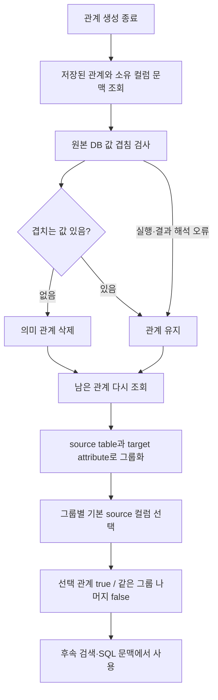
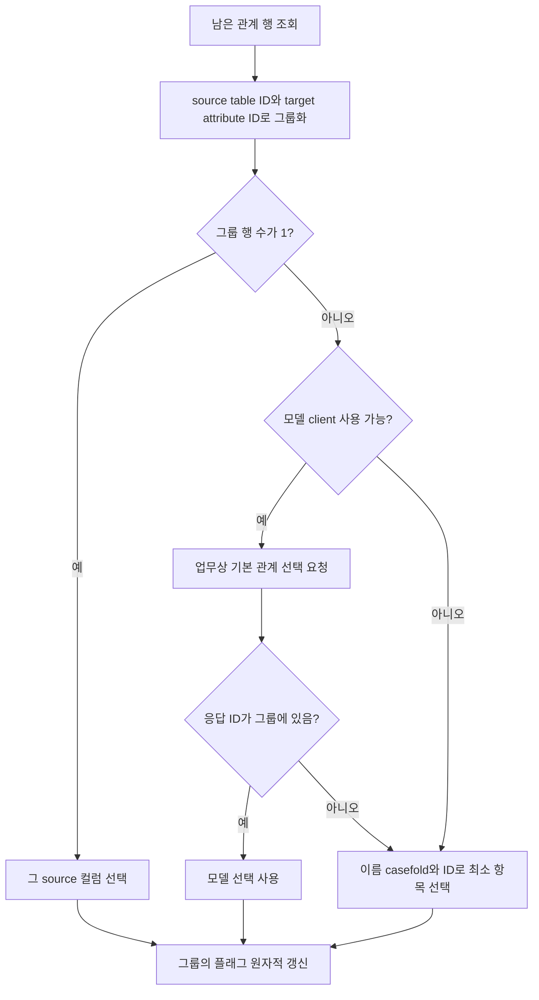
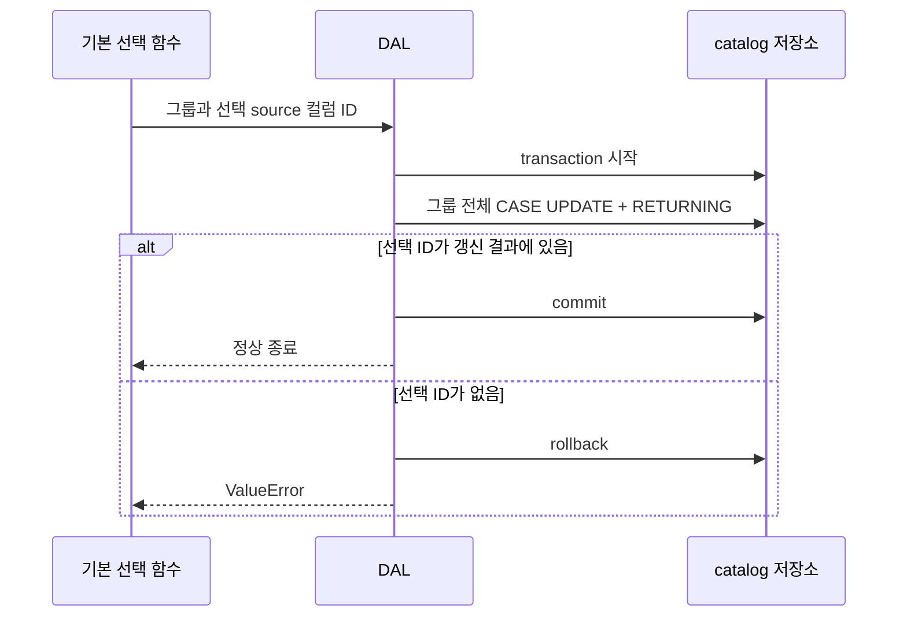
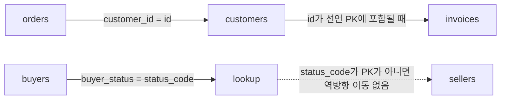

# Chapter 03. 관계 정리·JOIN 기본 선택과 경로 소비

의미 관계를 생성한 뒤에는 실제 값이 전혀 겹치지 않는 관계를 삭제하고, 같은 의미 속성을 참조하는 여러 컬럼 중 경로 탐색에 사용할 기본 컬럼을 고른다. 이 선택은 SQL 생성에 전달되는 JOIN 조건과 연결된다. 관계를 삭제하는 것과 경로에서 제외하는 것은 서로 다른 상태 변화다.

이 장은 로컬 코드·테스트의 정적 분석이다. 원본 DB·모델·테스트는 실행하지 않았다. SQL과 테이블 예시는 동작 설명용이며 실제 결과가 아니다. 앞 단계는 [선언 FK 연결](chapter-01-declared-and-semantic-foreign-keys.md), [벡터 후보와 표본 검사](chapter-02-vector-candidates-and-reference-validation.md)를 참고한다.

## 1. 용어와 전체 호출 순서

**FK(Foreign Key, 외래 키)**는 다른 컬럼의 값을 참조하는 관계다. **SEMANTIC_FK(의미 외래 키)**는 참조하는 컬럼에서 다른 컬럼의 의미 속성으로 저장한 관계이며, **HAS_ATTRIBUTE**는 속성을 소유하는 컬럼의 연결이다. **PK(Primary Key, 기본 키)**는 테이블의 행을 식별하는 키다.

**JOIN**은 조건에 따라 테이블의 행들을 결합하는 연산이다. **Join path(결합 경로)**는 테이블들을 연결하는 컬럼 쌍의 순서이며, **hop**은 인접한 테이블 사이의 한 번의 이동이다. **Pruning(관계 정리)**은 부적합한 관계를 삭제하는 작업, **overlap(값 겹침)**은 양쪽 컬럼에 같은 값이 존재하는지를 뜻한다. 업무 객체는 [용어집](../01-architecture/chapter-00-glossary.md)에서 더 찾아볼 수 있다.

진입점 `resolve_semantic_fks(database_name)`는 다음 순서를 고정한다.

```text
created = _resolve_semantic_fks(database_name)
created -= prune_disjoint_semantic_fks(database_name)
select_semantic_fk_join_defaults(database_name)
return created
```

이번 생성 수가 0이어도 정리와 기본 선택을 실행한다. 아래 두 후속 단계는 원본 DB 검사와 catalog 상태 갱신을 수행하지만, 생성부터 전체를 하나의 transaction, 즉 함께 성공·취소하는 작업 단위로 묶지는 않는다.



근거: [semantic_fk.py](../../../code/auto-ontology/auto_ontology/semantic/semantic_fk.py).

## 2. 정리와 기본 선택이 공통으로 읽는 행

`fetch_semantic_fk_join_groups(database_name)`는 의미 관계를 출발 컬럼·테이블·스키마·DB와 연결하고, target 속성의 HAS_ATTRIBUTE를 따라 소유 컬럼·테이블·스키마를 찾는다. 이름에 groups가 있지만 반환값은 **그룹화 전의 행 목록**이다.

| 필드 묶음 | 반환 내용 |
|---|---|
| `source_table_*` | 출발 테이블 ID·이름·설명 |
| `source_schema_name` | 출발 스키마 이름 |
| `source_column_*` | 출발 컬럼 ID·이름·설명 |
| `target_attribute_*` | 참조 속성 ID·이름·설명 |
| `target_table_*`, `target_schema_name` | 소유 테이블 ID·이름·설명과 스키마 |
| `target_column_*` | 소유 컬럼 ID·이름·설명 |
| `use_in_join_paths` | 현재 경로 사용 플래그 |

조회 조건은 **출발 DB 이름**이다. Target의 DB 일치 조건, 속성의 semantic source 조건, 현재 플래그가 true라는 조건은 이 쿼리에 없다. 정상 관계 저장 함수는 같은 DB인지 확인하지만, 이 조회 자체가 그 검사를 대체하지는 않는다.

모든 연결이 INNER JOIN, 즉 연결 대상이 있어야 행을 반환하는 방식이다. 소유 HAS_ATTRIBUTE가 없어진 의미 관계는 이 목록에 나오지 않으므로 이 정리 단계가 고아 관계를 모두 탐지·복구하는 것은 아니다.

정렬은 source table ID → target attribute ID → 소문자 source 컬럼 이름 → source 컬럼 ID 순이다. 같은 source 관계의 속성을 여러 컬럼이 소유하면 소유 컬럼별 행이 생길 수 있으며 DISTINCT가 없다. 따라서 한 행이 항상 서로 다른 의미 관계 한 개를 뜻하지는 않는다.

근거: [attributes.py의 관계 문맥 조회](../../../code/auto-ontology/auto_ontology/dal/attributes.py).

## 3. 값 겹침 정리는 ‘한 값이라도 존재하는가’를 검사한다

`prune_disjoint_semantic_fks`는 DB 이름으로 connector, 즉 원본 DB 접근 객체를 찾는다. 없으면 0을 반환하고 아무 관계도 삭제하지 않는다. 있으면 위 조회 목록의 각 행을 순차 처리한다.

출발·대상 위치는 `connector.qualify(schema, table)`로 만들고, 컬럼은 DB 방언에 맞게 인용한 뒤 다음 형태의 SQL을 구성한다.

```sql
SELECT COUNT(*) AS n
FROM (
    SELECT customer_id FROM orders
    WHERE customer_id IS NOT NULL LIMIT 1
) AS present
UNION ALL
SELECT COUNT(*)
FROM (
    SELECT customer_id FROM orders
    WHERE customer_id IN (SELECT id FROM customers) LIMIT 1
) AS shared
```

실제 테이블·컬럼 인용은 connector와 dialect에 따라 달라진다. 위 SQL은 설명용으로 이름을 단순화했다. `UNION ALL`은 두 결과를 합치되 중복을 제거하지 않는 SQL 연산이다. 반환 첫 컬럼의 두 값을 정수로 읽어 `present`, `shared`에 대입한다.

- `present`: 출발 컬럼에 NULL, 즉 값 없음이 아닌 행이 하나라도 있는가. 안쪽 LIMIT 때문에 보통 0 또는 1이다.
- `shared`: 출발 컬럼 값 중 대상 컬럼에 존재하는 값이 하나라도 있는가. 역시 보통 0 또는 1이다.

| present | shared | 처리 |
|---|---|---|
| 1 | 1 | 의미 관계 유지 |
| 1 | 0 | 공통 값이 없다는 로그와 함께 삭제 |
| 0 | 0 | 비어 있거나 전부 NULL인 출발 컬럼이라는 로그와 함께 삭제 |
| 조회 실패 | 확인 불가 | 해당 행의 검사를 건너뛰고 관계 유지 |

삭제 여부는 `if not shared`로 결정한다. `present`는 삭제 이유를 구분하는 데 사용한다. 빈 문자열은 NULL이 아니므로 present 측에서는 값이 있는 행으로 처리된다.

### 3.1 앞 장의 표본 검사와 다른 기준

| 비교 | Chapter 02의 SQL 대체 검사 | 이번 정리 |
|---|---|---|
| 실행 시점 | 모델이 후보를 선택하지 않았을 때 | 관계 생성 이후 공개 진입점에서 |
| 대상 | 검색된 동명 컬럼 후보 | 조회에 나타난 기존·새 의미 관계 |
| 값 | catalog에 저장된 표본 | 실제 원본 컬럼 |
| 합격 조건 | 서로 다른 저장 표본 모두 포함 | 공통 값 하나 이상 존재 |
| 타입 처리 | 대상 컬럼을 TEXT로 변환 | 원본 컬럼의 IN 비교, 별도 TEXT 변환 없음 |
| 실패 | 해당 후보 포기, 다음 후보 검사 | 관계를 삭제하지 않고 유지 |

예를 들어 출발 값 1,000개 중 하나만 맞아도 이번 정리를 통과할 수 있다. 일치 비율·전체 참조 무결성·대상 고유성·JOIN 결과 행 수를 검증하는 단계는 아니다. 반대로 아직 적재되지 않아 비어 있는 출발 테이블의 유효한 선언 관계도 현재 값 기준으로는 삭제될 수 있다.

선언 FK로 만들었는지 모델·표본으로 만들었는지 구분하는 필터도 없으며, `use_in_join_paths=False`인 관계도 정리 대상이다. 원본 선언 FK나 속성 객체를 삭제하는 것이 아니라 `delete_semantic_fk(source_column_id, target_attribute_id)`로 해당 의미 관계 쌍만 삭제한다.

### 3.2 실행 시간·오류·집계 경계

이번 SQL은 `ProbeExecutor`나 `execute_chat_sql`을 거치지 않고 **`connector.execute(sql)`를 직접 호출**한다. 이 함수는 명시적 timeout·호출 예산·재시도·취소 신호를 전달하지 않는다. 앞 장의 공통 SQL 기본 30초가 이 호출에도 전달된다고 가정하면 안 된다. 실제 connector의 고유 동작은 [실행·자원 경계](../03-connectors/chapter-11-execution-timeout-and-resources.md)를 따른다.

조회 실행과 DataFrame 첫 컬럼의 두 정수 해석은 try/except 안에 있다. SQL 오류, 행 수 불일치, 정수 변환 실패는 로그를 남기고 다음 행으로 진행한다. 그러나 `qualify`·컬럼 인용·SQL 구성은 그 앞이며, 관계 삭제는 그 뒤다. 이 부분의 예외나 최초 관계 문맥 조회 실패는 같은 보호를 받지 않고 상위로 전파될 수 있다. 이 경우 뒤의 기본 선택도 실행되지 않을 수 있다.

삭제 함수는 실제 삭제 행 수를 반환하지 않는다. 호출이 정상 종료되면 `pruned += 1`하므로 이미 삭제된 쌍을 다시 처리하는 경우까지 순수 신규 삭제 수로 보장하지 않는다. 여러 소유 컬럼 때문에 같은 관계가 여러 행으로 나온다면 한 소유 컬럼과 값이 겹치지 않았다는 이유로 관계 전체가 삭제될 수 있고, 중복 행의 삭제 호출도 집계될 수 있다. 이는 스키마·루프에서 확인한 가능성이며 실제 데이터로 재현하지 않았다.

공개 함수 반환은 생성 처리 수에서 이 정리 수를 뺀 값이다. 과거 관계를 지울 수 있으므로 새 생성 0·기존 삭제 2이면 반환값은 -2가 된다. 전체 유효 관계 수나 새로 삽입한 행 수로 해석하면 안 된다.

## 4. 기본 JOIN 관계는 source table·target attribute 단위다

정리가 끝나면 `select_semantic_fk_join_defaults`가 관계 문맥을 **다시 조회**한다. 방금 삭제한 관계를 이전 목록에서 그대로 선택하는 구조가 아니다.

그룹 키는 `(source_table_id, target_attribute_id)`다. 같은 출발 테이블의 `billing_customer_id`, `shipping_customer_id`, `customer_id`가 모두 고객 번호 속성을 가리키면 한 그룹이다. Target 테이블 쌍 전체에서 무조건 하나를 고르는 것은 아니다. 서로 다른 속성 ID를 가리키면 각각의 그룹에서 true가 생길 수 있다.



애매한 그룹이 하나라도 있을 때만 `get_llm_client()`를 호출하고, 생성한 client를 그룹들에 재사용한다. 단일 행 그룹만 있으면 모델 client 자체를 만들지 않는다. Client 생성의 설정 누락·일반 예외는 로그 후 규칙 기반 선택으로 대체한다.

그룹의 `len(group)>1`은 고유 source 컬럼 수가 아니라 **조회 행 수**다. 동일 관계가 다중 소유 컬럼 때문에 반복된 경우에도 애매한 그룹으로 취급될 수 있다.

### 4.1 모델에 보내는 입력과 응답 검증

Prompt에는 첫 행의 source/target 테이블 이름·설명, target 컬럼 이름·설명, target 의미 속성 이름과 후보별 source 컬럼 ID·이름·설명을 넣는다. 스키마·DB 이름, 표본 값, 겹침 결과, 현재 선택 플래그, target 속성 설명은 별도 필드로 전달하지 않는다.

모델 지시는 여러 업무 역할 중 **별도 역할 설명 없이 두 테이블을 JOIN할 때 가장 자연스러운 관계**를 고르라는 것이다. 응답은 `SemanticFkJoinDefaultSelection`으로 받으며 다음 계약을 가진다.

| 필드 | 의미 |
|---|---|
| `selected_column_id` | 필수. 후보의 실제 source catalog 컬럼 ID 또는 None |
| `rationale` | 선택적 설명 문자열. 기본 빈 값 |
| 정의 외 필드 | 허용하지 않음 |

앞 장의 후보 선택 prompt가 `column_id`라는 이름으로 의미 속성 ID를 전달했던 것과 달리, 여기서는 실제 **source 컬럼 ID**를 선택한다.

모델 호출 예외·None 응답·그룹에 없는 ID는 선택 실패로 바꾼다. 선택 이유는 플래그 갱신이나 관계 근거로 저장하지 않는다. 특정 질문에 맞춰 매번 고르는 관계도 아니다. 컴파일 후속 처리에서 저장해 두는 기본값이다.

### 4.2 모델이 결정하지 못하면 이름순이다

`_deterministic_join_default`는 `(source_column_name.casefold(), str(source_column_id))`가 가장 작은 행을 고른다. **Deterministic(결정적)**은 같은 입력이면 같은 결과를 내는 규칙이라는 뜻이다. 먼저 이름을 대소문자 차이 없이 비교하고 동률이면 ID를 비교한다.

예를 들어 `billing_customer_id`, `customer_id`, `shipping_customer_id`라면 모델이 없을 때 `billing_customer_id`가 선택될 수 있다. `customer_id`를 특별히 우선하는 하드코딩 규칙, 실제 사용 빈도, 인증 상태, 기존 true 플래그를 우선하는 조건은 없다.

이미 그룹에서 하나만 true여도 모든 관계 행을 다시 그룹화해 선택한다. 따라서 모델 응답이 바뀌거나 모델을 사용할 수 없게 되면 이전 기본값을 바꿀 수 있다. 단일 관계는 이전 false 상태였더라도 true로 지정한다.

근거: [선택 알고리즘](../../../code/auto-ontology/auto_ontology/semantic/semantic_fk.py), [응답 모델](../../../code/auto-ontology/auto_ontology/semantic/models.py).

## 5. 그룹별 플래그 갱신은 원자적이지만 전체 선택은 아니다

`set_semantic_fk_join_default(source_table_id, target_attribute_id, selected_column_id)`는 source table의 컬럼 ID들을 서브쿼리로 구하고, 해당 속성으로 향하는 그룹 전체를 UPDATE한다.

```text
선택한 source 컬럼의 관계 → use_in_join_paths = true
같은 source table·target attribute의 다른 관계 → false
다른 그룹 → 변경하지 않음
```

이 UPDATE는 `RETURNING column_id`를 사용한다. `write_transaction()` 안에서 선택 ID가 실제 갱신 행에 포함되었는지 확인하고, 아니면 ValueError를 발생시켜 rollback, 즉 해당 transaction 변경을 취소한다. 잘못된 선택으로 같은 그룹을 전부 false로 남기는 것을 막는 경계다.



그룹별 갱신은 하나의 transaction이지만 모델 선택을 포함한 전체 그룹 처리에 공통 transaction은 없다. 뒤 그룹에서 오류가 나면 앞 그룹의 선택은 이미 저장되어 있을 수 있다. 선택 함수는 그룹별 저장 오류를 잡고 계속하지 않으며, 반환값 `len(grouped)`는 정상 종료했을 때의 처리 그룹 수다. 실제 변경 행 수나 모델이 판단한 그룹 수가 아니다.

동시 실행 시 선택 계산부터 쓰기까지 잠그는 별도 코드도 없다. 각 UPDATE가 원자적이라는 사실만으로 이전 모델 판단이나 사용자의 선택을 보존한다고 볼 수는 없다.

근거: [플래그 UPDATE](../../../code/auto-ontology/auto_ontology/dal/attributes.py), [transaction 구현](../../../code/auto-ontology/auto_ontology/dal/session.py).

## 6. true인 관계가 테이블 경로로 바뀌는 방법

실제 경로 탐색은 오래된 `join_path_edge` view를 읽지 않는다. **View**는 저장된 조회 정의다. 스키마에는 남아 있지만 현재 `attributes.py`의 탐색은 `_SEMANTIC_TABLE_EDGES`와 `_find_table_join_hops`를 사용한다.

`_SEMANTIC_TABLE_EDGES`는 SEMANTIC_FK를 HAS_ATTRIBUTE의 소유 컬럼과 연결해 아래 행으로 만든다.

```text
fk_table_id, fk_column_id, owner_table_id, owner_column_id, owner_is_pk
```

양쪽 테이블의 DB ID가 요청 DB ID와 같고 `use_in_join_paths=True`인 관계만 남긴다. 의미 관계를 쓰는 함수가 DB 이름으로 검사한 것과 달리, 여기서는 양쪽 **DB ID**로 범위를 제한한다. 같은 행은 DISTINCT로 합친다.

### 6.1 이동 방향은 항상 양방향이 아니다

- FK 테이블 → 소유 테이블: 추가한다.
- 소유 테이블 → FK 테이블: 소유 컬럼 이름이 소유 테이블의 선언 `pk` 배열에 포함될 때만 추가한다.
- 같은 테이블을 향하는 관계: 탐색 간선에서 제외한다.

이때 PK 검사는 `컬럼 이름 == ANY(table.pk)`다. 복합 PK 전체의 결합 일치를 확인하는 것이 아니라, 해당 컬럼이 PK 구성원인지 확인한다. 표본에서 고유하다는 `is_unique`만으로 역방향 이동을 허용하지 않는다.



위의 점선은 실제 추가되는 경로가 아니라 **제외 조건**을 표시한 것이다. 관련 문서의 ‘undirected’, ‘outgoing-only’라는 요약 주석만으로 현재 탐색을 설명하면 이 PK 조건을 놓치게 된다. 함수 실행 조건을 기준으로 해석해야 한다.

### 6.2 가장 적은 hop 경로를 메모리에서 찾는다

`_find_table_join_hops`는 DB의 해당 간선을 한 번 조회한 뒤, 테이블별 이웃 목록을 만들고 정렬한다. **BFS(Breadth-First Search, 너비 우선 탐색)**로 가까운 테이블부터 방문하고, 방문한 테이블은 다시 확장하지 않는다.

최대 hop은 `(MAX_PATH_DEPTH + 2) // 4`이며 기본 `MAX_PATH_DEPTH=30`이므로 8이다. 이 상수는 과거 컬럼·속성·테이블 간선 수 기준을 테이블 hop으로 환산한 값이다.

목적 테이블을 처음 만나면 부모 기록을 거슬러 실제 컬럼 쌍을 복원한다. 인접 목록 정렬과 최초 방문이 동률 경로를 결정한다. 업무 적합도·행 수·성능 비용을 비교해 최적 JOIN을 찾는 알고리즘은 아니다. 경로마다 SQL을 재조회하지는 않지만 각 경로 요청이 DB의 의미 간선 목록을 다시 읽으며, 전체 호출에서 캐시를 공유하는 구현은 여기 없다.

### 6.3 입력 컬럼은 테이블을 지정하며 실제 JOIN 컬럼과 달라도 된다

`find_join_path(anchor_col_id, dest_col_id)`는 두 컬럼의 문맥을 읽어 테이블·DB를 확인한다. 동일 컬럼·동일 테이블·누락 문맥·다른 DB면 빈 목록을 반환한다. 경로 조회 예외도 로그와 빈 목록으로 바꾼다.

예를 들어 입력이 `customers.name`, `addresses.city`라도 실제 관계가 `customers.address_id → addresses.id`라면 반환 hop은 후자의 키 쌍이다. 반환 필드는 양쪽 `database`, `schema`, `table`, `column` 이름이다.

이름·문맥 보충은 경로 계산과 별도 조회다. 문맥 조회 실패가 빈 dict로 바뀌면 일부 반환 필드가 빈 문자열이 될 수 있다. 빈 경로도 ‘실제 연결 없음’, ‘동일 테이블이라 불필요’, ‘조회 실패’를 모두 표현하므로 상태 코드 하나로 구분하지 않는다.

## 7. 실제 소비자: 검색 문맥·SQL 생성·검사

| 소비자 | 경로와 플래그를 사용하는 방식 |
|---|---|
| `CandidatePreparationAgent` | 기준 의미 속성의 컬럼을 anchor, 즉 시작점으로 정하고 다른 속성 컬럼까지 `find_join_path` 호출. 결과를 `attribute_join_paths`에 저장 |
| 관련 테이블 필터 | path의 source/target 테이블 쌍을 `Known join paths` 문맥으로 표시 |
| `find_connected_junction_tables` | 연결 테이블을 확장할 때 semantic 경로에는 true 조건 적용. 선언 FK를 읽는 별도 분기는 플래그와 무관 |
| `find_kept_table_bridges` | 남긴 테이블 쌍 사이에 필요한 중간 테이블과 실제 hop을 찾고 `attribute_join_paths`에 추가 |
| `format_semantic_context` → `sql_from_semantic.py` | 양쪽 컬럼의 동등 조건을 prompt로 출력. 필요한 경로만 선택하되 선택한 경로의 중간 테이블·hop을 생략하지 않도록 지시 |
| JOIN 검사 `find_join_path_mismatches` | 작성된 JOIN 컬럼에서 경로를 양쪽 순서로 시도하고, 알려진 경로와 다른 컬럼·빠진 중간 테이블을 판단하는 근거로 사용 |

`find_table_bridge`는 같은 탐색기를 양쪽 방향으로 시도하며 **중간 테이블이 있는** 경로를 반환한다. 직접 한 hop만 있는 경로는 bridge 결과가 아니다. 허용된 테이블 집합이 주어지면 찾은 경로의 중간 테이블들이 그 집합에 포함되는지 검사한다. 발견한 최단 경로가 범위를 벗어난다고 제한 집합 안의 다른 경로를 다시 BFS로 찾는 구조는 아니다.

`find_shared_hub_bridge`, `find_anchor_hub_siblings`도 관계 플래그 true와 소유 컬럼의 선언 PK 조건을 사용한다. Hub는 여러 참조 테이블이 공유하는 중심 테이블, sibling은 같은 hub를 참조하는 다른 테이블이다. 후보 확장 범위·순위·개수 제한은 01-7 검색 분석에서, JOIN 검사와 실제 값 대체 검사는 01-9에서 상세히 이어간다.

false는 ‘관계 삭제’도 ‘이 관계로 작성한 모든 SQL 금지’도 아니다. 속성의 참조 컬럼 목록을 만드는 `fetch_column_attribute_columns_map`은 false 관계도 읽는다. 선언 FK 기반 연결 테이블 확장도 따로 있고 JOIN 검사에는 실제 값 검사와 예외가 있으므로, 이 플래그 하나가 전체 SQL 허용 여부를 결정하지 않는다.

Formatter가 표시하는 `VERIFIED OPTIONS`라는 표현 역시 경로 문맥의 이름이다. 앞의 약한 값 겹침 검사·실패 시 보존 정책을 고려하면 전체 원본 데이터의 참조 무결성을 보증하는 인증으로 이해하면 안 된다.

근거: [후보 준비](../../../code/auto-ontology/auto_ontology/retrieval/text_to_sql/agents/candidates_preparation.py), [문맥 formatter](../../../code/auto-ontology/auto_ontology/retrieval/text_to_sql/formatters_util.py), [SQL 생성 소비](../../../code/auto-ontology/auto_ontology/retrieval/text_to_sql/agents/sql_from_semantic.py), [JOIN 검사](../../../code/auto-ontology/auto_ontology/retrieval/text_to_sql/db_probe/join_path_check.py).

## 8. 재실행과 상태 변화 예시

| 이전 상태·실행 조건 | 이후 상태 |
|---|---|
| 새·기존 의미 관계에 공통 값 없음 | 의미 관계 행 삭제. 원본 선언 FK는 이 함수에서 삭제하지 않음 |
| 빈 source 또는 전부 NULL | 의미 관계 삭제 가능 |
| 값 검사 SQL 실패 | 관계 보존. 뒤의 기본 선택 후보에 남을 수 있음 |
| 같은 그룹에 billing과 customer 관계가 모두 true | 모델 또는 이름/ID 규칙으로 하나 true, 나머지 false |
| 단일 관계가 false | 정상 그룹 조회·선택이면 true로 재지정 |
| 앞 그룹 저장 후 뒤 그룹 오류 | 앞 그룹 결과는 남을 수 있음 |
| 삭제된 source가 HAS_ATTRIBUTE 없이 미연결 | 다음 resolver 후보가 될 수 있음. 이번 실행에서는 삭제 뒤 생성 단계를 다시 돌지 않음 |

선언 관계를 매번 직접 생성한 뒤 빈 테이블이라 다시 삭제하는 상황도 가능하다. 이 후속 단계에는 다음 실행을 막는 실패 marker나 재시도 횟수 제한이 없다. 재실행이 항상 안정된 같은 결과나 누락 관계 복구를 보장하지는 않는다.

## 9. 테스트 근거와 미확인 사항

[semantic FK 테스트](../../../code/auto-ontology/auto_ontology/semantic/tests/test_semantic_fk.py)의 다음 assertion을 읽었다.

- `test_prune_removes_disjoint_and_empty_source_fks`: `(present, shared)`가 `(1,1)`이면 유지, `(1,0)`과 `(0,0)`이면 삭제하며 반환 정리 수도 확인한다. Connector의 SQL 결과는 가짜 DataFrame이다.
- `test_single_semantic_fk_is_default_without_llm`: 단일 그룹은 client 생성 없이 선택·저장한다.
- `test_llm_selects_default_from_parallel_semantic_fks`: 모델이 고른 customer 컬럼 ID가 저장 함수로 전달된다.
- `test_invalid_llm_selection_uses_deterministic_default`, `test_missing_llm_uses_deterministic_default`: 잘못된 ID·모델 설정 누락 시 a 컬럼을 선택한다.
- `test_resolution_always_normalizes_join_defaults`: 공개 진입점이 기본 선택을 호출한다. 실제 전체 정리·선택의 원자성을 검증하는 것은 아니다.

[DAL 테스트](../../../code/auto-ontology/auto_ontology/dal/tests/test_attributes.py)에서는 다음 assertion을 확인했다.

- `test_setting_join_default_disables_every_other_group_member`: customer가 true이고 billing이 false임을 조회해 확인한다.
- `test_join_path_uses_only_the_selected_parallel_semantic_fk`: billing 컬럼을 입력해도 실제 hop은 선택된 customer 컬럼을 사용한다.
- `test_two_referencing_tables_join_through_the_attribute_owner`, `test_sibling_fks_do_not_join_through_a_non_identity_shared_attribute`: 선언 PK 소유자를 통한 경로와 비PK 공유 속성의 경로 제외를 구분한다.
- `test_endpoints_are_tables_to_connect_not_required_join_columns`: name·city를 입력해도 address_id·id를 반환한다.
- `test_a_cycle_terminates`, `test_the_depth_bound_is_enforced`: 순환 종료와 깊이 상수 변경에 따른 경로 제한을 확인한다.
- `test_find_table_join_hops_queries_once_regardless_of_fan_out`: 경로 탐색기의 저장소 접근이 한 번임을 확인한다. 전체 `find_join_path`의 문맥 조회까지 한 번이라는 뜻은 아니다.
- `test_connected_junctions_ignore_unselected_semantic_fks`, `test_hub_helpers_ignore_unselected_semantic_fks`: false 관계가 해당 semantic 확장·hub 조회에서 제외된다.

이 테스트들은 실행하지 않았다. 다중 소유 속성의 중복 정리·삭제 수, invalid 선택의 실제 rollback, 동시 선택·부분 실패, 데이터 적재 중 검사, 원본 SQL 성능·timeout은 이번에 실제 재현하지 않았다. 코드에서 확인한 transaction·분기와 운영상의 보장은 구분한다.

Mermaid 4개를 작성했으며 렌더링은 검증하지 않았다. 다음 Chapter 04에서는 이력 SQL이 계산 속성 제안으로 바뀌는 입력·점수·검증·저장·실패 경계를 분석한다.
