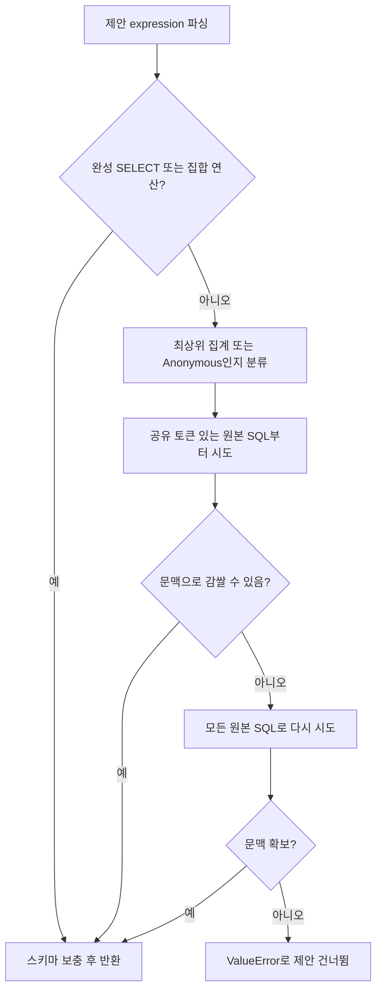
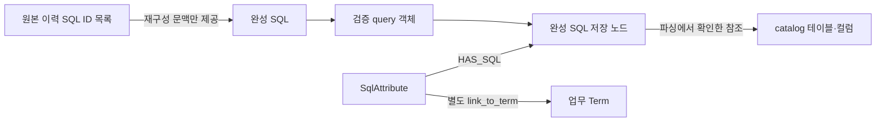
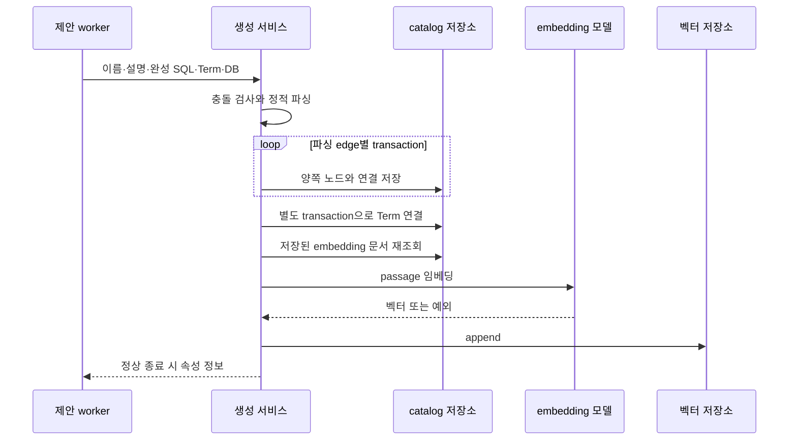

# Chapter 04-1. 제안 표현식의 SQL 완성·검증·저장과 검색 반영

모델이 제안한 `status='paid'` 같은 표현식은 원본 SQL에서 FROM·JOIN 문맥을 빌려 완성된 SQL로 바꾼다. 이후 서비스가 catalog 기준으로 파싱하고, SQL·속성·업무 개념의 연결을 저장한 뒤 검색 벡터를 만든다. 이 전체 과정은 하나의 transaction이 아니므로 저장 후 임베딩 실패가 남을 수 있다.

후보와 모델 제안은 [Chapter 04](chapter-04-query-history-sql-attributes.md), 기본 SQL 객체는 [SQL·분석 데이터 모델](../02-data-model/chapter-03-sql-and-analysis-definitions.md)을 참고한다. 이 장도 소스·테스트 정적 분석이며 실제 SQL·모델·테스트는 실행하지 않았다.

## 1. 용어와 입력·출력 계약

| 용어 | 뜻·이 문서에서의 의미 |
|---|---|
| SqlAttribute(SQL 속성) | 이름 붙여 재사용할 SQL 정의이다. |
| Term | 그 속성이 속한 업무 개념이다. |
| Catalog | 수집해 둔 테이블·컬럼 구조다. |
| Alias(별칭) | `orders o`의 `o`처럼 SQL에서 사용하는 다른 이름이다. |
| CTE(Common Table Expression) | WITH로 정의한 임시 이름의 조회 결과다. |
| Dialect(방언) | DB마다 다른 SQL 문법을 뜻한다. |
| 정적 검증 | 원본 DB에서 SQL을 실행하지 않고 문법과 catalog 참조를 분석하는 것이다. |
| 임베딩 | 검색용 숫자 벡터 생성이다. |
| VDB | 벡터 저장소다. |
| Provenance(출처 연결) | 어떤 원본에서 결과가 만들어졌는지 추적하는 관계다. 관련 용어는 [용어집](../01-architecture/chapter-00-glossary.md)과 연결된다. |

핵심 입력은 다음과 같다.

```text
_build_valid_sql(
  expression=모델 제안 문자열,
  source_sql_texts=정확히 같은 표현식이 추출된 원본 SQL 목록,
  schema_map={소문자 테이블명: 스키마명}
) → SQL 문자열 또는 ValueError

create_sql_attribute(
  name, description, expression=완성 SQL,
  term_id, connector=database_name, source="sql"
) → 속성·SQL·Term·DB 정보 dict
```

이력 제안의 속성 `source`는 `sql`이다. 연결 대상 Term의 `source="semantic"`과 다른 필드이며 혼동하면 안 된다. 생성 호출은 owner_id·created_by를 지정하지 않는다. 새 속성의 certified, 즉 인증 상태는 저장 스키마 기본값 false다.

## 2. 완성 SQL인지 먼저 구분한다

`_build_valid_sql`은 표현식을 기본 SQLGlot 문법과 `error_level=IGNORE`로 파싱한다.

| 파싱 결과 | 처리 |
|---|---|
| SELECT·UNION·INTERSECT·EXCEPT | 원문을 완성 SQL로 취급하고 스키마 보충만 시도 |
| 최상위 노드가 집계 AggFunc 또는 Anonymous 함수 | 원본 문맥을 빌려 `SELECT 표현식 FROM ...` |
| 그 외 노드·파싱 실패 | 원본 문맥을 빌려 `SELECT * FROM ... WHERE 표현식` 시도 |

함수 이름과 달리 이 단계가 실제 실행 가능한 SQL을 보증하지는 않는다. 원본 문맥 없는 단독 조건은 ValueError가 되지만, 완성 SELECT라고 파싱된 모델 출력은 원본 이력 SQL 목록이 비어 있어도 통과할 수 있다. 제안이 반드시 top 10의 원문이어야 한다는 membership 검사도 없다.

집계가 식 내부에 있는 `SUM(amount) / COUNT(*)`나 CASE·일부 내장 함수는 최상위 노드가 위의 두 함수 유형과 다르면 WHERE 분기로 간다. 추출 가능한 표현식의 종류와 SQL 완성 분류가 일대일로 맞는 구조는 아니다.



## 3. 원본 SELECT와 JOIN을 고르는 실제 규칙

원본 문맥 검색의 첫 pass는 표현식을 공백으로 나눈 토큰 중 4자 이상인 토큰 하나라도 원본 SQL의 소문자 문자열에 포함되는지 확인한다. 표현식 전체가 원문에 포함되는지를 이 함수에서 다시 증명하는 검사는 아니다. 실패하면 토큰 조건 없이 모든 원본 SQL을 다시 시도한다.

### 3.1 ‘가장 안쪽 SELECT’라는 설명과 실제 선택의 차이

`_try_wrap_in_select`는 표현식에 등장한 `column.table` 별칭들을 모은다. 이어 원본 SQL의 SELECT들을 순회하면서 FROM이 있고, 필요한 별칭이 그 SELECT에서 찾은 테이블 별칭·이름에 포함되는 첫 항목을 고른다.

주석 첫 설명은 innermost, 즉 가장 안쪽 SELECT를 찾는다고 하지만 실제 루프는 첫 일치에서 멈추며 내부 주석은 outermost 우선을 명시한다. 또한 `sel.find_all(Table)`은 하위 SELECT의 테이블도 포함할 수 있어 실제 SQL scope, 즉 별칭이 유효한 범위를 엄밀히 확인하는 절차는 아니다.

별칭이 맞는 SELECT를 못 찾으면 FROM이 있는 첫 SELECT를 대체로 선택한다. 따라서 별칭을 찾았다는 이유만으로 정확한 원본 scope가 입증되는 것은 아니며, 맞지 않는 FROM이 붙을 수도 있다.

### 3.2 표현식이 참조한 JOIN만 남긴다

선택 SELECT의 FROM은 가져오고, JOIN은 그 JOIN 안의 테이블 별칭·이름이 표현식의 별칭 집합에 포함된 것만 남긴다. 표현식에 테이블 접두사가 전혀 없으면 **JOIN을 전부 제외**한다.

중간 JOIN이 필요한 의존 관계를 재귀적으로 보존하는 로직은 없다. 예를 들어 표현식이 c 테이블만 사용하고 c까지 도달하려면 b를 거쳐야 하는 경우, c JOIN의 ON 조건에 b가 남아 있는데 b JOIN은 빠질 수 있다.

원본의 WHERE·GROUP BY·HAVING·ORDER BY·LIMIT·상위 WITH 정의는 복사하지 않는다. 집계에는 원본 필터가 자동으로 붙지 않으며, 조건 표현식에는 그 표현식만 새 WHERE로 붙인다.

```text
원본:
SELECT SUM(o.amount) FROM orders o WHERE o.status = 'paid'

제안 SUM(o.amount)의 재구성 형태:
SELECT SUM(o.amount) FROM orders AS o

제안 o.status = 'paid'의 재구성 형태:
SELECT * FROM orders AS o WHERE o.status = 'paid'
```

첫 결과는 결제 완료 주문의 합계가 아니라 전체 주문의 합계가 된다. 이는 원본 SQL의 전체 의미를 그대로 재현하는 변환이 아니라 **추출 표현식을 별도 재사용 정의로 만드는 변환**이라는 점을 보여 준다. 이름·설명과 실제 SQL 의미가 맞는지는 별도 판단이 필요하다.

완성 SQL로 통과한 SELECT나 집합 연산은 이 wrapping을 거치지 않으므로 기존 조건이 그대로 남을 수 있다. 모델 prompt가 인스턴스 ID를 무시하고 이름을 지으라고 해도, 코드가 그 ID 조건을 완성 SQL에서 자동 제거하지는 않는다.

### 3.3 스키마 보충은 이름 기반 변환이다

`_qualify_table_names`는 스키마·catalog 접두사가 모두 없는 Table 노드에 map의 스키마를 넣는다. 접두사가 이미 있으면 유지한다. SQL의 catalog는 DB보다 상위 이름을 표현할 때 쓰는 qualifier이며, 이 map은 스키마 하나만 보충한다.

Map이 비었거나 파싱·변환이 실패하면 원래 SQL을 반환한다. 출력은 기본 SQLGlot 직렬화이며 이 단계에서 connector dialect로 다시 출력하지 않는다. 동명 테이블 충돌, CTE와 실제 테이블 이름의 구분, 인용 식별자의 대소문자 의미를 별도 해소하는 코드는 없다.

근거: [SQL 완성·스키마 변환](../../../code/auto-ontology/auto_ontology/semantic/sql_attribute_suggester.py), [schema map](../../../code/auto-ontology/auto_ontology/dal/terms.py).

## 4. 생성 서비스의 충돌·DB·검증 순서

`create_sql_attribute`의 순서는 다음과 같다.

1. 명시한 connector 이름을 등록된 connector에서 대소문자 구분 없이 찾고 정식 DB 이름을 반환한다. 없으면 ValueError다.
2. 같은 이름의 기존 SqlAttribute를 전체 저장소에서 찾으면 이름 충돌이다.
3. Term ID의 존재를 확인한다.
4. 같은 Term에 동등한 표현식이 있으면 표현식 충돌이다.
5. 대상 DB의 dialect·catalog 스키마로 `validate_sql`을 호출한다.
6. 속성과 SQL·참조 관계를 저장하고 Term에 연결한다.
7. 저장 데이터를 재조회하여 임베딩하고 결과 dict를 반환한다.

이 호출자는 이미 DB를 알기 때문에 connector를 명시한다. 공개 API에서 connector가 생략될 때의 전체 catalog 대체 정책을 이 경로에 적용해서는 안 된다. Term 존재는 확인하지만 이 서비스 코드에 Term이 해당 connector DB의 테이블을 소유하는지 다시 검사하는 조건은 없다.

| 중복 검사 | 범위와 비교 방식 |
|---|---|
| 이름 | 전체 속성의 name과 정확히 같음. DB·Term·source별로 분리하지 않음 |
| 표현식 | 같은 Term의 기존 expression과 `" ".join(sql.split()).lower()` 비교 |
| 실행별 seen | 앞 장에서 원래 제안 표현식의 strip/lower로 비교. 위의 완성 SQL 비교와 다름 |

표현식 비교는 공백·대소문자를 무시하는 문자열 검사다. AST 의미 동등성 비교가 아니며 SQL literal 내부의 공백·대소문자까지 바꾸므로 서로 다른 값이 같다고 판정될 수 있다. 반대로 같은 의미여도 별칭이나 구문 모양이 다르면 남을 수 있다.

기존 속성의 manual·인증 여부와 관계없이 충돌이면 생성하지 않는다. 이 경로는 update를 호출하지 않으므로 기존 속성을 직접 덮어쓰지는 않는다. 그러나 수정·인증 상태를 검사해서 모든 의미 중복과 새 이름 생성을 통제하는 정책은 아니다. 검사와 실제 INSERT도 전체 공통 잠금으로 묶여 있지 않아 동시 실행에서 사전 검사만으로 신규 생성을 보증할 수 없다.

근거: [생성 서비스](../../../code/auto-ontology/auto_ontology/server/sql_attributes/service.py), [이름·표현식 비교](../../../code/auto-ontology/auto_ontology/dal/sql_attributes.py).

## 5. 정적 검증은 실제 SQL 실행이나 완전한 컬럼 검사와 다르다

`validate_sql`은 `parse_query_single`이 query 객체를 반환하는지 확인한다. 파싱 예외나 알려진 테이블 참조가 전혀 없으면 `SqlParseError`를 발생시킨다. `SqlAttributeSqlError`는 이 예외의 별칭이다.

`parse_query_single → parse_query_slim → extract_tables_and_columns`는 SQL 구조에서 테이블·컬럼·JOIN·UNION 참조를 추출한다. 알려진 테이블을 query 객체에 추가하고 실제로 찾은 컬럼의 참조 연결을 만든다.

하지만 SQLGlot qualification에는 `validate_qualify_columns=False`를 전달하고, qualification 예외도 원래 AST로 대체한다. 이후 catalog에서 찾지 못한 컬럼이나 일부 JOIN 참조는 건너뛸 수 있다. 최종 성공 기준은 인식한 테이블이 있는가다. 따라서 ‘모든 컬럼·alias·함수·DB 타입이 정확해서 실제 실행 가능하다’는 강한 검증으로 해석하면 안 된다.

이 서비스는 `connector.execute`·EXPLAIN을 호출하지 않는다. 행이 비지 않는지, 업무 규칙이 맞는지, 성능·권한이 적절한지 확인하지 않는다. 공유 parser는 여러 SQL 문장 유형을 처리하며, 이 서비스에 ProbeExecutor의 읽기 전용 문자열 검사를 추가로 적용하는 코드도 없다. 별도의 질의 실행·검증 단계와 구분해야 한다.

근거: [공통 검증](../../../code/auto-ontology/auto_ontology/server/sql_utils.py), [query 객체 생성](../../../code/auto-ontology/auto_ontology/catalog/sql_parse.py), [SQL 참조 추출](../../../code/auto-ontology/auto_ontology/catalog/parsers/sqlglot_extractor.py).

## 6. 실제 저장 관계와 transaction 범위

`_persist_attr_with_sql`은 검증한 query 객체의 SQL 노드를 완성 SQL 문자열로 매칭하도록 설정하고, `SqlAttribute → SQL` 연결을 query의 edges에 추가한다. 이어 `add_query(query_obj.get_edges())`를 호출한다.



원본 SQL ID들을 별도의 provenance 관계로 연결하는 루프는 없다. 저장 SQL이 우연히 원본 SQL과 정확히 같다면 자연 키에 의해 기존 SQL 행이 재사용될 수 있지만, 이것은 모든 추출 원본을 추적하는 출처 기록과 다르다.

또한 재사용된 원본 SQL에 속성 소유 연결이 생기면 다음 `fetch_terms_with_sqls`에서는 그 SQL이 생성물 소유 SQL로 제외될 수 있다. 이 영향은 소유 연결 기반 제외 조건에서 확인되는 가능성이며 실제 반복 실행으로 재현하지 않았다.

`add_query`는 모든 edge를 순회한다. `_write_link`는 양쪽 노드와 연결 **한 건**을 하나의 transaction으로 저장한다. 여러 edge 전체·이후 Term 연결·VDB를 한 번에 묶는 transaction은 없다.

`link_to_term`은 속성의 다른 Term 연결을 삭제하고 요청 Term 연결을 삽입하는 작업을 자체 transaction으로 묶는다. 새 생성 경로에서도 이 공통 함수를 사용한다.



SQL 노드·속성은 재사용 자연 키와 INSERT 동작을 가지므로 서비스의 ‘create’라는 이름이나 사전 조회만으로 모든 쓰기가 항상 신규라는 보장은 없다. 정상 단독 생성과 동시 경쟁 상황은 구분한다.

근거: [서비스 저장 helper](../../../code/auto-ontology/auto_ontology/server/sql_attributes/service.py), [edge별 저장](../../../code/auto-ontology/auto_ontology/catalog/store/queries.py), [자연 키·upsert](../../../code/auto-ontology/auto_ontology/catalog/store/rows.py), [Term 연결](../../../code/auto-ontology/auto_ontology/dal/sql_attributes.py).

## 7. 검색 문서·임베딩·실제 소비

`fetch_sql_attribute_docs(attr_id)`는 속성·Term·소유 SQL을 읽어 다음 텍스트를 만든다. SQL이 여러 개면 ID 순 첫 SQL 텍스트를 선택하며, 의미상 가장 대표적인 SQL을 고르는 점수는 없다.

```text
sql_attribute: Paid Orders, description: 결제 완료 주문,
term: Order, sql: SELECT * FROM public.orders WHERE status = 'paid'
```

실제 문자열은 줄바꿈 없이 쉼표로 연결한다. 공백뿐인 설명은 절 자체를 생략한다. 문서에는 `id`, `name`, `label="SqlAttribute"`, `source="sql"`을 넣고, 공통 embedding helper가 `database_name`, `source_path="auto_ontology:{id}"`, 같은 내용을 복사한 `content_metadata`를 추가한다.

`embed_docs_into_vdb → embed_rows_into_vdb → embed_rows`는 `passage` 유형으로 모델을 호출한다. 이 경로는 interactive 요청 설정인 요청당 timeout 60초·SDK 재시도 1회를 사용하며, 수집 단계의 긴 chunk 재시도와 다르다. 모델 예외나 벡터 0건은 RuntimeError로 바꾼다.

최종 VDB 쓰기는 `write_embedded_rows → vdb.run`이며 기존 벡터 ID를 지우지 않고 append한다. Helper 주석의 upsert 표현과 실제 쓰기를 구분한다. `_embed_sql_attribute`는 문서가 없으면 경고성 정보 로그 후 정상 종료하고, helper가 반환한 실제 쓰기 수를 서비스가 검사하지도 않는다.

후속 검색에서 SqlAttribute hit를 얻으면 `CandidatePreparationAgent`가 ID로 `fetch_sql_attributes_with_sql`을 호출해 SQL·Term 정보를 보충하고, `fetch_tables_from_sql_attributes`로 SQL이 참조한 테이블을 후보에 더한다. 따라서 벡터·속성·HAS_SQL·Term·SQL 참조 연결 중 일부가 없으면 검색 노출이나 문맥 보충이 불완전해질 수 있다. 전체 검색·순위는 01-7에서 분석한다.

근거: [embedding 문서 DAL](../../../code/auto-ontology/auto_ontology/dal/sql_attributes.py), [공통 embedding](../../../code/auto-ontology/auto_ontology/utils/embedding.py), [벡터 쓰기](../../../code/auto-ontology/auto_ontology/vdb/records.py), [검색 소비](../../../code/auto-ontology/auto_ontology/retrieval/text_to_sql/agents/candidates_preparation.py).

## 8. 실패·보고 수·다음 실행의 복구 한계

| 실패·상태 | 이번 동작과 남을 수 있는 결과 |
|---|---|
| SQL 완성 ValueError | 해당 제안 건너뜀. 실행별 표현식 예약은 유지 |
| 이름·동일 Term SQL 충돌 | 기존 속성에 연결·임베딩을 보충하지 않고 건너뜀 |
| 정적 파싱 실패 | 해당 제안 건너뜀. 원본 SQL 실행 검증은 수행하지 않음 |
| add_query의 중간 edge 실패 | 앞서 저장한 다른 edge는 남을 수 있음 |
| Term 연결 실패 | 속성·SQL은 이미 저장되었을 수 있음 |
| 임베딩 모델·VDB 오류 | 속성·SQL·Term은 저장된 채 서비스 예외 가능 |
| embedding 문서가 없거나 쓰기 수가 0으로 정상 반환 | 생성 서비스가 정상 반환해 성공 수에 포함될 수 있음 |
| 다음 실행에서 같은 이름 제안 | 이름 충돌로 건너뛰어 누락된 벡터가 자동 복구되지 않을 수 있음 |

`suggest_sql_attributes`는 서비스 예외를 기록하고 다음 제안으로 계속한다. 최종 count는 정상 반환한 ID 수다. 부분 저장을 보고 수에 포함하지 못할 수 있고, 반대로 벡터 완전성을 검증하지 않은 정상 반환도 셀 수 있다. ‘새 속성 N개’ 로그는 검색 가능한 전체 결과 N개라는 보장이 아니다.

기존 속성을 일괄 삭제·재임베딩하거나 실패 marker로 재처리하는 복구 루프도 없다. 수동 수정·인증 보호는 생성 시 충돌을 피하는 범위에서 동작하며, 다른 이름의 유사 SQL이나 별도 Term 소유 중복까지 모두 막지는 않는다.

## 9. 정적으로 확인한 테스트와 남은 질문

[SQL 속성 DAL 테스트](../../../code/auto-ontology/auto_ontology/dal/tests/test_sql_attributes.py)에서 다음 assertion을 확인했다.

- `test_find_by_name_excludes_the_attribute_being_edited`: 정확한 이름 조회와 수정 대상 ID 제외.
- `test_find_by_expression_ignores_case_and_whitespace`, `test_find_by_expression_is_scoped_to_the_term`: 공백·대소문자 정규화와 Term 범위.
- `test_link_to_term_replaces_the_previous_link`, `test_link_to_term_is_idempotent`: Term 연결 교체와 반복 시 중복 없음.
- `test_with_sql_returns_one_row_per_attribute`: SQL·표현식·Term을 갖춘 반환 구조.
- `test_tables_from_attributes_dedupes_and_nests_columns`: 참조 테이블 중복 제거와 컬럼 보충.
- `test_doc_text_format_is_reproduced_exactly`, `test_doc_carries_the_attribute_source`: 문서 문자열과 source 전달.
- `test_a_blank_description_is_omitted_not_rendered_empty`, `test_docs_are_empty_without_a_statement`: 빈 설명 생략·SQL 없는 속성의 문서 없음.

[공통 SQL helper 테스트](../../../code/auto-ontology/auto_ontology/server/tests/test_sql_utils.py)는 기본 dialect의 파싱 가능 여부, 대상 connector dialect 사용, 일치 connector가 없을 때 기본값 대체를 확인한다. 이 assertion이 실제 생성 SQL의 업무 의미·원본 실행·모든 컬럼 검증을 입증하지는 않는다.

검색한 테스트에서는 `_build_valid_sql`·JOIN 축소·원본 SQL provenance·create 서비스 전체의 저장 후 임베딩 실패를 직접 재현하는 제안 통합 테스트를 확인하지 못했다. 동시 자연 키 경쟁·잘못된 scope·CTE·집계 조건 손실·다중 스키마 충돌·벡터 복구는 실제 환경에서 추가 검증할 항목이다.

Mermaid 3개를 작성했으며 렌더링은 검증하지 않았다. 다음 Chapter 05는 bridge·junction 테이블을 기반으로 SQL 속성을 만드는 별도 경로를 분석한다.
