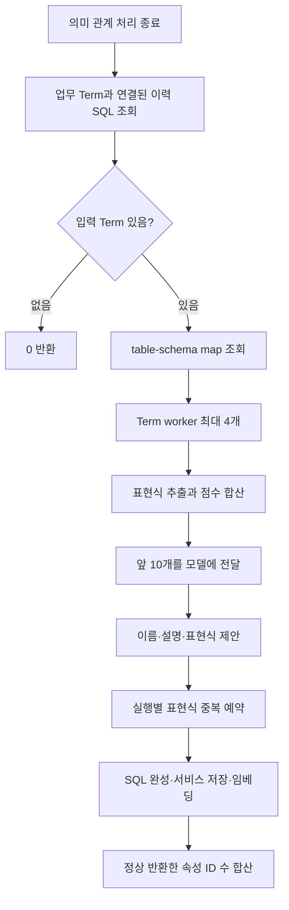
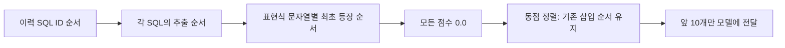
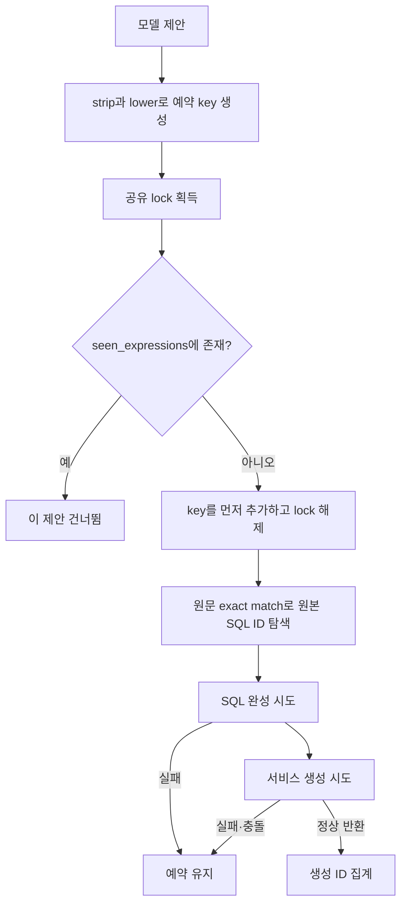

# Chapter 04. 이력 SQL에서 재사용할 계산 속성을 제안하는 과정

Auto-Ontology는 수집한 SQL 이력에서 조건·집계·함수 같은 표현식을 꺼내 업무 개념별로 모델에 보여 주고, 재사용할 만한 표현식에 이름을 붙이게 한다. 현재 구현의 사용량 점수는 항상 0이다. 따라서 ‘최근 3개월 사용량 상위 10개’라는 주석·prompt와 실제 후보 선정은 다르다.

이 장은 입력 조회·표현식 추출·순위·모델 판단·실행별 중복 처리를 분석한다. SQL 완성과 저장·임베딩은 [Chapter 04-1](chapter-04-1-sql-construction-and-persistence.md)로 분리했다. 로컬 소스·테스트 정적 분석이며 실제 DB·모델·테스트는 실행하지 않았다.

## 1. 용어와 기능 목적

**Term**은 고객·주문 같은 업무 개념이다. **SqlAttribute(SQL 속성)**는 그 개념에 연결한 이름 있는 SQL 정의다. 예를 들어 주문의 `status = 'paid'` 조건을 ‘결제 완료 주문’으로 재사용하는 식이다. 여기서 ‘계산 속성’은 숫자 계산뿐 아니라 필터·집계·집합 쿼리도 포함한다.

**표현식(expression)**은 조건이나 `SUM(amount)`처럼 SQL의 일부이며, 저장 서비스에는 최종적으로 완성한 조회 SQL을 전달한다. **AST(Abstract Syntax Tree, 구문 트리)**는 SQL 문장의 문법 구조를 나무 형태로 표현한 것이고, SQLGlot은 이 구조를 분석·출력하는 라이브러리다. **임베딩(embedding)**은 검색할 텍스트를 숫자 벡터로 바꾸는 작업이다. 더 넓은 개념은 [용어집](../01-architecture/chapter-00-glossary.md)을 참고한다.

이 기능은 사용자가 질문할 때마다 실행되는 것이 아니라 의미 컴파일의 후속 단계다.

```text
run_semantic_compilation(database_name)
→ resolve_semantic_fks(database_name)
→ suggest_sql_attributes(database_name)
→ build_bridge_tables_sql_attributes(database_name)
```

**FK(Foreign Key, 외래 키)** 관계 처리가 끝난 뒤 이력 속성을 제안한다. 직전 단계의 예외가 전파되면 이 단계에 도달하지 않는다. 제안 함수 안에는 취소 신호 확인이 없으며, 컴파일 상위의 후속 단계 진입 전 취소 확인과 구분해야 한다.



근거: [컴파일 호출](../../../code/auto-ontology/auto_ontology/semantic/compile.py), [제안 모듈](../../../code/auto-ontology/auto_ontology/semantic/sql_attribute_suggester.py).

## 2. 입력은 semantic Term과 연결된 SQL이다

진입점은 `suggest_sql_attributes(database_name)`다. 먼저 DAL, 즉 데이터 접근 계층의 `fetch_terms_with_sqls(SEMANTIC_SOURCE, database_name=...)`를 호출한다. `SEMANTIC_SOURCE`의 값은 `semantic`이다.

조회 연결은 `Term → table__term → sql_query__table → SQL`이다. Term이 표현하는 테이블과 SQL이 참조한 테이블이 연결되어야 입력이 된다. SQL 내용을 임베딩해 비슷한 Term을 새로 찾는 절차는 아니다.

| 조건 | 실제 조회 |
|---|---|
| Term 출처 | `term.source == "semantic"` |
| DB 범위 | Term과 연결된 테이블의 DB 이름으로 제한 |
| SQL 소유 관계 | SqlAttribute 또는 CustomAnalysis가 소유한 SQL은 제외 |
| Term에 연결된 SQL 없음 | 해당 Term을 결과에서 생략 |
| 최근 3개월 조건 | 조회에 없음 |
| 실행 횟수 최소 기준 | 조회에 없음 |
| SQL이 Term 테이블만 참조해야 하는가 | 그런 전체 테이블 제한 없음. 연결된 테이블을 통해 SQL을 가져옴 |

**CustomAnalysis**는 저장된 사용자 분석 정의다. 이를 포함한 생성 SQL을 제외하는 이유는 자동 생성 결과를 다음 제안의 원본으로 다시 사용하는 순환을 막기 위해서다. 제외 여부는 SQL의 source 문자열이 아니라 소유 연결의 존재로 판단한다.

결과를 DISTINCT로 합치고 Term ID → SQL ID로 정렬한 뒤 다음 구조로 묶는다.

```text
{
  term_id, term_name, term_description,
  sqls: [
    {sql_id, sql_text, props: SQL 행의 필드들}, ...
  ]
}
```

같은 SQL이 여러 Term에 연결될 수 있다. 이때 Term별 모델 판단은 각각 일어나지만 뒤의 실행별 중복 예약은 전체 worker가 공유한다. 최초 입력 조회 실패는 함수 밖으로 전파되며, 빈 결과면 schema map이나 모델을 만들지 않고 0을 반환한다.

### 2.1 테이블 이름의 스키마 보충 자료

`fetch_table_schema_map(database_name)`는 `{소문자 테이블 이름: 스키마 이름}`을 만든다. 스키마는 테이블들을 묶는 DB 내부 이름 공간이다. 같은 DB의 여러 스키마에 동명 테이블이 있으면 하나의 key에 충돌한다. 조회는 테이블 ID 순이며 dict에서 뒤에 읽은 스키마가 남는다. 실제 사용량·Term·SQL 문맥으로 충돌을 해결하지 않는다.

Map 조회 실패는 경고 후 빈 map으로 계속한다. 따라서 모델 제안 전체를 중단하지는 않지만 후속 SQL의 스키마 보충을 못 할 수 있다.

근거: [terms.py의 이력·스키마 조회](../../../code/auto-ontology/auto_ontology/dal/terms.py), [출처 상수](../../../code/auto-ontology/auto_ontology/semantic/constants.py).

## 3. SQL에서 어떤 표현식을 꺼내는가

`_extract_expressions(sql_text)`는 SQLGlot의 `parse_one(..., error_level=IGNORE)`로 파싱한다. 파싱 예외나 빈 AST는 빈 목록으로 바꾼다. 이 추출 단계에는 원본 connector의 dialect, 즉 DB별 SQL 문법 설정을 전달하지 않는다.

| 구역 | 실제 수집 대상 |
|---|---|
| 첫 번째로 찾은 WHERE | EQ·NEQ·GT·GTE·LT·LTE·IN·BETWEEN·LIKE·IS 비교 노드 |
| SQL 전체 구문 트리 | 집계 함수 `AggFunc`, 이름이 일반 함수로 분류된 `Anonymous`, CASE |
| 첫 번째로 찾은 HAVING | 조건 전체 |
| 모든 JOIN의 ON | ON 전체와 내부 비교 노드 |
| UNION·INTERSECT·EXCEPT | 집합 연산 전체와 각각의 좌우 branch |

WHERE는 행 필터, HAVING은 집계 후 필터, ON은 JOIN 조건이다. UNION·INTERSECT·EXCEPT는 각각 결과 합치기·교집합·차집합 연산이다. 모든 DB 함수가 `Anonymous`로 분류되는 것은 아니므로 ‘모든 함수 호출을 추출한다’고 확대 해석하면 안 된다.

WHERE/HAVING은 `ast.find`로 첫 항목을 찾는다. 중첩 쿼리·집합 분기마다 모든 WHERE 조건을 별도로 완전 순회하는 구조는 아니다. 다만 다른 전체 트리 순회나 집합 branch 수집을 통해 포함되는 내용은 있을 수 있다.

### 3.1 제외와 중복 기준

`_add`는 SQL 문자열로 출력한 뒤 다음을 제외한다.

- 출력 길이가 5자 미만인 항목.
- 단독 컬럼·`*`·literal, 즉 `'paid'`, `1000` 같은 값 자체.
- SELECT·WHERE 같은 SQL 키워드 토큰만 남은 결과.
- 양쪽이 모두 단순 컬럼인 `a.col = b.col` 동등 비교.
- 같은 SQL 한 건 안에서 소문자화한 출력 문자열이 이미 나온 경우.

마지막 비교 제외는 **실제 FK 저장 여부를 조회하는 검사**가 아니다. 모양이 컬럼=컬럼이면 제외한다. 반대로 `a.x > b.y` 같은 다른 연산은 추출될 수 있고, 여러 동등 비교를 AND로 묶은 ON 전체는 단순 EQ 노드가 아니므로 남을 수 있다. 주석의 ‘pure FK 제외’를 실행 코드의 범위로 좁혀 읽어야 한다.

```text
설명용 SQL:
SELECT SUM(o.amount)
FROM orders o JOIN customers c ON o.customer_id = c.id
WHERE o.status = 'paid' AND o.amount > 1000

대표 추출 항목:
o.status = 'paid'
o.amount > 1000
SUM(o.amount)

단순 o.customer_id = c.id 항목은 제외
```

실제 출력의 공백·괄호는 SQLGlot 직렬화에 따라 달라질 수 있다. 이 예시는 실행한 결과가 아니다.

## 4. 사용량 점수는 항상 0이며 top 10은 빈도순이 아니다

`_rank_expressions`는 각 SQL의 추출 결과에 `_usage_score(props)`를 더하고 표현식별 원본 SQL ID 목록을 중복 없이 모은다. 그러나 현재 `_usage_score`의 실행 코드는 단 한 줄 `return 0.0`이다.

함수 주석은 과거 카운터 이름 불일치 때문에 사용량 순위가 작동하지 않았고, 저장소 변경 과정에서 동작을 바꾸지 않기 위해 0점을 명시적으로 유지했다고 설명한다. 현재 DAL이 반환하는 SQL 행에도 월별 카운터 필드는 없으며, `total_counter`가 있어도 이 점수 함수는 읽지 않는다.

따라서 최근 3개월 계산, 사용 횟수 합산에 따른 실질적 우선순위, 빈번한 표현식 우대는 현재 구현되지 않는다. 사용량이 1인 SQL과 500인 SQL 모두 동일 점수다.



한 SQL 내부의 중복은 소문자 기준이지만, 여러 SQL을 합치는 `scores`의 key는 원래 표현식 문자열이다. 서로 다른 SQL에서 대소문자·출력 형태가 다르면 별도 후보로 남을 수 있다. 단순한 의미 동등성 분석이나 AST 정규화 중복 제거가 아니다.

정렬은 점수만 내림차순으로 비교하며 동점에서는 dict의 최초 삽입 순서를 유지한다. 현재 입력 SQL이 ID 순이므로, top 10은 이 ID·추출 순서의 영향을 받는다. 최신 실행일이나 업무 중요도 순이 아니다.

## 5. 모델 판단: 재사용 업무 규칙에 이름을 붙인다

`_judge_with_llm`은 Term 이름·설명과 top 10의 `(표현식, 점수)`를 전달한다. 각 줄은 `1. [0 uses] 표현식` 형태다. Prompt에는 여전히 ‘최근 3개월 실행 횟수순’이라고 쓰여 있으므로, 실제 0점 처리와 차이가 있다.

모델 client는 `get_llm_client(temperature=0.0)`이며, 이 함수는 max_tokens를 별도로 지정하지 않는다. Prompt에는 전체 원본 SQL·테이블 구조·기존 속성 목록·사용자 질문을 전달하지 않는다.

지시의 주요 기준은 다음과 같다. 이 기준들은 **모델에 요청하는 규칙**이며 동일한 조건을 Python 코드로 다시 검사하지 않는다.

| 표현식 | prompt의 제안 기준 |
|---|---|
| `status='active'`, `amount>1000` | 업무 범주·임계값으로 제안 |
| `id=12`, `request_id=50000` | 특정 행 조회만 나타내면 제외 |
| 같은 테이블 컬럼끼리 상수 없이 비교 | 구조적 무결성으로 보고 제외 |
| id·`*_id`의 NULL 검사 | JOIN 성립 확인만 나타내면 제외 |
| deleted_at·approved_by 등의 NULL 검사 | 업무 의미가 있으면 허용 |
| 업무 역할을 정의한 JOIN·집합 branch | 빈번하고 재사용 의미가 있으면 제안 |
| 다른 경로로 같은 유형의 참여자를 모으는 UNION | 전체 구조를 업무 개념으로 제안 |

결과는 `_Suggestions.suggestions`의 목록이며 각 항목은 필수 문자열 `name`, `description`, `expression`이다. 이름은 Title Case로, 표현식은 원문 그대로 복사하라고 요청한다. 그러나 모델의 표현식이 top 10 중 하나인지, 이름 형식이 맞는지, 빈 문자열인지, 제안 개수가 10개 이하인지 검사하는 별도 로직은 없다. 응답 모델에도 이 제한을 정의하지 않는다.

구조화 출력 wrapper가 None을 반환하면 빈 제안 목록으로 처리한다. Client 생성 등의 예외는 Term worker의 future를 회수할 때 로그로 남기고 해당 Term의 실패로 처리한다. 모든 Term을 중단하지는 않는다. 공통 모델 재시도 자체는 LLM 공통 분석 범위이며 여기서 제안 재평가 루프를 추가하지 않는다.

## 6. 원문 매칭·실행별 예약·worker 경쟁

제안된 `expression`으로 두 종류의 key를 만든다.

| 용도 | key |
|---|---|
| 이번 실행 전체의 중복 예약 | `expression.strip().lower()` |
| 원본 SQL 문맥 찾기 | 추출 결과 dict에서 **제안 문자열 그대로** exact match |

**Exact match**는 대소문자·공백까지 같은 문자열이어야 한다는 뜻이다. 모델이 표현식의 공백이나 대소문자를 바꾸면 예약에는 같은 항목으로 보일 수 있어도 원본 SQL ID 조회는 실패할 수 있다.



Lock은 여러 worker가 동시에 같은 집합을 수정하지 못하도록 하는 잠금이다. 최대 4개의 Term worker가 이 집합을 공유하며 **SQL 완성·검증·저장 전에** key를 예약한다. 작업 성공 시에만 예약하는 방식이 아니다. 실패·이름 충돌·임베딩 실패 후 예약을 해제하지도 않는다.

같은 표현식이 여러 Term에 나타나면 먼저 예약한 Term만 시도한다. 다른 Term에 연결을 추가하거나 우선 업무 소유자를 선택하는 절차는 없다. Worker 완료·예약 순서에 따라 소유 Term이 달라질 수 있다. `lower()`는 SQL literal 안에도 적용하므로 `'A'`와 `'a'`를 구분해야 하는 표현식도 같은 실행 key가 될 수 있다. 내부 공백은 합치지 않는다.

원본 SQL ID는 SQL 완성의 FROM·JOIN 문맥을 찾는 데 쓰인다. 제안 모듈에는 생성 속성을 그 원본 SQL ID들에 별도로 연결하는 호출이 없다. 모듈 주석의 ‘원본 Sql 노드와 연결’ 설명을 실제 구현 사실로 그대로 읽으면 안 된다. 자세한 저장 관계는 다음 문서에서 구분한다.

## 7. 반환 수·재실행·사용자 수정 경계

제안별 SQL 완성 실패(ValueError), 이름 충돌, 같은 Term의 표현식 충돌, SQL 검증 실패, 기타 서비스 예외는 로그 후 다음 제안으로 진행한다. Worker 바깥에서 발생한 예외도 future를 회수할 때 기록하며 다른 Term을 계속 처리한다.

반환값은 각 worker가 모은 **create 서비스가 정상 반환한 속성 ID 목록의 길이**다. 모델 제안 수, SQL 저장 시도 수, 실제 벡터 행 수가 아니다. 서비스가 일부 저장한 뒤 예외를 내면 실패로 세고도 저장 행은 남을 수 있다.

이번 실행의 seen 집합은 함수가 끝나면 사라진다. 다음 실행에서는 이력과 모델 판단을 다시 수행하지만 기존 속성은 서비스의 충돌 검사로 건너뛸 수 있다. 제안 단계가 기존 수정·인증 속성을 찾아 덮어쓰는 update를 호출하지는 않는다. 보호는 ‘같은 이름/표현식이면 생성 포기’라는 경계이며, 인증 여부를 읽어 새 의미 중복이나 이름 변경을 모두 막는 정책은 아니다.

## 8. 테스트 근거와 미검증 범위

[점수 테스트](../../../code/auto-ontology/auto_ontology/semantic/tests/test_usage_score.py)의 assertion을 정적으로 확인했다.

- `test_score_is_currently_always_zero`: 실제 모양의 카운터 입력, total_counter 500, 빈 입력 모두 0점.
- `test_the_data_needed_to_rank_is_present`: fixture에 0보다 큰 사용량이 있음을 확인. 실제 순위가 작동한다는 뜻은 아니다.
- `test_every_expression_currently_ties`: 사용량 1·500의 SQL을 넣어 추출 표현식의 모든 점수가 0임을 확인.
- `test_ranking_still_carries_source_query_ids`: 추출 표현식에 원본 SQL ID가 유지됨을 확인. 영속 provenance 연결을 검증하는 테스트는 아니다.

[Term DAL 테스트](../../../code/auto-ontology/auto_ontology/dal/tests/test_terms.py)는 schema map key 소문자화, SqlAttribute가 소유한 생성 SQL 제외, 원본 이력 없는 Term 생략을 확인한다. CustomAnalysis 제외도 코드에는 있으나 이 장에서 읽은 해당 assertion은 속성 소유 SQL 사례다.

검색한 테스트에서는 전체 추출 범주·모델 원문 위반·예약 실패 후 다른 Term 재시도·동시 소유 선택을 직접 검증하는 별도 제안 테스트를 확인하지 못했다. 이는 이번 코드 검색 범위의 결과이며 전체 품질을 단정하는 근거는 아니다.

Mermaid 3개를 작성했으며 렌더링은 검증하지 않았다. SQL 재구성의 alias·JOIN 손실 가능성, 정적 검증 범위, 저장·임베딩 부분 실패는 [Chapter 04-1](chapter-04-1-sql-construction-and-persistence.md)에서 이어진다.
