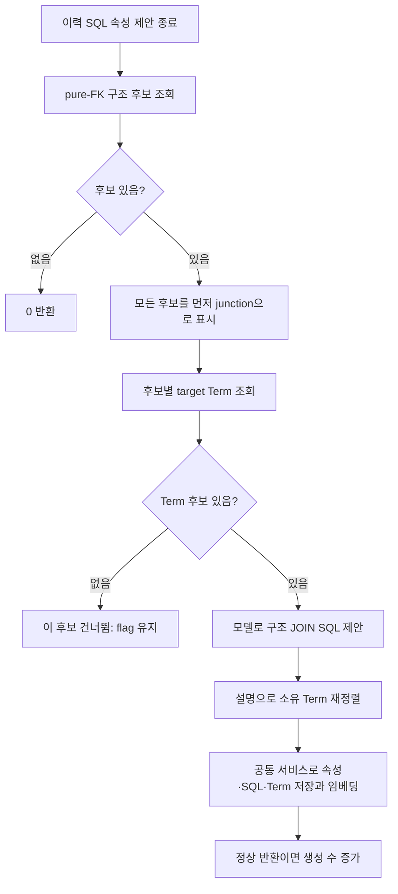
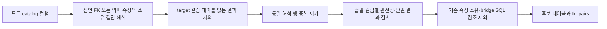
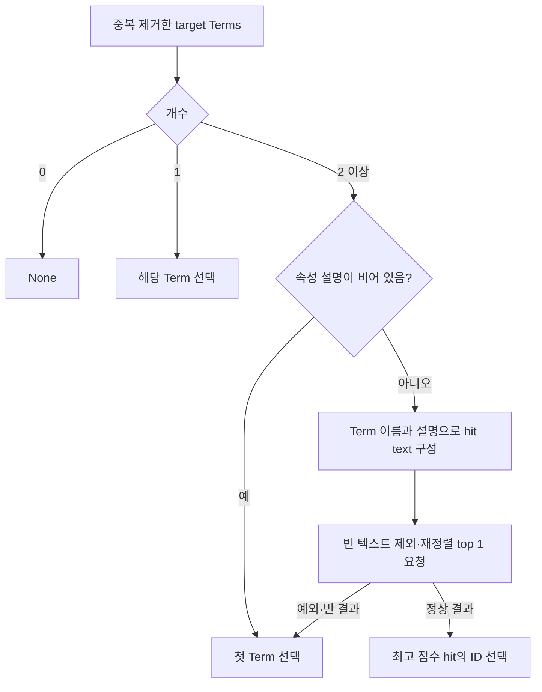
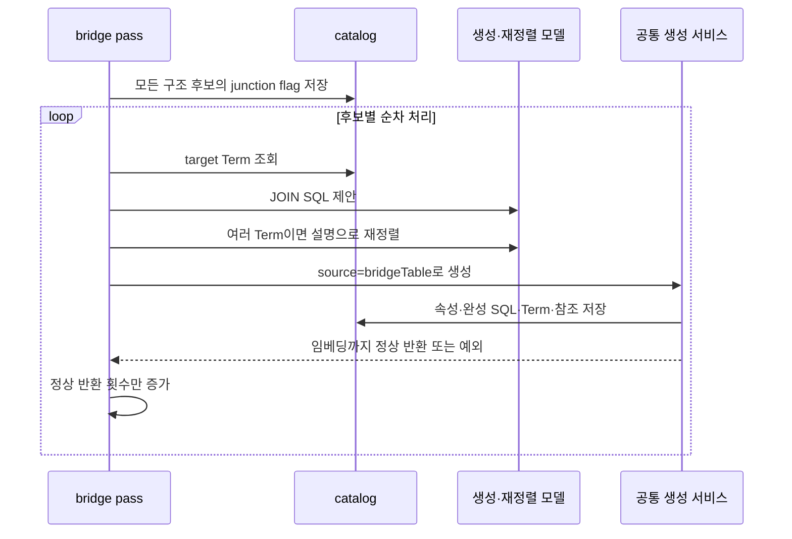

# Chapter 05. Bridge·junction 분류와 JOIN 패턴 SQL 속성

Auto-Ontology는 모든 컬럼의 참조 대상을 하나씩 해석할 수 있는 연결 테이블을 찾아 junction으로 표시하고, 관련 엔티티들을 연결하는 SQL 속성을 만든다. 테이블 분류는 모델 생성보다 먼저 저장하며, SQL 속성은 관련 엔티티의 기존 Term 하나에 연결한다. 연결 테이블의 새 Term을 이 단계에서 만들지는 않는다.

이 장은 로컬 소스·테스트의 정적 분석이다. 실제 DB·모델·재정렬 서비스·테스트는 실행하지 않았다. SQL과 테이블은 설명용 예시다. 저장 서비스의 공통 경계는 [Chapter 04-1](chapter-04-1-sql-construction-and-persistence.md)을 함께 참고한다.

## 1. 먼저 구분할 용어와 세 가지 연결 테이블

| 용어 | 뜻·이 문서에서의 의미 |
|---|---|
| Bridge 또는 junction table(연결 테이블) | 주문과 상품처럼 여러 엔티티의 관계를 행으로 표현하는 테이블이다. |
| FK(Foreign Key, 외래 키) | 다른 컬럼의 값을 참조하는 관계이다. |
| PK(Primary Key, 기본 키) | 행을 식별하는 키다. |
| Payload | 관계 자체에 붙는 수량·역할·유효일 같은 추가 값이다. |
| Term | 주문·상품 같은 업무 개념이다. |
| ColumnAttribute | 컬럼의 의미 속성이다. |
| SqlAttribute | 이름 붙여 재사용할 SQL 정의다. |
| JOIN 패턴 | 테이블들을 어떤 컬럼으로 결합할지 나타내는 SQL이다. |
| Reranking(재정렬) | 질의와 후보 텍스트의 관련도를 모델로 다시 평가해 순서를 바꾸는 작업이다. 상세 개념은 [용어집](../01-architecture/chapter-00-glossary.md)과 연결된다. |

| 구분 | 예시·역할 | 현재 분석 경로 |
|---|---|---|
| Pure-FK junction | `order_product(order_id, product_id)`처럼 모든 컬럼이 참조 역할 | 이번 bridge SQL 속성 후보 |
| Payload junction | `order_product(order_id, product_id, quantity)`처럼 관계 값도 보유 | 앞선 테이블 의미 컴파일에서 모델 판단과 구조 증거로 flag 설정 가능 |
| 경로 중간의 bridge | `orders → customers → addresses`에서 customers가 중간 테이블 | 경로 탐색이 찾는 중간 노드. pure-FK 조건과 별개 |

따라서 [Chapter 03의 경로 bridge](chapter-03-relationship-pruning-and-join-selection.md)와 이번 pure-FK 분류는 같은 후보 기준이 아니다. `is_junction_table=True`인 모든 테이블이 이 SQL 생성 단계의 후보가 되는 것도 아니다.

진입점 `build_bridge_tables_sql_attributes(database_name)`는 의미 관계 정리·이력 SQL 속성 제안 뒤에 실행한다. 컴파일 로그의 `Bridge tables built` 값도 실제 반환값은 **정상 생성 처리한 SQL 속성 수**다.



근거: [bridge_tables.py](../../../code/auto-ontology/auto_ontology/semantic/bridge_tables.py), [컴파일 호출](../../../code/auto-ontology/auto_ontology/semantic/compile.py).

## 2. 구조 후보 조회의 정확한 조건

`fetch_bridge_table_candidates(database_name)`는 catalog, 즉 수집한 DB 구조 목록을 조회한다. 원본 테이블을 스캔하거나 이력 SQL 사용량을 읽는 작업은 아니다.

### 2.1 컬럼의 참조 대상을 두 경로로 해석한다

| 경로 | 참조 대상 찾기 |
|---|---|
| 선언 FK | 출발 컬럼 → `column__foreign_key` → 대상 컬럼·테이블·스키마 |
| 의미 FK | 출발 컬럼 → `column__semantic_fk` → 의미 속성 ← `column__has_attribute` ← 소유 컬럼·테이블·스키마 |

**HAS_ATTRIBUTE**는 컬럼이 속성을 소유한다는 연결이고, **SEMANTIC_FK**는 다른 컬럼의 속성을 참조한다는 연결이다. 의미 FK의 대상은 속성 ID이므로, 실제 JOIN target은 그 속성을 소유하는 컬럼으로 다시 해석한다.

두 경로를 동시에 LEFT JOIN으로 붙이고 target 이름·스키마·컬럼·테이블 ID마다 `coalesce(선언 쪽, 의미 쪽)`를 사용한다. Coalesce는 앞 값이 없으면 뒤 값을 쓰는 연산이다. 선언 값이 있으면 우선하며, 두 경로를 독립 후보 목록으로 단순 합치는 UNION 방식이 아니다.

결과는 `column_id`, 출발 `owner_table_id`, `source_column`, `target_table`, `target_schema`, `target_column`, `target_table_id`로 만들고 DISTINCT, 즉 동일 행 중복 제거를 적용한다. 여기서 owner_table_id는 **출발 테이블**을 뜻한다. 의미 속성의 소유 target 테이블과 필드 이름을 혼동하면 안 된다.

### 2.2 모든 컬럼이 한 개씩 해석되어야 한다

후보 필터는 다음 조건을 모두 적용한다.

| 조건 | 의미 |
|---|---|
| 출발 DB 이름 일치 | 요청한 프로젝트 DB 범위 |
| 컬럼 수 ≥ 2 | 단일 컬럼 테이블 제외 |
| 어떤 컬럼에도 HAS_ATTRIBUTE 없음 | 이미 의미 속성을 소유한 컬럼이 하나라도 있으면 제외. 속성 출처 무관 |
| 기존 bridge 속성의 SQL이 이 테이블을 참조하지 않음 | source가 `bridgeTable`인 속성의 HAS_SQL → SQL/table 연결로 검사 |
| 서로 다른 해석된 출발 컬럼 수 = 전체 컬럼 수 | 참조 대상이 없는 컬럼을 다른 컬럼의 중복 행으로 가리지 않음 |
| 해석 결과 전체 행 수 = 전체 컬럼 수 | 한 컬럼에 여러 target 결과가 남는 모호한 구조도 제외 |

해석 결과에서는 target 컬럼 ID와 target 테이블 ID가 존재해야 한다. 단순히 outgoing FK 행이 있다는 것만으로 충분하지 않다. 모든 대상이 catalog의 컬럼·테이블로 연결되어야 한다.



조건은 원래 저장된 모든 FK 행에 대해 ‘정확히 하나’인지 세는 것이 아니라 **coalesce와 DISTINCT 이후 해석 결과**를 센다. 예를 들어 선언 FK가 우선하여 같은 결과로 합쳐지는 의미 FK 차이는 최종 target에 나타나지 않을 수 있다.

### 2.3 후보 조건에 없는 검사

이 쿼리는 PK·고유 제약조건·행 수·실제 다대다 관계·타입 호환성·table_type을 검사하지 않는다. `is_junction_table`이 이미 true인지도 필수 조건이나 제외 조건으로 쓰지 않는다. 2개 컬럼에 한정하지 않으므로 모든 컬럼이 FK인 3개 이상의 테이블도 가능하다.

의미 관계의 `use_in_join_paths`도 읽지 않는다. 따라서 일반 경로 탐색에서 false로 제외한 의미 관계가 구조 후보 해석에는 쓰일 수 있다. Target DB를 출발 DB와 같게 제한하는 조건 역시 이 쿼리에는 없다. 일반 관계 저장 함수의 DB 경계와 이 읽기 쿼리의 조건을 구분한다.

구조 조회는 테이블 이름순으로 후보를 읽고, 후보 ID 목록에 대해 `fk_pairs`를 별도 조회한다. 쌍별 필드는 source 컬럼·target 테이블/스키마/컬럼/테이블 ID다. 쌍 조회에는 정렬이나 두 조회 전체를 묶는 명시적 transaction이 없어, 기본 Term 선택의 순서와 동시 구조 변경을 별도 검증해야 한다.

근거: [datasources.py 후보 조회](../../../code/auto-ontology/auto_ontology/dal/datasources.py).

## 3. Payload junction은 별도 분류 경로다

`order_product(order_id, product_id, quantity)`에서 quantity가 비FK면 이번 후보에서 제외한다. `created_at`이나 surrogate ID, 즉 별도의 대체 식별자 컬럼도 참조가 아니면 같은 결과다.

앞선 `visit_enter.process_table` 경로는 다음 조건으로 payload junction을 표시할 수 있다.

```text
컬럼 수 > 2
AND FK 제안 모델의 is_junction_table == True
AND 선언 FK 컬럼명 ∪ 모델 제안 FK 컬럼명의 개수 ≥ 2
```

해당 모델 prompt는 관계의 수량·역할·상태 등 payload를 허용하되, 고유 업무 생명주기가 있는 이벤트·거래나 단순 부모 확장 테이블은 보수적으로 제외하라고 요청한다. 이 판단의 자세한 입력·flag promotion은 [테이블 역할과 속성 명세](../05-semantic-compilation/chapter-03-table-roles-and-attribute-specs.md)에서 분석했다.

두 경로 모두 `mark_table_as_junction`을 사용하지만 SQL 속성 후보는 다시 pure-FK 조건을 적용한다. Payload 테이블의 flag가 true라고 해서 이번 단계가 해당 테이블의 JOIN SQL 속성을 반드시 만들지는 않는다.

근거: [visit_enter.py](../../../code/auto-ontology/auto_ontology/semantic/visit_enter.py), [모델 분류 지시](../../../code/auto-ontology/auto_ontology/semantic/fk_suggester.py).

## 4. 먼저 모든 flag를 저장하는 이유와 실패 범위

진입점은 후보들을 먼저 순회하며 `mark_table_as_junction(table_id)`를 호출한다. 그다음 별도 루프에서 Term 조회·SQL 생성을 수행한다. 후속 선택이 실패해도 구조 증거로 확인한 분류를 잃지 않기 위해서다.

저장 함수는 `is_junction_table=False`인 행만 true로 UPDATE한다. 반복해도 같은 상태를 유지하는 **멱등성**이 있으며, 조건이 사라졌다고 false로 되돌리는 함수는 아니다. 사라진 ID를 지정했을 때 변경 행 수를 확인해 오류를 내는 코드도 없다.

이 첫 루프를 전체 transaction이나 후보별 try/except로 감싸지 않는다. 한 flag 쓰기가 실패하면 앞의 flag들은 남고 뒤의 분류·SQL 생성은 중단될 수 있다. 반대로 모든 flag 쓰기가 끝난 뒤 첫 모델 생성이 실패해도 뒤 후보의 flag는 이미 true일 수 있다.

**분류된 테이블 수**, **SQL 생성에 도달한 수**, **완성 속성 수**는 서로 다르다. 생성 수 0이어도 flag 변화가 있을 수 있다.

## 5. FK 대상 테이블의 기존 Term을 모은다

`_target_terms_for_bridge`는 `fk_pairs` 순서로 target table ID를 확인한다. 같은 table ID는 한 번만 조회하고, `get_term_record_for_table`로 Term ID·이름·설명을 가져온다. 같은 Term을 여러 대상 테이블이 공유하면 Term ID 기준으로도 중복을 제거한다.

Term 조회는 `table__term` 연결 중 source가 `semantic`인 것만 읽고 Term ID 오름차순 첫 건을 반환한다. 대상 테이블의 여러 Term을 모두 재정렬에 넣지는 않는다. 설명이 NULL이면 빈 문자열로 바꾼다.

Term 없는 target은 경고 후 건너뛴다. 모든 target이 Term을 가져야 한다는 조건은 없어서 한쪽만 있으면 그 Term을 사용할 수 있다. 모두 없으면 모델 생성도 호출하지 않고 후보를 건너뛴다. 이 단계에서 Term을 새로 만들거나 bridge 자체의 기존 Term을 소유 후보로 찾지는 않는다.

‘자기 참조 bridge’는 `also_buy(product_id, also_buy_product_id)`의 두 역할이 같은 products 테이블을 향하는 구조다. [Chapter 01](chapter-01-declared-and-semantic-foreign-keys.md)에서 제외한 ‘출발 테이블 내부 FK’와 다른 의미다. 같은 target table은 한 번 조회하므로 이 예시는 한 Term으로 바로 연결할 수 있다.

근거: [bridge 대상 선택](../../../code/auto-ontology/auto_ontology/semantic/bridge_tables.py), [Term 조회](../../../code/auto-ontology/auto_ontology/dal/terms.py).

## 6. 모델은 관계 역할을 표현하는 완성 SQL을 만든다

`_generate_bridge_sql_attribute`는 모델에 bridge 스키마·테이블 이름, 정렬·중복 제거한 관련 테이블 이름, source → target의 FK 쌍을 전달한다. Candidate의 table description, 대상 Term 설명, PK·컬럼 타입·표본·DB dialect는 prompt에 전달하지 않는다.

관련 테이블의 `스키마.테이블` 문자열 집합이 하나면 self-referential로 판단하고 같은 테이블을 두 번 alias하도록 지시한다. 그렇지 않으면 관련 엔티티들을 주어진 FK로 JOIN하라고 요청한다. 하나의 target에 세 역할 이상이 있어도 이 지시 문구는 ‘both FK columns’ 예시를 쓰며, 역할 수별 SQL을 코드로 구성하지는 않는다.

```sql
-- 설명용 형태. 실제 모델 출력이 아님
SELECT o.id AS order_id, p.id AS product_id
FROM shop.order_product AS op
JOIN shop.orders AS o ON op.order_id = o.id
JOIN shop.products AS p ON op.product_id = p.id
```

Prompt는 다음을 요구한다.

- 완성 SELECT/FROM/JOIN 문장을 만들 것.
- 모든 테이블에 스키마를 붙일 것.
- 주어진 FK만 사용하고 컬럼·필터를 만들지 말 것.
- 업무 literal 필터가 있는 WHERE 없이 구조적 JOIN만 만들 것.
- Title Case 이름과 관계 설명을 붙일 것.

Client는 `get_llm_client(temperature=0.0)`이며 응답은 `_BridgeSqlAttributeProposal`의 `name`, `description`, `expression` 필수 문자열이다. 정의 외 필드는 금지하지만 빈 문자열·JOIN 개수·정확한 FK 사용·WHERE 부재·참조 대상 전체 포함·이름 형식은 이 응답 모델이 검사하지 않는다.

모델 응답 None은 후보를 건너뛴다. 그러나 client 생성이나 wrapper 밖에서 예외가 발생하면 이 함수 호출 자체를 감싸는 후보별 보호가 없어서 전체 pass가 중단될 수 있다. 다음의 create 서비스 예외 흡수와 다른 경계다.

## 7. 생성 설명에 가장 가까운 Term 하나를 고른다

`_pick_owner_term_id(terms, proposal.description)`는 여기서의 owner를 **속성이 연결될 Term**이라는 뜻으로 사용한다. 사용자·그룹의 `owner_id`를 설정하는 작업이 아니다.



Term hit의 텍스트는 `이름. 설명`, 둘 중 하나만 있으면 그 값이다. 둘 다 비어 있으면 재정렬 목록에서 제외한다. 모든 텍스트가 비어 있어도 원래 첫 Term으로 대체한다. 최고 결과의 ID가 없을 때도 원래 첫 Term을 쓴다.

첫 Term의 순서는 `fk_pairs` 조회 순서의 영향을 받으며 알파벳순·업무 우선순위로 따로 정렬하지 않는다. 따라서 장애 대체가 항상 동일한 업무 소유자를 고른다는 보장은 없다.

### 7.1 재정렬의 요청·점수·시간 제한

`get_rerank_kwargs`는 RERANK 역할의 endpoint·model·key를 반환한다. URL이 `/rerank`로 끝나면 query 문자열·documents 목록·top_n을 보내고 `results[].relevance_score`를 읽는다. `/ranking` 또는 `/reranking`이면 query/text·passages/text 구조로 보내고 `rankings[].logit`을 읽는다. 기본 URL이면 `/v1/ranking`을 붙인다.

HTTP timeout은 30초다. Key가 있으면 Authorization을 넣고 없으면 헤더를 생략하며, 함수 자체의 별도 retry 루프는 없다. Endpoint 오류·응답 파싱 예외는 소유 선택 함수가 잡고 첫 Term으로 대체한다.

응답에 점수가 없는 후보는 음의 무한대다. 높은 점수부터 정렬하고 동점은 입력 순서를 유지한다. 모든 점수가 빠져도 빈 목록이 아니라 동일 최저 점수의 hit들이 남을 수 있으므로, 이때 top 1은 첫 유효 텍스트 hit가 된다. 최소 점수나 후보 간 점수 차이 기준은 없다.

이 설명 기반 선택은 SQL에 실제 등장한 주된 엔티티나 사용자의 의도를 별도로 검증하지 않는다. 모델이 생성한 설명과 Term 텍스트의 관련도로 한 소유자를 고른다.

근거: [소유 선택](../../../code/auto-ontology/auto_ontology/semantic/bridge_tables.py), [재정렬 HTTP·점수](../../../code/auto-ontology/auto_ontology/utils/rerank.py).

## 8. 저장 서비스·반환 수·재실행

후보 처리는 별도 worker pool 없이 순차 실행하며 다음 호출을 수행한다.

```text
create_sql_attribute(
  name=proposal.name,
  description=proposal.description,
  expression=proposal.expression,
  term_id=선택한 target Term,
  connector=database_name,
  source="bridgeTable"
)
```

이력 SQL 제안과 달리 `_build_valid_sql` wrapping이나 schema map 보충은 호출하지 않는다. 모델이 반환한 완성 SQL을 그대로 서비스에 전달한다. 실행별 seen 집합도 없다. 이름은 전체 속성과 충돌 검사하고, SQL 표현식은 같은 Term에서 공백·대소문자 정규화 비교한다.

서비스는 catalog 파싱·참조 인식을 수행하지만 FK 쌍 일치·구조 JOIN만 존재·실제 다대다·실행 가능성을 완전히 검사하지 않는다. [Chapter 04-1](chapter-04-1-sql-construction-and-persistence.md)의 정적 검증 한계와 edge/Term/vector별 부분 저장이 그대로 적용된다. 이 단계는 원본 DB SQL을 실행하지 않는다.



| 실패 지점 | 처리·남는 상태 |
|---|---|
| 최초 후보 조회 | 예외 전파 가능. flag 처리 전 |
| flag 저장 루프 | 예외 전파 가능. 앞 후보 flag는 남을 수 있음 |
| target Term 조회 예외 | 후보별 try 밖이므로 pass 중단 가능 |
| target Term 모두 없음·모델 None | 해당 후보 건너뜀, flag 유지 |
| 재정렬 HTTP 오류 | 첫 Term으로 대체하여 계속 |
| create 이름·표현식 충돌 | 해당 후보 건너뜀 |
| create SQL 검증·기타 예외 | 로그 후 다음 후보. 이미 저장된 부분은 남을 수 있음 |
| create 정상 반환 | `created += 1`. 실제 벡터 수는 확인하지 않음 |

`already_bridged`는 `source="bridgeTable"` 속성의 소유 SQL이 테이블을 참조하면 후보에서 제외한다. 해당 속성의 Term 연결·인증·벡터 존재를 확인하는 조건은 없다. 따라서 임베딩 실패 후 속성·SQL 참조가 남으면 다음 실행에서 후보 자체가 빠져 자동 복구하지 못할 수 있다.

반대로 flag만 true이고 속성이 없으면 flag 때문에 제외하지 않으므로 다음 실행에 다시 후보가 될 수 있다. Manual 또는 이력 `sql` 출처의 속성이 같은 테이블을 참조해도 bridge 존재 제외 조건은 충족하지 않는다. 단, create의 전역 이름 충돌은 별도로 발생할 수 있다.

어떤 bridge 속성이 여러 후보 테이블을 참조하면 다음 조회에서 여러 테이블을 동시에 제외할 수도 있다. 테이블별 전용 bridge ID를 추적하는 방식이 아니라 SQL 참조 연결로 판단하기 때문이다. 구조가 변해도 기존 속성의 SQL을 다시 생성·갱신하거나 junction flag를 내리는 과정은 이 pass에 없다.

## 9. 후속 검색: 분류 flag와 속성 source의 서로 다른 효과

첫 효과는 `is_junction_table`이다. `CandidatePreparationAgent`는 관련 테이블 필터 뒤 `find_connected_junction_tables`로 남긴 테이블에 연결된 junction들을 더한다. 선언 FK와 의미 FK 경로가 있고, 의미 경로에는 `use_in_join_paths=True` 조건을 적용한다. 구조 후보 해석에서는 이 조건을 사용하지 않았다는 차이가 있다.

둘째 효과는 벡터 metadata의 `source="bridgeTable"`다. 공통 임베딩 문서는 이 값을 저장하며, `CandidateRetrievalAgent`의 `_all_bridge_sourced`는 **검색된 SQL 속성 후보가 비어 있지 않고 전부 bridgeTable**이면 true다.

이때 SQL 속성에는 통합 LLM 관련성 필터를 적용하지 않고 사용자 분석 후보만 별도 필터한다. SQL 속성은 이후 중복 제거를 거쳐 저장한다. 빈 목록·다른 source 혼합·source 누락이면 일반 통합 필터 경로를 사용한다.

이 분기는 검색되지 않은 모든 bridge 속성을 무조건 추가하는 동작은 아니다. 이미 검색된 순수 bridge 배치에 대한 추가 모델 필터를 생략하는 것이다. 생성 시 ‘업무 필터 없는 구조 SQL’은 prompt로 요청하지만 별도 강제 검사가 없으므로, source가 저장되었다는 사실과 SQL 구조가 실제로 그 규칙을 충족한다는 보장은 구분해야 한다.

근거: [후보 검색의 source 분기](../../../code/auto-ontology/auto_ontology/retrieval/text_to_sql/agents/candidates_retrieval.py), [junction 확장 소비](../../../code/auto-ontology/auto_ontology/retrieval/text_to_sql/agents/candidates_preparation.py), [연결 조회](../../../code/auto-ontology/auto_ontology/dal/attributes.py).

## 10. 테스트 assertion과 미확인 범위

[DAL 구조 테스트](../../../code/auto-ontology/auto_ontology/dal/tests/test_datasources_semantic.py)를 정적으로 읽었다.

- `test_mark_table_as_junction_is_idempotent_and_promote_only`: false 상태에서 두 번 호출한 뒤 true.
- `test_a_pure_junction_table_is_a_candidate`: order_tag 후보와 source/target/schema/table ID의 정확한 쌍.
- `test_one_non_fk_column_disqualifies_the_table`, `test_an_existing_attribute_disqualifies_the_table`: 비FK 컬럼·기존 HAS_ATTRIBUTE의 제외.
- `test_an_existing_bridge_disqualifies_the_table`, `test_a_bridge_from_some_other_source_does_not_disqualify`: bridgeTable 소유 SQL과 manual 소유 SQL의 차이.
- `test_a_semantic_fk_counts_as_a_foreign_key`: 의미 속성의 소유 컬럼을 실제 target으로 해석.
- `test_a_self_referential_bridge_is_allowed`, `test_a_single_column_table_is_not_a_bridge`: 같은 target의 두 역할 허용·단일 컬럼 제외.
- `test_an_fk_pointing_outside_the_catalog_disqualifies`: target 삭제로 FK가 cascade 제거된 뒤 후보 제외. 깨진 FK 행을 강제로 유지한 상태를 검증하는 것은 아니다.

[Bridge orchestration 테스트](../../../code/auto-ontology/auto_ontology/semantic/tests/test_bridge_tables.py)는 Term 후보가 없을 때 생성 수 0, junction 표시 호출, SQL 모델 미호출을 확인한다. 실제 모델 성공·저장·모든 후보 flag 순서·예외 중단 전체를 검증하는 통합 테스트는 아니다.

[Term 테스트](../../../code/auto-ontology/auto_ontology/dal/tests/test_terms.py)는 record의 ID·이름·설명과 설명 누락 시 빈 문자열을 확인한다. [재정렬 테스트](../../../code/auto-ontology/auto_ontology/utils/tests/test_rerank.py)는 두 요청 스키마·헤더·URL 보충·점수 누락·top_n·HTTP 오류 전파를 가짜 HTTP 응답으로 확인한다.

[검색 테스트](../../../code/auto-ontology/auto_ontology/retrieval/text_to_sql/tests/test_candidates_retrieval.py)는 전부 bridge인 경우, 혼합·누락·빈 경우의 source 판정과 bridge 속성 필터 생략 중에도 사용자 분석 필터가 호출됨을 확인한다.

실제 구조 모호성·DB 경계·다중 소유·payload 분류 품질·세 역할 이상의 자기 참조 SQL·모델 FK 준수·소유 Term 안정성·부분 실패 복구는 미검증이다. 실행한 테스트와 읽은 assertion을 구분한다. Mermaid 4개를 작성했으며 렌더링하지 않았다.

이 장으로 01-6의 예정 정적 분석을 마친다. 다음 01-7 검색 단계에서는 질의가 어떤 검색 문맥과 후보 ID로 바뀌고, DB 선택·후보 필터·anchor·관련 테이블 확장으로 이어지는지를 분석한다.
