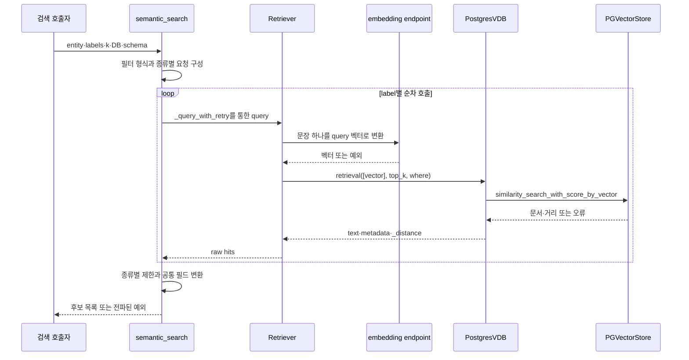
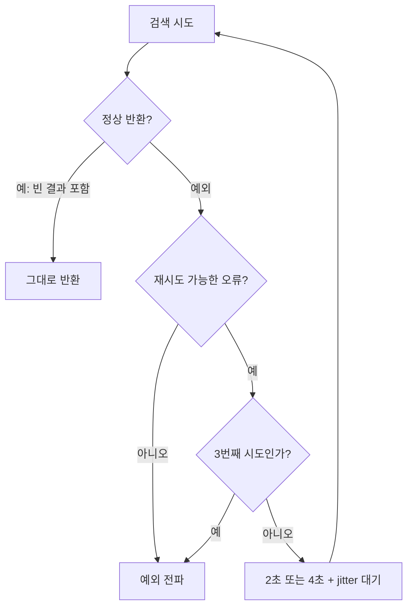
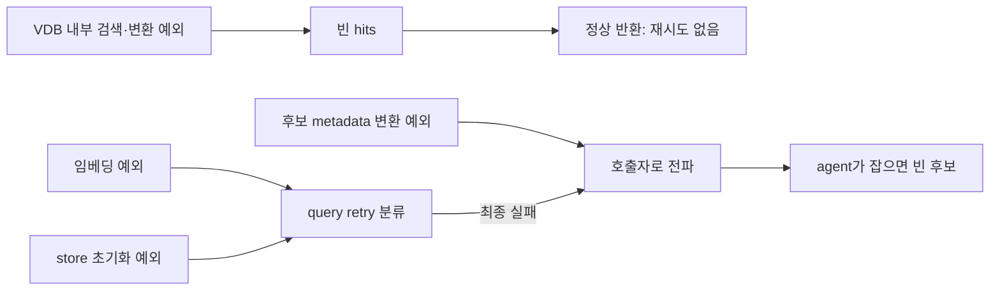

# Chapter 01. 검색 입력·필터·후보 점수와 재시도 계약

검색의 공통 함수는 문장을 임베딩하고 종류별로 벡터 저장소에 질의한 뒤, 결과를 `id`, `label`, `text`, `score` 형태로 바꾼다. 이때 score는 클수록 좋은 확률이 아니라 **작을수록 가까운 벡터 거리**다. 임베딩 요청의 예외는 재시도할 수 있지만 저장소가 오류를 빈 결과로 바꾸면 재시도하지 않는다.

이 장은 `search_semantic_index → Retriever.query → PostgresVDB.retrieval`의 입력·출력·분기·오류를 분석한다. 질문의 entity·DB 선택과 후보 판단은 후속 장에서 다룬다. 로컬 코드·테스트 정적 분석이며 실제 모델·DB·테스트는 실행하지 않았다.

## 1. 용어와 검색 계층의 책임

**Entity(검색 대상 개념)**는 이 함수에 넘기는 검색 문자열이다. 예를 들어 ‘매출’, ‘고객 지역’이 될 수 있지만, 이 함수 자체가 질문에서 그 단어를 추출하지는 않는다. **Label**은 `Table`, `ColumnAttribute`, `SqlAttribute`처럼 검색할 객체의 종류다.

**Embedding(임베딩)**은 텍스트를 숫자 벡터로 바꾸는 작업, **VDB(Vector Database)**는 비슷한 벡터를 찾는 저장소, **Retriever**는 임베딩과 VDB 호출을 연결하는 검색기다. **Hit**는 검색 결과 한 건이고 **metadata**는 객체 ID·종류·DB 이름 등 그 결과에 붙은 정보다.

**Top k**는 가까운 후보를 최대 k개 요청하는 값이다. **Distance(거리)**는 벡터 사이의 차이로 작을수록 가깝다. **Retry**는 실패한 호출 재시도, **backoff**는 재시도 전 기다리는 시간, **jitter**는 동시 재시도를 줄이기 위해 더하는 무작위 시간이다. 관련 개념은 [용어집](../01-architecture/chapter-00-glossary.md)을 참고한다.



이 함수는 결과를 catalog와 다시 대조하거나 모델로 관련성을 판단하지 않는다. 이후 단계가 후보 ID를 받아 문맥을 보충한다.

근거: [semantic_search.py](../../../code/auto-ontology/auto_ontology/retrieval/data_access/semantic_search.py), [Retriever](../../../code/auto-ontology/auto_ontology/utils/retriever.py), [VDB 검색](../../../code/auto-ontology/auto_ontology/vdb/postgres.py).

## 2. 저장소 선택과 검색기 수명

`get_data_objects_retriever()`는 `vdb.data_objects_layer`, `get_semantic_objects_retriever()`는 `vdb.semantic_layer`를 사용하는 검색기를 만든다. 각각 프로세스 내 전역 객체에 저장하는 singleton, 즉 같은 접근 함수를 다시 호출하면 재사용하는 객체다.

DB마다 별도 singleton을 만들지는 않는다. 여러 DB가 컬렉션을 공유하고 개별 검색의 metadata 조건으로 범위를 제한한다. VDB 생성 시 database_name을 전달하는 기능과 실제 query-time 필터는 서로 다른 경계다. 기본 생성은 reset을 요청하지 않는다.

검색기는 생성 시 `get_embed_params()`의 모델·endpoint·key를 보관한다. 요청마다 이를 새로 만드는 함수가 아니다. 초기 singleton 생성에는 명시적 lock이 없고, `close_retrievers()`는 각각의 VDB를 닫으려 시도한 뒤 전역 참조를 None으로 돌린다. 동시 최초 접근·정리·설정 변경 중의 동작은 이번에 재현하지 않았다.

모델 호출용 HTTP client도 endpoint·key별로 별도 재사용된다. 동일 검색 문장을 다시 벡터화하지 않는 결과 캐시는 이 검색 함수에 없다. Label이 여러 개면 같은 entity를 label마다 다시 임베딩한다.

근거: [singleton과 정리](../../../code/auto-ontology/auto_ontology/utils/retriever.py), [컬렉션 factory](../../../code/auto-ontology/auto_ontology/vdb/__init__.py), [embedding client](../../../code/auto-ontology/auto_ontology/utils/embedding.py).

## 3. 공통 검색 함수의 입력과 요청 수

```text
search_semantic_index(
  retriever,
  entity,
  label_filter=None,
  per_label_k=10,
  database_name=None,
  schema_name=None
) → list[dict]
```

`per_label_k`는 정수 하나 또는 `{label: k}` dict다. Dict에 label이 없으면 기본 10을 사용한다. 기본 정의에는 `Column:10`, `CustomAnalysis:3`, `SqlAttribute:3`인 별도 `PER_LABEL_LIMITS`도 있지만 **그 dict가 함수의 기본 인자는 아니다**. 호출자가 명시적으로 전달해야 적용된다.

Label 목록은 None 항목을 빼고 문자열 set으로 변환한다. 반복 label은 한 번만 요청하지만 set을 목록으로 바꾸므로 입력 label 순서를 유지한다는 보장은 없다. 종류별 검색은 이 목록을 순차 처리한다. 바깥 agent의 병렬 검색과 구분한다.

| 입력 | 검색 호출·요청 수 |
|---|---|
| label 하나, k=3 | 해당 label 필터로 한 번, top_k=3 |
| label 두 개, k=3 | 각 label별 한 번씩, 요청 합계 최대 6개 |
| label 없음·DB/schema 없음 | 필터 없는 한 번, `DEFAULT_FETCH_LIMIT=20` |
| label 없음·DB 또는 schema 있음 | 필터 있는 한 번, `_resolve_label_k(per_label_k, None)` 사용. 기본 10 |
| label별 dict | 해당 종류의 k. 종류 미지정이면 dict의 빈 문자열 key 또는 기본 10 |

주석의 ‘label이 없으면 20’보다 실제 조건은 좁다. **필터가 있으면 per_label_k, 없으면 20**을 요청한다. k가 0·음수·잘못된 타입인지 검증해 정상 범위로 고치는 공통 코드는 없다.

별도 상수 `MAX_CALCULATION_CANDIDATES=15`도 이 함수의 최종 전체 제한이 아니다. `data_access/candidates.py`의 후속 후보 병합·정렬에서 사용하는 값이다. `Column`과 `ColumnAttribute`도 서로 다른 label이며 동일한 key로 간주하지 않는다.

## 4. 필터 형식은 현재 VDB 객체가 결정한다

`_metadata_filter_format`은 `retriever.vdb_kwargs["vdb"].metadata_filter_format`을 읽는다. 값이 `dict` 또는 `sql`이면 사용하고, 객체·속성이 없거나 다른 문자열이면 `sql`로 대체한다. 현재 `PostgresVDB`는 `dict`를 선언한다.

### 4.1 Dict 필터

```json
{
  "label": "SqlAttribute",
  "database_name": "retail",
  "schema_name": "shop"
}
```

Label 하나면 문자열, helper를 직접 호출해 여러 label을 넘기면 목록을 만든다. 다만 정상 `search_semantic_index`는 이미 label별 요청으로 나누므로 각 요청에 보통 label 하나가 들어간다. 비어 있는 DB·schema 문자열은 조건으로 넣지 않는다.

Label·DB·schema를 단순 mapping으로 전달하며, source·고유성·인증·권한·zone 조건을 이 함수의 인자로 만들지는 않는다. **Source**는 생성 경로 출처이고 **zone**은 접근 범위를 묶는 관리 단위다. source는 반환 metadata에 실어 후속 단계가 판단할 수 있다.

### 4.2 SQL 문자열 필터

이 분기는 metadata JSON 텍스트 안의 조각을 LIKE로 찾는다. LIKE는 문자열 패턴 비교 연산이다. 예를 들어 DB retail 조건은 다음 형태다.

```sql
metadata LIKE '%"database_name":"retail"%' ESCAPE '\'
```

여러 label은 OR로, DB·schema와는 AND로 묶는다. `_escape_like`는 역슬래시·%·_·작은따옴표를 이스케이프, 즉 패턴·SQL의 특별한 뜻 대신 문자로 처리하도록 변환한다.

이 방식은 `"key":"value"`인 압축 JSON 문자열 모양을 전제한다. 콜론 뒤 공백이나 JSON escape 표현이 달라져도 의미상 같은 metadata인데 문자열 조각이 맞지 않을 수 있다. 구조화 JSON 연산이나 catalog 참조 검사가 아니다. 현재 기본 Postgres 경로는 이 문자열 방식을 선택하지 않는다.

### 4.3 조건 전달과 실제 적용 보장을 구분한다

`Retriever`는 where를 VDB로, `PostgresVDB`는 외부 `PGVectorStore`의 filter 인자로 그대로 전달한다. 별도 metadata 컬럼으로 선언한 것은 database_name·label이고, schema_name은 JSON metadata 쪽이다.

이 장에서는 외부 라이브러리의 dict/JSON 필터 해석이나 생성 SQL을 실행하지 않았다. 따라서 schema_name 조건의 실제 적용은 통합 미검증이다. [의미 FK 검색](../06-semantic-relationships/chapter-02-vector-candidates-and-reference-validation.md)의 is_unique 조건도 같은 전달/적용 구분을 유지한다.

반환 변환기는 label만 Python에서 다시 검사하며 DB·schema를 재검증하지 않는다. 후속 agent의 DB metadata 검사는 다음 장들에서 분석한다. 이 함수 자체가 검색 격리·접근 권한을 완전히 보증한다고 보면 안 된다.

## 5. Query 벡터 생성과 VDB 호출

`Retriever.query`는 `embed_texts([entity], params, "query", timeout=60.0, retries=0)`를 호출하고 첫 벡터를 꺼낸다. Query 유형은 검색 입력이라는 뜻이며, 저장 문서의 passage 유형과 다르다.

`embed_texts`는 공백뿐인 문자열·문자열이 아닌 입력은 전송하지 않고 해당 위치에 None을 반환한다. Retriever는 이를 `ValueError("Cannot search for a blank query.")`로 바꾼다. 정상 문자열은 양끝 공백을 제거해 전송한다.

요청에는 모델 이름·입력·`input_type="query"`·`truncate="END"`·modality가 들어간다. 코드가 지정한 특정 모델명 패턴은 문자열에도 `query: ` 접두사를 추가한다. 모델 응답의 index가 입력 수와 정확히 맞는지 검사하고 누락·중복이면 RuntimeError다.

60초는 embedding 요청에 전달하는 timeout이고 SDK 내부 retries는 0이다. 이 값이 VDB의 SQL timeout이나 질문 전체의 제한은 아니다. 이 공통 경로에는 앞선 semantic FK resolver의 ‘API key가 비었으면 검색기를 만들지 않음’과 같은 gate가 없으며, key 없는 요청의 헤더 처리는 embedding helper가 맡는다.

벡터를 확보하면 `vdb.retrieval([vector], top_k, where)[0]`를 호출한다. 반환 각 hit는 text를 strip하고 metadata를 유지하며 `_distance`를 float로 바꾼다. Top k로 결과를 다시 slice한다. 이 경로에서 임베딩 벡터나 후보 목록을 catalog에 저장하지는 않는다.

### 5.1 검색 초기화도 항상 순수 읽기인 것은 아니다

현재 `_get_store`는 컬렉션 테이블이 없으면 스키마·vector 테이블·인덱스를 초기화하는 코드를 실행한다. 주석의 ‘읽기에서 store 없음 반환’ 설명만으로 검색이 항상 DB 변경 없는 동작이라고 해석하면 안 된다. 초기화·연결 오류는 검색 루프의 try 밖에서 발생할 수 있다.

초기화 뒤 VDB는 `similarity_search_with_score_by_vector(embedding, filter, k)`를 호출한다. 반환 문서의 본문·metadata·거리를 공통 hit로 바꾼다. 이 함수는 자체 DB timeout을 전달하지 않는다.

근거: [query 벡터화](../../../code/auto-ontology/auto_ontology/utils/embedding.py), [Retriever.query](../../../code/auto-ontology/auto_ontology/utils/retriever.py), [store 초기화·검색](../../../code/auto-ontology/auto_ontology/vdb/postgres.py).

## 6. Raw hit를 공통 후보로 바꿀 때 남는 정보

`_hits_to_semantic_rows`가 생성하는 기본 필드는 다음과 같다.

| 결과 필드 | 실제 값 |
|---|---|
| `id` | metadata.id. None이면 후보 생략 |
| `label` | metadata.label 우선, 없으면 hit.label |
| `text` | hit.text의 양끝 공백 제거 |
| `score` | hit._distance를 float로 변환 |
| 선택적 필드 | name·schema_name·database_name·data_type·source가 None이 아니면 복사 |

전체 metadata를 그대로 결과에 넣지는 않는다. Table ID·source_column·is_unique·content_metadata 등의 추가 필드는 이 변환에서 복사하지 않는다. 객체별 상세 명세를 만들려면 이후 catalog 조회나 다른 문맥이 필요하다.

metadata는 dict면 그대로 사용하고 문자열이면 JSON 파싱, 실패하면 `ast.literal_eval`로 Python dict 표기를 읽는다. Literal eval은 문자열을 일반 코드로 실행하는 eval과 다르다. 그러나 JSON 파싱에 성공한 값이 실제 dict인지 다시 검사하지 않으므로, JSON 배열·숫자·null 같은 잘못된 루트는 뒤의 `.get`에서 예외를 일으킬 수 있다. 정상 저장·검색 결과의 dict metadata와 구분할 입력 오류다.

ID 검사는 None 여부뿐이어서 빈 문자열·숫자 ID도 이 변환 자체에서는 통과할 수 있다. Label은 필터 비교용으로 문자열화하지만 반환값은 원래 값을 유지한다. Label 없는 결과도 label_filter가 없으면 빈 종류로 세어 반환할 수 있다.

### 6.1 거리 방향과 누락 값의 두 경계

`_vector_distance_value`는 값이 없거나 숫자로 바꿀 수 없으면 양의 무한대를 반환한다. 값이 있으면 그대로 float로 바꾸고 `1-distance` 같은 점수 변환을 하지 않는다. NaN 같은 비유한 값을 별도로 배제하는 조건도 없다.

반면 그 앞의 `Retriever.query`는 raw hit에 `_distance` key가 없으면 **0.0**을 기본값으로 사용한다. 따라서 adapter에 직접 들어온 누락 거리와 실제 Retriever를 통과한 누락 거리는 다르게 보일 수 있다. None·잘못된 문자열은 Retriever의 float 변환에서 먼저 예외가 될 수도 있다.

Helper 주석은 L2 거리라고 쓰지만 현재 VDB의 주석과 인덱스는 cosine, 즉 벡터 방향 유사성을 바탕으로 한 거리 기준이다. 이 helper가 두 거리 사이를 바꾸지는 않는다. 여기서 확인한 공통 계약은 **작을수록 좋음**이며 외부 저장소의 실제 거리 계산·수치 범위는 실행 검증하지 않았다.

### 6.2 종류별 cap은 중복 제거 전에 소비된다

결과를 받은 순서대로 label별 count를 올리며 k에 도달하면 이후 hit를 제외한다. 전체 거리순 재정렬·임계값 필터·같은 객체 ID 중복 제거를 하지 않는다. 여러 label 요청의 결과도 종류별 목록을 이어 붙인 상태다.

```text
label A 검색: A1 거리 0.2, A2 거리 0.4
label B 검색: B1 거리 0.1

병합 가능한 순서: A1, A2, B1
전체 거리순인 B1, A1, A2로 이 함수가 바꾸지는 않음
```

같은 ID의 벡터가 여러 개 있으면 그 중복도 cap을 소모할 수 있다. 모듈의 `clean_results`는 `(label, str(id))` 기준 첫 항목을 남기는 helper이지만 `search_semantic_index`가 호출하지 않는다. 검색한 Python 소스에서도 별도 호출자를 확인하지 못했다. 최고 점수 중복 제거와 최종 순위는 후속 후보 처리의 책임이다.

## 7. 재시도는 예외가 올라온 경우에만 실행한다

`_query_with_retry`는 `retriever.query` 전체를 최대 3번 시도한다. 각 시도는 임베딩부터 다시 시작하므로 VDB 단계의 재시도 가능한 예외가 올라와도 벡터를 재사용하지 않는다.

| 오류 분류 | 재시도 여부 |
|---|---|
| OpenAI APIConnectionError 계열·timeout | 가능 |
| APIStatusError의 HTTP 408·429·500 이상 | 가능 |
| 그 밖의 APIStatusError, 예: 401 | 즉시 전파 |
| 일반 예외 문자열에 502·Bad Gateway·503·Service Unavailable·504·Gateway Timeout·Timeout·Connection 포함 | 가능. 문자열 대소문자 구분 |
| 그 외 일반 예외 | 즉시 전파 |
| 정상 반환된 빈 목록 | 재시도 없음 |

대기 시간은 첫 실패 뒤 `2 + uniform(0,1)`초, 두 번째 실패 뒤 `4 + uniform(0,1)`초다. 세 번째 실패는 더 기다리지 않고 전파한다. 성공하면 즉시 반환하고 로그에는 예외 문자열의 앞 200자까지 남긴다.



Embedding timeout이 매번 60초로 발생한다면 명목상 180초의 요청 대기와 약 6~8초 backoff가 누적될 수 있다. 다만 HTTP timeout 종류·연결·VDB 작업을 포함한 **전체 경과 시간의 고정 상한**은 아니다. Label·entity별 요청이 여럿이면 더 누적된다. 이 함수에는 전체 예산·취소 신호 확인이 없다.

앞선 의미 FK resolver는 Retriever를 직접 호출했으므로 같은 3회 wrapper가 적용되지 않았다. 같은 검색 객체라도 실제 호출 사슬을 따라야 재시도 횟수를 알 수 있다.

## 8. 오류가 빈 후보로 바뀌는 경계

`PostgresVDB.retrieval`의 검색 try/except는 외부 similarity 호출과 hit 변환 예외를 로그 후 `[[]]` 형태로 바꾼다. 이때 wrapper는 정상적인 빈 목록을 받아 종료한다. 재시도 가능 오류였더라도 예외가 보이지 않으므로 재시도하지 못한다.

반대로 `_get_store` 초기화는 그 try 밖이다. 초기화 오류는 위로 전파되고 재시도 분류를 통과할 수 있다. 반환 후보 metadata 변환은 `_query_with_retry`가 끝난 다음이므로 그 단계의 오류는 검색 wrapper의 재시도 대상도 아니다.



여러 label 중 앞 label이 성공했어도 뒤 label에서 예외가 최종 전파되면 `search_semantic_index`는 앞의 결과를 부분 반환하지 않는다. `_search_by_label`처럼 label 하나씩 호출하고 예외를 잡는 바깥 agent는 해당 검색을 빈 후보로 바꾼다. `get_relevant_tables` 역시 예외 시 raw 목록을 비운다. 모든 호출자가 동일한 실패 정책을 갖는 것은 아니다.

따라서 빈 후보는 실제로 관련 문서가 없음, 필터 불일치, metadata 누락, VDB 오류 흡수, 바깥 호출자의 오류 흡수 중 무엇 때문인지 반환 목록만으로 구분할 수 없다. 이 함수는 결과와 함께 장애 상태 코드를 반환하지 않는다.

근거: [retry·후보 변환](../../../code/auto-ontology/auto_ontology/retrieval/data_access/semantic_search.py), [label 호출자](../../../code/auto-ontology/auto_ontology/retrieval/text_to_sql/agents/candidates_retrieval.py), [관련 테이블 호출자](../../../code/auto-ontology/auto_ontology/retrieval/data_access/relevant_tables.py).

## 9. 작은 입력으로 보는 전체 경계

설명용으로 entity가 ‘결제 완료 주문’, label이 SqlAttribute, k=3, DB가 retail이라고 하자.

1. 현재 PostgresVDB가 dict 형식을 선언하므로 `{label: SqlAttribute, database_name: retail}`을 만든다.
2. 문자열 하나를 query 벡터로 만든다. 일시적 502 예외가 올라오면 backoff 후 다시 시도한다.
3. VDB는 해당 조건으로 최대 3개 hit를 요청한다.
4. 변환기는 ID 없는 hit나 다른 label을 제외하고, 나머지의 `_distance`를 score로 복사한다.
5. 결과에 source가 있으면 유지하지만 bridgeTable 여부로 판단하는 것은 후속 agent다.
6. SQL 본문·Term·실제 테이블은 이후 catalog에서 보충한다. 현재 검색 결과만으로 SQL 실행을 시작하지 않는다.

ID 없는 hit가 cap 요청을 차지해 실제 후보가 2개 이하가 되어도 추가 페이지를 검색해 3개를 채우지 않는다. 최소 후보 수를 보장하는 보충 검색은 이 함수의 기능이 아니다.

## 10. 테스트 근거와 다음 분석

[Query retry 테스트](../../../code/auto-ontology/auto_ontology/retrieval/data_access/tests/test_query_retry.py)의 assertion을 읽었다.

- `test_classification`: typed timeout·502는 true, 401·빈 검색 ValueError는 false, 일반 503 문자열은 true.
- `test_a_timeout_is_retried`: 첫 timeout 뒤 두 번째 결과를 반환. Sleep은 가짜 함수로 대체한다.
- `test_a_bad_key_raises_at_once`: 401을 즉시 전파하며 두 번째 준비 결과가 사용되지 않음을 확인.

[Embedding 테스트](../../../code/auto-ontology/auto_ontology/utils/tests/test_embedding.py)는 빈 입력의 미전송·None 위치 유지, 아무 입력도 없을 때 HTTP 미호출, `retries=0`에서 429 요청 한 번만 발생, 지정 timeout의 HTTP 전달을 가짜 endpoint로 확인한다. 이것이 실제 endpoint가 60초 내 전체 처리를 종료한다는 보장은 아니다.

[관련 테이블 테스트](../../../code/auto-ontology/auto_ontology/retrieval/data_access/tests/test_relevant_tables.py)는 호출자의 기본 k=1과 Table label 전달을 확인한다. 공통 검색 함수를 가짜 함수로 바꾸므로 실제 metadata 필터 적용 테스트와는 다르다.

검색한 테스트에서는 이 공통 모듈의 SQL/dict 필터 문자열·비정상 JSON 루트·label 순서·중복 cap·거리 누락 경계·3회 소진/대기 시간 전체를 직접 검증하는 별도 assertion을 확인하지 못했다. 외부 PGVectorStore의 JSON 필터·실제 거리·성능·동시 singleton 수명은 통합 미검증이다.

Mermaid 3개를 작성했으며 렌더링하지 않았다. 다음 Chapter 02는 질문에서 검색 entity·subject·DB 문맥이 만들어지고 재사용되는 호출과 상태를 분석한다.
