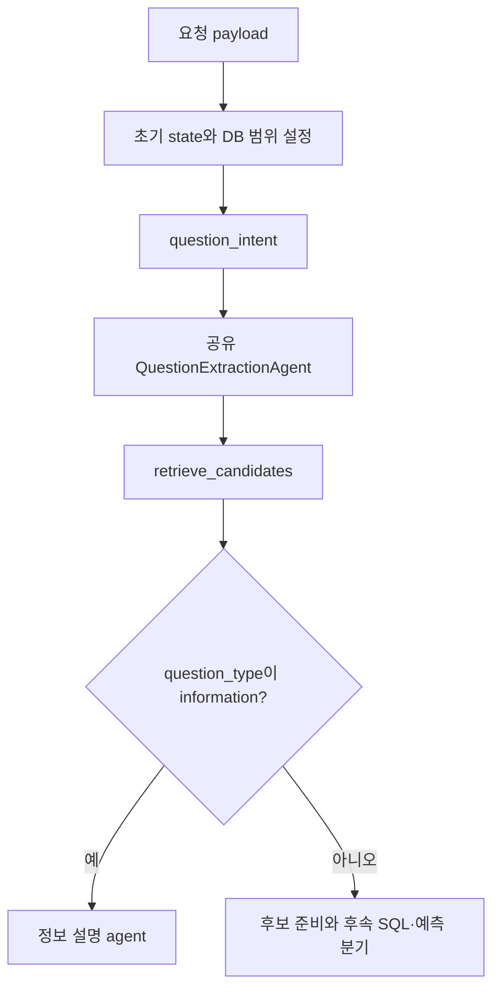
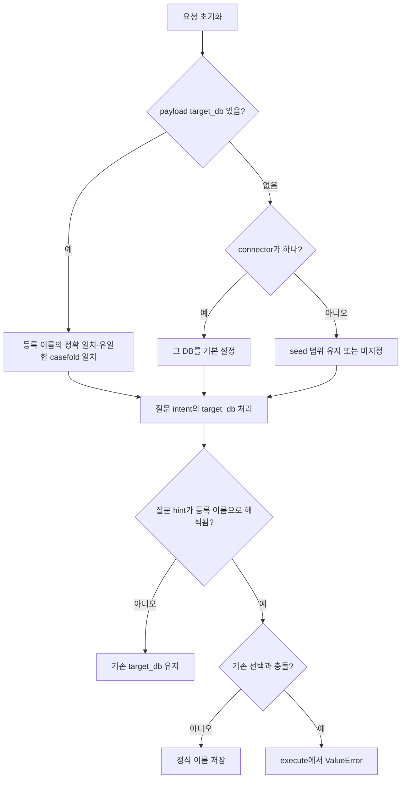
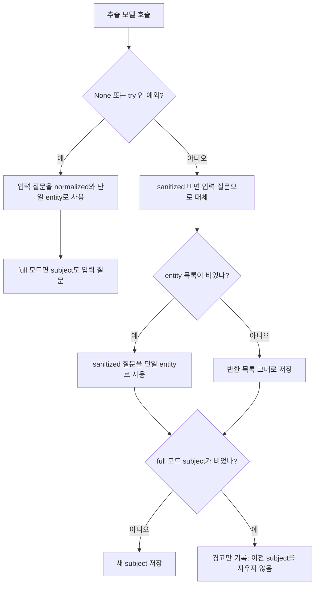
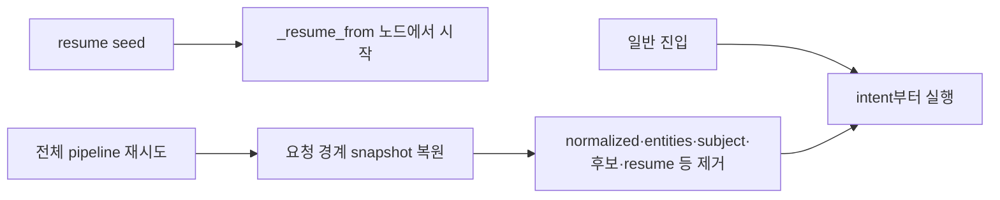

# Chapter 02. 질문 재작성·검색 개념 추출과 DB 문맥

검색 전에 두 모델 단계가 서로 다른 일을 한다. `QuestionIntentAgent`는 실행할 질문·보조 설명·DB 선택을 분리하고, `QuestionExtractionAgent`는 그 질문을 검색용으로 다듬어 entity 목록과 subject를 만든다. 제출 질문은 별도로 유지한다. 이 입력은 검색 문장이지 실제 catalog 객체 ID가 아니다.

이 장은 입력 생성·상태 재사용·실패 경계를 정적으로 분석한다. 실제 모델·DB·테스트는 실행하지 않았다. 검색 호출 자체는 [Chapter 01](chapter-01-search-contract-and-retry.md), 병렬 후보와 자동 DB 선택은 다음 Chapter 03에서 이어진다.

## 1. 용어와 실제 호출 지도

| 용어 | 뜻·이 문서에서의 의미 |
|---|---|
| Intent(질문 의도) | 정보 설명·계산·예측 중 어떤 요청인지를 뜻한다. |
| Entity | 검색할 업무 개념·속성의 문구이다. |
| subject | 질문이 주로 묻는 대상 하나다. 예를 들어 ‘지난달 배송된 상품 수’에서 상품과 배송 날짜는 entity 후보이고 상품은 subject가 될 수 있다. |
| Evidence(보조 근거) | 계산식·도메인 정의·테이블 힌트처럼 해석을 돕는 별도 설명이다. |
| Glossary | 조직에서 등록한 용어·약어 정의 목록이다. |
| Scope | 검색할 DB 등 범위이다. |
| state | 단계 사이에 전달하는 상태이다. |
| path_state | 그중 질문 처리 중간 결과를 담는 dict다. 더 넓은 개념은 [용어집](../01-architecture/chapter-00-glossary.md)을 참고한다. |

정상 그래프의 앞부분은 다음과 같다.



추출 agent의 실제 파일은 `retrieval/entity_coverage/agents/question_extraction.py`다. Text-to-SQL 그래프도 이 구현을 기본 full 모드로 가져온다. 디렉터리 이름만 보고 별도 entity coverage 기능에서만 실행된다고 해석하면 안 된다.

기존 계획에 포함했던 `combined_precheck.py`는 SQL 생성 뒤 값·JOIN·JSON 경로를 검사하는 기능이다. 여기서 entity를 생성하지 않으므로 01-9 검증 단계로 인계한다.

정보 질문도 intent 직후 즉시 종료하지 않는다. 질문 추출과 후보 검색을 거친 뒤 정보 agent로 나뉜다. 세부 SQL 생성 유형·예측·evidence refinement 분기는 01-8에서 설명한다.

근거: [그래프 등록과 연결](../../../code/auto-ontology/auto_ontology/retrieval/text_to_sql/text_to_sql_graph.py), [공유 추출 agent](../../../code/auto-ontology/auto_ontology/retrieval/entity_coverage/agents/question_extraction.py).

## 2. 세 가지 질문은 덮어쓰기 대상이 다르다

| 상태 | 생성·읽기 규칙 | 주 용도 |
|---|---|---|
| `state.initial_question` | 요청의 question을 양끝 strip한 값 | 제출 질문 보존 |
| `path_state.processing_question` | payload.processing_question을 strip한 값, 비면 제출 질문 | 이전 대화를 풀어쓴 독립 질문 |
| `path_state.normalized_question` | intent와 extraction이 순서대로 갱신 | 검색·후속 처리용 질문 |

`get_original_question`은 initial_question, `get_standalone_question`은 processing_question이 truthy면 그것을 아니면 initial_question을 반환한다. `get_question_for_processing`은 normalized_question을 우선하고 비면 standalone 질문으로 대체한다.

```text
제출: “그럼 다음 분기는?”
processing_question: “다음 분기 주문 수는 얼마인가?”
normalized_question: “다음 분기 주문 수”

intent 입력       → 독립 질문
extraction 입력   → intent가 만든 normalized_question
후보 검색 입력   → extraction이 갱신한 normalized_question
원본 접근자      → 제출 질문
```

위 문장은 설명용이며 모델을 실행한 결과가 아니다. 이 세 접근 함수는 문자열을 다시 strip하거나 타입·의미를 검증하지 않고 truthy 우선순위를 따른다. `_build_state`의 경계 처리와 직접 agent를 호출하는 테스트 상태의 차이를 구분한다.

이전 path_state를 전달하면 `_build_state`는 복사해서 사용하고 processing_question을 새 요청 값으로 설정한다. 이 시점에 모든 이전 추출 필드를 무조건 비우는 것은 아니다. 정상 실행의 후속 agent가 덮어쓰는 필드와 명시적 전체 재시도의 초기화는 뒤에서 구분한다.

근거: [state 접근자](../../../code/auto-ontology/auto_ontology/retrieval/text_to_sql/state.py), [초기 state](../../../code/auto-ontology/auto_ontology/retrieval/text_to_sql/main.py).

## 3. Intent는 질문·근거·DB 선택을 분리한다

`QuestionIntentAgent`는 standalone 질문, 기존 evidence, glossary, 등록 connector의 DB 이름 목록, 사용자가 제공한 SQL 예시를 prompt에 넣는다. **Connector**는 원본 DB 접근 객체다. 이 단계에서 실제 DB나 벡터 검색을 호출하지 않는다.

모델 지시의 핵심은 다음 구분이다.

- 실제 필터·기간·측정값·그룹·순위·출력 조건은 rewritten_question에 남긴다.
- 공식·업무 정의·매핑·테이블 힌트는 extracted_evidence로 분리한다.
- 명시한 등록 DB는 target_db에만 두고 질문·evidence에서 DB 지시 문구를 제거한다.
- 이름이 업무 개념과 비슷하다는 이유만으로 DB를 추측하지 않는다.

예를 들어 ‘지역별 매출을 구하되 매출은 총판매액에서 환불액을 뺀 값’은 실행 질문과 매출 정의로 나누도록 요청한다. 이런 분리의 의미 보존은 모델 지시이며, 코드가 원문과 결과를 비교해 모든 조건이 남았는지 검증하지는 않는다.

### 3.1 응답 필드와 실제 상태 갱신

| 모델 필드 | 사용처 |
|---|---|
| question_type | information·calculation·prediction 분류 |
| calculation_subtype | 계산 세부 유형. 해당 유형의 sql_template도 설정 |
| rewritten_question | strip 후 비면 입력 질문. normalized_question에 저장 |
| extracted_evidence | strip 후 path_state에 저장하고 기존 evidence와 병합 |
| target_db | 등록 DB 목록에서 해석한 뒤 조건부 저장 |
| relevant_sql_example_numbers | 사용자 SQL 예시의 1부터 시작하는 번호 목록 |

일반 `QuestionIntentModel`은 계산 질문에 subtype을 요구하고 비계산이면 subtype이 None이어야 한다. `calculation_only=True`는 별도 모델을 사용해 상위 타입 선택을 생략하지만 재작성·근거·DB·예시 선택은 계속한다. 예측 override의 최종 분류 정책은 01-8에 인계한다.

이 모델들과 추출 모델은 `StrictLLMOutputModel`을 상속한다. 정의 외 필드는 금지하되 `$`로 시작하는 provider 메타데이터 key는 검증 전에 제거한다. 이것은 출력 형태의 검증이며 사실 보존·검색 적합성을 보증하는 검사는 아니다.

### 3.2 Evidence 병합은 문자열 포함 검사다

`_merge_evidence`는 기존·새 문자열을 strip한다. 새 값이 비면 기존 값, 기존이 비면 새 값을 쓰고, 새 값 전체가 기존 값에 casefold 기준 부분 문자열로 들어 있으면 기존을 유지한다. 아니면 줄바꿈으로 덧붙인다.

의미가 같은 설명을 모델로 합치거나 줄별 중복 제거를 하지 않는다. 유사한 정의가 중복될 수도 있고, 짧은 문자열이 긴 설명에 포함되어 생략될 수도 있다. 원래 state의 evidence가 그대로 유지되는지와 새 추출 문자열을 합치는지 구분한다.

### 3.3 SQL 예시는 구조 관련성으로 선택하게 한다

Prompt는 질문·SQL이 비지 않은 사용자 예시들을 원래 번호와 함께 보여 주고, 출력 형태·집계·그룹 단위·순위·결과 수가 맞는 예시 번호만 고르라고 요청한다. 응답 번호를 set으로 만든 뒤 원래 예시 순서대로 유효 번호·비어 있지 않은 question/sql을 남긴다. 중복·범위 밖 번호는 결과를 늘리지 않는다.

성공 응답의 빈 번호 목록은 예시를 모두 비운다. 반면 intent가 None이면 기존 예시 전체를 유지한다. 예시 SQL이 실제 catalog와 맞는지 이 단계에서 파싱·실행하지 않는다.

근거: [intent 모델·prompt·갱신](../../../code/auto-ontology/auto_ontology/retrieval/text_to_sql/agents/question_intent.py), [strict 출력 기반](../../../code/auto-ontology/auto_ontology/utils/llm_invoke.py).

## 4. DB 범위에는 호출자 선택과 질문 힌트가 있다



초기 요청의 `resolve_target_database_name`은 exact 이름 또는 유일한 대소문자 무시 일치를 허용하고, 알 수 없는 명시 이름은 ValueError다. 단일 connector면 이름을 기본 target_db로 설정한다. 여러 connector이고 payload에 지정이 없으면 seed에 있던 target_db를 유지할 수 있으며, 없으면 검색 후 자동 선택 단계로 넘어간다.

질문 모델의 힌트는 별도 `_resolve_question_target_database_name`을 사용한다. Strip·casefold 일치로 하나를 찾거나 `difflib.get_close_matches(n=1, cutoff=0.8)`로 가까운 이름 하나를 찾는다. 이는 모델 신뢰도 80%라는 뜻이 아니라 문자열 유사도 기준이다. 안 맞으면 무시하고 기존 범위를 지우지 않는다.

해석된 질문 DB와 기존 target_db가 다르면 직접 execute는 ValueError를 낸다. 다만 그래프의 공통 `agent_wrapper`는 일반 예외를 `path_state.error`에 기록한 상태 갱신으로 바꾼다. 따라서 직접 호출 테스트의 예외 발생을 곧바로 ‘전체 그래프가 반드시 중단한다’는 보장으로 확대하면 안 된다. 후속 그래프 오류 처리의 상세 정책은 01-8에서 추적한다.

질문 문구의 DB 지시 제거는 prompt 규칙이며 코드가 다시 문자열에서 지우지 않는다. 잘못된 모델 hint가 무시되어도 재작성된 질문 자체는 다른 출력 규칙에 따라 저장될 수 있다. 실제 힌트 품질과 충돌 후 전체 실행은 미검증이다.

근거: [DB 이름 해석](../../../code/auto-ontology/auto_ontology/retrieval/text_to_sql/connector_routing.py), [intent hint 보정](../../../code/auto-ontology/auto_ontology/retrieval/text_to_sql/agents/question_intent.py), [agent wrapper](../../../code/auto-ontology/auto_ontology/retrieval/text_to_sql/base.py).

## 5. 공유 추출기는 entity·subject·사용 용어를 만든다

Text-to-SQL은 `QuestionExtractionAgent(include_subject=True)`를 사용한다. 별도 entity coverage는 lite 모드로 subject·사용 glossary 필드를 요청하지 않을 수 있다. 전체 coverage 알고리즘은 01-12 범위다.

| 출력 필드 | 의미·저장 |
|---|---|
| sanitized_question | 검색용 짧은 질문. normalized_question을 다시 갱신 |
| required_entity_name | 검색할 문자열 목록. path_state.entities |
| subject | 주요 대상 하나. 비지 않으면 path_state.subject |
| used_glossary_names | 실제 사용했다고 보고한 glossary 이름. 후속 state.glossary를 축소 |

Prompt는 정중한 표현·배경 설명을 빼되 사실 조건을 보존하도록 요청한다. Evidence는 뜻을 구분하는 짧은 qualifier 하나 정도에만 쓰고, 설명·공식·SQL·테이블 목록을 질문에 붙이지 말라고 한다. Entity는 **완성된 sanitized 질문에서만** 추출하고 glossary·evidence에서 직접 새 항목을 꺼내지 말라는 지시다.

### 5.1 Entity와 subject의 규칙은 다르다

| 항목 | Entity 지시 | Subject 지시 |
|---|---|---|
| 업무 대상 | 고객·배송 등 포함 | 주된 대상 하나 |
| 대상+속성/행위 | 배송 날짜 등 한 구문으로 포함 가능 | 필터·행위 수식은 제외 |
| 집계 | metric 이름에 붙은 total 등은 함께, 단독 집계어는 제외 | count·average 등 제외 |
| 값 | 브랜드·상품명 같은 이름 값은 유지 | 값·기간 수식 제외 |
| 숫자·날짜 literal | entity에서는 제외하되 질문에는 보존 | 제외 |
| id·name·type 같은 일반 스키마 단어 | 독립 entity로 내지 않음 | 주제 이름을 요청 |

날짜 관련 질문은 대상·행위·시간 단위를 date로 끝나는 검색 문구로 묶도록 요청한다. ‘지난달 배송 건수’에서 ‘지난달’ 값 자체를 검색하는 대신 배송·배송 월 날짜 같은 개념을 찾게 하는 의도다. 값 조건을 최종 질문에서 삭제하라는 뜻은 아니다.

Glossary의 약어는 정의에 맞게 해당 구문을 바꾸되 항목을 추가로 늘리지 말라고 요청한다. 예를 들어 MRR을 monthly recurring revenue로 풀고 region을 별도 entity로 두는 식이다. 이 규칙은 모델 지시이며 실제 schema ID를 조회하는 확정 매핑이 아니다.

### 5.2 개수 제한은 prompt에만 있다

Entity 개수 지시는 `CLARIFICATION_MAX_ENTITIES → SQL_GEN_MAX_ENTITIES → 기본 5` 순으로 읽는다. 공유 prompt이므로 clarification 이름의 설정이 Text-to-SQL에도 영향을 준다. 모듈 로딩 시 int로 읽으며 잘못된 정수 문자열을 보정하는 try/except는 없다.

응답 모델의 목록에는 min/max length 제한이 없고, agent도 개수 cap·중복 제거·빈 원소 제거를 적용하지 않는다. 문자열의 원래 casing을 보존하라는 지시도 코드의 재검증 조건은 아니다.

## 6. 빈 출력·실패·이전 subject의 차이



여기서 fallback의 ‘입력 질문’은 제출 원문이 아니라 `get_question_for_processing`으로 읽은 **이 단계 진입 시점의 질문**이다. Intent가 이미 분리·재작성했다면 그 결과를 사용한다.

빈 목록 `[]`은 단일 질문으로 대체하지만 `["   "]`처럼 공백 원소가 있는 목록은 truthy라 그대로 저장한다. 뒤의 CandidateRetrievalAgent가 문자열·strip·비어 있지 않음 조건으로 거르면 entity가 최종 0개가 될 수 있다. Entity 중복도 이 입력 정리만으로 제거하지 않는다.

정상 full 응답의 subject가 빈 문자열이면 새 subject를 설정하지 않을 뿐 기존 key를 pop하지 않는다. 새 state면 subject가 없지만 재사용 state면 옛 값이 남을 수 있다. 반면 None·예외 fallback은 subject를 질문 전체로 덮어쓴다. Lite 모드는 subject를 생성하거나 초기화하지 않는다.

추출 함수의 `llm = state["llm"]` 같은 초기 접근은 내부 try 앞에 있으므로 모든 오류가 질문 fallback으로 흡수되는 것은 아니다. 그래프 wrapper의 입력 검증 실패와 일반 예외 처리도 별도 경계다.

## 7. Glossary는 모델이 사용했다고 보고한 항목으로 줄어든다

Full 성공 시 `_filter_glossary_by_used_names`는 등록 glossary의 이름을 strip·casefold key로 만든다. 모델이 반환한 이름도 같은 방식으로 찾아 실제 등록 항목만 남기고 중복을 제거한다. 모델 응답 순서를 따르며, 등록 항목의 정의 문장을 새로 생성하지 않는다.

알 수 없는 이름은 버린다. 같은 이름의 등록 항목이 여러 개면 dict에 나중 항목이 남는다. 정의가 실제 질문 해석에 사용되었는지 코드가 의미 검증하지는 않는다.

결과 dict는 시작부터 `glossary=[]`를 넣는다. 따라서 None·예외 fallback 또는 lite 모드도 기본 반환은 빈 glossary다. 전체 glossary가 prompt에 들어갔다는 사실과 후속 state에 남는 목록은 다르다. Full 성공에서 사용 이름 목록이 비어도 이후 glossary는 비워진다.

## 8. 검색에 실제 전달하는 네 종류의 문장

CandidateRetrievalAgent는 추출 결과를 아래처럼 사용한다. 종류별 요청 개수·DB 선택·병렬 실행은 다음 장에서 더 추적한다.

| 입력 | 검색 대상 |
|---|---|
| 정리한 각 entity | ColumnAttribute, 즉 컬럼 의미 속성 |
| normalized 질문 전체 | SqlAttribute와 존재하는 CustomAnalysis |
| 비어 있지 않은 subject | Term top 1 |
| state.evidence 전체 | 비어 있지 않으면 ColumnAttribute 추가 검색 |

**CustomAnalysis**는 저장한 사용자 분석 정의다. Subject는 Term ID가 아니라 검색 문구이고, entity도 catalog 컬럼 이름으로 확정된 것이 아니다. 입력 텍스트를 문서와 비교해 후보를 찾은 뒤 ID를 얻는다.

Evidence에서 직접 entity를 추출하지 말라는 prompt 지시와 evidence 전체를 별도 검색하는 동작은 공존한다. 전자는 entity 목록의 출처를 좁히고, 후자는 보조 근거에 필요한 컬럼 의미를 별도 보충하는 경로다.

Subject나 entity가 비어 있어도 질문 전체를 사용하는 SQL 속성 검색은 시작할 수 있다. 반면 semantic_retriever 자체가 없으면 이 의미 검색들은 실행되지 않는다. 정확한 호출 조건은 각 종류별로 다르다.

근거: [추출 모델](../../../code/auto-ontology/auto_ontology/retrieval/entity_coverage/models.py), [추출 prompt](../../../code/auto-ontology/auto_ontology/retrieval/entity_coverage/prompts.py), [추출·glossary 처리](../../../code/auto-ontology/auto_ontology/retrieval/entity_coverage/agents/question_extraction.py), [검색 입력 소비](../../../code/auto-ontology/auto_ontology/retrieval/text_to_sql/agents/candidates_retrieval.py).

## 9. 정상 실행·재개·전체 재시도의 상태 수명



일반 진입은 question_intent부터 실행한다. `_entry_router_fn`은 `_resume_from`이 있으면 그 값을 사용하므로, 지원되는 뒤 노드에서 재개하면 intent·extraction을 다시 거치지 않을 수 있다. 전달한 중간 검색 상태를 사용한다는 뜻이지 모든 질문 변경을 자동 감지하는 캐시는 아니다.

전체 재시도는 `_restore_for_full_pipeline_retry`가 초기 요청 snapshot에서 state를 복원하고 `normalized_question`, `entities`, `subject`, 이전 검색 결과, `_resume_from` 등을 제거한다. 초기 evidence·glossary·SQL 예시·messages를 복원한다. Processing 질문과 초기 target_db는 유지하는 key다. 실패한 시도에서 자동 선택한 DB가 반드시 다음 시도에 남는 것은 아니다.

이 복사는 list/dict 수준의 얕은 복사다. 중첩 객체까지 모두 불변으로 만드는 일반 snapshot 저장소라고 해석하면 안 된다. 전체 재시도가 발생하는 조건·횟수·resume 공개 인터페이스는 01-8·01-12에 인계한다.

후보 검색 뒤 evidence refinement가 normalized_question을 다시 갱신할 수도 있다. 현재 그래프의 refine_evidence 다음 연결은 SQL 생성으로 향하며 entity 추출로 돌아가지 않는다. 따라서 후속 재작성 질문과 최초 검색어가 항상 같은 문장이라고 가정하면 안 된다. Refinement의 내용 검증·재질의 정책은 01-8 범위다.

## 10. 테스트 assertion과 미확인 항목

[질문 접근자 테스트](../../../code/auto-ontology/auto_ontology/retrieval/text_to_sql/tests/test_question_accessors.py)는 standalone 우선·normalized 우선·제출 질문 보존을 확인한다.

[Intent 테스트](../../../code/auto-ontology/auto_ontology/retrieval/text_to_sql/tests/test_question_intent.py)에서 다음 assertion을 읽었다.

- `test_agent_rewrites_question_and_merges_extracted_evidence`: 오타 DB 이름을 정식 이름으로 해석하고 질문·원문·기존 근거를 분리해 유지.
- `test_agent_ignores_question_database_when_no_configured_name_is_close`: 해석되지 않는 질문 DB를 설정하지 않음.
- `test_agent_preserves_existing_target_when_question_does_not_select_one`, `test_agent_rejects_question_database_conflicting_with_existing_target`: 기존 범위 유지·직접 execute의 충돌 ValueError.
- `test_agent_replaces_sql_examples_with_structurally_relevant_subset`, `test_failed_intent_filter_preserves_all_sql_examples`: 중복·범위 밖 번호 처리와 None 때 예시 유지.
- `test_agent_does_not_duplicate_existing_evidence`, `test_failed_classification_defaults_to_calculation_and_original_question`: 기존 근거 중복 방지와 intent None 시 calculation/match_based·진입 질문 fallback.
- `test_graph_entry_starts_with_intent_but_preserves_resume`, `test_information_routes_before_candidate_preparation`: 기본 시작점·resume 경로와 검색 후 정보 분기.

Intent None fallback은 prediction override·calculation_only에 따라 세부 타입이 달라질 수 있다. 이 장은 검색 입력으로 보존되는 질문·근거·DB·예시를 중심으로 확인했으며, 모든 상위 분류 조합의 실행 분석을 완료했다는 뜻은 아니다.

[추출 evidence 테스트](../../../code/auto-ontology/auto_ontology/retrieval/text_to_sql/tests/test_question_extraction_evidence.py)는 근거 사용 범위를 제한하는 prompt, 근거 전달·원문 보존, intent 재작성 질문이 extraction으로 이어지는 결과를 확인한다. 읽은 agent 실행 사례는 lite 모드이며 실제 full subject·glossary 선택 품질을 검증한 것은 아니다.

[후보 검색 테스트](../../../code/auto-ontology/auto_ontology/retrieval/text_to_sql/tests/test_candidates_retrieval.py)의 `test_full_evidence_adds_column_attribute_vector_results`는 evidence 전체 추가 검색과 entity 검색의 결과 병합을 확인한다. [전체 재시도 테스트](../../../code/auto-ontology/auto_ontology/retrieval/text_to_sql/tests/test_full_pipeline_retry.py)는 초기 근거·용어·예시·질문 복원과 processing_question·초기 target_db 유지, 실패 상태 제거를 확인한다.

모두 assertion 정적 확인이며 테스트를 실행하지 않았다. 실제 한국어 질문 재작성·조건 보존·약어 해석·subject 품질, 빈 subject의 기존 값 잔존, 과도한 entity 수·공백 목록, DB 충돌 후 전체 그래프와 resume 변경 상황은 미검증이다.

Mermaid 4개를 작성했으며 렌더링하지 않았다. 다음 Chapter 03은 이 문장들이 병렬 검색 요청으로 바뀌고, 여러 DB 후보에서 실제 검색 범위를 선택·보충하는 과정을 분석한다.
