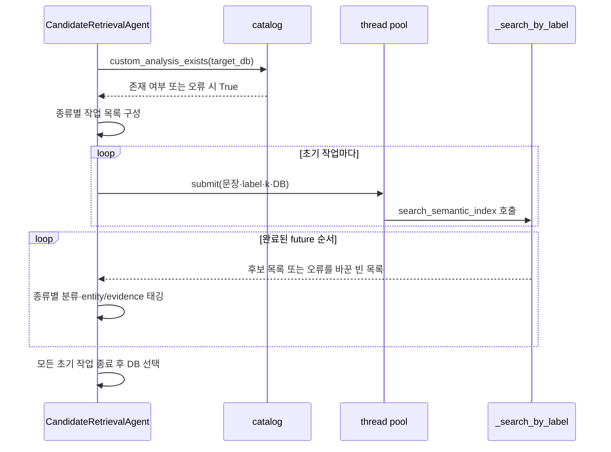
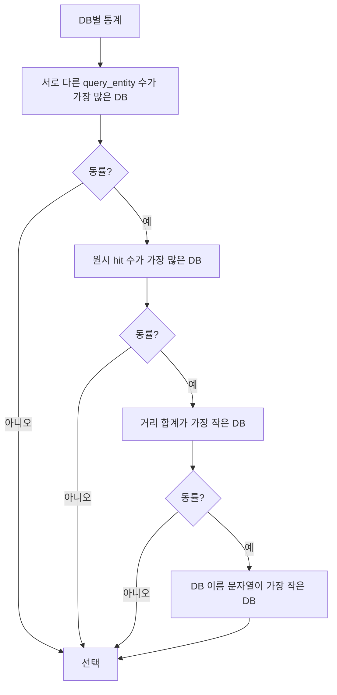
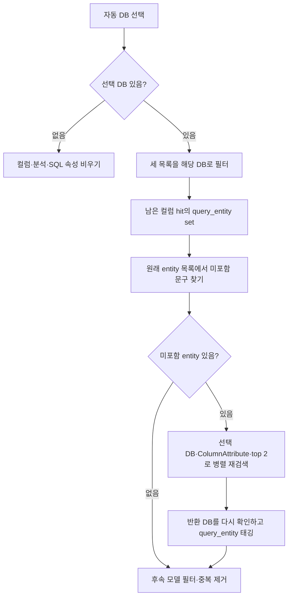

# Chapter 03. 후보 병렬 검색·자동 DB 선택과 entity 보충

`CandidateRetrievalAgent`는 질문·entity·evidence·subject를 서로 다른 종류의 검색으로 보내 병렬 수집한다. DB가 지정되지 않으면 컬럼 의미 속성이 다루는 entity 수를 우선해 DB 하나를 고르고, 그 DB에 없는 entity 후보만 다시 검색한다. 이는 전체 catalog에서 정답 DB를 증명하는 절차가 아니라 제한된 검색 결과로 범위를 결정하는 규칙이다.

이 장은 검색 요청·집계·선택·보충·상태 저장을 분석한다. 모델 필터의 prompt·최종 중복 제거·명세 구성은 Chapter 04에서 상세히 이어간다. 실제 DB·모델·테스트는 실행하지 않았으며 모든 예시는 설명용이다.

## 1. 용어와 입력 상태

**Entity**는 검색할 ‘매출’, ‘고객 지역’ 같은 업무 문구다. **Subject**는 질문의 중심 대상 하나, **evidence**는 계산식·업무 정의 같은 보조 근거다. 생성 과정은 [Chapter 02](chapter-02-question-entities-and-search-scope.md)를 참고한다.

**Hit**는 검색 후보 한 건이며 **label**은 객체 종류다. **ColumnAttribute**는 컬럼의 의미 속성, **SqlAttribute**는 이름 있는 SQL 정의, **CustomAnalysis**는 저장된 사용자 분석, **Term**은 업무 개념이다. **Recall(후보 수집)**은 관련 가능성이 있는 후보를 가져오는 단계이고, **backfill(보충 검색)**은 처음에 빠진 검색어를 선택한 DB 안에서 다시 조회하는 작업이다.

**Future**는 병렬 작업의 결과를 나중에 받는 객체, **worker**는 해당 작업을 실행하는 스레드다. **Coverage**는 여기서 검색어가 후보를 하나라도 얻었는지 나타내는 값이며, 실제 질문의 답을 계산할 수 있다는 보장이 아니다. 전체 개념은 [용어집](../01-architecture/chapter-00-glossary.md)과 연결된다.

Agent는 다음 입력을 읽는다.

| 입력 | 정리 방식 |
|---|---|
| 질문 | `get_question_for_processing`: normalized 우선 |
| path_state.entities | list인 경우 문자열 원소만 strip하고 빈 값 제외. 중복 유지 |
| path_state.subject | 비어 있지 않은 문자열만 strip |
| state.evidence | 비어 있지 않은 문자열만 strip |
| path_state.target_db | 그대로 읽음. 여기서 등록 connector 검증·strip을 다시 하지 않음 |
| semantic_retriever | 있으면 의미 검색 수행 |
| state.llm | 직접 key로 접근. 이후 모델 필터에 사용 |

`validate_input`은 질문이 truthy인지 확인한다. Entity 개수·DB 존재·모델·retriever를 모두 검사하는 함수는 아니다. 입력에 관한 상세 전제와 실제 graph wrapper 검증을 구분한다.

근거: [CandidateRetrievalAgent와 helper](../../../code/auto-ontology/auto_ontology/retrieval/text_to_sql/agents/candidates_retrieval.py).

## 2. 어떤 검색을 몇 개씩 병렬 요청하는가

모든 검색은 **같은 semantic_retriever**를 사용한다. 모듈 상단의 과거 ‘both VDBs’ 설명과 달리 현재 execute는 이 단계에서 data_retriever를 사용하지 않는다.

| 작업 key | 검색 문자열 | label·요청 수 | 생성 조건 |
|---|---|---|---|
| custom | 질문 전체 | CustomAnalysis·3 | catalog에 사용자 분석이 있다고 판단 |
| sql_attr | 질문 전체 | SqlAttribute·3 | retriever가 있으면 항상 |
| evidence_col_attr | evidence 전체 | ColumnAttribute·3 | evidence 비어 있지 않음 |
| col_attr:{entity} | 각 entity | ColumnAttribute·2 | 정리한 entity마다 |
| subject_term | subject | Term·1 | subject 비어 있지 않음 |

초기 작업 수는 `1 + entity 수 + 사용자 분석 존재 여부 + evidence 여부 + subject 여부`다. 각 여부는 0 또는 1이다. 요청상 후보 행 합계는 `3 + 2×entity 수 + 3×사용자 분석 여부 + 3×evidence 여부 + subject 여부`이며, 중복·누락·후속 필터 전의 최대 요청량이다.

예를 들어 entity 3개, 사용자 분석·evidence·subject가 모두 있으면 작업 7개, 요청 행 합계 최대 16개다. Entity를 중복 제거하지 않으므로 같은 문구가 두 번 있으면 검색도 두 번 제출된다. Prompt의 기본 entity 개수 제한은 코드의 worker 상한이 아니다.

### 2.1 사용자 분석 존재 검사는 검색 생략을 위한 힌트다

`custom_analysis_exists(target_db)`는 catalog의 LIMIT 1 존재 조회다. DB가 지정되면 분석의 SQL이 그 DB 테이블을 하나라도 참조하는지 확인하고, 미지정이면 사용자 분석 객체가 하나라도 있으면 true다.

조회 오류는 false가 아니라 **true**로 바꾼다. 장애 때문에 검색을 잘못 생략하지 않도록 계속 조회하게 하는 처리다. 사용자 권한·모든 참조 테이블의 DB 일치·질문 관련성·실제 검색 hit 존재를 보증하는 검사는 아니다.

SqlAttribute에는 이 같은 존재 조회 gate가 없다. 모델이 만든 bridge 속성도 동일 label 검색에 들어갈 수 있으며 source별 모델 필터 생략은 뒤 단계다.

근거: [custom_analysis_exists](../../../code/auto-ontology/auto_ontology/dal/custom_analyses.py).

## 3. Worker와 결과 수집·태깅

초기 pool은 `ThreadPoolExecutor(max_workers=len(search_tasks) or 1)`다. 작업 수와 같은 worker 상한을 주며 별도 고정 상한은 없다. 정상 retriever 분기에는 sql_attr 작업이 항상 하나 있으므로 보통 1개 이상이다.



`as_completed`는 제출 순서가 아니라 완료 순서로 결과를 받는다. CustomAnalysis·SqlAttribute·subject는 각 전용 목록에 넣고, entity/evidence 컬럼 후보는 공통 목록에 누적한다.

- Entity 검색 hit는 복사한 뒤 `query_entity=그 검색 문구`를 붙인다. 작업 key는 첫 `:`에서 한 번만 나눠 entity를 복원하므로 entity 안의 추가 콜론은 유지된다.
- Evidence 검색 hit는 `query_evidence=전체 evidence`를 붙인다. Entity tag를 대신 만들어 넣지 않는다.
- Subject hit는 별도 subject_term_hits에 둔다. 일반 컬럼 후보에 합치지 않는다.

같은 속성 ID를 entity와 evidence가 각각 찾으면 이 시점에는 별도 행으로 남는다. 최종 중복 제거가 이후 query_entities·query_evidence를 합치는 동작은 다음 Chapter 04에서 분석한다.

### 3.1 실패는 검색 wrapper와 future 바깥을 구분한다

`_search_by_label`은 [공통 검색](chapter-01-search-contract-and-retry.md)의 재시도·metadata 변환까지 호출하고 Exception을 잡아 로그 후 `[]`를 반환한다. 이 정상 경로에서는 한 검색의 실패가 다른 검색 결과를 직접 취소하지 않는다.

그러나 `future.result()`·hit dict 복사·집계·pool 생성 전체를 별도 try/except로 감싸지는 않는다. 예상 형식 밖의 결과나 바깥 오류가 발생하면 agent wrapper까지 전파될 수 있다. 모든 예외가 종류별 빈 결과로 복구된다고 해석하면 안 된다.

Pool의 `as_completed`·`future.result`에 timeout을 지정하지 않는다. 각 embedding 요청 제한은 있어도 이 단계 전체의 마감 시간·취소 event·총 요청 예산은 없다. Context manager는 제출 작업 종료를 기다린다.

## 4. 명시 DB 경로와 자동 DB 경로는 조건부터 다르다

자동 선택은 **`target_db is None`일 때만** 실행한다. 단순히 false인지 검사하는 조건이 아니다. 정상 요청 초기화는 등록 DB 이름을 정리하지만, 직접 seed에 `target_db=""`를 넣으면 검색 helper는 빈 값을 조건에서 생략하고 이 자동 선택 블록도 건너뛸 수 있다.

Target DB가 이미 있으면 모든 초기 작업에 그 값을 전달하고 자동 선택·선택 후 공통 DB 필터·entity 보충을 생략한다. 이 분기에서는 검색 backend의 DB 필터를 이 agent가 같은 방식으로 다시 검증하지 않는다.

대상이 None이면 초기 검색은 여러 DB가 공유하는 의미 컬렉션에서 수행된다. 각 요청의 top 1·2·3개가 **전체 DB를 통틀어** 잘린 뒤 집계된다. 특정 DB가 적합하더라도 초기 top k에 나타나지 않으면 선택 후보에 들어오지 못할 수 있다. DB마다 같은 개수를 먼저 가져와 비교하는 방식은 아니다.

## 5. 자동 선택은 네 가지 기준을 차례로 비교한다

`_select_candidate_database(column_hits, custom_hits, sql_attribute_hits)`는 DB별로 다음 통계를 만든다.

```text
entities: 이 DB의 ColumnAttribute query_entity 문자열 set
hit_count: 컬럼·사용자 분석·SQL 속성의 원시 hit 행 수
score_total: 위 hit들의 거리 score 합계
```

DB 이름은 `str(hit.database_name or "").strip()`으로 정리한다. 없거나 빈 값이면 해당 hit를 집계하지 않는다. 이름을 casefold하지 않으므로 `Sales`, `sales`는 이 helper에서 별도 DB key다. 등록 connector 이름과의 일치·권한·실행 가능 여부도 여기서 재검증하지 않는다.

거리 변환 `_score`는 None이면 무한대, 아니면 float다. 숫자 변환 실패는 이 helper가 빈 점수로 흡수하지 않는다. 0.0은 DB 선택에서는 유효한 최상위 거리로 남는다. 이후 중복 제거의 기본값 처리와 같다고 가정하면 안 된다.



실제 key는 `(-entity 수, -hit_count, score_total, database_name)`이며 min을 고른다. 평균 거리나 가장 가까운 단일 hit 기준이 아니다. 동점 마지막은 문자열 순서이며 단순 대소문자 무시 정렬도 아니다.

### 5.1 Entity coverage의 의미와 한계

Entity coverage는 query_entity set 크기다. 같은 속성 ID가 매출과 지역 검색에 각각 나왔으면 서로 다른 두 문구를 다룬 것으로 센다. 각 문구가 서로 다른 실제 컬럼으로 해결되었다거나 관계상 함께 질의 가능하다는 검사는 없다.

Case가 다른 `Revenue`, `revenue`도 다른 문구다. 중복 entity 문자열은 set에서는 하나지만 검색 hit_count와 거리 합계에는 반복 행이 기여할 수 있다. 점수가 나쁜 후보라도 entity tag가 있으면 coverage에 포함된다. 최소 유사도나 모델 관련성 검사를 거친 coverage가 아니다.

| 결과 종류 | coverage | hit_count·거리 합계 |
|---|---|---|
| Entity 컬럼 hit | query_entity가 비지 않으면 기여 | 기여 |
| Evidence 컬럼 hit | 보통 query_entity가 없으므로 기여하지 않음 | 기여 |
| 사용자 분석·SQL 속성 | 기여하지 않음 | 기여 |
| Subject Term | 집계 함수 인자에 없어 기여하지 않음 | 기여하지 않음 |

Subject Term 하나가 특정 DB를 강하게 가리켜도 이 자동 선택 규칙은 그 정보를 사용하지 않는다. Evidence는 entity가 같게 덮이는 첫 기준을 늘리지는 않지만 동률의 후보 수·거리 합계에 영향을 준다.

### 5.2 작은 비교 예시

| DB | 다룬 entity | 원시 hit 수 | 거리 합계 | 결과 |
|---|---|---:|---:|---|
| db-a | 매출·지역 | 2 | 0.7 | coverage 2로 선택 |
| db-b | 매출 | 4 | 0.4 | 더 많은 가까운 후보가 있어도 coverage 1 |

Coverage가 같으면 hit가 많은 쪽을 먼저 고른다. 따라서 많은 중복 행·인기 있는 속성이 나타난 DB가 영향을 받을 수 있다. 모델 필터와 ID 중복 제거는 **DB 선택 뒤**이므로 나중에 관련 없음으로 빠진 후보도 초기 선택에 기여한다.

## 6. 선택한 DB로 줄이고 미포함 entity만 다시 찾는다

선택 DB가 있으면 컬럼·사용자 분석·SQL 속성 목록을 `_filter_hits_to_database`로 제한한다. Strip한 hit DB 이름이 선택 이름과 정확히 같아야 한다. 다른 DB뿐 아니라 DB metadata 없는 hit도 제외한다.

선택할 통계가 없으면 이 세 목록을 비우고 경고한다. 이 경우 자동 target_db는 설정하지 않으며 entity 보충도 실행하지 않는다. 후보를 다시 전 DB에서 더 넓게 찾거나 connector 순서로 DB를 고르는 대체 단계는 이 블록에 없다.



`_covered_entities`는 query_entity만 본다. Evidence 검색만으로 같은 속성을 찾았더라도 entity의 tag가 없으면 그 문구는 미포함으로 볼 수 있다. 원래 entity 목록의 중복은 미포함 목록에서도 유지되어 같은 검색이 반복될 수 있다.

보충 pool의 worker 수는 미포함 entity 수다. 각 결과도 선택 DB로 다시 필터한 뒤 컬럼 후보에 추가한다. 한 번의 보충 단계이며, 계속 빈 결과라고 확대·유사어 변환·재분류를 반복하지 않는다. 새 후보를 보고 DB를 재선택하지도 않는다.

### 6.1 선택 DB 안에서 다시 검색하지 않는 것

사용자 분석·SQL 속성·evidence·subject는 보충하지 않는다. 전체 DB top k에서 선택 DB의 적절한 SQL 속성이 밀려났다면, 처음 결과를 필터해 비운 뒤 그 종류를 선택 DB로 다시 채우지는 않는다.

Entity 보충도 **후보가 0인 문구만** 처리한다. 원래 top 2 중 하나만 남은 entity를 다시 top 2까지 채우거나 더 적합한 속성을 찾는 절차는 아니다. 보충 뒤 최종 후보 개수와 유효 의미 범위가 충분하다는 보장은 없다.

## 7. Subject Term은 DB 선택·재필터에서 빠져 있다

`subject_term_hits`는 자동 DB 집계 인자에 없고, 선택 후 세 목록 필터나 no-stats 초기화에도 포함되지 않는다. 마지막에 첫 hit를 `retrieved_subject_term`으로 저장한다.

- 초기 DB가 미지정이면 subject top 1은 전 DB 검색 결과일 수 있다.
- 다른 DB가 선택되어도 subject Term을 선택 DB로 재검색하거나 metadata로 제외하지 않는다.
- 일반 세 후보 목록이 DB metadata 없음으로 모두 비워져도 subject 결과는 남을 수 있다.
- Subject가 비어 있으면 이전 retrieved_subject_term key를 pop하고, 문구는 있지만 결과가 없으면 None을 저장한다.

따라서 ‘최종 모든 후보가 선택 DB에 속한다’는 보장을 subject까지 확대하면 안 된다. 후속 `CandidatePreparationAgent`는 subject Term ID의 연결 테이블을 조회하고, 나중에 target_db가 있으면 최종 관련 테이블을 그 DB 이름으로 다시 제한한다. 잘못된 subject의 테이블을 반드시 그대로 실행에 사용한다는 뜻도 아니다. 이 후속 보충·제한은 Chapter 05~06에서 상세 분석한다.

## 8. 모델 필터·저장 순서와 부분 실패

DB 선택과 보충 다음에는 사용자 분석·SQL 속성의 모델 관련성 필터가 실행된다. SQL 속성이 전부 `bridgeTable` 출처이면 SQL 속성 필터를 생략하고 사용자 분석만 별도 필터한다. 혼합·빈 목록은 일반 통합 경로다. 이 단계의 prompt·ID 처리·None fallback은 Chapter 04 범위다.

컬럼 후보에는 이 execute 경로에서 모델 관련성 필터를 호출하지 않는다. 모듈 상단의 ‘각 entity의 hit를 모델로 필터한다’는 설명이나 `_llm_filter` helper의 존재만으로 실제 호출을 추정하면 안 된다.

이후 종류별 ID 중복 제거·정렬을 거쳐 다음 상태를 덮어쓴다.

| 저장 key | 값 |
|---|---|
| retrieved_column_attributes | 컬럼 속성 후보 |
| retrieved_custom_analyses | 사용자 분석 후보 |
| retrieved_sql_attributes | SQL 속성 후보 |
| retrieved_subject_term | subject 존재 시 첫 결과 또는 None, 없으면 key 제거 |
| target_db | 기존 또는 선택 DB가 truthy일 때 저장 |

자동 선택 DB는 로컬 변수에 먼저 담고 최종 상태 쓰기 때 저장한다. 그 전에 예상 밖 예외로 종료하면 새로 선택한 DB·후보 갱신이 반영되지 않을 수 있다. Seed의 이전 후보가 원래 path_state에 있었다면 예외 처리 결과와 함께 남는지도 구분해야 한다.

Semantic retriever가 없으면 검색·DB 선택 전체를 건너뛰고 빈 후보 목록을 저장한다. 기존 target_db는 지우지 않는다. LLM state 접근은 이 분기 앞이므로 모델 key 누락까지 안전하게 무시하는 no-search 모드는 아니다.

이 단계는 원본 DB의 업무 SQL을 실행하거나 semantic 관계를 저장하지 않는다. 사용자 분석 존재를 위한 catalog 읽기와 벡터 검색을 수행하고, 주된 출력은 메모리 state다. 단, [Chapter 01](chapter-01-search-contract-and-retry.md)의 VDB 초기화 가능성은 별도다.

## 9. 테스트에서 확인한 것과 남은 검증

[후보 검색 테스트](../../../code/auto-ontology/auto_ontology/retrieval/text_to_sql/tests/test_candidates_retrieval.py)의 assertion을 정적으로 확인했다.

- `test_selects_database_by_entity_coverage_before_total_hits`: 두 entity를 다룬 db-a가 더 많은 가까운 후보를 가진 db-b보다 우선한다.
- `test_database_selection_ties_are_deterministic`: hit 수 → 거리 합계 → DB 이름의 동률 해소 결과를 확인한다.
- `test_unscoped_retrieval_filters_database_and_backfills_entities`: 자동 db-a 선택, 세 목록의 DB 제한, DB 없는 hit 제외, customer만 보충하고 이미 다룬 revenue·region은 재조회하지 않음을 확인한다.
- `test_explicit_target_db_preserves_existing_search_behavior`: 명시 DB를 모든 검색에 전달하고 entity 2개·사용자 분석·SQL 속성의 4회 검색 결과를 확인한다.
- `test_full_evidence_adds_column_attribute_vector_results`: evidence top 3 요청과 entity 결과가 같은 ID로 합쳐져도 query_evidence·query_entities가 유지됨을 확인한다.

이 테스트는 검색·일부 모델 필터를 가짜 함수로 대체한다. 실제 pool의 최대 동시 실행 수·벡터 저장소 필터·한국어 질의 품질·원본 connector 실행을 검증한 것은 아니다. 존재 조회 역시 해당 agent 테스트에서는 true/false 함수로 대체한다.

실제 예외·중복 벡터가 집계에 미치는 영향, NaN/잘못된 score·대소문자 DB 이름·빈 target_db seed, subject와 선택 DB 불일치, 자동 선택 후 다른 종류의 미보충·중간 실패 뒤 이전 후보 잔존은 코드 경계에서 확인한 가능성이며 실행 재현하지 않았다.

Mermaid 3개를 작성했으며 렌더링은 검증하지 않았다. 다음 Chapter 04는 모델 필터의 실제 입력·ID 선택, score 0과 중복 제거, ColumnAttributeSpec 구성·metadata 보충을 분석한다.
