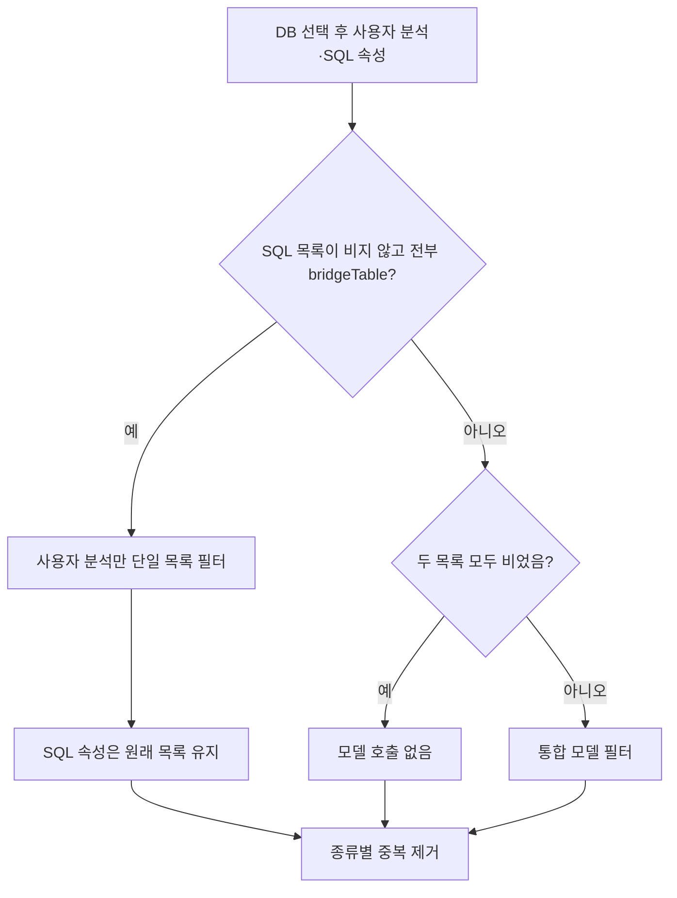
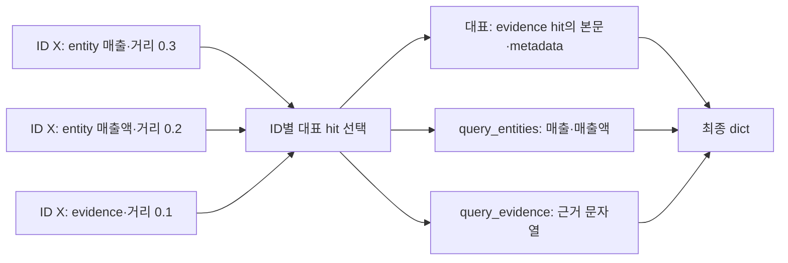
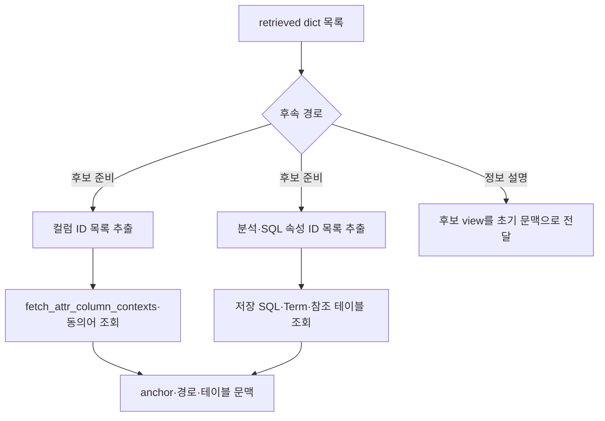

# Chapter 04. 모델 후보 필터·중복 제거와 실제 후보 명세

검색·DB 선택 이후 모델은 사용자 분석과 SQL 속성 중 관련 후보의 ID를 남긴다. 컬럼 의미 속성은 이 경로에서 모델 필터 없이 ID별 중복 제거를 거친다. 이름상 타입 명세를 만드는 helper도 있지만 현재 호출자는 확인되지 않았으며, 실제 후속 단계는 dict의 ID로 catalog를 다시 읽는다.

이 장은 로컬 코드·테스트의 정적 분석이다. 실제 모델·DB·테스트는 실행하지 않았다. [Chapter 03](chapter-03-candidate-recall-and-database-selection.md)의 후보 수집·DB 선택 이후부터, 다음 준비 단계의 문맥 조회 경계까지 다룬다.

## 1. 용어와 실제 처리 순서

**LLM(대규모 언어 모델)** 필터는 검색 문서가 질문에 도움이 되는지 판단한다. **ID**는 저장된 객체의 식별자, **hit**는 검색 후보, **metadata**는 후보의 DB·출처 같은 부가 정보다. **Score**는 여기서 작을수록 가까운 벡터 거리이며 확률이 아니다.

**ColumnAttribute**는 컬럼 의미 속성, **CustomAnalysis**는 저장된 사용자 분석, **SqlAttribute**는 이름 붙인 SQL 정의다. **Spec(명세)**는 정해진 필드를 갖는 데이터 구조이고, **catalog**는 수집해 둔 테이블·컬럼·의미 객체 저장소다. **Fallback**은 선택·호출 실패 시 적용하는 대체 동작이다. 전체 개념은 [용어집](../01-architecture/chapter-00-glossary.md)을 참고한다.

```text
후보 병렬 검색 → 자동 DB 선택·보충
→ 사용자 분석/SQL 속성 모델 필터 또는 bridge 생략
→ 종류별 _dedupe_best_score
→ retrieved_* dict 목록을 path_state에 저장
→ 후속 agent가 ID로 catalog 문맥 보충
```

모델 필터는 중복 제거 **전**에 호출된다. 같은 ID의 hit가 반복되면 prompt에도 반복될 수 있다. DB 선택 역시 이미 앞에서 끝났으므로 이 필터가 후보를 모두 제거해도 다른 DB로 다시 선택하지 않는다.

## 2. 실제로 호출되는 필터와 남아 있는 helper

| 함수 | 현재 검색 execute의 호출 | 책임 |
|---|---|---|
| `_llm_filter_both` | 일반 경로 | 사용자 분석·SQL 속성 두 목록을 한 모델 요청으로 필터 |
| `_llm_filter_candidates` | SQL 속성이 모두 bridge일 때 | 사용자 분석만 별도 필터 |
| `_all_bridge_sourced` | 분기 판단 | SQL hit 전부의 source가 bridgeTable인지 검사 |
| `_llm_filter` | 검색한 Python 소스에서 호출자 미발견 | entity의 단일 최적 ID를 고르도록 정의된 helper |
| `_build_column_attribute_spec` | 검색한 Python 소스에서 호출자 미발견 | hit를 타입 명세로 바꾸도록 정의된 helper |

따라서 모듈 주석의 ‘entity별 raw hit를 모델로 필터한다’, ‘typed 결과를 저장한다’는 설명을 현재 실행 사실로 그대로 읽으면 안 된다. `execute`는 컬럼 후보에 `_llm_filter`를 호출하지 않고 `_build_column_attribute_spec`도 호출하지 않는다.

이 분석은 제공된 소스에서의 호출 검색 결과다. 외부 코드가 이 private helper를 직접 호출할 가능성까지 부정하는 것은 아니다.

근거: [필터·helper·실제 execute](../../../code/auto-ontology/auto_ontology/retrieval/text_to_sql/agents/candidates_retrieval.py).

## 3. 일반 경로는 두 후보 목록을 한 번에 판단한다

`_llm_filter_both(llm, question, custom_hits, sql_attr_hits)`는 두 목록이 모두 비면 모델을 호출하지 않고 빈 목록 둘을 반환한다. 하나라도 있으면 SystemMessage 하나에 질문과 두 후보 블록을 넣는다.

후보 줄은 `- id: {id} | {text}`다. ID가 truthy인 후보만 prompt에 표시하고 빈 종류는 `(none)`으로 적는다. 전체 metadata·거리·검색 entity·근거·DB·source를 별도 필드로 전달하지 않는다. 다만 문서 text 안에 들어 있던 SQL·설명은 그 문자열로 보일 수 있다. 텍스트 길이·후보 줄 수를 여기서 추가로 자르지는 않는다.

모델에는 질문에 의미 있게 기여할 후보만 남기고 관련 도메인·개념·의도가 없으면 제거하라고 지시한다. 응답은 `CombinedCandidateFilterModel`이다.

| 응답 필드 | 계약 |
|---|---|
| custom_analysis_ids | 남길 사용자 분석 ID의 문자열 목록 |
| sql_attribute_ids | 남길 SQL 속성 ID의 문자열 목록 |
| 빈 목록 | 해당 종류를 모두 제외 |
| 정의 외 필드 | 허용하지 않음 |

두 필드는 필수이며 별도 이유·점수 필드는 없다. 이 모델은 일반 BaseModel에 extra 금지를 설정한 것으로, 앞 장의 `$` key 제거가 있는 StrictLLMOutputModel을 상속하지 않는다.

### 3.1 ID 검사는 원래 목록과의 교집합이다

각 응답 목록을 set으로 바꾸고, **원래 hit 목록을 순회**하며 `str(hit.id or "")`가 그 set에 있는 것만 남긴다.

- 모델이 없는 ID를 만들어도 새 hit를 만들지 않는다. 해당 ID는 매칭되지 않아 결과에 들어오지 않는다.
- 중복 응답 ID는 set에서 합쳐지지만, 입력 hit의 같은 ID 중복은 아직 남을 수 있다.
- 결과 순서는 모델이 반환한 순위가 아니라 원래 hit 순서다.
- ID의 공백·대소문자를 보정하거나 다른 종류의 ID를 찾아 이동시키지 않는다.
- 후보 밖 ID에 대한 별도 경고·모델 재질의는 없다. 필터 후 남은 것이 없을 수 있다.

```text
입력 custom: [A, B, B]
응답 custom_analysis_ids: [B, 지어낸 X, B]
필터 결과: [B, B]
후속 ID 중복 제거 결과: [B]
```

보통 UUID 형태의 ID를 전제하지만, 이 비교 자체가 빈·숫자 ID를 검증하는 일반 유효성 검사도 아니다. Prompt에서 생략된 truthy가 아닌 ID를 가진 hit는 None fallback 때 원래 목록에 남을 수 있다.

## 4. Bridge-only 경로는 SQL 속성의 모델 필터를 생략한다

`_all_bridge_sourced`는 SQL 속성 목록이 비어 있지 않고 **모든 hit의 최상위 source가 정확히 `bridgeTable`**일 때만 true다. Nested metadata를 다시 파싱하거나 catalog에서 source를 재조회하지 않는다.



혼합된 목록이면 bridge hit만 따로 빼서 보호하지 않고 통합 필터에 함께 보낸다. 빈 목록·source 누락·대소문자가 다른 출처도 일반 경로다.

단일 목록 `_llm_filter_candidates`는 `CustomAnalysisFilterModel.kept_ids`를 받고 같은 교집합 방식으로 원래 사용자 분석을 남긴다. 후보가 없으면 호출하지 않는다. SQL 속성 전체가 bridge인 한, 사용자 분석 필터가 무엇을 골라도 SQL 목록은 그 필터로 줄어들지 않는다.

이 최적화는 bridgeTable 문서를 업무 필터 없는 구조 JOIN 패턴으로 취급한다. 그러나 생성 시 그 조건을 모델 지시로 요청했을 뿐 완전히 강제하지는 않았다는 [bridge 생성 분석](../06-semantic-relationships/chapter-05-bridge-and-junction-sql-attributes.md)의 한계가 적용된다. Source만으로 실제 SQL의 정확성을 검증하는 단계는 아니다.

## 5. None·빈 선택·예외는 서로 다른 결과다

| 상황 | 현재 두 활성 필터의 결과 |
|---|---|
| 입력 목록 없음 | 해당 빈 결과 반환. 필요 없으면 모델 미호출 |
| 구조화 출력 wrapper가 None | 필터 전 원래 목록 유지 |
| 정상 응답의 ID 목록이 비었음 | 해당 종류 모두 제거 |
| 정상 응답이 전부 후보 밖 ID | 교집합 결과 없음 |
| wrapper 밖 예외·후속 처리 오류 | 이 helper에 자체 try/except가 없어 상위로 전파 가능 |

`invoke_with_structured_output`은 공통 재시도·출력 검증 후 실패를 None으로 바꿀 수 있다. 여기서 별도 get_llm_client를 만들지는 않고 state의 llm을 사용한다. 이 두 helper의 ‘failure 때 원본 유지’ 설명은 **wrapper가 None을 반환한 경로**와 실행 중의 모든 예외를 구분해서 읽어야 한다.

후보 텍스트 구성·출력 속성 접근 등에서 예외가 올라오면 최종 retrieved 목록을 쓰기 전 중단될 수 있다. 공통 agent wrapper의 오류 기록은 이전 path_state와 함께 남을 수 있으며, 이를 ‘필터 정상 완료’로 보아서는 안 된다.

### 5.1 미사용 단일 선택 helper의 별도 계약

`_llm_filter`는 `CandidateFilterModel(reasoning, best_id)`를 받는다. Prompt는 ‘맞는 것이 없으면 null’을 요청하지만, 구현은 result가 None이거나 best_id가 비면 **모든 기존 ID**를 반환한다. Best ID가 있으면 후보 목록에 실제 존재하는지 검사하지 않고 `[best_id]`를 반환하며 reasoning은 후속 처리하지 않는다.

이는 활성 통합 필터의 ‘정상 빈 목록이면 모두 제거’와 다른 계약이다. 현재 호출자가 확인되지 않았으므로 이 helper의 동작을 실제 컬럼 필터 정책으로 설명하거나, 실제 경로에서 잘못된 ID가 추가된다고 단정하면 안 된다.

근거: [필터 응답 모델](../../../code/auto-ontology/auto_ontology/retrieval/text_to_sql/models.py), [공통 구조화 출력 wrapper](../../../code/auto-ontology/auto_ontology/utils/llm_invoke.py).

## 6. ID 중복 제거는 최고 거리의 hit 하나를 기준으로 한다

`_dedupe_best_score`는 컬럼·사용자 분석·SQL 속성 목록에 각각 호출한다. 서로 다른 종류 전체를 한꺼번에 합치는 함수는 아니다.

1. ID가 None인 hit는 제외한다. 다른 ID는 str로 바꿔 dict key를 만든다.
2. 같은 key의 기존 hit와 거리를 비교해 더 작은 hit를 대표로 남긴다.
3. 별도 집합으로 모은 query_entity를 query_entities에 붙인다.
4. 별도로 모은 query_evidence를 붙인다.
5. 대표들을 거리 기준으로 정렬한다.

이 helper 자체에 최종 top N cap은 없다. 같은 이름의 `data_access/candidates.py::_dedupe_best_score_sort_cap`는 `(label,id)` key·다른 거리 처리·15개 cap을 가진 별도 함수다. 그 동작을 이 agent의 중복 제거로 옮겨 설명하면 안 된다.

### 6.1 숫자 0.0이 무한대로 취급되는 불일치

비교·최종 정렬의 코드가 다음 형태다.

```python
float(hit.get("score") or float("inf"))
```

Python에서 숫자 `0.0`은 false로 평가되므로 이 식은 `inf`가 된다. 거리가 작을수록 좋은데도 정확히 0인 결과는 비교상 최악으로 처리될 수 있다.

| 입력 | 비교·정렬에 쓰는 값 | 반환 hit의 score |
|---|---|---|
| 0.0 | inf | 대표로 남았다면 0.0 그대로 |
| 0.2 | 0.2 | 0.2 |
| None 또는 key 없음 | inf | 원래 값 유지 |
| 문자열 `"0.0"` | 0.0 | 문자열 그대로 유지 가능 |
| 숫자 변환 불가 문자열 | 예외 가능 | 정상 완료 보장 없음 |

문자열 `"0.0"`은 truthy라 숫자 0.0과 경계가 다르다. 정상 공통 검색은 score를 float로 만들기 때문에 실제 관심 대상은 숫자 0점이다.

```text
동일 ID A의 두 hit:
  A1 score=0.0  → 비교상 inf
  A2 score=0.2  → 비교상 0.2
대표는 A2가 될 수 있음

서로 다른 ID A=0.0, B=0.2:
정렬은 B가 앞, A가 뒤일 수 있음
단, A의 반환 score는 0.0으로 남음
```

이것은 코드 표현에서 확인한 사실이며 테스트를 실행해 재현한 결과는 아니다. 원본 코드는 변경하지 않았다. 앞 장의 자동 DB 집계 `_score`는 None만 무한대로 처리하므로 숫자 0을 정상 취급한다. 같은 데이터가 DB 선택과 최종 정렬에서 다른 비교값을 가질 수 있다.

### 6.2 동점과 완료 순서

대표 교체 조건은 `<`여서 같은 비교 점수면 먼저 받은 hit가 유지된다. 최종 정렬도 같은 key에서는 기존 순서를 유지한다. 컬럼 결과는 병렬 완료 순서로 합쳐지므로 동점 대표의 text·source 등은 완료 순서 영향을 받을 수 있다.

숫자로 바꿀 수 있는 NaN·무한대 값을 별도로 배제하는 조건은 없다. ID도 None만 제외하므로 빈 문자열과 숫자 ID를 일반 유효 ID로 확정하는 검증은 아니다. 숫자 1과 문자열 `"1"`은 같은 dict key가 된다.

## 7. 태그는 합치지만 metadata 전체를 합치지는 않는다



대표는 선택한 hit의 dict 전체를 복사한다. Name·DB·source·text 등 metadata를 다른 중복 hit에서 필드별로 보충하지 않는다. 더 가까운 hit에 metadata가 적으면 더 풍부한 다른 hit의 필드를 잃을 수 있다.

예외적으로 다음 태그를 별도로 합친다.

- `query_entity`가 truthy면 ID별 set에 문자열로 모으고 정렬한 query_entities 목록으로 저장한다.
- `query_evidence`가 truthy면 ID별 문자열 하나를 저장한다. 서로 다른 evidence가 여러 개면 마지막 값이 남으며 목록을 만들지 않는다.
- 대표의 단일 query_entity는 지우지 않는다. 대표가 evidence hit라 단일 값이 없어도 합친 query_entities는 생길 수 있다.
- 기존 query_entities 목록 자체를 모든 hit에서 모으는 로직은 없다. 주로 이번 검색에서 붙인 단일 query_entity들을 합친다.

현재 정상 경로는 질문 하나의 전체 evidence 문자열을 한 번 검색하므로 여러 서로 다른 evidence 충돌은 일반적인 입력은 아니다. 그래도 helper의 계약이 모든 검색 출처를 영속적으로 기록하는 provenance, 즉 이력 추적 저장소인 것은 아니다. 결과는 메모리 state이며 같은 ID의 모든 거리·본문·메타데이터를 보존하지 않는다.

## 8. ColumnAttributeSpec은 정의되어 있지만 현재 출력은 dict다

`ColumnAttributeSpec` 모델은 필수 source_column·name, 기본 빈 display_name·datatype, 선택 description을 갖는다. 객체 ID·DB·score·query_entities 필드는 없다.

`_build_column_attribute_spec`는 다음 순서로 만들도록 작성되어 있다.

| 단계 | 규칙 |
|---|---|
| metadata 해석 | dict 사용, 문자열이면 JSON 파싱. 파싱 예외면 빈 dict |
| 필드 찾기 | hit의 truthy 값 우선, 없으면 metadata 값 |
| name | name이 없으면 hit.text 전체를 strip하여 대체 |
| source_column | 반드시 있어야 함. 없으면 None 반환 |
| 나머지 | display_name·datatype 기본 빈 문자열, description은 선택 |

Docstring은 name을 요구하지만 실제로는 전체 문서 text가 이름 대체값이 될 수 있다. Datatype도 `datatype` key를 읽으며 `data_type`을 alias로 읽지 않는다. JSON 파싱 성공 후 dict 타입을 다시 보장하지 않으므로 잘못된 JSON 루트나 필드 타입이 오류가 될 수도 있다.

하지만 이 helper는 현재 `execute`의 출력 경로에 없다. 또한 [공통 검색 변환](chapter-01-search-contract-and-retry.md)은 source_column·전체 metadata를 전달하지 않고 datatype 대신 data_type 필드를 복사한다. 그 공통 결과가 이 builder의 입력 요건을 자동 충족하는 구조도 아니다.

따라서 ‘모든 검색 컬럼은 Spec으로 검증·보완되어 다음 단계로 간다’는 설명은 맞지 않는다. 이 helper가 호출되지 않는다는 사실 때문에 현재 실행 경로가 해당 불일치로 즉시 실패한다고 단정하는 것 역시 맞지 않는다.

## 9. 실제 후속 문맥은 ID로 다시 읽는다



`CandidatePreparationAgent`는 retrieved 컬럼 dict의 truthy ID를 문자열로 바꾸고 중복 제거한 뒤 `fetch_attr_column_contexts(ids, database_name=target_db)`와 `fetch_term_synonyms`를 호출한다. 검색 hit의 불완전한 metadata를 Spec builder로 채우는 경로가 아니다.

사용자 분석은 `fetch_custom_analyses_with_sql`로 SQL 문맥을 읽는다. SQL 속성은 `fetch_sql_attributes_with_sql`로 `id`, `name`, `description`, `expression`, `sql`, `term_name`을 보충하고 별도 참조 테이블 조회를 수행한다. 이 SQL 속성 조회는 SQL·Term 연결이 있어야 하고 조회 실패를 빈 목록으로 바꾼다. 검색에서 살아남은 ID 수와 실제 문맥 조회 결과 수가 같다는 보장은 없다.

정보 설명 경로의 `InformationAgent`는 retrieved_* dict의 선택 필드를 candidate view로 묶어 초기 prompt에 넣는다. 이 경로 역시 ColumnAttributeSpec을 호출하지 않는다. 정보 설명 도구·후속 조회 전체는 해당 인터페이스 단계에서 분석한다.

후속 anchor·관계·테이블 확장·DB 제한의 정확한 순서는 Chapter 05~06에서 이어간다. 이 장은 후보 필터가 저장소 존재·최신 설명·SQL 실행·접근 범위 전체를 검증하는 단계가 아니라는 책임 경계를 확인했다.

근거: [후보 준비의 catalog 보충](../../../code/auto-ontology/auto_ontology/retrieval/text_to_sql/agents/candidates_preparation.py), [컬럼 문맥 DAL](../../../code/auto-ontology/auto_ontology/dal/attributes.py), [사용자 분석 DAL](../../../code/auto-ontology/auto_ontology/dal/custom_analyses.py), [SQL 속성 문맥 DAL](../../../code/auto-ontology/auto_ontology/dal/sql_attributes.py), [정보 agent](../../../code/auto-ontology/auto_ontology/retrieval/text_to_sql/agents/information_agent.py).

## 10. 테스트 근거와 남은 검증

[후보 검색 테스트](../../../code/auto-ontology/auto_ontology/retrieval/text_to_sql/tests/test_candidates_retrieval.py)에서 다음 assertion을 확인했다.

- `test_all_bridge_sourced_true_when_every_hit_is_bridge`: 전부 bridgeTable이면 true.
- `test_all_bridge_sourced_false_for_mixed_missing_or_non_bridge`, `test_all_bridge_sourced_false_for_empty_hits`: 혼합·누락·비bridge·빈 목록은 false.
- `test_bridge_sourced_sql_attrs_skip_llm_filter_but_custom_still_filtered`: 통합 필터를 부르지 않고 사용자 분석 필터만 호출하며 bridge 속성을 유지.
- `test_full_evidence_adds_column_attribute_vector_results`: 같은 속성 ID의 entity/evidence 결과를 하나로 합쳐도 두 출처 태그를 유지.

이 테스트의 필터 성공 사례는 일부 helper를 가짜 함수로 바꾼다. 활성 필터의 실제 prompt·후보 밖 ID·None/빈 목록의 차이 전체를 직접 검증하는 통합 사례로 확대하면 안 된다.

[정보 agent 테스트](../../../code/auto-ontology/auto_ontology/retrieval/text_to_sql/tests/test_information_agent.py)의 `test_first_prompt_is_grounded_with_candidates`는 질문·entity·DB·속성 ID·테이블 ID와 사용 가능한 도구가 초기 문맥에 들어감을 확인한다. 실제 검색 결과를 Spec으로 변환했다는 검증은 아니다.

검색한 테스트에서는 숫자 0점의 대표 선택·정렬, 동점 완료 순서·필드 손실, builder의 datatype/data_type·source_column 입력, 미사용 단일 선택 helper의 null/후보 밖 ID를 직접 재현하는 assertion을 확인하지 못했다. 이런 경계는 코드에서 분석했으며 실행 재현은 하지 않았다.

Mermaid 3개를 작성했으며 렌더링은 검증하지 않았다. 다음 Chapter 05는 ID 기반 문맥 조회·anchor 선택·경로 계산과 hub 확장으로 이어간다.
