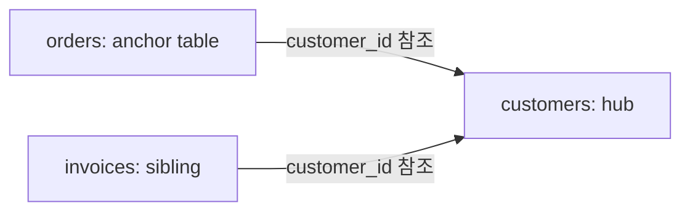
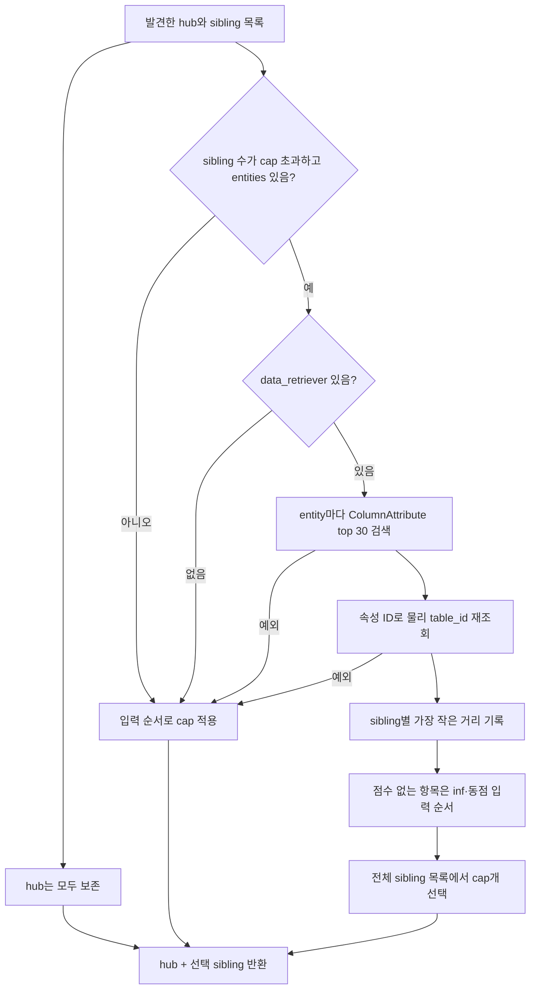
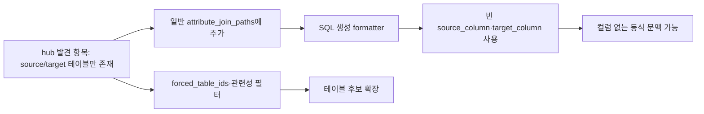

# Chapter 05-1. Hub·sibling 발견과 순위·제한·실제 소비

| 먼저 읽을 용어 | 뜻 |
|---|---|
| hub / sibling | 여러 테이블이 참조하는 중심 테이블 / 같은 hub를 참조하는 다른 테이블 |
| Anchor / anchor table | 질문의 기준 의미 속성 / 그 속성이 속한 테이블 |
| JOIN / SQL | 컬럼 조건으로 테이블의 행을 연결하는 연산 / DB 조회 언어 |
| DB | 데이터베이스의 줄임말 |
| PK (기본 키) | 테이블의 행 식별 키 |
| BFS (너비 우선 탐색) | 가까운 테이블부터 경로를 찾는 방법 |

Hub 확장은 기준 테이블과 같은 중심 엔티티를 참조하는 테이블들을 후보에 더하는 기능이다. 기본값은 비활성이며, 실행하면 구조 후보를 읽고 필요할 때 추가 검색으로 순위를 매긴다. 현재 구현은 주석의 검색기·비용·hub별 제한 설명과 다르고, 발견용 항목을 JOIN 경로로 전달하는 경계도 있다.

이 장은 [Chapter 05](chapter-05-anchor-and-semantic-context.md)의 anchor 선택 이후 확장을 정적으로 분석한다. 실제 DB·검색 모델·테스트는 실행하지 않았다. 관계 탐색의 PK 방향·BFS는 [의미 관계 Chapter 03](../06-semantic-relationships/chapter-03-relationship-pruning-and-join-selection.md)을 참고한다.

## 1. Hub와 sibling은 직접 JOIN을 뜻하지 않는다

예를 들어 orders와 invoices가 모두 customers를 참조하면 customers는 hub, invoices는 orders의 sibling이다. Anchor라는 속성 자체와 그 속성의 소유 테이블을 구분한다.

**PK(기본 키)**는 테이블 행의 식별 키, **SEMANTIC_FK**는 컬럼이 다른 컬럼의 의미 속성을 참조하는 관계다. **HAS_ATTRIBUTE**는 그 속성을 소유한 컬럼의 연결이다. **Cap**은 남길 항목 수 제한, **ranking**은 관련도 순서 계산이다. 추가 용어는 [용어집](../01-architecture/chapter-00-glossary.md)과 연결된다.

**DAL**은 내부 저장소를 조회하는 데이터 접근 계층, **ID**는 저장 객체 식별자다. **Entity**는 질문의 검색 개념 문구, **ColumnAttribute**는 컬럼의 업무 의미다. **Retriever**는 검색 객체, **embedding**은 텍스트를 검색용 숫자 벡터로 바꾸는 처리, **VDB**는 그 벡터를 저장·검색하는 저장소다. **Score**는 여기서 작을수록 가까운 거리, **metadata**는 후보의 부가 정보, **prompt**는 모델에 주는 문맥이다. **LLM**은 대규모 언어 모델이며 **state**는 처리 중 공유하는 데이터다.



이 구조는 orders와 invoices를 서로 직접 JOIN하라는 뜻이 아니다. 두 관계가 같은 고객 식별자를 향한다는 후보 확장 근거다. 실제 질의 목적·관계 방향·행 증가 문제는 별도 판단이 필요하다.

## 2. 활성 조건과 설정이 적용되는 위치

실행 조건은 다음 세 가지다.

1. 유효한 anchor ID가 선택되어 primary_attribute가 만들어졌다.
2. Anchor 문맥의 table_id가 있다.
3. `HUB_SIBLING_EXPANSION_ENABLED`가 true다.

모듈 로딩 시 읽는 활성값은 strip/lower 후 `1`, `true`, `yes`일 때만 true이며 기본 false다. 로컬 배포에서 실제 설정이 켜졌다고 가정하지 않는다. Anchor가 없으면 hub가 구조상 존재해도 이 호출은 하지 않는다.

`HUB_SIBLING_CAP`은 기본 6이고 int로 읽는다. 잘못된 정수 문자열·음수 범위를 별도로 보정하지 않는다. `_HUB_SIBLING_RANK_K=30`은 순위를 위한 entity별 검색 요청 수다.

호출은 `find_anchor_hub_siblings(anchor_table_id, max_siblings=None)`다. DAL의 기본 cap을 먼저 적용하지 않고 구조 후보 전체를 받은 뒤 호출자가 제한한다.

## 3. 구조 후보 쿼리의 관계·PK 조건

DAL은 anchor의 컬럼 → SEMANTIC_FK → 속성의 HAS_ATTRIBUTE 소유 컬럼 → hub를 찾고, 같은 속성을 참조하는 다른 테이블을 sibling으로 연결한다.

| 검사 | 실제 조건 |
|---|---|
| Anchor 관계 | source table ID가 anchor이고 의미 관계 true |
| Sibling 관계 | 같은 속성 ID를 참조하고 의미 관계 true |
| Hub 식별자 | 소유 컬럼 이름이 hub.table.pk 배열에 포함 |
| 출발 테이블 제외 | sibling table ID가 anchor와 다름 |
| 행 중복 | 선택 필드 전체에 DISTINCT |

선언 FK 테이블을 직접 읽는 쿼리는 아니다. 선언에서 생성한 의미 관계도 true로 남아 있으면 이 구조에 참여할 수 있다. PK 검사는 복합 PK 전체를 검증하는 것이 아니라 컬럼 이름의 구성원 여부다. 표본 고유성만으로 hub를 인정하지 않는다.

이 쿼리에는 별도 database_id/database_name 조건이 없다. Anchor ID와 저장된 의미 관계를 따라간다. 일반 의미 관계 저장의 DB 경계와 이 조회가 스스로 DB를 검증하는지는 구분한다.

Sibling이 연결되는 INNER JOIN, 즉 대상이 있어야 행을 반환하는 쿼리다. 실제 sibling 행이 하나도 안 나오면 hub만 독립적으로 반환하는 조회는 아니다. ‘hub도 항상 포함’이라는 설명은 **조회 결과로 발견한 hub**에 대해 적용된다.

### 3.1 반환 필드는 발견용 테이블 정보다

```text
{
  source_table: anchor 이름,
  target_table: hub 또는 sibling 이름,
  id: 해당 테이블 ID,
  hub_table: hub 이름,
  is_hub: True 또는 False
}
```

Source/target 컬럼·스키마·DB·실제 두 hop의 JOIN 조건은 없다. 여러 hub를 통해 같은 sibling을 발견하면 hub별 항목이 생길 수 있다. 마지막에 테이블 ID로 전역 중복 제거하지 않는다.

DAL은 결과를 hub별로 묶고 hub entry를 먼저 추가한 뒤 sibling들을 더한다. `max_siblings`가 숫자면 hub마다 slice하고 잘린 항목 수를 더한다. 하지만 이번 caller는 None을 주므로 이 단계의 잘림 수는 쓰지 않는다. 쿼리에는 ORDER BY가 없어 기본 항목 순서는 관련도 순서가 아니다.

조회 예외는 로그 후 `([], 0)`이다. 구조가 없는 것과 조회 실패를 반환 형태로 구분하지 않는다.

근거: [find_anchor_hub_siblings](../../../code/auto-ontology/auto_ontology/dal/attributes.py).

## 4. 호출자의 cap은 전체 sibling 항목에 적용된다

`_rank_and_cap_hub_siblings`는 모든 hub entry와 나머지 sibling entry를 분리한다. Hub는 제한에서 제외하고 항상 반환 목록에 유지한다. 그다음 **합쳐진 sibling 목록 전체**를 cap만큼 남긴다.

예를 들어 hub 두 개에서 sibling 항목이 각각 5개씩 나왔고 cap이 6이면, 최대 sibling 6개와 hub 2개를 반환한다. Hub별 6개씩은 아니다. 같은 테이블이 다른 hub 아래 중복되어 있으면 항목 두 개가 cap을 차지할 수 있다.

Sibling 수가 cap 이하이거나 entities가 비어 있거나 data_retriever가 없으면 입력 순서의 `sibling_entries[:cap]`을 사용한다. 반환은 hub_entries + kept, 잘린 수는 전체 sibling 항목 수 - 남긴 항목 수다. Cap 0이면 hub만 남으며, 음수면 Python slice 동작이 적용될 수 있어 정상적인 비음수 제한과 다르다.

## 5. 순위 검색은 data_retriever로 새로 실행한다



이 함수는 state의 **data_retriever**를 읽는다. ‘candidate_retrieval과 같은 semantic index를 재사용한다’는 주석과 실제 객체가 다르다. 기본 factory는 data_objects_layer와 semantic_layer를 나누고 ColumnAttribute embedding은 의미 계층에 저장하므로, 실제 주입한 data_retriever가 무엇을 담는지에 따라 이 검색의 유효 후보가 달라진다.

각 entity를 순서대로 `search_semantic_index(data_retriever, entity, label_filter=["ColumnAttribute"], per_label_k=30, database_name=target_db)`로 검색한다. 반환 ID가 있으면 `fetch_attr_column_contexts`를 호출해 물리 table_id를 구하고 구조 후보의 sibling ID에 속한 것만 점수에 반영한다.

검색 결과의 text나 table 이름 문자열로 직접 연결하지 않는다. Metadata에 source table ID가 충분하다고 가정하지 않고 저장된 속성 문맥을 다시 읽는다. 단, 문맥의 DB 필터가 다른 속성을 제거하는 WHERE가 아니라는 경계는 [Chapter 05](chapter-05-anchor-and-semantic-context.md)와 같다.

### 5.1 가장 좋은 단일 match가 테이블 점수다

Sibling table별로 모든 entity·그 테이블 속성 중 최소 score를 보관한다. 여러 entity를 얼마나 다뤘는지·평균 거리·합계를 비교하지 않는다. Score가 None이면 쓰지 않고 숫자 0은 정상 점수로 남는다. 앞 장의 `score or inf` 중복 제거와 다른 조건이다.

점수 없는 sibling은 inf로 정렬하되 삭제하지 않고 빈 슬롯을 채울 수 있다. 동점은 입력 순서를 유지한다. 검색 top 30 안에 속성이 안 나왔다는 사실이 해당 테이블에 의미상 관련 속성이 전혀 없다는 뜻은 아니다.

### 5.2 재사용·비용·실패에 관한 주석과 실제 동작

‘추가 embedding 호출이 없다’는 주석과 달리, 각 `search_semantic_index`는 [Chapter 01](chapter-01-search-contract-and-retry.md)의 query 임베딩을 새로 호출한다. 이전 entity 검색 벡터나 hit를 전달받아 재사용하지 않는다. 추가 LLM 판단 호출은 없지만 임베딩·VDB·catalog 조회 비용은 생긴다.

한 entity의 예외가 try 밖으로 올라오면, 앞 entity에서 이미 계산한 부분 점수를 사용하지 않고 **입력 순서 cap 전체로 대체**한다. 반대로 VDB가 오류를 빈 hits로 바꾸거나 DAL이 문맥 오류를 `{}`로 바꾸면 예외 fallback을 실행하지 않고 해당 점수만 없는 상태로 계속할 수 있다.

Entities 전체가 아무 점수도 만들지 못하면 모두 inf여서 입력 순서 결과가 된다. 무조건 이전 방식보다 품질이 좋다는 주석의 평가 주장은 이 정적 분석으로 검증하지 않았다.

근거: [순위·cap 실제 구현](../../../code/auto-ontology/auto_ontology/retrieval/text_to_sql/agents/candidates_preparation.py), [기본 검색기 컬렉션](../../../code/auto-ontology/auto_ontology/utils/retriever.py).

## 6. Forced table와 JOIN path에는 서로 다른 소비가 있다

결과가 비어 있지 않으면 준비 agent는 다음을 수행한다.

```text
attribute_join_paths.append({"path": hub_sibling_hops})
forced_table_ids.update(항목의 truthy 테이블 ID)
```

Forced table은 관련 테이블 필터 뒤에 복원할 테이블 후보다. 이후 이미 남은 테이블 ID를 빼고 `fetch_tables_by_ids`로 나머지를 보충한다. 최종 DB 제한·복원 순서와 조회 실패의 한계는 [Chapter 06](chapter-06-table-selection-and-context-reconciliation.md)에서 확인한다.

관련성 필터는 path의 source_table·target_table만 읽어 `anchor <-> sibling` 같은 문맥을 만들 수 있다. 이 소비에는 테이블 연결의 발견 신호로 쓸 수 있지만 실제 JOIN 컬럼은 전달하지 않는다.

### 6.1 SQL formatter는 컬럼 없는 항목도 등식으로 출력한다

DAL docstring은 이 결과가 발견용 신호이며 직접 JOIN 경로가 아니라고 설명한다. 그런데 호출자는 일반 attribute_join_paths에 넣고, SQL 생성의 `format_semantic_context`는 모든 path hop을 `_hop_column`으로 처리한다.

`_hop_column`은 `{side}_column`이 없으면 빈 문자열을 사용하고 `테이블접두사.컬럼`을 만든다. Formatter에는 허용된 schema/column이 있는지 먼저 확인해 hub 발견용 entry를 제외하는 조건이 없다.



따라서 접두사 설정에 따라 `orders. = invoices.`처럼 컬럼이 빠진 형태의 **prompt 문맥**이 만들어질 수 있다. 실제 SQL을 여기서 실행한다는 뜻이나 모델이 반드시 같은 SQL을 출력한다는 뜻은 아니다. 또 anchor에서 sibling으로 직접 연결한 발견 entry는 실제 `anchor → hub ← sibling`의 두 컬럼 hop을 대체하지 못한다.

Primary_attribute가 있을 때 SQL 생성이 formatter를 호출하며, 이 hub 분기는 유효 anchor 아래 실행되므로 그 소비 경로가 연결되어 있다. 이 차이는 소스의 호출·필드 접근에서 확인했으며 실제 모델 결과로 재현하지 않았다. 원본 코드는 수정하지 않았다.

근거: [추가·forced table 처리](../../../code/auto-ontology/auto_ontology/retrieval/text_to_sql/agents/candidates_preparation.py), [hop formatter](../../../code/auto-ontology/auto_ontology/retrieval/text_to_sql/formatters_util.py), [SQL 생성 호출](../../../code/auto-ontology/auto_ontology/retrieval/text_to_sql/agents/sql_from_semantic.py).

## 7. 테스트와 미검증 인계

[DAL 테스트](../../../code/auto-ontology/auto_ontology/dal/tests/test_attributes.py)의 assertion을 읽었다.

- `test_finds_the_hub_and_its_sibling`: hub/sibling의 is_hub·source·hub 이름과 anchor 제외.
- `test_hub_siblings_are_empty_for_a_table_with_no_outgoing_fk`: 참조 관계 없는 테이블의 빈 결과.
- `test_hub_siblings_caps_and_reports_the_truncated_count`: DAL cap=2에서 sibling 두 항목·잘림 1.
- `test_hub_siblings_uncapped_when_max_siblings_is_none`: None이면 세 sibling 모두 반환·잘림 0.
- `test_hub_helpers_ignore_unselected_semantic_fks`: false 관계가 hub helper에서 제외됨.

이 DAL cap 테스트가 caller의 전역 sibling cap·추가 검색 정렬을 검증하는 것은 아니다. 검색한 테스트에서는 `_rank_and_cap_hub_siblings`의 실제 호출자 테스트, data/semantic retriever 차이, 다중 hub cap·중복 항목·빈 점수·부분 예외, hub entry의 컬럼 없는 formatter 출력을 직접 재현하는 assertion을 확인하지 못했다.

실제 주입 검색기의 컬렉션 내용·모델 비용·순위 품질·활성 환경·동시 구조 변경·SQL 생성 영향은 미검증이다. 기본 false를 실제 운영 설정값으로 단정하지 않으며, 주석에 적힌 성능·정확도 수치를 이번에 재측정한 값으로 사용하지 않았다.

Mermaid 3개를 작성했으며 렌더링하지 않았다. 다음 Chapter 06은 관련 테이블 입력 병합·모델 필터·junction/bridge 복원·value anchor 정리·최종 SQL 문맥을 추적한다.
