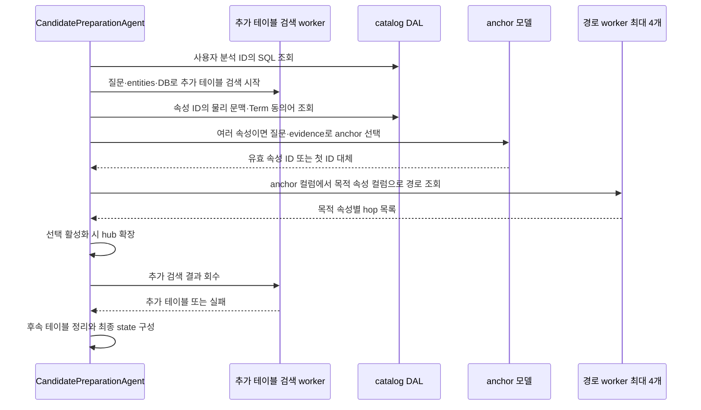
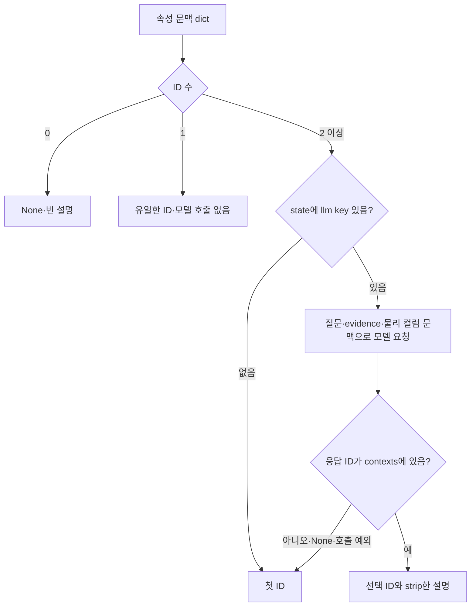
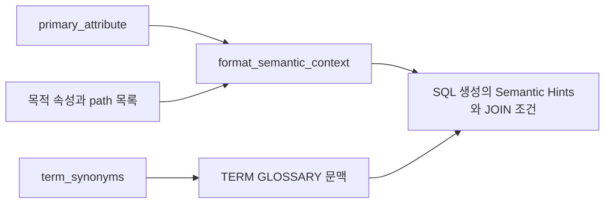

# Chapter 05. 속성 문맥·동의어·anchor와 의미 경로 준비

먼저 **hit**는 검색이 반환한 후보, **ID**는 저장 객체의 식별자, **SQL**은 데이터베이스 조회 언어, **JOIN**은 컬럼 조건으로 테이블을 연결하는 연산이다. **Anchor**는 질문의 기준이 되는 컬럼 의미 속성이고, **의미 경로**는 그 속성의 테이블에서 다른 테이블로 이어지는 컬럼 연결 목록이다. **Hub**는 여러 테이블이 참조하는 중심 테이블이다. 컬럼은 테이블의 한 항목이고 **DB**는 데이터베이스의 줄임말이다.

후보 준비 단계는 검색 hit의 본문만으로 JOIN을 결정하지 않는다. 속성 ID로 저장된 물리 컬럼·테이블 문맥을 읽고, 질문의 중심 속성인 anchor를 선택한 뒤 다른 속성까지 연결 경로를 구한다. 이 작업과 별도로 추가 테이블 검색을 먼저 시작해 대기 시간을 겹친다.

이 장은 준비 진입·문맥 조회·anchor·경로·반환·문맥 문자열 구성의 경계를 정적으로 분석한다. Hub 확장은 [Chapter 05-1](chapter-05-1-hub-sibling-expansion.md)로 분리했다. 실제 DB·모델·테스트는 실행하지 않았다.

## 1. 용어와 이번 단계의 범위

**Anchor(기준점)**는 질문의 중심이 되는 컬럼 의미 속성이다. **ColumnAttribute**는 컬럼의 업무 의미이고, **물리 컬럼**은 실제 `schema.table.column`이다. 여기서 schema는 테이블을 묶는 이름 공간이다. **Term**은 업무 개념, **synonym**은 그 개념의 다른 이름이다. 사용자가 넘긴 값의 위치를 나타내는 value anchor와 이 의미 속성 anchor는 다른 구조다.

**Join path**는 테이블을 연결할 실제 컬럼 쌍의 순서이고 **hop**은 테이블 사이 한 번의 이동이다. **Catalog**는 수집한 구조와 의미 객체 저장소, **DAL**은 이를 읽고 쓰는 데이터 접근 계층이다. **Worker**는 병렬 작업 스레드이고 **future**는 작업 결과를 나중에 받는 객체다. 전체 용어는 [용어집](../01-architecture/chapter-00-glossary.md)을 참고한다.

**State**는 처리 중 공유하는 데이터이고 `path_state`는 그 안의 중간 결과 사전이다. **Prompt(프롬프트)**는 모델에 주는 지시·문맥, **formatter**는 그 문맥을 문자열로 구성하는 함수다. **Entity**는 질문에서 뽑은 검색 개념 문구, **evidence**는 제공된 질문 해석 근거다. **Junction**은 연결 테이블 표시를 가진 테이블, **bridge**는 두 테이블 경로의 중간 테이블이다. **Connector**는 원본 DB와 통신하는 객체다. 아래 호출 그림의 **LLM**은 대규모 언어 모델이다.



테이블 관련성 필터·SQL 속성 참조 테이블·junction/bridge 복원·value anchor 정리는 [Chapter 06](chapter-06-table-selection-and-context-reconciliation.md) 범위다. 이 장에서 해당 알고리즘까지 완료한 것으로 보지는 않는다.

## 2. 준비 입력은 후보가 없어도 통과할 수 있다

`validate_input`은 retrieved_column_attributes·retrieved_custom_analyses·retrieved_sql_attributes 중 하나가 있으면 true다. 모두 없어도 target_db가 있거나 connector가 하나이고 DB 이름이 있으면 true다. 따라서 docstring의 ‘최소 한 hit 필요’보다 실제 조건은 넓다.

DB 범위가 명확하면 추가 테이블 검색으로 진행할 수 있기 때문이다. 반대로 subject Term 하나만 있고 일반 후보·DB 범위가 없으면 이 검사의 후보로 세지 않는다.

Execute는 target_db가 false면 단일 connector의 DB 이름을 로컬 대체값으로 사용한다. 세 retrieved 목록을 복사해 후보를 합치고, 사용자 분석의 SQL 문맥을 먼저 읽는다. 그다음 `ThreadPoolExecutor(max_workers=1)`로 추가 테이블 검색을 제출한다.

추가 검색은 data_retriever·질문·entity·DB만 사용하므로 뒤의 anchor 선택과 독립적으로 시작한다. 원래 컬럼 후보가 없어도 이 future는 만들어질 수 있다. `_retrieve_additional_tables`의 검색 수·관련성 판단은 다음 장에서 분석한다.

근거: [준비 진입·실행 순서](../../../code/auto-ontology/auto_ontology/retrieval/text_to_sql/agents/candidates_preparation.py).

## 3. 속성 ID를 물리 문맥으로 다시 해석한다

검색 컬럼 hit의 truthy id를 문자열로 바꾸고 순서를 유지하며 중복 제거한다. `fetch_attr_column_contexts(attr_ids, database_name=target_db)`는 다음 구조를 돌려준다.

| 필드 | 의미 |
|---|---|
| dict key | 속성 ID |
| attr_name·attr_description·datatype | 저장된 속성 이름·설명·타입 |
| col_id·col_name | 물리 컬럼 ID·이름 |
| table_id·table_name | 컬럼이 속한 테이블 |
| schema_name·database_name | 물리 위치 문맥 |
| term_name | 연결된 업무 개념 이름 |

검색 결과의 score·query_entities는 이 DAL 응답에 포함되지 않는다. Anchor 선택은 이 문맥을 기준으로 하므로 단순히 벡터 거리가 가장 가까운 컬럼을 자동 채택하는 단계가 아니다.

### 3.1 속성의 소유 컬럼이 참조 컬럼보다 우선한다

DAL은 `HAS_ATTRIBUTE` 연결에 rank 0, `SEMANTIC_FK` 연결에 rank 1을 주어 합친다. 전자는 컬럼이 속성을 소유한다는 뜻이고 후자는 다른 컬럼의 속성을 참조한다는 의미 FK, 즉 외래 키 관계다.

속성 ID → rank → 컬럼 ID로 정렬한 뒤 속성마다 첫 행을 유지한다. 따라서 소유 컬럼이 우선하며, 소유 컬럼이 여럿이면 ID 순 첫 컬럼이다. 소유가 없으면 참조 컬럼 문맥이 사용될 수 있다. 여러 연결 Term이 있어도 모두 반환하는 구조는 아니다.

이 조회는 참조 관계의 `use_in_join_paths`를 필터하지 않는다. 경로용 기본 관계 선택과 속성의 표시 문맥 조회는 서로 다른 책임이다.

### 3.2 DB 필터가 다른 DB 속성을 제거하는 WHERE는 아니다

DB 이름 조건은 catalog_database에 대한 LEFT JOIN의 ON에 들어간다. LEFT JOIN은 연결이 없어도 원래 속성 행을 남기는 조회다. 따라서 다른 DB의 속성 ID를 전달해도 그 속성·컬럼·테이블·스키마 문맥이 남고 database_name만 비어 있을 수 있다.

없는 물리 컬럼을 가진 속성도 속성 객체가 존재하면 entry가 남아 col_id/table_id는 None, 표시 문자열은 빈 값이 된다. 문맥 dict에 ID가 있다고 유효한 물리 JOIN 기준점이나 요청 DB 소속이 확인된 것은 아니다.

조회 예외는 로그와 `{}`로 바꾼다. 실제 후보 없음과 조회 실패를 반환 형태만으로 구분하지 않는다. Anchor 코드가 이 결과의 각 문맥에 필수 물리 필드가 모두 있는지 먼저 거르지도 않는다.

근거: [fetch_attr_column_contexts](../../../code/auto-ontology/auto_ontology/dal/attributes.py).

## 4. Term 동의어는 별도 이름 기반 문맥이다

`fetch_term_synonyms(attr_ids)`는 해당 속성과 연결된 Term 중 synonym 배열이 NULL이 아니고 길이가 있는 것을 읽는다. 결과는 `{term_name: [다른 이름, ...]}`이며 Term ID가 key가 아니다.

Truthy한 synonym만 남기고 비어 있는 목록은 생략한다. 공백 strip·대소문자 정규화·배열 내부 중복 제거는 하지 않는다. DB·source·인증 상태를 추가 조건으로 검사하지도 않는다. 동일 이름의 Term이 여러 행이면 dict의 뒤 값이 덮어쓸 수 있다.

조회 실패와 빈 ID 입력은 `{}`다. 이 동의어는 anchor prompt의 별도 필드로 들어가지 않고, 최종 `term_synonyms` state로 저장된 뒤 SQL 생성의 `TERM GLOSSARY` 문맥에 표시된다. 사용자 glossary, 즉 앞 장에서 선택한 조직 용어 정의 목록과도 다른 입력이다.

근거: [Term 동의어 조회](../../../code/auto-ontology/auto_ontology/dal/terms.py), [SQL 생성에서의 동의어 문맥](../../../code/auto-ontology/auto_ontology/retrieval/text_to_sql/agents/sql_from_semantic.py).

## 5. Anchor는 속성 ID 중 하나를 선택한다

`_identify_anchor(state, question, contexts)`는 `(anchor_id 또는 None, reasoning)`을 반환한다. Reasoning은 코드가 받은 짧은 선택 설명이며, 모델을 부르지 않거나 실패하면 빈 문자열이다.



모델 후보 한 줄은 `속성 ID | physical column: schema.table.column — 속성 설명`이다. 속성 display name 자체는 후보 이름으로 나열하지 않으며, evidence의 개념을 물리 컬럼 참조로 연결하라고 요청한다. DB 이름·검색 score·entity별 거리·Term 동의어는 개별 prompt 필드로 전달하지 않는다.

Evidence가 있으면 `Authoritative evidence` 블록으로 넣는다. 시스템·사용자 메시지를 사용하고 `llm.bind(max_tokens=1024)`에 `AnchorColumnModel`을 요청한다. 응답은 필수 reasoning 문자열과 anchor_id(문자열 또는 None), 정의 외 필드 금지다.

후보 목록에 있는 ID인지 확인하지만 col_id·table_id가 유효한지, 요청 DB와 같은지, 질문의 실제 subject Term과 일치하는지 다시 검사하지 않는다. 모델이 null을 반환해도 ‘anchor 없이 진행’이 아니라 첫 ID로 대체한다.

첫 ID는 contexts의 순서다. 현재 DAL은 속성 ID로 정렬하므로 정상 조회의 첫 ID는 원래 검색 거리순 첫 hit와 다를 수 있다. ID 순서가 업무상 우선순위를 뜻하지도 않는다. 대체 선택 시 설명을 만들지 않는다.

## 6. Anchor 상태와 목적별 경로 조회

선택 ID가 contexts에 있으면 다음 primary_attribute를 만든다.

```text
id, attr_name, col_name, table_name,
schema_name, database_name, datatype
```

여기에는 table_id·col_id·검색 score·전체 description은 저장하지 않는다. 실제 경로 호출은 원래 anchor_ctx의 col_id를 사용한다. Anchor 선택의 설명이 비어 있지 않으면 `record_thought`로 실행 trace에 추가한다.

나머지 **모든 속성 문맥**을 목적지로 삼아 `find_join_path(anchor_ctx.col_id, dest_ctx.col_id)`를 제출한다. 같은 테이블이거나 물리 컬럼이 없는 항목을 여기서 사전 제외하지 않는다. DAL이 빈 경로를 반환할 수 있다.

Pool worker 수는 `min(목적지 수 또는 1, 4)`다. 목적지마다 worker를 무제한 생성하지 않는다. 완료 순서로 다음 entry를 attribute_join_paths에 추가한다.

```text
{
  id, attr_name, col_name, table_name,
  schema_name, database_name, datatype,
  path: [실제 컬럼 JOIN hop, ...]
}
```

Path가 `[]`여도 해당 목적 속성 entry는 남는다. 동일 테이블이라 JOIN 불필요한 경우, 경로 없음, 다른 DB, 조회 오류가 모두 빈 path로 나타날 수 있다.

### 6.1 경로 알고리즘과 호출자의 경계

경로 DAL은 true로 선택된 의미 FK·소유 컬럼에서 테이블 간선을 만들고 BFS, 즉 가까운 테이블부터 방문하는 탐색을 수행한다. FK 쪽에서 소유 테이블로는 이동하고, 반대 방향은 소유 컬럼이 선언 PK에 포함될 때만 허용한다. 기본 최대 8 hop이다. 자세한 구현·테스트는 [의미 관계 Chapter 03](../06-semantic-relationships/chapter-03-relationship-pruning-and-join-selection.md)에 있다.

이 준비 호출자는 한 방향으로 `find_join_path(anchor, destination)`를 호출하며 실패 시 반대 순서를 다시 시도하지 않는다. 이는 위에서 설명한 PK 조건부 역방향 간선을 금지한다는 뜻은 아니다. 호출의 시작 방향과 각 간선의 허용 조건을 구분한다. 뒤의 SQL JOIN 검사 helper가 양쪽 시작 순서를 시도하는 것과도 다르다.

Future 회수에는 개별 timeout이나 try/except가 없다. DAL이 흡수하는 오류는 빈 경로가 되지만 예기치 못한 future 예외는 준비 작업 밖으로 전파될 수 있다. 진행 중 작업을 취소하거나 전체 경로 예산을 확인하는 코드도 없다.

## 7. 추가 테이블 future와 자원 정리

속성 처리 이후 후보·속성 문맥에 연결된 테이블을 모으고 `extra_future.result()`로 추가 테이블 검색을 회수한다. 그 결과의 예외는 경고 후 빈 추가 목록으로 대체한다. 반면 anchor·경로 작업을 감싼 try에는 전체 오류를 흡수하는 except가 없고 finally만 있다.

Finally의 `extra_pool.shutdown()`은 종료를 기다린다. 따라서 anchor·경로에서 오류가 나도 이미 시작한 추가 검색이 끝날 때까지 기다릴 수 있다. 앞서 설명한 경로 pool도 context manager로 정리된다. ‘병렬이므로 한쪽이 실패하면 다른 작업도 즉시 종료’하는 구조는 아니다.

이 단계는 catalog 문맥·관계를 조회하고 메모리 state를 만든다. Anchor 선택 때문에 의미 관계나 Term을 새로 쓰지는 않는다. 실제 원본 DB의 JOIN SQL을 실행해 이 경로를 재검증하지도 않는다.

## 8. 최종 상태와 SQL prompt 소비

정상 반환은 기존 path_state를 펼친 새 dict에 primary_attribute·attribute_join_paths·term_synonyms와 후속 테이블/SQL 정보를 넣는다. Anchor가 없으면 primary_attribute는 None, 경로 목록은 빈 값으로 시작한다. 기존 중간값을 그대로 재사용하는 것으로 가정하면 안 된다.



`sql_from_semantic.py`는 primary_attribute가 truthy일 때 formatter를 호출한다. 기준 테이블은 ‘강한 힌트이며 강제는 아님’으로, 경로는 ‘필요한 것만 선택하고 선택한 경로의 모든 중간 테이블·hop을 유지’하도록 출력한다.

실제 hop은 source/target의 DB·스키마·테이블·컬럼을 사용해 `왼쪽 = 오른쪽`으로 만든다. Hop 자체 DB가 우선하고 없으면 target_db를 쓴다. 빈 path의 목적 속성은 이름·컬럼 표시는 남지만 JOIN 등식은 없다.

이 formatter의 `VERIFIED OPTIONS` 문구는 원본 데이터 전체의 참조 무결성을 인증한 결과가 아니다. 생성·관계 정리의 보장 한계는 기존 장과 동일하다. 컬럼 키가 없는 hub 발견용 항목까지 들어오는 문제는 [다음 보충 장](chapter-05-1-hub-sibling-expansion.md)에서 구분한다.

근거: [formatter](../../../code/auto-ontology/auto_ontology/retrieval/text_to_sql/formatters_util.py), [SQL 생성 소비](../../../code/auto-ontology/auto_ontology/retrieval/text_to_sql/agents/sql_from_semantic.py).

## 9. 테스트 assertion과 미확인 사항

[준비 테스트](../../../code/auto-ontology/auto_ontology/retrieval/text_to_sql/tests/test_candidates_preparation.py)의 `test_anchor_maps_evidence_to_schema_table_column`은 가짜 모델 응답의 ID 선택과 prompt의 evidence·물리 참조 포함, 의미 속성명 미노출을 확인한다. `test_additional_table_retrieve_starts_before_anchor_returns`는 threading event를 사용한 가짜 추가 검색이 anchor 반환 전에 시작되고 결과 테이블이 포함되는지 확인한다.

[속성 DAL 테스트](../../../code/auto-ontology/auto_ontology/dal/tests/test_attributes.py)는 빈 ID 목록·컬럼 없는 속성 entry 유지·다른 DB 필터에도 속성 ID가 남는 것을 확인한다. `test_contexts_read_semantic_fk_backwards`의 table_name assertion은 customers 또는 orders를 허용하므로, 이 assertion만으로 현재 소유 컬럼 우선 정렬 전체가 검증되었다고 해석하면 안 된다.

[Term 테스트](../../../code/auto-ontology/auto_ontology/dal/tests/test_terms.py)는 이름 key·비어 있는 동의어 생략·빈 입력을 확인한다. [Formatter 테스트](../../../code/auto-ontology/auto_ontology/retrieval/text_to_sql/tests/test_formatters_util.py)는 한정된 테이블·컬럼의 출력과 target_db 대체, 선택적 경로 안내 문구 등을 확인한다.

테스트는 실행하지 않았다. 다중 소유·다른 DB 문맥의 anchor 선택·고아 속성·모델 null과 첫 ID·경로 timeout·future 오류 후 shutdown·여러 Term 동명 충돌·한국어 anchor 품질은 미검증이다. Mermaid 3개를 작성했으며 렌더링하지 않았다.
