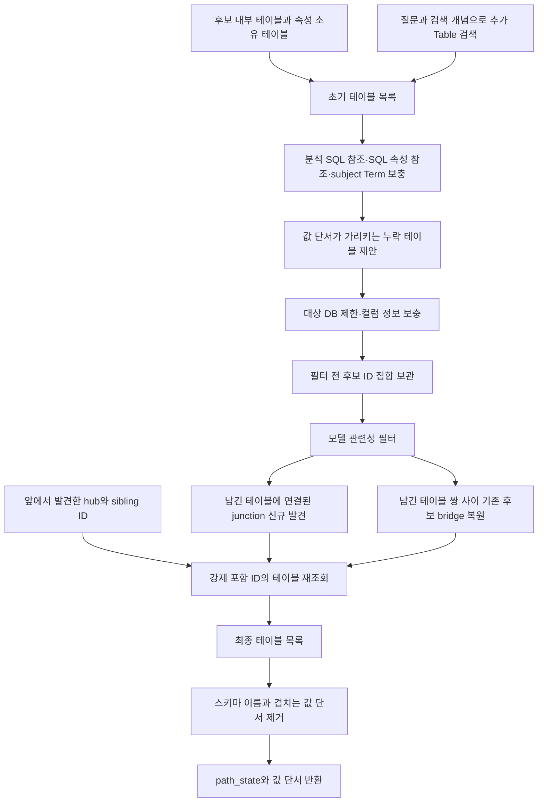
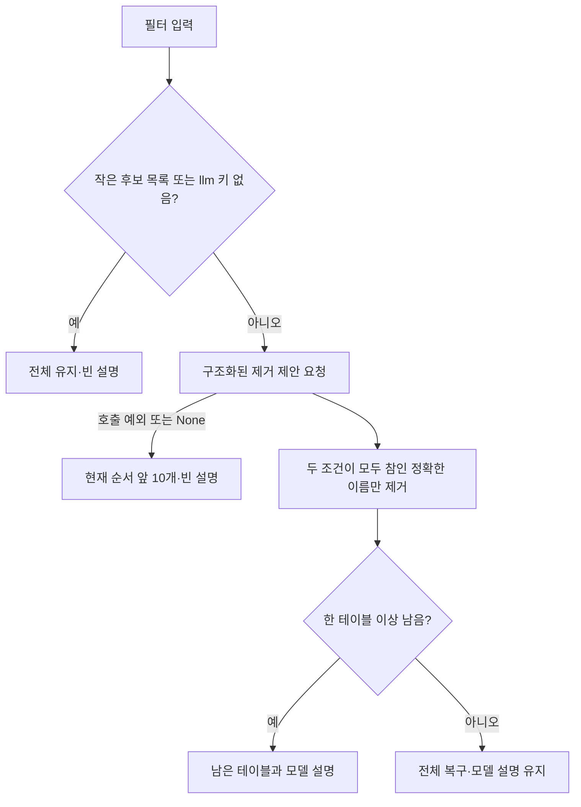
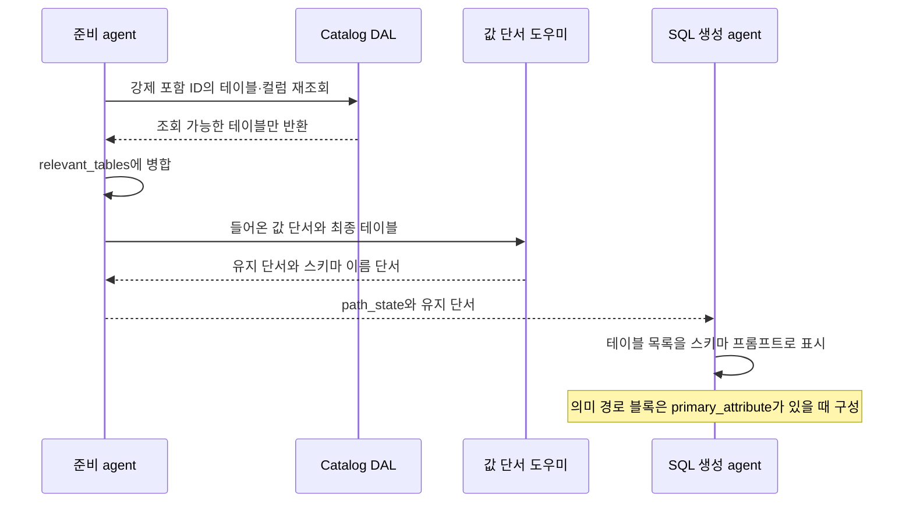

# Chapter 06. 관련 테이블 선택·연결 복원과 최종 SQL 문맥

## 1. 먼저 구분할 개념과 이 단계의 목적

**SQL(Structured Query Language)**은 데이터베이스에 조회를 요청하는 언어다. **관련 테이블 문맥**은 SQL을 만들 모델에게 보여 줄 테이블·컬럼·관계 정보다. 이 목록에 들어갔다는 사실이 최종 SQL에서 반드시 사용된다는 뜻은 아니다. **컬럼**은 테이블의 한 항목이고, **스키마**는 여기서 테이블이 속한 이름 공간이다. **DB**는 데이터베이스의 줄임말이다.

**후보**는 검색 등으로 모았지만 아직 필요한지 결정하지 않은 항목이다. **관련성 필터**는 질문에 불필요한 후보 테이블을 모델이 제안해 제거하는 처리다. **LLM(Large Language Model, 대규모 언어 모델)**은 이 판단과 이후 SQL 생성을 담당한다. **프롬프트**는 모델에 보내는 지시와 문맥이다.

**Catalog(카탈로그)**는 수집한 물리 구조와 업무 의미를 보관하는 내부 저장소다. **DAL(Data Access Layer, 데이터 접근 계층)**은 그 정보를 조회하는 코드다. **ID**는 저장 객체의 식별자이고, **메타데이터**는 컬럼 타입·샘플 값 같은 설명 정보다. **State**는 처리 중 공유하는 데이터이고, 그 안의 `path_state`는 이 경로의 중간 결과 사전이다.

**NULL**은 DB에서 값이 없거나 알려지지 않았음을 나타낸다. Python의 **None**도 값 부재를 표현하지만, 사전에 키 자체가 없는 것과는 다르다. **Cap**은 항목 수 제한이고, **임베딩**은 텍스트를 유사도 검색용 숫자 벡터로 바꾸는 처리다.

**JOIN**은 컬럼 조건으로 테이블의 행을 연결하는 연산이다. **FK(Foreign Key, 외래 키)**는 다른 테이블의 키를 참조하는 관계이고 **PK(Primary Key, 기본 키)**는 행을 식별하는 키다. **의미 FK(SEMANTIC_FK)**는 이 프로젝트가 컬럼과 다른 컬럼의 업무 의미 사이에 저장한 참조다. **Hop**은 경로에서 테이블 사이 한 번의 이동이다.

이 장의 **junction**은 catalog의 `is_junction_table` 표시가 참인 연결 테이블이다. **Bridge 복원**에서 bridge는 남은 두 테이블 사이 경로의 중간 테이블을 뜻한다. 이름이 비슷해도 두 처리는 조건이 다르다. 예를 들어 `orders → customers → addresses`에서 customers는 bridge이며, 별도의 junction 표시가 없어도 복원 대상이 될 수 있다.

**Term**은 저장된 업무 개념이고 **subject Term**은 앞 단계가 질문의 중심 개념으로 선택한 Term이다. **ColumnAttribute**는 컬럼의 업무 의미, **SqlAttribute**는 이름 붙인 SQL 정의, **CustomAnalysis**는 저장된 사용자 분석이다. **Anchor**는 앞 장에서 선택한 기준 의미 속성이다. **Value anchor(값 단서)**는 질문의 표현이 어느 테이블·컬럼의 저장 값과 연결됐는지 나타내는 별도 사전이다. **Hub**는 여러 테이블이 참조하는 중심 테이블, **sibling**은 같은 hub를 참조하는 다른 테이블이다. 상세 정의는 [용어집](../01-architecture/chapter-00-glossary.md)을 함께 참고한다.

이 장은 `CandidatePreparationAgent.execute`의 테이블 수집부터 최종 상태 반환까지를 설명한다. 기준 속성 선택은 [Chapter 05](chapter-05-anchor-and-semantic-context.md), hub 확장은 [Chapter 05-1](chapter-05-1-hub-sibling-expansion.md)에서 다룬다. 로컬 코드·테스트를 읽은 정적 분석이며 실제 DB·모델·테스트는 실행하지 않았다.

근거: [실행 순서·도우미](../../../code/auto-ontology/auto_ontology/retrieval/text_to_sql/agents/candidates_preparation.py), [테이블 형태·검색](../../../code/auto-ontology/auto_ontology/retrieval/data_access/relevant_tables.py).

## 2. 입력 후보와 추가 검색은 서로 다른 경로다

입력은 `retrieved_custom_analyses`, `retrieved_column_attributes`, `retrieved_sql_attributes`, `entities`, `retrieved_subject_term`, `target_db`와 최상위 `value_anchors`다. `entities`는 검색에 쓸 개념 문구 목록이다. 검색 도구 `data_retriever`, 모델 `llm`, DB 연결 객체인 connector 목록도 사용한다. 후보 없는 입력의 통과 조건은 Chapter 05를 따른다.

### 2.1 후보 안에 있던 테이블은 첫 ID를 남기고 후보에서 제거한다

`get_relevant_tables_from_candidates(candidates)`는 각 후보의 `relevant_tables`를 모은다. 사전 형태이고 ID가 None이 아닌 테이블만 읽으며, 같은 ID는 첫 항목만 남긴다. 여기서는 뒤 항목의 풍부한 컬럼 정보를 병합하지 않는다. 이후 **각 후보에서 `relevant_tables` 키를 직접 제거**한다.

Execute가 세 후보 목록을 `list(...)`로 복사했어도 내부 사전까지 복사한 것은 아니다. 따라서 입력 상태가 참조하던 후보 사전에서도 키가 없어질 수 있다. 반환 상태가 새 사전이라는 사실과 입력 객체를 전혀 바꾸지 않는다는 주장은 구분해야 한다. 함수는 None ID와 달리 빈 문자열 ID를 최초 수집에서 허용한다.

속성 문맥의 `table_id`도 `fetch_tables_by_ids`로 읽어 초기 목록에 없는 ID만 추가한다. 이 추가 역시 기존 동일 ID의 컬럼을 즉시 보충하는 처리는 아니며, 뒤의 정보 보충 단계가 별도로 있다.

### 2.2 추가 검색의 20개는 최종 테이블 수 제한이 아니다

추가 검색은 기준 속성 선택과 병렬로 먼저 시작된다. **Worker**는 병렬 실행 담당 스레드, **future**는 제출한 작업의 결과를 나중에 받는 객체다. `_retrieve_additional_tables` 안에서는 `[question] + entities` 각각에 작업을 제출한다. 질문·개념의 중복이나 빈 문자열을 여기서 제거하지 않는다.

각 검색의 요청 수는 `max(1, SQL_GEN_MAX_ENTITIES // 검색 문장 수)`다. 설정 기본값은 5다. 문장이 7개이면 각각 최소 1개를 요청하므로 전체 요청 수가 5를 넘을 수 있다. 검색별 worker를 만들고, 결과는 완료 순서가 아니라 **제출 순서**로 받는다. 개별 작업 실패는 로그 후 건너뛴다.

`get_relevant_tables(data_retriever, query, k, database_name=target_db)`는 Table 종류만 검색한다. 검색 예외는 빈 목록으로 대체한다. 검색 문서의 텍스트에서 DB·스키마·테이블명·컬럼을 해석하지만 이는 텍스트 형식에 의존한 복원이며 완전한 DB 구조 조회가 아니다.

모은 결과를 `dedupe_merge_relevant_tables`로 병합한 뒤 `[:20]`을 적용한다. 이 함수는 **문자열 ID로 정렬**하므로 최종 20개는 거리 점수 상위 20개라고 할 수 없다. 같은 ID 안에서 먼저 수집한 값의 우선순위는 유지된다. 이후 여러 출처와 복원 단계가 더하므로 최종 테이블 총수도 20개로 제한되지 않는다.

초기 목록과 추가 검색을 합칠 때는 DB·스키마·테이블명을 포함한 이름을 소문자로 바꿔 중복 제거하고 **첫 테이블을 남긴다**. 이 지점은 정보 병합이 아니다. 뒤의 `_merge_tables`는 ID 기준 병합이므로 두 기준을 같은 처리로 보면 안 된다.

근거: [후보 추출·정규화·병합](../../../code/auto-ontology/auto_ontology/retrieval/data_access/relevant_tables.py), [추가 검색·이름 중복 제거](../../../code/auto-ontology/auto_ontology/retrieval/text_to_sql/agents/candidates_preparation.py), [기본 요청 수](../../../code/auto-ontology/auto_ontology/retrieval/text_to_sql/prompts.py).

## 3. 저장된 연결과 값 단서로 후보를 보충한다

| 순서·출처 | 호출과 실제 근거 | 이후 취급 |
|---|---|---|
| 사용자 분석 | `fetch_tables_from_custom_analyses`가 분석 → 저장 SQL → 테이블 참조 연결을 조회 | ID 병합 후 필터 대상 |
| SQL 속성 | `fetch_sql_attributes_with_sql`로 SQL·표현식·Term을 읽고, `fetch_tables_from_sql_attributes`로 참조 테이블 조회 | SQL 문맥과 테이블 목록을 별도 구성 |
| Subject Term | `fetch_term_table_pairs(term_ids=[id])`의 table_id를 재조회 | 기존 ID가 없을 때 추가 |
| 값 단서 | `anchor_tables_missing_from_scope` → `find_table_id_by_name(name, target_db)` → `fetch_tables_by_ids` | 필터 전에 제안하며 강제 포함하지 않음 |

분석·SQL 속성의 참조 테이블은 **현재 문자열 SQL을 다시 파싱해 발견하지 않는다**. Catalog에 저장된 참조 연결을 읽는다. 저장 연결이 없으면 SQL 문자열이 테이블명을 포함해도 이 조회만으로 복구되지 않는다. 두 조회는 컬럼과 연결되는 테이블만 반환하고 오류는 `[]`로 바꾼다.

Subject Term 조회의 관련성은 Term의 테이블 대표 관계 또는 컬럼 의미 소유·참조 관계다. 이 호출은 DB 인수를 주지 않으므로 다른 DB의 테이블도 일단 후보가 될 수 있다. 같은 ID가 이미 있으면 subject 경로에서 정보를 다시 병합하지 않는다.

값 단서는 예를 들어 `{phrase: "human", tbl: "race", col: "race", stored_value: "Human"}`이다. 먼저 현재 테이블·컬럼 이름을 가리키는 것으로 판정한 단서는 후보 제안에서 제외한다. 나머지 단서의 `tbl` 중 현재 목록에 없는 이름을 원래 순서로 한 번씩 제안한다. 이 비교에는 DB·스키마가 아닌 테이블 이름만 사용한다.

`find_table_id_by_name`은 DB 이름이 있으면 그 DB에서 대소문자 무시 이름을 찾아 한 행을 사용한다. **스키마 조건·ORDER BY는 없다.** DB 이름이 없으면 최대 두 행을 보고 동명이면 미해결 None으로 반환한다. 이 조회 자체에는 예외를 빈 결과로 바꾸는 처리가 없다.

근거: [분석과 SQL 참조](../../../code/auto-ontology/auto_ontology/dal/custom_analyses.py), [SQL 속성 조회](../../../code/auto-ontology/auto_ontology/dal/sql_attributes.py), [Term과 테이블](../../../code/auto-ontology/auto_ontology/dal/terms.py), [이름 조회](../../../code/auto-ontology/auto_ontology/dal/datasources.py), [값 단서 처리](../../../code/auto-ontology/auto_ontology/retrieval/text_to_sql/value_anchors.py).

## 4. 대상 DB와 컬럼 정보 보충의 정확한 경계

보충 후 target_db가 있으면 `table.database_name == target_db`인 테이블만 남긴다. 이 비교는 대소문자 변환 없이 수행하며 DB 이름이 없는 테이블도 제외한다. **이 제한은 모델 필터 전에 한 번 적용되고, 뒤의 강제 포함 결과에 다시 적용되지 않는다.** Junction과 bridge는 각각의 관계 조회 조건을 따르며 hub 조회가 별도 DB 조건을 갖는다고 가정하면 안 된다.

그다음 `_needs_column_metadata_backfill`은 다음 중 하나라도 만족하면 ID 재조회를 요청한다.

- 테이블 전체에서 비어 있지 않은 `sample_values`가 있는 컬럼이 하나도 없다.
- 모든 컬럼에 `is_nullable` 키가 있지 않다. 이는 NULL 값 허용 여부이며 값이 None이어도 키가 있으면 통과한다.
- 모든 컬럼에 `semantic_fk` 키가 있지 않다. 값이 None이어도 키가 있으면 통과한다.

샘플은 모든 컬럼에 있어야 하는 조건이 아니다. 컬럼 목록이 비어도 보충 대상이다. `fetch_tables_by_ids`는 컬럼이 없는 테이블을 반환하지 않으며 실패 시 `[]`다. 따라서 요청했다고 항상 풍부해지는 것은 아니다.

`_merge_tables`는 기존 순서를 유지하고 새 ID는 뒤에 더한다. 같은 ID의 컬럼은 **정확히 같은 이름**으로 병합하고 기존 값이 None·빈 문자열·빈 목록일 때 새 값을 채운다. 기존 False는 빈 값으로 취급하지 않는다. 기존의 비어 있지 않은 타입·설명·참조를 최신 catalog 값으로 무조건 교체하는 갱신은 아니다. `table_info`는 더 긴 문자열을 택하고 PK는 기존 값이 비었을 때 채운다.

`fetch_tables_by_ids`가 만드는 `semantic_fk` 문자열은 의미 참조 대상의 소유 컬럼 중 정렬상 첫 대상을 표시하며, 이 표시 조회에는 `use_in_join_paths=True` 조건이 없다. 뒤의 실제 경로 탐색과 같은 선택 보장을 갖는 필드로 해석하면 안 된다.

최종 보충 뒤 `pre_filter_candidate_ids`를 저장한다. 이는 이 시점 테이블의 ID 집합이지, 뒤에서 발견할 모든 연결 테이블을 포함한 집합이 아니다.

근거: [DB 제한·정보 보충 조건·병합](../../../code/auto-ontology/auto_ontology/retrieval/text_to_sql/agents/candidates_preparation.py), [컬럼 단위 병합](../../../code/auto-ontology/auto_ontology/retrieval/data_access/relevant_tables.py), [풍부한 테이블 조회](../../../code/auto-ontology/auto_ontology/dal/datasources.py).

## 5. 모델에는 무엇을 보여 주고 언제 제거를 적용하는가

기본적으로 후보가 2개 이하면 필터를 생략한다. `RELEVANCE_FILTER_BYPASS_MAX_TABLES`는 모듈을 읽을 때 정수로 해석하는 설정이다. `state`에 llm 키가 없어도 전체 후보를 유지한다. llm 키가 있으나 값이 잘못된 경우는 같은 사전 검사로 거르지 않는다.

프롬프트는 질문, 테이블의 DB·스키마 포함 이름·설명·컬럼, 업무 규칙, 선택된 사용자 분석, 알려진 연결 테이블 쌍, 있으면 `enriched_question`을 포함한다. `enriched_question`은 공식·임계값 등을 풀어 쓴 확장 질문이다. 원래 `evidence` 전체는 이 필터의 별도 입력 블록으로 넣지 않는다.

분석 블록은 **원래 검색 후보**의 name·description·sql을 읽는다. 앞에서 catalog로 재조회한 `relevant_queries`를 이 블록 대신 넣지는 않는다. 따라서 재조회 SQL이 후속 생성 문맥에 있어도 필터가 같은 SQL 본문을 보았다고 할 수 없다. SQL 속성 본문·값 단서 전체도 이 필터의 독립 블록이 아니다.

컬럼은 `RELEVANCE_FILTER_MAX_COLS` 기본 25개까지다. JSON은 키와 값으로 구조화한 데이터 형식이고 JSONB는 PostgreSQL의 JSON 저장 타입이다. 타입 문자열에 `json`이 있으면 샘플 앞 12개를 `JSONB keys`라는 제목으로 보여 주고 설명도 덧붙인다. 제목이 key라고 해서 코드가 샘플을 JSON으로 해석해 키만 추출하는 것은 아니다. 일반 컬럼의 샘플은 이 요약에서 표시하지 않는다.

경로 블록은 각 hop의 source_table·target_table을 `A <-> B` 문자열로 모아 중복 제거·정렬한다. 컬럼·DB·스키마·전체 순차 경로가 아니라 테이블 이름 쌍이다. ‘연결 테이블을 제거하지 말라’는 지시는 프롬프트 규칙이며 그 문장 자체가 코드 차원의 강제 포함은 아니다.

### 5.1 두 조건은 모델이 보고한 값이며 DB에서 증명하지 않는다

`TableRelevanceModel`은 설명 `reasoning`과 제거 제안 `tables_to_remove`를 받는다. 각 `TableRemovalModel`에는 다음 필드가 필수다. 정의 외 필드는 허용하지 않는다.

| 필드 | 뜻 | 제거 적용 조건 |
|---|---|---|
| table | 제거할 테이블 이름 | DB·스키마 포함 이름과 대소문자 무시 정확히 일치 |
| supplies_no_needed_column | 출력·조건·그룹·정렬 등에 필요한 컬럼을 제공하지 않음 | True |
| cannot_change_qualifying_rows | 제거해도 조건에 맞는 행 집합이 바뀌지 않음 | True |
| justification | 두 판단의 짧은 근거 문장 | 필수 문자열이나 내용 진위를 코드로 재검증하지 않음 |

두 불리언이 모두 참인 이름만 제거 집합에 넣는다. 예를 들어 ‘검사 기록이 있는 환자’에서 검사 테이블의 컬럼을 출력하지 않더라도 검사와의 JOIN은 대상 환자를 제한하므로 두 번째 조건을 참으로 봐서는 안 된다. 이 규칙은 그 오판을 줄이기 위한 계약이며 실제 행 집합 비교를 실행하는 검사는 아니다.

모델이 없는 이름을 내면 일치하는 테이블이 없으므로 새 테이블을 만들거나 다른 후보를 제거하지 않는다. 이름 양끝 공백은 제거하지만 부분 이름·별칭을 찾아 보정하지 않는다.

오류 시 앞 10개는 여러 출처를 합친 **현재 목록 순서**다. 전역 거리순 top 10이라는 보장은 없다. 모델이 정상 응답으로 전부 제거했을 때는 전체를 되살리지만, 오류로 10개만 남기는 분기에는 그 전체 복구 규칙이 적용되지 않는다. 이 helper 자체가 모델을 재호출하는 반복문은 없다.

근거: [필터 구현](../../../code/auto-ontology/auto_ontology/retrieval/text_to_sql/agents/candidates_preparation.py), [응답 모델](../../../code/auto-ontology/auto_ontology/retrieval/text_to_sql/models.py), [프롬프트 규칙](../../../code/auto-ontology/auto_ontology/retrieval/text_to_sql/prompts.py).

## 6. 필터 뒤의 두 연결 처리는 발견 범위가 다르다

### 6.1 Junction은 후보에 없었어도 한 단계 발견한다

`find_connected_junction_tables(kept_ids)`는 남은 테이블을 참조하는 junction을 찾는다. 선언 FK와 `use_in_join_paths=True`인 의미 FK를 합쳐 조회하며, junction 표시가 참이고 출발·대상 테이블이 다르며 같은 database_id에 있어야 한다.

결과는 junction의 `{id, name}` 목록과 실제 컬럼을 담은 **각각 한 hop짜리 경로** 목록이다. 양쪽 테이블·컬럼·스키마·DB를 붙인다. SQL 조회 결과는 이름·ID·컬럼 ID로 정렬하고 테이블은 ID로 중복 제거한다. 이름/컬럼 문맥을 못 구한 행은 건너뛴다.

남긴 테이블 하나를 참조하는 것만으로도 발견할 수 있다. Junction의 나머지 FK 대상까지 재귀적으로 모두 포함하는 처리가 아니며, 필터 전 후보 집합 제한이나 별도 개수 cap도 없다. 새 junction ID는 나중에 강제 포함하고 경로는 즉시 `attribute_join_paths`에 추가한다. **이 시점 junction이 relevant_tables 자체에 병합된 것은 아니다.**

초기 관계 조회의 예외는 빈 두 목록으로 바꾸지만 이후 컬럼 이름 조회까지 전체를 같은 try로 감싸지는 않는다. 모든 내부 오류가 빈 결과로 대체된다고 설명하면 부정확하다.

### 6.2 Bridge는 필터 전 후보였던 중간 테이블만 복원한다

`find_kept_table_bridges(kept_ids, pre_filter_candidate_ids)`는 여전히 **모델이 남긴 테이블**로만 쌍을 만든다. 앞서 발견해 ID만 모아 둔 junction·hub·sibling은 이 쌍의 끝점에 자동 합류하지 않는다.

각 쌍의 `find_table_bridge(A, B, allowed)`는 양쪽 시작 방향을 차례로 시도한다. 내부 `_find_table_join_hops`는 가까운 테이블부터 검사하는 **BFS(Breadth-First Search, 너비 우선 탐색)**로 가장 짧은 경로를 찾는다. 최대 8 hop이며, 의미 FK의 참조 컬럼 → 소유 컬럼 방향은 허용하고 역방향은 소유 컬럼이 해당 테이블의 PK일 때만 허용한다. ‘모든 역방향 금지’라는 일부 주석 설명보다 실제 조건이 넓다.

끝점 둘을 제외한 중간 테이블이 모두 allowed 집합에 있어야 경로를 받아들인다. 이 조건은 **경로 탐색 후** 검사한다. 처음 찾은 경로가 허용 집합 밖을 지나면 그 방향의 다른 우회 경로를 추가 탐색하지 않고 반대 방향으로 넘어간다. 직접 연결처럼 중간 테이블이 없으면 bridge 결과도 없다.

기본 cap은 서로 다른 신규 bridge 5개다. 확인한 코드는 쌍 하나를 처리하기 **전** 발견 수를 검사하며, 그 쌍에서 찾은 테이블을 개별적으로 자르지 않는다. **코드에서 도출한 추론**으로, 한 경로가 여러 새 중간 테이블을 더하면 반환 개수가 5를 넘을 수 있다. 이 경우를 실행 재현하지는 않았다. 이미 남은 테이블은 cap에 세지 않지만 그 쌍의 경로는 보존할 수 있다. `skipped_pairs`는 cap 이후 검사하지 않은 쌍 수이며 실패한 쌍 수가 아니다.

Bridge의 실제 경로에는 스키마·테이블·컬럼이 있지만 DB 필드는 없어서 후속 표시에서 target_db를 대체값으로 사용한다. 기본 그래프 조회는 출발 테이블의 database_id로 제한한다. 경로 조회 오류는 반대 방향을 시도하지만 DB ID·이름 조회 등은 별도로 전파될 수 있다.

근거: [junction·bridge·공통 경로 탐색](../../../code/auto-ontology/auto_ontology/dal/attributes.py), [두 결과의 소비 순서](../../../code/auto-ontology/auto_ontology/retrieval/text_to_sql/agents/candidates_preparation.py), [기존 관계 분석](../06-semantic-relationships/chapter-03-relationship-pruning-and-join-selection.md).

## 7. 강제 포함과 값 단서 정리 후에도 보장은 제한된다

**Forced table**은 관련성 필터의 판단과 별개로 코드가 최종 목록에 추가하려는 테이블이다. 앞 장의 hub·sibling, 이번 junction, bridge의 ID를 한 집합에 모으고 이미 남은 ID를 뺀 뒤 `fetch_tables_by_ids`로 읽어 `_merge_tables`한다. 집합을 목록으로 바꾸므로 요청 순서에 의미를 부여하지 않는다.

ID가 강제 포함 집합에 있어도 테이블이 삭제됐거나 컬럼이 없거나 조회가 실패하면 실제 목록에는 안 들어올 수 있다. 이미 추가한 경로를 그 결과에 맞춰 모두 정리하거나 다시 모델 필터를 실행하는 처리는 없다. 최종 DB 필터·전체 개수 제한·연결 가능성 검증도 여기서 다시 수행하지 않는다.

그 뒤 `split_schema_named_anchors`는 **최종 테이블·컬럼 이름 전체**와 값 단서의 phrase를 비교한다. 영어 소문자와 숫자 `[a-z0-9]+` 단위로 나누고, 구두점·밑줄·괄호는 구분자로 취급해 단어 경계가 맞는 연속 부분을 찾는다. ASCII는 여기서 영문자·숫자 등 기본 문자 범위를 뜻한다. 최소 한 영문자가 있는 phrase만 제거하므로 숫자만인 `12`는 유지한다.

예를 들어 `Headcount (Full-Time)` 컬럼이 있으면 `full-time` 단서를 스키마 이름으로 판단해 제외한다. `head`가 `Headcount`의 일부라는 이유로 제외하지는 않는다. 한국어만인 phrase에는 영문자가 없으므로 이 규칙으로 제거되지 않는다. 이는 코드 조건에서 확인하는 언어 범위이며 실제 한국어 품질 평가 결과는 아니다.

비교는 단서 자신의 tbl·col이 아니라 모든 최종 테이블의 이름을 대상으로 한다. 스키마 이름과 겹치는 **실제 데이터 값**도 제외할 수 있으므로 의미상 항상 정확하다는 보장은 없다. 반대로 단서가 가리키는 테이블이 최종 목록에 없다는 이유만으로 제거하지도 않는다. 테이블 문맥이 없으면 모두 유지한다.

근거: [강제 포함·반환](../../../code/auto-ontology/auto_ontology/retrieval/text_to_sql/agents/candidates_preparation.py), [값 단서의 문자 규칙](../../../code/auto-ontology/auto_ontology/retrieval/text_to_sql/value_anchors.py).

## 8. 작은 예시와 최종 상태의 소비

다음은 설명용 예시이며 실행 결과가 아니다. 질문이 ‘주문이 있는 고객의 주소’를 묻고 필터 전 후보가 orders·customers·addresses·audit_log라고 하자. 저장 관계는 `orders.customer_id → customers.id`, `customers.address_id → addresses.id`다.

| 시점 | 테이블·상태 | 의미 |
|---|---|---|
| 필터 직전 | 네 테이블 ID를 후보 집합에 저장 | 복원 허용 범위 확정 |
| 모델 필터 뒤 | orders·addresses 유지 | 모델이 customers까지 제거한 상황 가정 |
| Bridge 조회 | customers와 실제 두 hop 발견 | customers가 원래 후보였으므로 복원 가능 |
| Junction 조회 | orders를 참조하는 표시된 order_tag 발견 가능 | 원래 후보가 아니어도 한 단계 확장 가능 |
| 강제 조회 뒤 | orders·addresses·customers·order_tag | 조회가 성공한 경우의 최종 목록 |

처음 후보에 customers가 없었다면 같은 경로를 알아도 이 bridge 복원은 허용하지 않는다. 또한 order_tag를 더했다고 tags까지 자동 확장하지 않는다. 새로 더한 테이블들을 끝점으로 bridge 조회를 반복하지도 않는다.

정상 반환은 기존 path_state에 아래 필드를 덮어쓴 새 사전이다. 원본 DB의 SQL을 여기서 실행하거나 catalog 관계를 새로 저장하는 단계는 아니다. 다만 추가 검색은 임베딩 모델과 검색 저장소를 사용하며 검색기 초기화의 쓰기 경계는 [Chapter 01](chapter-01-search-contract-and-retry.md)에서 설명했다.

| 출력 필드 | 소비할 내용·주의 |
|---|---|
| relevant_tables | 모델 필터 후 코드가 보충한 최종 테이블 문맥 |
| relevant_queries | 사용자 분석 재조회에서 sql이 있는 문자열만 |
| custom_analyses·custom_analyses_str | 원래 분석 후보 목록·재조회 SQL로 만든 표시 문자열 |
| sql_attributes·sql_attributes_str | 재조회 SQL 속성 목록·표시 문자열 |
| table_relevance_reasoning | 필터 설명. 강제 포함 후 최종 목록을 재설명한 결과가 아님 |
| primary_attribute·attribute_join_paths·term_synonyms | 기준 속성·누적 경로·개념별 동의어 |
| 최상위 value_anchors | 입력이 비어 있지 않았을 때만 유지 단서로 갱신. 모두 제거됐으면 빈 목록 반환 |

Docstring의 `candidates`·`similar_questions`를 이 execute가 새로 만든다고 볼 수 없다. 기존 path_state에 있으면 펼치기로 남을 수 있지만 이 반환문에서 생성하지는 않는다. 단일 connector로 얻은 로컬 target_db도 반환문에서 새로 path_state에 기록하지 않는다.

`SqlFromSemanticAgent.execute`는 relevant_tables를 스키마 문맥으로 표시한다. 반면 `format_semantic_context`의 **의미 경로 블록은 primary_attribute가 있을 때** 만든다. 별도의 중요 컬럼 요약 함수에도 경로 목록을 전달하지만, 이 함수는 attr_name·table_name·col_name을 가진 항목만 읽는다. Junction·bridge가 추가한 `{path: hops}`만으로는 이 조건을 만족하지 않는다. 따라서 기준 속성 없이 경로만 존재할 때 실제 JOIN 등식까지 해당 두 표시 경로로 전달된다고 할 수 없다. 테이블 컬럼의 semantic_fk 표시 같은 다른 문맥은 남을 수 있다. SQL 생성의 전체 입력·분기는 다음 01-8에서 이어간다.

근거: [반환·문자열 생성](../../../code/auto-ontology/auto_ontology/retrieval/text_to_sql/agents/candidates_preparation.py), [SQL 생성 소비](../../../code/auto-ontology/auto_ontology/retrieval/text_to_sql/agents/sql_from_semantic.py), [문맥 표시](../../../code/auto-ontology/auto_ontology/retrieval/text_to_sql/formatters_util.py).

## 9. 관련 테스트가 확인하는 범위와 남은 질문

**Assertion**은 테스트가 기대 조건을 검사하는 구문이고, **mock**은 실제 의존성 대신 쓰는 모형이다. 아래는 테스트의 assertion을 읽은 결과다. 이번에 실행하지 않았으며 mock을 사용한 흐름 검증을 실제 모델·DB 검증으로 바꾸어 표현하지 않는다.

| 테스트 파일·사례 | 읽어서 확인한 기대 조건 |
|---|---|
| [준비 테스트](../../../code/auto-ontology/auto_ontology/retrieval/text_to_sql/tests/test_candidates_preparation.py): `test_column_metadata_backfill_requires_samples_nullability_and_semantic_fk` | 샘플·키 누락은 보충 대상, is_nullable/semantic_fk가 None이어도 키 존재 인정 |
| 같은 파일: `test_linked_tables_are_backfilled_before_relevance_filter` | 분석/SQL 속성 두 출처에서 필터가 보충된 semantic_fk를 받음 |
| 같은 파일: `test_retrieve_additional_tables_searches_question_and_entities`, `test_a_table_two_searches_return_merges_the_same_way_whichever_finishes_first` | 검색별 요청 수·DB 전달·제출 순서 수집, 질문 검색이 늦어도 설명 우선순위 유지 |
| 같은 파일: `test_connected_junctions_are_forced_in_with_their_join_hops` | 모형 junction 테이블과 hop이 최종 상태에 포함 |
| 같은 파일: `test_the_table_an_anchor_points_at_reaches_the_relevance_filter`, `test_anchors_naming_a_column_in_scope_are_dropped` | 값 단서 테이블이 필터·bridge 입력에 도달, 스키마와 겹치는 단서 제거 |
| 같은 파일: `test_removal_is_applied_when_both_checks_hold`와 두 `test_removal_is_declined_*` | 두 조건 모두 참일 때만 제거, 하나라도 거짓이면 보존 |
| [관계 DAL 테스트](../../../code/auto-ontology/auto_ontology/dal/tests/test_attributes.py): `test_finds_one_hop_junctions_over_declared_and_semantic_fks` 등 | 선언·의미 FK의 컬럼 경로, junction 아닌 테이블·비선택 의미 FK 제외 |
| 같은 DAL 파일: `test_table_bridge_restricts_to_allowed_table_ids` 등, `test_kept_table_bridges_respects_the_cap` | 허용 집합 안의 중간 테이블만 반환, 양방향 시작, 이미 남은 bridge는 신규 집계 제외, cap=0이면 쌍을 검사하지 않음 |
| [테이블 형태 테스트](../../../code/auto-ontology/auto_ontology/retrieval/data_access/tests/test_relevant_tables.py) | 반복 정규화의 pk 유지, 풍부한 컬럼 정보 병합, 괄호 안 쉼표가 있는 타입·타입 없는 컬럼 해석 |
| [값 단서 테스트](../../../code/auto-ontology/auto_ontology/retrieval/text_to_sql/tests/test_value_anchors.py) | 단어 경계·숫자 보존·빈 문맥, 단서 순서·동명 테이블 제안 중복 제거 |

다음 항목은 정적 조건과 실행 검증을 구분해 인계한다.

- 실제 한국어 질문·넓은 테이블의 뒤쪽 컬럼·JSON 샘플이 모델 판단에 미치는 영향은 미검증이다.
- 한 bridge 경로가 cap을 넘기는 경우, 허용 집합 안의 대체 경로 미탐색, 다중 스키마 동명 조회는 실행 재현하지 않았다. cap=0 테스트가 다중 경로의 엄격한 최대 5개를 증명하지는 않는다.
- 강제 조회 실패 후 경로/테이블 불일치, hub의 DB 경계, 기존 메타데이터와 catalog 변경 간 충돌은 통합 미검증이다.
- 값 단서가 가리키는 테이블의 최종 잔존 여부와 실제 데이터 조건의 타당성은 여기서 검증하지 않는다.
- 모델·DAL·검색 내부의 공통 재시도 정책 전체를 이 함수의 보장으로 합치지 않는다. 각 호출의 실패 전파와 Chapter 01의 검색 계약을 함께 본다.
- Mermaid 3개를 작성했으며 렌더링하지 않았다. 다음 단계는 01-8 SQL 생성의 상태·입력·분기·재시도 분석이다.
