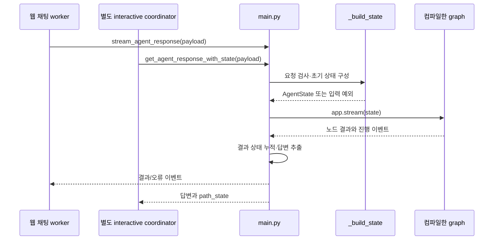
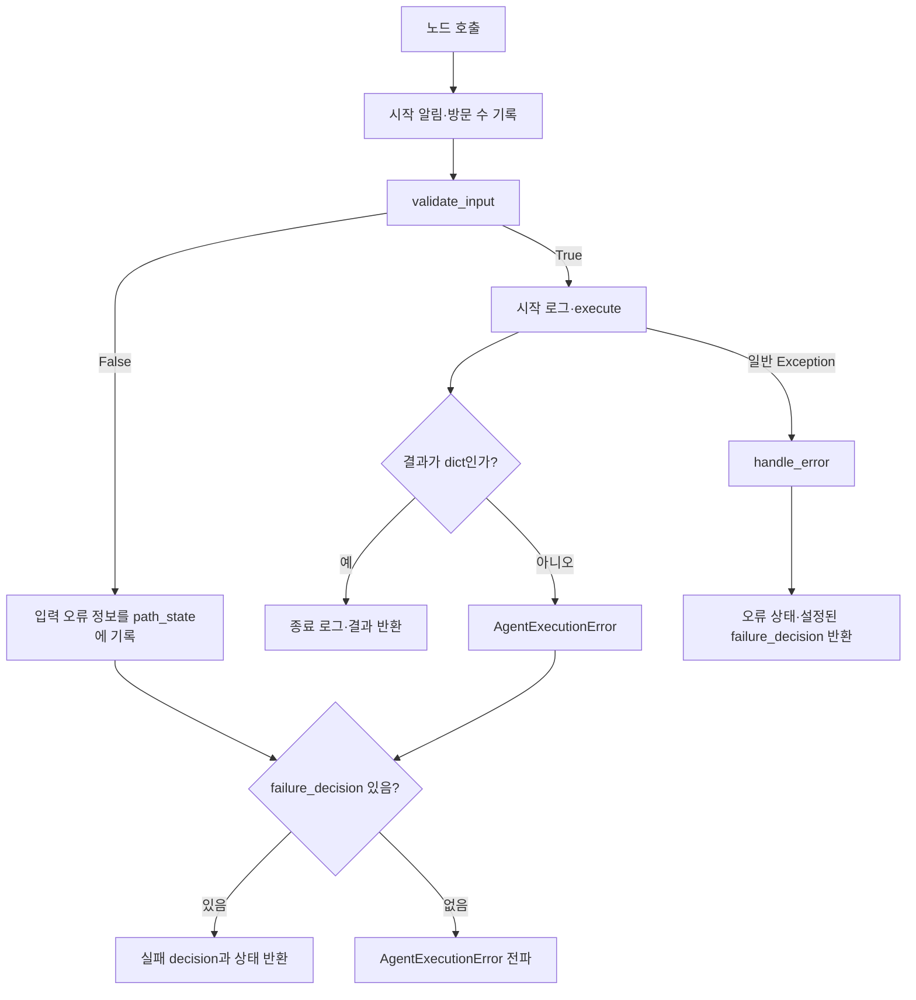
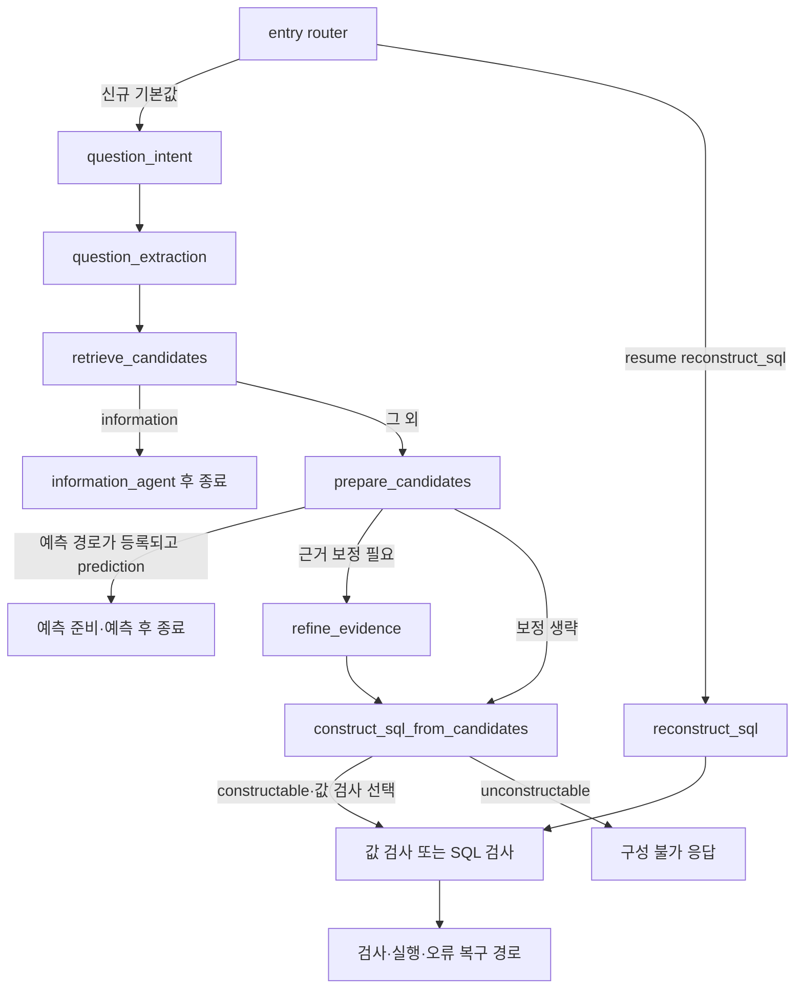

# Chapter 01. 요청·공유 상태와 SQL 생성 그래프의 실행 계약

## 1. 먼저 정의할 개념과 이 장의 범위

**SQL(Structured Query Language)**은 데이터베이스에 조회를 요청하는 언어다. **DB**는 데이터베이스의 줄임말이다. **Text-to-SQL**은 자연어 질문을 SQL로 바꾸는 처리다. **LLM(Large Language Model, 대규모 언어 모델)**은 질문 분류와 SQL 생성 등을 담당하는 모델이다. **프롬프트**는 모델에 보내는 지시와 문맥이다.

**Payload**는 호출자가 전달한 요청 데이터다. **State**는 처리 단계들이 공유하는 데이터이고, **AgentState**는 이 프로젝트가 정의한 공유 상태의 타입 이름이다. **TypedDict**는 Python 사전에 어떤 이름·타입의 필드가 들어가는지 표현하는 타입 선언이다. 그 선언 자체가 실행 중 모든 입력을 검사하거나 기본값을 채우지는 않는다. **NotRequired**는 해당 키를 생략할 수 있다는 타입 표시다.

**Agent**는 질문 해석·검색·생성 같은 한 역할의 처리 객체다. **Graph(그래프)**는 그 처리 단계와 연결을 정의한 실행 흐름이고 **node(노드)**는 등록한 단계, **edge(간선)**는 다음 단계로 가는 연결이다. **Routing(분기)**은 상태를 보고 다음 노드를 고르는 처리다. **Decision**은 일부 분기에 쓰는 상태의 문자열 값이다. **LangGraph**는 이 상태 기반 실행 흐름을 구성하는 라이브러리다.

**Wrapper(래퍼)**는 실제 처리 함수를 감싸 입력 검사·로그·예외 처리를 더하는 함수다. **Exception(예외)**은 정상 처리 대신 오류를 전달하는 방식이다. **Shallow copy(얕은 복사)**는 바깥 사전·목록만 새로 만들고 그 안의 사전 같은 객체는 공유하는 복사다. **Snapshot(스냅샷)**은 특정 시점의 값을 보관한 자료다. 이름에 snapshot이 붙었다고 깊은 복사나 변경 불가가 보장되는 것은 아니다.

**Connector**는 원본 DB와 통신하는 객체, **dialect(방언)**는 DB별 SQL 문법 차이다. **Retriever**는 검색 객체이고 이 프로젝트는 물리 구조용 `data_retriever`와 업무 의미용 `semantic_retriever`를 구분한다. **Catalog**는 수집한 구조·업무 의미를 보관하는 내부 저장소다. **Metadata**는 테이블 이름·컬럼 타입 같은 설명 정보다. 컬럼은 테이블의 한 항목이다. 상세 용어는 [용어집](../01-architecture/chapter-00-glossary.md)을 함께 참고한다.

**Evidence**는 질문 해석의 근거·제약 설명이다. **SQL example**은 다른 질문과 SQL을 구조 참고용으로 묶은 예시다. **Value anchor**는 질문 표현을 특정 테이블·컬럼의 저장 값과 연결한 단서다. **Glossary**는 사용자가 관리한 용어 정의 목록이다. **Resume(재개)**는 보관한 중간 상태로 특정 지점부터 다시 시작하는 것이고, **전체 재시도**는 원요청 경계로 돌아가 질문 해석부터 다시 도는 것이다.

이 장은 요청이 상태가 되는 과정, 공통 실행 래퍼와 그래프의 연결 계약을 다룬다. 각 의도 분류·정보 도구·근거 보정·SQL 생성 프롬프트·재시도 알고리즘은 후속 Chapter로 나눈다. 로컬 코드와 관련 테스트를 읽은 정적 분석이며 실제 DB·모델·테스트는 실행하지 않았다.

## 2. 실제 호출자는 어떤 요청을 넘기는가

웹 채팅의 [worker](../../../code/auto-ontology/auto_ontology/server/chat/worker.py)는 대화의 후속 질문을 독립적으로 읽을 수 있는 질문으로 풀어 쓴 뒤 `stream_agent_response(agent_payload)`를 호출한다. Worker는 별도 실행 담당 프로세스다. 요청에는 question·processing_question·evidence·prediction·두 검색기·connector·acronyms·custom_prompts를 담고 target_db가 있으면 추가한다.

별도 상호작용 처리인 [interactive coordinator](../../../code/auto-ontology/auto_ontology/retrieval/interactive/coordinator.py)는 `get_agent_response_with_state(payload)`를 호출한다. 두 호출자는 다른 사용 경로이며 coordinator를 일반 웹 채팅 worker의 기본 내부 호출로 보지 않는다.

[main.py](../../../code/auto-ontology/auto_ontology/retrieval/text_to_sql/main.py)는 세 진입점을 제공한다.

| 함수 | 결과 전달 | 상태 구성과 실패 경계 |
|---|---|---|
| stream_agent_response | 단계·SQL·최종 결과·오류를 이벤트 사전으로 순차 전달 | `_build_state` 후 그래프 실행을 try로 감쌈 |
| get_agent_response | 위 이벤트를 소비해 최종 답변 사전 반환 | 오류 이벤트는 AgentRunError로 올림 |
| get_agent_response_with_state | 답변에 path_state를 붙여 반환 | 별도로 `_build_state` 후 그래프 실행·상태 누적 |

**Stream(스트림)**은 결과를 한 번에 모아 주지 않고 준비된 항목부터 순차적으로 전달하는 방식이다. **Event(이벤트)**는 여기서 type·node 등의 필드를 가진 전달 항목이다. 이 장은 전송 프로토콜·대화 저장·재접속까지 분석하지 않으며 그 부분은 01-10 채팅 실행 단계에 인계한다.

위 그림의 두 호출은 서로 다른 사용 경로를 함께 표현한 것이며 한 요청에서 둘 다 실행한다는 뜻은 아니다.

## 3. 요청 타입·실행 상태·복원 경계는 역할이 다르다

[state.py](../../../code/auto-ontology/auto_ontology/retrieval/text_to_sql/state.py)는 다음 구조를 정의한다.

| 타입 | 책임 | 주의할 점 |
|---|---|---|
| TextToSQLPayload | 호출자 요청: question·data_retriever, 선택적 검색기·연결·제약·기존 상태 | connectors는 타입상 NotRequired지만 `_build_state`는 비어 있으면 거부 |
| AgentState | 모델·질문·메시지·검색기·DB 연결·규칙·decision·path_state·재시도 정보 | path_state 자체는 세부 필드가 고정되지 않은 dict |
| RetryRestoreState | 전체 재시도 때 되돌릴 질문·근거·메시지·예시·단서·용어·초기 path_state | 바깥 컨테이너 복사로 만들며 내부 객체를 고정하지 않음 |
| AgentPayload | question·단일 retriever를 쓰는 기존 흐름의 요청 | TextToSQLPayload와 구분한다. 이번 생성 경로는 두 검색기를 사용 |

AgentState의 messages 타입은 `list[HumanMessage]`지만 실제 `_build_state`는 SystemMessage와 HumanMessage를 함께 넣는다. 전자는 모델의 역할·공통 지시, 후자는 사용자 질문을 담는 메시지다. 타입 선언과 실행 객체가 완전히 일치한다고 가정할 수 없는 예다. semantic_retriever도 AgentState에는 Retriever로 적혀 있지만 빌더는 누락 시 None을 넣고 경고한다.

AgentState에는 최상위 question_type 필드가 없다. 질문 종류·검색 결과·SQL·실패 횟수 등은 주로 path_state 안에 쌓이고, decision은 그와 별개의 최상위 필드다. 다음 경로는 항상 decision 하나로 결정되는 것이 아니다.

근거: [요청·상태 타입](../../../code/auto-ontology/auto_ontology/retrieval/text_to_sql/state.py), [실제 초기화](../../../code/auto-ontology/auto_ontology/retrieval/text_to_sql/main.py).

## 4. _build_state는 무엇을 검사하고 무엇을 그대로 두는가

초기화 순서는 connector 확인 → 검색기 확인 → 설정/예측 요청 확인 → 초기 path_state/DB 결정 → 질문·메시지 구성 → 복원 경계와 실행 상태 구성이다.

| 입력·조건 | 실제 처리 | 보장하지 않는 것 |
|---|---|---|
| connectors가 비어 있음 | ValueError | 각 객체의 실제 연결·dialect 속성까지 여기서 검증하지 않음 |
| data_retriever가 None | ValueError | Retriever 인스턴스인지 별도로 검사하지 않음 |
| semantic_retriever가 None | 경고하고 None 유지 | 요청 전체를 막거나 검색 객체를 대신 만들지 않음 |
| payload.target_db가 참인 값 | resolve_target_database_name 호출 | 기존 path_state.target_db만 있는 경우와 검증 범위가 같지 않음 |
| 명시 target_db 없고 connector 하나·이름 있음 | 그 DB 이름을 초기 path_state에 기록 | 이 경우 전달받은 path_state의 기존 DB 힌트를 덮을 수 있음 |
| question | 필수 키를 읽고 strip | 공백만인 질문을 별도로 거부하지 않음 |
| calculation_only | bool로 변환 | 문자열 "false"를 실제 False로 해석하는 파서가 아님 |
| 나머지 여러 실행 flag | payload.get 값 또는 기본 False 전달 | 모든 flag를 같은 방식으로 bool 변환하지 않음 |

명시 target_db는 앞뒤 공백을 제거하고 설정된 DB 이름과 정확히 일치하는지 먼저 검사한다. 없으면 대소문자 무시 일치가 정확히 하나일 때 설정 이름을 반환한다. 알 수 없거나 그 방식으로 모호한 이름은 ValueError다. 이 helper는 이름 검증이며 실제 SQL 실행 대상을 여기서 연 것은 아니다. 자세한 connector 선택은 Chapter 05에서 다룬다.

초기 path_state는 `dict(payload.get("path_state") or {})`다. 명시 target_db도 없고 단일 connector 대체도 적용되지 않으면 기존 path_state의 target_db를 그대로 남긴다. 명시 입력과 같은 정규화 함수를 무조건 다시 거치는 것은 아니다.

Prediction은 관계 데이터를 이용한 예측 요청 경로다. calculation_only가 참이면 prediction_override는 None이 된다. 그 외 prediction이 정확히 True이고 `_prediction_enabled()`가 거짓이면 ValueError다. **실제 활성 조건은 `KUMO_RFM_API_URL` 존재**다. 이 분기의 오류 문구와 일부 주석은 API_KEY 누락이라고 쓰지만 현재 helper가 검사하는 값은 URL이므로 문구를 그대로 설정 계약으로 옮기면 안 된다.

`main.py`를 읽어 들일 때 일반 모델·추론 모델 객체를 각각 초기화한다. ValueError·EnvironmentError는 잡아 None으로 두지만 `_build_state`가 이후 모델의 None을 다시 거부하지는 않는다. 그래프도 이때 한 번 생성·컴파일한다. 컴파일은 등록한 단계·분기를 실행 가능한 객체로 만드는 과정이다. 요청마다 그래프를 새로 만드는 구조는 아니다. 모델 호출의 세부 실패 처리는 각 agent에서 추가 확인해야 한다.

근거: [_build_state와 모듈 초기화](../../../code/auto-ontology/auto_ontology/retrieval/text_to_sql/main.py), [DB 이름 검증](../../../code/auto-ontology/auto_ontology/retrieval/text_to_sql/connector_routing.py), [예측 활성 helper](../../../code/auto-ontology/auto_ontology/retrieval/text_to_sql/text_to_sql_graph.py).

## 5. 세 질문 표현과 근거는 섞지 않는다

**Original question**은 제출 질문, **standalone question**은 대화 맥락을 풀어 쓴 독립 질문, **normalized question**은 검색에 맞게 정리한 질문이다. 세 값은 목적이 다르다.

| 접근자 | 우선순위 | 예시 |
|---|---|---|
| get_original_question | initial_question 또는 빈 문자열 | “그럼 다음 분기는?” |
| get_standalone_question | path_state.processing_question → initial_question | “다음 분기 주문 수는?” |
| get_question_for_processing | path_state.normalized_question → standalone | “다음 분기 주문 개수” |

예시는 설명용이며 실제 모델 출력이 아니다. 접근자의 ‘→’는 앞 값이 비어 있으면 뒤 값을 사용한다는 뜻이다. 접근자가 공백 문자열을 자체 strip하지는 않는다.

Original 접근자의 주석은 제출 원문이라고 설명하지만 `_build_state`가 payload.question을 먼저 strip하므로, 빌더 경유 상태에는 **양끝 공백이 제거된 제출 질문**이 들어간다. 바이트 수준 원문 보존과는 다르다.

빌더는 최상위 processing_question을 strip해 사용하고 비어 있으면 제출 질문을 쓴다. 그 값을 path_state.processing_question에 기록하므로 기존 path_state에만 넣었던 같은 이름의 값은 덮인다. 반면 초기 path_state.normalized_question은 이 지점에서 지우지 않는다. 정상 신규 흐름의 질문 추출과 중간 상태 재개를 같은 초기 조건으로 보아서는 안 된다.

초기 messages는 날짜·custom_prompts를 넣은 공통 시스템 지시와 processing_question 두 개다. Evidence는 별도 문자열, SQL 예시·값 단서·glossary는 별도 목록으로 넣는다. `_build_state`가 이들을 질문에 덧붙이거나 초기 사용자 메시지에 합치지는 않는다. 이후 어떤 agent가 무엇을 사용하는지는 각 Chapter에서 추적한다.

`acronyms` 입력은 약어만이 아니라 사용자 용어 정의 목록으로 사용되며, domain_rules와 glossary 두 목록의 초기 원천이 된다. 바깥 목록은 각각 만들지만 내부 정의 사전까지 별도로 복사하지는 않는다.

근거: [세 접근자·규칙 문자열](../../../code/auto-ontology/auto_ontology/retrieval/text_to_sql/state.py), [초기 질문·메시지 구성](../../../code/auto-ontology/auto_ontology/retrieval/text_to_sql/main.py), [검색 입력 분석](../07-retrieval/chapter-02-question-entities-and-search-scope.md).

## 6. 상태 갱신과 복원 경계는 자동 깊은 병합이 아니다

| 시점 | 만드는 상태 | 변경·공유 경계 |
|---|---|---|
| 요청 시작 | decision="", full_pipeline_attempt=1, sql_value_validation_cache={} | 초기 판단·전체 시도 횟수·값 검사 임시 보관소를 새로 설정 |
| 초기 path_state | 외부 path_state의 바깥 사전 복사 | 내부 목록·사전은 공유될 수 있음 |
| restore_from | 초기 질문·근거·메시지·예시·단서·glossary·path_state의 경계 | list/dict 복사이며 내부 중첩 구조는 깊은 복사 아님 |
| agent 정상 종료 | 각 execute가 결과 dict 반환 | wrapper는 반환 타입만 확인하며 내부 키를 깊게 병합하지 않음 |
| 외부 결과 누적 | _merge_node_output(final_state, node_output) | path_state는 update로 키별 병합, 나머지 최상위 필드는 교체 |

RetryRestoreState의 주석은 immutable request boundary, 즉 변경 불가 원요청 경계라고 부른다. 하지만 TypedDict와 얕은 복사만으로 내부 객체까지 변경 불가가 되지 않는다. **코드에서 도출한 추론**으로, 공유 중첩 사전을 직접 바꾸면 실행 상태와 복원 자료가 함께 영향을 받을 수 있다. 이번에는 이 중첩 변경 시나리오를 실행 재현하지 않았다. 실제 재시도의 제거 키와 복원 순서는 Chapter 06에서 다룬다.

BaseAgent의 설명에는 path_state dict merge·messages 추가 같은 표현이 있지만 `agent_wrapper` 자체는 그런 작업을 하지 않고 결과 dict를 그대로 반환한다. AgentState에도 중첩 사전의 자동 병합을 지정한 별도 규칙은 없다. 외부 누적 함수가 path_state를 병합한다는 사실을 그래프 내부의 모든 중첩 필드 자동 병합 보장으로 확대하지 않는다.

예를 들어 외부 누적 상태가 `{path_state: {a: 1, nested: {x: 1}}}`이고 결과가 `{path_state: {nested: {y: 2}}}`라면 `_merge_node_output` 뒤 a는 유지되지만 nested는 `{y: 2}`로 바뀐다. 이는 함수의 update 동작을 설명한 예시이며 실제 그래프 실행 결과는 아니다.

근거: [초기화·외부 상태 누적](../../../code/auto-ontology/auto_ontology/retrieval/text_to_sql/main.py), [타입 선언](../../../code/auto-ontology/auto_ontology/retrieval/text_to_sql/state.py), [래퍼](../../../code/auto-ontology/auto_ontology/retrieval/text_to_sql/base.py).

## 7. 공통 실행 래퍼는 실패 종류를 구분한다

일반 등록 순서는 `_make_node(그래프 노드명, agent_wrapper(agent))`다. 바깥 `wrap_node_with_logging`은 시작 알림 → 노드 방문 수 증가 → 안쪽 함수 호출을 한다. 노드 방문 수와 전체 재시도 횟수는 서로 다른 값이다.

| 상황 | 실제 동작 | 주의 |
|---|---|---|
| validate_input이 False | error.type=AgentInputValidationError, message·agent 기록 | failure_decision 없으면 실행을 건너뛰는 빈 갱신이 아니라 예외 |
| validate_input 자체가 예외 | wrapper의 execute용 try 밖으로 전파 | 일반 실행 예외와 같은 handle_error 경로가 아님 |
| execute가 dict 아닌 값 반환 | AgentExecutionError 발생 | failure_decision 없으면 전파, 있으면 handle_error |
| execute가 AgentExecutionError 발생 | failure_decision 유무로 전파/오류 상태 결정 | 일반 Exception과 분기가 다름 |
| execute가 다른 Exception 발생 | handle_error 호출 | failure_decision 없어도 기본 처리는 오류 상태 반환 |

기본 `handle_error`는 기존 path_state 사전에 error를 직접 넣는다. error는 예외 타입·메시지·agent 내부 이름이다. failure_decision이 있으면 decision도 덮지만 없으면 새 decision을 넣지 않는다. **이 경우 이전 판단이 자동으로 초기화되지는 않는다.** 실제 후속 영향은 해당 agent와 그래프 연결에 달려 있다.

예를 들어 SQLExecutionAgent는 실패 decision을 invalid_sql로 정해, 이전 valid_sql 판단이 남아 잘못 성공 경로로 가는 것을 막는다. 반면 준비·의도·SQL 생성의 기본 생성자는 같은 failure_decision을 지정하지 않는다. 모든 agent가 동일한 실패 전이를 갖는다고 가정하면 안 된다.

위 그림은 주요 분기 요약이다. 실패 decision이 있는 입력 거부는 오류를 직접 구성하고, execute의 AgentExecutionError는 handle_error를 거친다는 세부 차이는 표와 코드를 따른다. 이 래퍼 자체에는 재시도 반복문·상태 rollback이 없다. **Rollback**은 실패 전에 바뀐 값을 되돌리는 처리다.

근거: [BaseAgent·agent_wrapper](../../../code/auto-ontology/auto_ontology/retrieval/text_to_sql/base.py), [실행 agent의 실패 전이](../../../code/auto-ontology/auto_ontology/retrieval/text_to_sql/agents/sql_execution.py), [노드 포장](../../../code/auto-ontology/auto_ontology/retrieval/text_to_sql/text_to_sql_graph.py).

## 8. 그래프의 분기는 decision만 읽지 않는다

`_entry_router_fn`의 기본 시작점은 question_intent다. path_state._resume_from으로 reconstruct_sql을 선택할 수 있지만 등록한 시작 분기표는 **이 두 값만** 갖는다. 임의 노드 이름을 넣는 범용 재개 기능으로 볼 수 없다. 이 entry 노드는 단순 상태 전달이며 다른 일반 노드처럼 `_make_node`로 감싸지 않는다.

질문 종류를 먼저 분류해도 정보 응답 분기는 **후보 검색 뒤**에 일어난다. 따라서 information이 곧 검색 생략은 아니다. 정보 경로는 prepare_candidates와 SQL 생성을 거치지 않고 InformationAgent 후 종료한다.

준비 뒤 예측 분기는 그래프 생성 때 예측 노드가 등록된 경우에만 적용한다. 나머지는 evidence가 strip 후 비어 있지 않고 skip_evidence_refinement가 거짓이면 근거 보정으로 간다. 없으면 바로 생성한다. 근거 보정 노드 다음은 고정으로 SQL 생성 노드다.

SQL 생성에는 파일명이 sql_from_semantic.py인 `SQLFromCandidatesAgent`가 실제 등록된다. 노드 이름은 construct_sql_from_candidates, agent 내부 이름은 sql_from_semantic다. 상태 진행 기록에 쓸 이름과 내부 로그 이름을 구분한다. sql_from_tables.py는 이 create_graph에서 생성 노드로 등록하지 않는다.

`route_decision`은 constructable을 validate_sql_query로 바꾸는 별칭만 적용한다. `route_generated_sql`은 그 결과와 최상위 validate_sql_values 설정을 함께 보고 값 검사로 보낼 수 있다. 별칭과 검사 노드가 끝났다는 사실은 SQL 정확성·실행 성공을 뜻하지 않는다. 검사·재구성·빈 결과 복구 상세는 01-9에서 다룬다.

사전 실행 검사 노드 precheck_combined는 그래프 생성 시 세 DB_PROBE 설정 중 하나라도 활성일 때 등록된다. Probe는 원본 DB에 제한된 확인 질의를 보내는 검사다. 이미 만들어진 그래프에 환경변수 변경만으로 노드가 추가되지는 않는다. 요청별 값 검사 설정과 그래프 생성 때 결정되는 노드 존재를 구분해야 한다.

근거: [노드 등록·라우터·연결표](../../../code/auto-ontology/auto_ontology/retrieval/text_to_sql/text_to_sql_graph.py), [컴파일 시점](../../../code/auto-ontology/auto_ontology/retrieval/text_to_sql/main.py).

## 9. 진행 기록·저장 경계와 오류 전달

`announce_node_start`는 `{type: "step_start", node: 노드명}`을 실행 시작 시 보내며 전달 실패를 잡아 계속 진행한다. `log_node_visit`는 path_state.node_visit_counts를 직접 늘린다. 시작 알림은 실제 작업 완료·성공을 뜻하지 않는다.

`record_thought`는 빈 문자열이면 아무것도 더하지 않고, 텍스트가 있으면 thoughts_log 목록에 `{node, text}`를 추가한다. 여기서 thought는 agent가 이미 만든 짧은 설명·처리 요약이다. 모델의 비공개 내부 추론 전체를 기록하는 기능으로 해석하지 않는다. 외부 스트림은 마지막 기록의 node가 방금 끝난 노드와 같을 때만 그 설명을 종료 이벤트에 붙인다.

`stream_agent_response`의 `_build_state`는 그래프 실행 try **앞**에 있다. 따라서 connector 누락·명시 DB 이름 오류 같은 초기화 실패가 모두 type=error 이벤트로 바뀐다는 보장은 없다. 반면 그래프 실행 중 예외는 마지막 노드와 부분 답변을 담은 오류 이벤트로 만든다. 시작 이벤트를 받았으면 아직 결과를 반환하지 못한 실행 중 노드도 오류 위치로 기록할 수 있다.

`get_agent_response`는 오류 이벤트를 AgentRunError로 올려 node·partial_answer를 호출자에게 남긴다. `get_agent_response_with_state`는 별도 실행 try에서 예외를 잡아 기존 sql_code와 path_state를 답변에 남기는 경로가 있다. 어느 반환에 SQL 문자열이 남았다는 사실만으로 성공적으로 검증·실행된 SQL이라고 단정하지 않는다.

이 장의 초기화·래퍼·라우터는 원본 DB 연결을 열어 SQL을 실행하거나 catalog·대화 이력을 저장하지 않는다. 모델 객체 초기화와 진행 이벤트 전달, 메모리 상태 변경은 수행한다. 실제 검색·모델·DB 호출은 등록된 agent 내부에 있으며 각 기능 분석을 따른다. 그래프 안의 다음 단계 실패가 앞 단계의 원본 조회·상태 변경까지 원자적으로 되돌리는 공통 트랜잭션은 이 코드에 없다. **트랜잭션**은 여러 변경을 한 묶음의 성공·실패로 처리하는 저장 단위다.

근거: [시작·방문 기록](../../../code/auto-ontology/auto_ontology/retrieval/text_to_sql/text_to_sql_graph.py), [설명 기록](../../../code/auto-ontology/auto_ontology/retrieval/text_to_sql/base.py), [오류 이벤트와 두 호출 형태](../../../code/auto-ontology/auto_ontology/retrieval/text_to_sql/main.py).

## 10. 관련 테스트와 미검증 인계

**Assertion**은 테스트의 기대 조건 검사이고 **mock**은 실제 의존성 대신 쓰는 모형이다. 아래는 assertion을 읽은 결과이며 이번에 테스트를 실행한 결과가 아니다.

| 테스트 파일·사례 | 확인한 기대 조건 |
|---|---|
| [test_main_evidence.py](../../../code/auto-ontology/auto_ontology/retrieval/text_to_sql/tests/test_main_evidence.py) | 근거 누락/빈 값은 빈 문자열, 두 모델 객체 분리, 질문·근거·복원 자료의 별도 저장, flag 전달·빈 값 검사 cache, calculation_only 때 예측 override 무효화 |
| [test_question_accessors.py](../../../code/auto-ontology/auto_ontology/retrieval/text_to_sql/tests/test_question_accessors.py) | 독립 질문/검색 질문 우선순위, 원질문 유지, 세 표현 표시와 중복 블록 생략 |
| [test_graph_state_failures.py](../../../code/auto-ontology/auto_ontology/retrieval/text_to_sql/tests/test_graph_state_failures.py) | 입력 거부에 빈 갱신을 반환하지 않음, SQL 실행 입력/일반 예외가 이전 valid_sql을 invalid_sql로 바꿈, 잘못된 반환 타입은 실패 전이 없으면 예외 |
| [test_node_start_events.py](../../../code/auto-ontology/auto_ontology/retrieval/text_to_sql/tests/test_node_start_events.py) | 느린 모형 노드의 custom 시작 이벤트가 updates보다 먼저 옴, 알림 실패해도 노드 실행, 정보 응답의 표시 이름 |
| [test_agent_run_failure.py](../../../code/auto-ontology/auto_ontology/retrieval/text_to_sql/tests/test_agent_run_failure.py) | 그래프 모형의 실패 이벤트와 비스트림 예외에 부분 SQL 유지, 시작 후 실패한 노드를 오류 위치로 표시 |

첫 테스트 파일의 `test_build_state_treats_absent_or_empty_evidence_as_none`이라는 이름과 달리 실제 assertion은 None이 아니라 `""`를 기대한다. 테스트 이름도 assertion·현재 코드와 대조해야 한다.

미검증 항목은 다음과 같다.

- TypedDict 선언만으로 실제 호출자의 모든 잘못된 타입을 막는지는 보장하지 않는다. 공백 질문·None 모델·설정 문자열·기존 상태 힌트 조합은 각각 확인한 검사 범위를 넘어 일반화하지 않는다.
- 복원 자료의 중첩 변경·동시 요청 간 객체 공유 영향은 실행 재현하지 않았다. 얕은 복사라는 사실과 실제 오염이 발생했다는 주장을 구분한다.
- 실제 라이브러리 실행에서의 상태 수명·모델/검색/DB 장애·진행 전달 지연은 통합 미검증이다. 모형 이벤트 테스트를 서비스 전체의 스트리밍 보장으로 사용하지 않는다.
- 예측 URL의 그래프 생성 시점과 요청 시점 차이, 전체 재시도의 제거 키·재구성 횟수·재개 상태 계약은 Chapter 06에서 상세 확인한다.
- Mermaid 3개를 작성했으며 렌더링하지 않았다. 다음 시작점은 Chapter 02의 질문 의도·계산 종류·정보 응답이다.
