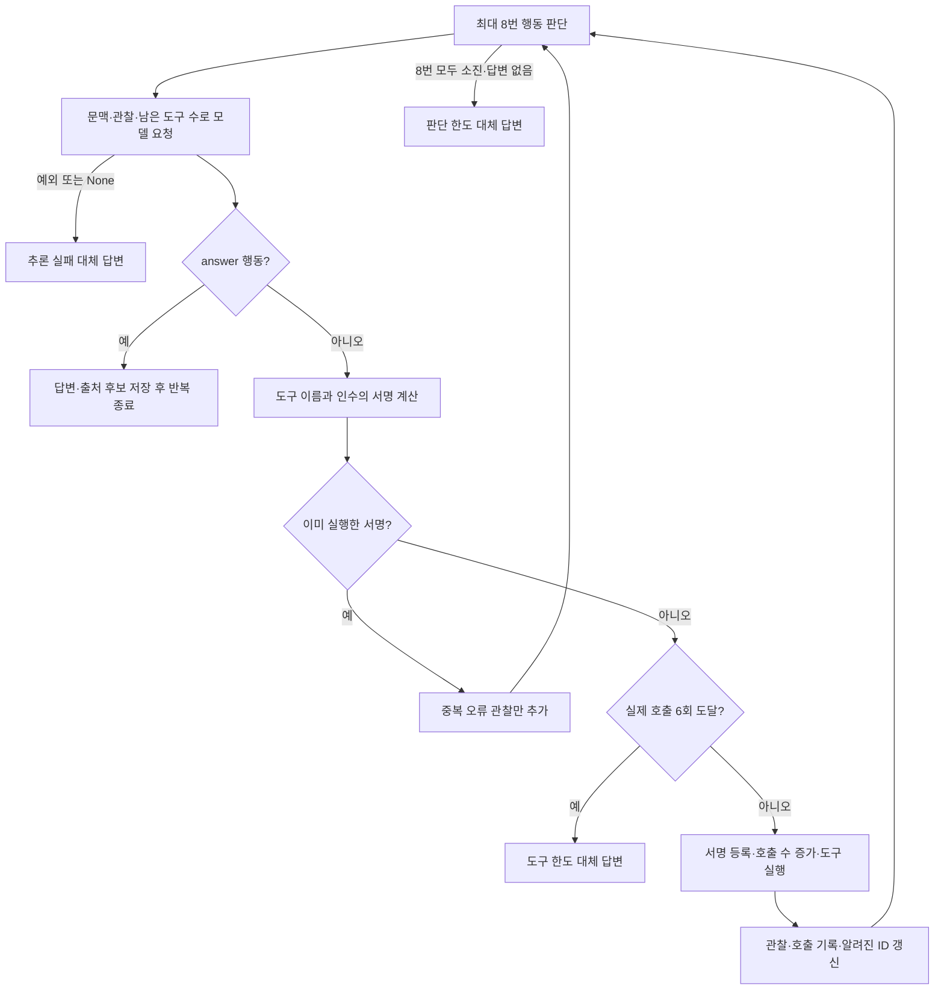
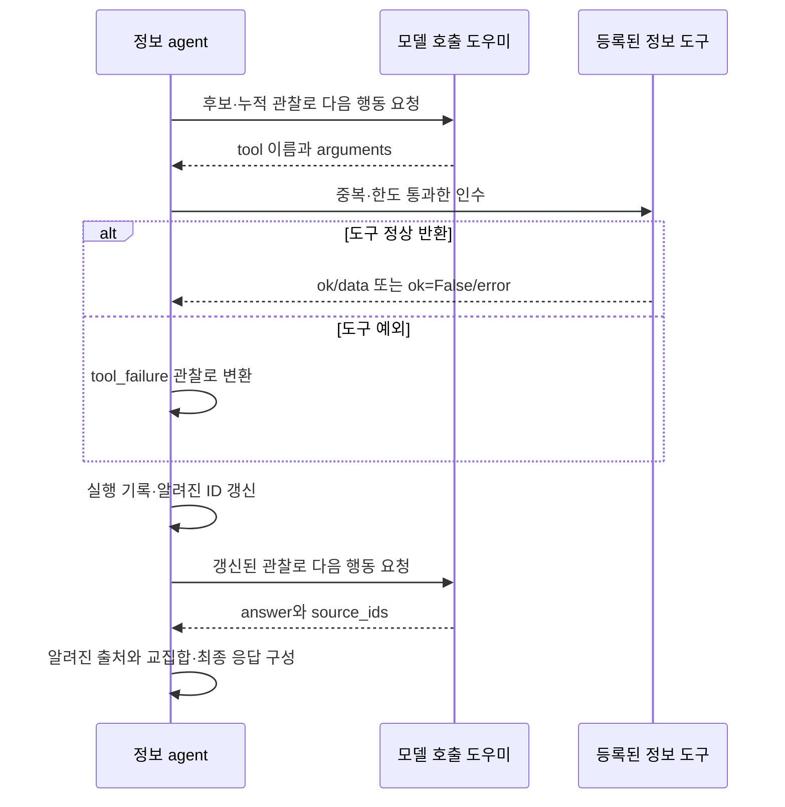
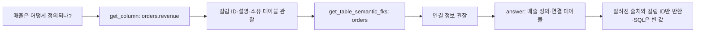

# Chapter 02-1. 정보 응답의 행동 선택·도구 반복과 출처 처리

## 1. 먼저 정의할 개념과 역할

**Information intent(정보 의도)**는 데이터 자체를 계산해 달라는 요청보다 저장된 테이블·컬럼·업무 정의를 설명해 달라는 요청이다. **Catalog**는 그 구조·업무 의미를 보관하는 내부 저장소, **metadata**는 그 설명 정보다. **DB**는 데이터베이스이고 **SQL**은 DB에 조회를 요청하는 언어다. 컬럼은 테이블의 한 항목이다.

**Agent**는 한 역할을 수행하는 처리 객체다. **LLM(대규모 언어 모델)**은 여기서 다음에 정보를 더 조회할지 답변할지를 고른다. **Action(행동)**은 이 선택의 구조화 결과이고 **tool(도구)**은 이름·입력 인수를 정해 둔 조회 함수다. **Observation(관찰 결과)**은 실행한 도구의 반환값을 모델에 다시 보여 주는 기록이다. **프롬프트**는 모델에 보내는 지시·문맥이다.

**State**는 공유 처리 데이터이고 **path_state**는 중간 결과 사전이다. **ID**는 저장 객체 식별자다. **Source ID**는 답변을 뒷받침한다고 모델이 선택한 객체 ID다. **ColumnAttribute**는 컬럼의 업무 의미, **SqlAttribute**는 이름 붙인 SQL 정의, **CustomAnalysis**는 저장된 사용자 분석, **Term**은 업무 개념이다. **Dataset**은 이 장의 초기 문맥에서 선택한 DB 이름을 뜻한다.

**Retriever**는 검색 객체이고 **벡터 검색**은 텍스트를 숫자 표현으로 바꿔 가까운 의미의 문서를 찾는 방식이다. **JSON**은 사전·목록·값을 텍스트로 표현하는 형식이다. **Fallback(대체 동작)**은 정상 처리를 마치지 못했을 때 적용하는 응답이다. **Iteration**은 반복문의 한 번 실행이며 도구 호출 한 번과 같지 않다. 추가 용어는 [용어집](../01-architecture/chapter-00-glossary.md)을 참고한다.

`InformationAgent`는 검색된 후보와 조회 결과를 읽어 설명 답변을 만드는 제한된 반복 실행기다. 그래프에서의 정보 분류는 [Chapter 02](chapter-02-intent-and-information-routing.md)를 따른다. 이 장은 agent 반복·디스패치 경계까지 분석하며, 각 도구의 실제 카탈로그 조회는 [Chapter 02-2](chapter-02-2-information-tools-and-catalog-access.md)에서 별도로 설명한다. 실제 모델·DB·테스트 실행은 하지 않았다.

## 2. 그래프의 진입 위치와 초기 문맥

질문 의도 → 검색 개념 추출 → 후보 검색 뒤 question_type이 information이면 이 agent로 간다. **후보 준비·근거 보정·SQL 생성보다 앞**에서 갈라지고, 정보 agent 다음 연결은 그래프 종료다. InformationAgent.validate_input은 검색용 질문이 비어 있지 않은지만 검사한다. 종류가 information인지 다시 검증하는 함수는 아니다.

`_initial_context`가 모델에 전달하는 정보는 다음과 같다.

| 필드 | 실제 출처·제한 |
|---|---|
| question | get_question_for_processing: normalized_question → 독립 질문 → 제출 질문 |
| entities·subject | 질문에서 추출한 검색 개념 목록·중심 주제 |
| dataset | path_state.target_db |
| extracted_evidence | 의도 단계에서 이번 질문으로부터 분리한 근거 |
| column_attribute_candidates | 컬럼 의미 속성 후보의 앞 12개를 먼저 자른 뒤 표시 가능한 항목만 |
| sql_attribute_candidates | SQL 속성 후보 앞 12개 |
| custom_analysis_candidates | 사용자 분석 후보 앞 12개 |
| subject_candidate | 선택된 주제 Term의 표시 필드 |

여기에는 **최상위 evidence 전체·glossary·domain_rules·sql_examples·기존 messages 전체**를 독립 블록으로 넣지 않는다. 이전 단계가 해석에 사용한 자료와 정보 agent가 실제로 읽는 자료를 구분한다.

`_candidate_view`는 id·name·text·description·database_name·schema_name·table_id·table_name·source_column·term_name·source만 남긴다. 최상위 값이 None 또는 빈 문자열이면 metadata 사전에서 보충한다. score 같은 검색 거리·관련도는 이 표시 목록에 없다. 빈 리스트는 None/빈 문자열과 달라 그대로 남을 수 있다.

후보는 ‘유효한 12개를 찾을 때까지 순회’하지 않는다. 원시 목록 앞 12개를 자른 뒤 비사전·빈 표시를 제외한다. 반면 각 text·description 길이를 따로 자르거나 전체 초기 문맥 문자 수를 제한하지는 않는다.

근거: [초기 문맥·후보 축약](../../../code/auto-ontology/auto_ontology/retrieval/text_to_sql/agents/information_agent.py), [정보 분기와 종료](../../../code/auto-ontology/auto_ontology/retrieval/text_to_sql/text_to_sql_graph.py).

## 3. 행동 모델과 노출된 도구의 계약

`InformationAgentAction`은 다음 둘 중 하나다. 이 모델과 인수 모델은 정의 밖 키를 거부하고 `$` 시작 부가 키를 제거하는 공통 StrictLLMOutputModel을 상속한다.

| action | 필수 | 허용하지 않는 조합 |
|---|---|---|
| tool | 열거된 tool 이름과 arguments 객체 | answer가 None 아닌 값이면 거부. 빈 문자열도 포함 |
| answer | 공백만이 아닌 answer 문자열 | tool 또는 arguments가 None 아닌 값이면 거부 |

source_ids는 두 행동 모두에서 기본 빈 목록이다. source_ids를 도구 행동에 넣는 것을 모델이 따로 금지하지는 않지만, agent는 최종 answer 행동의 source_ids만 최종 출처 후보로 사용한다.

인수 객체에는 database/dataset/schema/table/column/term/attribute 관련 ID·이름과 search·query·labels·skip·limit가 있다. 모든 식별자 인수는 기본 None이며 skip은 0 이상, limit는 1~100이다. **특정 도구에 필요한 ID가 실제로 채워졌는지는 이 공통 인수 모델만으로 보장하지 않는다.** 각 도구가 추가로 검사한다. 생략 인수는 `model_dump(exclude_none=True)`로 호출에서 빠진다.

프롬프트는 13개 이름을 노출한다.

| 이름 묶음 | 모델에게 설명하는 역할 |
|---|---|
| list_databases·list_schemas·list_tables·list_columns | DB에서 컬럼으로 내려가는 구조 목록 |
| get_dataset·get_table·get_column | 대상의 상세·컬럼·관계 문맥 |
| get_table_semantic_fks | 저장된 의미 외래 키 연결. 외래 키는 다른 테이블 키를 참조하는 관계다. |
| list_terms·get_term | 업무 용어 목록·개별 정의 |
| get_column_attribute·get_sql_attribute | 컬럼 의미 또는 SQL 정의 |
| search_semantic_layer | 후보가 부족할 때 업무 의미 벡터 검색 |

위 표는 **프롬프트와 등록 이름의 계약**이다. 실제 반환 필드·조회 범위·개수 제한은 도구별로 달라 Chapter 02-2에서 확인한다. 모델에는 이미 아는 ID·정확한 이름이 있으면 벡터 검색보다 상세 조회를 우선하고, 의미·공식·연결을 설명하며, 모호하거나 없으면 그 사실을 말하라고 지시한다.

프롬프트의 dataset 이름을 범위로 쓰라는 지시는 자동 인수 주입이 아니다. Agent의 호출은 모델이 만든 arguments와 semantic_retriever만 전달하며 target_db를 database_name에 강제로 넣지 않는다. DB 범위를 확정하는 코드는 각 도구에서 따로 확인해야 한다.

근거: [행동·인수 모델·프롬프트](../../../code/auto-ontology/auto_ontology/retrieval/text_to_sql/agents/information_agent.py), [도구 Enum·디스패치](../../../code/auto-ontology/auto_ontology/retrieval/text_to_sql/agents/information_tools.py).

## 4. 반복 횟수·호출 횟수·중복은 각각 센다

Execute는 빈 observations·call_records·seen_calls를 만들고 known_source_ids는 초기 문맥에서 수집한다. known_column_ids는 빈 집합으로 시작한다. **집합**은 중복 없이 항목을 보관하는 자료구조다.

각 반복에서 현재 문맥과 관찰 결과로 프롬프트를 새로 만들고 `state.llm`에 InformationAgentAction을 요청한다. 이전 대화를 messages에 계속 붙여 모델로 보내는 방식이 아니라, **매번 하나의 SystemMessage 안에 누적 관찰을 다시 표시**한다. SystemMessage는 모델 지시를 담는 메시지이며 공통 도우미가 전송 역할을 보정할 수 있다.

중복 **서명(signature)**은 도구 이름과 인수를 키 정렬 JSON으로 만든 문자열이다. 사전 키 순서만 다른 같은 인수는 동일하게 취급하지만 대소문자·표현·목록 순서가 달라지면 의미상 같은 요청이어도 다른 서명이 될 수 있다. 빠뜨린 기본값과 명시한 기본값도 동일하다고 합치지 않는다.

중복이면 도구를 다시 실행하지 않고 duplicate_call 오류를 observations에만 더한다. 실제 호출 수·call_records에는 넣지 않지만 반복 1회는 소비한다. 중복 검사가 6회 한도 검사보다 먼저이므로 도구 한도 이후에도 같은 요청 반복은 판단 횟수를 소모할 수 있다.

실제 새 호출은 실패해도 호출 수를 올리고 서명을 seen_calls에 남긴다. 같은 인수로 실패한 도구를 즉시 재시도하도록 허용하는 구조가 아니다. 다른 인수나 다른 도구는 남은 한도 안에서 가능하다.

6개 도구를 이미 호출했더라도 다음 모델 판단이 answer면 답변을 채택할 수 있다. 다음 행동이 새 도구면 한도 대체 응답으로 끝낸다. MAX_AGENT_ITERATIONS=8은 **모델 판단 루프 수**, MAX_TOOL_CALLS=6은 **실행한 새 도구 수**이며, 공통 모델 호출 내부 재시도까지 포함한 네트워크 요청 수는 아니다. 전체 실행 시간 제한을 이 agent 반복문이 별도로 계산하지도 않는다.

근거: [반복문과 검사 순서](../../../code/auto-ontology/auto_ontology/retrieval/text_to_sql/agents/information_agent.py), [공통 모델 재시도](../../../code/auto-ontology/auto_ontology/utils/llm_invoke.py).

## 5. 관찰 표시 제한과 도구 오류 처리

Observations는 원래 목록에 계속 보관한다. 프롬프트를 만들 때 JSON 문자열로 바꾸고 12,000자를 넘으면 **문자열의 마지막 12,000자**만 남긴 뒤 앞부분 생략 안내를 붙인다. 안내문 길이는 그 제한 밖에 더해진다. 관찰 객체·도구 호출 하나의 경계에 맞춰 자르지는 않으므로 잘린 표시가 완전한 JSON일 보장은 없다.

초기 context에는 이 12,000자 제한을 적용하지 않는다. 메모리의 관찰·ID 집합에서 오래된 자료를 지우는 처리도 아니다. 따라서 잘려 모델에 안 보이는 예전 결과의 ID가 최종 알려진 출처 집합에는 남을 수 있다.

`run_information_tool`은 이름을 Enum으로 해석하고 등록 함수에 인수를 전달한다. 알 수 없는 도구 문자열은 unknown_tool 오류를 반환하지만 정상 행동 모델은 이미 Enum으로 이름을 제한한다. 의미 검색일 때만 semantic_retriever를 전달한다. 그 검색기가 없을 때 상세 ID 조회까지 모두 불가능하다는 뜻은 아니다.

도구 호출 예외는 `{ok: False, error: {code: "tool_failure", message: "예외 타입: 메시지"}}`로 바꾸어 관찰에 넣는다. 반환된 정상 오류도 관찰로 받는다. 도구 오류 한 번으로 agent 전체를 즉시 중단하지 않고, 다음 모델이 다른 조회·오류 설명을 선택할 수 있다.

관찰에는 도구·인수·전체 result가 들어가지만 최종 call_records에는 도구·인수·ok 불리언만 남긴다. 호출 결과가 사전이라는 계약을 믿고 뒤에서 `.get`을 호출하므로, 계약에 어긋난 반환을 모두 같은 도구 예외 분기에서 처리한다고 볼 수는 없다. 프롬프트 구성 등 모델 요청 try 밖의 예외도 공통 agent_wrapper 경계를 따른다.

근거: [관찰 절단·예외·기록](../../../code/auto-ontology/auto_ontology/retrieval/text_to_sql/agents/information_agent.py), [도구 디스패치·검색기 경계](../../../code/auto-ontology/auto_ontology/retrieval/text_to_sql/agents/information_tools.py).

## 6. 알려진 출처만 남기지만 답변 전체를 검증하지는 않는다

`_collect_ids`는 사전·목록을 재귀적으로 읽고 키가 id이거나 `_id`로 끝나는 truthy 값을 문자열 ID로 수집한다. 초기 후보 문맥과 모든 실행 결과가 대상이다. result.ok가 참인 경우만 수집하는 조건은 없다. 이는 문자열·필드명 기반 수집이며 DB에서 해당 객체의 존재·권한·종류를 다시 조회해 인증하는 과정이 아니다.

최종 answer 행동의 source_ids는 원래 순서를 유지하며 중복 제거하고 known_source_ids에 속하는 것만 information_sources에 남긴다. **답변 문장 자체를 이 교집합으로 수정하거나 각 주장과 출처를 대조하지는 않는다.** 알려지지 않은 ID를 전부 제거해도 답변 텍스트는 반환할 수 있다.

`_collect_column_ids`는 column·source_column·foreign_key_column 아래 사전의 id, columns·connected_columns·referencing_columns 안에서 모은 ID를 컬럼 후보로 취급한다. 목록 아래 다른 종류의 `_id`까지 들어 있으면 함께 수집될 수 있는 **필드 구조 기반 판정**이며 엄격한 객체 타입 검사는 아니다.

known_column_ids는 초기 후보에서 만들지 않고 도구 결과에서만 채운다. 모델이 후보에 이미 있던 속성·테이블을 근거로 즉시 답할 수 있어도 sql_columns에 그 ID를 자동으로 넣지는 않는다. 최종 출처 중 known_column_ids에도 있는 ID만 sql_columns로 내보낸다.

| 출력 위치 | 내용 |
|---|---|
| path_state.information_tool_calls | 실제 실행한 호출의 tool·arguments·ok만. 중복·전체 관찰은 없음 |
| information_sources | 모델이 제안한 ID 중 코드가 보았던 ID만 |
| formatted_response | 답변 텍스트 |
| final_response.response | 같은 답변 텍스트 |
| final_response.sql_code | 빈 문자열 |
| final_response.sql_columns | 출처 교집합에 포함된 도구 결과의 컬럼 후보 ID |
| final_response.custom_analyses_used | 빈 목록 |
| final_response.sql_response_from_db | None |
| 최상위 messages | 기존 목록 복사 뒤 AIMessage 답변 추가. AIMessage는 모델 답변 메시지다. |

새 path_state는 기존 값을 펼쳐 만든다. 기존 sql_code·실행 결과 같은 다른 키를 모두 지우는 정리 단계는 아니며, **final_response의 빈 SQL과 기존 path_state의 값은 구별**해야 한다. agent는 decision을 새로 쓰지 않지만 그래프 연결이 고정 END이므로 정상 반환 뒤 다른 생성 단계로 가지 않는다. 전체 재시도 판단도 terminal_node가 구성 불가 응답 노드일 때만 적용하므로 정보 응답의 빈 SQL을 자동 실패로 보지 않는다.

근거: [ID 수집·최종 응답](../../../code/auto-ontology/auto_ontology/retrieval/text_to_sql/agents/information_agent.py), [그래프 종료](../../../code/auto-ontology/auto_ontology/retrieval/text_to_sql/text_to_sql_graph.py), [전체 재시도 시작 조건](../../../code/auto-ontology/auto_ontology/retrieval/text_to_sql/main.py).

## 7. 대체 답변과 작은 실행 예시

모델 예외 또는 None이면 즉시 추론 실패 대체 답변을 만든다. 새 도구 호출이 한도를 넘으면 도구 한도, 반복을 모두 썼는데 답변이 없으면 판단 한도 대체 답변이다. 공통 문구에 원본 데이터를 조회하지 않았다고 적고, 초기 컬럼 의미 후보 앞 5개의 name 또는 text를 덧붙일 수 있다.

대체 답변은 **성공한 도구 관찰 전체를 다시 요약하지 않는다**. 직전에 유용한 조회를 했어도 반복 끝에 모델이 답을 못 내면 그 내용을 활용한 최종 요약 대신 초기 후보 중심 문구가 나온다. 내부 영문 이유가 그대로 사용자 답변에 포함될 수 있다.

다음은 설명용 예시이며 실제 모델 실행 결과가 아니다.

같은 get_column 인수를 두 번 선택하면 두 번째는 조회하지 않는다. 모델이 이 요청만 계속 반복하면 실제 호출은 한 번이어도 8회 판단 한도에서 끝날 수 있다. 따라서 ‘6회 호출을 다 쓰기 전에는 종료하지 않는다’는 해석은 틀리다.

Agent에는 임의 SQL 실행 도구가 없고 connector를 디스패처에 전달하지 않는다. 여기서 직접 저장하는 것은 메모리 응답·호출 기록이다. Catalog 상세와 벡터 검색은 등록된 도구를 통해 읽으며, 의미 검색은 임베딩 모델·벡터 저장소 접근을 포함할 수 있다. **‘원본 데이터 조회 없음’과 ‘모든 외부 호출 없음’은 다르다.** 각 도구가 가져오는 저장 샘플·관계와 권한 범위는 후속 분석에서 확인한다.

## 8. 관련 테스트와 미검증 인계

**Assertion**은 기대 조건 검사, **mock**은 실제 모델·도구를 대신하는 모형이다. [test_information_agent.py](../../../code/auto-ontology/auto_ontology/retrieval/text_to_sql/tests/test_information_agent.py)를 읽어 다음 범위를 확인했다. 실행하지 않았다.

| 테스트 | 확인한 assertion |
|---|---|
| test_agent_uses_multiple_tools_and_emits_terminal_response | 모형 도구 두 번, known 출처 유지, 컬럼 ID 한 개, 빈 SQL·None DB 결과·메시지 답변 |
| test_duplicate_tool_call_is_not_executed_twice | 같은 호출 두 번 선택해도 실제 도구·기록은 한 번 |
| test_llm_failure_returns_safe_non_sql_response | 모델 None일 때 대체 문구·후보 이름·빈 SQL·도구 기록 없음 |
| test_tool_failure_is_observed_and_answered_safely | 도구 예외가 ok=False 호출 기록이 되고 모델이 후속 답변 가능 |
| test_first_prompt_is_grounded_with_candidates | 질문·개념·dataset·속성/테이블 ID와 주요 도구 이름이 첫 프롬프트에 있음 |
| test_semantic_search_tool_receives_state_retriever | 디스패처가 상태의 semantic_retriever를 받음 |
| test_reasoning_limit_stops_repeated_calls | 같은 요청을 계속 골라도 도구는 한 번, 이후 판단 한도 문구 |

마지막 테스트는 반복 호출에서의 8회 종료를 확인하며, **서로 다른 도구 6회 후 일곱 번째 새 호출 차단**을 직접 재현한 사례는 아니다. 관찰 문자열의 중간 절단·대형 초기 후보·출처 조작·컬럼 ID 오분류·과거 path_state 잔존·DB 범위 누락·실제 한국어 답변 품질도 이번에 실행 검증하지 않았다.

Mermaid 3개를 작성했으며 렌더링하지 않았다. 다음 읽을 내용은 [Chapter 02-2](chapter-02-2-information-tools-and-catalog-access.md)의 개별 도구·실제 DAL 함수·ID/이름/DB 범위·개수 제한·오류와 관련 테스트다.
